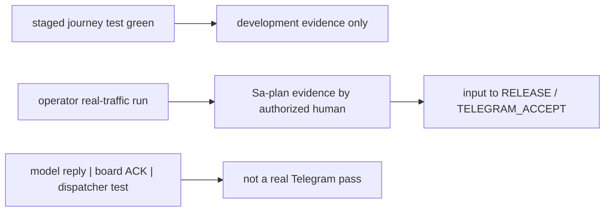

# 20261026-0220 — Telegram journey acceptance rule

#fractal-l0 #fractal-l3 #fractal-l4 #fractal-l5 #fractal-l6 #fractal-l9 #zk-adr #zero-muda #km-triad #tailscale-web

- **Contract ID**: `SC-TELEGRAM-JOURNEY-001`
- **Domain**: Telegram command surface acceptance, operator journeys
- **Authority**: UOS Canonical Policy over the [operator journey contract](http://nas-1.tail55d152.ts.net:4100/files/docs/design/20261026-0210-telegram-operator-journey-contract.md); Sa-plan `uos/telegram-runtime/20261001-1150` COMMAND_IMPL
- **Tailscale FQDN Link**: [http://nas-1.tail55d152.ts.net:4100/files/contracts/rules/20261026-0220-telegram-journey-acceptance.md](http://nas-1.tail55d152.ts.net:4100/files/contracts/rules/20261026-0220-telegram-journey-acceptance.md)
- **Status**: ACTIVE — process rule; grants no authority and no admission

[Cockpit](http://nas-1.tail55d152.ts.net:4100/) · [Skill](http://nas-1.tail55d152.ts.net:4100/files/.claude/skills/uos-telegram-journeys/SKILL.md) · [Wiki guide](http://nas-1.tail55d152.ts.net:4100/docs/wiki/20261026-0220-telegram-journeys-guide.md) · [ZK](http://nas-1.tail55d152.ts.net:4100/zk) · [Wiki](http://nas-1.tail55d152.ts.net:4100/wiki)

Transclusions: `[[zk:20260905-1801-moc-uos-unified-master]]` · `[[wiki:20260905-1801-uos-zk-km-corpus-index]]`

## 1. Invariants

- **INV-TGJ-01 (coverage).** No command family F1–F9 and no catalog literal exists without a journey step in at least one of the three journey specs. The coverage test `telegram_journey_coverage_test` enforces this over all 77 literals.
- **INV-TGJ-02 (staged gate).** The staged journey tests (`telegram_journey_security_test`, `telegram_journey_defence_test`, `telegram_journey_responder_test`, `telegram_journey_coverage_test`) are green at the candidate before any landing that touches the Telegram command surface (`telegram_ingress_guard`, `telegram_read_adapters`, `telegram_action_adapters`, the Telegram service loop).
- **INV-TGJ-03 (real traffic).** Real-traffic journeys are executed and recorded by an authorized human, as Sa-plan evidence, before RELEASE and before TELEGRAM_ACCEPT. A model, agent, board ACK or peer cannot record them.
- **INV-TGJ-04 (no fabricated success).** A journey step expects only `ok`, `preview`, `denied`, `backend_unavailable` or `approval_required`. `executed` and `duplicate` are expected only through the approval flow, never from a plain message. Missing capability is expressed as `backend_unavailable` or `denied`, never as invented success.
- **INV-TGJ-05 (production untouched).** The production bridge is never restarted, reconfigured or reused for a journey. Journeys use the staging bot only; its token lives only in the reviewed private transport configuration, with an allowlisted user and chat.

## 2. Evidence boundary

```text
[staged journey test green] -> [development evidence only]
[operator real-traffic run] -> [Sa-plan evidence by authorized human] -> [input to RELEASE / TELEGRAM_ACCEPT]
[model reply | board ACK | dispatcher test] -> [not a real Telegram pass]
```



## 3. Run

```bash
cd apps/cepaf_gleam && bash -c 'export UOS_ROOT=/home/an/NAS-setup/uos; source $UOS_ROOT/tools/lib/uos-toolchain.sh; uos_env; gleam build --target erlang; PA=(); for d in build/dev/erlang/*/ebin; do PA+=(-pa $d); done; erl -noshell "${PA[@]}" -eval "eunit:test([telegram_journey_security_test,telegram_journey_defence_test,telegram_journey_responder_test,telegram_journey_coverage_test],[verbose]), halt()."'
```

## 4. Limits

This rule is a convention plus the coverage test. Rule presence is not runtime enforcement; it does not prevent a landing that skips the journeys. Journeys prove dispatcher and staged-service behaviour, not a release and not admission. EV ceiling 93; EV-94..109 NOT_ADMITTED; no new EV number is minted.

## Comprehensive verification checklist

This is a process/document package. The entries below do not assert production conformance.
UNRUN and NOT_ADMITTED remain nonpassing; N/A must be justified for each actual change.

<details><summary>Domain 1 — Metadata and navigation</summary>

- [x] CHK-01-TIME — Timestamp prefix recorded (20261026-0220).
- [x] CHK-02-TAIL — Full Tailscale FQDN references provided; live delivery unverified.
- [x] CHK-03-FRACT — L0–L9 applicability tagged.
- [x] CHK-04-KM — Contract, specs, runbooks and wiki guide linked in this package.

</details>
<details><summary>Domain 2 — Zero-Muda and storage safety</summary>

- [ ] CHK-05-MUDA — Fleet dependency exclusion scan UNRUN.
- [ ] CHK-06-GRAPH — Runtime language/NIF conformance UNRUN.
- [ ] CHK-07-DRIVE — OS storage interlock execution UNRUN.

</details>
<details><summary>Domain 3 — Testing and mathematical gates</summary>

- [ ] CHK-08-C1C8 — Full UI categories UNRUN.
- [ ] CHK-09-MATH — Mathematical quality gates UNRUN.
- [ ] CHK-10-9MOD — Nine runtime test modalities UNRUN.
- [ ] CHK-11-REGR — Live UI regression monitoring UNRUN.

</details>
<details><summary>Domain 4 — Cross-language control and observability</summary>

- [ ] CHK-12-GLEAM — Staged journey tests not run by this documentation package; UNRUN.
- [ ] CHK-13-HERMES — Mandatory enforcement NOT_IMPLEMENTED by this package.
- [ ] CHK-14-ZIGVM — Runtime kernel checks UNRUN.
- [ ] CHK-15-MAX — Actual inference checks UNRUN.
- [ ] CHK-16-OTEL — Runtime telemetry correlation UNRUN.

</details>
<details><summary>Domain 5 — Governance and Jujutsu</summary>

- [ ] CHK-17-SOV — Independent review/admission NOT_ADMITTED.
- [x] CHK-18-JJ — No native Git command used; standalone JJ workspace fable-w4 only.

</details>

<details><summary>Domain 6 — Provenance extension</summary>

EV ceiling remains 93. EV-94..109 remain NOT_ADMITTED. No new EV number is minted.
A real-traffic journey pass is recorded by an authorized human in Sa-plan; this package records none.

</details>

**UOS footer:** `nas-1.tail55d152.ts.net:4100` · Sa-plan is the sole execution authority; this rule grants no admission.
