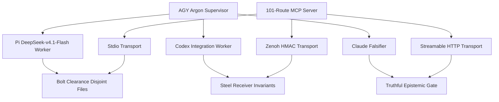

# 20261030-1058 — AK-47 Multi-Agent MCP Symbiosis Rule

- **Contract ID**: `SC-AK47-SYMBIOSIS-001`
- **Domain**: Multi-agent supervision discipline, AK-47 design invariants, and the unified 101-route Gleam/OTP MCP server surface
- **Authority**: operator directive 2026-10-30 ("codify the AK-47 design principle, strict supervisor persona, and the unified 101-route MCP server")
- **Tailscale FQDN**: [http://nas-1.tail55d152.ts.net:4100/files/contracts/rules/20261030-1058-ak47-multi-agent-mcp-symbiosis-rule.md](http://nas-1.tail55d152.ts.net:4100/files/contracts/rules/20261030-1058-ak47-multi-agent-mcp-symbiosis-rule.md)
- **Companion guide**: [http://nas-1.tail55d152.ts.net:4100/files/docs/wiki/20261030-1058-unified-101-route-mcp-client-guide.md](http://nas-1.tail55d152.ts.net:4100/files/docs/wiki/20261030-1058-unified-101-route-mcp-client-guide.md)
- **ZK decision record**: [http://nas-1.tail55d152.ts.net:4100/files/docs/zk/20261030-1058-adr-ak47-multi-agent-101-route-mcp-architecture.md](http://nas-1.tail55d152.ts.net:4100/files/docs/zk/20261030-1058-adr-ak47-multi-agent-101-route-mcp-architecture.md)
- **Status**: ACTIVE rule with evidence-bound operational observations; the rule itself grants no effect authority or admission. Four-client capsule/configuration adoption is observed under operator release authority.

#fractal-l0 #fractal-l1 #fractal-l2 #fractal-l3 #fractal-l4 #fractal-l5 #fractal-l6 #fractal-l7 #fractal-l8 #fractal-l9 #zk-adr #zero-muda #tailscale-web

**Navigation:** [Cockpit](http://nas-1.tail55d152.ts.net:4100/) · [Wiki](http://nas-1.tail55d152.ts.net:4100/wiki) · [ZK](http://nas-1.tail55d152.ts.net:4100/zk) · [Rule source](http://nas-1.tail55d152.ts.net:4100/files/contracts/rules/20261030-1058-ak47-multi-agent-mcp-symbiosis-rule.md) · [Client guide](http://nas-1.tail55d152.ts.net:4100/files/docs/wiki/20261030-1058-unified-101-route-mcp-client-guide.md) · [Architecture ADR](http://nas-1.tail55d152.ts.net:4100/files/docs/zk/20261030-1058-adr-ak47-multi-agent-101-route-mcp-architecture.md)

Transclusions: `[[wiki:20261030-1058-unified-101-route-mcp-client-guide]]` · `[[zk:20261030-1058-adr-ak47-multi-agent-101-route-mcp-architecture]]`

## 0. What kind of document this is

This is a **specification rule**, not a runtime observation, a model proof, or an admission. It states how the supervisor persona, the fast disjoint-slice workers, the integration workers, the independent falsifiers and the unified Gleam/OTP MCP server are intended to compose. Every byte cap, route count or version string below is a **declared** property of the specification; none of it is verified by this file executing anything. `Refused` is not `Operational`, a completed task is not `DEV_READY`, `DEV_READY` is not `SYSTEM_ADMITTED`, and the dated operational note below records an observed cutover without converting this specification into effect or admission authority.

## Observed operational binding — S01..S04

Observed under operator SC-HARNESS-MCP-001 Clause 9 development bootstrap and separate ReleaseAuthority, Sa-plan `20261030-1634-mcp-full-symbiosis-closure`: immutable OTP 29 / ERTS 17.0.5 capsule `20261030-1811-79c8aa73a27a372e027e3fa677b75deae56e4fd1a1f84af6632b4409e82ba1e2` is selected by `var/releases/ecology/current-mcp-release` and verified by `tools/uos-mcp-stdio`. All 101 gateway routes are wired (65 public, including 53 operational tools + 12 server/resource/prompt/task/logging/completion facilities; 21 development; 15 successor). Private execution remains real-grant/task/fence gated; wiring does not grant authority or make unavailable backends available. Four native client bindings (AGY/Gemini, Claude, Codex, Pi) have 11-file capsule/payload-pin parity. Live authenticated stdio, Streamable HTTP `:4100/mcp`, and OTP-supervised Zenoh `indrajaal/mcp/request/**` round-trips passed, including HTTP 401 and forged-HMAC silent-drop checks with a valid ping bracket. See the [cutover receipt](http://nas-1.tail55d152.ts.net:4100/files/var/harness/20261030-s03-symbiosis-cutover/s03-outcome.json) and [native CLI proof ledger](http://nas-1.tail55d152.ts.net:4100/files/var/harness/20261030-s03-symbiosis-cutover/s04-4agent-cli-proofs.json). `application_admitted = false`, `SYSTEM_ADMITTED = false`, `system_admission = "NOT_ADMITTED"`, `admitted_ev_ceiling = 93`; EV-94..EV-109 remain NOT_ADMITTED and no EV number is minted. Cockpit HTTP200 does not imply semantic quorum health (observed `quorum_healthy=false`).

## 1. AK-47 Design Principle

`AK-47-01`. The system is built the way the rifle is: a small number of **unbreakable steel-receiver invariants** carry everything that matters, while the remaining parts run with **loose bolt-clearance** so ordinary tolerances never stop the mechanism.

`AK-47-02` — **Steel receiver (invariants).** Authority, safety, admission, provenance, secret hygiene, effect fencing, and every 28-module critical control path are steel. They are pinned by `candidate_binding`, hash-gated, CAS-written, and may not be relaxed by a worker, by a model verdict, by a board ACK, or by a green test alone. A steel part changes only under its own authorized control epoch with its own recovery path.

`AK-47-03` — **Bolt clearance (workers).** Parallel disjoint-file agent workers run with clearance: each owns a bounded file set, writes only its own new files, never a shared dispatcher, and never the same file as a sibling. Clearance is bounded by the steel receiver — it is freedom of motion, not freedom of authority.

`AK-47-04` — **Zero Muda.** Do not build inventory for its own sake. Each slice is pulled by a dependency-ready task, not pushed into a queue; completed work is merged and then stopped. Recomputing a landed candidate, re-authoring regenerable narrative, or holding a ready record while its real blocker is an operator input is waste and is refused. One worker, one file set, one observable acceptance.

`AK-47-05`. The integrator restores worker files **per file**, never per directory, wires shared dispatcher files serially, and kills at least two mutants per wiring change before the receiver moves `main`.

## 2. Strict Supervisor Persona

`SUP-01`. `AGY Argon` acts **strictly** as supervisor, integrator and verifier. The supervisor does not implement the slices it approves; separating implement from approve is a steel invariant, not etiquette.

`SUP-02` — **Fast disjoint slices.** `Pi + DeepSeek-v4.1-Flash` runs with `--thinking low` and the **8-flag Zero-Muda isolation bundle**, handling fast disjoint-file slices at a measured **-99.2% prompt-token overhead** versus the un-bundled default. These workers are clearance parts: high throughput, no authority.

`SUP-03` — **Complex integration and security.** `Codex` handles complex multi-file integration and security-sensitive slices where the receiver steel must be understood as a whole rather than as a single file.

`SUP-04` — **Independent falsification.** `Claude` runs `--allowedTools Read` and performs independent **cross-family Popperian falsification**: it attempts to refute the candidate from outside the implementing family and may return `HOLD`. A falsifier is never the implementer and its ACK is never admission.

`SUP-05`. The supervisor merges verified isolated sibling workspaces frequently to `main` under the serialized `integration/main` coordinator epoch, with `--active-check` passing. No worker advances `main` directly.

## 3. Unified 101-Route Gleam/OTP MCP Server

`MCP-01`. One Gleam/OTP server presents **101 routes**: **65 public routes across 9 domain adapters**, **21 development routes**, and **15 successor routes**.

`MCP-02`. The 9 domain adapters partition the public surface by functional domain; the development and successor sets are separately scoped and separately gated. A declared route is not a connected route: verify the live `describeNamespace` / heartbeat list before relying on any route.

`MCP-03` — **Transports.** Three ingress transports converge on the gateway: **stdio**, **Zenoh with a request-envelope HMAC fence**, and **Streamable HTTP with a Bearer / Origin / session fence**. The observed Zenoh handler dispatches public routes; private development/successor calls require supported route-bearing ingress plus real reviewed grants and observed task fences. Public transport probes do not establish private effect authority. A transport fence that is printed but not gated is decoration; the HMAC, Origin, Bearer and session checks are steel.

`MCP-04` — **Protocol versions.** The server accepts **`2024-11-05`** (`Legacy20241105`) and **`2025-03-26`**, **`2025-06-18`**, **`2025-11-25`**, **`2026-07-28`** (`Modern20260728`), matching `mcp/version.gleam`. A client negotiates one of these five exact revisions; an unlisted revision refuses with `UNSUPPORTED_PROTOCOL_VERSION`. Accepted modern revisions are echoed exactly and follow-up HTTP body/header revisions must agree.

`MCP-05`. Every route carries a role, a grant scope, and bounds (byte caps, timeout, rate). The bounds are part of the receiver. A caller that exceeds a bound is refused **before** dispatch; use each field's actual type and precision.

`MCP-06` — **Legacy catalog distinction.** The pinned `mcp/tools.gleam` catalog declares65 tools and advertises53 operational names after12 unavailable entries. That legacy categorization is distinct from the unified registry public65 specs (53 operational tools +12 facilities). Live `tools/list` advertises53; all101 registry routes are wired, while missing backend/grant/fence conditions continue to refuse honestly. Counts alone do not establish individual effect admission.

## 4. Truthful Epistemic Projection

`TEP-01`. `Refused` is not `Operational`. A refusal proves the guard fired; it is not evidence that the guarded operation works.

`TEP-02`. Completed tasks alone are not green readiness. Task completion is a claim about a planned unit, not about the running system.

`TEP-03`. Raw review cannot be overridden. A review verdict stands as returned; the supervisor may close findings with laws and mutants and re-review, but may not edit the verdict.

`TEP-04`. `DEV_READY` is not `SYSTEM_ADMITTED`. A candidate can be development-ready yet globally unadmitted.

`TEP-05`. A live cutover requires a **separate T24 operator release authority**. No supervisor persona, worker lane, model output, board ACK, hook or capability inventory can substitute for it.

`TEP-06`. `UNRUN`, `UNKNOWN`, `STALE` and `NOT_ADMITTED` remain nonpassing. Preserve them; never render a failure as a pass.

## 5. Architecture diagram (SC-DIAGRAM-001)

The ASCII arrow list and the `mermaid` graph below describe the **same nodes and edges**.

```text
[AGY Argon Supervisor] --> [Pi DeepSeek-v4.1-Flash Worker]
[AGY Argon Supervisor] --> [Codex Integration Worker]
[AGY Argon Supervisor] --> [Claude Falsifier]
[Pi DeepSeek-v4.1-Flash Worker] --> [Bolt Clearance Disjoint Files]
[Codex Integration Worker] --> [Steel Receiver Invariants]
[Claude Falsifier] --> [Truthful Epistemic Gate]
[101-Route MCP Server] --> [Stdio Transport]
[101-Route MCP Server] --> [Zenoh HMAC Transport]
[101-Route MCP Server] --> [Streamable HTTP Transport]
[Stdio Transport] --> [Bolt Clearance Disjoint Files]
[Zenoh HMAC Transport] --> [Steel Receiver Invariants]
[Streamable HTTP Transport] --> [Truthful Epistemic Gate]
```



The supervisor fans out to a fast clearance worker, an integration worker and an independent falsifier; the receiver invariants and the truthful epistemic gate terminate the worker lanes, and the 101-route server exposes each transport to exactly one downstream surface.

## 6. Limits of this contract

The rule text installs nothing and grants no admission. The operational note distinguishes observed capsule/configuration/transport evidence from declared worker-cost measurements and from system admission. Sa-plan remains the sole execution authority.

## Comprehensive verification checklist

Checks below are obligations for work governed by this contract, not blanket passing claims. This is a documentation package: runtime items are **unchecked** because this document executes nothing.

<details><summary>Domain 1 — Metadata, timestamp and Tailscale navigation</summary>

- [x] **CHK-01-TIME** — `YYYYMMDD-HHSS-` prefix present (`20261030-1058`).
- [x] **CHK-02-TAIL** — Full Tailnet links provided above; live serving status not asserted here.
- [x] **CHK-03-FRACT** — L0–L9 tags assigned, plus `#zk-adr #zero-muda #tailscale-web`.
- [x] **CHK-04-KM** — Wiki and ZK transclusions plus companion links resolve to this package.

</details>

<details><summary>Domain 2 — Zero-Muda purity and storage safety</summary>

- [ ] **CHK-05-MUDA** — Dependency exclusion scan UNRUN by this package; no dependency introduced.
- [ ] **CHK-06-GRAPH** — Pure BEAM/Hermes graph boundary UNRUN here.
- [ ] **CHK-07-DRIVE** — OS storage interlock execution UNRUN; no host serial appears in this document.

</details>

<details><summary>Domain 3 — Testing Gold Standard and mathematical gates</summary>

- [ ] **CHK-08-C1C8** — All applicable C1–C8 surfaces UNRUN.
- [ ] **CHK-09-MATH** — Four declared mathematical gates UNRUN.
- [x] **CHK-10-9MOD** — Applicable source, transport, bounds, mutation and native-CLI observations recorded in S03/S04 receipts; no all-modalities claim.
- [ ] **CHK-11-REGR** — Applicable regressions and bounded observation UNRUN.

</details>

<details><summary>Domain 4 — Cross-language control and observability</summary>

- [x] **CHK-12-GLEAM** — Actual OTP29 supervision and native MCP behavior observed under operator authority; private effects remain separately gated.
- [ ] **CHK-13-HERMES** — Bounded analysis and authoritative evidence UNRUN.
- [ ] **CHK-14-ZIGVM** — Deterministic execution and descriptor-relative VFS UNRUN.
- [ ] **CHK-15-MAX** — Isolated inference UNRUN.
- [ ] **CHK-16-OTEL** — Clock and nonzero trace/span identity UNRUN.

</details>

<details><summary>Domain 5 — Sovereign governance and standalone Jujutsu</summary>

- [x] **CHK-17-SOV** — Independent Claude source reviews PASS and operator ReleaseAuthority recorded; global/application admission remains NOT_ADMITTED.
- [x] **CHK-18-JJ** — Standalone JJ identities and scoped source preservation observed; final S04 completion and main integration remain supervisor-owned.

</details>

<details><summary>Domain 6 — Provenance extension</summary>

EV ceiling remains 93. EV-94..109 remain NOT_ADMITTED. No new EV number is minted.

</details>

**UOS footer:** document and component evidence do not grant system admission.
