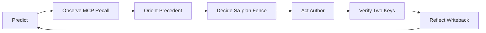

# 20261031-1127 — UOS KM triad brain memory

#fractal-l0 #fractal-l1 #fractal-l2 #fractal-l3 #fractal-l4 #fractal-l5 #fractal-l6 #fractal-l7 #fractal-l8 #fractal-l9 #km-triad #zk-adr #zero-muda

**SC-MCP-KM-BRAIN-001 — Mandatory 7-Stage POODAVR #km-triad Brain-Memory Loop for AGY, Codex, Claude & Pi**, aligned with Rete Guard **GR-070**. This is active process guidance; registration and a guard reference do not establish runtime enforcement or admission.

[Self](http://nas-1.tail55d152.ts.net:4100/files/.agents/skills/uos-km-triad-brain-memory/SKILL.md) · [Canonical policy](http://nas-1.tail55d152.ts.net:4100/files/AGENTS.md) · [KM triad](http://nas-1.tail55d152.ts.net:4100/km) · [KM catalog](http://nas-1.tail55d152.ts.net:4100/api/v1/km/catalog) · [Fractal system prompt](http://nas-1.tail55d152.ts.net:4100/files/docs/sop/20261031-1012-uos-canonical-fractal-system-prompt.md).

## Authority and supersession

This UOS-local adapter supersedes stale external `/home/an/dev/ver/c3i/.../fy27-zettelkasten`, `sa-plan-daemon` and `zigvm_harness.exe` command recipes in the imported `zk-recall`, `zk-learn` and `living-ontology` skills. Those imported originals remain read-only evidence under AGENTS.md §3; do not edit or execute their stale recipes. Use the `uos-gleam` MCP harness and canonical Sa-plan authority. A failed or unavailable gate requires evidence repair through the authorized path, never an external-command fallback.

## PREDICT & OBSERVE — Pre-operation MCP recall gate

Before planning, claiming a Sa-plan task, editing or reviewing:

1. **PREDICT:** State the expected relevant precedents, evidence age and falsifier for this operation. Keep the active scope, permission and token budget explicit.
2. **OBSERVE:** Through `uos-gleam` MCP, `read_resource` with URI `uos://km/triad`. Alternatively, inspect `system_health` or `ooda_decide` and require both `km_brain_memory_status == "healthy"` and `km_canonical_triad_intact == "true"`. Missing fields or degraded state are not a passing recall gate.
3. Call `knowledge_search` with the relevant query and `limit: 5`, then `zk_transclude` with a relevant ADR query and bounded limit. Recall ADRs, Wiki architecture pages, SOPs and prior SC-JOURNAL-v3 RCA/anti-patterns. Use query mode for ranked excerpts; explicit `key` transclusion is a deliberate document expansion.
4. Retrieve only the top 1–2 documents needed with `read_file` or `read_resource` at `uos://docs/<rel_path>` using each returned `resource_uri`. Preserve **SUP-01**: search snippets are at most 2400 graphemes, retain header metadata and a matching passage, and expose `truncated`, full `bytes`, `tailscale_url` and `resource_uri`. A truncated excerpt is not the full evidence document. If the connected schema lacks an argument or resource, record the capability gap; do not invent a successful call.

`kms_catalog` is cryptographic **Key Management Service**, NOT the knowledge corpus. For KM use `uos://km/triad` or [the KM catalog](http://nas-1.tail55d152.ts.net:4100/api/v1/km/catalog).

## ORIENT & DECIDE — Precedent and provenance binding

3. **ORIENT:** Record recalled `[[zk:ADR-...]]` and `[[wiki:...]]` paths, candidate identity, evidence age, uncertainty and counterexamples. Bind them into the Sa-plan task scope and SC-RISK-PRIORITY-001 `evidence_refs` / `counterevidence` through the authorized planning interface.
4. **DECIDE:** Apply safety and dependency readiness before risk ranking. Run the applicable risk `--preflight` before claim and `--active-check` with the current worker/attempt during execution. Sa-plan alone owns task execution; recall, scores and board ACKs grant no effect authority.

Strictly retain `admitted_ev_ceiling = 93`. **EV-94..109 and ADR-071..086 are NOT_ADMITTED and must be refused as admission evidence.** Preserve historical records and quarantine caveats. Mint no new EV numbers.

## ACT & VERIFY — Authoring and two-key gate

5. **ACT:** Every generated or updated Markdown document carries the canonical `YYYYMMDD-HHSS-` timestamp prefix, full clickable `http://nas-1.tail55d152.ts.net:4100/...` links, the applicable `#fractal-l0`..`#fractal-l9` tags plus `#km-triad` and `#zero-muda`, `[[zk:...]]` references and two-way `[[wiki:...]]` transclusions. Preserve fixed agent/skill discovery filenames and timestamp their document headings/updates. Maintain the six-domain checklist with all 18 core checkpoints and the provenance extension.
6. **VERIFY:** Bind fresh observed behavior and machine-verifiable specification to the same candidate revision. Explanatory diagrams require matching editable ASCII and Mermaid source under **SC-DIAGRAM-001**. Use bracketed ASCII endpoints and identical Mermaid node labels, with zero parentheses inside labels, so `tools/diagram-check` can compare edges and report `verified`. Never infer passing status from an exit code while UNVERIFIED diagrams remain.

## REFLECT — Mandatory writeback and live Tailnet proof

7. **REFLECT:** Register new/changed documents and reciprocal links in all four locations:

   - [Wiki corpus index](http://nas-1.tail55d152.ts.net:4100/files/docs/wiki/20260905-1801-uos-zk-km-corpus-index.md): `[[wiki:20260905-1801-uos-zk-km-corpus-index]]`.
   - [ZK master MOC](http://nas-1.tail55d152.ts.net:4100/files/docs/zk/20260905-1801-moc-uos-unified-master.md): `[[zk:20260905-1801-moc-uos-unified-master]]`.
   - [Capability inventory](http://nas-1.tail55d152.ts.net:4100/files/governance/capability-inventory/wiki-zk-km.toml).
   - The task's 13-section **SC-JOURNAL-v3** journal, including RCA, anti-patterns, raw FMEA, all four UCA types, evidence receipts and residual gaps. For this slice: [T01 journal](http://nas-1.tail55d152.ts.net:4100/files/docs/journal/20261031-1151-t01-always-fresh-km-and-verifiers-journal.md), `[[wiki:20261031-1151-t01-always-fresh-km-and-verifiers-journal]]`.

Verify through the admitted harness path using these repository checks:

```sh
bash tools/km-gate --gate
bash tools/diagram-check <changed-markdown-paths>
bash tools/journal-check <task-journal-path>
tools/link_tracker_verifier.exe --host nas-1.tail55d152.ts.net --port 4100
```

Then repeat live `uos-gleam` MCP `knowledge_search` and `read_resource` after the authorized deployment to prove zero staleness: newly written bytes are visible immediately, changed bytes replace prior content, and removed content is no longer returned. Compare candidate/path/digest evidence. Development fixtures, local disk registration and an old capsule response do not prove Tailnet delivery. Independent Claude acceptance, main merge and live capsule cutover remain separately authorized gates.

## Editable recall-to-writeback topology

```ascii
[Predict] --> [Observe MCP Recall]
[Observe MCP Recall] --> [Orient Precedent]
[Orient Precedent] --> [Decide Sa-plan Fence]
[Decide Sa-plan Fence] --> [Act Author]
[Act Author] --> [Verify Two Keys]
[Verify Two Keys] --> [Reflect Writeback]
[Reflect Writeback] --> [Predict]
```



## Comprehensive verification checklist

The checklist records obligations; unchecked items remain UNRUN at fleet scope.

<details><summary>Domain 1 — Metadata, timestamp and navigation</summary>

- [ ] CHK-01-TIME — Observe synchronized host time and timestamp prefixes.
- [ ] CHK-02-TAIL — Verify full Tailnet links and live delivery.
- [ ] CHK-03-FRACT — Bind relevant L0–L9 layers.
- [ ] CHK-04-KM — Reconcile reciprocal wiki, ZK, inventory and journal references.

</details>
<details><summary>Domain 2 — Zero-Muda purity and storage safety</summary>

- [ ] CHK-05-MUDA — Verify excluded dependencies remain absent.
- [ ] CHK-06-GRAPH — Preserve pure Gleam/OTP and Hermes graph boundaries.
- [ ] CHK-07-DRIVE — Preserve OS storage interlocks and source exclusions.

</details>
<details><summary>Domain 3 — Tests and mathematical gates</summary>

- [ ] CHK-08-C1C8 — Run applicable UI categories.
- [ ] CHK-09-MATH — Bind four mathematical gates to the candidate.
- [ ] CHK-10-9MOD — Record applicable testing modalities and unrun gaps.
- [ ] CHK-11-REGR — Verify ranking, excerpt limits and fresh recall regressions.

</details>
<details><summary>Domain 4 — Cross-language control and observability</summary>

- [ ] CHK-12-GLEAM — Observe real OTP harness control.
- [ ] CHK-13-HERMES — Bind bounded formal/evidence checks.
- [ ] CHK-14-ZIGVM — Verify deterministic kernel behavior when affected.
- [ ] CHK-15-MAX — Verify isolated inference when affected.
- [ ] CHK-16-OTEL — Record observed clock and trace identity.

</details>
<details><summary>Domain 5 — Sovereign governance and Jujutsu</summary>

- [ ] CHK-17-SOV — Obtain independent candidate-bound acceptance and effect authority.
- [ ] CHK-18-JJ — Verify standalone JJ scope and candidate diff.

</details>
<details><summary>Domain 6 — Provenance extension</summary>

EV-93 ceiling; EV-94..109 / ADR-071..086 NOT_ADMITTED. No new EV number or blanket admission claim.

</details>

[Previous: fractal prompt](http://nas-1.tail55d152.ts.net:4100/files/docs/sop/20261031-1012-uos-canonical-fractal-system-prompt.md) · [Wiki](http://nas-1.tail55d152.ts.net:4100/wiki) · [ZK](http://nas-1.tail55d152.ts.net:4100/zk) · [Cockpit](http://nas-1.tail55d152.ts.net:4100/) · [Next: T01 evidence](http://nas-1.tail55d152.ts.net:4100/files/docs/journal/20261031-1151-t01-always-fresh-km-and-verifiers-journal.md).

UOS footer: process guidance and development evidence confer no runtime deployment or system admission.
