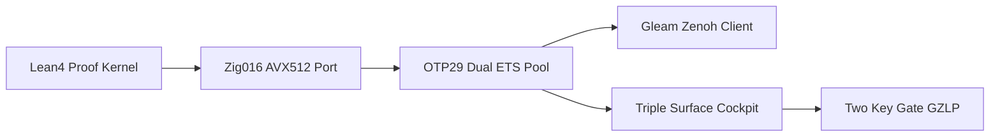

# 20261101-1410 — UOS-ZLP-v3 Supervised Lean 4 + Zig + OTP 29 + Zenoh Port Hyperplane Skill

#fractal-l0 #fractal-l1 #fractal-l2 #fractal-l3 #fractal-l4 #fractal-l5 #fractal-l6 #fractal-l7 #fractal-l8 #fractal-l9 #km-triad #zk-adr #zero-muda #tailscale-web

**Governing Contracts**: [SC-ZLP-PORT-001](http://nas-1.tail55d152.ts.net:4100/files/contracts/rules/20261101-1410-zlp-hyperplane-port-contract.md) · [SC-HARNESS-MCP-001](http://nas-1.tail55d152.ts.net:4100/files/contracts/rules/20260909-0412-gleam-harness-agent-operation-contract.md) · [SC-MCP-KM-BRAIN-001](http://nas-1.tail55d152.ts.net:4100/files/.agents/skills/uos-km-triad-brain-memory/SKILL.md) · [SC-PROVENANCE-001](http://nas-1.tail55d152.ts.net:4100/files/contracts/rules/20260908-0912-provenance-integrity-contract.md).

[Self](http://nas-1.tail55d152.ts.net:4100/files/.agents/skills/uos-zlp-hyperplane/SKILL.md) · [ZLP Cockpit](http://nas-1.tail55d152.ts.net:4100/zlp) · [Design Spec](http://nas-1.tail55d152.ts.net:4100/files/docs/design/20261101-1225-uos-zlp-v3-lean4-zig-otp29-zenoh-hyperplane-spec.md) · [Wiki Guide](http://nas-1.tail55d152.ts.net:4100/files/docs/wiki/20261101-1248-uos-zlp-v3-supervised-lean4-zig-otp29-zenoh-hyperplane.md) · [ZK Decision](http://nas-1.tail55d152.ts.net:4100/files/docs/zk/20261101-1248-zlp-v3-supervised-otp29-port-hyperplane-decision.md) · [Operations SOP](http://nas-1.tail55d152.ts.net:4100/files/docs/sop/20261101-1248-uos-zlp-v3-hyperplane-operations-and-verification-sop.md).

## When to Use This Skill

Activate `uos-zlp-hyperplane` whenever AGY, Codex, Claude, or Pi needs to:
1. Add or modify mechanized `Lean 4.33.0` theorems and `@[export]` C-ABI verification/scoring kernels in [formal/lean/UosZlpHyperplane.lean](http://nas-1.tail55d152.ts.net:4100/files/formal/lean/UosZlpHyperplane.lean).
2. Rebuild or benchmark the `Zig 0.16.0` Zen 5 AVX-512 + Perceus FBIP Two-Lane OTP 29 port worker (`var/zlp/uos_zlp_v3_port`).
3. Subscribe to live Zenoh SSE streams or publish/query Zenoh topics from Gleam via `cepaf_gleam/zenoh/client` (`open_zlp/1`, `open_prefer_zlp/1`, `subscribe/3`) or `cepaf_gleam/mcp/transports/zlp_hyperplane`.
4. Inspect or extend the Triple-Surface observability stack (`/zlp` Lustre HTML cockpit, `/api/v1/zlp/*` Wisp JSON routes, `zlp_view.gleam` ANSI TUI, and `bash tools/uos-cli zlp-check`).

## Non-Negotiable Architecture Rules (`SC-ZLP-PORT-001`)

- **Never link `libleanshared.so` as an in-process BEAM NIF**: Always run Lean + Zig inside the OS-isolated OTP 29 port pool (`uos_zlp_sup` -> `uos_zlp_shard`) with `{packet, 4}`, `{parallelism, true}`, `PR_SET_PDEATHSIG(SIGTERM)`, and stdin `EOF` exit.
- **Gleam owns all policy and effect authority (`SC-HARNESS-MCP-001`, Theorem `T10`)**: ZLP kernels advise, verify, score, and veto; they never bypass Gleam `SignedZenohEnvelope` authentication or `Sa-plan` fencing.
- **Zero `sorryAx`**: Every theorem in `formal/lean/UosZlpHyperplane.lean` must pass `#print axioms` with zero `sorryAx`.
- **Zero Drift on Protected & Census-Pinned Modules**: Do not mutate `harness/*`, `uos_sup.gleam`, `mcp/tools.gleam`, `mcp/protocol.gleam`, or `apps/cepaf_gleam/manifest.toml` without an explicit operator census-pin update task.

## Workflow & Canonical Commands

### 1. Pre-Flight Recall & Fencing
1. Read `uos://km/triad` and run `knowledge_search` (`query: "UOS-ZLP-v3 hyperplane"`) via `uos-gleam` MCP (`SC-MCP-KM-BRAIN-001`).
2. Claim task through `./tools/sa-plan` after `bash tools/risk-priority-check --preflight` passes, and work inside a standalone Jujutsu sibling workspace (`.uos-workspaces/*`).

### 2. Build Native Port & Run Two-Key Verification (`G-ZLP`)
```bash
source /home/an/NAS-setup/uos/tools/lib/uos-toolchain.sh && uos_env
bash native/zlp/build_zlp_port.sh
bash tools/uos-cli zlp-check
bash tools/uos-cli gate G-ZLP
```

### 3. Gleam Client & Transport Usage
```gleam
import cepaf_gleam/mcp/transports/zlp_hyperplane
import cepaf_gleam/zenoh/client as zenoh_client
import gleam/erlang/process

pub fn connect_and_subscribe() {
  // Automatically starts the 4-shard OTP 29 port pool if var/zlp/uos_zlp_v3_port is built
  use session <- result.try(zenoh_client.open_prefer_zlp("{}"))
  case zenoh_client.supports_subscriptions(session) {
    True -> zenoh_client.subscribe(session, "uos/telemetry/**", process.self())
    False -> Ok(Nil)
  }
}
```

### 4. Triple-Surface Inspection Endpoints
- **Browser Lustre Cockpit**: `http://nas-1.tail55d152.ts.net:4100/zlp` (`cepaf_gleam/ui/lustre/zlp_cockpit.view()`)
- **Runtime Shard & Pool JSON**: `http://nas-1.tail55d152.ts.net:4100/api/v1/zlp/status` (`& /api/zlp/health`)
- **21-Theorem & 8 C-ABI Export JSON**: `http://nas-1.tail55d152.ts.net:4100/api/v1/zlp/theorems`
- **Two-Lane Zen 5 Architecture JSON**: `http://nas-1.tail55d152.ts.net:4100/api/v1/zlp/lanes`
- **Terminal ANSI TUI**: `cepaf_gleam/ui/tui/zlp_view.render()`

## Editable Hyperplane Workflow Topology (`SC-DIAGRAM-001`)

```ascii
[Lean4 Proof Kernel] --> [Zig016 AVX512 Port]
[Zig016 AVX512 Port] --> [OTP29 Dual ETS Pool]
[OTP29 Dual ETS Pool] --> [Gleam Zenoh Client]
[OTP29 Dual ETS Pool] --> [Triple Surface Cockpit]
[Triple Surface Cockpit] --> [Two Key Gate GZLP]
```



## Comprehensive Verification Checklist (`SC-CHECKLIST-001`)

Checks below record obligations; unchecked items remain `UNRUN` at fleet scope.

<details>
<summary>Domain 1 — Metadata, timestamp and Tailscale navigation</summary>

- [ ] **CHK-01-TIME** — Observe synchronized host clock and `YYYYMMDD-HHSS-` headings.
- [ ] **CHK-02-TAIL** — Verify full clickable `http://nas-1.tail55d152.ts.net:4100/...` links.
- [ ] **CHK-03-FRACT** — Bind L0–L9 fractal layer tags.
- [ ] **CHK-04-KM** — Reconcile skill, contract, spec, wiki, ZK, SOP, and journal links.

</details>

<details>
<summary>Domain 2 — Zero-Muda purity and storage safety</summary>

- [ ] **CHK-05-MUDA** — Verify zero Bevy and zero Graphite dependencies.
- [ ] **CHK-06-GRAPH** — Preserve pure BEAM/Hermes/Lean boundaries.
- [ ] **CHK-07-DRIVE** — Preserve denied host OS NVMe serial interlock.

</details>

<details>
<summary>Domain 3 — Testing Gold Standard and mathematical gates</summary>

- [ ] **CHK-08-C1C8** — Verify Lustre/Wisp/TUI cockpit rendering and XSS escaping (`zlp_cockpit_test`).
- [ ] **CHK-09-MATH** — Verify 21 zero-`sorryAx` Lean 4.33.0 theorems via `#print axioms`.
- [ ] **CHK-10-9MOD** — Run 9-modality unit, system, TDD, BDD, perf, scale, property, fuzz, and chaos suite (`zlp_hyperplane_test`).
- [ ] **CHK-11-REGR** — Conserve all 389 UI regression and 775 census tests.

</details>

<details>
<summary>Domain 4 — Cross-language control and observability</summary>

- [ ] **CHK-12-GLEAM** — Observe OTP 29 shard supervision and Dual-ETS replay.
- [ ] **CHK-13-HERMES** — Reconcile `Sa-plan`, `km-gate`, and `risk-priority-check` evidence.
- [ ] **CHK-14-ZIGVM** — Verify deterministic Zig 0.16.0 Zen 5 AVX-512 framing.
- [ ] **CHK-15-MAX** — Keep Python isolated strictly to MAX inference tier.
- [ ] **CHK-16-OTEL** — Preserve W3C trace and `chrony` clock synchronization metadata.

</details>

<details>
<summary>Domain 5 — Sovereign governance and standalone Jujutsu</summary>

- [ ] **CHK-17-SOV** — Obtain independent Codex review prior to production runtime cutover.
- [ ] **CHK-18-JJ** — Preserve standalone `.jj/` repository history and peer working-copy files.

</details>

<details>
<summary>Domain 6 — Provenance extension</summary>

Admitted EV ceiling remains `EV-93`. `EV-94..109` and `ADR-071..086` remain `NOT_ADMITTED`. Zero new EV or numbered ADR identifiers minted; `system_admitted = false`.

</details>

[Previous: KM Brain-Memory Skill](http://nas-1.tail55d152.ts.net:4100/files/.agents/skills/uos-km-triad-brain-memory/SKILL.md) · [ZLP Cockpit](http://nas-1.tail55d152.ts.net:4100/zlp) · [Wiki](http://nas-1.tail55d152.ts.net:4100/wiki) · [ZK](http://nas-1.tail55d152.ts.net:4100/zk) · [Next: Contract SC-ZLP-PORT-001](http://nas-1.tail55d152.ts.net:4100/files/contracts/rules/20261101-1410-zlp-hyperplane-port-contract.md)

UOS footer: skill guidance and development evidence confer no runtime deployment or system admission.
