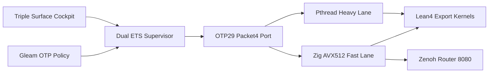

# 20261101-1410 — UOS-ZLP-v3 Supervised OTP 29 Port Hyperplane Contract (`SC-ZLP-PORT-001`)

- **Contract ID**: `SC-ZLP-PORT-001`
- **Tailscale Web FQDN**: [http://nas-1.tail55d152.ts.net:4100/files/contracts/rules/20261101-1410-zlp-hyperplane-port-contract.md](http://nas-1.tail55d152.ts.net:4100/files/contracts/rules/20261101-1410-zlp-hyperplane-port-contract.md)
- **Observed Clock (`SC-TIME`)**: `2026-11-01T13:15:00Z` (`chrony` stratum `3`, system offset `+0.000119s`, nominal `< 2s` drift band)
- **Governing Contracts**: [SC-HARNESS-MCP-001](http://nas-1.tail55d152.ts.net:4100/files/contracts/rules/20260909-0412-gleam-harness-agent-operation-contract.md) · [SC-PROVENANCE-001](http://nas-1.tail55d152.ts.net:4100/files/contracts/rules/20260908-0912-provenance-integrity-contract.md) · [SC-CHECKLIST-001](http://nas-1.tail55d152.ts.net:4100/files/contracts/rules/comprehensive-checklist-contract.md) · [SC-RISK-PRIORITY-001](http://nas-1.tail55d152.ts.net:4100/files/contracts/rules/20260907-1559-risk-prioritization-sop.md)
- **Reciprocal `#km-triad` & Skill Links**:
  - **Live Browser Cockpit**: [http://nas-1.tail55d152.ts.net:4100/zlp](http://nas-1.tail55d152.ts.net:4100/zlp)
  - **Design & Math Specification**: [docs/design/20261101-1225-uos-zlp-v3-lean4-zig-otp29-zenoh-hyperplane-spec.md](http://nas-1.tail55d152.ts.net:4100/files/docs/design/20261101-1225-uos-zlp-v3-lean4-zig-otp29-zenoh-hyperplane-spec.md)
  - **Hermes Wiki Guide**: [docs/wiki/20261101-1248-uos-zlp-v3-supervised-lean4-zig-otp29-zenoh-hyperplane.md](http://nas-1.tail55d152.ts.net:4100/files/docs/wiki/20261101-1248-uos-zlp-v3-supervised-lean4-zig-otp29-zenoh-hyperplane.md)
  - **Zettelkasten Decision Note**: [docs/zk/20261101-1248-zlp-v3-supervised-otp29-port-hyperplane-decision.md](http://nas-1.tail55d152.ts.net:4100/files/docs/zk/20261101-1248-zlp-v3-supervised-otp29-port-hyperplane-decision.md)
  - **Operations & Verification SOP**: [docs/sop/20261101-1248-uos-zlp-v3-hyperplane-operations-and-verification-sop.md](http://nas-1.tail55d152.ts.net:4100/files/docs/sop/20261101-1248-uos-zlp-v3-hyperplane-operations-and-verification-sop.md)
  - **Agent Skill**: [.agents/skills/uos-zlp-hyperplane/SKILL.md](http://nas-1.tail55d152.ts.net:4100/files/.agents/skills/uos-zlp-hyperplane/SKILL.md)
  - **Formal Lean 4 Proof Kernel**: [formal/lean/UosZlpHyperplane.lean](http://nas-1.tail55d152.ts.net:4100/files/formal/lean/UosZlpHyperplane.lean)
- **Fractal Tags**: `#fractal-l0` `#fractal-l1` `#fractal-l2` `#fractal-l3` `#fractal-l4` `#fractal-l5` `#fractal-l6` `#fractal-l7` `#fractal-l8` `#fractal-l9` `#km-triad` `#zk-adr` `#zero-muda` `#tailscale-web`
- **Transclusions**: `[[wiki:20260905-1801-uos-zk-km-corpus-index]]` · `[[wiki:20261101-1248-uos-zlp-v3-supervised-lean4-zig-otp29-zenoh-hyperplane]]` · `[[zk:20260905-1801-moc-uos-unified-master]]` · `[[zk:20261101-1248-zlp-v3-supervised-otp29-port-hyperplane-decision]]`

---

## 1. Constitutional Mandate

`SC-ZLP-PORT-001` governs all cross-language integration between **Gleam/OTP 29**, **Lean 4**, **Zig**, **MCP**, and **Zenoh** inside the Unified Operational System (UOS). Policy text and development tests do not grant runtime deployment authority or global system admission.

## 2. Hard Invariants (`INV-ZLP-01` .. `INV-ZLP-08`)

1. **`INV-ZLP-01` (OS Process Isolation — No In-Process Lean NIFs)**: `libleanshared.so` and Lean 4 C-ABI kernels MUST execute exclusively inside OS-isolated OTP 29 ports (`open_port({spawn_executable, ...}, [binary, {packet, 4}, exit_status, {parallelism, true}])`), never inside `beam.smp` NIF address space.
2. **`INV-ZLP-02` (Gleam Sole Effect Authority)**: Per `SC-HARNESS-MCP-001` and Lean 4 Theorem `T10_zlp_cannot_escalate_authority`, native ZLP port workers advise, verify, veto, and transport Zenoh frames behind Gleam's authenticated `SignedZenohEnvelope` contract; they MUST NEVER independently authorize or execute host side-effects.
3. **`INV-ZLP-03` (Zero-Orphan Deterministic Teardown)**: Every ZLP port worker MUST register Linux `prctl(PR_SET_PDEATHSIG, SIGTERM)` at startup and terminate deterministically on `fd 0` (`stdin`) `EOF`.
4. **`INV-ZLP-04` (Zero-`sorryAx` Mechanized Proof Gate)**: Every Lean 4 theorem and `@[export]` C-ABI kernel in [formal/lean/UosZlpHyperplane.lean](http://nas-1.tail55d152.ts.net:4100/files/formal/lean/UosZlpHyperplane.lean) MUST compile under pinned `Lean 4.33.0` with zero `sorryAx` and zero user-defined axioms.
5. **`INV-ZLP-05` (Two-Lane Head-of-Line Isolation)**: Fast-lane control/transport opcodes (`< 10 us` budget) execute on the non-blocking `epoll` reactor with Zen 5 AVX-512 64-byte SIMD pre-gating; multi-round reductions (`OP_HEAVY_PROVE`) MUST offload to `lean_initialize_thread()` worker threads signaling completion via `eventfd`.
6. **`INV-ZLP-06` (Dual-ETS Subscription Resilience)**: Active Zenoh SSE topic subscriptions MUST be persisted in supervisor-owned ETS (`uos_zlp_sup`) and automatically replayed on shard `init/1` after any `SIGKILL` or port restart (`T15_ets_subscription_replay_idempotent`).
7. **`INV-ZLP-07` (Zenoh Topic Confinement)**: Empty topics, leading `/`, `..` path traversal, embedded `NUL` bytes, and `c3i/a2a` prefixes MUST fail closed at both the Lean/Zig port boundary (`T14_zenoh_key_blocks_a2a_and_nul`) and the Gleam transport boundary.
8. **`INV-ZLP-08` (Triple-Surface & Two-Key Verification)**: Read-only observability MUST be exposed across Lustre HTML (`/zlp`), Wisp JSON (`/api/v1/zlp/status`, `/api/v1/zlp/theorems`, `/api/v1/zlp/lanes`), and ANSI TUI (`zlp_view.gleam`), and verified by `bash tools/uos-cli zlp-check` (`G-ZLP`) without minting new EV numbers above `EV-93`.

## 3. Control & Isolation Topology (`SC-DIAGRAM-001`)

```ascii
[Gleam OTP Policy] --> [Dual ETS Supervisor]
[Dual ETS Supervisor] --> [OTP29 Packet4 Port]
[OTP29 Packet4 Port] --> [Zig AVX512 Fast Lane]
[OTP29 Packet4 Port] --> [Pthread Heavy Lane]
[Zig AVX512 Fast Lane] --> [Lean4 Export Kernels]
[Pthread Heavy Lane] --> [Lean4 Export Kernels]
[Zig AVX512 Fast Lane] --> [Zenoh Router 8080]
[Triple Surface Cockpit] --> [Dual ETS Supervisor]
```



## 4. Machine Enforcement

```bash
bash tools/uos-cli zlp-check
bash tools/uos-cli gate G-ZLP
bash tools/diagram-check contracts/rules/20261101-1410-zlp-hyperplane-port-contract.md
bash tools/km-gate --gate
```

## 5. Comprehensive Verification Checklist (`SC-CHECKLIST-001`)

Checks below record obligations; unchecked items remain `UNRUN` at fleet scope.

<details>
<summary>Domain 1 — Metadata, timestamp and Tailscale navigation</summary>

- [ ] **CHK-01-TIME** — Observe synchronized host clock and `YYYYMMDD-HHSS-` prefix.
- [ ] **CHK-02-TAIL** — Verify full clickable `http://nas-1.tail55d152.ts.net:4100/...` links.
- [ ] **CHK-03-FRACT** — Bind L0–L9 fractal layer tags.
- [ ] **CHK-04-KM** — Reconcile contract, spec, wiki, ZK, SOP, skill, and journal links.

</details>

<details>
<summary>Domain 2 — Zero-Muda purity and storage safety</summary>

- [ ] **CHK-05-MUDA** — Verify zero Bevy and zero Graphite dependencies.
- [ ] **CHK-06-GRAPH** — Preserve pure BEAM/Hermes/Lean algebraic boundaries.
- [ ] **CHK-07-DRIVE** — Preserve denied host OS NVMe serial interlock.

</details>

<details>
<summary>Domain 3 — Testing Gold Standard and mathematical gates</summary>

- [ ] **CHK-08-C1C8** — Verify Lustre/Wisp/TUI cockpit rendering and XSS escaping.
- [ ] **CHK-09-MATH** — Verify 21 zero-`sorryAx` Lean 4.33.0 theorems via `#print axioms`.
- [ ] **CHK-10-9MOD** — Run 9-modality unit, system, TDD, BDD, perf, scale, property, fuzz, and chaos checks.
- [ ] **CHK-11-REGR** — Conserve all 389 UI regression and 775 census tests.

</details>

<details>
<summary>Domain 4 — Cross-language control and observability</summary>

- [ ] **CHK-12-GLEAM** — Observe `uos_zlp_sup` OTP 29 shard supervision and Dual-ETS replay.
- [ ] **CHK-13-HERMES** — Reconcile `Sa-plan`, `km-gate`, and `risk-priority-check` evidence.
- [ ] **CHK-14-ZIGVM** — Verify deterministic Zig 0.16.0 Zen 5 AVX-512 framing.
- [ ] **CHK-15-MAX** — Keep Python isolated strictly to MAX inference tier.
- [ ] **CHK-16-OTEL** — Preserve W3C trace and `chrony` clock synchronization metadata.

</details>

<details>
<summary>Domain 5 — Sovereign governance and standalone Jujutsu</summary>

- [ ] **CHK-17-SOV** — Obtain independent Codex review prior to production runtime cutover.
- [ ] **CHK-18-JJ** — Preserve standalone `.jj/` repository history and peer working-copy files.

</details>

<details>
<summary>Domain 6 — Provenance extension</summary>

Admitted EV ceiling remains `EV-93`. `EV-94..109` and `ADR-071..086` remain `NOT_ADMITTED`. Zero new EV or numbered ADR identifiers minted; `system_admitted = false`.

</details>

[Previous: Gleam Harness Contract](http://nas-1.tail55d152.ts.net:4100/files/contracts/rules/20260909-0412-gleam-harness-agent-operation-contract.md) · [ZLP Cockpit](http://nas-1.tail55d152.ts.net:4100/zlp) · [Wiki](http://nas-1.tail55d152.ts.net:4100/wiki) · [ZK](http://nas-1.tail55d152.ts.net:4100/zk) · [Next: ZLP Design Spec](http://nas-1.tail55d152.ts.net:4100/files/docs/design/20261101-1225-uos-zlp-v3-lean4-zig-otp29-zenoh-hyperplane-spec.md)

UOS footer: contract text and development verification do not grant runtime deployment authority or global system admission.
