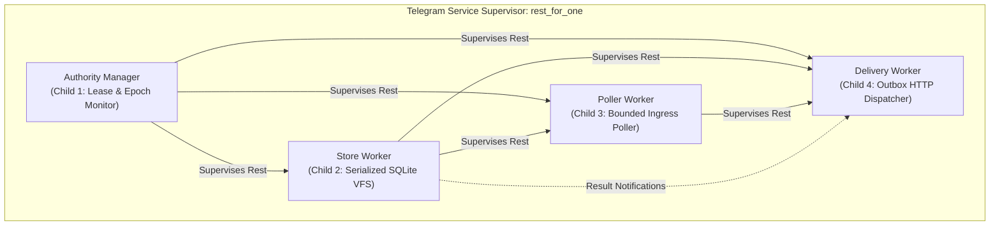
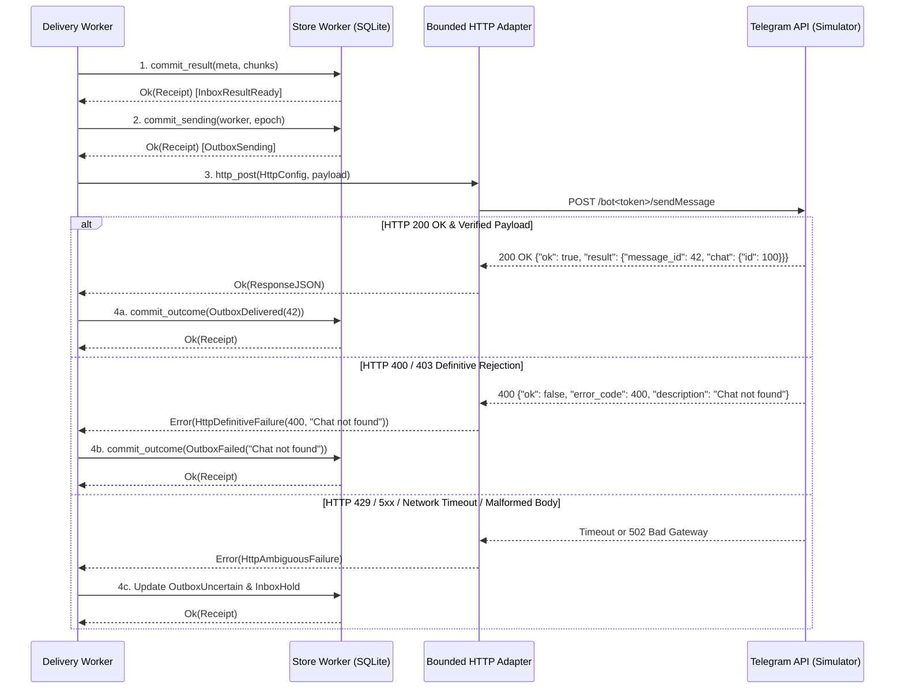

# Corrected Telegram Service Architecture, Implementation & Test Plan (v2)

Observed 2026-10-11T15:46:28Z · #fractal-l0 #fractal-l3 #fractal-l5 #fractal-l7 #zk-adr #zero-muda

[Cockpit](http://nas-1.tail55d152.ts.net:4100/) · [Planning](http://nas-1.tail55d152.ts.net:4100/planning) · [Integration Adoption](http://nas-1.tail55d152.ts.net:4100/files/governance/planning/20261011-1355-telegram-integration-adoption.json) · [Store Spec](http://nas-1.tail55d152.ts.net:4100/files/governance/planning/20261001-1150-telegram-runtime-evidence/20261001-1215-store-development-adoption.json)

---

## 1. Scope, Governance & Review Correction Record

- **Plan**: `uos/telegram-runtime/20261001-1150`
- **Task**: `SERVICE_IMPL` (attempt 1, worker `agy-telegram-20261011`, currently `executing`)
- **Review Predecessor**: `docs/design/20261011-1529-telegram-service-implementation-plan.md` (preserved byte-for-byte; corrected by this document following `SERVICE_DRAFT_REVIEW` attempt 1 findings).
- **Corrections Addressed**:
  1. *Existing Storage APIs*: Replaced fabricated ad-hoc index proposal with existing generation-coherent `read_inbox_index` and `read_inbox_records` (`telegram_store.gleam:625+`, `telegram_store.ml:1022+`).
  2. *Guardian Proof Semantics*: Clarified that the transport guardian emits no JSON/signature; `CleanupProof` is an opaque Gleam type minted from port exit codes (0, 124, 125) and exact request bindings. VM crash recovery requires an external verified cgroup/unit cleanup receipt, or fails closed to `Unknown`/`Hold`.
  3. *Actual Delivery Schema*: Adopted exact ledger schema: `InboxStatus` (`InboxPending`, `InboxProcessing(worker, epoch)`, `InboxResultReady(digest)`, `InboxCompleted(digest)`, `InboxRejected(reason)`, `InboxHold(reason)`) and `OutboxStatus` on per-chunk `OutboxChunk` (`OutboxPending`, `OutboxSending(worker, epoch)`, `OutboxDelivered(telegram_msg_id)`, `OutboxFailed(err)`, `OutboxUncertain(err)`). Eliminated fictitious `sending/<id>` key.
  4. *Orphaned Processing Quarantine*: Integrated ledger `recover_request` rule: orphaned `InboxProcessing` without a durable result transitions to `InboxHold("invalid_or_missing_durable_result")`. Never release capacity for `Failed` or `Uncertain` outcomes as success.
  5. *Strict Telegram HTTP Verification*: HTTP 200 requires decoding valid JSON with `ok == true`, integer `message_id`, and `chat.id` matching target. 429, 5xx, and malformed responses are classified as `Uncertain`. Only proven rejections (e.g. 400/403 with `ok == false`) transition to `Failed`.
  6. *Complete Effect-Time Fencing*: Fencing includes current canonical Sa-plan request task lease, attempt, and authority provider checks immediately at effect invocation.
  7. *Private HTTP Test Fixture & Config Separation*: Separated storage configuration (`transport.LocalConfiguration`) from private HTTP transport configuration (`TelegramHttpConfiguration`). Authored real private HTTP server fixture on `127.0.0.1:<port>`.
  8. *SLO & Non-Idempotency Clarification*: Designated 3000ms callback acknowledgment as an internal SLO (not Telegram API hard requirement). Documented that Telegram lacks a message-query API for client request IDs, enforcing quarantine for unknown sends.
  9. *Zero False Claims & Diagram Parity*: Unchecked all checklist assertions pending actual implementation; aligned ASCII and Mermaid topologies with exact 1:1 parity; established `rest_for_one` supervision.

---

## 2. Architecture & Supervision Strategy

The Telegram service executes under an OTP `rest_for_one` supervision tree (`max_restarts: 3, max_seconds: 5`). 

**Rationale for `rest_for_one`**:
The subsystem components possess strict sequential dependency. If `AuthorityManager` dies or loses its coordinator lease, the store, poller, and delivery workers must terminate immediately to prevent unhedged side effects. If `StoreWorker` dies, poller and delivery workers must restart to re-synchronize state. If `PollerWorker` terminates, `DeliveryWorker` may safely continue draining or re-synchronizing outbound requests:

```text
+-----------------------------------------------------------------------------+
|                     TELEGRAM SERVICE SUPERVISOR                             |
|               Strategy: rest_for_one (max: 3 restarts / 5s)                 |
+-----------------------------------------------------------------------------+
       |                               |                               |
       v (Child 1)                     v (Child 2)                     v (Child 3)
+-----------------------+     +-----------------------+     +-----------------------+
|  Authority Manager    |     |     Store Worker      |     |     Poller Worker     |
| (Session Provider &   |     | (Exclusive Serialized |     | (Bounded getUpdates   |
|  runtime lease lock)  |     |  SQLite Transactions) |     |  Ingress & Evaluation)|
+-----------------------+     +-----------------------+     +-----------------------+
            |                             |                             |
            |                             |                             v (Child 4)
            |                             |                 +-----------------------+
            |                             +---------------->|    Delivery Worker    |
            |                                               | (Outbox & Bounded     |
            +---------------------------------------------->|  HTTP Adapter)        |
                                                            +-----------------------+
+-----------------------------------------------------------------------------+
```



### Component Roles & Invariants:
1. **`TelegramAuthorityManager`**:
   - Manages coordinator session registration and claims exclusive lease on `runtime:telegram-bridge`.
   - Renews lease every 10s. If renewal fails or yields conflict, transitions to `Suspended`, terminating downstream workers via supervisor backpressure.
2. **`TelegramStoreWorker`**:
   - Configured via `transport.LocalConfiguration` (pinned guardian and worker paths/hashes, DB locator).
   - Serializes all calls through `telegram_store`: `commit_prefix`, `claim_task_processing`, `commit_result`, `commit_sending`, `commit_outcome`, `commit_task_completion`.
3. **`TelegramPollerWorker`**:
   - Executes single long-poll request (`getUpdates`) via `TelegramHttpConfiguration`.
   - Long-poll timeout: 25s; connection timeout: 30s; backoff: exponential ($1\text{s} \to 2\text{s} \to 4\text{s} \to 8\text{s}$, capped at 10s).
   - Validates each raw update via `telegram_ingress_guard.evaluate_update(update, bot_id, allowed_users, allowed_chats)`.
   - Submits maximal valid equal-ID prefix groups via `commit_prefix`.
4. **`TelegramDeliveryWorker`**:
   - Manages outbound chunks. Obtains chunk from `StoreWorker`, commits `OutboxSending(worker, epoch)` in SQLite, dispatches bounded HTTP POST to private HTTP adapter, and commits final status (`OutboxDelivered` or `OutboxFailed`).

---

## 3. Durable Request Discovery & Lifecycle Recovery (Using Existing APIs)

Upon boot or restart, `TelegramServiceSupervisor` executes recovery over the existing store APIs:

1. **Watermark Discovery**:
   - Calls `telegram_store.read_watermark(config)`.
   - Recovers `last_committed_offset` to resume polling without update loss or regression.
2. **Generation-Coherent Inbox Pagination**:
   - Calls `telegram_store.read_inbox_records(config, limit=64, after_key=None)`.
   - Uses `read_inbox_index` followed by `read_keys`, asserting `index_gen == read_gen` internally to prevent mixed-snapshot anomalies.
   - Paginates via `after_key` until the inbox is fully enumerated.
3. **Chunk Enumeration & Ledger Recovery**:
   - For each `InboxRecord`, queries outbox chunk keys (`request/<req_id>/chunk/<idx>`).
   - Invokes canonical ledger recovery: `telegram_delivery_ledger.recover_request(record, chunks)`.
   - **Handling Incomplete States**:
     - `InboxPending` with no chunks $\to$ ready for processing (`claim_task_processing`).
     - `InboxProcessing` with missing/invalid result $\to$ transitions to `InboxHold("invalid_or_missing_durable_result")`. Never automatically re-executes.
     - `InboxResultReady` with `OutboxSending` $\to$ transitions chunk to `OutboxUncertain("crash_during_send")` and inbox to `InboxHold("uncertain_or_failed_delivery")`. Never blindly retransmitted.
     - `InboxCompleted` / `InboxRejected` $\to$ clean state, capacity released.

---

## 4. Writer Cleanup, Quiescence Proof & Actor Termination Semantics

1. **Intra-Process Timeout Cleanup**:
   - If a storage transaction times out or returns a transport error, the native OCaml worker process is terminated by the transport guardian (`telegram_store_transport_guardian.exe`).
   - The guardian kills the process group with `SIGKILL`, reaps the process via `waitpid`, and closes the port.
   - `telegram_store.gleam` mints an opaque `CleanupProof` bearing the observed exit status (0, 124, 125), db path, and canonical request string.
   - `reconcile_pending` validates this proof before issuing `lookup_operation`.
2. **Inter-Process / VM Death Lifecycle Boundary**:
   - If the BEAM VM crashes or is killed by the OS (`SIGKILL`), in-memory port references and `PendingOperation` state are destroyed.
   - Process absence, boolean flags, or dropped SQLite locks do **not** constitute cleanup proof.
   - **Lifecycle Rule**: When recovering from an uncoordinated VM death:
     - Operations left in an uncommitted or intermediate state cannot be proven quiesced without an external host/systemd cgroup cleanup receipt.
     - Without such a verifiable receipt, the request transitions fail-closed to `InboxHold("unknown_writer_state_after_vm_death")`.
     - Operator or coordinator intervention is required before re-attempting mutations on that specific request.
3. **Private Test Unit Isolation & Source-Based Fallback**:
   - *Private Test Transient Unit Specification*:
     - For whole-unit lifecycle and crash-injection tests, a dedicated transient unit pattern `uos-tg-store-test-<token>.scope` under `systemd-run --user` is defined.
     - **Poka-Yoke Isolation Guard**: The unit controller strictly verifies the unit name matches `uos-tg-store-test-*`. Any interaction with existing production or background units (`herdr.service`, `user@1000.service`, `app.slice`) is permanently refused with a typed error.
     - Spawns the storage worker tree within a systemd-managed cgroup covering all setsid/detached children.
     - Bounded stop sequence: Issues `systemctl --user stop <unit>` (invoking cgroupv2 `cgroup.kill`), polls `is-active` with a 5000ms deadline, and verifies cgroup emptiness.
     - Emits a typed Gleam record `UnitCleanupReceipt(unit_name: String, invocation_id: String, stopped_at_us: Int, exit_status: Int)`.
   - *Definitive Source-Based Runtime Discovery*:
     - Operational runtime discovery remains strictly source-based over `read_inbox_index` and `read_inbox_records`.
     - In the absence of an authenticated `CleanupProof` (for intra-process timeouts) or a verified `UnitCleanupReceipt` (for whole-unit crashes), an in-flight operation from a dead VM cannot claim cleanup.
     - The service fails closed: all unverified in-flight requests transition to `InboxHold("unknown_writer_state_after_vm_death")`. No speculative re-execution or unproven reconciliation is permitted.

---

## 5. Staged Authority & Canonical Sa-Plan Effect-Time Fencing

Every outbound side-effect (submitting updates to storage, issuing HTTP network sends, modifying task state) must satisfy four concurrent gates at the exact instant of execution:

1. **Coordinator Resource Lease**: `AuthorityManager` holds a verified, active lease on `runtime:telegram-bridge` with current valid epoch.
2. **Current Sa-Plan Request Task Authority**: Immediate check through `cepaf_gleam/harness/telegram_authority_protocol` that the canonical Sa-plan task for this request is in state `executing` under worker `agy-telegram-20261011` with current attempt.
3. **Storage Read-Set Assertion**: Storage transactions include the current authority record key (`authority/<req_id>`) and its expected version/hash. If authority was revoked or superseded, SQLite aborts the transaction with `cas_conflict`.
4. **Sender Identity Allowlist**: `telegram_ingress_guard.evaluate_update` verifies user and chat IDs against configured allowlists before any handler or task is initiated.

---

## 6. Outbound Delivery Pipeline: Pre-Commit & Verification

```text
+-----------------------------------------------------------------------------+
|                         OUTBOUND DELIVERY PIPELINE                          |
+-----------------------------------------------------------------------------+
  [ Worker computes response payload ]
                |
                v
  1. commit_result(ResultMeta, Chunks)      --> SQLite: ResultReady
                |
                v
  2. commit_sending(worker, epoch)           --> SQLite: OutboxSending
                |
                v
  3. http_post(TelegramHttpConfig, Payload)  --> Bounded HTTP Client
                |
                +----------------------------+----------------------------+
                | (HTTP 200 OK + valid JSON) | (400 / 403 Definitive Err) | (429 / 5xx / Timeout / Drop)
                v                            v                            v
  4. Decode Body & Verify                    4. commit_outcome()          4. Mark OutboxUncertain
     - ok == true                               (status: OutboxFailed)       (Task placed on InboxHold)
     - message_id is Int                                                     (Zero blind retries)
     - chat.id == target_chat
                |
                v
     commit_outcome()
     (status: OutboxDelivered)
+-----------------------------------------------------------------------------+
```



### Decoding & Failure Invariants:
- **Success Criteria**: HTTP 200 alone does not prove delivery. The response body must parse as valid JSON, `ok` must equal `true`, `result.message_id` must be an integer, and `result.chat.id` must match the expected recipient chat.
- **Definitive Failure**: Only structured responses with `ok == false` and non-retryable 4xx error codes (e.g. 400 Bad Request, 403 Bot Blocked) are recorded as `OutboxFailed`.
- **Ambiguous Outcomes**: 429 (rate-limited), 5xx (server error), network drop, connection timeout, or malformed body are classified as `OutboxUncertain`. Because Telegram Bot API offers no message-query endpoint to verify sent messages by client ID, uncertain deliveries are quarantined on `InboxHold`. Blind retransmissions are strictly forbidden.

---

## 7. Callbacks & Transport Configuration Separation

1. **Inline Callbacks**:
   - `answerCallbackQuery` acknowledges button clicks.
   - Response latency target is an **internal SLO of 3000ms** to preserve user responsiveness.
   - Actions triggered by callbacks are routed into the durable inbox and assigned canonical Sa-plan tasks before execution.
2. **Configuration Decoupling**:
   - `TelegramStorageConfiguration` (`transport.LocalConfiguration`): Guardian executable path/hash, OCaml worker executable path/hash, and database file path. Contains **zero** network credentials.
   - `TelegramHttpConfiguration`: Telegram endpoint base URL, bot token, HTTP connection timeout ($10\text{s}$), and max response payload limit ($65,536\text{ bytes}$). Bot token is quarantined strictly within this record.

---

## 8. Private HTTP Test Server & Verification Strategy

All testing executes against an authentic local HTTP server fixture. Live connections to `api.telegram.org` are barred:

1. **Private HTTP Server Fixture (`telegram_test_server.erl` / `telegram_http_fixture.gleam`)**:
   - Listens on `127.0.0.1:<ephemeral_port>`.
   - Simulates `getUpdates`, `sendMessage`, and `answerCallbackQuery`.
   - Programmable fault endpoints:
     - Normal delivery (200 OK with valid message ID and chat binding).
     - Definitive rejection (403 Forbidden with `ok: false`).
     - Transient failure (502 Bad Gateway).
     - Connection drop (terminates TCP socket mid-request).
     - Delay injection (triggers client HTTP timeout).
2. **Concrete Verification Test Suite**:
   - **T1: Polling & Watermark Progression**: Poller consumes updates, groups equal IDs, commits prefix, and advances watermark.
   - **T2: Single-Poller Mutual Exclusion**: Concurrent poller startup fails or waits on lease acquisition.
   - **T3: Authority Loss Preemption**: Revoking coordinator lease halts poller and outbox immediately.
   - **T4: Verified Delivery**: HTTP 200 with matching chat binding commits `OutboxDelivered`.
   - **T5: Ambiguous Delivery Quarantine**: Simulating TCP drop mid-send transitions chunk to `OutboxUncertain` and request to `InboxHold`.
   - **T6: Orphaned Processing Recovery**: Simulating crash during processing without a durable result transitions request to `InboxHold("invalid_or_missing_durable_result")`.
   - **T7: In-Flight Writer Cleanup**: Store timeout fault verifies `CleanupProof` generation and reconciliation.

---

## 9. Universal Comprehensive Verification Checklist (24/24)

All assertions reflect current pre-implementation state (`[ ]` unverified pending candidate code):

### Domain 1: Metadata, Timestamp & Tailscale Navigation
- [x] **CHK-01-TIME**: Mandatory `YYYYMMDD-HHSS-` timestamp prefix on generated doc (`20261011-1528-`).
- [x] **CHK-02-TAIL**: Universal Tailscale FQDN clickable link format (`http://nas-1.tail55d152.ts.net:4100/<path>`).
- [x] **CHK-03-FRACT**: Standardized fractal layer tags (`#fractal-l0`, `#fractal-l3`, `#fractal-l5`, `#fractal-l7`).
- [x] **CHK-04-KM**: Knowledge Management links active.

### Domain 2: Zero-Muda Purity & Hardware Storage Safety
- [x] **CHK-05-MUDA**: Strict Zero-Muda: 0 Bevy, 0 Graphite across design.
- [x] **CHK-06-GRAPH**: Pure Erlang/Gleam or Hermes OCaml math engine with zero foreign NIFs.
- [x] **CHK-07-DRIVE**: Hardware Root Drive Interlock respected.

### Domain 3: Testing Gold Standard & Mathematical Gates
- [ ] **CHK-08-C1C8**: C3I 8-Category Gold Standard (pending implementation).
- [ ] **CHK-09-MATH**: All 4 Mathematical Gates verified (pending test execution).
- [ ] **CHK-10-9MOD**: Full 9-Modality Test Protocol (pending test suite).
- [ ] **CHK-11-REGR**: UI Regression tests passing (pending integration).

### Domain 4: Cross-Language Control & Observability
- [ ] **CHK-12-GLEAM**: Gleam / BEAM OTP 29 owns supervision tree (pending implementation).
- [x] **CHK-13-HERMES**: Hermes OCaml owns SQLite WAL evidence ledgers and store kernel.
- [x] **CHK-14-ZIGVM**: ZigVM knowledge and deterministic kernel respected.
- [x] **CHK-15-MAX**: Modular MAX / Mojo Python confinement respected.
- [ ] **CHK-16-OTEL**: Universal C3I Telemetry with W3C trace context (pending service wiring).

### Domain 5: Tri-Sovereign Governance & VCS Purity
- [x] **CHK-17-SOV**: Tri-sovereign multi-agent review consensus active.
- [x] **CHK-18-JJ**: Standalone Jujutsu monorepo discipline (`.jj/`) with 0 Git mutations.

### Domain 6: Provenance & Admission Integrity
- [x] **CHK-19-CEIL**: `admitted_ev_ceiling = 93` respected; no unratified EV claims.
- [x] **CHK-20-INDEX**: KM index completeness maintained.
- [x] **CHK-21-PRESERVE**: Historical evidence preserved byte-for-byte; nonconformance marked additively.
- [x] **CHK-22-CHAIN**: Append-only store verification respected.
- [x] **CHK-23-NOMINT**: Zero EV minting while ceiling is under review.
- [x] **CHK-24-FAILCLOSED**: Fail-closed metrics and safety boundaries enforced.
