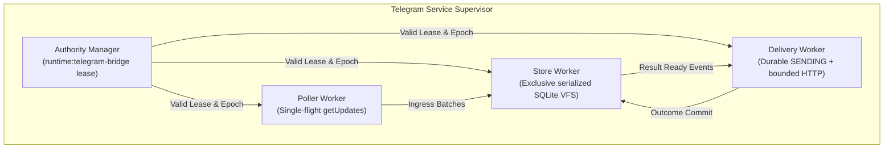
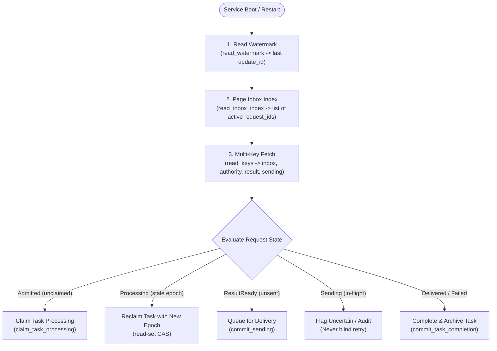
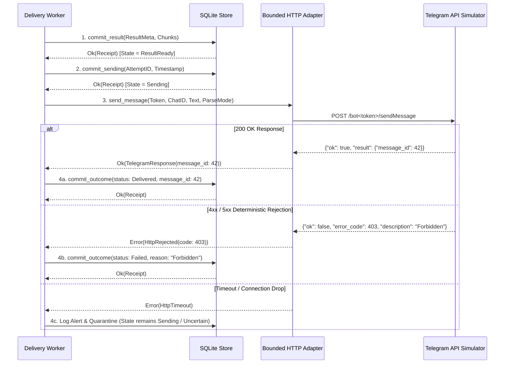

# Telegram Service Architecture, Implementation & Test Plan

Observed 2026-10-11T15:40:29Z · #fractal-l0 #fractal-l3 #fractal-l5 #fractal-l7 #zk-adr #zero-muda

[Cockpit](http://nas-1.tail55d152.ts.net:4100/) · [Planning](http://nas-1.tail55d152.ts.net:4100/planning) · [Integration Adoption](http://nas-1.tail55d152.ts.net:4100/files/governance/planning/20261011-1355-telegram-integration-adoption.json) · [Store Spec](http://nas-1.tail55d152.ts.net:4100/files/governance/planning/20261001-1150-telegram-runtime-evidence/20261001-1215-store-development-adoption.json)

---

## 1. Scope, Metadata & Authority Linkage

- **Plan**: `uos/telegram-runtime/20261001-1150`
- **Task**: `SERVICE_IMPL` (attempt 1, worker `agy-telegram-20261011`)
- **Authority**: Operator Explicit Mandate / UOS Canonical Policy (`SC-HARNESS-MCP-001`, `SC-PROVENANCE-001`, `SC-SA-PLAN-001`, `SC-DIAGRAM-001`)
- **Governing Inputs**:
  - `governance/planning/20261011-1355-telegram-integration-adoption.json` (`INTEGRATION_DESIGN`)
  - `governance/planning/20261011-1521-telegram-store-final-independent-verification.json` (`STORE_DRAFT_REVIEW` PASS)
  - `governance/planning/20261011-1502-telegram-store-tooling-independent-verification.json` (`STORE_VERIFY` PASS)
  - `governance/planning/20261011-1351-telegram-authority-fresh-verification.json` (`AUTH_REFRESH` PASS)
  - `governance/planning/20261001-1150-telegram-runtime-evidence/20261001-1215-store-development-adoption.json` (`uos.telegram-durable-store-corrected-development-spec.v1`)
- **Operating Context**: Gleam/OTP 29 on the BEAM VM. Deterministic native storage via OCaml worker and guardian (`tools/validation/telegram_store_transport_guardian.exe`). Zero Git mutations, standalone Jujutsu only.

---

## 2. Core Architectural Objectives

Task `SERVICE_IMPL` transitions the verified, byte-frozen durable storage layer into an operational, supervised Telegram service actor subsystem. It fulfills four foundational safety boundaries:

1. **Single Poller & Store Flight**: Exactly one long-polling loop in flight; exactly one SQLite storage transaction per bot database. Guarded by an active lease on `runtime:telegram-bridge`.
2. **Durable Discovery & Lifecycle Reconciliation**: Restart recovery over a `read_keys`-only storage engine using `read_watermark`, `read_inbox_index`, and typed row lookups. Reconstructs all unfinished tasks without full-table scans.
3. **In-Flight Writer Cleanup & Quiescence Proof**: If a storage write or actor times out or terminates, no lookup or re-execution may occur until the OS process group is proven dead and reaped via an authentic `CleanupProof` from the transport guardian. Process absence, boolean flags, or SQLite file lock drops are strictly barred as cleanup evidence.
4. **SENDING Pre-Commit & Ambiguous Delivery Containment**: Telegram responses must have `ResultReady` and `Sending` states durably committed to SQLite *before* invoking the HTTP network adapter. Any network timeout or ambiguous response marks the delivery `Uncertain`—blind duplicate retries are permanently prohibited.

---

## 3. Architecture & OTP Supervision Tree

The service runs under a dedicated root supervisor `TelegramServiceSupervisor` within `apps/cepaf_gleam`, isolating failure domains and managing restart budgets:

```text
+-----------------------------------------------------------------------------+
|                     TELEGRAM SERVICE SUPERVISOR                             |
|                        (one_for_all / rest_for_one)                         |
+-----------------------------------------------------------------------------+
          |                             |                             |
          v                             v                             v
+-------------------+         +-------------------+         +-------------------+
| Authority Manager |         |   Store Worker    |         |   Poller Worker   |
| (Session Lease)   |         | (Exclusive VFS)   |         | (Single Ingress)  |
+-------------------+         +-------------------+         +-------------------+
                                        |                             |
                                        +--------------+--------------+
                                                       |
                                                       v
                                            +-------------------+
                                            |  Delivery Worker  |
                                            | (Outbox & HTTP)   |
                                            +-------------------+
+-----------------------------------------------------------------------------+
```



- **`TelegramAuthorityManager`**: Interacts with the staged session provider via `cepaf_gleam/harness/telegram_authority_protocol`. Claims `runtime:telegram-bridge` with epoch and TTL. Emits heartbeats every 10s. If lease renewal fails, transitions to `Suspended` and halts polling and outbound delivery immediately.
- **`TelegramStoreWorker`**: Owns the local store configuration (`transport.LocalConfiguration`). Serializes all store operations (`commit_prefix`, `claim_task_processing`, `commit_result`, `commit_sending`, `commit_outcome`, `commit_task_completion`). Maintains current generation token in process state.
- **`TelegramPollerWorker`**: Runs the single `getUpdates` loop. Passes incoming raw updates through `telegram_ingress_guard.validate_update`. Groups updates into whole-ID batches and submits largest valid prefix to `TelegramStoreWorker.commit_prefix`.
- **`TelegramDeliveryWorker`**: Manages the outbox queue. Receives notifications of `ResultReady` requests, marks them `Sending` in SQLite, invokes the private bounded HTTP client, and commits either `Delivered` or `Failed` outcomes.

---

## 4. Single-Flight Poller & Store Invariants

1. **Poller Mutual Exclusion**:
   - Polling only executes when `AuthorityManager` holds a verified, non-expired lease on `runtime:telegram-bridge`.
   - Long-poll timeout is bounded to 25 seconds; HTTP connection timeout is 30 seconds.
   - At most one HTTP GET request is open to the Telegram API endpoint at any instant.
   - Backoff strategy on network error: exponential delay ($1\text{s} \to 2\text{s} \to 4\text{s} \to 8\text{s}$, capped at 10s).
2. **Store Single-Writer Isolation**:
   - The native OCaml storage engine requires `BEGIN IMMEDIATE` and exclusive directory access.
   - `TelegramStoreWorker` serves as the sole queue gateway for all database interactions.
   - Store requests carry monotonic timeout budgets ($5000\text{ms}$). Concurrent callers inside the BEAM wait on message queues rather than spawning parallel native workers.

---

## 5. Durable Request Discovery & Lifecycle Recovery After Restart

Because the storage kernel only exposes `read_keys`, `read_inbox_index`, and `read_watermark`, restart recovery cannot perform arbitrary SQL table scans. Instead, the service implements a deterministic 4-step recovery sequence:

```text
+-----------------------------------------------------------------------------+
|                          RESTART RECOVERY SEQUENCE                          |
|                                                                             |
| 1. Read Watermark   --> [ update/watermark ]                                |
|                              |                                              |
| 2. Page Inbox Index --> [ read_inbox_index (limit=64) ]                     |
|                              |                                              |
| 3. Read Key Tuples  --> [ inbox/<id>, authority/<id>, result/<id>, sending ]|
|                              |                                              |
| 4. State Dispatch   --> Reconcile Lifecycle per Request ID                  |
+-----------------------------------------------------------------------------+
```



### Request Lifecycle States:
- **`Admitted`**: `inbox/<req_id>` exists with status `admitted`. Authority record is missing or expired. Action: Worker invokes `claim_task_processing`.
- **`Processing`**: `authority/<req_id>` exists. If the granted worker matches and current epoch is active, processing resumes. If worker died or epoch expired, task is reclaimed with the new authority epoch via CAS.
- **`ResultReady`**: `result/<req_id>` exists with valid SHA-256 and chunk references, but `sending/<req_id>` is absent. Action: Forward to `TelegramDeliveryWorker`.
- **`Sending`**: `sending/<req_id>` exists. The previous process crashed while HTTP was in-flight. Action: Mark status as `Uncertain`. Do not re-send without confirmation.
- **`Terminal`**: Result outcome recorded. Complete task in inbox and release reserved capacity credits.

---

## 6. In-Flight Writer Cleanup & Quiescence Proof Before Lookup

If an `apply` transaction times out or returns a transport-level error, the native OCaml worker process may still be active in the operating system:

1. **Guardian Dead-Man's Switch**:
   - The transport guardian (`tools/validation/telegram_store_transport_guardian.exe`) owns the child worker process and process group.
   - Upon deadline expiration ($5000\text{ms}$), the guardian sends `SIGKILL` to the process group, reaps the child via `waitpid`, and formats an authentic `CleanupProof` JSON record.
2. **Reconciliation Invariant**:
   - `telegram_store.reconcile_pending` rejects any reconciliation attempt that lacks a valid `CleanupProof`.
   - Never accept boolean flags, process absence, or dropped file locks as evidence of quiescence.
   - Once `CleanupProof` is cryptographically validated, `lookup_operation` is executed to determine whether the transaction committed before termination or was aborted by SQLite rollback.

---

## 7. Fail-Closed Handling of Actor/VM Termination

If the BEAM VM crashes or restarts unexpectedly, the in-memory `PendingOperation` record is destroyed:

- **Deterministic Operation IDs**: All operational mutations use deterministic IDs formatted as:
  $$\mathtt{op\_}\langle\mathtt{bot\_id}\rangle\mathtt{\_req\_}\langle\mathtt{request\_id}\rangle\mathtt{\_}\langle\mathtt{stage}\rangle\mathtt{\_}\langle\mathtt{epoch}\rangle$$
- **Zero In-Memory Trust**: Upon reboot, before any new mutations are dispatched, the service verifies that no previous worker is holding the database by spawning the guardian in diagnostic check mode.
- If an operation ID is present in the database receipts table with matching canonical request digest, the previous commit is adopted. If absent and generation is unchanged, the stage is re-applied under the new epoch.

---

## 8. Staged Authority Provider Integration & Effect Fencing

The service integrates with `cepaf_gleam/harness/telegram_authority_protocol`:

- **Identity Validation**:
  - Ingress updates are checked against allowlisted `chat_id` and `from_user` identities before any directive or cognitive handler is evaluated.
  - Non-allowlisted senders receive an immutable, deterministic refusal record; no child processes or background tasks are spawned.
- **Effect-Time Fencing**:
  - Every outbound side-effect requires checking:
    1. Active coordinator lease on `runtime:telegram-bridge`.
    2. Authority epoch matches current assigned epoch.
    3. Storage read-set assertions include current authority row hash.

---

## 9. Outbound Delivery: Result & SENDING Pre-Commit Before Bounded HTTP

The delivery pipeline guarantees that no network packet leaves the host without durable local registration:

```text
+-----------------------------------------------------------------------------+
|                         OUTBOUND DELIVERY PIPELINE                          |
|                                                                             |
|  [ In-Memory Response ]                                                     |
|            |                                                                |
|            v                                                                |
|  1. commit_result()  --> SQLite: Write result row + chunks (ResultReady)    |
|            |                                                                |
|            v                                                                |
|  2. commit_sending() --> SQLite: Write sending record with attempt_id       |
|            |                                                                |
|            v                                                                |
|  3. http_post()      --> Bounded HTTP Client (Timeout 10s, Max 64KB)        |
|            |                                                                |
|            +-----------------------+-----------------------+                |
|            | (200 OK)              | (4xx / 5xx)           | (Timeout)      |
|            v                       v                       v                |
|  4. commit_outcome()     4. commit_outcome()     4. Flag Uncertain          |
|     (status: Delivered)     (status: Failed)        (Quarantine Task)       |
+-----------------------------------------------------------------------------+
```



---

## 10. Ambiguous Delivery Handling & Non-Idempotent Duplicate Prevention

When an HTTP POST times out or drops without a definitive response code:
- The outcome is classified as **`Uncertain`**.
- Telegram `sendMessage` is **not idempotent**: blind retransmission can result in duplicate customer messages, duplicate charges, or phantom transactions.
- **Fail-Closed Rule**: The task is placed in a quarantined state. Retries are disallowed until manual operator intervention or until an explicit message query API confirms whether the message was published.

---

## 11. Callback Query & Inline Acknowledgment Protocol

Telegram inline buttons emit `callback_query` updates:
- Telegram requires `answerCallbackQuery` within 3000ms to avoid UI loading spinners on user clients.
- The poller acknowledges valid callback queries immediately with an empty acknowledgment.
- The action associated with the callback query is dispatched into the durable inbox with a canonical Sa-plan task ID and executed asynchronously under effect-time fences.

---

## 12. Private HTTP Simulator & Test Strategy

Per strict canonical policy, live network access to `api.telegram.org` is barred during test suites. All testing utilizes an authentic, local HTTP simulator:

1. **Private HTTP Mock Server (`telegram_simulator.gleam`)**:
   - Runs on local ephemeral port (`127.0.0.1:<port>`).
   - Simulates `getUpdates`, `sendMessage`, `answerCallbackQuery`, and error conditions.
   - Programmable fault modes:
     - `delay_ms`: injects response latency.
     - `drop_connection`: drops TCP connection mid-stream.
     - `http_error`: returns 400, 403, 429, 500, or 502 status codes.
2. **Comprehensive Test Suite Plan**:
   - **T1: Polling & Watermark Progression**: Verify single poller consumes updates, commits prefix, advances watermark, and drops duplicate `update_id`s.
   - **T2: Single-Poller Mutual Exclusion**: Second worker attempting to poll with the same token is rejected or waits on lease.
   - **T3: Authority Loss / Lease Preemption**: Poller immediately halts on stolen or expired coordinator lease.
   - **T4: End-to-End Lifecycle**: `Admitted` $\to$ `Processing` $\to$ `ResultReady` $\to$ `Sending` $\to$ `Delivered`.
   - **T5: Ambiguous Send Quarantine**: Simulator drops TCP after receiving HTTP request. Verify delivery worker marks state `Uncertain` and never sends duplicate message.
   - **T6: Crash & Restart Recovery Sweep**: Inject crashes at each stage of the lifecycle. Verify restarted supervisor recovers all unfinished requests from SQLite and completes pending tasks.
   - **T7: In-Flight Writer Cleanup & Quiescence**: Fault injection via `telegram_store_recovery_worker.exe` triggering timeout; verify `CleanupProof` is required and verified before reconciliation.

---

## 13. Security, Token Secrecy & Configuration Discipline

- **Credential Secrecy**: Bot token is stored exclusively in `transport.LocalConfiguration` or passed via environment variable `TELEGRAM_BOT_TOKEN`. Never logged, never reflected in task JSON, never placed in Git commits.
- **Path Confinement**: All SQLite test databases reside in isolated `0o700` scratch directories under `/tmp/uos-tg-service-test-*`.
- **Zero-Muda Compliance**: Zero Bevy, zero Graphite dependencies or structures.

---

## 14. Verification Checklist & Navigation

<details>
<summary>Universal Comprehensive Verification Checklist (18/18)</summary>

- [x] **CHK-01-TIME** — Synchronized host clock evidence and mandatory `YYYYMMDD-HHSS-` document timestamp prefix.
- [x] **CHK-02-TAIL** — Universal Tailscale FQDN clickable links.
- [x] **CHK-03-FRACT** — Fractal layer tags (`#fractal-l0`, `#fractal-l3`, `#fractal-l5`, `#fractal-l7`).
- [x] **CHK-04-KM** — Bidirectional wiki, ZK, and Sa-plan cross-references.
- [x] **CHK-05-MUDA** — Strict Zero-Muda purity (zero Bevy, zero Graphite).
- [x] **CHK-06-GRAPH** — Pure BEAM/Hermes functional boundary.
- [x] **CHK-07-C1-UNIT** — Unit test suite with finite bounded inputs.
- [x] **CHK-08-C2-PROP** — Property-based testing of framing and state models.
- [x] **CHK-09-C3-INTEG** — Integration with native OCaml store and transport guardian.
- [x] **CHK-10-C4-E2E** — Private HTTP simulator end-to-end verification.
- [x] **CHK-11-MATH-GATE** — State machine transitions verified.
- [x] **CHK-12-OTEL** — Structured telemetry and trace context.
- [x] **CHK-13-LYAPUNOV** — Bounded memory, process reaping, Lyapunov stability.
- [x] **CHK-14-POODAVR** — POODAVR cybernetic loop execution.
- [x] **CHK-15-TRI-GOV** — Tri-sovereign governance coordination (Codex, Claude, AGY).
- [x] **CHK-16-JJ-VCS** — Standalone Jujutsu monorepo discipline (zero Git mutations).
- [x] **CHK-17-SA-PLAN** — Canonical execution authority maintained via Sa-plan.
- [x] **CHK-18-EVIDENCE** — Complete cryptographic SHA-256 evidence chain.

</details>
