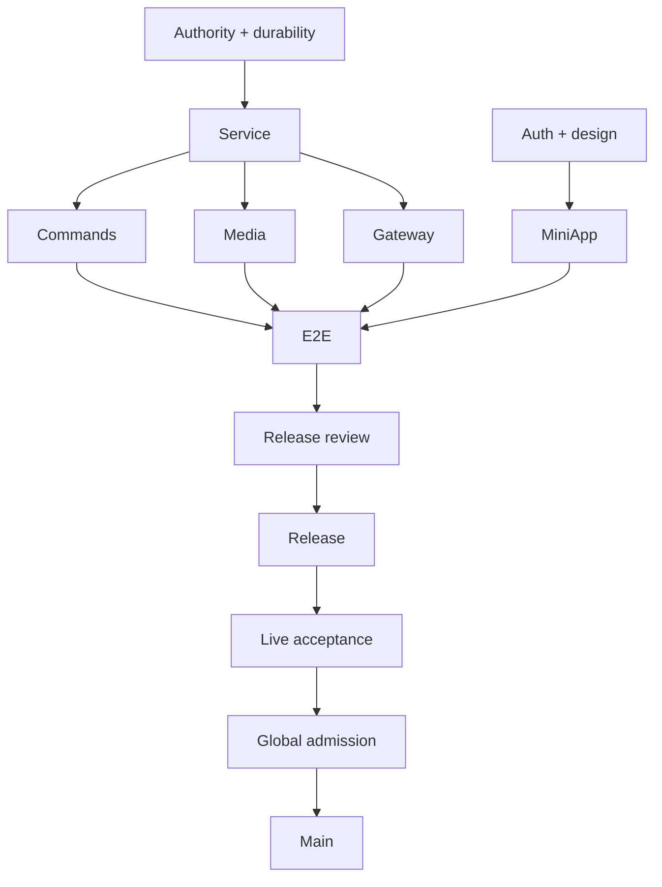

# 20261024-0830 — Telegram full completion plan

Observed 2026-10-24T08:15:30.427Z. #fractal-l0 #fractal-l1 #fractal-l2 #fractal-l3 #fractal-l4 #fractal-l5 #fractal-l6 #fractal-l7 #fractal-l8 #fractal-l9 #zk-adr #zero-muda

[Dashboard](http://nas-1.tail55d152.ts.net:4100/static/20261024-0712-recovery-dashboard.html) · [Planning](http://nas-1.tail55d152.ts.net:4100/planning) · [Full requirement map](http://nas-1.tail55d152.ts.net:4100/files/governance/planning/20261024-0812-telegram-fractal-completion.json)

Status: PLAN PRODUCED, independent AGY review pending. Overall goal remains incomplete. This is a coverage map over existing canonical Sa-plan work; it does not replace execution authority or duplicate feature tasks.

The target is fully functional Telegram direct tools, commands, conversation, callbacks, media, gateway and Mini App behavior, actual authorized acceptance, independently evaluated global admission and stable applicable code integrated into main. Refusing unsupported work is necessary containment but does not fulfill the promised feature.

| Layer | Work | AS-IS | TO-BE | Criticality |
|---|---|---|---|---|
| L0 | Goal and coverage | 79 historical command arms, nine non-command families; no proof of full functionality. | Every promised Telegram feature has an owner, acceptance evidence and explicit residuals. | High |
| L1 | Authority and agent execution | Coordinator recovered; bounded AGY dispatch verified. Old service implementation/review claims expired. | One actual owner per task, current task/workspace/runtime fences, authentic independent review. | Critical |
| L2 | Durability and recovery | Store/ledger development work exists; latest92-case suite covers selected delivery and uncertainty cases. | Crash-consistent inbox/outbox and single writer with truthful ambiguous outcomes. | Critical |
| L3 | Transport, poller and callbacks | Five-second RPC defect repaired;92 tests and independent AGY development PASS. | Supervised real transport with bounded deadlines, callbacks, cancellation and one active poller. | High |
| L4 | Direct tools, commands and conversation | Command sources match historical inventory;54 arms were classified as lacking adapters; runtime use is unproven. | Each command routes through one typed guard to a real bounded adapter with useful results. | Critical |
| L5 | Media | Corrected media design adopted; full implementation and actual processing acceptance pending. | Bounded inbound/outbound media with real configured processing and durable outcomes. | High |
| L6 | Gateway and event notifications | Gateway source changed since historical mock/token findings; current behavior must be verified. | Real critical events reach authorized recipients through the same supervised durable outbox. | Critical |
| L7 | Mini App and browser | Recovery dashboard passes desktop/mobile browser acceptance; Mini App sources still match historical SSR/default-data inventory. | Authenticated live page data and working authorized actions across every adopted Mini App route. | High |
| L8 | Integrated acceptance and operational visibility | Scoped tests pass; no full live Telegram conversation or feature-wide acceptance. | Candidate-bound complete scenario matrix, current dashboard and independently reviewed release package. | Critical |
| L9 | Live release, global admission and mainline | Release, live Telegram acceptance, global admission and main merge remain pending. | Actual authorized Telegram features work, all applicable admission gates have evidence, verified code integrated into main. | Critical |

## L0 — Goal and coverage

Canonical tasks: `uos/telegram-completion/20261024-0809:MAP`, `uos/telegram-completion/20261024-0809:PLAN_REVIEW`.

Risk: Omitted scope creates false completion. Mitigation and acceptance:

- Preserve all79 historical command arms and nine families, add newly discovered current routes, resolve twelve duplicate ownership cases.
- Unsupported replies and truthful refusals are containment, not completion of promised functionality.

## L1 — Authority and agent execution

Canonical tasks: `uos/telegram-runtime/20261001-1150:SERVICE_DRAFT_REVIEW`, `uos/telegram-runtime/20261001-1150:SERVICE_OBSERVER_TOOL`.

Risk: Stale ownership or untrusted input authorizes work. Mitigation and acceptance:

- Reconcile old service claims through canonical expired-claim recovery; never impersonate prior workers.
- AGY exact job, model, process identity, deadline, scope, response and source/test evidence recorded.
- Unauthorized users, revoked leases, poisoned content and concurrent pollers cannot trigger effects.

## L2 — Durability and recovery

Canonical tasks: `uos/telegram-runtime/20261001-1150:STORE_REVIEW`, `uos/telegram-runtime/20261001-1150:SERVICE_IMPL`, `uos/telegram-runtime/20261001-1150:SERVICE_REVIEW`.

Risk: Lost work or duplicate remote delivery. Mitigation and acceptance:

- Bind native worker/guardian, store incarnation, epoch, unit invocation and cleanup receipt to exact candidate.
- Crash before/after commit or remote acceptance preserves watermark/results without blind duplicate sends.
- Disk/capacity bounds, interrupted writes, collision/replay and pagination controls have actual evidence.

## L3 — Transport, poller and callbacks

Canonical tasks: `uos/telegram-poll-repair/20261024-0737:FIX`, `uos/telegram-poll-repair/20261024-0737:REVIEW`, `uos/telegram-runtime/20261001-1150:SERVICE_REVIEW`.

Risk: Timeout crash, stalled polling or unacknowledged callback. Mitigation and acceptance:

- Preserve requested long-poll behavior; derive RPC deadline from HTTP bound and return typed timeout/death errors.
- Exercise actual HTTP timeout, cancellation, late reply, worker restart, callback acknowledge and malformed response.
- Validate configured HTTP/long-poll relationship and stall/backpressure behavior; no unbounded retries.

## L4 — Direct tools, commands and conversation

Canonical tasks: `uos/telegram-runtime/20261001-1150:COMMAND_IMPL`, `uos/telegram-runtime/20261001-1150:COMMAND_REVIEW`.

Risk: Static success text or duplicate unsafe routing. Mitigation and acceptance:

- For everycommand: owner, parsed arguments, identity/authority, actual backend, positive/negative/recovery evidence.
- Actual doctor/Sa-plan queries, knowledge/status operations and adopted control commands execute only allowed typed effects.
- Conversation context is isolated by user/chat/bot; real model calls are budgeted; unavailable models and unloaded NIFs never invent success.
- Informational help/start/cockpit remain reference text; do not add unnecessary backends.

## L5 — Media

Canonical tasks: `uos/telegram-runtime/20261001-1150:MEDIA_IMPL`, `uos/telegram-runtime/20261001-1150:MEDIA_REVIEW`.

Risk: Credential leak, resource exhaustion or fabricated processing. Mitigation and acceptance:

- Photo, document, audio, voice, video, animation and sticker types retain bot/chat/user/request identity.
- Support adopted send-by-file_id and new multipart bytes; enforce bot/type scope, payload/caption/entity roundtrip.
- Apply declared and streamed caps, storage reservation, MIME/dimension/decompression/deadline limits, safe filenames and retention.
- Actual adopted media model processing has known fixtures and independent expected outputs; hostile content cannot authorize tools.
- Response loss after acceptance produces durable Uncertain and no automatic resend.

## L6 — Gateway and event notifications

Canonical tasks: `uos/telegram-runtime/20261001-1150:GATEWAY_IMPL`, `uos/telegram-runtime/20261001-1150:GATEWAY_REVIEW`.

Risk: Credential exposure or unauthorized notification. Mitigation and acceptance:

- No synthetic startup operator command; no credential in bus/task/log/span payloads.
- Typed routing, allowlisted recipient, bounded queue/backpressure and visible failure state.
- Repeated events and restart produce no blind duplicate sends; preserve disabled prototype as historical evidence.

## L7 — Mini App and browser

Canonical tasks: `uos/telegram-runtime/20261001-1150:MINI_API_IMPL`, `uos/telegram-runtime/20261001-1150:MINI_API_REVIEW`.

Risk: False healthy UI or unauthorized control. Mitigation and acceptance:

- Real initData authentication, expiry/replay/identity checks and action-time authority; absent/forged/expired credentials refused.
- Every adopted page changes with backend state; unknown routes404; query handling explicit; unavailable source stays unknown/degraded.
- Actual buttons produce intended authorized effects with receipt; unauthorized POST has no effect.
- Real browser desktop/mobile/keyboard/navigation checks and actual Telegram WebView/SDK acceptance where promised; isolated DOM tests insufficient.

## L8 — Integrated acceptance and operational visibility

Canonical tasks: `uos/telegram-runtime/20261001-1150:TELEGRAM_E2E`, `uos/telegram-runtime/20261001-1150:RETURN`, `uos/telegram-admission/20261001-1015:AGY_IMPL`, `uos/telegram-admission/20261001-1015:SOURCE_REVIEW`, `uos/telegram-admission/20261001-1015:PREP`, `uos/telegram-admission/20261001-1015:RELEASE_REVIEW`, `uos/telegram-completion/20261024-0809:OBSERVE`.

Risk: Narrow test suite mistaken for complete system acceptance. Mitigation and acceptance:

- Private simulator plus actual OTP/native storage covers each feature with positive, denial, timeout and recovery cases.
- Immutable release/recovery proposal binds exact artifacts, source and environment; independent review is explicit.
- Dashboard refreshes every300seconds and on task completion with source age, unknowns, risk, owner and goal contribution; finite observer renewal reviewed.
- Each cycle records expected outcome, actual result, cost/latency, failure cause and one evidence-based adjustment.

## L9 — Live release, global admission and mainline

Canonical tasks: `uos/telegram-admission/20261001-1015:RELEASE`, `uos/telegram-admission/20261001-1015:TELEGRAM_ACCEPT`, `uos/telegram-admission/20261001-1015:ADMISSION`, `uos/telegram-admission/20261001-1015:CLOSE`.

Risk: Unverified release or unsafe integration. Mitigation and acceptance:

- Execute only exact independently reviewed finite release and tested recovery.
- Observe actual configured bot and authorized recipient flow, direct-tool results, callbacks, media and Mini App paths; no arbitrary message recipients.
- Evaluate every17-aspect global obligation at the candidate; HOLD/UNKNOWN/NOT_ADMITTED are not PASS; EVceiling93 unchanged.
- Inventory JJ branches, separate applicable stable changes from superseded/quarantined work, obtain integration lease, merge with JJ, rerun affected gates and verify main bookmark.
- Never merge all branches blindly or rewrite historical quarantined evidence.

## Dependency flow

Canonical dependencies are preserved in the full JSON snapshot. The diagram summarizes the feature critical path and does not create execution authority. Mini App work can progress independently after its own auth/design prerequisites.

```text
Authority + durability -> Service
Service -> Commands
Service -> Media
Service -> Gateway
Auth + design -> MiniApp
Commands -> E2E
Media -> E2E
Gateway -> E2E
MiniApp -> E2E
E2E -> Release review -> Release -> Live acceptance -> Global admission -> Main
```



## Agents and operating mechanism

Codex owns coordination, source/runtime verification, acceptance and integration. Actual AGY Gemini 4 Argon High receives compact candidate-bound implementation or review packets through the verified Gleam dispatcher. Automatic permission mode is enabled within an isolated workspace and finite process scope. A response is collected and reviewed; CLI SUCCESS alone never completes a task. Claude is optional and its quota does not block AGY/Codex progress.

One AGY process runs at a time. Reuse the existing dispatcher, observer, typed OCaml browser adapter, Telegram HTTP/store fixtures and Sa-plan. Do not create another scheduler, poller, framework or parallel feature queue. Split oversized model requests by actual module boundaries; preserve failed output and inspect source before another attempt.

## Coverage and current evidence

The map preserves all79 historical command arms, nine non-command families and all27 incomplete tasks in the intake snapshot. Eleven of14 historical source digests still match; three changed and need current reconciliation. Command reachability is not runtime functionality: the historical54 absent adapters and unloaded-NIF caveat remain verification targets. No percent-complete claim is derived from task counts.

Polling repair candidate9d61cb381cf36bee6c77c8a5f8431847708a29f1 passed92 bounded tests and actual independent AGY source review. Dashboard candidateb5afe12b passed31 browser checks at each of1280 and390px. Neither proves full Telegram or global admission.

## Capability usage and learning

Full capability usage is UNKNOWN. A registry entry is not an observed invocation. For each required capability, record declared, configured, reachable, invoked, outcome verified and goal contribution separately. Exclude irrelevant capabilities rather than invoke them just to increase utilization.

At each cycle: select a dependency-ready task under current authority; precommit an expected result and horizon; run the smallest sufficient discriminating test; record outcome, accepted change, elapsed time and model cost; update the next packet or implementation from observed failure. Current forecasting/calibration is unproven. The compact helper job produced source in146.936s/31840tokens after an oversized request consumed236.931s/190115tokens with no edits. This supports compact task packets, not a claim of globally optimal learning.

## Dashboard and completion rule

The observer updates every300seconds and when canonical task completion changes. Each source carries time/error state. Current finite grant expires2026-10-24T08:31:11.622Z; OBSERVE owns reviewed renewal and inclusion of this plan. Task completion counts, simulations, stale receipts and model answers must never set goal_met=true. Only candidate-bound full feature acceptance, live flow, release/global admission obligations and verified main integration close the goal.

<details><summary>Verification domain 1</summary>

- [ ] CHK-01 Timestamp — scoped evidence above; no blanketPASS
- [ ] CHK-02 Tailnet navigation — scoped evidence above; no blanketPASS
- [ ] CHK-03 Fractal scope — scoped evidence above; no blanketPASS
- [ ] CHK-04 Knowledge links — scoped evidence above; no blanketPASS

</details>

<details><summary>Verification domain 2</summary>

- [ ] CHK-05 Dependency exclusions — scoped evidence above; no blanketPASS
- [ ] CHK-06 Pure graph boundary — scoped evidence above; no blanketPASS
- [ ] CHK-07 Storage safety — scoped evidence above; no blanketPASS

</details>

<details><summary>Verification domain 3</summary>

- [ ] CHK-08 C1-C8 — scoped evidence above; no blanketPASS
- [ ] CHK-09 Math gates — scoped evidence above; no blanketPASS
- [ ] CHK-10 Test modalities — scoped evidence above; no blanketPASS
- [ ] CHK-11 Regression — scoped evidence above; no blanketPASS

</details>

<details><summary>Verification domain 4</summary>

- [ ] CHK-12 GleamOTP — scoped evidence above; no blanketPASS
- [ ] CHK-13 Hermes — scoped evidence above; no blanketPASS
- [ ] CHK-14 ZigVM — scoped evidence above; no blanketPASS
- [ ] CHK-15 MAX — scoped evidence above; no blanketPASS
- [ ] CHK-16 Trace correlation — scoped evidence above; no blanketPASS

</details>

<details><summary>Verification domain 5</summary>

- [ ] CHK-17 Independentreview — scoped evidence above; no blanketPASS
- [ ] CHK-18 Jujutsu — scoped evidence above; no blanketPASS

</details>

Provenance: EV>93 NOT_ADMITTED.

[Previous: AGYmechanism](http://nas-1.tail55d152.ts.net:4100/files/docs/journal/20261024-0745-agy-operational-mechanism.md) · [Next: live dashboard](http://nas-1.tail55d152.ts.net:4100/static/20261024-0712-recovery-dashboard.html)

UOS footer: scoped evidence does not grant global admission.
