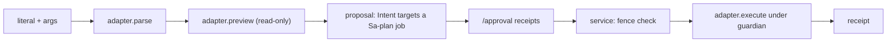

# 20261026-0115 — Telegram ControlledAction adapter contract (wave 2)

#fractal-l0 #fractal-l3 #fractal-l4 #fractal-l9 #zk-adr #zero-muda #km-triad

[This design](http://nas-1.tail55d152.ts.net:4100/files/docs/design/20261026-0115-telegram-controlled-action-adapter-contract.md) · [Plan](http://nas-1.tail55d152.ts.net:4100/files/docs/journal/20261026-0049-claude-telegram-parity-plan-and-process.md) · [Wave 1](http://nas-1.tail55d152.ts.net:4100/files/docs/journal/20261026-0110-claude-telegram-wave1-adapters-and-reconciliation.md) · [Cockpit](http://nas-1.tail55d152.ts.net:4100/)

Transclusions: [[zk:20260905-1801-moc-uos-unified-master]] · [[wiki:20260905-1801-uos-zk-km-corpus-index]]

Status: development design under `uos/telegram-runtime/20261001-1150` COMMAND_IMPL. Grants no authority. Sa-plan remains the sole execution authority (`SC-JIDOKA-001`).

## 1. Problem

22 ControlledAction literals are refused at classify time with "not implemented yet". The repository already has a signed multi-party approval subsystem (`telegram_action_intent`, `telegram_action_proposal`, `telegram_approval`, `telegram_action_profile`) whose only wired effect is a job-lease cancellation, and now a `/verify` chain (reservation → Sa-plan job → guarded executor → receipt). Every ControlledAction must use the same path. No adapter may execute on its own.

## 2. Authority path (unchanged)

```text
[literal + args] -> [adapter.parse] -> [adapter.preview (read-only)]
[preview] -> [proposal: Intent targets a Sa-plan job] -> [/approval receipts]
[approved] -> [service: fence check] -> [adapter.execute under guardian] -> [receipt]
```



The service owns steps 4–6. Adapters own 1, 2 and the body of 5.

## 3. Adapter API (exact)

Module `cepaf_gleam/harness/telegram_action_<name>.gleam`:

```gleam
pub type Request            // parsed, bounded, no IO performed to build it
pub fn literal() -> String  // e.g. "/andon"
pub fn parse(args: String) -> Result(Request, String)   // usage string on error
pub fn effect_id(r: Request) -> String                  // stable digest of the exact effect
pub fn preview(r: Request) -> String                    // JSON: what WOULD change, from real state, no mutation
pub fn execute(r: Request, evidence_dir: String) -> Result(String, String)  // JSON receipt; bounded; idempotent by effect_id
```

Rules:
1. `parse` and `preview` perform no mutation. `preview` reads real state through existing modules and says what it read (`"confidence":"observed|declared|simulated"`).
2. `execute` is called only by the service after approval and fences. It must be idempotent by `effect_id` (a repeat returns the stored receipt), bounded in time, and must write its receipt with exclusive create under `evidence_dir`.
3. An adapter whose effect needs a process, a model, a network peer or hardware that cannot be bounded in development returns `Error("backend_unavailable:<module>")` from `execute` and says so in `preview`. It is still wired, so the literal gets a truthful reply.
4. No adapter touches `telegram_ingress_guard.gleam` or `telegram_service.gleam`. Wiring is serial by the integrator.
5. Reply JSON is closed-shape; `status ∈ {preview, denied, backend_unavailable, executed, duplicate}`.

## 4. Wave-2 candidates and their real backends

| Literal | Backend module | Effect in development | Notes |
|---|---|---|---|
| /andon | `ecology/andon` | record an Andon trip record | must not stop production services |
| /chaos | `testing/chaos_injector`, `chaos/apoptosis` | run one bounded injector scenario in a test harness | development only |
| /dark | `prajna/dark_cockpit` | toggle dark-cockpit mode in the service state model | state record, reversible |
| /export-audit | `vault_audit_query` | write a bounded audit export file | read vault audit, never secrets |
| /gameday | `immune/chaos_immune_engine` | run one gameday scenario in pure simulation | labelled simulated |
| /handover | journals | create a handover journal skeleton | file creation, exclusive |
| /verify | `telegram_verify_*` | run the pinned profile under the guardian | integrator (this session) |
| others (15) | none bounded today | `backend_unavailable` with the named gap | still wired |

## 5. Acceptance per adapter

- Tests: parse positive/negative, preview reads real state (or declares unavailable), execute idempotent by `effect_id` (second call → `duplicate`), execute refuses without an evidence dir, at least 2 killed mutants.
- Integrator: wire literal → `PreservedDirective` in classify (ControlledAction branch) → service arm that only ever calls `preview` until the approval path is extended to call `execute`.

## Comprehensive verification checklist

Design document; checks are obligations for the implementation waves.

<details><summary>Domains 1–6</summary>

- [x] CHK-01-TIME prefix from host clock · [x] CHK-03-FRACT · [x] CHK-04-KM · [x] CHK-18-JJ
- [ ] CHK-02, 05–17: per wave-2 journal.
- Domain 6: EV ceiling 93; EV-94..109 NOT_ADMITTED; no new EV number.

</details>

UOS footer: `nas-1.tail55d152.ts.net:4100` · document evidence grants no system admission.
