# 20261026-0150 — /verify: extending the signed approval flow to call an adapter's execute

#fractal-l0 #fractal-l3 #fractal-l4 #fractal-l9 #zk-adr #zero-muda #km-triad

[This design](http://nas-1.tail55d152.ts.net:4100/files/docs/design/20261026-0150-telegram-verify-approval-execute-extension.md) · [Adapter contract](http://nas-1.tail55d152.ts.net:4100/files/docs/design/20261026-0115-telegram-controlled-action-adapter-contract.md) · [Executor journal](http://nas-1.tail55d152.ts.net:4100/files/docs/journal/20261026-0038-claude-verify-bounded-executor.md) · [Cockpit](http://nas-1.tail55d152.ts.net:4100/)

Transclusions: [[zk:20260905-1801-moc-uos-unified-master]] · [[wiki:20260905-1801-uos-zk-km-corpus-index]]

Status: design under `uos/telegram-runtime/20261001-1150` COMMAND_IMPL. Not implemented. It touches the signed-approval code path, so it needs independent review before, not after, implementation (R5 route: Codex and AGY packets).

## 1. What exists

- Signed approvals: `telegram_action_intent` (Intent targets a Sa-plan job: `Target(job, worker, attempt, lease_until_ns)`), `telegram_action_proposal`, `telegram_approval` (roster receipts), `telegram_action_profile` (trusted profile with context, roster, transport), `telegram_action_packet.load` (64 KiB closed envelope `uos.telegram.action-packet.v1` → `cancellation.Prepared`).
- One effect kind is wired: `/cancel_job_lease` via `execute_approved_cancellation` → `telegram_cancellation` → transport exchange → lookup → commit.
- `/verify` chain: loader (pins) → reservation (inbox id) → `telegram_verify_job.ensure` (Sa-plan job id = binding job_id) → `telegram_verify_executor.execute` (pinned guardian, receipt) → `telegram_verify_reconcile`.
- Dispatcher: `specialized_dispatch` maps `/approval_manage` → ApprovalDispatch and `/cancel_job_lease` → CancellationDispatch; everything else is RegularDispatch.

## 2. The gap

`cancellation.Prepared` is specific to lease cancellation: its record, lookup and commit assume the target is a lease to revoke. `/verify` needs the same approval evidence but a different effect: run the guardian for a reserved job and commit a receipt.

## 3. Design

Add one effect kind, keeping every existing fence.

```text
[verify request] -> [classify VerifyDispatch]
[classify VerifyDispatch] -> [reserve inbox]
[reserve inbox] -> [ensure job]
[ensure job] -> [proposal intent]
[proposal intent] -> [approval receipts]
[approval receipts] -> [load verify packet]
[load verify packet] -> [fence checks]
[fence checks] -> [loader recheck]
[loader recheck] -> [executor execute]
[executor execute] -> [receipt]
[receipt] -> [commit and outbox reply]
```

```mermaid
flowchart LR
  A["verify request"] --> B["classify VerifyDispatch"]
  B --> C["reserve inbox"]
  C --> D["ensure job"]
  D --> E["proposal intent"]
  E --> F["approval receipts"]
  F --> G["load verify packet"]
  G --> H["fence checks"]
  H --> I["loader recheck"]
  I --> J["executor execute"]
  J --> K["receipt"]
  K --> L["commit and outbox reply"]
```



Changes, each small and separately testable:

1. `telegram_action_intent`: no change. The Target already names a job; `effect_id` already derives from the intent digest.
2. `telegram_action_packet`: a second loader `load_verify` returning `telegram_verify_action.Prepared` (new module) with the same envelope, same receipt verification against `action_profile.roster`, and a target kind marker `"verify"` in the record so a cancellation packet can never be replayed as a verify packet and vice versa.
3. `telegram_verify_action` (new): `Prepared`, `recovery_record`, `ready` (same clock and roster checks as `cancellation.ready`), and the execution step that calls `loader.load`, `loader.recheck`, `executor.execute` with the evidence root from `ServiceConfiguration` (new optional field `verify_source: Option(VerifySource)` carrying root, profile path, pin, locators, guardian pin, evidence base; absent → `/verify` replies "not configured", never executes).
4. `telegram_service`: `specialized_dispatch` adds `"/verify" -> VerifyDispatch`; `execute_verify_dispatch` mirrors `execute_action_dispatch` (RecoveryActions → hold; None → not configured; SignedActions → collected or approved path), then `telegram_verify_reconcile` decides between first run, reload of a completed receipt, and refusal on Partial/Inconsistent.
5. Classify: `/verify` leaves the ControlledAction denial only when `verify_source` is configured; otherwise it stays denied.

## 4. Invariants to test (laws)

- No execution without a packet whose receipts verify against the current roster and whose target job id equals the reservation's job id.
- A cancellation packet presented to `load_verify` is refused (kind marker), and a verify packet presented to `action_packet.load` is refused.
- Replay of the same inbox request after a receipt exists returns the stored receipt (reconcile Complete), never a second run.
- Partial evidence after a crash refuses to rerun into the same directory; a new attempt is a new Sa-plan job attempt with a new evidence directory.
- A changed artifact between approval and execution is refused by `recheck` before spawn.
- The guardian pin mismatch is refused before spawn; no child process is created.

## 5. What this does not do

No Telegram delivery of raw gate output (only digests and statuses); no production authority; no service restart; the approval roster and profile remain operator-held configuration.

## 6. Review packet

Reviewers (Codex R5, AGY advice): the kind marker in §3.2, the fence list in §3.3, and whether `verify_source` belongs in `ServiceConfiguration` or in the action profile. A board Question with this file's path will be posted when the implementation task is claimed.

UOS footer: `nas-1.tail55d152.ts.net:4100` · document evidence grants no system admission.
