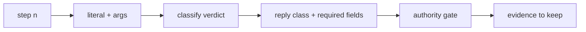

# 20261026-0210 — Telegram operator journey contract (security, defence, critical responder)

#fractal-l0 #fractal-l3 #fractal-l4 #fractal-l5 #fractal-l6 #fractal-l9 #zk-adr #zero-muda #km-triad

[This contract](http://nas-1.tail55d152.ts.net:4100/files/docs/design/20261026-0210-telegram-operator-journey-contract.md) · [Earlier user-centric journeys](http://nas-1.tail55d152.ts.net:4100/files/docs/design/20260909-2205-uos-telegram-user-centric-usecases-spec.md) · [Adapter contract](http://nas-1.tail55d152.ts.net:4100/files/docs/design/20261026-0115-telegram-controlled-action-adapter-contract.md) · [Cockpit](http://nas-1.tail55d152.ts.net:4100/)

Transclusions: [[zk:20260905-1801-moc-uos-unified-master]] · [[wiki:20260905-1801-uos-zk-km-corpus-index]]

Contract ID: `SC-TELEGRAM-JOURNEY-001`. Status: development contract under `uos/telegram-runtime/20261001-1150` COMMAND_IMPL (jobs `journeys-wave5-w1..w3`). Grants no authority. Sa-plan remains the sole execution authority.

## 1. Purpose

A journey is an ordered sequence of Telegram interactions an operator performs to reach an outcome, with the exact truthful reply class each step must produce and the authority gate that applies. Journeys are the acceptance surface for TELEGRAM_E2E and TELEGRAM_ACCEPT: the staged form runs in development against the dispatcher and service harness; the real-traffic form is executed by an authorized human with the staging bot and recorded.

## 2. Three use cases, one contract

| Use case | Operator | Outcome |
|---|---|---|
| Security incident | on-call security responder | detect, contain, preserve evidence, escalate, record |
| Defence / high availability | SRE under degraded conditions | observe health, exercise safeguards, verify recovery, never fabricate state |
| Critical responder | field responder with a phone | fastest truthful situational picture, bounded actions behind approval, handover |

Every journey covers all nine families F1–F9 at least once across the set, and every one of the 77 command literals appears in at least one journey step across the three specs (the coverage test enforces this).

## 3. Reply classes (what a step may expect)

| Class | Meaning | Source of truth |
|---|---|---|
| `ok` | an observation read from a named backend, with `confidence` observed or declared | read adapter or historical arm |
| `preview` | what a ControlledAction would do, read-only, with `confidence` | `telegram_action_adapters.route_preview` |
| `denied` | typed refusal with usage or policy reason | guard or adapter parse |
| `backend_unavailable` | truthful refusal naming the missing backend | adapter |
| `approval_required` | the effect needs the signed approval flow (`/approval propose|submit`) | service |
| `executed` / `duplicate` | only reachable through the approval flow; never from a plain message | approval path (not yet wired for `/verify`) |

A journey step never expects a fabricated success. If the staged system cannot do something, the expected class is `backend_unavailable` or `denied`, and the runbook says what real deployment must add.

## 4. Journey step record

```text
[step n] -> [literal + args] -> [classify verdict] -> [reply class + required fields] -> [authority gate] -> [evidence to keep]
```



Each spec is a Markdown table with columns: Step, Persona action, Literal and args, Family, Expected class, Required fields (e.g. `confidence`, `backend`), Authority gate (none / allowlisted pair / approval roster / operator), Evidence kept (receipt digest, journal line), Failure meaning.

## 5. Executable forms

1. **Dispatcher-layer journey test** (development, deterministic): for each step, `telegram_ingress_guard.classify_directive(text)` then `telegram_read_adapters.route` / `telegram_action_adapters.route_preview` / historical arm expectation; asserts the reply class and required fields; one test per journey plus a coverage test over all 77 literals. Module names: `test/telegram_journey_<usecase>_test.gleam`.
2. **Service-loop journey** (development): the `telegram_service_e2e_test` harness (poll → dispatch → outbox) replays the journey's first steps end to end; one per use case where the harness supports the step.
3. **Real-traffic run** (operator): the runbook `docs/sop/20261026-xxxx-telegram-real-traffic-journeys-runbook.md`: prerequisites (staging bot token held in the reviewed private transport configuration, never in the repo; allowlisted user and chat; production bridge untouched), the exact messages to send, the expected replies, pass/fail per step, and where evidence is written. A pass is recorded by the operator as Sa-plan evidence; a model or agent cannot record it on their behalf.

## 6. Capability bindings

- Skill `uos-telegram-journeys` on `.claude`, `.gemini`, `.agents`, `.codex`: how to add a journey, run the staged forms, prepare the real-traffic run, and what counts as evidence.
- Rule `telegram-journey-acceptance` (same four surfaces): no command family or literal without a journey step; staged journeys green before a landing that touches the command surface; real-traffic journeys before RELEASE.
- Plugin `plugins/uos-telegram-journeys`: packages the skill; no hooks, no network, no credentials.
- Superpowers binding: journeys are the `verification-before-completion` artefact for the Telegram surface and the `finishing-a-development-branch` gate for landings touching it.

## 7. What this contract does not claim

Development journeys prove the dispatcher and the staged service behave as specified. They are not a real Telegram user journey, not a release, not admission. EV ceiling 93; EV-94..109 NOT_ADMITTED.

UOS footer: `nas-1.tail55d152.ts.net:4100` · document evidence grants no system admission.
