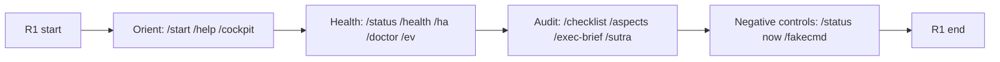
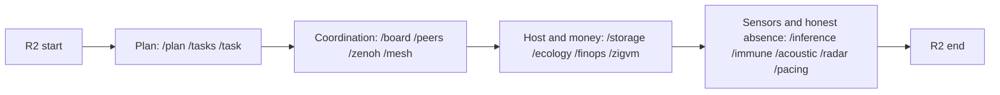
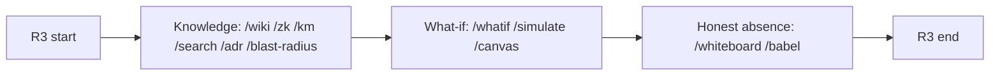
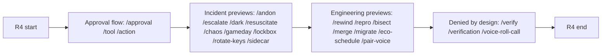
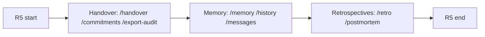
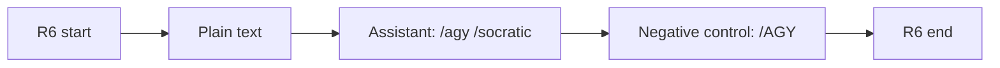

# 20261026-0215 — Telegram journeys: critical responder

#fractal-l0 #fractal-l3 #fractal-l5 #fractal-l6 #zk-adr #zero-muda #km-triad #tailscale-web

[This document](http://nas-1.tail55d152.ts.net:4100/files/docs/design/20261026-0215-telegram-journey-critical-responder.md) · [Journey contract](http://nas-1.tail55d152.ts.net:4100/files/docs/design/20261026-0210-telegram-operator-journey-contract.md) · [Persona language](http://nas-1.tail55d152.ts.net:4100/files/docs/design/20260909-2205-uos-telegram-user-centric-usecases-spec.md) · [Cockpit](http://nas-1.tail55d152.ts.net:4100/) · [Planning](http://nas-1.tail55d152.ts.net:4100/planning) · [Wiki](http://nas-1.tail55d152.ts.net:4100/wiki) · [ZK](http://nas-1.tail55d152.ts.net:4100/zk) · [Checklist](http://nas-1.tail55d152.ts.net:4100/checklist)

Transclusions: [[zk:20260905-1801-moc-uos-unified-master]] · [[wiki:20260905-1801-uos-zk-km-corpus-index]]

Contract ID: `SC-TELEGRAM-JOURNEY-001` (use case 3 of 3). Ledger: Sa-plan job `uos/telegram-runtime/20261001-1150/journeys-wave5-w3`, COMMAND_IMPL attempt 19. Grants no authority. EV ceiling 93; EV-94..109 NOT_ADMITTED.

## 1. Persona and ground rules

**Persona: the critical responder.** A field responder with only a phone, possibly outdoors, one thumb, intermittent signal, no laptop, no signing key. They need the fastest truthful picture, a way to prepare an action without being able to cause one, and a clean handover. Persona language follows the earlier user-centric spec (P1 on-the-go SRE, P2 hands-busy field technician); this document adds no new persona authority.

**What is walked.** Every step is sent through the three functions the Telegram service calls, in the service's order: `telegram_ingress_guard.classify_directive`, then `telegram_read_adapters.route`, then `telegram_action_adapters.route_preview`. Nothing in the staged form touches the network, a process or Telegram.

**Expected classes** follow the contract (section 3). Two refinements are needed to stay true to the current dispatcher:

| Label | Meaning here |
|---|---|
| `ok` | an adapter or the static reference path replied; the test asserts the reply |
| `ok*` | the literal is a live-service read (DirectReadTool) or a service arm; the dispatcher layer asserts only the classify verdict, and the reply class depends on the staged service configuration. Real traffic records what the service actually answered (an observation, or a typed failure naming the missing backend) |
| `preview` | a read-only ControlledAction preview with `confidence` simulated, declared or observed and `approval_required`/`authority:NONE` where the adapter states it |
| `denied` | a typed refusal: a `DeniedMutation` or `UnknownDirective` at classify, or an adapter reply with `status:denied` and a usage reason |
| `backend_unavailable` | a truthful refusal naming the missing backend |
| `executed`, `duplicate`, `approval_required` | never expected here: no plain message in these journeys reaches execution |

**Gate legend.** `pair` = the (chat, user) pair is on the allowlist. Preview steps add: execution needs the signed approval flow (`/approval propose|submit`), which a plain message does not satisfy.

**Evidence legend.** E1 = reply text and Telegram message id. E2 = E1 plus sha256 of the reply text. E3 = E2 plus the preview `effect_id`.

**Family labels.** The contract names families F1 to F9 without enumerating them. This document fixes the labels it uses: F1 orientation, F2 health and status, F3 plan and tasks, F4 coordination and mesh, F5 knowledge, F6 simulation and sensors, F7 approval-gated actions, F8 memory, handover and evidence, F9 conversation. All nine appear.

**Required-fields note.** The contract says an `ok` reply carries `confidence`. The read adapters actually emit `status`, `command`, `backend` and `observation` (the observation itself states `kind`, `live_status`, `subject` or `deployment_confirmed`); only ControlledAction previews emit `confidence`. The tests assert what the adapters emit.

Totals: **6 journeys, 103 steps, 8 tests** (6 journey walks, 1 catalog-membership test, 1 coverage test), **75 of 77 catalog literals covered**. The two not covered here, `/fmea` and `/rete`, belong to the security and defence journeys.

## 2.1. R1 First 60 seconds

**Goal.** Within one minute of opening the bot, reach the cockpit link, see what the bot can do, and learn which health answers are observations and which are only configuration.

**Persona.** Critical responder, phone only.

**Preconditions.** Staged service running; allowlisted (chat, user) pair; no prior state needed.

### Diagram

```text
[R1 start] -> [Orient: /start /help /cockpit]
[Orient: /start /help /cockpit] -> [Health: /status /health /ha /doctor /ev]
[Health: /status /health /ha /doctor /ev] -> [Audit: /checklist /aspects /exec-brief /sutra]
[Audit: /checklist /aspects /exec-brief /sutra] -> [Negative controls: /status now /fakecmd]
[Negative controls: /status now /fakecmd] -> [R1 end]
```



### Steps

| Step | Persona action | Literal and args | Family | Expected class | Required fields | Authority gate | Evidence kept | Failure meaning |
|---|---|---|---|---|---|---|---|---|
| R1.1 | Opens the bot for the first time and wants the list of what works. | `/start` | F1 | `ok` | classify Preserved(/help); reference text lists the catalog | pair | E2 | Empty or non-catalog reply means the static reference path is broken; the responder has no map. |
| R1.2 | Asks for help again mid-incident. | `/help` | F1 | `ok` | classify Preserved(/help); reply contains `/status` | pair | E2 | Same as /start; help must not claim every listed command is ready (it says some are being completed). |
| R1.3 | Wants the one link to the full cockpit. | `/cockpit` | F1 | `ok` | classify Preserved(/cockpit); reply contains the Tailscale cockpit URL | pair | E2 | Missing or non-FQDN link: the responder cannot escalate to the big screen. |
| R1.4 | Asks whether the bot's own services are reachable. | `/status` | F2 | `ok*` | classify DirectReadTool(query_system_health) | pair | E1 | A reply that claims health without naming what was probed is a fabricated state. |
| R1.5 | Same question, other spelling. | `/health` | F2 | `ok*` | classify DirectReadTool(query_system_health) | pair | E1 | Alias must give the same tool; a different verdict means alias drift. |
| R1.6 | Checks runtime pressure of the Telegram BEAM node. | `/ha` | F2 | `ok*` | classify DirectReadTool(query_ha) | pair | E1 | Cluster failover must stay reported as unverified, never as healthy. |
| R1.7 | Wants diagnostic provenance. | `/doctor` | F2 | `ok*` | classify DirectReadTool(query_doctor) | pair | E1 | A live-pass claim without runtime evidence violates two-key verification. |
| R1.8 | Uses the short alias for the same diagnostic. | `/ev` | F2 | `ok*` | classify DirectReadTool(query_doctor) | pair | E1 | Alias must resolve to the doctor read. |
| R1.9 | Checks the verification checklist state. | `/checklist` | F2 | `ok*` | classify DirectReadTool(query_checklist) | pair | E1 | Candidate records are not gate execution; a reply that says gates passed is wrong. |
| R1.10 | Wants the 17-aspect audit overview. | `/aspects` | F2 | `ok*` | classify Preserved(/aspects, [""]); service verification arm | pair | E1 | Reply must be configured candidate records, not a gate run. |
| R1.11 | Mistypes an aspect code on a phone. | `/aspects A99` | F2 | `denied` | classify DeniedMutation(/aspects); usage names A01 through A17 | pair | E1 | A99 accepted would mean unbounded scope selection. |
| R1.12 | Wants a one-screen progress brief. | `/exec-brief` | F2 | `ok*` | classify DirectReadTool(query_exec_brief) | pair | E1 | Must state it covers the configured plan only, not global health. |
| R1.13 | Sends /sutra expecting the matrix read. | `/sutra` | F2 | `ok*` | classify DirectReadTool(query_matrix_versions) | pair | E1 | Today /sutra answers observed Matrix client API versions; any other content is invention. |
| R1.14 | Appends a word by habit. | `/status now` | F2 | `denied` | classify DeniedMutation(query_system_health): read arguments must be absent | pair | E1 | Accepting free text on a read tool would let arguments widen scope. |
| R1.15 | Mistypes a command. | `/fakecmd` | F1 | `denied` | classify UnknownDirective(/fakecmd) | pair | E1 | An unknown literal must be refused by name, never guessed. |

## 2.2. R2 Situational picture and field sensors

**Goal.** Build a truthful situational picture from a phone: plan and tasks, coordination, host and spend, and the field sensors, with every absent sensor reported as absent.

**Persona.** Critical responder, phone only.

**Preconditions.** R1 passed or recorded. A Sa-plan observer configuration exists for `/plan`, `/task`, `/search` if those steps are to observe rather than report a typed failure.

### Diagram

```text
[R2 start] -> [Plan: /plan /tasks /task]
[Plan: /plan /tasks /task] -> [Coordination: /board /peers /zenoh /mesh]
[Coordination: /board /peers /zenoh /mesh] -> [Host and money: /storage /ecology /finops /zigvm]
[Host and money: /storage /ecology /finops /zigvm] -> [Sensors and honest absence: /inference /immune /acoustic /radar /pacing]
[Sensors and honest absence: /inference /immune /acoustic /radar /pacing] -> [R2 end]
```



### Steps

| Step | Persona action | Literal and args | Family | Expected class | Required fields | Authority gate | Evidence kept | Failure meaning |
|---|---|---|---|---|---|---|---|---|
| R2.1 | Reads the configured plan snapshot. | `/plan` | F3 | `ok*` | classify DirectReadTool(query_saplan) | pair | E1 | Observer failure must surface as a typed failure object, not an empty plan. |
| R2.2 | Uses the alias. | `/tasks` | F3 | `ok*` | classify DirectReadTool(query_saplan) | pair | E1 | Alias must equal /plan. |
| R2.3 | Looks at one task chosen from /plan (use a real id from step 1 in real traffic). | `/task t1` | F3 | `ok*` | classify Preserved(/task, ["t1"]); service task arm | pair | E1 | Recorded state is a snapshot; a reply that implies a live lease is wrong. |
| R2.4 | Forgets the id. | `/task` | F3 | `denied` | classify DeniedMutation(/task): usage `/task <task_id>` | pair | E1 | Must refuse; no default task may be invented. |
| R2.5 | Reads coordination board counts. | `/board` | F4 | `ok*` | classify DirectReadTool(query_board) | pair | E1 | Counts only; message bodies must not be fabricated. |
| R2.6 | Sees which agent sessions heartbeat. | `/peers` | F4 | `ok*` | classify DirectReadTool(query_peers) | pair | E1 | Heartbeat observations only; absence is not proof of death. |
| R2.7 | Checks the mesh bus, no topic. | `/zenoh` | F4 | `ok*` | classify Preserved(/zenoh, [""]); service zenoh arm | pair | E1 | Topic reads only for explicitly granted user and chat. |
| R2.8 | Pastes a URL by mistake. | `/zenoh https://example.invalid` | F4 | `denied` | classify DeniedMutation(/zenoh): URLs and wildcards refused | pair | E1 | A URL accepted as topic would be an SSRF-shaped hole. |
| R2.9 | Reads the declared mesh topology. | `/mesh` | F4 | `ok (backend_unavailable if the declared mesh config is invalid)` | status ok, command, backend=`cepaf_gleam/config/mesh_source`, observation with `deployment_confirmed:false` | pair | E2 | `deployment_confirmed` must stay false: this is configuration, never deployment evidence. |
| R2.10 | Checks host storage capacity. | `/storage` | F2 | `ok*` | classify DirectReadTool(query_storage) | pair | E1 | The root-OS drive interlock stays asserted by policy; a read cannot change it. |
| R2.11 | Uses the NVMe alias. | `/nvme` | F2 | `ok*` | classify DirectReadTool(query_storage) | pair | E1 | Alias must equal /storage. |
| R2.12 | Asks about local participants. | `/ecology` | F2 | `ok*` | classify DirectReadTool(query_ecology) | pair | E1 | Service health stays unverified. |
| R2.13 | Checks reserved model spend. | `/finops` | F2 | `ok*` | classify DirectReadTool(query_finops) | pair | E1 | Actual spend stays unknown; only reserved liability is reported. |
| R2.14 | Uses the budget alias. | `/budget` | F2 | `ok*` | classify DirectReadTool(query_finops) | pair | E1 | Alias must equal /finops. |
| R2.15 | Asks for the pinned kernel version. | `/zigvm` | F2 | `ok*` | classify DirectReadTool(query_zigvm_version) | pair | E1 | Version only; evaluation is not integrated. |
| R2.16 | Asks which inference tiers exist. | `/inference` | F6 | `ok` | status ok, command, backend=`cepaf_gleam/ui/lustre/inference_tier`, observation with `live_status:not_observed` | pair | E2 | `live_status` must be `not_observed`; the read lists configuration, no model was called. |
| R2.17 | Adds an argument. | `/inference now` | F6 | `denied` | status denied, command, reason `Usage: /inference (takes no arguments)` | pair | E1 | Arguments to a no-argument read are refused. |
| R2.18 | Asks for antibody state. | `/immune` | F6 | `backend_unavailable` | status backend_unavailable, command, backend=`cepaf_gleam/immune/system`, reason | pair | E2 | An ok here would be a fabricated state: the immune system is an actor with no snapshot message. |
| R2.19 | Asks for the rack camera result. | `/rack-cv` | F6 | `backend_unavailable` | status backend_unavailable, command, backend=`cepaf_gleam/harness/multimodal_features`, reason | pair | E2 | No vision backend exists; any detection would be invented. |
| R2.20 | Asks for acoustic bearing. | `/acoustic` | F6 | `backend_unavailable` | status backend_unavailable, command, backend=`cepaf_gleam/services/max_inference_daemon`, reason | pair | E2 | No audio sample or MAX daemon is observable; any bearing would be invented. |
| R2.21 | Opens the acoustic HUD. | `/acoustic-hud` | F6 | `ok` | status ok, command, backend=`cepaf_gleam/knowledge/raga_cybernetic_synthesis`, observation with `live_sensor:not_observed` | pair | E2 | This is a self-audit of the shruti tables; `live_sensor` must read not_observed. |
| R2.22 | Asks for the radar picture. | `/radar` | F6 | `backend_unavailable` | status backend_unavailable, command, backend=`cepaf_gleam/ui/lustre/biosemiotics_radar`, reason | pair | E2 | The radar is fixed constants today; presenting them as telemetry would be false. |
| R2.23 | Asks for work pacing advice. | `/pacing` | F6 | `backend_unavailable` | status backend_unavailable, command, backend=`cepaf_gleam/harness/telegram_creative`, reason | pair | E2 | No typing-cadence source exists; canned text is refused. |
| R2.24 | Asks for a nap schedule. | `/pacing nap` | F6 | `backend_unavailable` | same as /pacing; argument `nap` accepted but changes nothing | pair | E2 | Accepting the argument must not unlock a canned answer. |

### What real deployment must add (backend_unavailable steps)

| Step | Missing backend named by the reply | What real deployment must add |
|---|---|---|
| `/immune` | `cepaf_gleam/immune/system` | A read-only snapshot message on the immune actor, exposed through a supervised synchronous reader with a bounded reply. |
| `/rack-cv` | `cepaf_gleam/harness/multimodal_features` | A camera ingest path and a computer-vision model call through the isolated MAX tier, with a typed result reader. |
| `/acoustic` | `cepaf_gleam/services/max_inference_daemon` | An audio sample ingress and a running MAX daemon exposing `infer_audio`, plus a bounded bearing kernel. |
| `/radar` | `cepaf_gleam/ui/lustre/biosemiotics_radar` | A live telemetry feed replacing the fixed constants, with freshness and source fields. |
| `/pacing` | `cepaf_gleam/harness/telegram_creative` | A typing-cadence or session-telemetry source with consent and retention rules. |
| `/pacing nap` | `cepaf_gleam/harness/telegram_creative` | Same as /pacing; the `nap` argument needs a real schedule source, not canned text. |

### Host-dependent steps

These answer `ok` when the host provides the input and `backend_unavailable` otherwise; the test accepts either, the real run records which.

| Step | Needs |
|---|---|
| `/mesh` | UOS_MESH_CONFIG_JSON absent (compiled default) or valid; invalid declares backend_unavailable. |

## 2.3. R3 Knowledge in the field and what-if

**Goal.** Look things up and test ideas in the field without leaving Telegram: wiki, ZK, ADRs, dependency reach, and pure what-if simulations that say they are simulations.

**Persona.** Critical responder, phone only.

**Preconditions.** docs/zk and docs/journal readable by the service for `/adr`; wiki/zk corpora indexed for `/wiki` `/zk` `/km` `/search`.

### Diagram

```text
[R3 start] -> [Knowledge: /wiki /zk /km /search /adr /blast-radius]
[Knowledge: /wiki /zk /km /search /adr /blast-radius] -> [What-if: /whatif /simulate /canvas]
[What-if: /whatif /simulate /canvas] -> [Honest absence: /whiteboard /babel]
[Honest absence: /whiteboard /babel] -> [R3 end]
```



### Steps

| Step | Persona action | Literal and args | Family | Expected class | Required fields | Authority gate | Evidence kept | Failure meaning |
|---|---|---|---|---|---|---|---|---|
| R3.1 | Looks up a concept in the wiki. | `/wiki homeostasis` | F5 | `ok*` | classify Preserved(/knowledge, ["wiki","homeostasis"]) | pair | E1 | Must report observed documents only. |
| R3.2 | Looks in the Zettelkasten. | `/zk adr` | F5 | `ok*` | classify Preserved(/knowledge, ["zk","adr"]) | pair | E1 | Same. |
| R3.3 | Searches both corpora. | `/km provenance` | F5 | `ok*` | classify Preserved(/knowledge, ["all","provenance"]) | pair | E1 | Same. |
| R3.4 | Searches task ids, states and documents. | `/search lease` | F5 | `ok*` | classify Preserved(/search, ["lease"]) | pair | E1 | Searches the configured plan only; scope overrides refused. |
| R3.5 | Asks how many decision records exist. | `/adr` | F5 | `ok (backend_unavailable if docs/zk is unreadable)` | status ok, command, backend=`cepaf_gleam/harness/files (docs/zk)`, observation with `adr_files` and `highest_number` | pair | E2 | Count must come from the directory read, not a constant. |
| R3.6 | Opens one decision record. | `/adr 10` | F5 | `ok (backend_unavailable if docs/zk is unreadable)` | status ok, observation with `number`, `found`, `title`, `first_lines` | pair | E2 | Title and first lines come from the file; `found:false` is a valid truthful answer for a missing number. |
| R3.7 | Types a word instead of a number. | `/adr ten` | F5 | `denied` | status denied, reason `Usage: /adr [number 1-999]` | pair | E1 | Non-numeric input is refused. |
| R3.8 | Asks what depends on a module. | `/blast-radius cepaf_gleam/harness/telegram_service` | F5 | `ok*` | classify Preserved(/blast-radius, ["cepaf_gleam@harness@telegram_service"]) | pair | E1 | Static compiled dependencies only; never a live impact claim. |
| R3.9 | Forgets the module. | `/blast-radius` | F5 | `denied` | classify DeniedMutation(/blast-radius): exact module or path required | pair | E1 | No default module may be chosen. |
| R3.10 | Wonders what happens if three workers claim one task. | `/whatif claim 3` | F6 | `ok` | status ok, observation `kind:pure_simulation`, `subject` says synthetic task, `granted:1`, `rejected:2` | pair | E2 | The subject must say synthetic; this is never the live plan. |
| R3.11 | Asks how retries back off. | `/whatif retry 3` | F6 | `ok` | status ok, observation `scenario:oban_retry_backoff`, steps end in `dead` | pair | E2 | Backoff steps are simulated; must say synthetic job. |
| R3.12 | Asks whether an expired lease is reaped. | `/whatif zombie 100 200` | F6 | `ok` | status ok, observation `scenario:zombie_lease_reaper`, `reaped:true` | pair | E2 | Synthetic lease only. |
| R3.13 | Tries too many workers. | `/whatif claim 99` | F6 | `denied` | status denied, reason is the /whatif usage text | pair | E1 | Out-of-range values are refused, not clamped. |
| R3.14 | Tries the peer-mesh simulation grammar. | `/simulate a:nominal b:degraded` | F6 | `denied` | status denied, command `/whatif` (alias collapse), reason is the /whatif usage text | pair | E1 | DEFECT RECORDED: /simulate canonicalizes to /whatif at classify, so its peer-mesh grammar is unreachable and the reply is the /whatif usage. A success here would mean the alias was fixed; update the journey then. |
| R3.15 | Sketches two points to check a merge. | `/canvas a:1,2,3 b:4,5,6` | F6 | `ok` | status ok, observation `subject` says caller-supplied elements, `element_count:2`, `split_replicas_merge_converged` | pair | E2 | Subject must say not the live canvas. |
| R3.16 | Sends it empty. | `/canvas` | F6 | `denied` | status denied, reason is the /canvas usage text | pair | E1 | Empty canvas is refused. |
| R3.17 | Wants a whiteboard photo turned into code. | `/whiteboard` | F6 | `backend_unavailable` | status backend_unavailable, backend=`cepaf_gleam/harness/telegram_collab.handle_whiteboard`, reason | pair | E2 | Needs photo upload and a vision model; code from nowhere would be invention. |
| R3.18 | Wants live speech translation. | `/babel` | F6 | `backend_unavailable` | status backend_unavailable, backend=`cepaf_gleam/harness/telegram_collab.handle_babel`, reason | pair | E2 | Needs a voice stream and a translation model. |

### What real deployment must add (backend_unavailable steps)

| Step | Missing backend named by the reply | What real deployment must add |
|---|---|---|
| `/whiteboard` | `cepaf_gleam/harness/telegram_collab.handle_whiteboard` | Photo upload (media ingress is currently unsupported), a vision model, and a reviewed code-synthesis step. |
| `/babel` | `cepaf_gleam/harness/telegram_collab.handle_babel` | A voice stream and a translation model behind the isolated inference tier. |

### Host-dependent steps

These answer `ok` when the host provides the input and `backend_unavailable` otherwise; the test accepts either, the real run records which.

| Step | Needs |
|---|---|
| `/adr` | docs/zk readable from the service's repository root. |
| `/adr 10` | docs/zk readable from the service's repository root. |

## 2.4. R4 Bounded action behind approval

**Goal.** Prepare a bounded action: read what each controlled action would change, understand why nothing changes without the signed approval flow, and meet the three literals that are denied outright.

**Persona.** Critical responder, phone only.

**Preconditions.** Staging approval roster configured (codex, agy, claude, operator) or explicitly absent; the responder holds no signing key and signs nothing in this journey.

### Diagram

```text
[R4 start] -> [Approval flow: /approval /tool /action]
[Approval flow: /approval /tool /action] -> [Incident previews: /andon /escalate /dark /resuscitate /chaos /gameday /lockbox /rotate-keys /sidecar]
[Incident previews: /andon /escalate /dark /resuscitate /chaos /gameday /lockbox /rotate-keys /sidecar] -> [Engineering previews: /rewind /repro /bisect /merge /migrate /eco-schedule /pair-voice]
[Engineering previews: /rewind /repro /bisect /merge /migrate /eco-schedule /pair-voice] -> [Denied by design: /verify /verification /voice-roll-call]
[Denied by design: /verify /verification /voice-roll-call] -> [R4 end]
```



### Steps

| Step | Persona action | Literal and args | Family | Expected class | Required fields | Authority gate | Evidence kept | Failure meaning |
|---|---|---|---|---|---|---|---|---|
| R4.1 | Lists pending controlled requests. | `/approval` | F7 | `ok*` | classify Preserved(/approval, []); service approval-status arm | pair | E1 | An empty list is a valid answer; a fabricated request is not. |
| R4.2 | Types the word approve. | `/approval approve tg-123` | F7 | `denied` | classify DeniedMutation(/approval): unsigned approve text cannot authorize | pair | E1 | If this ever parses as approval, the signed-receipt boundary is broken. |
| R4.3 | Asks for the signing challenge of one request. | `/approval propose tg-123` | F7 | `ok*` | classify Preserved(/approval_manage, ["propose","tg-123"]); approval dispatch | pair; approval roster signs, never the responder | E1 | Proposing unknown ids must yield a typed not-found style reply, never an execution. |
| R4.4 | Mistypes the id. | `/approval propose bad` | F7 | `denied` | classify DeniedMutation(/approval): invalid request identifier | pair; approval roster signs, never the responder | E1 | Bad ids are refused at the guard. |
| R4.5 | Asks which tools exist. | `/tool help` | F7 | `ok*` | classify Preserved(/tool_help, []) | pair | E1 | Help text must list only read tools plus the approval flow. |
| R4.6 | Uses the /action alias. | `/action help` | F7 | `ok*` | classify Preserved(/tool_help, []) | pair | E1 | Alias must equal /tool. |
| R4.7 | Uses the tool form of a read. | `/tool query_peers` | F7 | `ok*` | classify DirectReadTool(query_peers) | pair | E1 | Tool form and slash form must select the same read. |
| R4.8 | Tries to run a shell by habit. | `/tool shell ls` | F7 | `denied` | classify DeniedMutation(/tool): tool unavailable | pair | E1 | No shell tool exists; acceptance would be a critical hole. |
| R4.9 | Sends it bare in a hurry. | `/andon` | F7 | `denied` | status denied, reason is the /andon usage text | pair; preview only, execute needs signed approval | E1 | Bare action must teach the grammar, not stop anything. |
| R4.10 | Previews halting the MAX tier. | `/andon modular_max watchdog_stall` | F7 | `preview` | status preview, effect_id, confidence=simulated, `approval_required:true`, `process_signalled:false`, `authority:NONE` | pair; preview only, execute needs signed approval | E3 | `process_signalled` must stay false: nothing is stopped. |
| R4.11 | Previews escalation for a 120 s stale signal. | `/escalate 120` | F7 | `preview` | status preview, effect_id, confidence=simulated, `notification_sent:false` | pair; preview only, execute needs signed approval | E3 | `notification_sent` must stay false. |
| R4.12 | Types an out-of-range age. | `/escalate 99999` | F7 | `denied` | status denied, reason `age_out_of_range` | pair; preview only, execute needs signed approval | E1 | Out-of-range values are refused. |
| R4.13 | Previews dimming the cockpit. | `/dark dim` | F7 | `preview` | status preview, effect_id, confidence=declared, `global_state_mutated:false` | pair; preview only, execute needs signed approval | E3 | `global_state_mutated` must stay false; the state source is declared, not the running cockpit. |
| R4.14 | Previews recovery of the MAX tier. | `/resuscitate modular_max` | F7 | `preview` | status preview, effect_id, confidence=simulated, `process_restarted:false` | pair; preview only, execute needs signed approval | E3 | No restart happens; completion needs an engaged-backend probe receipt. |
| R4.15 | Previews a synthetic daemon kill. | `/chaos sa-plan-daemon-kill` | F7 | `preview` | status preview, effect_id, confidence=declared, `real_effects:none` | pair; preview only, execute needs signed approval | E3 | `real_effects` must read none. |
| R4.16 | Previews a game-day scenario. | `/gameday worker-oom` | F7 | `preview` | status preview, effect_id, confidence=simulated, `real_effects:none` | pair; preview only, execute needs signed approval | E3 | Pure simulation only. |
| R4.17 | Previews sealing the vault after a suspected leak. | `/lockbox seal credential_suspected` | F7 | `preview` | status preview, effect_id, confidence=declared, `secret_material_read:false`, `execute:unavailable:vault_kek` | pair; preview only, execute needs signed approval | E3 | Sealing must not run; the vault is not read. |
| R4.18 | Previews key rotation timing. | `/rotate-keys 90 40` | F7 | `preview` | status preview, effect_id, confidence=declared, `key_material_read:false`, `policy_decision` | pair; preview only, execute needs signed approval | E3 | Declared inputs only; no key is read. |
| R4.19 | Previews booting the ingress sidecar. | `/sidecar ingress` | F7 | `preview` | status preview, effect_id, confidence=simulated, `runtime_observation:unknown`, backend `unavailable:mirage_unikernel_daemon` | pair; preview only, execute needs signed approval | E3 | Nothing boots; runtime state must read unknown. |
| R4.20 | Previews rewinding five events of a reference history. | `/rewind 5` | F7 | `preview` | status preview, effect_id, confidence=simulated, `store_mutations:0` | pair; preview only, execute needs signed approval | E3 | The history is declared; no live store is read. |
| R4.21 | Previews a reproduction packet for a task. | `/repro task-1` | F7 | `preview` | status preview, effect_id, confidence=declared, `executes_commands:false` | pair; preview only, execute needs signed approval | E3 | Task state must read not_observed in the preview. |
| R4.22 | Previews a bisection plan. | `/bisect abcd ef01` | F7 | `preview` | status preview, effect_id, confidence=simulated, `vcs_calls:0` | pair; preview only, execute needs signed approval | E3 | No VCS call is made; outcome is assumed. |
| R4.23 | Previews merging a change. | `/merge zkuzwnup` | F7 | `backend_unavailable` | status backend_unavailable (inside the preview object), effect_id, backend=`integration_lease`, `requires`, `vcs_mutation:false` | pair; preview only, execute needs signed approval | E2 | A plain preview here would hide that no integration lease can be read. |
| R4.24 | Previews a migration stage move. | `/migrate MIG-02-SANDBOX discovered` | F7 | `preview` | status preview, effect_id, confidence=simulated, `migrated:false`, `admission:unverified` | pair; preview only, execute needs signed approval | E3 | `migrated` must stay false. |
| R4.25 | Previews leveled scheduling of five model jobs. | `/eco-schedule jobs=5` | F7 | `preview` | status preview, effect_id, confidence=simulated, `jobs_scheduled` | pair; preview only, execute needs signed approval | E3 | No job is enqueued. |
| R4.26 | Previews a voice pairing session. | `/pair-voice alpha` | F7 | `preview` | status preview, effect_id, confidence=declared, `pipeline_active:false` | pair; preview only, execute needs signed approval | E3 | Nothing opens. |
| R4.27 | Capitalizes the peer name. | `/pair-voice Alpha` | F7 | `denied` | status denied, reason is the /pair-voice usage text | pair; preview only, execute needs signed approval | E1 | Uppercase is refused. |
| R4.28 | Tries to trigger verification from chat. | `/verify` | F7 | `denied` | classify DeniedMutation(/verify): action not implemented for a plain message | pair | E1 | Denied by design: verification needs the approval flow (see 20261026-0150), not a plain message. An executed reply here is a boundary breach. |
| R4.29 | Uses the alias. | `/verification` | F7 | `denied` | classify DeniedMutation(/verify) (alias of /verify) | pair | E1 | Same as /verify; the alias resolves to the same canonical literal. |
| R4.30 | Tries a voice roll call. | `/voice-roll-call` | F7 | `denied` | classify DeniedMutation(/voice-roll-call) | pair | E1 | Denied by design: the media design forbids an unauthenticated path from offering to authenticate a constitutional vote; the adapter stays an unrouted candidate. |

### What real deployment must add (backend_unavailable steps)

| Step | Missing backend named by the reply | What real deployment must add |
|---|---|---|
| `/merge zkuzwnup` | `integration_lease` | A reader for the held `integration/main` lease and green build/test evidence at the new tip; execution only through the signed approval flow. |

### Preview steps whose execute leg is unavailable

These reply `preview` truthfully, and the same reply states that execution cannot run. They are not `backend_unavailable` steps but real deployment still needs the backend named.

| Step | Execute backend | What real deployment must add |
|---|---|---|
| `/lockbox seal credential_suspected` | `vault_kek` | An opened vault and production authority; sealing runs only after signed approval. |
| `/rotate-keys 90 40` | `vault_kek_rotation` | An opened vault and production authority; rotation is operator-gated (re-seal-tpm). |
| `/sidecar ingress` | `mirage_unikernel_daemon` | A supervised unikernel daemon and Solo5 toolchain evidence. |

## 2.5. R5 Handover and memory

**Goal.** Close the shift: preview a handover, see what is owed, preview an audit export, check memory, and find the last journals.

**Persona.** Critical responder, phone only.

**Preconditions.** R4 complete so the responder has previews to hand over. No `/memory clear` or `/memory reset` is sent: those mutate stored history.

### Diagram

```text
[R5 start] -> [Handover: /handover /commitments /export-audit]
[Handover: /handover /commitments /export-audit] -> [Memory: /memory /history /messages]
[Memory: /memory /history /messages] -> [Retrospectives: /retro /postmortem]
[Retrospectives: /retro /postmortem] -> [R5 end]
```



### Steps

| Step | Persona action | Literal and args | Family | Expected class | Required fields | Authority gate | Evidence kept | Failure meaning |
|---|---|---|---|---|---|---|---|---|
| R5.1 | Sends it bare at shift end. | `/handover` | F8 | `denied` | status denied, reason is the /handover usage text | pair | E1 | Bare action must teach the slug grammar. |
| R5.2 | Previews a 13-section handover skeleton. | `/handover shift-a` | F8 | `preview` | status preview, effect_id, confidence=observed, `sections:13`, `docs_directory_untouched:true` | pair; preview only, execute needs signed approval | E3 | Nothing is written by the preview; the file name carries the host clock so it is not asserted. |
| R5.3 | Asks what is owed. | `/commitments` | F8 | `preview` | status preview, effect_id, confidence=declared, `execute:backend_unavailable:...telegram_task_command` | pair; preview only, execute needs signed approval | E3 | `tasks_observed` must be 0 here: open tasks need the service observer configuration. |
| R5.4 | Previews an audit-metadata export. | `/export-audit limit=10` | F8 | `preview` | status preview, effect_id, confidence=declared, `never_exported` lists secret_bytes, backend `unavailable:rusty_vault_nif` | pair; preview only, execute needs signed approval | E3 | No export file is written; secrets are never listed as exportable. |
| R5.5 | Checks what the bot remembers. | `/memory` | F8 | `ok*` | classify Preserved(/memory, []); memory dispatch | pair | E1 | Status only; clearing history (`/memory clear`) is not exercised. |
| R5.6 | Reads recent messages. | `/history` | F8 | `ok*` | classify Preserved(/messages, []); memory dispatch | pair | E1 | Alias must resolve to /messages. |
| R5.7 | Reads recent messages. | `/messages` | F8 | `ok*` | classify Preserved(/messages, []); memory dispatch | pair | E1 | Same. |
| R5.8 | Looks for the last retrospectives. | `/retro` | F8 | `ok (backend_unavailable if docs/journal is unreadable)` | status ok, backend=`cepaf_gleam/harness/files (docs/journal)`, observation `newest` filenames, note says no retro registry exists | pair | E2 | The note must state there is no retro registry; filenames only. |
| R5.9 | Limits to three. | `/retro 3` | F8 | `ok (backend_unavailable if docs/journal is unreadable)` | status ok, `newest` has at most 3 entries | pair | E2 | More than the limit means the bound is broken. |
| R5.10 | Looks for postmortems. | `/postmortem` | F8 | `ok (backend_unavailable if docs/journal is unreadable)` | status ok, `keyword:postmortem`, `keyword_matches` | pair | E2 | Match count is a filename scan, not an incident record. |
| R5.11 | Types zero. | `/postmortem 0` | F8 | `denied` | status denied, reason `Usage: /postmortem [count 1-20]` | pair | E1 | Zero is refused. |

### Host-dependent steps

These answer `ok` when the host provides the input and `backend_unavailable` otherwise; the test accepts either, the real run records which.

| Step | Needs |
|---|---|
| `/retro` | docs/journal readable from the service's repository root. |
| `/retro 3` | docs/journal readable from the service's repository root. |
| `/postmortem` | docs/journal readable from the service's repository root. |

### Preview steps whose execute leg is unavailable

| Step | Execute backend | What real deployment must add |
|---|---|---|
| `/export-audit limit=10` | `rusty_vault_nif` | A loaded vault NIF and an evidence directory; the export writes metadata only. |
| `/commitments` | `cepaf_gleam/harness/telegram_task_command` | The pinned Sa-plan observer configuration held by the service. |

## 2.6. R6 Conversation fallback

**Goal.** Fall back to conversation when no command fits, and confirm the model path stays advisory and case-exact.

**Persona.** Critical responder, phone only.

**Preconditions.** Conversation model configured (free tier, bounded limits) for R6.1 to R6.3 to answer; when conversation is disabled the same steps return backend_unavailable and are recorded as such.

### Diagram

```text
[R6 start] -> [Plain text]
[Plain text] -> [Assistant: /agy /socratic]
[Assistant: /agy /socratic] -> [Negative control: /AGY]
[Negative control: /AGY] -> [R6 end]
```



### Steps

| Step | Persona action | Literal and args | Family | Expected class | Required fields | Authority gate | Evidence kept | Failure meaning |
|---|---|---|---|---|---|---|---|---|
| R6.1 | Types plain text with no slash. | `the pump room is flooding, what should I check first` | F9 | `ok*` | classify Preserved(conversational, [text]); conversation path (or backend_unavailable when the conversation model is disabled) | pair | E1 | Advice is advisory; it must not claim an observation or an executed action. |
| R6.2 | Asks the assistant for a summary. | `/agy summarize the open risks` | F9 | `ok*` | classify Preserved(/agy, [text]); conversation path | pair | E1 | Same; the model never gains effect authority. |
| R6.3 | Asks for a guided hypothesis check. | `/socratic why did the lease expire` | F9 | `ok*` | classify Preserved(/socratic, [topic]); conversation path | pair | E1 | Questions only; no invented root cause. |
| R6.4 | Sends it bare. | `/socratic` | F9 | `denied` | classify DeniedMutation(/socratic): topic of 1 to 2048 bytes required | pair | E1 | Empty topic refused. |
| R6.5 | Capitalizes the literal. | `/AGY hello` | F9 | `denied` | classify UnknownDirective(/AGY) | pair | E1 | Literals are case-exact; a guess would be silent aliasing. |

## 3. Coverage and findings

**Coverage.** The required responder set (`/start /help /cockpit /plan /tasks /sutra /ev /nvme /doctor /finops /budget /exec-brief /checklist /aspects /ha /storage /ecology /zigvm /blast-radius /canvas /whiteboard /babel /pacing /radar /whatif /simulate /rewind /repro /bisect /merge /commitments /migrate /lockbox /rotate-keys /sidecar /eco-schedule /pair-voice /dark /chaos /gameday /resuscitate /export-audit /inference /immune /rack-cv /acoustic /acoustic-hud /mesh /verify /verification /voice-roll-call`) is asserted by `covered_literals_are_the_responder_set_test`. The journeys also exercise `/status /health /plan /task /board /peers /zenoh /wiki /zk /km /search /adr /andon /escalate /approval /tool /action /handover /memory /history /messages /retro /postmortem /agy /socratic`.

**Findings recorded, not fixed (this package adds files only).**

1. **`/simulate` alias collapse.** `/simulate` canonicalizes to `/whatif` at classify, so the peer-mesh grammar of `telegram_simulation_read_command` (`/simulate <node>:<mode> ...`) is unreachable through the dispatcher and the reply is the `/whatif` usage text. R3.14 expects `denied` for that reason. When the alias is fixed the step must be changed to `ok` with `scenario:peer_mesh_quorum`.
2. **`/verify` and `/verification` are denied at classify.** No adapter owns them and the guard denies ControlledActions without an adapter. Verification from chat is reachable only through the approval-execute extension (design 20261026-0150), not from a plain message.
3. **`/voice-roll-call` is denied by design** (media design T0): the adapter exists but is deliberately unrouted so an unauthenticated path never offers to authenticate a constitutional vote.
4. **`/history` is the `/messages` literal.** The service's memory dispatch lists `/history` but classify has already canonicalized it to `/messages`; harmless, noted.
5. **Reply classes of live reads are not asserted at this layer.** `ok*` steps prove classification only.

## 4. Executable forms

1. `apps/cepaf_gleam/test/telegram_journey_responder_test.gleam`: one EUnit test per journey, `every_step_literal_exists_in_catalog_test`, `covered_literals_are_the_responder_set_test`, and `pub fn covered_literals() -> List(String)`.
2. Real-traffic run: [runbook](http://nas-1.tail55d152.ts.net:4100/files/docs/sop/20261026-0215-telegram-real-traffic-journeys-responder-runbook.md).

## 5. What this document does not claim

The staged journeys prove the dispatcher classifies and previews as specified. They are not a real Telegram journey, not a release and not admission. A model, a board ACK or a green test grants no effect authority.

## Comprehensive verification checklist

Checks below are obligations for this document package, not blanket passing claims. Runtime, formal and sovereign obligations remain UNRUN.

<details>
<summary>Domain 1 — Metadata, timestamp and Tailscale navigation</summary>

- [x] **CHK-01-TIME** — `20261026-0215` prefix on the file name.
- [x] **CHK-02-TAIL** — Full Tailscale FQDN links; serving status unverified.
- [x] **CHK-03-FRACT** — L0, L3, L5, L6 tags assigned.
- [ ] **CHK-04-KM** — Cross-links to wiki, ZK and journal to be reconciled by the integrator.

</details>

<details>
<summary>Domain 2 — Zero-Muda purity and storage safety</summary>

- [ ] **CHK-05-MUDA** — Not exercised by this package.
- [ ] **CHK-06-GRAPH** — Not exercised by this package.
- [ ] **CHK-07-DRIVE** — Not exercised; no storage command can act from a plain message.

</details>

<details>
<summary>Domain 3 — Testing Gold Standard and mathematical gates</summary>

- [ ] **CHK-08-C1C8** — UNRUN.
- [ ] **CHK-09-MATH** — UNRUN.
- [ ] **CHK-10-9MOD** — Dispatcher-layer journey tests only; other modalities UNRUN.
- [ ] **CHK-11-REGR** — UNRUN.

</details>

<details>
<summary>Domain 4 — Cross-language control and observability</summary>

- [ ] **CHK-12-GLEAM** — Dispatcher functions observed; no OTP supervision observed.
- [ ] **CHK-13-HERMES** — UNRUN.
- [ ] **CHK-14-ZIGVM** — UNRUN.
- [ ] **CHK-15-MAX** — UNRUN; `/inference` lists configuration only.
- [ ] **CHK-16-OTEL** — UNRUN.

</details>

<details>
<summary>Domain 5 — Sovereign governance and standalone Jujutsu</summary>

- [ ] **CHK-17-SOV** — Independent review outstanding.
- [x] **CHK-18-JJ** — Authored in a sibling jj workspace; no native Git used.

</details>

<details>
<summary>Domain 6 — Provenance extension</summary>

EV ceiling remains 93. EV-94..109 remain NOT_ADMITTED. No new EV number is minted.

</details>

[Previous: journey contract](http://nas-1.tail55d152.ts.net:4100/files/docs/design/20261026-0210-telegram-operator-journey-contract.md) · [Next: real-traffic runbook](http://nas-1.tail55d152.ts.net:4100/files/docs/sop/20261026-0215-telegram-real-traffic-journeys-responder-runbook.md)

UOS footer: `nas-1.tail55d152.ts.net:4100` · document evidence grants no system admission. Sa-plan remains the sole execution authority.
