# 20261026-0215 — Telegram operator journeys: defence and high availability

#fractal-l0 #fractal-l3 #fractal-l4 #fractal-l5 #fractal-l6 #fractal-l9 #zk-adr #zero-muda #km-triad #stamp-stpa #tailscale-web

[This spec](http://nas-1.tail55d152.ts.net:4100/files/docs/design/20261026-0215-telegram-journey-defence-ha.md) · [Journey contract](http://nas-1.tail55d152.ts.net:4100/files/docs/design/20261026-0210-telegram-operator-journey-contract.md) · [Earlier user-centric journeys](http://nas-1.tail55d152.ts.net:4100/files/docs/design/20260909-2205-uos-telegram-user-centric-usecases-spec.md) · [Real-traffic runbook](http://nas-1.tail55d152.ts.net:4100/files/docs/sop/20261026-0215-telegram-real-traffic-journeys-defence-runbook.md) · [Cockpit](http://nas-1.tail55d152.ts.net:4100/) · [Wiki](http://nas-1.tail55d152.ts.net:4100/wiki) · [ZK](http://nas-1.tail55d152.ts.net:4100/zk)

Transclusions: [[zk:20260905-1801-moc-uos-unified-master]] · [[wiki:20260905-1801-uos-zk-km-corpus-index]]

Contract: `SC-TELEGRAM-JOURNEY-001` (use case 2 of 3: DEFENCE / HIGH AVAILABILITY). Ledger: Sa-plan job `uos/telegram-runtime/20261001-1150/journeys-wave5-w2`, worker `claude-sonnet-fable-w2`, COMMAND_IMPL attempt 19. This document grants no authority and no admission. EV ceiling 93; EV-94..109 NOT_ADMITTED.

Executable form: `apps/cepaf_gleam/test/telegram_journey_defence_test.gleam` (one test per journey, plus catalog coverage). Real-traffic form: the runbook linked above.

## 1. Scope and how to read this

Persona: an SRE on call, usually on a phone, under degraded conditions (partial mesh, unobservable subsystems, stale evidence). The point of these journeys is not that the system is healthy. The point is that every reply stays truthful when it is not: observed things carry a backend, declared things say `declared`, simulated things say `simulated`, unobservable things say `backend_unavailable`, and no plain message ever produces `executed` or `duplicate`.

Expected classes in the step tables were read from the current dispatcher (`telegram_ingress_guard.classify_directive`, `telegram_read_adapters.route`, `telegram_action_adapters.route_preview`, and the service's historical arms) and were exercised by the test. Steps whose answer comes from live service state (`DirectReadTool` and historical arms) are pinned by the test at the classify verdict only; their reply fields come from the report modules' source and are verified only in real traffic.

### 1.1 Step table columns (contract section 4)

Step, Persona action, Literal and args, Family, Expected class, Required fields, Authority gate, Evidence kept, Failure meaning.

| Evidence code | Meaning |
|---|---|
| E1 | exact reply bytes with chat and message id, copied by the operator |
| E2 | E1 plus the `effect_id` from the preview (names the intended effect; nothing happened) |
| E3 | E1 plus the verbatim `status` and `backend` fields |

Family column: the contract's families are the nine non-command families F1 to F9. At the dispatcher layer a slash command exercises F4 (ingress authorisation and command routing) and conversational text exercises F7 (conversation and model). F1 (poller) and F2 (outbox) are exercised passively by every real-traffic step, because a reply only arrives if the poll and delivery path worked. F3, F5, F6, F8 and F9 are not exercised by this use case and are left to the other journey specs.

### 1.2 Reply shapes that differ by arm (true for the current service)

| Arm | Reply shape |
|---|---|
| read adapter / action preview | JSON object with `status` in `ok`, `backend_unavailable`, `denied`, `preview` |
| guard denial (`DeniedMutation`) | JSON `{"error":"denied_mutation: <tool> (<reason>)"}` with no `status` key |
| unknown literal | JSON `{"error":"unknown_directive_refused: <name>"}` |
| `DirectReadTool` and historical report arms | JSON with a `schema` of the form `uos.telegram.<name>.v1` and a `status` such as `observed`, `partially_observed`, `recorded_assessment` |
| approval arm | plain text |

In the tables, class `denied` for a step marked as guard denial means the second row. The test asserts the classify verdict `DeniedMutation(tool, _)`; the runbook asserts the `error` text.

### 1.3 Findings recorded while building this spec

1. **Alias defect.** The catalog canonicalises `/simulate` to `/whatif`, so the peer-quorum simulation in `telegram_simulation_read_command` is unreachable from a Telegram message; `/simulate zenoh:partitioned` answers with the `/whatif` usage denial. Journey 1 step 6 pins the current (denied) truth and says what must flip when the alias is fixed.
2. **Voice roll call.** On the integration view that includes the wave-3 adapter router, `/voice-roll-call` is not routed and is denied at classify (the adopted media design requires the biometric arm to be denied until an authenticated surface exists); `/verify` and `/verification` are preserved at classify for the service's VerifyDispatch (wave 6b). This use case sends `/verify` and `/verification` and expects either the truthful not-configured reply or, with a signed verify packet for that exact inbox request, an executed verification; it does not send `/voice-roll-call`.
3. **Approval flow scope.** The only approval path wired to the service today manages cancellation proposals (`/tool` cancel lease). No ControlledAction adapter has an approval-to-execute path, so a journey cannot reach `executed`, which is the intended safe state.


## Journey 1: Degraded mesh and homeostasis check

**Goal.** Establish within a few messages what is observed, what is only declared, and what cannot be observed, about a degraded mesh, without being told the system is healthy when it is not.

**Persona.** P1 on-call SRE (phone, away from workstation), paged by a Lyapunov-trend alert on the mesh.

**Preconditions.**

- Staging bot running with the allowlisted (chat, user) pair for the operator.
- No outage is induced for this journey. The mesh may or may not be degraded; the journey checks that replies stay truthful in either case.
- Zenoh REST read access is granted to the service only if configured; if absent step 3 is expected to be backend_unavailable.

| Step | Persona action | Literal and args | Family | Expected class | Required fields | Authority gate | Evidence kept | Failure meaning |
|---|---|---|---|---|---|---|---|---|
| 1.1 | Ask for overall health | `/status` | F4 | ok (partially_observed) | schema=uos.telegram.operational-status.v1; status=partially_observed; global_healthy=null; runtime_admission=NOT_GRANTED; services[] each with observation | allowlisted pair | E1 | global_healthy is true or a bare 'healthy' with no services[] rows = fabricated health |
| 1.2 | Ask for HA metrics | `/ha` | F4 | ok (partially_observed) | schema=uos.telegram.ha.v1; cluster_healthy=null; failover_verified=false; runtime_admission=NOT_GRANTED; metrics{} | allowlisted pair | E1 | cluster_healthy true or failover_verified true = fabricated redundancy claim |
| 1.3 | Read the retained homeostasis key | `/zenoh indrajaal/l2/health/homeostasis` | F4 | ok (retained_reply \| no_retained_reply) or backend_unavailable (status=unavailable) | schema=uos.telegram.zenoh.v1; authority=observation_only; runtime_admission=NOT_GRANTED; topic echoed | allowlisted pair + granted exact-topic read | E1 | A payload with no topic, or a wildcard accepted, or a reply when the source is down |
| 1.4 | Ask what mesh topology is configured | `/mesh` | F4 | ok | backend=cepaf_gleam/config/mesh_source; observation.status=declared; observation.deployment_confirmed=false | allowlisted pair | E3 | deployment_confirmed true = declared config presented as observed |
| 1.5 | Ask for antibody state | `/immune` | F4 | backend_unavailable | backend=cepaf_gleam/immune/system; reason naming the missing read-only snapshot | allowlisted pair | E3 | status ok with antibody counts = invented observation |
| 1.6 | Try a peer-quorum what-if | `/simulate zenoh:partitioned mesh:degraded peer:nominal` | F4 | denied (current defect) | reason starts 'Usage: /whatif claim'; the catalog canonicalises /simulate to /whatif | allowlisted pair | E3 | status ok here would mean the alias defect was fixed; update the journey, do not accept silently |
| 1.7 | Evaluate caller-supplied facts | `/rete watchdog=false,mesh_running=true,high_drift=true` | F4 | ok (evaluated, advisory) or backend_unavailable (worker missing) | schema=uos.telegram.rete.v1; scope=caller_supplied_facts_only; runtime_facts_verified=false; authority=advisory_only; runtime_admission=NOT_GRANTED | allowlisted pair | E1 | runtime_facts_verified true, or any effect claimed = authority leak |
| 1.8 | Ask in plain language | `the mesh looks slow, what should I check first` | F7 | ok (advisory) or backend_unavailable | reply is labelled advisory; no effect claimed; no action executed | allowlisted pair | E1 | Reply asserts it restarted, fixed or changed anything |

Dispatcher arm per step (what the test walks): 1.1 DirectReadTool; 1.2 DirectReadTool; 1.3 historical; 1.4 read adapter; 1.5 read adapter; 1.6 read adapter; 1.7 historical; 1.8 historical.

### Journey 1 diagram (ASCII source)

```text
[operator] -> [s1 /status]
[s1 /status] -> [s2 /ha]
[s2 /ha] -> [s3 /zenoh indrajaal/l2/health/homeostasis]
[s3 /zenoh indrajaal/l2/health/homeostasis] -> [s4 /mesh]
[s4 /mesh] -> [s5 /immune]
[s5 /immune] -> [s6 /simulate zenoh:partitioned mesh:degraded peer:nominal]
[s6 /simulate zenoh:partitioned mesh:degraded peer:nominal] -> [s7 /rete watchdog=false,mesh_running=true,high_drift=true]
[s7 /rete watchdog=false,mesh_running=true,high_drift=true] -> [s8 the mesh looks slow, what should I check first]
[s8 the mesh looks slow, what should I check first] -> [Sa-plan evidence line]
```

### Journey 1 diagram (Mermaid source)

```mermaid
flowchart LR
  op["operator"] --> s1["s1 /status"]
  s1["s1 /status"] --> s2["s2 /ha"]
  s2["s2 /ha"] --> s3["s3 /zenoh indrajaal/l2/health/homeostasis"]
  s3["s3 /zenoh indrajaal/l2/health/homeostasis"] --> s4["s4 /mesh"]
  s4["s4 /mesh"] --> s5["s5 /immune"]
  s5["s5 /immune"] --> s6["s6 /simulate zenoh:partitioned mesh:degraded peer:nominal"]
  s6["s6 /simulate zenoh:partitioned mesh:degraded peer:nominal"] --> s7["s7 /rete watchdog=false,mesh_running=true,high_drift=true"]
  s7["s7 /rete watchdog=false,mesh_running=true,high_drift=true"] --> s8["s8 the mesh looks slow, what should I check first"]
  s8["s8 the mesh looks slow, what should I check first"] --> ev["Sa-plan evidence line"]
```



### Journey 1: what real deployment must add

| Step or surface | Missing backend | What a real deployment must add |
|---|---|---|
| `/immune` | `cepaf_gleam/immune/system` | a read-only snapshot message on the immune actor and a supervised query port the Telegram service may call synchronously with a bounded timeout; until then antibody state is not observable. |
| `/zenoh (when Zenoh REST is not granted)` | `Zenoh REST source` | a granted, authenticated exact-topic REST read configured for the service, with the router reachable from the staging host over the Tailnet FQDN; otherwise the reply is the unavailable envelope. |
| `/simulate (alias defect)` | `cepaf_gleam/zenoh/peer_simulator` | a catalog canonical for /simulate that routes to simulation_read_command's simulate arm instead of /whatif; this is a dispatcher fix, not a backend. |
| `conversational step` | `model connectivity` | a configured, probed conversation backend (status reports model_connectivity=not_probed until then). |

**Journey 1 passes when** every step returns the expected class with its required fields, no reply contains `executed` or `duplicate`, and each failure meaning in the table is absent.

## Journey 2: Immune and andon escalation with approval preview

**Goal.** Preview every escalation step (staleness runbook, dark cockpit, andon trip) and prove that a plain message can only produce a preview or a denial, never an executed effect, and that unsigned approval text authorizes nothing.

**Persona.** P1 on-call SRE deciding whether to trip an andon on a failing capability; the human is the L0 guardian.

**Preconditions.**

- Staging bot, allowlisted pair.
- No signed-action profile is required; if one is configured the approval steps may answer differently, which must be recorded.
- The capability names modular_max and openrouter_free are the only andon targets the adapter accepts.

| Step | Persona action | Literal and args | Family | Expected class | Required fields | Authority gate | Evidence kept | Failure meaning |
|---|---|---|---|---|---|---|---|---|
| 2.1 | Declare a 120 s staleness age and ask what the runbook says | `/escalate 120` | F4 | preview | confidence=simulated; staleness_level=degraded; runbook_id=RB-009; notification_sent=false; approval_required=true; authority=NONE | allowlisted pair | E2 | notification_sent true = an escalation was actually sent |
| 2.2 | Out-of-range age | `/escalate 90000` | F4 | denied | reason contains age_out_of_range and the usage text | allowlisted pair | E1 | Any preview for an out-of-range age = missing bound |
| 2.3 | Preview forcing the emergency cockpit mode | `/dark emergency` | F4 | preview | confidence=declared; global_state_mutated=false; reversible_by='/dark dark'; approval_required=true | allowlisted pair | E2 | global_state_mutated true = mutation from a plain message |
| 2.4 | Preview an andon trip | `/andon modular_max timeout_failure` | F4 | preview | confidence=simulated; effect=andon_trip_record_only; process_signalled=false; predicted_after_phase=stopped; approval_required=true; authority=NONE | allowlisted pair | E2 | process_signalled true, or status executed = actual stop |
| 2.5 | Forget the reason | `/andon modular_max` | F4 | denied | reason starts 'usage: /andon' | allowlisted pair | E1 | A preview without a serious failure reason = missing Poka-Yoke |
| 2.6 | List own controlled-action requests | `/approval` | F4 | ok (text) | plain text; 'No controlled action requests found for this chat and user.' when none; scoped to this chat and user | allowlisted pair | E1 | Requests of another chat or user listed |
| 2.7 | Ask for the signing challenge of a request | `/approval propose tg-123` | F4 | denied (text) unless a pending request tg-123 exists | plain text such as 'Controlled action approvals are not configured. No action was executed.' or a refusal that no pending request exists; never an executed result | allowlisted pair; signed roster for submit | E1 | Any claim of execution; a challenge for a request not owned by this chat/user |
| 2.8 | Try an unsigned approve | `/approval approve tg-123` | F4 | denied | guard denial: error starts 'denied_mutation: /approval' and says unsigned approve text cannot authorize | allowlisted pair | E1 | Any reply other than a denial = approval bypass |

Dispatcher arm per step (what the test walks): 2.1 action preview; 2.2 action preview; 2.3 action preview; 2.4 action preview; 2.5 action preview; 2.6 historical; 2.7 historical; 2.8 guard denial.

### Journey 2 diagram (ASCII source)

```text
[operator] -> [s1 /escalate 120]
[s1 /escalate 120] -> [s2 /escalate 90000]
[s2 /escalate 90000] -> [s3 /dark emergency]
[s3 /dark emergency] -> [s4 /andon modular_max timeout_failure]
[s4 /andon modular_max timeout_failure] -> [s5 /andon modular_max]
[s5 /andon modular_max] -> [s6 /approval]
[s6 /approval] -> [s7 /approval propose tg-123]
[s7 /approval propose tg-123] -> [s8 /approval approve tg-123]
[s8 /approval approve tg-123] -> [Sa-plan evidence line]
```

### Journey 2 diagram (Mermaid source)

```mermaid
flowchart LR
  op["operator"] --> s1["s1 /escalate 120"]
  s1["s1 /escalate 120"] --> s2["s2 /escalate 90000"]
  s2["s2 /escalate 90000"] --> s3["s3 /dark emergency"]
  s3["s3 /dark emergency"] --> s4["s4 /andon modular_max timeout_failure"]
  s4["s4 /andon modular_max timeout_failure"] --> s5["s5 /andon modular_max"]
  s5["s5 /andon modular_max"] --> s6["s6 /approval"]
  s6["s6 /approval"] --> s7["s7 /approval propose tg-123"]
  s7["s7 /approval propose tg-123"] --> s8["s8 /approval approve tg-123"]
  s8["s8 /approval approve tg-123"] --> ev["Sa-plan evidence line"]
```



### Journey 2: what real deployment must add

| Step or surface | Missing backend | What a real deployment must add |
|---|---|---|
| `/approval propose / submit` | `signed-action profile and trusted roster` | a reviewed signing profile held by the service, the operator/codex/agy/claude receipt roster, and the approval path extended from cancellation proposals to the action adapters (execute is not reachable from route_preview). Until then no ControlledAction preview can progress to executed, which is the intended safe state. |
| `/andon, /dark, /escalate execute` | `ecology/andon, prajna/dark_cockpit, ha/runbooks (live actors)` | each preview reads declared startup state, not the live actor; a real effect needs approval, fences, a live actor snapshot and a post-change probe receipt. |

**Journey 2 passes when** every step returns the expected class with its required fields, no reply contains `executed` or `duplicate`, and each failure meaning in the table is absent.

## Journey 3: Chaos gameday rehearsal in simulation

**Goal.** Rehearse claim contention, zombie lease reaping, retry backoff, packet loss, worker OOM and a network partition entirely in simulation, with every reply labelled simulated or declared and real_effects none.

**Persona.** P1 SRE running a rehearsal during a quiet period; nothing may be injected into production.

**Preconditions.**

- Staging bot, allowlisted pair.
- The rehearsal is pure simulation; no fault is injected anywhere.
- Reference history for /rewind is declared inside the adapter; no live store is read.

| Step | Persona action | Literal and args | Family | Expected class | Required fields | Authority gate | Evidence kept | Failure meaning |
|---|---|---|---|---|---|---|---|---|
| 3.1 | Four workers contend for one task | `/whatif claim 4` | F4 | ok | backend=cepaf_gleam/planning/sa_plan_simulator; subject='synthetic task, not a live Sa-plan task'; granted=1; rejected=3 | allowlisted pair | E3 | subject missing or granted>1 = broken single-writer simulation or mislabeled |
| 3.2 | Lease expired at 100, now 200 | `/whatif zombie 100 200` | F4 | ok | subject='synthetic task, not a live lease'; reaped=true; final_task_state=available | allowlisted pair | E3 | A live lease named or touched |
| 3.3 | Backoff schedule for 3 attempts | `/whatif retry 3` | F4 | ok | subject='synthetic job, not a live Oban job'; final step state=dead | allowlisted pair | E3 | A live job named or enqueued |
| 3.4 | Wrong what-if syntax | `/whatif zenoh-router-kill` | F4 | denied | reason starts 'Usage: /whatif' | allowlisted pair | E1 | Free text interpreted as a scenario |
| 3.5 | Rehearse 30% packet loss | `/gameday packet-loss-moderate` | F4 | preview | confidence=simulated; andon_tripped=false; containment_preserved=true; real_effects=none | allowlisted pair | E2 | real_effects not none |
| 3.6 | Rehearse 80% packet loss | `/gameday packet-loss-catastrophic` | F4 | preview | confidence=simulated; response=andon_emergency_halt; andon_tripped=true; real_effects=none | allowlisted pair | E2 | andon_tripped false (wrong policy) or a real halt |
| 3.7 | Rehearse a worker OOM | `/gameday worker-oom` | F4 | preview | response=hot_reload_triggered; real_effects=none | allowlisted pair | E2 | real_effects not none |
| 3.8 | Preview a synthetic partition | `/chaos zenoh-network-partition` | F4 | preview | confidence=declared; guardian_required_for_live=true; real_effects=none | allowlisted pair + guardian for any live use | E2 | guardian_required_for_live false or real_effects not none |
| 3.9 | Unknown scenario | `/chaos no-such-scenario` | F4 | denied | reason starts 'usage: /chaos' and lists the allowlist | allowlisted pair | E1 | Any scenario outside the allowlist accepted |
| 3.10 | Preview rewinding 5 events | `/rewind 5` | F4 | preview | confidence=simulated; store_mutations=0; history='declared reference history; no live store read' | allowlisted pair | E2 | store_mutations not 0, or a live store named as read |

Dispatcher arm per step (what the test walks): 3.1 read adapter; 3.2 read adapter; 3.3 read adapter; 3.4 read adapter; 3.5 action preview; 3.6 action preview; 3.7 action preview; 3.8 action preview; 3.9 action preview; 3.10 action preview.

### Journey 3 diagram (ASCII source)

```text
[operator] -> [s1 /whatif claim 4]
[s1 /whatif claim 4] -> [s2 /whatif zombie 100 200]
[s2 /whatif zombie 100 200] -> [s3 /whatif retry 3]
[s3 /whatif retry 3] -> [s4 /whatif zenoh-router-kill]
[s4 /whatif zenoh-router-kill] -> [s5 /gameday packet-loss-moderate]
[s5 /gameday packet-loss-moderate] -> [s6 /gameday packet-loss-catastrophic]
[s6 /gameday packet-loss-catastrophic] -> [s7 /gameday worker-oom]
[s7 /gameday worker-oom] -> [s8 /chaos zenoh-network-partition]
[s8 /chaos zenoh-network-partition] -> [s9 /chaos no-such-scenario]
[s9 /chaos no-such-scenario] -> [s10 /rewind 5]
[s10 /rewind 5] -> [Sa-plan evidence line]
```

### Journey 3 diagram (Mermaid source)

```mermaid
flowchart LR
  op["operator"] --> s1["s1 /whatif claim 4"]
  s1["s1 /whatif claim 4"] --> s2["s2 /whatif zombie 100 200"]
  s2["s2 /whatif zombie 100 200"] --> s3["s3 /whatif retry 3"]
  s3["s3 /whatif retry 3"] --> s4["s4 /whatif zenoh-router-kill"]
  s4["s4 /whatif zenoh-router-kill"] --> s5["s5 /gameday packet-loss-moderate"]
  s5["s5 /gameday packet-loss-moderate"] --> s6["s6 /gameday packet-loss-catastrophic"]
  s6["s6 /gameday packet-loss-catastrophic"] --> s7["s7 /gameday worker-oom"]
  s7["s7 /gameday worker-oom"] --> s8["s8 /chaos zenoh-network-partition"]
  s8["s8 /chaos zenoh-network-partition"] --> s9["s9 /chaos no-such-scenario"]
  s9["s9 /chaos no-such-scenario"] --> s10["s10 /rewind 5"]
  s10["s10 /rewind 5"] --> ev["Sa-plan evidence line"]
```



### Journey 3: what real deployment must add

| Step or surface | Missing backend | What a real deployment must add |
|---|---|---|
| `/chaos live injection` | `chaos executor with Guardian gate` | a development-only injector, Guardian quorum for any non-synthetic scenario, a target allowlist, rollback and a post-injection probe; none exist and none is requested here. |
| `/gameday on live immune state` | `immune/chaos_immune_engine live instance` | the adapter runs a fresh in-memory engine; a rehearsal against the running immune actor needs the /immune snapshot port (journey 1). |
| `/rewind` | `live Sa-plan store reader` | the adapter replays a declared reference history; rewinding or replaying the real store needs a read-only store port and is an effect behind approval. |

**Journey 3 passes when** every step returns the expected class with its required fields, no reply contains `executed` or `duplicate`, and each failure meaning in the table is absent.

## Journey 4: Storage interlock, capacity and standby readiness

**Goal.** Read the storage interlock and capacity posture and the budget posture, preview standby actions, and show that everything not observable says so.

**Persona.** P1 SRE verifying that the storage interlock, budgets and standby services are in the state they are believed to be.

**Preconditions.**

- Staging bot, allowlisted pair.
- The host OS drive identity is [REDACTED_SYSTEM_OS_SERIAL]; no reply or evidence line in this journey may print the raw serial.
- Storage observation is read-only; no allocation or wipe is ever requested.

| Step | Persona action | Literal and args | Family | Expected class | Required fields | Authority gate | Evidence kept | Failure meaning |
|---|---|---|---|---|---|---|---|---|
| 4.1 | Read storage posture | `/storage` | F4 | ok (observed, non-atomic) | schema=uos.telegram.storage.v1; status=observed; snapshot_atomic=false; authority=observation_only; production_interlock_enforcement=NOT_ESTABLISHED; osd_allocation_authority=NOT_GRANTED | allowlisted pair | E1 | production_interlock_enforcement ESTABLISHED, or the raw serial in the reply |
| 4.2 | Same, via the alias | `/nvme` | F4 | ok (observed, non-atomic) | same fields as step 1 (alias of /storage) | allowlisted pair | E1 | Different shape than /storage |
| 4.3 | Add an argument | `/storage now` | F4 | denied | guard denial: error starts 'denied_mutation: query_storage' ('Read arguments must be absent or an empty JSON object') | allowlisted pair | E1 | Argument accepted or ignored silently |
| 4.4 | Read ecology posture | `/ecology` | F4 | ok or backend_unavailable | schema=uos.telegram.ecology.v1; a named source for each capability row | allowlisted pair | E1 | Capability reported ready with no source |
| 4.5 | Read budget posture | `/finops` | F4 | ok | schema=uos.telegram.finops.v1; unknown cost stays unknown, never zero | allowlisted pair | E1 | A fabricated zero cost |
| 4.6 | Same, via the alias | `/budget` | F4 | ok | same as step 5 | allowlisted pair | E1 | Different shape than /finops |
| 4.7 | Preview a leveled job schedule | `/eco-schedule` | F4 | preview | confidence=simulated; backend=ecology/daily_budget; authority=NONE; no job enqueued | allowlisted pair | E2 | jobs actually enqueued |
| 4.8 | Preview booting the forwarder sidecar | `/sidecar forward` | F4 | preview | runtime_mode=simulation_only; runtime_observation=unknown; admission=unverified; backend=unavailable:mirage_unikernel_daemon; authority=NONE | allowlisted pair | E2 | runtime_observation other than unknown, or a sidecar started |
| 4.9 | Unknown sidecar | `/sidecar everything` | F4 | denied | reason starts 'usage: /sidecar' | allowlisted pair | E1 | Unknown sidecar accepted |
| 4.10 | Preview an audit-metadata export | `/export-audit` | F4 | preview | backend=unavailable:rusty_vault_nif; authority=NONE; never_exported lists secret_bytes, secret_names, callers | allowlisted pair | E2 | Any secret name or byte in the reply |
| 4.11 | Read the configured inference cascade | `/inference` | F4 | ok (configured, not observed) | backend=cepaf_gleam/ui/lustre/inference_tier; observation.live_status=not_observed; tier_count=7 | allowlisted pair | E3 | live_status other than not_observed |
| 4.12 | Ask for the biosemiotic radar | `/radar` | F4 | backend_unavailable | backend=cepaf_gleam/ui/lustre/biosemiotics_radar; reason: no live telemetry feed | allowlisted pair | E3 | ok with radar numbers = constants shown as telemetry |
| 4.13 | Ask for the acoustic HUD | `/acoustic-hud` | F4 | ok (self-audit, no sensor) | kind=shruti_lattice_self_audit; live_sensor=not_observed | allowlisted pair | E3 | live_sensor other than not_observed |

Dispatcher arm per step (what the test walks): 4.1 DirectReadTool; 4.2 DirectReadTool; 4.3 guard denial; 4.4 DirectReadTool; 4.5 DirectReadTool; 4.6 DirectReadTool; 4.7 action preview; 4.8 action preview; 4.9 action preview; 4.10 action preview; 4.11 read adapter; 4.12 read adapter; 4.13 read adapter.

### Journey 4 diagram (ASCII source)

```text
[operator] -> [s1 /storage]
[s1 /storage] -> [s2 /nvme]
[s2 /nvme] -> [s3 /storage now]
[s3 /storage now] -> [s4 /ecology]
[s4 /ecology] -> [s5 /finops]
[s5 /finops] -> [s6 /budget]
[s6 /budget] -> [s7 /eco-schedule]
[s7 /eco-schedule] -> [s8 /sidecar forward]
[s8 /sidecar forward] -> [s9 /sidecar everything]
[s9 /sidecar everything] -> [s10 /export-audit]
[s10 /export-audit] -> [s11 /inference]
[s11 /inference] -> [s12 /radar]
[s12 /radar] -> [s13 /acoustic-hud]
[s13 /acoustic-hud] -> [Sa-plan evidence line]
```

### Journey 4 diagram (Mermaid source)

```mermaid
flowchart LR
  op["operator"] --> s1["s1 /storage"]
  s1["s1 /storage"] --> s2["s2 /nvme"]
  s2["s2 /nvme"] --> s3["s3 /storage now"]
  s3["s3 /storage now"] --> s4["s4 /ecology"]
  s4["s4 /ecology"] --> s5["s5 /finops"]
  s5["s5 /finops"] --> s6["s6 /budget"]
  s6["s6 /budget"] --> s7["s7 /eco-schedule"]
  s7["s7 /eco-schedule"] --> s8["s8 /sidecar forward"]
  s8["s8 /sidecar forward"] --> s9["s9 /sidecar everything"]
  s9["s9 /sidecar everything"] --> s10["s10 /export-audit"]
  s10["s10 /export-audit"] --> s11["s11 /inference"]
  s11["s11 /inference"] --> s12["s12 /radar"]
  s12["s12 /radar"] --> s13["s13 /acoustic-hud"]
  s13["s13 /acoustic-hud"] --> ev["Sa-plan evidence line"]
```



### Journey 4: what real deployment must add

| Step or surface | Missing backend | What a real deployment must add |
|---|---|---|
| `/radar` | `cepaf_gleam/ui/lustre/biosemiotics_radar` | a live telemetry feed that the radar model can be built from; today the model is fixed constants. |
| `/sidecar, /export-audit execute` | `mirage_unikernel_daemon, rusty_vault_nif` | a supervised unikernel daemon with an observable runtime state, and the vault NIF with audited bounded export; previews stay previews until both exist and an approval path executes. |
| `/storage production interlock` | `host interlock enforcement` | production_interlock_enforcement is NOT_ESTABLISHED by design here; establishing it needs the storage controller's enforcement evidence on the production host, outside this surface. |

**Journey 4 passes when** every step returns the expected class with its required fields, no reply contains `executed` or `duplicate`, and each failure meaning in the table is absent.

## Journey 5: Verification scorecard and FMEA

**Goal.** Read the recorded verification, checklist, FMEA and impact posture and show that no reply upgrades a recorded outcome into an admission, and that the verification executor stays unreachable from a plain message.

**Persona.** P1 SRE (or release reviewer) checking what is recorded as verified versus unobserved before trusting a status.

**Preconditions.**

- Staging bot, allowlisted pair.
- Candidate and assessment records are whatever the service is configured with; the journey does not create any.
- EV ceiling 93; EV-94..109 are NOT_ADMITTED.

| Step | Persona action | Literal and args | Family | Expected class | Required fields | Authority gate | Evidence kept | Failure meaning |
|---|---|---|---|---|---|---|---|---|
| 5.1 | Read the doctor projection | `/doctor` | F4 | ok (static projection) | doctor_status=UNOBSERVED_RUNTIME; admitted_ev_ceiling=93; admission_status=NOT_ADMITTED; checks_passed=UNOBSERVED | allowlisted pair | E1 | Any green status or EV above 93 admitted |
| 5.2 | Same, via the alias | `/ev` | F4 | ok (static projection) | same as step 1 | allowlisted pair | E1 | Different shape than /doctor |
| 5.3 | Read the checklist record | `/checklist` | F4 | ok | schema=uos.telegram.verification.v1; evidence_bytes_verified=false; gates_executed=false; runtime_admission=NOT_GRANTED | allowlisted pair | E1 | gates_executed true from a read |
| 5.4 | Read all 17 aspects | `/aspects` | F4 | ok | schema=uos.telegram.verification.v1; rows[] with state; admission_credit=false on every row | allowlisted pair | E1 | admission_credit true; a missing record shown as PASS |
| 5.5 | Read aspect A04 only | `/aspects A04` | F4 | ok | selector=A04; selected_count=1 | allowlisted pair | E1 | More than one row |
| 5.6 | List recorded FMEA assessments | `/fmea` | F4 | ok | schema=uos.telegram.fmea.v1; status=recorded_assessment; runtime_admission=NOT_GRANTED; note that S/O/Det are estimates | allowlisted pair | E1 | RPN presented as measured failure rate |
| 5.7 | Read one task's assessment | `/fmea s2-policy-status-correction` | F4 | ok or ok-empty | assessment_id and task_id echoed; freshness field; max_rpn; or total_matching_tasks=0 | allowlisted pair | E1 | An assessment for a task id that has no record |
| 5.8 | Missing module | `/blast-radius` | F4 | denied | guard denial: error starts 'denied_mutation: /blast-radius' | allowlisted pair | E1 | A default module chosen silently |
| 5.9 | Impact of changing uos_sup | `/blast-radius uos_sup` | F4 | ok | schema=uos.telegram.impact.v1 (read-only source scan) | allowlisted pair | E1 | Any file written |
| 5.10 | Try to run verification from chat | `/verify` | F4 | backend_unavailable (service reply "Verification is not configured on this service. Nothing was executed.") unless a signed verify packet exists for this inbox request, then executed | reply text; with a packet: `status`, `job_id`, `receipt_sha256` | allowlisted pair; approval roster for execution | E1 | Any verification executed from a plain message without a signed packet |
| 5.11 | Alias of /verify | `/verification` | F4 | same as step 10 (canonical /verify) | same as step 10 | same as step 10 | E1 | Different behaviour than /verify |
| 5.12 | Read the matrix versions | `/sutra` | F4 | ok | schema=uos.telegram.matrix.v1 | allowlisted pair | E1 | Versions invented |
| 5.13 | Search tasks for 'andon' | `/search andon` | F4 | ok or ok-empty | schema=uos.telegram.task_search.v1 | allowlisted pair | E1 | Results not backed by a task record |
| 5.14 | Search the wiki for 'ha' | `/wiki ha` | F4 | ok or ok-empty | schema=uos.telegram.knowledge.v1; view=wiki | allowlisted pair | E1 | Content not from the corpus |
| 5.15 | Search the whole KM corpus | `/km mesh` | F4 | ok or ok-empty | schema=uos.telegram.knowledge.v1; view=all | allowlisted pair | E1 | Content not from the corpus |
| 5.16 | Read the ADR index summary | `/adr` | F4 | ok | backend=cepaf_gleam/harness/files (docs/zk); adr_files and highest_number integers | allowlisted pair | E3 | Counts without a named directory |

Dispatcher arm per step (what the test walks): 5.1 DirectReadTool; 5.2 DirectReadTool; 5.3 DirectReadTool; 5.4 historical; 5.5 historical; 5.6 DirectReadTool; 5.7 historical; 5.8 guard denial; 5.9 historical; 5.10 guard denial; 5.11 guard denial; 5.12 DirectReadTool; 5.13 historical; 5.14 historical; 5.15 historical; 5.16 read adapter.

### Journey 5 diagram (ASCII source)

```text
[operator] -> [s1 /doctor]
[s1 /doctor] -> [s2 /ev]
[s2 /ev] -> [s3 /checklist]
[s3 /checklist] -> [s4 /aspects]
[s4 /aspects] -> [s5 /aspects A04]
[s5 /aspects A04] -> [s6 /fmea]
[s6 /fmea] -> [s7 /fmea s2-policy-status-correction]
[s7 /fmea s2-policy-status-correction] -> [s8 /blast-radius]
[s8 /blast-radius] -> [s9 /blast-radius uos_sup]
[s9 /blast-radius uos_sup] -> [s10 /verify]
[s10 /verify] -> [s11 /verification]
[s11 /verification] -> [s12 /sutra]
[s12 /sutra] -> [s13 /search andon]
[s13 /search andon] -> [s14 /wiki ha]
[s14 /wiki ha] -> [s15 /km mesh]
[s15 /km mesh] -> [s16 /adr]
[s16 /adr] -> [Sa-plan evidence line]
```

### Journey 5 diagram (Mermaid source)

```mermaid
flowchart LR
  op["operator"] --> s1["s1 /doctor"]
  s1["s1 /doctor"] --> s2["s2 /ev"]
  s2["s2 /ev"] --> s3["s3 /checklist"]
  s3["s3 /checklist"] --> s4["s4 /aspects"]
  s4["s4 /aspects"] --> s5["s5 /aspects A04"]
  s5["s5 /aspects A04"] --> s6["s6 /fmea"]
  s6["s6 /fmea"] --> s7["s7 /fmea s2-policy-status-correction"]
  s7["s7 /fmea s2-policy-status-correction"] --> s8["s8 /blast-radius"]
  s8["s8 /blast-radius"] --> s9["s9 /blast-radius uos_sup"]
  s9["s9 /blast-radius uos_sup"] --> s10["s10 /verify"]
  s10["s10 /verify"] --> s11["s11 /verification"]
  s11["s11 /verification"] --> s12["s12 /sutra"]
  s12["s12 /sutra"] --> s13["s13 /search andon"]
  s13["s13 /search andon"] --> s14["s14 /wiki ha"]
  s14["s14 /wiki ha"] --> s15["s15 /km mesh"]
  s15["s15 /km mesh"] --> s16["s16 /adr"]
  s16["s16 /adr"] --> ev["Sa-plan evidence line"]
```



### Journey 5: what real deployment must add

| Step or surface | Missing backend | What a real deployment must add |
|---|---|---|
| `/verify, /verification` | `telegram_verify_packet, telegram_verify_run and the service VerifyDispatch` | wired in wave 6b per docs/design/20261026-0150: a signed verify packet (kind `verify_profile` in the intent and in every receipt) for the exact reservation runs the pinned guardian at most once and returns a receipt digest. Real deployment needs the operator-held verify configuration (profile pin, guardian pin, evidence root, sa-plan database) and the approval roster; without them the plain message answers that verification is not configured. |
| `/doctor, /checklist, /aspects` | `candidate-bound gate runs` | these replies show recorded or UNOBSERVED state; green requires fresh candidate-bound gate execution recorded in the configured candidate record. |

**Journey 5 passes when** every step returns the expected class with its required fields, no reply contains `executed` or `duplicate`, and each failure meaning in the table is absent.

## Journey 6: Recovery, resuscitation preview and shift handover

**Goal.** Preview resuscitation and reproduction without restarting or running anything, read the plan and board state, produce a handover skeleton preview, and keep an honest account of what recovery would still need.

**Persona.** P1 SRE at the end of an incident, previewing recovery, reviewing commitments and handing over to the next on-call.

**Preconditions.**

- Staging bot, allowlisted pair.
- No restart, replay, merge or bisect is performed.
- The handover preview writes nothing; only execute (not reachable here) writes the skeleton.

| Step | Persona action | Literal and args | Family | Expected class | Required fields | Authority gate | Evidence kept | Failure meaning |
|---|---|---|---|---|---|---|---|---|
| 6.1 | Read the plan view | `/plan` | F4 | ok or backend_unavailable | observer-sourced reply or observer_failed; no invented tasks | allowlisted pair | E1 | Tasks listed that the observer did not return |
| 6.2 | Alias of /plan | `/tasks` | F4 | ok or backend_unavailable | same as step 1 | allowlisted pair | E1 | Different behaviour than /plan |
| 6.3 | Read the coordination board | `/board` | F4 | ok or backend_unavailable | schema=uos.telegram.coordination.v1 | allowlisted pair | E1 | Peer ACK presented as deployment authority |
| 6.4 | Read peers | `/peers` | F4 | ok or backend_unavailable | schema=uos.telegram.coordination.v1 | allowlisted pair | E1 | A peer shown live without an observation |
| 6.5 | Preview recovering modular_max | `/resuscitate modular_max` | F4 | preview | confidence=simulated; predicted_after_phase=recovering; completion_requires=engaged_backend_probe_receipt; process_restarted=false; approval_required=true | allowlisted pair | E2 | process_restarted true, or completion without a probe receipt |
| 6.6 | Unknown capability | `/resuscitate nothing` | F4 | denied | reason starts 'usage: /resuscitate' | allowlisted pair | E1 | Unknown capability accepted |
| 6.7 | Build a reproduction packet for a task | `/repro s2-policy-status-correction` | F4 | preview | executes_commands=false; observation.task_state=not_observed | allowlisted pair | E2 | A command executed, or a task state claimed without a store read |
| 6.8 | List open commitments | `/commitments` | F4 | preview | tasks_observed=0 and execute=backend_unavailable:cepaf_gleam/harness/telegram_task_command unless the service holds a pinned observer | allowlisted pair | E2 | Open tasks listed without an observer |
| 6.9 | Preview the handover journal skeleton | `/handover mesh-degraded-shift` | F4 | preview | sections=13; docs_directory_untouched=true; authority=NONE; file name carries the current date prefix | allowlisted pair | E2 | A file written, or fewer than 13 sections |
| 6.10 | Look for postmortems | `/postmortem` | F4 | ok | backend=cepaf_gleam/harness/files (docs/journal); keyword=postmortem; note says no postmortem registry exists | allowlisted pair | E3 | A postmortem presented from a registry that does not exist |
| 6.11 | Executive brief | `/exec-brief` | F4 | ok or backend_unavailable | schema=uos.telegram.exec-brief.v1 | allowlisted pair | E1 | Figures with no source |
| 6.12 | Recent own messages | `/messages` | F4 | ok (text) or empty | memory arm (telegram_memory_command): stored messages for this chat and user only, or an explicit empty/unavailable statement | allowlisted pair | E1 | Messages of another chat or user, or invented history |
| 6.13 | Ask for questions, not answers | `/socratic why did the mesh partition` | F7 | ok (advisory) or backend_unavailable | reply is questions; no effect claimed | allowlisted pair | E1 | A definitive root cause asserted without evidence |
| 6.14 | Re-read the command reference | `/help` | F4 | ok (static reference) | static command reference text | allowlisted pair | E1 | Commands listed that do not exist in the catalog |

Dispatcher arm per step (what the test walks): 6.1 DirectReadTool; 6.2 DirectReadTool; 6.3 DirectReadTool; 6.4 DirectReadTool; 6.5 action preview; 6.6 action preview; 6.7 action preview; 6.8 action preview; 6.9 action preview; 6.10 read adapter; 6.11 DirectReadTool; 6.12 historical; 6.13 historical; 6.14 historical.

### Journey 6 diagram (ASCII source)

```text
[operator] -> [s1 /plan]
[s1 /plan] -> [s2 /tasks]
[s2 /tasks] -> [s3 /board]
[s3 /board] -> [s4 /peers]
[s4 /peers] -> [s5 /resuscitate modular_max]
[s5 /resuscitate modular_max] -> [s6 /resuscitate nothing]
[s6 /resuscitate nothing] -> [s7 /repro s2-policy-status-correction]
[s7 /repro s2-policy-status-correction] -> [s8 /commitments]
[s8 /commitments] -> [s9 /handover mesh-degraded-shift]
[s9 /handover mesh-degraded-shift] -> [s10 /postmortem]
[s10 /postmortem] -> [s11 /exec-brief]
[s11 /exec-brief] -> [s12 /messages]
[s12 /messages] -> [s13 /socratic why did the mesh partition]
[s13 /socratic why did the mesh partition] -> [s14 /help]
[s14 /help] -> [Sa-plan evidence line]
```

### Journey 6 diagram (Mermaid source)

```mermaid
flowchart LR
  op["operator"] --> s1["s1 /plan"]
  s1["s1 /plan"] --> s2["s2 /tasks"]
  s2["s2 /tasks"] --> s3["s3 /board"]
  s3["s3 /board"] --> s4["s4 /peers"]
  s4["s4 /peers"] --> s5["s5 /resuscitate modular_max"]
  s5["s5 /resuscitate modular_max"] --> s6["s6 /resuscitate nothing"]
  s6["s6 /resuscitate nothing"] --> s7["s7 /repro s2-policy-status-correction"]
  s7["s7 /repro s2-policy-status-correction"] --> s8["s8 /commitments"]
  s8["s8 /commitments"] --> s9["s9 /handover mesh-degraded-shift"]
  s9["s9 /handover mesh-degraded-shift"] --> s10["s10 /postmortem"]
  s10["s10 /postmortem"] --> s11["s11 /exec-brief"]
  s11["s11 /exec-brief"] --> s12["s12 /messages"]
  s12["s12 /messages"] --> s13["s13 /socratic why did the mesh partition"]
  s13["s13 /socratic why did the mesh partition"] --> s14["s14 /help"]
  s14["s14 /help"] --> ev["Sa-plan evidence line"]
```



### Journey 6: what real deployment must add

| Step or surface | Missing backend | What a real deployment must add |
|---|---|---|
| `/resuscitate execute` | `ecology/andon live service table and a probe` | a live actor snapshot, an approved restart effect with fences, and an engaged-backend probe receipt that completes the recovery; today completion_requires names exactly that receipt. |
| `/commitments` | `pinned Sa-plan observer configuration held by the service` | the service must hold the pinned observer; a preview built outside it reports tasks_observed=0 by design. |
| `/handover execute` | `evidence_dir with an exclusive-create fence` | execute writes the 13-section skeleton and an effect receipt; it is behind approval and is not reachable from a message. |
| `/postmortem` | `a postmortem registry` | journal filenames only exist; a postmortem index must be created and owned before the reply can be more than a filename scan. |

**Journey 6 passes when** every step returns the expected class with its required fields, no reply contains `executed` or `duplicate`, and each failure meaning in the table is absent.

## 8. Coverage and what this does not claim

Literals sent by this use case: see `covered_literals()` in the test (it is checked against `commands.catalog()`). Journeys 1 to 6 contain 69 steps. A step that expects `backend_unavailable` or `denied` is a pass when the reply says so; an invented success is a fail.

Not claimed: no step here is a release test, none grants authority, and a green dispatcher test is not a real Telegram user journey. The dispatcher test proves the dispatcher decides as specified; the runbook proves the staging service replies as specified. EV ceiling 93; EV-94..109 NOT_ADMITTED.

## Comprehensive verification checklist

Obligations for this document package, not blanket passing claims. Runtime, formal and admission obligations remain UNRUN.

<details><summary>Domain 1 - Metadata, timestamp and Tailscale navigation</summary>

- [x] CHK-01-TIME - filename carries the `20261026-0215-` prefix.
- [x] CHK-02-TAIL - full Tailnet links provided; serving status unverified.
- [x] CHK-03-FRACT - fractal tags assigned.
- [x] CHK-04-KM - transclusions to the master MOC and corpus index.

</details>

<details><summary>Domain 2 - Zero-Muda and storage safety</summary>

- [ ] CHK-05-MUDA - dependency scan UNRUN (no dependency changed).
- [ ] CHK-06-GRAPH - not in scope.
- [x] CHK-07-DRIVE - the host OS drive serial is written only as [REDACTED_SYSTEM_OS_SERIAL].

</details>

<details><summary>Domain 3 to 5 - testing, control, governance</summary>

- [ ] CHK-08-C1C8, CHK-09-MATH, CHK-10-9MOD, CHK-11-REGR - UNRUN for this package.
- [ ] CHK-12-GLEAM to CHK-16-OTEL - exercised only at the dispatcher layer by the journey test.
- [ ] CHK-17-SOV - independent review and admission outstanding.
- [x] CHK-18-JJ - authored in a sibling Jujutsu workspace; no native Git used.

</details>

<details><summary>Domain 6 - Provenance extension</summary>

EV ceiling remains 93. EV-94..109 remain NOT_ADMITTED. No new EV number is minted.

</details>

[Journey contract](http://nas-1.tail55d152.ts.net:4100/files/docs/design/20261026-0210-telegram-operator-journey-contract.md) · [Runbook](http://nas-1.tail55d152.ts.net:4100/files/docs/sop/20261026-0215-telegram-real-traffic-journeys-defence-runbook.md) · [Wiki](http://nas-1.tail55d152.ts.net:4100/wiki) · [ZK](http://nas-1.tail55d152.ts.net:4100/zk) · [Cockpit](http://nas-1.tail55d152.ts.net:4100/)

UOS footer: `nas-1.tail55d152.ts.net:4100` - document evidence grants no system admission.
