```mermaid
flowchart LR
  N0["START responder alerted"] --> N1["S1 /status"]
  N1["S1 /status"] --> N2["S2 /nosuch"]
  N2["S2 /nosuch"] --> N3["S3 /status+NUL"]
  N3["S3 /status+NUL"] --> N4["S4 /status"]
  N4["S4 /status"] --> N5["S5 /peers"]
  N5["S5 /peers"] --> N6["S6 /zenoh"]
  N6["S6 /zenoh"] --> N7["S7 /immune"]
  N7["S7 /immune"] --> N8["S8 /rete"]
  N8["S8 /rete"] --> N9["S9 /andon"]
  N9["S9 /andon"] --> N10["END evidence recorded"]
```

```mermaid
flowchart LR
  N0["START responder alerted"] --> N1["S1 /search"]
  N1["S1 /search"] --> N2["S2 /nvme"]
  N2["S2 /nvme"] --> N3["S3 /lockbox"]
  N3["S3 /lockbox"] --> N4["S4 /lockbox"]
  N4["S4 /lockbox"] --> N5["S5 /rotate-keys"]
  N5["S5 /rotate-keys"] --> N6["S6 /export-audit"]
  N6["S6 /export-audit"] --> N7["S7 /approval"]
  N7["S7 /approval"] --> N8["S8 /approval"]
  N8["S8 /approval"] --> N9["S9 /tool"]
  N9["S9 /tool"] --> N10["END evidence recorded"]
```

```mermaid
flowchart LR
  N0["START responder alerted"] --> N1["S1 photo"]
  N1["S1 photo"] --> N2["S2 /rack-cv"]
  N2["S2 /rack-cv"] --> N3["S3 /acoustic"]
  N3["S3 /acoustic"] --> N4["S4 /whiteboard"]
  N4["S4 /whiteboard"] --> N5["S5 /babel"]
  N5["S5 /babel"] --> N6["S6 /sidecar"]
  N6["S6 /sidecar"] --> N7["S7 /verification"]
  N7["S7 /verification"] --> N8["END evidence recorded"]
```

```mermaid
flowchart LR
  N0["START responder alerted"] --> N1["S1 /mesh"]
  N1["S1 /mesh"] --> N2["S2 /peers"]
  N2["S2 /peers"] --> N3["S3 /board"]
  N3["S3 /board"] --> N4["S4 /zenoh"]
  N4["S4 /zenoh"] --> N5["S5 /ha"]
  N5["S5 /ha"] --> N6["S6 /whatif"]
  N6["S6 /whatif"] --> N7["S7 /whatif"]
  N7["S7 /whatif"] --> N8["S8 /simulate"]
  N8["S8 /simulate"] --> N9["S9 /chaos"]
  N9["S9 /chaos"] --> N10["S10 /gameday"]
  N10["S10 /gameday"] --> N11["S11 /resuscitate"]
  N11["S11 /resuscitate"] --> N12["END evidence recorded"]
```

```mermaid
flowchart LR
  N0["START responder alerted"] --> N1["S1 /repro"]
  N1["S1 /repro"] --> N2["S2 /bisect"]
  N2["S2 /bisect"] --> N3["S3 /rewind"]
  N3["S3 /rewind"] --> N4["S4 /export-audit"]
  N4["S4 /export-audit"] --> N5["S5 /escalate"]
  N5["S5 /escalate"] --> N6["S6 /escalate"]
  N6["S6 /escalate"] --> N7["S7 /dark"]
  N7["S7 /dark"] --> N8["S8 /approval"]
  N8["S8 /approval"] --> N9["S9 /approval"]
  N9["S9 /approval"] --> N10["END evidence recorded"]
```

```mermaid
flowchart LR
  N0["START responder alerted"] --> N1["S1 /handover"]
  N1["S1 /handover"] --> N2["S2 /handover"]
  N2["S2 /handover"] --> N3["S3 /commitments"]
  N3["S3 /commitments"] --> N4["S4 /postmortem"]
  N4["S4 /postmortem"] --> N5["S5 /retro"]
  N5["S5 /retro"] --> N6["S6 /adr"]
  N6["S6 /adr"] --> N7["S7 /plan"]
  N7["S7 /plan"] --> N8["S8 /finops"]
  N8["S8 /finops"] --> N9["S9 /exec-brief"]
  N9["S9 /exec-brief"] --> N10["S10 /messages"]
  N10["S10 /messages"] --> N11["S11 /cockpit"]
  N11["S11 /cockpit"] --> N12["S12 /checklist"]
  N12["S12 /checklist"] --> N13["END evidence recorded"]
```

# 20261026-0215 — Telegram journeys: security incident (on-call security responder)

#fractal-l0 #fractal-l3 #fractal-l4 #fractal-l5 #fractal-l6 #fractal-l9 #zk-adr #zero-muda #km-triad #tailscale-web #stamp-stpa

[This spec](http://nas-1.tail55d152.ts.net:4100/files/docs/design/20261026-0215-telegram-journey-security-incident.md) · [Journey contract](http://nas-1.tail55d152.ts.net:4100/files/docs/design/20261026-0210-telegram-operator-journey-contract.md) · [User-centric use cases](http://nas-1.tail55d152.ts.net:4100/files/docs/design/20260909-2205-uos-telegram-user-centric-usecases-spec.md) · [Adapter contract](http://nas-1.tail55d152.ts.net:4100/files/docs/design/20261026-0115-telegram-controlled-action-adapter-contract.md) · [Real-traffic runbook](http://nas-1.tail55d152.ts.net:4100/files/docs/sop/20261026-0215-telegram-real-traffic-journeys-security-runbook.md) · [Cockpit](http://nas-1.tail55d152.ts.net:4100/) · [Wiki](http://nas-1.tail55d152.ts.net:4100/wiki) · [ZK](http://nas-1.tail55d152.ts.net:4100/zk) · [Checklist](http://nas-1.tail55d152.ts.net:4100/checklist)

Transclusions: [[zk:20260905-1801-moc-uos-unified-master]] · [[wiki:20260905-1801-uos-zk-km-corpus-index]]

Contract: `SC-TELEGRAM-JOURNEY-001` (use case: security incident). Sa-plan job `uos/telegram-runtime/20261001-1150/journeys-wave5-w1`, worker `claude-sonnet-fable-w1`, COMMAND_IMPL attempt 19. Status: development specification. It grants no authority, performs no network or Telegram traffic, and restarts nothing. EV ceiling 93; EV-94..109 NOT_ADMITTED.

## 1. Purpose and honesty rules

Six journeys for an on-call security responder, written against what the dispatcher really does today. Every expected class below was determined by running the step through `telegram_ingress_guard.classify_directive`, then `telegram_read_adapters.route` or `telegram_action_adapters.route_preview`, and is asserted by the executable form [`apps/cepaf_gleam/test/telegram_journey_security_test.gleam`](http://nas-1.tail55d152.ts.net:4100/files/apps/cepaf_gleam/test/telegram_journey_security_test.gleam). No step expects a fabricated success. Where a backend does not exist the expected class is `backend_unavailable` (or a `preview` that names an unavailable execute path), and each such step lists what a real deployment must add.

Layers a step crosses:

1. **Guard**: `evaluate_update` (allowlist, text validity) and `classify_directive` (catalog parse, argument validation).
2. **Adapter** (asserted by the dispatcher test): read adapters answer `ok | backend_unavailable | denied`; action adapters answer `preview | denied | backend_unavailable`. `execute` is never reachable from a plain message.
3. **Service** (asserted at classify shape only): `DirectReadTool` arms and service-owned directives (`/zenoh`, `/rete`, `/search`, `/approval`, `/messages`, `/cockpit`, `/tool cancel_job_lease`) are executed by `telegram_service`. The dispatcher test proves the verdict shape and that no adapter claims the literal; the real reply class is observed only in the real-traffic runbook.

### Families used in the Family column

The nine families come from the completion critical path (`docs/design/20261024-1044-telegram-completion-critical-path.md`).

| Family | Meaning |
|---|---|
| F1 | poller and callbacks (approval requests and receipts) |
| F2 | outbound outbox (reply delivery, message history) |
| F3 | durable store and ledger (evidence, tasks, audit) |
| F4 | ingress authorisation and command grammar |
| F5 | mini-app HTTP and cockpit surface |
| F6 | gateway notifications, mesh and streaming observation |
| F7 | conversation, model and knowledge |
| F8 | attachments and media |
| F9 | broken app: degraded or unavailable backends |

### Expected classes used

| Class | Meaning here |
|---|---|
| rejected (tombstone, no reply) | `evaluate_update` returns `RejectedUpdate`; nothing is sent to the sender |
| denied | typed refusal with a reason or usage text |
| ok | observation from a named backend; pure simulations are labelled `pure_simulation` |
| preview | what a ControlledAction would do, read-only, with `confidence` (`declared`, `simulated` or `observed`) and `authority=NONE` |
| backend_unavailable | truthful refusal naming the missing backend |
| service read: ok \| backend_unavailable | executed by the service from a configured observer; the dispatcher layer cannot know which, so the runbook accepts either but forbids a success shape that names no source |
| service: ledger / memory / reference reply | executed by the service; the dispatcher asserts classify shape only |

## 2. Journey overview

| Journey | Title | Steps | Backend-unavailable or unavailable-execute steps |
|---|---|---|---|
| SEC-J1 | Suspicious ingress | 9 | 1 |
| SEC-J2 | Credential-exposure scare | 9 | 3 |
| SEC-J3 | Hostile media attachment | 7 | 7 |
| SEC-J4 | Swarm and mesh anomaly | 11 | 1 |
| SEC-J5 | Evidence export and escalation | 9 | 1 |
| SEC-J6 | Post-incident handover | 12 | 1 |

Total: 6 journeys, 57 steps.

## 3. SEC-J1 — Suspicious ingress

**Goal.** Confirm that only the allowlisted responder reaches the command surface, characterise health, and preview a containment record without stopping anything.

**Persona.** On-call security responder SR on a phone, allowlisted on the staging bot; a second Telegram account S that is NOT allowlisted.

**Preconditions.**

- Staging bot running with SR's (user, chat) pair as the only allowlisted pair.
- Account S exists and has opened a chat with the staging bot.
- No production bridge involvement.

**Steps.**

| Step | Persona action | Literal and args | Family F1-F9 | Expected class | Required fields | Authority gate | Evidence kept | Failure meaning |
|---|---|---|---|---|---|---|---|---|
| S1 | S (stranger) sends the command | `/status` | F4 | rejected (tombstone, no reply) | reason=unsupported_or_unauthorized_identity | allowlist (user, chat) | envelope digest in tombstone; no outbox row | Any reply to S means an allowlist breach (P0): stop the run and open an incident. |
| S2 | SR types a command that does not exist | `/nosuch` | F4 | denied (unknown command) | typed denial | allowlisted pair | reply text sha256 + UTC | A success-shaped reply to an unknown literal. |
| S3 | (dispatcher only) control byte injected after a valid literal | `/status` followed by byte U+0000 | F4 | denied (invalid_input) | typed denial | guard (dispatcher layer) | none: not sendable from a real client | Classify must never return a directive for a NUL-bearing text. |
| S4 | SR checks health | `/status` | F4 | service read: ok \| backend_unavailable | status field; no success without a named source | allowlisted pair (read-only) | reply sha256 + UTC | A health claim with no named observation source. |
| S5 | SR checks peers | `/peers` | F6 | service read: ok \| backend_unavailable | status field | allowlisted pair (read-only) | reply sha256 + UTC | Peer list fabricated while the mesh is unreachable. |
| S6 | SR reads the mesh stream summary | `/zenoh` | F6 | service read: ok \| backend_unavailable | status field | allowlisted pair (read-only) | reply sha256 + UTC | A topic summary that does not name its source. |
| S7 | SR asks for antibody state | `/immune` | F9 | backend_unavailable | backend, reason | allowlisted pair (read-only) | reply sha256 + UTC | Any ok reply: the immune actor has no read-only snapshot message. |
| S8 | SR evaluates a watchdog and mesh fact set | `/rete watchdog=false,mesh_running=false` | F4 | service: evaluation reply | status field; advice only | allowlisted pair (read-only) | reply sha256 + UTC | A Rete result presented as an executed action. |
| S9 | SR previews a containment trip | `/andon modular_max provider_failure` | F6 | preview | confidence=simulated, effect_id, approval_required, authority=NONE | allowlisted pair; effect needs signed approval flow and effect authority (none granted) | reply sha256 + UTC; effect_id | process_signalled must be false; an executed status here is a defect. |

**Step flow (ASCII source).**

```text
[START responder alerted] --> [S1 /status]
[S1 /status] --> [S2 /nosuch]
[S2 /nosuch] --> [S3 /status+NUL]
[S3 /status+NUL] --> [S4 /status]
[S4 /status] --> [S5 /peers]
[S5 /peers] --> [S6 /zenoh]
[S6 /zenoh] --> [S7 /immune]
[S7 /immune] --> [S8 /rete]
[S8 /rete] --> [S9 /andon]
[S9 /andon] --> [END evidence recorded]
```

**Step flow (Mermaid source, same nodes and edges).**



**What real deployment must add (backend-unavailable and unavailable-execute steps).**

| Step | Today | What real deployment must add |
|---|---|---|
| S7 `/immune` | backend_unavailable | Needs a read-only snapshot message on the immune system actor (cepaf_gleam/immune/system) so antibody state can be read synchronously. |

**Notes.**

- S3: not sendable from Telegram.
- S9: execute is not reachable from a plain message.

## 4. SEC-J2 — Credential-exposure scare

**Goal.** Triage a suspected credential exposure: check storage lock and knowledge, preview seal, rotation and audit export, and open an approval request without any key material being touched.

**Persona.** On-call security responder SR on a phone, allowlisted on the staging bot.

**Preconditions.**

- Staging bot with SR allowlisted.
- No vault is opened by this journey; every vault step is a declared-parameter preview.
- Request ids below (tg-4501) are placeholders for a request the service allocates on the staging bot.

**Steps.**

| Step | Persona action | Literal and args | Family F1-F9 | Expected class | Required fields | Authority gate | Evidence kept | Failure meaning |
|---|---|---|---|---|---|---|---|---|
| S1 | SR searches the corpus for prior handling | `/search credential` | F7 | service read: ok \| backend_unavailable | status field | allowlisted pair (read-only) | reply sha256 + UTC | Search hits invented when the index is unreadable. |
| S2 | SR confirms the OS drive interlock | `/nvme` | F4 | service read: ok \| backend_unavailable | status field | allowlisted pair (read-only) | reply sha256 + UTC | Any text implying the lock was changed. |
| S3 | SR previews sealing the lockbox | `/lockbox seal credential_exposure_suspected` | F3 | preview (execute unavailable) | confidence=declared, effect_id, execute=unavailable:vault_kek, approval_required | allowlisted pair; effect needs signed approval flow and effect authority (none granted) | reply sha256; effect_id | secret_material_read must be false; any 'sealed' wording is a defect. |
| S4 | SR tries to unseal over Telegram | `/lockbox unseal credential_exposure_suspected` | F4 | denied | reason (usage names seal only) | adapter parse | reply sha256 | An unseal preview: Telegram must offer seal only. |
| S5 | SR previews key rotation for a 120-day-old key | `/rotate-keys 90 120` | F3 | preview (execute unavailable) | confidence=declared, policy_decision=overdue, execute | allowlisted pair; effect needs signed approval flow and effect authority (none granted) | reply sha256; effect_id | key_material_read must be false. |
| S6 | SR previews an audit-metadata export for failed stale reads | `/export-audit event=get_failed_stale limit=100` | F3 | preview (backend unavailable) | confidence=declared, backend=unavailable:rusty_vault_nif, never_exported | allowlisted pair; effect needs signed approval flow and effect authority (none granted) | reply sha256; effect_id | never_exported must list secret_bytes; a digest list means a real export happened. |
| S7 | SR lists approval requests | `/approval` | F3 | service: ledger reply | status field | allowlisted pair (read-only) | reply sha256 + UTC | A request listed as approved without receipts. |
| S8 | SR proposes an approval request | `/approval propose tg-4501` | F1 | service: ledger reply | request state pending | allowlisted pair (read-only) | request id + reply sha256 | Proposal treated as approval; proposal alone grants nothing. |
| S9 | SR proposes cancelling a job lease | `/tool cancel_job_lease j1 -- credential_scare_hold` | F3 | service: approval-gated reply | no cancellation record without approval | allowlisted pair (read-only) | reply sha256 | A reply stating a lease was cancelled without a signed approval. |

**Step flow (ASCII source).**

```text
[START responder alerted] --> [S1 /search]
[S1 /search] --> [S2 /nvme]
[S2 /nvme] --> [S3 /lockbox]
[S3 /lockbox] --> [S4 /lockbox]
[S4 /lockbox] --> [S5 /rotate-keys]
[S5 /rotate-keys] --> [S6 /export-audit]
[S6 /export-audit] --> [S7 /approval]
[S7 /approval] --> [S8 /approval]
[S8 /approval] --> [S9 /tool]
[S9 /tool] --> [END evidence recorded]
```

**Step flow (Mermaid source, same nodes and edges).**



**What real deployment must add (backend-unavailable and unavailable-execute steps).**

| Step | Today | What real deployment must add |
|---|---|---|
| S3 `/lockbox seal credential_exposure_suspected` | preview (execute unavailable) | execute unavailable: vault_kek |
| S5 `/rotate-keys 90 120` | preview (execute unavailable) | execute unavailable: vault_kek_rotation |
| S6 `/export-audit event=get_failed_stale limit=100` | preview (backend unavailable) | backend unavailable: rusty_vault_nif |

## 5. SEC-J3 — Hostile media attachment

**Goal.** Handle a photo, audio clip or document from an untrusted party: nothing is downloaded or interpreted, media-dependent commands refuse truthfully, and a sandbox sidecar is previewed.

**Persona.** On-call security responder SR on a phone, allowlisted on the staging bot.

**Preconditions.**

- Staging bot with SR allowlisted.
- A harmless test image (not hostile) is available to attach.
- No media is stored or scanned by this journey.

**Steps.**

| Step | Persona action | Literal and args | Family F1-F9 | Expected class | Required fields | Authority gate | Evidence kept | Failure meaning |
|---|---|---|---|---|---|---|---|---|
| S1 | SR sends a photo with a caption and no text | (photo with caption `/status`, no text field) | F8 | media reply: backend_unavailable (no transport) \| denied \| ok | status, caption_directive, declared_kind, declared_file_unique_id, reason or sha256 | allowlisted pair; media intake chain (download, inspect, store) only when a transport and a media policy are configured | reply sha256 + UTC; stored object digest when ok | A reply that describes or acts on the image. |
| S2 | SR asks for rack computer vision | `/rack-cv` | F8 | backend_unavailable | backend, reason | allowlisted pair (read-only) | reply sha256 + UTC | Any ok reply: no vision backend exists. |
| S3 | SR asks for acoustic bearing analysis | `/acoustic` | F8 | backend_unavailable | backend, reason | allowlisted pair (read-only) | reply sha256 + UTC | Any bearing or number in the reply. |
| S4 | SR asks for whiteboard-to-code synthesis | `/whiteboard` | F8 | backend_unavailable | backend, reason | allowlisted pair (read-only) | reply sha256 + UTC | Any synthesised code. |
| S5 | SR asks for live translation | `/babel` | F8 | backend_unavailable | backend, reason | allowlisted pair (read-only) | reply sha256 + UTC | Any translated text. |
| S6 | SR previews an isolated sandbox sidecar for the sample | `/sidecar sandbox` | F9 | preview (backend unavailable) | confidence=simulated, runtime_mode=simulation_only, admission=unverified, backend=unavailable:mirage_unikernel_daemon | allowlisted pair; effect needs signed approval flow and effect authority (none granted) | reply sha256; effect_id | 'started' or 'booted' wording; nothing is started. |
| S7 | SR asks to verify the sample | `/verification` | F3 | backend_unavailable (not configured) or, with a signed verify packet, executed | `status`, `job_id`, `receipt_sha256` when executed | approval roster (signed verify packet for this exact inbox request) | reply sha256; evidence receipt digest | A verification result from a plain message without a signed packet (wave 6b: the plain message answers that verification is not configured). |

**Step flow (ASCII source).**

```text
[START responder alerted] --> [S1 photo]
[S1 photo] --> [S2 /rack-cv]
[S2 /rack-cv] --> [S3 /acoustic]
[S3 /acoustic] --> [S4 /whiteboard]
[S4 /whiteboard] --> [S5 /babel]
[S5 /babel] --> [S6 /sidecar]
[S6 /sidecar] --> [S7 /verification]
[S7 /verification] --> [END evidence recorded]
```

**Step flow (Mermaid source, same nodes and edges).**



**What real deployment must add (backend-unavailable and unavailable-execute steps).**

| Step | Today | What real deployment must add |
|---|---|---|
| S1 (photo with caption `/status`, no text field) | media reply (wave 6h): the guard accepts the caption as the command text, the stored input row carries the declared media reference, and the service answers the typed media reply; backend_unavailable until a deployment binds a transport (media design governance/planning/20261011-1354; MEDIA_INTAKE). Previously: needs attachment intake: admit a file reference with size and type bounds, no automatic download, a quarantined scan path, and a typed reply naming what was and was not read (media design governance/planning/20261011-1354, MEDIA_IMPL). |
| S2 `/rack-cv` | backend_unavailable | Needs a computer-vision backend (camera or ViT result) reachable from cepaf_gleam/harness/multimodal_features and the attachment intake path. |
| S3 `/acoustic` | backend_unavailable | Needs an audio sample path and a running MAX daemon whose status the harness can observe. |
| S4 `/whiteboard` | backend_unavailable | Needs an uploaded-photo intake and a vision model; the in-repo handler returns static text and is refused. |
| S5 `/babel` | backend_unavailable | Needs a voice-stream intake and a translation model; the in-repo handler returns static text and is refused. |
| S6 `/sidecar sandbox` | preview (backend unavailable) | backend unavailable: mirage_unikernel_daemon |
| S7 `/verification` | backend_unavailable until the service is configured with a verify source and signed actions; executed only through a signed verify packet | Wave 6b wired the approval-execute extension (20261026-0150): classify preserves the literal, the service's VerifyDispatch reserves the request, loads the packet against that exact reservation and runs the pinned guardian at most once. Real deployment needs the operator-held verify configuration (profile pin, guardian pin, evidence root) and the approval roster. |

## 6. SEC-J4 — Swarm and mesh anomaly

**Goal.** Assess a suspected mesh partition or rogue peer using observations and pure simulations, preview synthetic failure drills, and never claim live repair.

**Persona.** On-call security responder SR on a phone, allowlisted on the staging bot.

**Preconditions.**

- Staging bot with SR allowlisted.
- UOS_MESH_CONFIG_JSON unset (declared default) or valid; an invalid value turns S1 into backend_unavailable.
- Simulations are labelled pure_simulation and never read the live system.

**Steps.**

| Step | Persona action | Literal and args | Family F1-F9 | Expected class | Required fields | Authority gate | Evidence kept | Failure meaning |
|---|---|---|---|---|---|---|---|---|
| S1 | SR reads the declared mesh configuration | `/mesh` | F6 | ok (declared, deployment unconfirmed) | backend, observation (deployment_confirmed=false) | allowlisted pair (read-only) | reply sha256 + UTC | Wording that confirms deployment: the read is declaration only. |
| S2 | SR lists peers | `/peers` | F6 | service read: ok \| backend_unavailable | status field | allowlisted pair (read-only) | reply sha256 + UTC | Peers listed while the mesh is unreachable. |
| S3 | SR reads the swarm message board | `/board` | F6 | service read: ok \| backend_unavailable | status field | allowlisted pair (read-only) | reply sha256 + UTC | Board messages invented. |
| S4 | SR reads one exact Zenoh topic | `/zenoh indrajaal/l0/const/andon/halt` | F6 | service read: ok \| backend_unavailable | status field | allowlisted pair (read-only) | reply sha256 + UTC | A wildcard topic being accepted. |
| S5 | SR reads high-availability state | `/ha` | F9 | service read: ok \| backend_unavailable | status field | allowlisted pair (read-only) | reply sha256 + UTC | HA claimed healthy with no named source. |
| S6 | SR simulates a zombie lease reaper | `/whatif zombie 100 200` | F3 | ok (pure simulation) | backend, observation (kind=pure_simulation) | allowlisted pair (read-only) | reply sha256 + UTC | The reply must say synthetic task, not a live lease. |
| S7 | SR simulates 5 concurrent claims | `/whatif claim 5` | F3 | ok (pure simulation) | backend, observation (granted=1, rejected=4) | allowlisted pair (read-only) | reply sha256 + UTC | granted other than 1 contradicts the single-writer model. |
| S8 | SR simulates a partitioned peer set | `/simulate n1:partitioned n2:nominal n3:nominal` | F9 | denied (alias routes to /whatif) | reason (usage of /whatif) | allowlisted pair (read-only) | reply sha256 | An ok peer-quorum reply: today /simulate is catalogued as an alias of /whatif and its peer syntax is refused. |
| S9 | SR previews a synthetic partition drill | `/chaos zenoh-network-partition` | F9 | preview | confidence=declared, real_effects=none, execute=in_process_synthetic_with_receipt | allowlisted pair; effect needs signed approval flow and effect authority (none granted) | reply sha256; effect_id | real_effects other than none. |
| S10 | SR previews a packet-loss game day | `/gameday packet-loss-moderate` | F9 | preview (pure simulation) | confidence=simulated, real_effects=none | allowlisted pair; effect needs signed approval flow and effect authority (none granted) | reply sha256; effect_id | real_effects other than none. |
| S11 | SR previews recovery of the inference capability | `/resuscitate modular_max` | F6 | preview | confidence=simulated, approval_required, completion_requires=engaged_backend_probe_receipt | allowlisted pair; effect needs signed approval flow and effect authority (none granted) | reply sha256; effect_id | process_restarted must be false. |

**Step flow (ASCII source).**

```text
[START responder alerted] --> [S1 /mesh]
[S1 /mesh] --> [S2 /peers]
[S2 /peers] --> [S3 /board]
[S3 /board] --> [S4 /zenoh]
[S4 /zenoh] --> [S5 /ha]
[S5 /ha] --> [S6 /whatif]
[S6 /whatif] --> [S7 /whatif]
[S7 /whatif] --> [S8 /simulate]
[S8 /simulate] --> [S9 /chaos]
[S9 /chaos] --> [S10 /gameday]
[S10 /gameday] --> [S11 /resuscitate]
[S11 /resuscitate] --> [END evidence recorded]
```

**Step flow (Mermaid source, same nodes and edges).**



**What real deployment must add (backend-unavailable and unavailable-execute steps).**

| Step | Today | What real deployment must add |
|---|---|---|
| S8 `/simulate n1:partitioned n2:nominal n3:nominal` | denied (alias routes to /whatif) | Needs the peer-quorum syntax routed to the simulation adapter: telegram_simulation_read_command implements /simulate node:mode, but the catalog canonicalises /simulate to /whatif so classify hands it the wrong grammar. |

## 7. SEC-J5 — Evidence export and escalation

**Goal.** Preserve evidence by reference, preview escalation and cockpit posture, and move the decision into the signed approval flow.

**Persona.** On-call security responder SR on a phone, allowlisted on the staging bot; an approver holding a signed receipt produced out of band.

**Preconditions.**

- Staging bot with SR allowlisted.
- The approver's signed receipt is produced outside Telegram; the journey records its digest only.
- Request id tg-4502 stands for the id the service allocates.

**Steps.**

| Step | Persona action | Literal and args | Family F1-F9 | Expected class | Required fields | Authority gate | Evidence kept | Failure meaning |
|---|---|---|---|---|---|---|---|---|
| S1 | SR builds a reproduction packet for a task | `/repro tg-1` | F3 | preview | confidence=declared, effect=none, packet_contains | allowlisted pair (read-only) | reply sha256; effect_id | executes_commands must be false; the task state is declared not_observed. |
| S2 | SR plans a bisect between two revisions | `/bisect abc1 abc9 8` | F3 | preview (simulated) | confidence=simulated, plan | allowlisted pair (read-only) | reply sha256; effect_id | vcs_calls must be 0. |
| S3 | SR previews rewinding 3 events of the reference history | `/rewind 3` | F3 | preview (simulated) | confidence=simulated, replay digests | allowlisted pair (read-only) | reply sha256; effect_id | store_mutations must be 0. |
| S4 | SR previews the audit-metadata export | `/export-audit` | F3 | preview (backend unavailable) | confidence=declared, backend=unavailable:rusty_vault_nif | allowlisted pair; effect needs signed approval flow and effect authority (none granted) | reply sha256; effect_id | A reply carrying real digests. |
| S5 | SR previews escalation for a 1-hour-stale feed | `/escalate 3600` | F6 | preview | confidence=simulated, staleness_level=dead, runbook_severity=P0 | allowlisted pair; effect needs signed approval flow and effect authority (none granted) | reply sha256; effect_id | notification_sent must be false; nobody is paged. |
| S6 | SR previews escalation for a 90-second-stale feed | `/escalate 90` | F6 | preview | confidence=simulated, staleness_level=stale, runbook_severity=P2 | allowlisted pair; effect needs signed approval flow and effect authority (none granted) | reply sha256; effect_id | Severity not lower than S5. |
| S7 | SR previews emergency cockpit posture | `/dark emergency` | F5 | preview | confidence=declared, target_mode=emergency, approval_required | allowlisted pair; effect needs signed approval flow and effect authority (none granted) | reply sha256; effect_id | global_state_mutated must be false. |
| S8 | SR proposes the approval request | `/approval propose tg-4502` | F1 | service: ledger reply | request state pending | allowlisted pair (read-only) | request id + reply sha256 | Proposal treated as approval. |
| S9 | Approver submits the signed receipt (placeholder token shown) | `/approval submit tg-4502 operator signed-receipt-placeholder` | F1 | service: ledger reply | accepted only with a valid signed receipt | allowlisted pair (read-only) | request id + receipt digest (never the receipt) | A placeholder or unsigned token accepted. |

**Step flow (ASCII source).**

```text
[START responder alerted] --> [S1 /repro]
[S1 /repro] --> [S2 /bisect]
[S2 /bisect] --> [S3 /rewind]
[S3 /rewind] --> [S4 /export-audit]
[S4 /export-audit] --> [S5 /escalate]
[S5 /escalate] --> [S6 /escalate]
[S6 /escalate] --> [S7 /dark]
[S7 /dark] --> [S8 /approval]
[S8 /approval] --> [S9 /approval]
[S9 /approval] --> [END evidence recorded]
```

**Step flow (Mermaid source, same nodes and edges).**



**What real deployment must add (backend-unavailable and unavailable-execute steps).**

| Step | Today | What real deployment must add |
|---|---|---|
| S4 `/export-audit` | preview (backend unavailable) | backend unavailable: rusty_vault_nif |

## 8. SEC-J6 — Post-incident handover

**Goal.** Close the incident with a handover skeleton, open commitments, recent journals, the plan and cost position, and the cockpit link for the next shift.

**Persona.** Outgoing on-call security responder SR on a phone, allowlisted on the staging bot.

**Preconditions.**

- Staging bot with SR allowlisted.
- Evidence directory configured by the service owner; nothing is written by previews.
- Canonical repository readable for /adr, /postmortem and /retro.

**Steps.**

| Step | Persona action | Literal and args | Family F1-F9 | Expected class | Required fields | Authority gate | Evidence kept | Failure meaning |
|---|---|---|---|---|---|---|---|---|
| S1 | SR previews a handover journal skeleton | `/handover incident-20261026` | F3 | preview | confidence=observed, slug, sections=13 | allowlisted pair; effect needs signed approval flow and effect authority (none granted) | reply sha256; effect_id | docs_directory_untouched must be true. |
| S2 | SR forgets the slug | `/handover` | F4 | denied | reason (usage) | adapter parse | reply sha256 | A preview with an invented slug. |
| S3 | SR lists open commitments | `/commitments` | F3 | preview (execute unavailable) | confidence=declared, execute=backend_unavailable:cepaf_gleam/harness/telegram_task_command | allowlisted pair (read-only) | reply sha256; effect_id | tasks_observed must be 0 here; a non-zero count with no observer is fabricated. |
| S4 | SR lists recent post-mortem related journals | `/postmortem` | F3 | ok (filenames only) | backend, observation (note: no registry exists) | allowlisted pair (read-only) | reply sha256 + UTC | A post-mortem summary: only journal filenames are listed. |
| S5 | SR lists 5 recent retro related journals | `/retro 5` | F3 | ok (filenames only) | backend, observation | allowlisted pair (read-only) | reply sha256 + UTC | More than 5 entries. |
| S6 | SR opens ADR 1 as a format check | `/adr 1` | F7 | ok | backend, observation (found, title) | allowlisted pair (read-only) | reply sha256 + UTC | found=false for ADR 1. |
| S7 | SR reads the plan | `/plan` | F3 | service read: ok \| backend_unavailable | status field | allowlisted pair (read-only) | reply sha256 + UTC | Tasks listed with no observer. |
| S8 | SR reads the cost position | `/finops` | F3 | service read: ok \| backend_unavailable | status field | allowlisted pair (read-only) | reply sha256 + UTC | A cost figure with no ledger source. |
| S9 | SR requests the executive brief | `/exec-brief` | F7 | service read: ok \| backend_unavailable | status field | allowlisted pair (read-only) | reply sha256 + UTC | A brief that cites evidence it did not read. |
| S10 | SR reads message history for the shift | `/messages` | F2 | service: memory reply | status field | allowlisted pair (read-only) | reply sha256 + UTC | Messages from another chat appearing. |
| S11 | SR sends the cockpit link to the next shift | `/cockpit` | F5 | service: static reference | cockpit URL | allowlisted pair (read-only) | reply sha256 | A health claim in the reference reply. |
| S12 | SR runs the checklist | `/checklist` | F5 | service read: ok \| backend_unavailable | status field | allowlisted pair (read-only) | reply sha256 + UTC | 18/18 claimed without a named source. |

**Step flow (ASCII source).**

```text
[START responder alerted] --> [S1 /handover]
[S1 /handover] --> [S2 /handover]
[S2 /handover] --> [S3 /commitments]
[S3 /commitments] --> [S4 /postmortem]
[S4 /postmortem] --> [S5 /retro]
[S5 /retro] --> [S6 /adr]
[S6 /adr] --> [S7 /plan]
[S7 /plan] --> [S8 /finops]
[S8 /finops] --> [S9 /exec-brief]
[S9 /exec-brief] --> [S10 /messages]
[S10 /messages] --> [S11 /cockpit]
[S11 /cockpit] --> [S12 /checklist]
[S12 /checklist] --> [END evidence recorded]
```

**Step flow (Mermaid source, same nodes and edges).**



**What real deployment must add (backend-unavailable and unavailable-execute steps).**

| Step | Today | What real deployment must add |
|---|---|---|
| S3 `/commitments` | preview (execute unavailable) | Needs the pinned Sa-plan observer configuration held by the service so open tasks can be read. |

## 9. Coverage

Families touched by this set: F1, F2, F3, F4, F5, F6, F7, F8, F9.

Distinct catalog literals touched: 43 (exported by `covered_literals()` in the test): `/status`, `/peers`, `/zenoh`, `/immune`, `/rete`, `/andon`, `/search`, `/nvme`, `/lockbox`, `/rotate-keys`, `/export-audit`, `/approval`, `/tool`, `/rack-cv`, `/acoustic`, `/whiteboard`, `/babel`, `/sidecar`, `/verification`, `/mesh`, `/board`, `/ha`, `/whatif`, `/simulate`, `/chaos`, `/gameday`, `/resuscitate`, `/repro`, `/bisect`, `/rewind`, `/escalate`, `/dark`, `/handover`, `/commitments`, `/postmortem`, `/retro`, `/adr`, `/plan`, `/finops`, `/exec-brief`, `/messages`, `/cockpit`, `/checklist`.

## 10. Findings recorded while writing the journeys

1. `/simulate` is catalogued as an alias of `/whatif`, so `classify_directive` hands `/simulate n1:partitioned ...` to the `/whatif` grammar and the reply is `denied` (SEC-J4/S8). The peer-quorum simulation exists in `telegram_simulation_read_command` but is unreachable through the alias.
2. `/verify` and its alias `/verification` are preserved at classify for the service's VerifyDispatch (wave 6b); without a signed verify packet the service answers that verification is not configured, and nothing executes from the text (SEC-J3/S7).
3. `/voice-roll-call` is deliberately not used here: the integrator workspace denies it at classify (biometric arm), while an older adapter copy would preview it. The journeys avoid depending on that difference.
4. A photo with a caption but no `text` is accepted by the guard with the caption as its command text (wave 6h); the service answers the typed media reply (`backend_unavailable` until a transport is bound, `denied` when download, inspection or storage refuses, `ok` only when the bytes are stored under their recomputed digest) and reports the caption directive instead of running it (SEC-J3/S1). A photo without any caption is a `media_without_caption` tombstone (SEC-J3/S1b). Forwarded, automatically forwarded and via-bot messages are refused at ingress as `forwarded_not_supported` (wave 6k, review C-02), and a bare photo from a stranger is `unsupported_or_unauthorized_identity`, never media-named (C-10).
5. `/mesh` is an `ok` declared-configuration read with `deployment_confirmed=false`; it turns `backend_unavailable` if `UOS_MESH_CONFIG_JSON` is invalid.
6. Previews `/lockbox`, `/rotate-keys`, `/export-audit`, `/sidecar` and `/commitments` report `status=preview` while naming an unavailable execute path or backend in a field; the class is `preview`, and the unavailable path is part of the required fields.

## 11. What this document does not claim

It proves the guard and adapters behave as specified for these inputs. It is not a real Telegram user journey, not a release, and not admission. Service-executed replies are unobserved until the real-traffic runbook is run by an authorized human with the staging bot and the operator records the result in Sa-plan.

## Comprehensive verification checklist

Checks refer to this document package only. Runtime, formal-proof and sovereign-admission obligations remain UNRUN.

<details>
<summary>Domains 1 to 5</summary>

- [x] **CHK-01-TIME**: Timestamp prefix 20261026-0215- on spec, test and runbook.
- [x] **CHK-02-TAIL**: Tailnet links present; serving status not verified.
- [x] **CHK-03-FRACT**: Fractal tags assigned.
- [x] **CHK-04-KM**: Transclusions and cross-links present.
- [ ] **CHK-05-MUDA**: No Bevy or Graphite introduced; scan UNRUN.
- [ ] **CHK-07-DRIVE**: No storage or drive path touched; no interlock test run.
- [ ] **CHK-10-9MOD**: Dispatcher-layer example tests only; other modalities UNRUN.
- [ ] **CHK-12-GLEAM**: Pure functions exercised; no supervision behaviour observed.
- [ ] **CHK-17-SOV**: Independent review and admission outstanding.
- [x] **CHK-18-JJ**: Authored in a sibling workspace with standalone Jujutsu only.

</details>

[Contract](http://nas-1.tail55d152.ts.net:4100/files/docs/design/20261026-0210-telegram-operator-journey-contract.md) · [Runbook](http://nas-1.tail55d152.ts.net:4100/files/docs/sop/20261026-0215-telegram-real-traffic-journeys-security-runbook.md) · [Wiki](http://nas-1.tail55d152.ts.net:4100/wiki) · [ZK](http://nas-1.tail55d152.ts.net:4100/zk) · [Cockpit](http://nas-1.tail55d152.ts.net:4100/)

UOS footer: `nas-1.tail55d152.ts.net:4100` · peer `vm-1.tail55d152.ts.net:4100` · document evidence grants no system admission.
