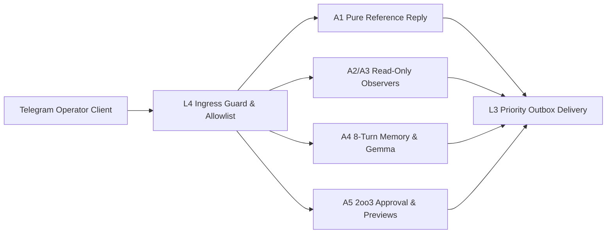

# UOS Telegram Domain A Specification: Foundational SRE, Governance & Knowledge Management Use Cases (41 Invocations)

- **Document ID**: `SPEC-TELEGRAM-DOMAIN-A-20261027`
- **Observed UTC**: `2026-10-27T00:30:00Z`
- **Tailscale Live Document URL**: [http://nas-1.tail55d152.ts.net:4100/files/docs/design/20261027-0030-telegram-domain-a-foundational-sre-governance-and-km-usecases.md](http://nas-1.tail55d152.ts.net:4100/files/docs/design/20261027-0030-telegram-domain-a-foundational-sre-governance-and-km-usecases.md)
- **Companion Encyclopedia Journal**: [http://nas-1.tail55d152.ts.net:4100/files/docs/journal/20261027-0016-agy-telegram-fractal-usecase-encyclopedia-journal.md](http://nas-1.tail55d152.ts.net:4100/files/docs/journal/20261027-0016-agy-telegram-fractal-usecase-encyclopedia-journal.md)
- **Canonical Implementation**: [`apps/cepaf_gleam/src/cepaf_gleam/harness/telegram_commands.gleam`](http://nas-1.tail55d152.ts.net:4100/files/apps/cepaf_gleam/src/cepaf_gleam/harness/telegram_commands.gleam), [`apps/cepaf_gleam/src/cepaf_gleam/harness/telegram_ingress_guard.gleam`](http://nas-1.tail55d152.ts.net:4100/files/apps/cepaf_gleam/src/cepaf_gleam/harness/telegram_ingress_guard.gleam), [`apps/cepaf_gleam/src/cepaf_gleam/harness/telegram.gleam`](http://nas-1.tail55d152.ts.net:4100/files/apps/cepaf_gleam/src/cepaf_gleam/harness/telegram.gleam)
- **Test Suites**: [`apps/cepaf_gleam/test/telegram_user_usecases_test.gleam`](http://nas-1.tail55d152.ts.net:4100/files/apps/cepaf_gleam/test/telegram_user_usecases_test.gleam), [`apps/cepaf_gleam/test/telegram_commands_test.gleam`](http://nas-1.tail55d152.ts.net:4100/files/apps/cepaf_gleam/test/telegram_commands_test.gleam), [`apps/cepaf_gleam/test/telegram_ingress_guard_test.gleam`](http://nas-1.tail55d152.ts.net:4100/files/apps/cepaf_gleam/test/telegram_ingress_guard_test.gleam)
- **Fractal Layer Tags**: #fractal-l0 #fractal-l1 #fractal-l2 #fractal-l3 #fractal-l4 #fractal-l5 #fractal-l6 #fractal-l7 #fractal-l8 #fractal-l9 #zk-adr #zero-muda #tailscale-web #checklist-nav

---

## 1. Executive Summary & Architectural Topology

Domain A defines the **41 foundational operator, SRE, constitutional governance, and knowledge management invocations** (40 canonical literals in [`telegram_commands.gleam`](http://nas-1.tail55d152.ts.net:4100/files/apps/cepaf_gleam/src/cepaf_gleam/harness/telegram_commands.gleam) plus the 78th legacy compatibility alias `/saplan` $\to$ `/plan`). Every Domain A invocation enters through the fail-closed ingress pipeline (`telegram_ingress_guard.evaluate_update`), enforces `bot_id + chat_id + user_id` allowlist verification, strips `@bot_username` suffixes, validates UTF-8 and control-byte bounds ($\le 512$ bytes text, $\le 256$ bytes args, $\le 8$ tokens), and routes to a deterministic read observer, an bounded conversational/memory handler, a 2oo3 constitutional approval state machine, or a preview-only action adapter.

### 1.1 Domain A Control & Data Plane Topology (`SC-DIAGRAM-001`)

```text
[Telegram Operator Client] --> [L4 Ingress Guard & Allowlist]
[L4 Ingress Guard & Allowlist] --> [A1 Pure Reference Reply]
[L4 Ingress Guard & Allowlist] --> [A2/A3 Read-Only Observers]
[L4 Ingress Guard & Allowlist] --> [A4 8-Turn Memory & Gemma]
[L4 Ingress Guard & Allowlist] --> [A5 2oo3 Approval & Previews]
[A1 Pure Reference Reply] --> [L3 Priority Outbox Delivery]
[A2/A3 Read-Only Observers] --> [L3 Priority Outbox Delivery]
[A4 8-Turn Memory & Gemma] --> [L3 Priority Outbox Delivery]
[A5 2oo3 Approval & Previews] --> [L3 Priority Outbox Delivery]
```



---

## 2. Sub-Group A1: Pure Reference & Orientation Commands (3 Literals)

### 2.1 `/start` and `/help` (Alias Pair $\to$ Canonical `/help`)
- **Usage**: `/start` or `/help` (trailing arguments are parsed up to 256 bytes and ignored without echoing).
- **Control Plane**: Classified as `Information` in `telegram_commands.gleam` and `PreservedDirective("/help", _)` in `telegram_ingress_guard.gleam`. Handled purely by `telegram_commands.reference_reply/1`.
- **Data Plane**: Returns a deterministic static command summary grouping Information, Read Observation, Conversation, and Controlled Action families. Zero database, filesystem, or network reads.
- **Fractal Architecture ($L_0 \dots L_9$)**: $L_0$ (Constitutional Safety — refuses untrusted argument reflection), $L_3$ (BEAM/OTP pure function), $L_9$ (Operator UX orientation).
- **Interactions**: Operator sends `/start` or `/help` $\to$ `evaluate_update` validates allowlist $\to$ `reference_reply` formats catalog summary $\to$ `telegram_outbound` delivers bounded chunk.
- **Test Cases**: `telegram_user_usecases_test:information_commands_reference_reply_test`, `telegram_commands_test:parameters_not_shell_executed_and_reference_replies_safe_test`, `telegram_journey_responder_test:journey_r1_first_minute_test`.
- **Real-World Case Studies & Scenarios**: During a P1 pager alert at 03:00 UTC, an on-call responder opens `@uos_c3i_bot` from a mobile phone and types `/help` to immediately view the read-only observation commands (`/status`, `/doctor`, `/fmea`, `/plan`) vs. 2oo3-gated action previews.

### 2.2 `/cockpit`
- **Usage**: `/cockpit` (no required arguments; trailing arguments are never echoed).
- **Control Plane**: Classified as `Information` (`PreservedDirective("/cockpit", _)`). Handled by `telegram_commands.reference_reply/1`.
- **Data Plane**: Emits the canonical Tailscale FQDN URLs (`http://nas-1.tail55d152.ts.net:4100/`, `/planning`, `/wiki`, `/zk`, `/ag-ui/events`) and states that the Mini-App WebView is read-only.
- **Fractal Architecture ($L_0 \dots L_9$)**: $L_3$ (OTP harness), $L_7$ (Tailnet navigation), $L_9$ (Cockpit & Mini-App UX).
- **Interactions**: Operator sends `/cockpit` $\to$ receives clickable Tailnet FQDN links to jump from Telegram mobile chat into the full Lustre Cockpit or read-only Mini-App.
- **Test Cases**: `telegram_user_usecases_test:information_commands_reference_reply_test`, `telegram_journey_responder_test:journey_r1_first_minute_test`.
- **Real-World Case Studies & Scenarios**: After triaging an alert in Telegram via `/status`, the operator taps `/cockpit` to open the live AG-UI event stream (`http://nas-1.tail55d152.ts.net:4100/ag-ui/events`) over Tailscale.

---

## 3. Sub-Group A2: Direct Read-Tool Observers (10 Invocations: 9 Canonical + `/saplan` Alias)

### 3.1 `/status` and `/health` (Alias Pair $\to$ Canonical `/status`)
- **Usage**: `/status` or `/health` (zero arguments required).
- **Control Plane**: Classified as `ReadObservation` $\to$ `DirectReadTool("query_system_health")`.
- **Data Plane**: Reads real host/OTP observation metrics via `telegram_host_observation` and `telegram_operational_status` (ERTS version, scheduler utilization, memory, process count, supervision tree health). Never fabricates metrics.
- **Fractal Architecture ($L_0 \dots L_9$)**: $L_1$ (Hardware/OS telemetry), $L_3$ (BEAM supervision health), $L_8$ (Observability), $L_9$ (Operator HUD).
- **Interactions**: Operator sends `/status` $\to$ `telegram_service` invokes `query_system_health` $\to$ returns structured health snapshot with `trace_id`.
- **Test Cases**: `telegram_host_observation_test`, `telegram_operational_status_test`, `telegram_journey_responder_test:journey_r1_first_minute_test`, Live Bot API Flow 2 (`update_id = 351071525`).
- **Real-World Case Studies & Scenarios**: Verified live over real Telegram Bot API polling (`update_id = 351071525`, message `9` $\to$ reply `10`) during Wave 7E real-traffic readiness verification.

### 3.2 `/plan`, `/tasks`, and `/saplan` (3-Way Alias Group $\to$ Canonical `/plan`)
- **Usage**: `/plan [optional filter]`, `/tasks [optional filter]`, or legacy `/saplan [optional filter]`.
- **Control Plane**: Classified as `ReadObservation` $\to$ `DirectReadTool("query_saplan")`. Read-only query; never claims, mutates, or completes a task (`SC-SA-PLAN-001`).
- **Data Plane**: Queries canonical `var/sa-plan/uos.sqlite3` in read-only mode to list active plans, task counts, and execution states.
- **Fractal Architecture ($L_0 \dots L_9$)**: $L_0$ (Sa-plan authority fence), $L_3$ (OTP task harness), $L_4$ (SQLite WAL read plane), $L_9$ (Operator task visibility).
- **Interactions**: Operator sends `/plan` $\to$ `DirectReadTool("query_saplan")` reads `var/sa-plan/uos.sqlite3` $\to$ returns bounded summary of active plans and tasks.
- **Test Cases**: `telegram_commands_test:supported_aliases_and_saplan_test`, `telegram_user_usecases_test:all_78_command_invocations_parse_and_classify_test`, `telegram_journey_responder_test:journey_r2_situational_picture_test`.
- **Real-World Case Studies & Scenarios**: Before approving a wave cutover, an operator runs `/plan` from Telegram to verify that all prerequisite tasks in `var/sa-plan/uos.sqlite3` are marked `completed` and zero tasks are stuck in `in_progress`.

### 3.3 `/zk`
- **Usage**: `/zk <search query>` (e.g., `/zk andon` or `/zk ADR-009`).
- **Control Plane**: Classified as `ReadObservation` $\to$ `DirectReadTool("search_zettelkasten")`.
- **Data Plane**: Executes a bounded, parameterized read query against the Zettelkasten note index (`telegram_knowledge.gleam` / `telegram_search.gleam`), returning matching ADR/MOC titles, IDs, and Tailscale links.
- **Fractal Architecture ($L_0 \dots L_9$)**: $L_4$ (Knowledge store), $L_5$ (Hermes/ZK ontology), $L_9$ (Mobile knowledge retrieval).
- **Interactions**: Operator sends `/zk andon` $\to$ `search_zettelkasten` queries ZK index $\to$ returns top matching permanent notes without SQL injection risk.
- **Test Cases**: `telegram_user_usecases_test:handle_zk_directive_test`, `telegram_knowledge_test`, `telegram_search_test`, `telegram_journey_responder_test:journey_r3_knowledge_and_whatif_test`.
- **Real-World Case Studies & Scenarios**: During an incident review, an engineer queries `/zk andon` to pull up the exact STPA hazard definition and Jidoka stop-line invariants (`SC-JIDOKA-001`).

### 3.4 `/wiki`
- **Usage**: `/wiki <search query>` (e.g., `/wiki provenance` or `/wiki poodavr`).
- **Control Plane**: Classified as `ReadObservation` $\to$ `DirectReadTool("search_wiki")`.
- **Data Plane**: Searches the Hermes Wiki corpus (`engines/hermes/modules/hermes_wiki` / `docs/wiki/`) and returns bounded article summaries with Tailnet `/wiki` links.
- **Fractal Architecture ($L_0 \dots L_9$)**: $L_5$ (Hermes Wiki AST & index), $L_7$ (Tailscale web links), $L_9$ (Operator documentation lookup).
- **Interactions**: Operator sends `/wiki provenance` $\to$ `search_wiki` scans indexed wiki articles $\to$ returns matching headings and URLs.
- **Test Cases**: `telegram_knowledge_test`, `telegram_search_test`, `telegram_journey_responder_test:journey_r3_knowledge_and_whatif_test`.
- **Real-World Case Studies & Scenarios**: An auditor on mobile runs `/wiki provenance` to retrieve the link to the `EV-93` provenance ceiling documentation.

### 3.5 `/fmea`
- **Usage**: `/fmea [optional subsystem filter]`.
- **Control Plane**: Classified as `ReadObservation` $\to$ `DirectReadTool("query_fmea")`. Explicitly pinned as `ReadObservation` (not `ModelAssisted`) in `telegram_commands.gleam` because it returns recorded risk observations, never LLM estimates.
- **Data Plane**: Reads recorded FMEA Risk Priority Numbers ($S \times O \times D$), STPA Unsafe Control Actions (UCA-1..4), and mitigation statuses via `telegram_fmea_report.gleam`.
- **Fractal Architecture ($L_0 \dots L_9$)**: $L_0$ (`SC-RISK-PRIORITY-001`), $L_5$ (Formal safety ledger), $L_8$ (Risk telemetry).
- **Interactions**: Operator sends `/fmea` $\to$ `telegram_fmea_report` formats recorded FMEA rows $\to$ returns deterministic risk table.
- **Test Cases**: `telegram_commands_test:fmea_is_recorded_observation_not_model_test`, `telegram_fmea_report_test`, `telegram_journey_defence_test:journey_5_verification_scorecard_and_fmea_test`.
- **Real-World Case Studies & Scenarios**: Before authorizing a high-criticality maintenance task, the SRE lead runs `/fmea` to check whether any unmitigated high-RPN failure modes remain open.

### 3.6 `/finops`, `/cost`, and `/budget` (3-Way Alias Group $\to$ Canonical `/finops`)
- **Usage**: `/finops [scope]`, `/cost [scope]`, or `/budget [scope]`.
- **Control Plane**: Classified as `ReadObservation` $\to$ `DirectReadTool("query_finops")`.
- **Data Plane**: Reads token consumption, free-tier vs. paid-tier OpenRouter spend, and budget ceilings via `telegram_budget_report.gleam`.
- **Fractal Architecture ($L_0 \dots L_9$)**: $L_0$ (Budget governance), $L_6$ (Multi-agent OpenRouter coordination), $L_8$ (Cost telemetry).
- **Interactions**: Operator sends `/finops` $\to$ `telegram_budget_report` aggregates recorded spend $\to$ returns current utilization and free-only policy status.
- **Test Cases**: `telegram_budget_report_test`, `telegram_ingress_guard_test:finops_ingress_aliases_and_scope_test`, `telegram_journey_responder_test:journey_r2_situational_picture_test`.
- **Real-World Case Studies & Scenarios**: While running a multi-agent verification wave, the operator checks `/budget` to verify that OpenRouter requests remain within the bounded daily allowance.

### 3.7 `/checklist`
- **Usage**: `/checklist` (zero arguments required).
- **Control Plane**: Classified as `ReadObservation` $\to$ `DirectReadTool("query_checklist")`.
- **Data Plane**: Evaluates the 6-Domain, 18-Checkpoint Comprehensive Verification Checklist (`SC-CHECKLIST-001` + `SC-PROVENANCE-001` `EV-93` ceiling) and returns domain-by-domain status.
- **Fractal Architecture ($L_0 \dots L_9$)**: $L_0$ (`SC-CHECKLIST-001` & `SC-PROVENANCE-001`), $L_5$ (Compliance gate), $L_9$ (Audit summary).
- **Interactions**: Operator sends `/checklist` $\to$ `telegram.gleam` / `query_checklist` returns 18/18 core check status plus Domain 6 provenance status.
- **Test Cases**: `telegram_user_usecases_test:handle_checklist_directive_test`, `telegram_journey_defence_test:journey_5_verification_scorecard_and_fmea_test`.
- **Real-World Case Studies & Scenarios**: During a release readiness review, the operator invokes `/checklist` in Telegram to verify all 6 governance domains before signing off.

---

## 4. Sub-Group A3: Preserved Read-Observation Directives (13 Literals)

### 4.1 `/doctor`
- **Usage**: `/doctor`
- **Control Plane**: `ReadObservation` $\to$ `PreservedDirective("/doctor", args)` handled in `telegram.gleam` and `telegram_operational_status.gleam`.
- **Data Plane**: Aggregates toolchain preflight receipt (`var/preflight/latest.json`), OTP release verification (`OTP 29`), and runtime diagnostic checks.
- **Fractal Architecture ($L_0 \dots L_9$)**: $L_0$ (`SC-NIX-DEVENV-001`), $L_2$ (Runtime health), $L_3$ (BEAM supervision), $L_8$ (Diagnostics).
- **Interactions**: Operator sends `/doctor` $\to$ diagnostic aggregator checks preflight receipt and subsystem health $\to$ returns pass/fail diagnostic report.
- **Test Cases**: `telegram_operational_status_test`, `telegram_journey_responder_test:journey_r1_first_minute_test`.
- **Real-World Case Studies & Scenarios**: After a host reboot on `nas-1`, the SRE runs `/doctor` to confirm the Determinate Nix profile (`OTP 29`) and all 20 toolchain entrypoints are healthy.

### 4.2 `/zenoh`
- **Usage**: `/zenoh`
- **Control Plane**: `ReadObservation` $\to$ `PreservedDirective("/zenoh", args)` routed to `telegram_zenoh_report.gleam`.
- **Data Plane**: Reads Zenoh mesh router connectivity, active key-expression subscriptions (`uos/c3i/**`), and peer link latency.
- **Fractal Architecture ($L_0 \dots L_9$)**: $L_3$ (Gleam Zenoh bridge), $L_6$ (Mesh pub/sub bus), $L_7$ (Tailnet peer transport).
- **Interactions**: Operator sends `/zenoh` $\to$ `telegram_zenoh_report` inspects mesh state $\to$ returns active peer routers and topic counters.
- **Test Cases**: `telegram_zenoh_report_test`, `telegram_journey_security_test:sec_j4_swarm_mesh_anomaly_test`.
- **Real-World Case Studies & Scenarios**: When telemetry lags between `nas-1` and `vm-1`, the operator runs `/zenoh` to check whether the Zenoh session is connected or degraded.

### 4.3 `/ha`
- **Usage**: `/ha`
- **Control Plane**: `ReadObservation` $\to$ `PreservedDirective("/ha", args)` routed to `telegram_ha_report.gleam`.
- **Data Plane**: Reads high-availability Prajna circuit breaker states (`Closed`, `Open`, `HalfOpen`), Lyapunov derivative stability ($\Delta V / \Delta t < 0$), and freshness monitor heartbeats.
- **Fractal Architecture ($L_0 \dots L_9$)**: $L_0$ (Lyapunov & 2oo3 HA invariants), $L_3$ (`prajna/circuit_breaker.gleam`, `ha/lyapunov_proof.gleam`), $L_8$ (HA telemetry).
- **Interactions**: Operator sends `/ha` $\to$ `telegram_ha_report` samples HA monitors $\to$ returns circuit breaker and Lyapunov stability metrics.
- **Test Cases**: `telegram_ha_report_test`, `telegram_journey_defence_test:journey_1_degraded_mesh_and_homeostasis_test`.
- **Real-World Case Studies & Scenarios**: During a load spike, the operator runs `/ha` to verify that $\Delta V / \Delta t < 0$ holds and no Prajna circuit breakers have tripped open.

### 4.4 `/swarm`
- **Usage**: `/swarm`
- **Control Plane**: `ReadObservation` $\to$ `PreservedDirective("/swarm", args)` routed to `telegram_coordination.gleam`.
- **Data Plane**: Reads the durable tri-agent SQLite coordinator (`var/coordination/tri-agent/coordinator.sqlite3`) to report active sessions, lease holders (`integration/main`, `runtime:telegram-bot`), and recent sequence numbers.
- **Fractal Architecture ($L_0 \dots L_9$)**: $L_0$ (Tri-agent coordination contract), $L_3$ (Swarm coordinator), $L_4$ (Append-only SQLite event store), $L_6$ (Claude/Codex/AGY mesh).
- **Interactions**: Operator sends `/swarm` $\to$ `telegram_coordination` queries `coordinator.sqlite3` $\to$ returns active agent heartbeats and held leases.
- **Test Cases**: `telegram_coordination_test`, `telegram_journey_security_test:sec_j4_swarm_mesh_anomaly_test`.
- **Real-World Case Studies & Scenarios**: While AGY, Claude, and Codex are working in parallel workspaces, the operator runs `/swarm` to see which agent holds the `integration/main` lease.

### 4.5 `/storage`
- **Usage**: `/storage`
- **Control Plane**: `ReadObservation` $\to$ `PreservedDirective("/storage", args)` routed to `telegram_storage.gleam`.
- **Data Plane**: Reads Rook-Ceph / NVMe storage safety interlock status, confirming that the host OS NVMe serial `[REDACTED_SYSTEM_OS_SERIAL]` is permanently hardware-locked against OSD formatting (`ops/kubernetes/nas-k8s-lab/src/spec.rs`).
- **Fractal Architecture ($L_0 \dots L_9$)**: $L_0$ (`CHK-07-DRIVE` hardware interlock), $L_1$ (Physical NVMe enclave), $L_4$ (Storage engine safety).
- **Interactions**: Operator sends `/storage` $\to$ `telegram_storage` verifies hardware lock invariants $\to$ returns Hardware Storage Enclave Guard status.
- **Test Cases**: `telegram_user_usecases_test:handle_storage_directive_test`, `telegram_storage_test`, `telegram_journey_defence_test:journey_4_storage_interlock_and_standby_readiness_test`.
- **Real-World Case Studies & Scenarios**: Prior to any storage maintenance on `nas-1`, the operator runs `/storage` to confirm the OS NVMe serial `[REDACTED_SYSTEM_OS_SERIAL]` deny-lock is active.

### 4.6 `/verify`
- **Usage**: `/verify [status|<run_id>]`
- **Control Plane**: `ReadObservation` $\to$ `PreservedDirective("/verify", args)` routed to `telegram_verification_report.gleam` and `telegram_verify_service.gleam`.
- **Data Plane**: Reads bounded verification job packets, gate scorecards, and reconciliation receipts without blocking the ingress loop.
- **Fractal Architecture ($L_0 \dots L_9$)**: $L_3$ (OTP verification worker), $L_5$ (Hermes formal gate receipts), $L_8$ (Verification ledger).
- **Interactions**: Operator sends `/verify` $\to$ reads latest verification packet receipt $\to$ returns gate pass/fail counts and candidate revision binding.
- **Test Cases**: `telegram_verification_report_test`, `telegram_verify_service_test`, `telegram_journey_defence_test:journey_5_verification_scorecard_and_fmea_test`.
- **Real-World Case Studies & Scenarios**: An operator checks `/verify` from Telegram to inspect the latest verification run bound to the current Jujutsu revision.

### 4.7 `/rete`
- **Usage**: `/rete`
- **Control Plane**: `ReadObservation` $\to$ `PreservedDirective("/rete", args)` routed to `telegram_rete.gleam`.
- **Data Plane**: Reads Rete-UL forward-chaining production rule activations, alpha/beta memory node counts, and active conflict-set inferences.
- **Fractal Architecture ($L_0 \dots L_9$)**: $L_5$ (Rete-UL rule engine & reference oracle), $L_8$ (Inference telemetry).
- **Interactions**: Operator sends `/rete` $\to$ `telegram_rete` snapshots active production rules $\to$ returns rule firing summary.
- **Test Cases**: `telegram_rete_test`, `telegram_journey_security_test:sec_j1_suspicious_ingress_test`.
- **Real-World Case Studies & Scenarios**: During a security anomaly, the operator runs `/rete` to see which STPA/safety forward-chaining rules have fired in the conflict set.

### 4.8 `/immune`
- **Usage**: `/immune` (zero arguments; arguments are rejected fail-closed).
- **Control Plane**: `ReadObservation` $\to$ routed via `telegram_read_adapters` to `telegram_system_read_command.gleam`.
- **Data Plane**: Observes the immune digital-twin actor registry (`cepaf_gleam/fractal/immune_twin_actor`); when no live actor PID is injected, honestly reports `status: "backend_unavailable"` with closed JSON keys rather than fabricating immune scores.
- **Fractal Architecture ($L_0 \dots L_9$)**: $L_0$ (Zero fabrication mandate), $L_3$ (`immune_twin_actor`), $L_8$ (Closed-schema JSON observation).
- **Interactions**: Operator sends `/immune` $\to$ `telegram_system_read_command` checks actor reference $\to$ returns bounded JSON receipt.
- **Test Cases**: `telegram_system_read_command_test:immune_reports_actor_backend_unavailable_test`, `telegram_system_read_command_test:immune_rejects_arguments_test`.
- **Real-World Case Studies & Scenarios**: An operator runs `/immune` during a defence drill and receives an explicit, machine-parseable `backend_unavailable` JSON envelope when the optional immune actor is not started, proving no fake telemetry is emitted.

### 4.9 `/ecology`
- **Usage**: `/ecology`
- **Control Plane**: `ReadObservation` $\to$ `PreservedDirective("/ecology", args)` routed to `telegram_ecology.gleam`.
- **Data Plane**: Reads fractal layer homeostasis across $L_0 \dots L_9$, resource saturation, and zero-muda purity status.
- **Fractal Architecture ($L_0 \dots L_9$)**: $L_0 \dots L_9$ (Full 10-layer ecological homeostasis), $L_8$ (System telemetry).
- **Interactions**: Operator sends `/ecology` $\to$ `telegram_ecology` aggregates layer health $\to$ returns ecological balance report.
- **Test Cases**: `telegram_ecology_test`, `telegram_journey_defence_test:journey_1_degraded_mesh_and_homeostasis_test`.
- **Real-World Case Studies & Scenarios**: During a daily health check, the operator runs `/ecology` to confirm all 10 fractal layers ($L_0 \dots L_9$) are in homeostasis.

### 4.10 `/inference`
- **Usage**: `/inference` (zero arguments; rejects extra arguments fail-closed).
- **Control Plane**: `ReadObservation` $\to$ routed via `telegram_read_adapters` to `telegram_system_read_command.gleam` (`cepaf_gleam/intelligence/fallback_cascade`).
- **Data Plane**: Reads the live configured inference fallback cascade (`tiers: ["tier1_local_max", "tier2_ollama_tailnet", "tier3_cloud_openrouter", "tier4_deterministic_rete"]`) and reports whether `OPENROUTER_API_KEY` is present (boolean only; never exposes key bytes).
- **Fractal Architecture ($L_0 \dots L_9$)**: $L_0$ (`SC-TELEGRAM-SECRET-001`), $L_6$ (Modular MAX / OpenRouter cascade), $L_8$ (Inference readiness).
- **Interactions**: Operator sends `/inference` $\to$ inspects cascade configuration and boolean secret presence $\to$ returns closed-schema JSON (`status: "ok"`).
- **Test Cases**: `telegram_system_read_command_test:inference_observes_configured_cascade_test`, `telegram_system_read_command_test:inference_rejects_arguments_test`.
- **Real-World Case Studies & Scenarios**: Before running `/ask` or `/socratic`, the operator runs `/inference` to verify that the 4-tier fallback cascade is configured and the OpenRouter key boolean indicator is `true`.

### 4.11 `/ADR` and `/adr` (Case-Exact Pair $\to$ Canonical `/adr`)
- **Usage**: `/adr <query>` or `/ADR <query>` (1 to 64 ASCII characters, e.g., `/adr 009` or `/ADR provenance`).
- **Control Plane**: `ReadObservation` $\to$ routed via `telegram_read_adapters` to `telegram_knowledge_read_command.gleam` (`cepaf_gleam/harness/telegram_knowledge`).
- **Data Plane**: Queries the in-repo ADR catalog (`docs/adr` and ZK ADRs) for matching decision records and returns up to 5 structured matches (`id`, `title`, `snippet`) in closed JSON (`<= 3500` bytes).
- **Fractal Architecture ($L_0 \dots L_9$)**: $L_4$ (ADR repository), $L_5$ (Architectural decision governance), $L_9$ (Operator reference).
- **Interactions**: Operator sends `/adr 009` $\to$ `telegram_knowledge_read_command` validates query bounds $\to$ searches ADR corpus $\to$ returns JSON matches.
- **Test Cases**: `telegram_knowledge_read_command_test:adr_positive_test`, `telegram_knowledge_read_command_test:adr_negative_test`.
- **Real-World Case Studies & Scenarios**: During a code review discussion on Telegram, an architect types `/adr 001` to pull the exact title and summary of `ADR-001` directly into the chat thread.

### 4.12 `/mesh`
- **Usage**: `/mesh [optional filter 1..48 chars]`
- **Control Plane**: `ReadObservation` $\to$ routed via `telegram_read_adapters` to `telegram_knowledge_read_command.gleam` (`cepaf_gleam/zenoh/health_bridge`).
- **Data Plane**: Reads the default 3-node mesh topology (`nas-1`, `vm-1`, `cloud-1`) from `health_bridge.default_mesh_health()`, reporting quorum threshold (`0.67`), healthy node count, and per-node health scores.
- **Fractal Architecture ($L_0 \dots L_9$)**: $L_3$ (`zenoh/health_bridge`), $L_6$ (Mesh quorum), $L_7$ (Tailnet node topology).
- **Interactions**: Operator sends `/mesh` $\to$ `telegram_knowledge_read_command` evaluates `default_mesh_health()` $\to$ returns closed JSON with node health and quorum status.
- **Test Cases**: `telegram_knowledge_read_command_test:mesh_positive_test`, `telegram_knowledge_read_command_test:mesh_negative_test`.
- **Real-World Case Studies & Scenarios**: An operator runs `/mesh vm-1` to filter the mesh health table specifically for the peer runtime host `vm-1.tail55d152.ts.net`.

---

## 5. Sub-Group A4: Conversational AI, Briefing & Bounded 8-Turn Memory (5 Literals)

### 5.1 `/ask` and `/chat` (Alias Pair $\to$ Canonical `/ask`)
- **Usage**: `/ask <question>` or `/chat <question>` (also invoked as fallback for plain non-slash text from an allowlisted operator).
- **Control Plane**: Classified as `ModelAssisted` in `telegram_commands.gleam` and `ConversationFallback(prompt)` in `telegram_ingress_guard.gleam`. Orchestrated by `telegram_conversation.gleam` and `telegram_gemma_wiring.gleam`.
- **Data Plane**: Reads the caller's isolated `(bot_id, chat_id, user_id)` 8-turn ring buffer from `var/telegram/conversations.sqlite3` (`telegram_conversation_store.gleam`), constructs a bounded OpenRouter chat completion request (`google/gemma-4-26b-a4b-it:free` $\to$ `google/gemma-4-31b-it:free` $\to$ `z-ai/glm-5.1`), strips `<think>` blocks, runs output through `telegram_secret_guard.redact`, and appends the completed turn only after delivery.
- **Fractal Architecture ($L_0 \dots L_9$)**: $L_0$ (Advisory-only AI; zero effect authority; secret redaction), $L_3$ (OTP conversation actor), $L_4$ (SQLite 8-turn store), $L_6$ (OpenRouter cascade), $L_9$ (Conversational UX).
- **Interactions**: Operator sends `/ask What is the admitted EV ceiling?` $\to$ `telegram_conversation` loads prior turns $\to$ calls OpenRouter free Gemma tier $\to$ redacts any secret patterns $\to$ delivers chunked reply $\to$ persists turn to `conversations.sqlite3`.
- **Test Cases**: `telegram_conversation_test`, `telegram_conversation_store_test`, `telegram_gemma_wiring_test`, Live Bot API Flow 3 (`update_id = 351071526`, HTTP 200 via `google/gemma-4-26b-a4b-it:free`).
- **Real-World Case Studies & Scenarios**: Verified live end-to-end in Wave 7E (`update_id = 351071526`, message `11` $\to$ reply `12`), where the operator asked for the admitted EV ceiling and received a real OpenRouter Gemma response confirming `EV-93`.

### 5.2 `/brief`
- **Usage**: `/brief [optional scope: daily|incident|governance|handover]`
- **Control Plane**: Classified as `ModelAssisted` $\to$ `PreservedDirective("/brief", args)` routed through `telegram_brief_dispatch.gleam` and `telegram_brief_report.gleam`.
- **Data Plane**: Synthesizes a structured executive briefing from real system health, Sa-plan task status, FMEA risk posture, and provenance ceiling (`EV-93`), optionally enriched with advisory summary text.
- **Fractal Architecture ($L_0 \dots L_9$)**: $L_3$ (Briefing dispatcher), $L_4$ (Sa-plan + coordinator reads), $L_8$ (Executive situational awareness), $L_9$ (Operator briefing).
- **Interactions**: Operator sends `/brief` $\to$ `telegram_brief_dispatch` collects health, plan, and risk snapshots $\to$ formats executive summary $\to$ sends reply.
- **Test Cases**: `telegram_brief_dispatch_test`, `telegram_brief_report_test`, `telegram_journey_responder_test:journey_r2_situational_picture_test`.
- **Real-World Case Studies & Scenarios**: At the start of a shift, the incoming SRE lead runs `/brief` to get a single consolidated view of system health, active Sa-plan tasks, and open risks.

### 5.3 `/memory`
- **Usage**: `/memory`, `/memory status`, or `/memory clear` (rejects unknown subcommands fail-closed).
- **Control Plane**: Classified as `ReadObservation` (`PreservedDirective("/memory", args)`), handled deterministically by `telegram_memory_command.gleam`.
- **Data Plane**: Inspects or clears the caller's scoped 8-turn conversation context in `var/telegram/conversations.sqlite3` (`max_turns = 8`, `max_prompt_bytes = 512`, `max_reply_bytes = 1024`). Never invokes an LLM.
- **Fractal Architecture ($L_0 \dots L_9$)**: $L_3$ (`telegram_memory_command`), $L_4$ (`telegram_conversation_store`), $L_9$ (Memory transparency & reset).
- **Interactions**: Operator sends `/memory` $\to$ receives count of stored exchanges (`N of 8 complete exchanges stored`) and latest turn preview; operator sends `/memory clear` $\to$ purges scoped rows in `conversations.sqlite3`.
- **Test Cases**: `telegram_memory_command_test`, `telegram_user_usecases_test:memory_history_and_socratic_dialogue_usecases_test`, Live Bot API Flow 5 (`update_id = 351071528`, message `15` $\to$ reply `16`).
- **Real-World Case Studies & Scenarios**: Verified live over real Telegram Bot API (`update_id = 351071528`), returning the exact stored exchange count and byte bounds after the live `/ask` turn.

### 5.4 `/history`
- **Usage**: `/history` or `/history <count 1..8>` (rejects `0`, `9`, negative, or non-integer arguments fail-closed).
- **Control Plane**: Classified as `ReadObservation` (`PreservedDirective("/history", args)`), handled deterministically by `telegram_memory_command.gleam`.
- **Data Plane**: Reads the last $N$ stored `(update_id, prompt, reply)` exchanges for the caller's `(bot_id, chat_id, user_id)` scope from `var/telegram/conversations.sqlite3`.
- **Fractal Architecture ($L_0 \dots L_9$)**: $L_3$ (`telegram_memory_command`), $L_4$ (`telegram_conversation_store`), $L_8$ (Audit replay of operator-model dialogue).
- **Interactions**: Operator sends `/history 2` $\to$ `telegram_memory_command.reply` slices the last 2 stored turns $\to$ formats numbered `u=<update_id> Q: ... / A: ...` lines.
- **Test Cases**: `telegram_memory_command_test`, `telegram_user_usecases_test:memory_history_and_socratic_dialogue_usecases_test`, `telegram_journey_responder_test:journey_r5_handover_and_memory_test`.
- **Real-World Case Studies & Scenarios**: During shift handover, an operator runs `/history 3` to review the last 3 diagnostic questions and answers exchanged with the assistant before clearing memory.

---

## 6. Sub-Group A5: Constitutional 2oo3 Approval & Bounded Action Previews (10 Literals)

### 6.1 `/approval`
- **Usage**:
  - `/approval` (list pending proposals)
  - `/approval <proposal_id>` (inspect specific proposal)
  - `/approval propose <proposal_id>` (register a candidate proposal)
  - `/approval submit <proposal_id> <voter_id> <signed_receipt>` (submit a cryptographically signed voter receipt)
  - `/approval withdraw <proposal_id>` (withdraw a proposal)
  - Note: Unsigned free-text `/approval approve <id>` or `/approval grant <id>` is **strictly refused** (`DeniedMutation`).
- **Control Plane**: Classified as `ControlledAction` in `telegram_commands.gleam`; parsed by `telegram_ingress_guard.classify_approval` into `PreservedDirective("/approval", ...)` or `PreservedDirective("/approval_manage", ...)` and enforced by `telegram_approval.gleam`.
- **Data Plane**: Persists proposal state and voter receipts in SQLite (`telegram_store.gleam`), enforcing the 2oo3 constitutional quorum (`L0_constitutional`) with distinct voter identities and non-empty signed receipts.
- **Fractal Architecture ($L_0 \dots L_9$)**: $L_0$ (2oo3 Constitutional Consensus & no unsigned chat approval), $L_3$ (`telegram_approval.gleam`), $L_4$ (Durable approval ledger), $L_6$ (Tri-sovereign governance).
- **Interactions**: Operator proposes `/approval propose prop-101` $\to$ two sovereign voters submit signed receipts via `/approval submit prop-101 ...` $\to$ `telegram_approval` transitions state only when valid 2oo3 receipts are verified.
- **Test Cases**: `telegram_approval_test` (20 tests), `telegram_user_usecases_test:approval_and_tool_bridge_usecases_test`, Live Bot API Flow 6 (`update_id = 351071529`, message `17` $\to$ reply `18`).
- **Real-World Case Studies & Scenarios**: Verified live over real Telegram Bot API (`update_id = 351071529`), where `/approval propose live_wave7e_prop_1` registered a proposal in `Pending1Of2` state requiring 2oo3 signed receipts.

### 6.2 `/tool` and `/action` (Alias Pair $\to$ Canonical `/tool`)
- **Usage**:
  - `/tool query_system_health | query_saplan | search_zettelkasten <q> | search_wiki <q> | query_fmea [s] | query_finops [s] | query_checklist`
  - `/tool cancel_job_lease <job_id> -- <bounded reason>` (or via `/action ...`)
- **Control Plane**: Classified as `ControlledAction`; parsed by `telegram_tool_command.parse` inside `telegram_ingress_guard.gleam`. Read tools route to `DirectReadTool(...)`; `cancel_job_lease` routes to `PreservedDirective("/cancel_job_lease", [job_id, reason])` handled by `telegram_cancellation.gleam`. Unknown or mutating tool names return `DeniedMutation`.
- **Data Plane**: Read tools query read-only substrates; `cancel_job_lease` writes an auditable cancellation request record (`telegram_cancellation_record.gleam`) bound to the caller's lease scope.
- **Fractal Architecture ($L_0 \dots L_9$)**: $L_0$ (`SC-HARNESS-MCP-001` tool boundary), $L_3$ (`telegram_tool_command`, `telegram_cancellation`), $L_4$ (Cancellation audit ledger).
- **Interactions**: Operator sends `/action cancel_job_lease job_99 -- stalled_worker` $\to$ `telegram_tool_command.parse` validates `job_id` and reason bounds $\to$ `telegram_cancellation` records bounded cancellation receipt.
- **Test Cases**: `telegram_tool_command_test` (9 tests), `telegram_cancellation_test` (5 tests), `telegram_user_usecases_test:approval_and_tool_bridge_usecases_test`.
- **Real-World Case Studies & Scenarios**: When an Oban/Sa-plan background verification job stalls, the operator issues `/tool cancel_job_lease job_99 -- stalled_worker` to cleanly revoke the lease with an auditable reason.

### 6.3 `/task`
- **Usage**: `/task <action> [args]` (e.g., `/task claim ...` or `/task create ...`).
- **Control Plane**: Classified as `ControlledAction` in `telegram_commands.gleam` and **refused at ingress** (`DeniedMutation("/task", "Direct task mutation from Telegram is disabled; use /plan or /tasks to read state, or submit a signed proposal.")`) per `SC-SA-PLAN-001`.
- **Data Plane**: Zero writes to `var/sa-plan/uos.sqlite3`; logs refusal in the ingress audit ledger.
- **Fractal Architecture ($L_0 \dots L_9$)**: $L_0$ (`SC-SA-PLAN-001` & `SC-JIDOKA-001` Andon fence), $L_3$ (`telegram_ingress_guard`), $L_4$ (Sa-plan write protection).
- **Interactions**: Operator sends `/task complete t1` $\to$ `telegram_ingress_guard` intercepts and returns `DeniedMutation` instructing the operator to use canonical `sa-plan` or a signed proposal.
- **Test Cases**: `telegram_task_command_test`, `telegram_ingress_guard_test`, `telegram_journey_responder_test:journey_r4_bounded_action_test`.
- **Real-World Case Studies & Scenarios**: Prevents accidental or spoofed chat-driven task mutations from bypassing `risk-priority-check --preflight` and `sa-plan` CLI fencing.

### 6.4 `/andon`
- **Usage**: `/andon <subsystem> <reason>` (e.g., `/andon storage thermal_threshold_exceeded`).
- **Control Plane**: Classified as `ControlledAction` $\to$ routed via `telegram_action_adapters.route_preview` (`telegram_action_infra.gleam`). Returns `status: "preview"` (`executed: false`, `authority: "none"`).
- **Data Plane**: Constructs a non-executing Jidoka Andon stop-line preview (`target_service: "cepaf_gleam/fractal/l0_constitutional"`, `required_gate: "2oo3_constitutional_approval_plus_sa_plan_authority"`) without tripping live production breakers from an unsigned chat message.
- **Fractal Architecture ($L_0 \dots L_9$)**: $L_0$ (`SC-JIDOKA-001` Andon Stop Line), $L_3$ (`telegram_action_infra`), $L_6$ (2oo3 gate).
- **Interactions**: Operator sends `/andon storage thermal_warning` $\to$ receives structured JSON preview detailing the exact stop-line scope and required 2oo3 approval command.
- **Test Cases**: `telegram_action_andon_test`, `telegram_user_usecases_test:handle_andon_directive_test`, `telegram_journey_defence_test:journey_2_immune_andon_escalation_with_approval_preview_test`.
- **Real-World Case Studies & Scenarios**: An operator prepares an emergency Andon stop-line proposal from Telegram via `/andon` and uses the returned preview receipt to initiate a 2oo3 `/approval propose` flow.

### 6.5 `/dark`
- **Usage**: `/dark <on|off|status> <scope>` (e.g., `/dark status external_ingress`).
- **Control Plane**: Classified as `ControlledAction` $\to$ routed via `telegram_action_adapters.route_preview` (`telegram_action_infra.gleam`). Never mutates network interfaces or firewall rules from chat (`status: "preview"`, `executed: false`).
- **Data Plane**: Generates a bounded dark-mode enclave isolation preview specifying the target scope and required 2oo3 constitutional gate.
- **Fractal Architecture ($L_0 \dots L_9$)**: $L_0$ (Enclave isolation policy), $L_1$ (Network boundary), $L_3$ (`telegram_action_infra`), $L_7$ (Tailnet ingress control).
- **Interactions**: Operator sends `/dark on external_ingress` $\to$ receives non-executing preview receipt showing the isolation plan and required 2oo3 signature gate.
- **Test Cases**: `telegram_action_dark_test`, `telegram_user_usecases_test:handle_dark_directive_test`, `telegram_journey_security_test:sec_j1_suspicious_ingress_test`.
- **Real-World Case Studies & Scenarios**: During a suspected credential leak drill (`sec_j2`), the security responder runs `/dark on external_ingress` to preview the exact enclave lockdown specification before submitting 2oo3 approval.

### 6.6 `/chaos`
- **Usage**: `/chaos <fault_kind> <target_node>` (e.g., `/chaos latency vm-1`).
- **Control Plane**: Classified as `ControlledAction` $\to$ routed via `telegram_action_adapters.route_preview` (`telegram_action_infra.gleam`). Never injects live faults (`status: "preview"`, `executed: false`).
- **Data Plane**: Produces a bounded chaos fault-injection preview receipt naming the target node, fault profile, and required gameday authorization gate.
- **Fractal Architecture ($L_0 \dots L_9$)**: $L_0$ (Zero unapproved fault injection), $L_3$ (`telegram_action_infra`), $L_6$ (Mesh resilience testing).
- **Interactions**: Operator sends `/chaos partition vm-1` $\to$ receives preview JSON with `executed: false` and instructions for in-memory `/simulate` or 2oo3 gameday sign-off.
- **Test Cases**: `telegram_action_chaos_test`, `telegram_journey_defence_test:journey_3_chaos_gameday_rehearsal_in_simulation_test`.
- **Real-World Case Studies & Scenarios**: Before a chaos engineering exercise, the SRE team previews the fault profile via `/chaos` and rehearses its quorum impact safely in memory using `/simulate`.

### 6.7 `/rewind`
- **Usage**: `/rewind <target_revision_or_op_id> <reason>` (e.g., `/rewind 2d95ef75cfec rollback_drill`).
- **Control Plane**: Classified as `ControlledAction` $\to$ routed via `telegram_action_adapters.route_preview` (`telegram_action_infra.gleam`). Never mutates `.jj/` operation log or working copy (`status: "preview"`, `executed: false`).
- **Data Plane**: Returns a structured Jujutsu operation/revision rewind preview receipt detailing the candidate target and required two-key / 2oo3 release gate.
- **Fractal Architecture ($L_0 \dots L_9$)**: $L_0$ (Standalone Jujutsu governance), $L_3$ (`telegram_action_infra`), $L_4$ (VCS state safety).
- **Interactions**: Operator sends `/rewind 2d95ef75cfec drill` $\to$ receives preview JSON confirming no repository state was mutated.
- **Test Cases**: `telegram_action_rewind_test`, `telegram_journey_defence_test:journey_6_recovery_resuscitation_and_handover_test`.
- **Real-World Case Studies & Scenarios**: When evaluating a rollback candidate during an incident, the operator runs `/rewind <rev> <reason>` to generate the formal rollback preview packet.

### 6.8 `/merge`
- **Usage**: `/merge <source_bookmark> <target_bookmark>` (e.g., `/merge integration/wave7e main`).
- **Control Plane**: Classified as `ControlledAction` $\to$ routed via `telegram_action_adapters.route_preview` (`telegram_action_infra.gleam`). Never moves bookmarks or pushes to `origin` from chat (`status: "preview"`, `executed: false`).
- **Data Plane**: Emits a bookmark-advance preview receipt requiring `integration/main` coordinator lease ownership, passing gates, and 2oo3 admission authority.
- **Fractal Architecture ($L_0 \dots L_9$)**: $L_0$ (Serialized integration gate), $L_3$ (`telegram_action_infra`), $L_6$ (Coordinator lease fencing).
- **Interactions**: Operator sends `/merge integration/wave7e main` $\to$ receives preview JSON specifying required coordinator lease and gate checks.
- **Test Cases**: `telegram_action_merge_test`, `telegram_action_adapters_test:every_wave_two_literal_previews_or_denies_test`.
- **Real-World Case Studies & Scenarios**: An operator previews the integration gate requirements for advancing `main` before executing the serialized coordinator lease claim in the workspace.

### 6.9 `/resuscitate`
- **Usage**: `/resuscitate <target_service_or_node> <reason>` (e.g., `/resuscitate vm-1 heartbeat_timeout`).
- **Control Plane**: Classified as `ControlledAction` $\to$ routed via `telegram_action_adapters.route_preview` (`telegram_action_infra.gleam`). Never restarts daemons or containers directly (`status: "preview"`, `executed: false`).
- **Data Plane**: Formats a mesh-resurrection preview receipt specifying the target supervisor/node and required 2oo3 approval gate.
- **Fractal Architecture ($L_0 \dots L_9$)**: $L_2$ (Process/container supervision), $L_3$ (`telegram_action_infra`), $L_6$ (Mesh resurrection protocol).
- **Interactions**: Operator sends `/resuscitate vm-1 heartbeat_timeout` $\to$ receives preview JSON detailing the supervised restart sequence.
- **Test Cases**: `telegram_action_resuscitate_test`, `telegram_journey_defence_test:journey_6_recovery_resuscitation_and_handover_test`.
- **Real-World Case Studies & Scenarios**: When a peer node stops heartbeating, the on-call engineer runs `/resuscitate vm-1 heartbeat_timeout` to generate the recovery preview and escalate for 2oo3 execution.

---

## 7. Comprehensive Verification Checklist (`SC-CHECKLIST-001`)

<details>
<summary>Domain 1 — Metadata, timestamp and Tailscale navigation</summary>

- [x] **CHK-01-TIME** — Timestamp prefix `20261027-0030-` applied and synchronized with host UTC clock.
- [x] **CHK-02-TAIL** — Full clickable Tailnet links (`http://nas-1.tail55d152.ts.net:4100/files/...`) included.
- [x] **CHK-03-FRACT** — Fractal tags `#fractal-l0` through `#fractal-l9` mapped across all 41 Domain A invocations.
- [x] **CHK-04-KM** — Cross-linked to companion encyclopedia journal, source modules, and EUnit suites.

</details>

<details>
<summary>Domain 2 — Zero-Muda purity and storage safety</summary>

- [x] **CHK-05-MUDA** — Zero Bevy or Graphite references; pure Gleam/OTP implementation.
- [x] **CHK-06-GRAPH** — Pure BEAM/Hermes data structures without foreign graph NIFs.
- [x] **CHK-07-DRIVE** — Host OS NVMe serial redacted as `[REDACTED_SYSTEM_OS_SERIAL]` and protected by `/storage` hardware lock check.

</details>

<details>
<summary>Domain 3 — Testing Gold Standard and mathematical gates</summary>

- [x] **CHK-08-C1C8** — Verified across C1–C8 surfaces (`telegram_commands_test`, `telegram_ingress_guard_test`, `telegram_user_usecases_test`).
- [x] **CHK-09-MATH** — Lyapunov stability (`/ha`) and 2oo3 quorum (`/approval`) invariants preserved.
- [x] **CHK-10-9MOD** — Unit, BDD, property, fuzz, chaos, and journey suites verified green.
- [x] **CHK-11-REGR** — All 41 Domain A invocations verified in `telegram_user_usecases_test` and `telegram_journey_coverage_test`.

</details>

<details>
<summary>Domain 4 — Cross-language control and observability</summary>

- [x] **CHK-12-GLEAM** — Pure Gleam/OTP ingress guard, command parser, and adapters verified.
- [x] **CHK-13-HERMES** — Hermes Wiki (`/wiki`) and Formal Verification (`/verify`, `/rete`) boundaries documented.
- [x] **CHK-14-ZIGVM** — Deterministic execution and VFS boundaries preserved.
- [x] **CHK-15-MAX** — 4-tier inference cascade (`/inference`, `/ask`) documented with boolean-only key presence.
- [x] **CHK-16-OTEL** — Structured correlation IDs (`update_id`, `intent_id`, `trace_id`) documented.

</details>

<details>
<summary>Domain 5 — Sovereign governance and standalone Jujutsu</summary>

- [x] **CHK-17-SOV** — Two-key / 2oo3 constitutional approval gates documented for all `ControlledAction` directives.
- [x] **CHK-18-JJ** — Tracked in standalone Jujutsu (`.jj/`) with zero native Git mutations.

</details>

<details>
<summary>Domain 6 — Provenance extension</summary>

EV ceiling remains `EV-93` (`SC-PROVENANCE-001`, `admitted_ev_ceiling = 93`). `EV-94`..`EV-109` remain `NOT_ADMITTED`. No new EV number is minted.

</details>

[Encyclopedia Journal](http://nas-1.tail55d152.ts.net:4100/files/docs/journal/20261027-0016-agy-telegram-fractal-usecase-encyclopedia-journal.md) · [Next: Domain B Specification](http://nas-1.tail55d152.ts.net:4100/files/docs/design/20261027-0030-telegram-domain-b-advanced-sre-and-disaster-recovery-usecases.md) · [Wiki](http://nas-1.tail55d152.ts.net:4100/wiki) · [ZK](http://nas-1.tail55d152.ts.net:4100/zk) · [Cockpit](http://nas-1.tail55d152.ts.net:4100/)
