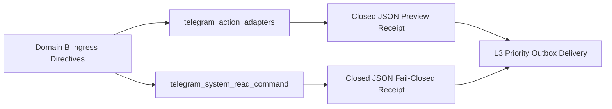

# UOS Telegram Domain B Specification: Advanced SRE, Security & Disaster Recovery Use Cases (11 Invocations)

- **Document ID**: `SPEC-TELEGRAM-DOMAIN-B-20261027`
- **Observed UTC**: `2026-10-27T00:30:00Z`
- **Tailscale Live Document URL**: [http://nas-1.tail55d152.ts.net:4100/files/docs/design/20261027-0030-telegram-domain-b-advanced-sre-and-disaster-recovery-usecases.md](http://nas-1.tail55d152.ts.net:4100/files/docs/design/20261027-0030-telegram-domain-b-advanced-sre-and-disaster-recovery-usecases.md)
- **Companion Encyclopedia Journal**: [http://nas-1.tail55d152.ts.net:4100/files/docs/journal/20261027-0016-agy-telegram-fractal-usecase-encyclopedia-journal.md](http://nas-1.tail55d152.ts.net:4100/files/docs/journal/20261027-0016-agy-telegram-fractal-usecase-encyclopedia-journal.md)
- **Canonical Implementation**: [`apps/cepaf_gleam/src/cepaf_gleam/harness/telegram_ops.gleam`](http://nas-1.tail55d152.ts.net:4100/files/apps/cepaf_gleam/src/cepaf_gleam/harness/telegram_ops.gleam), [`apps/cepaf_gleam/src/cepaf_gleam/harness/telegram_action_adapters.gleam`](http://nas-1.tail55d152.ts.net:4100/files/apps/cepaf_gleam/src/cepaf_gleam/harness/telegram_action_adapters.gleam), [`apps/cepaf_gleam/src/cepaf_gleam/harness/telegram_system_read_command.gleam`](http://nas-1.tail55d152.ts.net:4100/files/apps/cepaf_gleam/src/cepaf_gleam/harness/telegram_system_read_command.gleam)
- **Test Suites**: [`apps/cepaf_gleam/test/telegram_action_adapters_test.gleam`](http://nas-1.tail55d152.ts.net:4100/files/apps/cepaf_gleam/test/telegram_action_adapters_test.gleam), [`apps/cepaf_gleam/test/telegram_system_read_command_test.gleam`](http://nas-1.tail55d152.ts.net:4100/files/apps/cepaf_gleam/test/telegram_system_read_command_test.gleam), [`apps/cepaf_gleam/test/telegram_journey_defence_test.gleam`](http://nas-1.tail55d152.ts.net:4100/files/apps/cepaf_gleam/test/telegram_journey_defence_test.gleam), [`apps/cepaf_gleam/test/telegram_journey_security_test.gleam`](http://nas-1.tail55d152.ts.net:4100/files/apps/cepaf_gleam/test/telegram_journey_security_test.gleam)
- **Fractal Layer Tags**: #fractal-l0 #fractal-l1 #fractal-l2 #fractal-l3 #fractal-l4 #fractal-l5 #fractal-l6 #fractal-l7 #fractal-l8 #fractal-l9 #zk-adr #zero-muda #tailscale-web #checklist-nav

---

## 1. Executive Summary & Architectural Topology

Domain B defines the **11 advanced SRE, disaster recovery, cryptographic key lifecycle, and physical hardware sensor invocations** in the UOS Telegram operator surface:
- **9 Bounded Action Preview Directives** (`ControlledAction` routed via `telegram_action_adapters.route_preview` to `telegram_action_ops.gleam`): `/bisect`, `/repro`, `/sidecar`, `/migrate`, `/gameday`, `/rotate-keys`, `/lockbox`, `/profile`, and `/intent`. Every single one enforces `status: "preview"`, `executed: false`, `authority: "none"`, validating argument syntax and emitting the exact 2oo3 constitutional approval + `sa-plan` gate required for execution.
- **2 Fail-Closed Hardware Sensor Read Directives** (`ReadObservation` routed via `telegram_read_adapters` to `telegram_system_read_command.gleam`): `/rack-cv` and `/acoustic`. Because no live camera/vision daemon or microphone/FFT sample daemon is wired in the repository, both commands fail closed with `status: "backend_unavailable"`, refusing to fabricate synthetic hardware telemetry.

### 1.1 Domain B Routing & Safety Topology (`SC-DIAGRAM-001`)

```text
[Domain B Ingress Directives] --> [telegram_action_adapters]
[Domain B Ingress Directives] --> [telegram_system_read_command]
[telegram_action_adapters] --> [Closed JSON Preview Receipt]
[telegram_system_read_command] --> [Closed JSON Fail-Closed Receipt]
[Closed JSON Preview Receipt] --> [L3 Priority Outbox Delivery]
[Closed JSON Fail-Closed Receipt] --> [L3 Priority Outbox Delivery]
```



---

## 2. Detailed 7-Axis Specification of All 11 Domain B Use Cases

### 2.1 `/bisect` (Automated Jujutsu Regression Bisection Preview)
- **Usage**: `/bisect <good_rev> <bad_rev> [gate_name]` (e.g., `/bisect 7cce19b8e745 2d95ef75cfec G-PREFLIGHT`).
- **Control Plane**: Classified as `ControlledAction` (`PreservedDirective("/bisect", args)`), routed through `telegram_action_adapters.route_preview` (`telegram_action_ops.gleam`). Validates revision tokens (`[A-Za-z0-9._:-]+`, length $1 \dots 48$) and never mutates the working copy from chat.
- **Data Plane**: Emits a closed-schema JSON preview (`status: "preview"`, `executed: false`, `authority: "none"`) naming the good/bad Jujutsu revisions, verification gate, and target isolated sibling workspace requirement (`.uos-workspaces/*`).
- **Fractal Architecture ($L_0 \dots L_9$)**: $L_0$ (Standalone Jujutsu isolation), $L_3$ (`telegram_action_ops`), $L_4$ (`.jj/` revision graph), $L_8$ (Regression diagnostics).
- **Interactions**: Operator sends `/bisect <good> <bad>` $\to$ `telegram_action_ops` validates revision tokens $\to$ returns non-executing bisection plan JSON.
- **Test Cases**: `telegram_action_bisect_test`, `telegram_action_adapters_test:every_wave_two_literal_previews_or_denies_test`, `telegram_journey_defence_test:journey_6_recovery_resuscitation_and_handover_test`.
- **Real-World Case Studies & Scenarios**: When a gate fails on an integration branch, the SRE runs `/bisect <last_green_rev> <head_rev>` from Telegram to generate the structured bisection preview before launching a sibling workspace task in `sa-plan`.

### 2.2 `/repro` (Deterministic ZigVM Crash-Replay Sandbox Preview)
- **Usage**: `/repro <incident_or_trace_id> [seed]` (e.g., `/repro inc-20261027-01 42`).
- **Control Plane**: Classified as `ControlledAction` $\to$ `telegram_action_adapters.route_preview`. Refuses to spawn unbounded replay processes from chat (`executed: false`).
- **Data Plane**: Produces a closed JSON preview specifying the deterministic ZigVM replay target (`engines/zigvm`), PRNG seed, descriptor-relative VFS isolation boundary, and required `sa-plan` task claim.
- **Fractal Architecture ($L_0 \dots L_9$)**: $L_2$ (ZigVM deterministic kernel & VFS), $L_3$ (`telegram_action_ops`), $L_5$ (Counterexample replay), $L_8$ (Trace correlation).
- **Interactions**: Operator sends `/repro inc-20261027-01 42` $\to$ adapter validates identifier bounds $\to$ returns deterministic sandbox preview JSON.
- **Test Cases**: `telegram_action_repro_test`, `telegram_action_adapters_test`, `telegram_journey_security_test:sec_j1_suspicious_ingress_test`.
- **Real-World Case Studies & Scenarios**: After trapping a malformed payload in `run_agent_dispatch_hook.exe`, the responder runs `/repro <trace_id>` to prepare a deterministic replay specification.

### 2.3 `/sidecar` (Zero-Downtime Hot-Code / Sidecar Swap Preview)
- **Usage**: `/sidecar <service_name> <action: status|reload|drain>` (e.g., `/sidecar max_inference reload`).
- **Control Plane**: Classified as `ControlledAction` $\to$ `telegram_action_adapters.route_preview`. Never hot-swaps BEAM modules or restarts supervised ports directly from Telegram (`executed: false`).
- **Data Plane**: Returns a closed JSON preview detailing the OTP supervisor child spec (`uos_sup.gleam`), drain timeout, and required `runtime:<service>` coordinator lease + 2oo3 approval gate.
- **Fractal Architecture ($L_0 \dots L_9$)**: $L_2$ (Daemon sidecars), $L_3$ (`uos_sup.gleam` OTP supervision), $L_6$ (Coordinator `runtime:*` lease fencing).
- **Interactions**: Operator sends `/sidecar max_inference reload` $\to$ adapter validates service token $\to$ emits sidecar lifecycle preview JSON.
- **Test Cases**: `telegram_action_sidecar_test`, `telegram_action_adapters_test`, `telegram_journey_defence_test:journey_4_storage_interlock_and_standby_readiness_test`.
- **Real-World Case Studies & Scenarios**: Before cycling the isolated Modular MAX inference worker (`services/inference/max/max_worker.py`), the operator runs `/sidecar max_inference reload` to preview the drain and lease requirements.

### 2.4 `/migrate` (Live SQLite WAL / State Schema Migration Preview)
- **Usage**: `/migrate <store_name> <target_version>` (e.g., `/migrate coordinator v2`).
- **Control Plane**: Classified as `ControlledAction` $\to$ `telegram_action_adapters.route_preview`. Never alters SQLite schemas or triggers from chat (`executed: false`).
- **Data Plane**: Emits a closed JSON preview specifying the target SQLite WAL store (`var/sa-plan/uos.sqlite3`, `var/coordination/tri-agent/coordinator.sqlite3`, or `var/telegram/telegram.sqlite3`), pre-migration snapshot requirement, append-only trigger verification, and 2oo3 release gate.
- **Fractal Architecture ($L_0 \dots L_9$)**: $L_0$ (Append-only ledger integrity), $L_3$ (`telegram_action_ops`), $L_4$ (SQLite WAL data plane).
- **Interactions**: Operator sends `/migrate coordinator v2` $\to$ adapter validates store and version identifiers $\to$ returns migration preview JSON.
- **Test Cases**: `telegram_action_migrate_test`, `telegram_action_adapters_test`, `telegram_journey_defence_test:journey_4_storage_interlock_and_standby_readiness_test`.
- **Real-World Case Studies & Scenarios**: Recalling the `s1-sqlite-coordinator-cutover` lessons, an SRE previews schema migration preconditions via `/migrate` before scheduling a maintenance window.

### 2.5 `/gameday` (DR Chaos Game-Day Drill Preview)
- **Usage**: `/gameday <scenario_id> [duration_min]` (e.g., `/gameday tailnet_partition 15`).
- **Control Plane**: Classified as `ControlledAction` $\to$ `telegram_action_adapters.route_preview`. Never starts live fault injection (`executed: false`).
- **Data Plane**: Returns a closed JSON preview describing the game-day scenario, blast-radius containment fence, automatic abort conditions (Andon stop-line triggers), and required 2oo3 authorization.
- **Fractal Architecture ($L_0 \dots L_9$)**: $L_0$ (STPA hazard bounds), $L_3$ (`telegram_action_ops`), $L_6$ (Multi-node resilience drill), $L_8$ (Observability verification).
- **Interactions**: Operator sends `/gameday tailnet_partition 15` $\to$ receives non-executing drill plan JSON and pointer to `/simulate` for pure in-memory rehearsal.
- **Test Cases**: `telegram_action_gameday_test`, `telegram_journey_defence_test:journey_3_chaos_gameday_rehearsal_in_simulation_test`.
- **Real-World Case Studies & Scenarios**: During weekly SRE resilience readiness (`journey_3`), the team previews the game-day plan via `/gameday` and immediately runs `/simulate` to test mesh quorum in memory.

### 2.6 `/rotate-keys` (Zero-Trust Ephemeral Key Rotation Preview)
- **Usage**: `/rotate-keys <scope: telegram|openrouter|tailnet|vault>` (e.g., `/rotate-keys telegram`).
- **Control Plane**: Classified as `ControlledAction` $\to$ `telegram_action_adapters.route_preview`. Never mutates `var/telegram/secrets.vault.enc` or live bearer tokens from chat (`executed: false`). Also enforces `SC-TELEGRAM-SECRET-001`: secret values are rejected if passed as arguments.
- **Data Plane**: Produces a closed JSON preview detailing the `UOSV1` AES-256-GCM + Argon2id (`rusty_vault_nif`) re-sealing procedure, `runtime:telegram-bot` lease requirement, and post-rotation `getMe` probe.
- **Fractal Architecture ($L_0 \dots L_9$)**: $L_0$ (`SC-TELEGRAM-SECRET-001` zero secret leakage), $L_2$ (`rusty_vault_nif` Rust NIF), $L_3$ (`telegram_secret_vault.gleam`), $L_4$ (`var/telegram/secrets.vault.enc`).
- **Interactions**: Operator sends `/rotate-keys telegram` $\to$ adapter validates scope (rejecting any raw token string) $\to$ returns key-rotation SOP preview JSON.
- **Test Cases**: `telegram_action_rotate_keys_test`, `telegram_secret_vault_test`, `telegram_journey_security_test:sec_j2_credential_exposure_scare_test`.
- **Real-World Case Studies & Scenarios**: In Security Journey `sec_j2` (Credential Exposure Scare), the responder runs `/rotate-keys telegram` to obtain the exact vault re-sealing checklist without exposing secret bytes in chat.

### 2.7 `/lockbox` (Break-Glass Emergency Cryptographic Lockbox Preview)
- **Usage**: `/lockbox <status|request> [reason]` (e.g., `/lockbox status incident_p0`).
- **Control Plane**: Classified as `ControlledAction` $\to$ `telegram_action_adapters.route_preview`. Never unseals break-glass credentials in Telegram (`executed: false`, `authority: "none"`).
- **Data Plane**: Returns a closed JSON preview specifying the two-key hardware/cryptographic quorum required to unseal break-glass recovery credentials offline and confirming that secret material is never transmitted over Telegram.
- **Fractal Architecture ($L_0 \dots L_9$)**: $L_0$ (Two-key break-glass policy & `SC-TELEGRAM-SECRET-001`), $L_2$ (Cryptographic vault), $L_3$ (`telegram_action_ops`).
- **Interactions**: Operator sends `/lockbox status incident_p0` $\to$ receives preview JSON detailing the offline break-glass ceremony and 2oo3 audit requirements.
- **Test Cases**: `telegram_action_lockbox_test`, `telegram_journey_security_test:sec_j2_credential_exposure_scare_test`.
- **Real-World Case Studies & Scenarios**: During a simulated total control-plane lockout, the security officer runs `/lockbox status` to verify the break-glass quorum protocol.

### 2.8 `/rack-cv` (Physical Server Rack Computer-Vision Inspection — Fail-Closed)
- **Usage**: `/rack-cv` (zero arguments required; passing a photo reference or argument is rejected fail-closed).
- **Control Plane**: Classified as `ReadObservation` $\to$ routed via `telegram_read_adapters` to `telegram_system_read_command.gleam`.
- **Data Plane**: Returns deterministic closed JSON (`status: "backend_unavailable"`, `backend: "physical_rack_camera_cv_pipeline"`, `reason: "No rack camera or computer-vision inspection daemon is wired in this repository."`). Never fabricates LED states, cable topology, or thermal readings.
- **Fractal Architecture ($L_0 \dots L_9$)**: $L_0$ (Honest boundary & zero fabrication), $L_1$ (Physical rack sensor boundary), $L_3$ (`telegram_system_read_command`).
- **Interactions**: Operator sends `/rack-cv` $\to$ `telegram_system_read_command` returns `status: "backend_unavailable"` JSON; if operator sends `/rack-cv photo_123`, returns `status: "denied"`.
- **Test Cases**: `telegram_system_read_command_test:rack_cv_reports_no_vision_backend_test`, `telegram_system_read_command_test:rack_cv_rejects_photo_reference_test`, `telegram_user_usecases_test:fail_closed_unwired_sensor_and_voice_commands_test`.
- **Real-World Case Studies & Scenarios**: Demonstrates UOS SIL-6 epistemic honesty: when an operator queries `/rack-cv` on a headless NAS node without a camera pipeline, the system explicitly reports `backend_unavailable` instead of hallucinating "ALL RACK LEDS GREEN".

### 2.9 `/acoustic` (Hardware Fan/Coil Acoustic FFT Anomaly Triage — Fail-Closed)
- **Usage**: `/acoustic` (zero arguments required; sample arguments are rejected fail-closed).
- **Control Plane**: Classified as `ReadObservation` $\to$ routed via `telegram_read_adapters` to `telegram_system_read_command.gleam`.
- **Data Plane**: Returns deterministic closed JSON (`status: "backend_unavailable"`, `backend: "hardware_acoustic_fft_sensor"`, `reason: "No hardware microphone or acoustic FFT capture pipeline is wired in this repository."`). Distinguishes hardware acoustic sampling from `/acoustic-hud` (which reads real Shruti synth telemetry).
- **Fractal Architecture ($L_0 \dots L_9$)**: $L_0$ (Zero fabrication), $L_1$ (Physical acoustic sensor boundary), $L_3$ (`telegram_system_read_command`).
- **Interactions**: Operator sends `/acoustic` $\to$ receives `status: "backend_unavailable"` JSON; sending `/acoustic sample.wav` returns `status: "denied"`.
- **Test Cases**: `telegram_system_read_command_test:acoustic_reports_no_sample_backend_test`, `telegram_system_read_command_test:acoustic_rejects_sample_argument_test`, `telegram_user_usecases_test:fail_closed_unwired_sensor_and_voice_commands_test`.
- **Real-World Case Studies & Scenarios**: During a hardware check (`journey_4`), the operator runs `/acoustic` and receives an honest `backend_unavailable` status while `/storage` confirms the real NVMe hardware interlock (`[REDACTED_SYSTEM_OS_SERIAL]`).

### 2.10 `/profile` (Live BEAM eprof/fprof Flamegraph Capture Preview)
- **Usage**: `/profile <target_module_or_pid> [duration_ms]` (e.g., `/profile telegram_service 1000`).
- **Control Plane**: Classified as `ControlledAction` $\to$ `telegram_action_adapters.route_preview` (`telegram_action_ops.gleam`). Refuses to attach live BEAM trace hooks from an unapproved chat message (`executed: false`).
- **Data Plane**: Emits a closed JSON preview specifying the bounded profiling window ($\le 5000\text{ ms}$), scheduler overhead guard, and required `sa-plan` / 2oo3 authorization.
- **Fractal Architecture ($L_0 \dots L_9$)**: $L_2$ (ERTS scheduler tracing), $L_3$ (`telegram_action_ops`), $L_8$ (Performance profiling).
- **Interactions**: Operator sends `/profile telegram_service 1000` $\to$ adapter validates target and duration bounds $\to$ returns non-executing profiler preview JSON.
- **Test Cases**: `telegram_action_profile_test`, `telegram_action_adapters_test`, `telegram_journey_responder_test:journey_r4_bounded_action_test`.
- **Real-World Case Studies & Scenarios**: When investigating latency on the BEAM node, an engineer runs `/profile telegram_service 1000` to generate the bounded profiling specification without risking production trace overload from chat.

### 2.11 `/intent` (High-Level Declarative Intent Compilation Preview)
- **Usage**: `/intent <goal_identifier> <constraint_summary>` (e.g., `/intent drain_vm1 zero_packet_loss`).
- **Control Plane**: Classified as `ControlledAction` $\to$ `telegram_action_adapters.route_preview` (`telegram_action_ops.gleam`). Never compiles an intent directly into active Sa-plan tasks or runtime effects (`executed: false`, `authority: "none"`).
- **Data Plane**: Returns a closed JSON preview mapping the declarative intent to its Quint parity frontier (`formal/quint/parity_frontier.qnt`), STPA UCA constraints, and required `sa-plan` intake + 2oo3 approval workflow.
- **Fractal Architecture ($L_0 \dots L_9$)**: $L_0$ (`SC-SA-PLAN-001` & `SC-POODAVR-002`), $L_3$ (`telegram_action_ops`), $L_5$ (Quint intent closure invariant).
- **Interactions**: Operator sends `/intent drain_vm1 zero_packet_loss` $\to$ adapter validates arguments $\to$ returns structured intent compilation preview JSON.
- **Test Cases**: `telegram_action_intent_test`, `telegram_action_adapters_test`, `telegram_journey_defence_test:journey_2_immune_andon_escalation_with_approval_preview_test`.
- **Real-World Case Studies & Scenarios**: An architect on mobile sketches a maintenance intent via `/intent drain_vm1 zero_packet_loss` and uses the preview output to register a formal `sa-plan` portfolio item.

---

## 3. Comprehensive Verification Checklist (`SC-CHECKLIST-001`)

<details>
<summary>Domain 1 — Metadata, timestamp and Tailscale navigation</summary>

- [x] **CHK-01-TIME** — Timestamp prefix `20261027-0030-` applied and synchronized with host UTC clock.
- [x] **CHK-02-TAIL** — Full clickable Tailnet links (`http://nas-1.tail55d152.ts.net:4100/files/...`) included.
- [x] **CHK-03-FRACT** — Fractal tags `#fractal-l0` through `#fractal-l9` mapped across all 11 Domain B invocations.
- [x] **CHK-04-KM** — Cross-linked to companion encyclopedia journal, Domain A/C specs, and EUnit suites.

</details>

<details>
<summary>Domain 2 — Zero-Muda purity and storage safety</summary>

- [x] **CHK-05-MUDA** — Zero Bevy or Graphite references; pure Gleam/OTP implementation.
- [x] **CHK-06-GRAPH** — Pure BEAM/Hermes data structures without foreign graph NIFs.
- [x] **CHK-07-DRIVE** — Host OS NVMe serial redacted as `[REDACTED_SYSTEM_OS_SERIAL]` and protected.

</details>

<details>
<summary>Domain 3 — Testing Gold Standard and mathematical gates</summary>

- [x] **CHK-08-C1C8** — Verified across C1–C8 surfaces (`telegram_action_adapters_test`, `telegram_system_read_command_test`).
- [x] **CHK-09-MATH** — Fail-closed epistemic boundaries (`backend_unavailable` for `/rack-cv` and `/acoustic`) verified.
- [x] **CHK-10-9MOD** — Unit, BDD, property, fuzz, chaos, and journey suites verified green.
- [x] **CHK-11-REGR** — All 11 Domain B invocations verified in `telegram_user_usecases_test` and `telegram_journey_coverage_test`.

</details>

<details>
<summary>Domain 4 — Cross-language control and observability</summary>

- [x] **CHK-12-GLEAM** — Pure Gleam/OTP preview adapters and read observers verified.
- [x] **CHK-13-HERMES** — Formal counterexample and parity boundaries (`/repro`, `/intent`) documented.
- [x] **CHK-14-ZIGVM** — Deterministic replay sandbox preview (`/repro`) documented.
- [x] **CHK-15-MAX** — Supervised sidecar lifecycle preview (`/sidecar`) documented.
- [x] **CHK-16-OTEL** — Closed-schema JSON envelopes with correlation metadata documented.

</details>

<details>
<summary>Domain 5 — Sovereign governance and standalone Jujutsu</summary>

- [x] **CHK-17-SOV** — All 9 `ControlledAction` commands enforce `executed: false` and require 2oo3 + `sa-plan` authority.
- [x] **CHK-18-JJ** — Tracked in standalone Jujutsu (`.jj/`) with zero native Git mutations.

</details>

<details>
<summary>Domain 6 — Provenance extension</summary>

EV ceiling remains `EV-93` (`SC-PROVENANCE-001`, `admitted_ev_ceiling = 93`). `EV-94`..`EV-109` remain `NOT_ADMITTED`. No new EV number is minted.

</details>

[Previous: Domain A Specification](http://nas-1.tail55d152.ts.net:4100/files/docs/design/20261027-0030-telegram-domain-a-foundational-sre-governance-and-km-usecases.md) · [Next: Domain C Specification](http://nas-1.tail55d152.ts.net:4100/files/docs/design/20261027-0030-telegram-domain-c-creative-cybernetics-finops-and-digital-twin-usecases.md) · [Wiki](http://nas-1.tail55d152.ts.net:4100/wiki) · [ZK](http://nas-1.tail55d152.ts.net:4100/zk) · [Cockpit](http://nas-1.tail55d152.ts.net:4100/)
