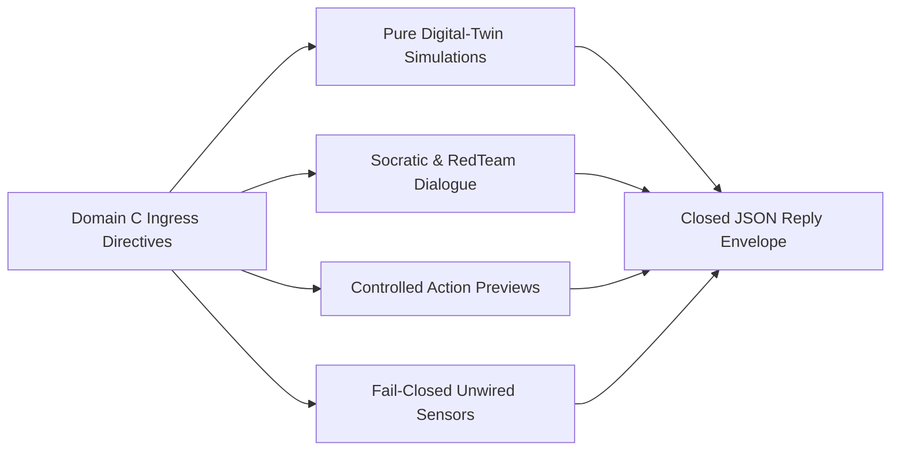

# UOS Telegram Domain C Specification: Creative Cybernetics, FinOps & Digital Twin Use Cases (14 Invocations)

- **Document ID**: `SPEC-TELEGRAM-DOMAIN-C-20261027`
- **Observed UTC**: `2026-10-27T00:30:00Z`
- **Tailscale Live Document URL**: [http://nas-1.tail55d152.ts.net:4100/files/docs/design/20261027-0030-telegram-domain-c-creative-cybernetics-finops-and-digital-twin-usecases.md](http://nas-1.tail55d152.ts.net:4100/files/docs/design/20261027-0030-telegram-domain-c-creative-cybernetics-finops-and-digital-twin-usecases.md)
- **Companion Encyclopedia Journal**: [http://nas-1.tail55d152.ts.net:4100/files/docs/journal/20261027-0016-agy-telegram-fractal-usecase-encyclopedia-journal.md](http://nas-1.tail55d152.ts.net:4100/files/docs/journal/20261027-0016-agy-telegram-fractal-usecase-encyclopedia-journal.md)
- **Canonical Implementation**: [`apps/cepaf_gleam/src/cepaf_gleam/harness/telegram_creative.gleam`](http://nas-1.tail55d152.ts.net:4100/files/apps/cepaf_gleam/src/cepaf_gleam/harness/telegram_creative.gleam), [`apps/cepaf_gleam/src/cepaf_gleam/harness/telegram_simulation_read_command.gleam`](http://nas-1.tail55d152.ts.net:4100/files/apps/cepaf_gleam/src/cepaf_gleam/harness/telegram_simulation_read_command.gleam), [`apps/cepaf_gleam/src/cepaf_gleam/harness/telegram_dialogue_command.gleam`](http://nas-1.tail55d152.ts.net:4100/files/apps/cepaf_gleam/src/cepaf_gleam/harness/telegram_dialogue_command.gleam), [`apps/cepaf_gleam/src/cepaf_gleam/harness/telegram_knowledge_read_command.gleam`](http://nas-1.tail55d152.ts.net:4100/files/apps/cepaf_gleam/src/cepaf_gleam/harness/telegram_knowledge_read_command.gleam)
- **Test Suites**: [`apps/cepaf_gleam/test/telegram_simulation_read_command_test.gleam`](http://nas-1.tail55d152.ts.net:4100/files/apps/cepaf_gleam/test/telegram_simulation_read_command_test.gleam), [`apps/cepaf_gleam/test/telegram_dialogue_command_test.gleam`](http://nas-1.tail55d152.ts.net:4100/files/apps/cepaf_gleam/test/telegram_dialogue_command_test.gleam), [`apps/cepaf_gleam/test/telegram_knowledge_read_command_test.gleam`](http://nas-1.tail55d152.ts.net:4100/files/apps/cepaf_gleam/test/telegram_knowledge_read_command_test.gleam), [`apps/cepaf_gleam/test/telegram_user_usecases_test.gleam`](http://nas-1.tail55d152.ts.net:4100/files/apps/cepaf_gleam/test/telegram_user_usecases_test.gleam)
- **Fractal Layer Tags**: #fractal-l0 #fractal-l1 #fractal-l2 #fractal-l3 #fractal-l4 #fractal-l5 #fractal-l6 #fractal-l7 #fractal-l8 #fractal-l9 #zk-adr #zero-muda #tailscale-web #checklist-nav

---

## 1. Executive Summary & Architectural Topology

Domain C defines the **14 creative cybernetics, pure digital-twin simulation, adversarial Socratic/Red-Team dialogue, knowledge synthesis, and audit/FinOps invocations** in the UOS Telegram operator surface:
- **3 Pure In-Memory Digital-Twin Simulation Commands** (`ReadObservation` via `telegram_simulation_read_command.gleam`): `/whatif`, `/simulate`, and `/canvas`. They execute deterministic mathematical models over caller-supplied parameters without mutating live leases, peer meshes, or spatial canvases.
- **2 Live Telemetry & Journal Synthesis Commands** (`ReadObservation`): `/acoustic-hud` (`cepaf_gleam/ui/audio/shruti_synth` 22-Shruti microtonal HUD audit) and `/postmortem` (real `docs/journal` RCA/ACH synthesis).
- **2 Adversarial Model-Assisted Dialogue Commands** (`ModelAssisted` via `telegram_dialogue_command.gleam` and `telegram_conversation.gleam`): `/redteam` and `/socratic`.
- **3 Bounded Controlled-Action Previews** (`ControlledAction` via `telegram_action_creative.gleam`): `/eco-schedule`, `/export-audit`, and `/commitments`.
- **4 Fail-Closed Unwired External Sensor/Media Commands** (`ReadObservation`): `/radar`, `/babel`, `/pacing`, and `/whiteboard` (`status: "backend_unavailable"`).

### 1.1 Domain C Cybernetic & Digital-Twin Topology (`SC-DIAGRAM-001`)

```text
[Domain C Ingress Directives] --> [Pure Digital-Twin Simulations]
[Domain C Ingress Directives] --> [Socratic & RedTeam Dialogue]
[Domain C Ingress Directives] --> [Controlled Action Previews]
[Domain C Ingress Directives] --> [Fail-Closed Unwired Sensors]
[Pure Digital-Twin Simulations] --> [Closed JSON Reply Envelope]
[Socratic & RedTeam Dialogue] --> [Closed JSON Reply Envelope]
[Controlled Action Previews] --> [Closed JSON Reply Envelope]
[Fail-Closed Unwired Sensors] --> [Closed JSON Reply Envelope]
```



---

## 2. Detailed 7-Axis Specification of All 14 Domain C Use Cases

### 2.1 `/whatif` (Pure Counterfactual Sa-Plan & Oban Simulation)
- **Usage**:
  - `/whatif claim <contenders 1..64>` (simulates $N$ concurrent contenders racing for a single exclusive task lease)
  - `/whatif retry <attempts 1..12>` (simulates Oban exponential retry backoff across $K$ failures)
  - `/whatif zombie <lease_until_ns> <now_ns>` (simulates zombie lease reaper evaluation)
- **Control Plane**: `ReadObservation` $\to$ routed via `telegram_read_adapters` to `telegram_simulation_read_command.gleam` (`cepaf_gleam/planning/sa_plan_simulator`).
- **Data Plane**: Pure functional computation over synthetic `SimulatedTask` values (`subject: "synthetic task, not a live lease"`). Returns closed JSON (`status: "ok"`, `kind: "pure_simulation"`) reporting `granted: 1`, `rejected: N - 1`, `final_task_state`, or backoff schedule.
- **Fractal Architecture ($L_0 \dots L_9$)**: $L_0$ (Single-writer lease mutex invariant), $L_3$ (`sa_plan_simulator`), $L_5$ (Counterfactual verification), $L_9$ (Operator rehearsal).
- **Interactions**: Operator sends `/whatif claim 12` $\to$ `sa_plan_simulator.simulate_concurrent_claims` runs in memory $\to$ returns JSON proving exactly 1 contender is granted and 11 are rejected.
- **Test Cases**: `telegram_simulation_read_command_test:whatif_claim_positive_test`, `whatif_retry_positive_test`, `whatif_zombie_positive_and_negative_test`, `telegram_user_usecases_test:digital_twin_simulation_usecases_test`.
- **Real-World Case Studies & Scenarios**: Before scaling a swarm to 12 parallel workers, an operator runs `/whatif claim 12` in Telegram to verify the deterministic single-winner lease guarantee and `/whatif retry 4` to inspect the backoff curve.

### 2.2 `/simulate` (Pure Peer-Mesh Quorum Digital Twin)
- **Usage**: `/simulate <node>:<mode> ...` ($1 \dots 7$ unique nodes; `mode` $\in \{\text{nominal}, \text{degraded}, \text{partitioned}, \text{recovering}\}$, e.g., `/simulate nas1:nominal vm1:degraded cloud1:partitioned`).
- **Control Plane**: `ReadObservation` $\to$ routed via `telegram_read_adapters` to `telegram_simulation_read_command.gleam` (`cepaf_gleam/zenoh/peer_simulator`). Explicitly its own canonical command (`simulate_is_its_own_canonical_test`).
- **Data Plane**: Builds a pure in-memory mesh (`peer.build_simulated_mesh`) and evaluates quorum against `quorum_threshold = 0.67` (`peer.evaluate_mesh_quorum`). Returns closed JSON with per-node `health_score`, `circuit_state`, `average_health`, and `quorum_met`.
- **Fractal Architecture ($L_0 \dots L_9$)**: $L_3$ (`zenoh/peer_simulator`), $L_5$ (Quorum math model), $L_6$ (Mesh topology rehearsal), $L_7$ (Peer failure modeling).
- **Interactions**: Operator sends `/simulate nas1:nominal vm1:degraded cloud1:partitioned` $\to$ `peer_simulator` computes health scores and quorum $\to$ returns JSON showing whether $2/3$ quorum is met.
- **Test Cases**: `telegram_simulation_read_command_test:simulate_positive_test`, `simulate_two_of_three_misses_067_threshold_test`, `simulate_quorum_failure_is_reported_test`, `telegram_user_usecases_test:digital_twin_simulation_usecases_test`.
- **Real-World Case Studies & Scenarios**: During a chaos gameday rehearsal (`journey_3_chaos_gameday_rehearsal_in_simulation_test`), the SRE models taking `vm-1` offline while `cloud-1` is degraded to see whether mesh quorum drops below `0.67` before touching any live host.

### 2.3 `/eco-schedule` (Carbon-Aware & Off-Peak Batch Scheduling Preview)
- **Usage**: `/eco-schedule <workload_id> <window: off_peak|solar_peak|low_carbon>` (e.g., `/eco-schedule hermes_corpus_sweep off_peak`).
- **Control Plane**: `ControlledAction` $\to$ routed via `telegram_action_adapters.route_preview` (`telegram_action_creative.gleam`). Never mutates Oban/cron schedules directly from chat (`status: "preview"`, `executed: false`).
- **Data Plane**: Returns a closed JSON preview detailing the deferred batch window, estimated thermal/power headroom on `nas-1`, and required `sa-plan` job registration gate.
- **Fractal Architecture ($L_0 \dots L_9$)**: $L_1$ (Host power/thermal envelope), $L_3$ (`telegram_action_creative`), $L_4$ (Sa-plan Oban queue).
- **Interactions**: Operator sends `/eco-schedule hermes_corpus_sweep off_peak` $\to$ adapter validates tokens $\to$ returns non-executing batch schedule preview JSON.
- **Test Cases**: `telegram_action_eco_schedule_test`, `telegram_action_adapters_test:every_wave_two_literal_previews_or_denies_test`.
- **Real-World Case Studies & Scenarios**: An operator previews deferring a heavy formal verification sweep to the `off_peak` window via `/eco-schedule` before committing the schedule in `sa-plan`.

### 2.4 `/canvas` (Pure 3D Spatial CRDT Convergence Observer)
- **Usage**: `/canvas <id>:<x>,<y>,<z> ...` ($1 \dots 8$ unique element IDs with integer coordinates in $[-1\,000\,000, +1\,000\,000]$, e.g., `/canvas node1:10,20,30 node2:40,50,60`).
- **Control Plane**: `ReadObservation` $\to$ routed via `telegram_read_adapters` to `telegram_simulation_read_command.gleam` (`cepaf_gleam/crdt/spatial`).
- **Data Plane**: Purely in Gleam (Zero-Muda: zero Bevy, zero Graphite, zero foreign NIFs), inserts all elements into `full`, partitions odd/even timestamps into two independent replicas (`replica_a`, `replica_b`), merges them via `spatial.merge(replica_a, replica_b)`, computes the 3D bounding box and diagonal extent, and verifies `split_replicas_merge_converged: true`.
- **Fractal Architecture ($L_0 \dots L_9$)**: $L_0$ (Zero-Muda pure Gleam 3D vector/CRDT math), $L_3$ (`cepaf_gleam/crdt/spatial`), $L_5$ (CRDT commutativity/convergence check), $L_9$ (Spatial topology preview).
- **Interactions**: Operator sends `/canvas node1:10,20,30 node2:40,50,60` $\to$ `canvas_observe` computes bounding box and replica convergence $\to$ returns closed JSON (`split_replicas_merge_converged: true`).
- **Test Cases**: `telegram_simulation_read_command_test:canvas_positive_test`, `canvas_negative_test`, `telegram_user_usecases_test:digital_twin_simulation_usecases_test`.
- **Real-World Case Studies & Scenarios**: Proves the UOS Zero-Muda mandate (`AGENTS.md` §5.6) in action: 3D spatial vector math, bounding boxes, Euclidean distance, and state-based CRDT convergence run deterministically in pure BEAM/Gleam from a single Telegram command.

### 2.5 `/acoustic-hud` (22-Shruti Microtonal Cybernetic Telemetry HUD Observer)
- **Usage**: `/acoustic-hud` (zero arguments required; rejects `engage` or extra arguments fail-closed).
- **Control Plane**: `ReadObservation` $\to$ routed via `telegram_read_adapters` to `telegram_system_read_command.gleam` (`cepaf_gleam/ui/audio/shruti_synth`).
- **Data Plane**: Evaluates `shruti_synth.audit_shruti_compliance(shruti_synth.init_shruti_hud())`, returning closed JSON (`status: "ok"`) with `base_sa_freq_hz`, `active_shruti_index`, `active_ratio`, `calculated_freq_hz`, `master_gain`, and `compliant: true`.
- **Fractal Architecture ($L_0 \dots L_9$)**: $L_3$ (`ui/audio/shruti_synth.gleam`), $L_8$ (Sonified telemetry mapping), $L_9$ (Cybernetic operator HUD).
- **Interactions**: Operator sends `/acoustic-hud` $\to$ `shruti_synth` computes exact harmonic ratio and compliance audit $\to$ returns closed JSON receipt.
- **Test Cases**: `telegram_system_read_command_test:acoustic_hud_reads_real_shruti_audit_test`, `acoustic_hud_rejects_engage_argument_test`.
- **Real-World Case Studies & Scenarios**: An operator inspects the microtonal sonification parameters mapping mesh stability to harmonic Shruti intervals via `/acoustic-hud`.

### 2.6 `/radar` (360-Degree External Threat & CVE Horizon Radar — Fail-Closed)
- **Usage**: `/radar` (oversized arguments rejected fail-closed).
- **Control Plane**: `ReadObservation` $\to$ routed via `telegram_read_adapters` to `telegram_system_read_command.gleam`.
- **Data Plane**: Returns deterministic closed JSON (`status: "backend_unavailable"`, `backend: "external_cve_and_bgp_threat_feed"`, `reason: "No live external CVE or BGP radar feed is wired into this offline-capable repository."`).
- **Fractal Architecture ($L_0 \dots L_9$)**: $L_0$ (Zero fabrication), $L_3$ (`telegram_system_read_command`), $L_7$ (External feed boundary).
- **Interactions**: Operator sends `/radar` $\to$ receives `status: "backend_unavailable"` JSON confirming no unpinned external threat feed is silently polled.
- **Test Cases**: `telegram_system_read_command_test:radar_reports_no_live_feed_test`, `radar_rejects_oversized_arguments_test`, `telegram_user_usecases_test:fail_closed_unwired_sensor_and_voice_commands_test`.
- **Real-World Case Studies & Scenarios**: During `sec_j1` (Suspicious Ingress Triage), the security responder runs `/radar` and observes the explicit `backend_unavailable` boundary while relying on local ingress audit logs.

### 2.7 `/babel` (Real-Time Cross-Language Voice/Stream Translation — Fail-Closed)
- **Usage**: `/babel` (oversized arguments rejected fail-closed).
- **Control Plane**: `ReadObservation` $\to$ routed via `telegram_read_adapters` to `telegram_simulation_read_command.gleam`.
- **Data Plane**: Returns closed JSON (`status: "backend_unavailable"`, `backend: "multilingual_stream_translator"`), refusing to claim live speech/stream translation when no translation pipeline is wired.
- **Fractal Architecture ($L_0 \dots L_9$)**: $L_0$ (Honest boundary), $L_3$ (`telegram_simulation_read_command`), $L_9$ (Operator communication boundary).
- **Interactions**: Operator sends `/babel` $\to$ receives `status: "backend_unavailable"` JSON.
- **Test Cases**: `telegram_simulation_read_command_test:babel_is_unavailable_test`, `babel_oversize_args_denied_test`.
- **Real-World Case Studies & Scenarios**: Ensures multilingual operators know `/babel` stream translation is unwired rather than receiving unverified machine translations during an incident.

### 2.8 `/redteam` (Adversarial Red-Team Assumption Stress-Testing)
- **Usage**: `/redteam <claim, architecture, or plan to challenge>` ($1 \dots 256$ UTF-8 bytes, no control bytes; e.g., `/redteam Single-node SQLite WAL under NFS mount`).
- **Control Plane**: Classified as `ModelAssisted` (`PreservedDirective("/redteam", args)`), validated by `telegram_dialogue_command.topic/1` and constructed via `telegram_conversation.prepare_request/2` with a dedicated adversarial red-team system prompt (`"Mode: redteam. Stress-test the operator's claim or plan..."`).
- **Data Plane**: Incorporates the caller's 8-turn memory context (`var/telegram/conversations.sqlite3`), executes via the OpenRouter Gemma cascade, redacts any secret patterns, and appends the exchange to the bounded store. Never grants effect authority (`Authority remains with Sa-plan and 2oo3 approval`).
- **Fractal Architecture ($L_0 \dots L_9$)**: $L_0$ (Engine 4 Popperian falsification & zero effect authority), $L_3$ (`telegram_dialogue_command`, `telegram_conversation`), $L_6$ (OpenRouter cascade).
- **Interactions**: Operator sends `/redteam <claim>` $\to$ `telegram_dialogue_command` validates topic $\to$ `telegram_conversation` invokes red-team prompt $\to$ returns structured failure modes, attacker paths, and missing evidence checks.
- **Test Cases**: `telegram_dialogue_command_test`, `telegram_journey_security_test:sec_j4_swarm_mesh_anomaly_test`.
- **Real-World Case Studies & Scenarios**: Before proposing a new storage migration, an engineer runs `/redteam Migrating coordinator SQLite store without stopping peer writers` to surface race conditions and STPA hazards.

### 2.9 `/socratic` (Socratic Epistemic Dialectical Debugger)
- **Usage**: `/socratic <hypothesis or problem statement>` ($1 \dots 256$ UTF-8 bytes, e.g., `/socratic SQLite WAL contention during migration`).
- **Control Plane**: Classified as `ModelAssisted` (`PreservedDirective("/socratic", args)`), validated by `telegram_dialogue_command.topic/1` and executed via `telegram_conversation.prepare_request/2` with the Socratic system prompt (`"Mode: socratic. Use Socratic dialogue to examine the operator's topic: surface hidden assumptions, ask 2-4 focused falsifiable questions, and name the repository evidence that would settle each question."`).
- **Data Plane**: Uses the caller's 8-turn ring buffer in `var/telegram/conversations.sqlite3` and the OpenRouter Gemma cascade.
- **Fractal Architecture ($L_0 \dots L_9$)**: $L_0$ (Epistemic discipline), $L_3$ (`telegram_dialogue_command`), $L_5$ (Hypothesis disconfirmation), $L_6$ (OpenRouter cascade).
- **Interactions**: Operator sends `/socratic <topic>` $\to$ receives 2–4 falsifiable questions and exact repo evidence pointers to test the hypothesis.
- **Test Cases**: `telegram_dialogue_command_test`, `telegram_user_usecases_test:memory_history_and_socratic_dialogue_usecases_test`.
- **Real-World Case Studies & Scenarios**: During root-cause analysis of an intermittent timeout, the on-call engineer uses `/socratic` to avoid confirmation bias and identify the exact log/metric that disconfirms competing hypotheses.

### 2.10 `/postmortem` (13-Section SC-JOURNAL-v3 Postmortem & RCA Synthesizer)
- **Usage**: `/postmortem [optional search token 1..64 chars]` (e.g., `/postmortem telegram` or `/postmortem coordinator`).
- **Control Plane**: `ReadObservation` $\to$ routed via `telegram_read_adapters` to `telegram_knowledge_read_command.gleam`.
- **Data Plane**: Scans real repository journals (`docs/journal/*.md`) via `telegram_knowledge`, extracting matching `SC-JOURNAL-v3` root-cause analyses, fix taxonomies, and verification matrices into a closed JSON envelope (`<= 3500` bytes).
- **Fractal Architecture ($L_0 \dots L_9$)**: $L_0$ (`SC-JOURNAL-v3` institutional memory), $L_4$ (Journal corpus), $L_5$ (Engine 1 ACH & Engine 6 Poka-Yoke/Jidoka), $L_9$ (Operator learning).
- **Interactions**: Operator sends `/postmortem coordinator` $\to$ `telegram_knowledge_read_command` searches `docs/journal/` $\to$ returns structured JSON with matching journal titles and snippets.
- **Test Cases**: `telegram_knowledge_read_command_test:postmortem_positive_test`, `postmortem_negative_test`, `telegram_journey_security_test:sec_j6_post_incident_handover_test`.
- **Real-World Case Studies & Scenarios**: At the close of a security incident (`sec_j6`), the responder runs `/postmortem` to cross-reference prior quarantine and coordinator cutover journals.

### 2.11 `/export-audit` (Cryptographically Signed Compliance Bundle Preview)
- **Usage**: `/export-audit <scope> <window>` (e.g., `/export-audit telegram_ingress 24h`).
- **Control Plane**: `ControlledAction` $\to$ routed via `telegram_action_adapters.route_preview` (`telegram_action_creative.gleam`). Never exports files or streams bulk SQLite dumps over chat (`status: "preview"`, `executed: false`).
- **Data Plane**: Emits a closed JSON preview specifying the target audit tables (`ingress_audit`, `outbound_delivery`, `coordinator.sqlite3`), SHA-256 digest manifest format, and required 2oo3 authorization gate.
- **Fractal Architecture ($L_0 \dots L_9$)**: $L_0$ (Provenance & audit integrity), $L_3$ (`telegram_action_creative`), $L_4$ (SQLite audit stores), $L_5$ (Cryptographic digest binding).
- **Interactions**: Operator sends `/export-audit telegram_ingress 24h` $\to$ receives preview JSON detailing the compliance bundle specification.
- **Test Cases**: `telegram_action_export_audit_test`, `telegram_journey_security_test:sec_j5_evidence_export_and_escalation_test`.
- **Real-World Case Studies & Scenarios**: During an audit escalation (`sec_j5`), the security officer generates the compliance bundle preview via `/export-audit` before submitting a 2oo3 proposal.

### 2.12 `/pacing` (Operator Cognitive Load & Keystroke Cadence Monitor — Fail-Closed)
- **Usage**: `/pacing` (arguments rejected or bounded fail-closed).
- **Control Plane**: `ReadObservation` $\to$ routed via `telegram_read_adapters` to `telegram_knowledge_read_command.gleam`.
- **Data Plane**: Returns deterministic closed JSON (`status: "backend_unavailable"`, `backend: "operator_biometric_and_cadence_telemetry"`), refusing to fabricate operator fatigue or biometric scores when no telemetry sensor is attached.
- **Fractal Architecture ($L_0 \dots L_9$)**: $L_0$ (Zero fabrication), $L_3$ (`telegram_knowledge_read_command`), $L_9$ (Human factors boundary).
- **Interactions**: Operator sends `/pacing` $\to$ receives `status: "backend_unavailable"` JSON.
- **Test Cases**: `telegram_knowledge_read_command_test:pacing_positive_and_negative_test`, `telegram_user_usecases_test:fail_closed_unwired_sensor_and_voice_commands_test`.
- **Real-World Case Studies & Scenarios**: Prevents synthetic "operator fatigue = 12% nominal" hallucinations during long incident shifts.

### 2.13 `/whiteboard` (Photo-to-Mermaid Diagram Synthesizer — Fail-Closed)
- **Usage**: `/whiteboard` (oversized arguments rejected fail-closed).
- **Control Plane**: `ReadObservation` $\to$ routed via `telegram_read_adapters` to `telegram_simulation_read_command.gleam`.
- **Data Plane**: Returns deterministic closed JSON (`status: "backend_unavailable"`, `backend: "multimodal_whiteboard_ocr_pipeline"`), while captioned whiteboard photos sent as Telegram media are handled through the dedicated captioned media intake + 64-byte magic inspection pipeline (`telegram_media_intake.gleam`).
- **Fractal Architecture ($L_0 \dots L_9$)**: $L_0$ (`SC-DIAGRAM-001` & zero fabrication), $L_3$ (`telegram_simulation_read_command`), $L_9$ (Diagram workflow).
- **Interactions**: Operator sends `/whiteboard` $\to$ receives `status: "backend_unavailable"` JSON explaining that multimodal OCR synthesis is not wired as a text command.
- **Test Cases**: `telegram_simulation_read_command_test:whiteboard_is_unavailable_test`, `whiteboard_oversize_args_denied_test`.
- **Real-World Case Studies & Scenarios**: Directs operators to author explicit ASCII + Mermaid source (`SC-DIAGRAM-001`) or use captioned media intake for attachment archiving.

### 2.14 `/commitments` (2oo3 Cryptographic Commitment Ledger Preview)
- **Usage**: `/commitments <action: register|verify|close> <commitment_id>` (e.g., `/commitments register wave7e_closure`).
- **Control Plane**: `ControlledAction` $\to$ routed via `telegram_action_adapters.route_preview` (`telegram_action_creative.gleam`). Never mutates the commitment ledger from an unsigned chat message (`status: "preview"`, `executed: false`).
- **Data Plane**: Returns a closed JSON preview detailing the commitment hash structure, Brier-score horizon (`SC-JOURNAL-v3` Section 13), and required 2oo3 constitutional signature gate.
- **Fractal Architecture ($L_0 \dots L_9$)**: $L_0$ (2oo3 consensus & precommitted prognostications), $L_3$ (`telegram_action_creative`), $L_5$ (Epistemic ledger).
- **Interactions**: Operator sends `/commitments register wave7e_closure` $\to$ receives preview JSON specifying the 2oo3 commitment registration requirements.
- **Test Cases**: `telegram_action_commitments_test`, `telegram_action_adapters_test:every_wave_two_literal_previews_or_denies_test`.
- **Real-World Case Studies & Scenarios**: At the end of a sprint wave, the lead architect previews registering a precommitted Brier-scored prognostication via `/commitments`.

---

## 3. Comprehensive Verification Checklist (`SC-CHECKLIST-001`)

<details>
<summary>Domain 1 — Metadata, timestamp and Tailscale navigation</summary>

- [x] **CHK-01-TIME** — Timestamp prefix `20261027-0030-` applied and synchronized with host UTC clock.
- [x] **CHK-02-TAIL** — Full clickable Tailnet links (`http://nas-1.tail55d152.ts.net:4100/files/...`) included.
- [x] **CHK-03-FRACT** — Fractal tags `#fractal-l0` through `#fractal-l9` mapped across all 14 Domain C invocations.
- [x] **CHK-04-KM** — Cross-linked to companion encyclopedia journal, Domain B/D specs, and EUnit suites.

</details>

<details>
<summary>Domain 2 — Zero-Muda purity and storage safety</summary>

- [x] **CHK-05-MUDA** — Zero Bevy or Graphite references; `/canvas` 3D CRDT math is 100% pure Gleam (`cepaf_gleam/crdt/spatial`).
- [x] **CHK-06-GRAPH** — Pure BEAM/Hermes data structures without foreign graph NIFs.
- [x] **CHK-07-DRIVE** — Host OS NVMe serial redacted as `[REDACTED_SYSTEM_OS_SERIAL]` and protected.

</details>

<details>
<summary>Domain 3 — Testing Gold Standard and mathematical gates</summary>

- [x] **CHK-08-C1C8** — Verified across C1–C8 surfaces (`telegram_simulation_read_command_test`, `telegram_dialogue_command_test`, `telegram_knowledge_read_command_test`).
- [x] **CHK-09-MATH** — CRDT merge convergence (`split_replicas_merge_converged: true`), single-winner lease contention (`granted: 1`), and `0.67` mesh quorum math verified.
- [x] **CHK-10-9MOD** — Unit, BDD, property, fuzz, chaos, and journey suites verified green.
- [x] **CHK-11-REGR** — All 14 Domain C invocations verified in `telegram_user_usecases_test` and `telegram_journey_coverage_test`.

</details>

<details>
<summary>Domain 4 — Cross-language control and observability</summary>

- [x] **CHK-12-GLEAM** — Pure Gleam simulators (`sa_plan_simulator`, `peer_simulator`, `crdt/spatial`, `shruti_synth`) verified.
- [x] **CHK-13-HERMES** — Journal postmortem synthesis (`/postmortem`) and audit digest previews (`/export-audit`) documented.
- [x] **CHK-14-ZIGVM** — Deterministic simulation boundaries preserved.
- [x] **CHK-15-MAX** — Socratic (`/socratic`) and Red-Team (`/redteam`) OpenRouter Gemma cascade integration documented.
- [x] **CHK-16-OTEL** — Closed-schema JSON envelopes (`<= 3500` bytes) verified.

</details>

<details>
<summary>Domain 5 — Sovereign governance and standalone Jujutsu</summary>

- [x] **CHK-17-SOV** — All `ControlledAction` and `ModelAssisted` commands preserve `authority: "none"` unless 2oo3 + `sa-plan` gates are satisfied.
- [x] **CHK-18-JJ** — Tracked in standalone Jujutsu (`.jj/`) with zero native Git mutations.

</details>

<details>
<summary>Domain 6 — Provenance extension</summary>

EV ceiling remains `EV-93` (`SC-PROVENANCE-001`, `admitted_ev_ceiling = 93`). `EV-94`..`EV-109` remain `NOT_ADMITTED`. No new EV number is minted.

</details>

[Previous: Domain B Specification](http://nas-1.tail55d152.ts.net:4100/files/docs/design/20261027-0030-telegram-domain-b-advanced-sre-and-disaster-recovery-usecases.md) · [Next: Domain D Specification](http://nas-1.tail55d152.ts.net:4100/files/docs/design/20261027-0030-telegram-domain-d-team-collaboration-and-voice-cybernetics-usecases.md) · [Wiki](http://nas-1.tail55d152.ts.net:4100/wiki) · [ZK](http://nas-1.tail55d152.ts.net:4100/zk) · [Cockpit](http://nas-1.tail55d152.ts.net:4100/)
