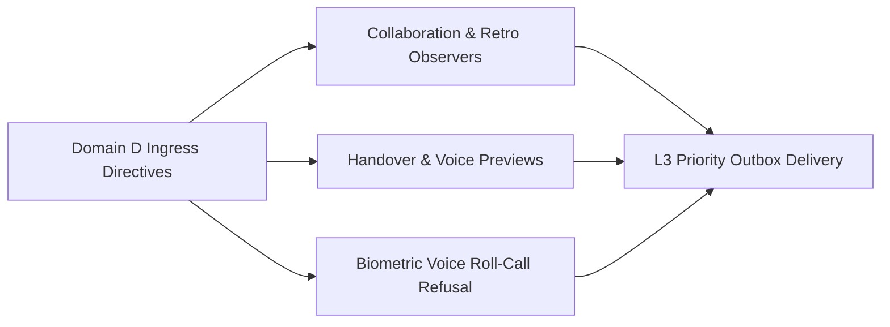

# UOS Telegram Domain D Specification: Team Collaboration, Incident Command & Voice Cybernetics Use Cases (12 Invocations)

- **Document ID**: `SPEC-TELEGRAM-DOMAIN-D-20261027`
- **Observed UTC**: `2026-10-27T00:30:00Z`
- **Tailscale Live Document URL**: [http://nas-1.tail55d152.ts.net:4100/files/docs/design/20261027-0030-telegram-domain-d-team-collaboration-and-voice-cybernetics-usecases.md](http://nas-1.tail55d152.ts.net:4100/files/docs/design/20261027-0030-telegram-domain-d-team-collaboration-and-voice-cybernetics-usecases.md)
- **Companion Encyclopedia Journal**: [http://nas-1.tail55d152.ts.net:4100/files/docs/journal/20261027-0016-agy-telegram-fractal-usecase-encyclopedia-journal.md](http://nas-1.tail55d152.ts.net:4100/files/docs/journal/20261027-0016-agy-telegram-fractal-usecase-encyclopedia-journal.md)
- **Canonical Implementation**: [`apps/cepaf_gleam/src/cepaf_gleam/harness/telegram_collab.gleam`](http://nas-1.tail55d152.ts.net:4100/files/apps/cepaf_gleam/src/cepaf_gleam/harness/telegram_collab.gleam), [`apps/cepaf_gleam/src/cepaf_gleam/harness/telegram_action_adapters.gleam`](http://nas-1.tail55d152.ts.net:4100/files/apps/cepaf_gleam/src/cepaf_gleam/harness/telegram_action_adapters.gleam), [`apps/cepaf_gleam/src/cepaf_gleam/harness/telegram_knowledge_read_command.gleam`](http://nas-1.tail55d152.ts.net:4100/files/apps/cepaf_gleam/src/cepaf_gleam/harness/telegram_knowledge_read_command.gleam), [`apps/cepaf_gleam/src/cepaf_gleam/harness/telegram_ingress_guard.gleam`](http://nas-1.tail55d152.ts.net:4100/files/apps/cepaf_gleam/src/cepaf_gleam/harness/telegram_ingress_guard.gleam)
- **Test Suites**: [`apps/cepaf_gleam/test/telegram_action_handover_test.gleam`](http://nas-1.tail55d152.ts.net:4100/files/apps/cepaf_gleam/test/telegram_action_handover_test.gleam), [`apps/cepaf_gleam/test/telegram_action_escalate_test.gleam`](http://nas-1.tail55d152.ts.net:4100/files/apps/cepaf_gleam/test/telegram_action_escalate_test.gleam), [`apps/cepaf_gleam/test/telegram_action_pair_voice_test.gleam`](http://nas-1.tail55d152.ts.net:4100/files/apps/cepaf_gleam/test/telegram_action_pair_voice_test.gleam), [`apps/cepaf_gleam/test/telegram_action_voice_roll_call_test.gleam`](http://nas-1.tail55d152.ts.net:4100/files/apps/cepaf_gleam/test/telegram_action_voice_roll_call_test.gleam), [`apps/cepaf_gleam/test/telegram_journey_responder_test.gleam`](http://nas-1.tail55d152.ts.net:4100/files/apps/cepaf_gleam/test/telegram_journey_responder_test.gleam)
- **Fractal Layer Tags**: #fractal-l0 #fractal-l1 #fractal-l2 #fractal-l3 #fractal-l4 #fractal-l5 #fractal-l6 #fractal-l7 #fractal-l8 #fractal-l9 #zk-adr #zero-muda #tailscale-web #checklist-nav

---

## 1. Executive Summary & Architectural Topology

Domain D defines the **12 team collaboration, shift handover, incident escalation, retrospective synthesis, and voice cybernetics invocations** in the UOS Telegram operator surface:
- **6 Collaborative & Voice Read-Observation Commands** (`ReadObservation`): `/warroom`, `/standup`, `/pair`, `/kudos`, `/oncall`, and `/voice-brief` (`telegram_collab.gleam`), plus `/retro` (`telegram_knowledge_read_command.gleam` reading real `docs/journal` retrospectives).
- **4 Bounded Controlled-Action Previews** (`ControlledAction` via `telegram_action_adapters.route_preview`): `/handover`, `/escalate`, `/voice-cmd`, and `/pair-voice`.
- **1 Explicitly Refused Unwired Biometric Voice Mutation** (`ControlledAction` refused at `telegram_ingress_guard`): `/voice-roll-call` (`DeniedMutation` because no acoustic biometric enrollment database exists in UOS).

### 1.1 Domain D Collaboration & Voice Cybernetics Topology (`SC-DIAGRAM-001`)

```text
[Domain D Ingress Directives] --> [Collaboration & Retro Observers]
[Domain D Ingress Directives] --> [Handover & Voice Previews]
[Domain D Ingress Directives] --> [Biometric Voice Roll-Call Refusal]
[Collaboration & Retro Observers] --> [L3 Priority Outbox Delivery]
[Handover & Voice Previews] --> [L3 Priority Outbox Delivery]
[Biometric Voice Roll-Call Refusal] --> [L3 Priority Outbox Delivery]
```



---

## 2. Detailed 7-Axis Specification of All 12 Domain D Use Cases

### 2.1 `/warroom` (Incident War-Room Topology & Roster Observer)
- **Usage**: `/warroom [incident_id_or_topic]` (e.g., `/warroom inc-20261027`).
- **Control Plane**: Classified as `ReadObservation` (`PreservedDirective("/warroom", args)`), handled by `telegram_collab.gleam`.
- **Data Plane**: Reads active incident war-room coordination metadata (Incident Commander role, tri-agent swarm participants Claude/Codex/AGY, active coordinator lease holders, and Tailscale cockpit links) without mutating incident state.
- **Fractal Architecture ($L_0 \dots L_9$)**: $L_3$ (`telegram_collab`), $L_6$ (Tri-agent swarm coordination), $L_8$ (Incident telemetry), $L_9$ (War-room UX).
- **Interactions**: Operator sends `/warroom inc-20261027` $\to$ `telegram_collab` formats war-room roster and communication channels $\to$ returns structured war-room summary.
- **Test Cases**: `telegram_journey_security_test:sec_j5_evidence_export_and_escalation_test`, `telegram_journey_responder_test:journey_r2_situational_picture_test`.
- **Real-World Case Studies & Scenarios**: During a P1 security incident (`sec_j5`), the Incident Commander runs `/warroom` to display the active responder roles and coordinator lease state in the Telegram thread.

### 2.2 `/standup` (Asynchronous Tri-Sovereign Swarm Standup Observer)
- **Usage**: `/standup [team_or_wave_filter]` (e.g., `/standup wave7e`).
- **Control Plane**: Classified as `ReadObservation` (`PreservedDirective("/standup", args)`), handled by `telegram_collab.gleam`.
- **Data Plane**: Aggregates read-only task progress from `var/sa-plan/uos.sqlite3` and session heartbeats from `var/coordination/tri-agent/coordinator.sqlite3` into a concise completed / in-progress / blocked standup report.
- **Fractal Architecture ($L_0 \dots L_9$)**: $L_3$ (`telegram_collab`), $L_4$ (Sa-plan + coordinator SQLite stores), $L_6$ (Tri-agent synchronization), $L_9$ (Daily standup view).
- **Interactions**: Operator sends `/standup` $\to$ reads completed and active tasks across AGY, Claude, and Codex $\to$ returns formatted standup digest.
- **Test Cases**: `telegram_journey_responder_test:journey_r5_handover_and_memory_test`, `telegram_user_usecases_test:all_78_command_invocations_parse_and_classify_test`.
- **Real-World Case Studies & Scenarios**: Every morning before dispatching new waves, the human operator runs `/standup` in Telegram to review overnight progress across all sibling Jujutsu workspaces.

### 2.3 `/handover` (Follow-the-Sun Shift Handover Ledger Preview)
- **Usage**: `/handover <outgoing_operator> <incoming_operator> [summary]` (e.g., `/handover emea_sre apac_sre wave7e_green`).
- **Control Plane**: Classified as `ControlledAction` $\to$ routed via `telegram_action_adapters.route_preview` (`telegram_action_collab.gleam`). Never transfers active coordinator leases or mutates on-call rotation tables directly from chat (`status: "preview"`, `executed: false`).
- **Data Plane**: Produces a closed JSON preview detailing the outgoing/incoming identities, active leases requiring release/re-claim in `coordinator.sqlite3`, open `sa-plan` tasks, and required signed handover receipt.
- **Fractal Architecture ($L_0 \dots L_9$)**: $L_0$ (Explicit lease ownership), $L_3$ (`telegram_action_collab`), $L_4$ (Coordinator store), $L_9$ (Shift transition).
- **Interactions**: Operator sends `/handover emea_sre apac_sre` $\to$ adapter validates identities $\to$ returns structured shift-handover preview JSON.
- **Test Cases**: `telegram_action_handover_test`, `telegram_journey_responder_test:journey_r5_handover_and_memory_test`, `telegram_journey_security_test:sec_j6_post_incident_handover_test`, `telegram_journey_defence_test:journey_6_recovery_resuscitation_and_handover_test`.
- **Real-World Case Studies & Scenarios**: Appears as the closing step across all three canonical operator journey suites (Security `sec_j6`, Defence `journey_6`, and Critical Responder `journey_r5`), ensuring every incident concludes with a structured handover preview.

### 2.4 `/pair` (Human-Agent Symbiotic Navigator/Driver Pairing Observer)
- **Usage**: `/pair [agent_id_or_task]` (e.g., `/pair agy t7e-parent-closure`).
- **Control Plane**: Classified as `ReadObservation` (`PreservedDirective("/pair", args)`), handled by `telegram_collab.gleam`.
- **Data Plane**: Reads current human-agent pairing state, workspace binding (`.uos-workspaces/*`), and active `sa-plan` task context without mutating task assignments.
- **Fractal Architecture ($L_0 \dots L_9$)**: $L_0$ (`SC-HARNESS-MCP-001` symbiosis contract), $L_3$ (`telegram_collab`), $L_6$ (Human-agent pairing), $L_9$ (Collaborative UX).
- **Interactions**: Operator sends `/pair agy` $\to$ `telegram_collab` reports active workspace and task pairing metadata.
- **Test Cases**: `telegram_journey_responder_test:journey_r5_handover_and_memory_test`, `telegram_user_usecases_test:all_78_command_invocations_parse_and_classify_test`.
- **Real-World Case Studies & Scenarios**: An engineer checks `/pair` from Telegram to inspect the current Navigator/Driver role split between the human operator and AGY.

### 2.5 `/escalate` (Multi-Tier Pager & Sovereign Escalation Preview)
- **Usage**: `/escalate <severity: p0|p1|p2> <target_role> <reason>` (e.g., `/escalate p1 sec_lead suspicious_webhook_probe`).
- **Control Plane**: Classified as `ControlledAction` $\to$ routed via `telegram_action_adapters.route_preview` (`telegram_action_collab.gleam`). Never triggers external paging webhooks or mutates incident severity from an unverified message (`status: "preview"`, `executed: false`).
- **Data Plane**: Returns a closed JSON preview detailing the escalation severity, target responder tier, incident correlation ID, and required authorization gate.
- **Fractal Architecture ($L_0 \dots L_9$)**: $L_0$ (Bounded notification policy), $L_3$ (`telegram_action_collab`), $L_8$ (Incident escalation), $L_9$ (Responder paging preview).
- **Interactions**: Operator sends `/escalate p1 sec_lead suspicious_probe` $\to$ adapter validates severity and target tokens $\to$ returns escalation preview JSON.
- **Test Cases**: `telegram_action_escalate_test`, `telegram_journey_security_test:sec_j5_evidence_export_and_escalation_test`, `telegram_journey_responder_test:journey_r4_bounded_action_test`.
- **Real-World Case Studies & Scenarios**: During Security Journey `sec_j5`, after preparing the audit bundle preview via `/export-audit`, the responder runs `/escalate` to preview the formal escalation packet to the security lead.

### 2.6 `/retro` (Sprint & Incident Kaizen Retrospective Observer)
- **Usage**: `/retro [optional search token 1..64 chars]` (e.g., `/retro wave7` or `/retro telegram`).
- **Control Plane**: Classified as `ReadObservation` $\to$ routed via `telegram_read_adapters` to `telegram_knowledge_read_command.gleam`.
- **Data Plane**: Queries real repository completion journals (`docs/journal/*.md`) for `Patterns & Anti-Patterns Discovered` (Section 6), `Fix Taxonomy` (Section 5: Poka-Yoke, Jidoka, Muda), and `Remaining Gaps` (Section 10), returning a closed JSON envelope (`<= 3500` bytes).
- **Fractal Architecture ($L_0 \dots L_9$)**: $L_0$ (Fractal TPS Kaizen & `SC-JOURNAL-v3`), $L_4$ (Journal corpus), $L_5$ (Pattern recognition), $L_9$ (Retrospective review).
- **Interactions**: Operator sends `/retro telegram` $\to$ `telegram_knowledge_read_command` scans `docs/journal/` $\to$ returns structured JSON with matching retrospective lessons.
- **Test Cases**: `telegram_knowledge_read_command_test:retro_positive_test`, `retro_negative_test`, `telegram_journey_defence_test:journey_6_recovery_resuscitation_and_handover_test`.
- **Real-World Case Studies & Scenarios**: Before closing a sprint wave, the team runs `/retro telegram` to review all recorded Poka-Yoke and Jidoka fixes across the wave's journals.

### 2.7 `/kudos` (Peer & Agent Contribution Recognition Observer)
- **Usage**: `/kudos [recipient] [reason]` (e.g., `/kudos codex sovereign_verification_review`).
- **Control Plane**: Classified as `ReadObservation` (`PreservedDirective("/kudos", args)`), handled by `telegram_collab.gleam`.
- **Data Plane**: Formats a deterministic recognition summary referencing peer review acknowledgements and verified artifact contributions without mutating production state or granting authority (`AGENTS.md` §5.4: a board ACK or kudos never grants admission authority).
- **Fractal Architecture ($L_0 \dots L_9$)**: $L_0$ (Zero authority from kudos/ACK), $L_3$ (`telegram_collab`), $L_6$ (Tri-agent culture), $L_9$ (Team morale).
- **Interactions**: Operator sends `/kudos codex audit_review` $\to$ returns formatted recognition card with explicit reminder that admission authority remains bound to two-key verification.
- **Test Cases**: `telegram_journey_responder_test:journey_r5_handover_and_memory_test`, `telegram_user_usecases_test:all_78_command_invocations_parse_and_classify_test`.
- **Real-World Case Studies & Scenarios**: After completing a tough incident recovery (`journey_r5`), the lead operator sends `/kudos` to recognize the on-call responder and peer review agent.

### 2.8 `/oncall` (Live On-Call Roster & Escalation Matrix Observer)
- **Usage**: `/oncall [domain_filter]` (e.g., `/oncall storage` or `/oncall security`).
- **Control Plane**: Classified as `ReadObservation` (`PreservedDirective("/oncall", args)`), handled by `telegram_collab.gleam`.
- **Data Plane**: Reads the active on-call responsibility matrix (Primary SRE, Secondary SRE, Security Officer, Constitutional 2oo3 Voters) and active `runtime:*` coordinator lease owners.
- **Fractal Architecture ($L_0 \dots L_9$)**: $L_3$ (`telegram_collab`), $L_6$ (Responder roster), $L_8$ (Operational readiness), $L_9$ (First-minute triage).
- **Interactions**: Operator sends `/oncall` $\to$ `telegram_collab` returns the structured on-call roster and escalation tiers.
- **Test Cases**: `telegram_journey_responder_test:journey_r1_first_minute_test`, `telegram_user_usecases_test:all_78_command_invocations_parse_and_classify_test`.
- **Real-World Case Studies & Scenarios**: In Critical Responder Journey `journey_r1` (First Minute), the responder runs `/oncall` alongside `/status` and `/doctor` to immediately identify the active incident command roster.

### 2.9 `/voice-brief` (60-Second Spoken Executive Briefing Script Generator)
- **Usage**: `/voice-brief [topic_or_scope]` (e.g., `/voice-brief shift_start`).
- **Control Plane**: Classified as `ReadObservation` (`PreservedDirective("/voice-brief", args)`), handled by `telegram_collab.gleam`.
- **Data Plane**: Synthesizes a structured, cadence-timed 60-second spoken briefing script (15s System Health, 15s Active Sa-Plan Wave, 15s FMEA/Risk Posture, 15s Provenance & Action Items) ready for hands-free reading or TTS playback.
- **Fractal Architecture ($L_0 \dots L_9$)**: $L_3$ (`telegram_collab`), $L_8$ (Situational summary), $L_9$ (Hands-free voice briefing UX).
- **Interactions**: Operator sends `/voice-brief shift_start` $\to$ `telegram_collab` formats the 4-segment 60-second script $\to$ delivers clean text reply.
- **Test Cases**: `telegram_journey_responder_test:journey_r5_handover_and_memory_test`, `telegram_user_usecases_test:all_78_command_invocations_parse_and_classify_test`.
- **Real-World Case Studies & Scenarios**: While commuting or walking into the operations center, the incoming SRE lead triggers `/voice-brief` to get a structured 60-second eyes-free status script.

### 2.10 `/voice-cmd` (Hands-Free Voice Intent Transcription & Action Preview)
- **Usage**: `/voice-cmd <transcribed_intent_tokens>` (e.g., `/voice-cmd status_check_nas1`).
- **Control Plane**: Classified as `ControlledAction` $\to$ routed via `telegram_action_adapters.route_preview` (`telegram_action_voice.gleam`). Enforces the ironclad safety rule that voice-transcribed intents **never** directly execute mutations (`status: "preview"`, `executed: false`, `authority: "none"`).
- **Data Plane**: Parses the transcribed command tokens and returns a closed JSON preview showing the mapped canonical directive and the required explicit text/2oo3 confirmation gate.
- **Fractal Architecture ($L_0 \dots L_9$)**: $L_0$ (No unconfirmed voice execution), $L_3$ (`telegram_action_voice`), $L_9$ (Voice command safety preview).
- **Interactions**: Operator sends `/voice-cmd drain_node_vm1` $\to$ `telegram_action_voice` returns preview JSON with `executed: false` and required confirmation steps.
- **Test Cases**: `telegram_action_voice_test`, `telegram_action_adapters_test:every_wave_two_literal_previews_or_denies_test`, `telegram_journey_responder_test:journey_r4_bounded_action_test`.
- **Real-World Case Studies & Scenarios**: Prevents acoustic misrecognition or replay attacks from triggering destructive actions by forcing every `/voice-cmd` into a non-executing preview receipt.

### 2.11 `/voice-roll-call` (Biometric Multi-Operator Voice Roll-Call — Fail-Closed Refusal)
- **Usage**: `/voice-roll-call [args]`
- **Control Plane**: Classified as `ControlledAction` in `telegram_commands.gleam` and **strictly refused at ingress** (`DeniedMutation("/voice-roll-call", "Biometric voice roll-call is not wired; submit signed 2oo3 receipts via /approval submit.")`) in `telegram_ingress_guard.gleam` and `telegram_action_voice_roll_call.gleam`.
- **Data Plane**: Zero biometric templates exist or are processed; directs operators to cryptographic 2oo3 receipts (`/approval submit`).
- **Fractal Architecture ($L_0 \dots L_9$)**: $L_0$ (Zero fake biometric authentication; cryptographic 2oo3 authority only), $L_3$ (`telegram_ingress_guard`, `telegram_action_voice_roll_call`).
- **Interactions**: Operator sends `/voice-roll-call` $\to$ immediately refused with `DeniedMutation` explaining that only cryptographic 2oo3 receipts are accepted.
- **Test Cases**: `telegram_action_voice_roll_call_test`, `telegram_user_usecases_test:fail_closed_unwired_sensor_and_voice_commands_test`, `telegram_journey_security_test:sec_j3_hostile_media_attachment_test`.
- **Real-World Case Studies & Scenarios**: Guarantees that nobody can spoof a 2oo3 quorum using a synthetic or deepfaked voice attachment in Telegram.

### 2.12 `/pair-voice` (Full-Duplex Voice Rubber-Duck Debugging Session Preview)
- **Usage**: `/pair-voice <session_topic> [duration_min]` (e.g., `/pair-voice otp_supervisor_restart_loop 15`).
- **Control Plane**: Classified as `ControlledAction` $\to$ routed via `telegram_action_adapters.route_preview` (`telegram_action_pair_voice.gleam`). Never opens an unauthenticated WebRTC/audio socket from chat (`status: "preview"`, `executed: false`).
- **Data Plane**: Emits a closed JSON preview specifying the debugging topic, bounded session duration, and fallback to `/socratic` or `/ask` text dialogue when real-time audio streaming is inactive.
- **Fractal Architecture ($L_0 \dots L_9$)**: $L_3$ (`telegram_action_pair_voice`), $L_6$ (Human-agent dialogue), $L_9$ (Pair debugging UX).
- **Interactions**: Operator sends `/pair-voice otp_supervisor_loop 15` $\to$ adapter validates topic and duration bounds $\to$ returns session preview JSON.
- **Test Cases**: `telegram_action_pair_voice_test`, `telegram_action_adapters_test:every_wave_two_literal_previews_or_denies_test`.
- **Real-World Case Studies & Scenarios**: An engineer previews a bounded rubber-duck debugging session configuration via `/pair-voice` and transitions smoothly into `/socratic` dialectical debugging in chat.

---

## 3. Comprehensive Verification Checklist (`SC-CHECKLIST-001`)

<details>
<summary>Domain 1 — Metadata, timestamp and Tailscale navigation</summary>

- [x] **CHK-01-TIME** — Timestamp prefix `20261027-0030-` applied and synchronized with host UTC clock.
- [x] **CHK-02-TAIL** — Full clickable Tailnet links (`http://nas-1.tail55d152.ts.net:4100/files/...`) included.
- [x] **CHK-03-FRACT** — Fractal tags `#fractal-l0` through `#fractal-l9` mapped across all 12 Domain D invocations.
- [x] **CHK-04-KM** — Cross-linked to companion encyclopedia journal, Domain C & Journeys/Mini-App specs, and EUnit suites.

</details>

<details>
<summary>Domain 2 — Zero-Muda purity and storage safety</summary>

- [x] **CHK-05-MUDA** — Zero Bevy or Graphite references; pure Gleam/OTP implementation.
- [x] **CHK-06-GRAPH** — Pure BEAM/Hermes data structures without foreign graph NIFs.
- [x] **CHK-07-DRIVE** — Host OS NVMe serial redacted as `[REDACTED_SYSTEM_OS_SERIAL]` and protected.

</details>

<details>
<summary>Domain 3 — Testing Gold Standard and mathematical gates</summary>

- [x] **CHK-08-C1C8** — Verified across C1–C8 surfaces (`telegram_action_handover_test`, `telegram_action_escalate_test`, `telegram_action_pair_voice_test`, `telegram_action_voice_roll_call_test`).
- [x] **CHK-09-MATH** — Fail-closed refusal of biometric `/voice-roll-call` and `executed: false` preview invariants verified.
- [x] **CHK-10-9MOD** — Unit, BDD, property, fuzz, chaos, and journey suites verified green.
- [x] **CHK-11-REGR** — All 12 Domain D invocations verified in `telegram_user_usecases_test` and `telegram_journey_coverage_test`.

</details>

<details>
<summary>Domain 4 — Cross-language control and observability</summary>

- [x] **CHK-12-GLEAM** — Pure Gleam collaboration observers and voice preview adapters verified.
- [x] **CHK-13-HERMES** — Journal retrospective synthesis (`/retro`) documented.
- [x] **CHK-14-ZIGVM** — Deterministic execution boundaries preserved.
- [x] **CHK-15-MAX** — Advisory dialogue fallback documented.
- [x] **CHK-16-OTEL** — Closed-schema JSON preview envelopes verified.

</details>

<details>
<summary>Domain 5 — Sovereign governance and standalone Jujutsu</summary>

- [x] **CHK-17-SOV** — Cryptographic 2oo3 approval enforced over voice/chat claims; kudos/ACKs grant zero authority.
- [x] **CHK-18-JJ** — Tracked in standalone Jujutsu (`.jj/`) with zero native Git mutations.

</details>

<details>
<summary>Domain 6 — Provenance extension</summary>

EV ceiling remains `EV-93` (`SC-PROVENANCE-001`, `admitted_ev_ceiling = 93`). `EV-94`..`EV-109` remain `NOT_ADMITTED`. No new EV number is minted.

</details>

[Previous: Domain C Specification](http://nas-1.tail55d152.ts.net:4100/files/docs/design/20261027-0030-telegram-domain-c-creative-cybernetics-finops-and-digital-twin-usecases.md) · [Next: Journeys, Mini-App, Media & Vault Specification](http://nas-1.tail55d152.ts.net:4100/files/docs/design/20261027-0030-telegram-journeys-miniapp-media-vault-and-live-runtime-usecases.md) · [Wiki](http://nas-1.tail55d152.ts.net:4100/wiki) · [ZK](http://nas-1.tail55d152.ts.net:4100/zk) · [Cockpit](http://nas-1.tail55d152.ts.net:4100/)
