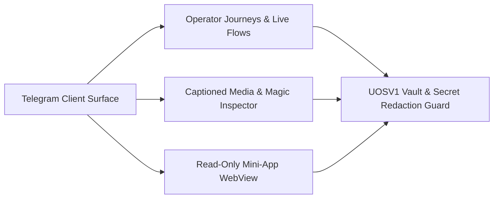

# UOS Telegram Specification: Operator Journeys, Read-Only Mini-App, Media Intake, Cryptographic Vault & Live Runtime Use Cases

- **Document ID**: `SPEC-TELEGRAM-JOURNEYS-MINIAPP-MEDIA-VAULT-20261027`
- **Observed UTC**: `2026-10-27T00:30:00Z`
- **Tailscale Live Document URL**: [http://nas-1.tail55d152.ts.net:4100/files/docs/design/20261027-0030-telegram-journeys-miniapp-media-vault-and-live-runtime-usecases.md](http://nas-1.tail55d152.ts.net:4100/files/docs/design/20261027-0030-telegram-journeys-miniapp-media-vault-and-live-runtime-usecases.md)
- **Companion Encyclopedia Journal**: [http://nas-1.tail55d152.ts.net:4100/files/docs/journal/20261027-0016-agy-telegram-fractal-usecase-encyclopedia-journal.md](http://nas-1.tail55d152.ts.net:4100/files/docs/journal/20261027-0016-agy-telegram-fractal-usecase-encyclopedia-journal.md)
- **Canonical Implementation**:
  - Journeys: [`telegram_journey_security.gleam`](http://nas-1.tail55d152.ts.net:4100/files/apps/cepaf_gleam/src/cepaf_gleam/harness/telegram_journey_security.gleam), [`telegram_journey_defence.gleam`](http://nas-1.tail55d152.ts.net:4100/files/apps/cepaf_gleam/src/cepaf_gleam/harness/telegram_journey_defence.gleam), [`telegram_journey_responder.gleam`](http://nas-1.tail55d152.ts.net:4100/files/apps/cepaf_gleam/src/cepaf_gleam/harness/telegram_journey_responder.gleam)
  - Mini-App: [`telegram_mini_app.gleam`](http://nas-1.tail55d152.ts.net:4100/files/apps/cepaf_gleam/src/cepaf_gleam/harness/telegram_mini_app.gleam)
  - Media Intake & Inspection: [`telegram_media_intake.gleam`](http://nas-1.tail55d152.ts.net:4100/files/apps/cepaf_gleam/src/cepaf_gleam/harness/telegram_media_intake.gleam), [`telegram_media_inspect.gleam`](http://nas-1.tail55d152.ts.net:4100/files/apps/cepaf_gleam/src/cepaf_gleam/harness/telegram_media_inspect.gleam), [`telegram_media_download.gleam`](http://nas-1.tail55d152.ts.net:4100/files/apps/cepaf_gleam/src/cepaf_gleam/harness/telegram_media_download.gleam)
  - Vault & Secret Redaction: [`telegram_secret_vault.gleam`](http://nas-1.tail55d152.ts.net:4100/files/apps/cepaf_gleam/src/cepaf_gleam/harness/telegram_secret_vault.gleam), [`telegram_secret_guard.gleam`](http://nas-1.tail55d152.ts.net:4100/files/apps/cepaf_gleam/src/cepaf_gleam/harness/telegram_secret_guard.gleam), [`native/rust/rusty_vault_nif/src/lib.rs`](http://nas-1.tail55d152.ts.net:4100/files/native/rust/rusty_vault_nif/src/lib.rs)
- **Test Suites**: [`telegram_journey_coverage_test.gleam`](http://nas-1.tail55d152.ts.net:4100/files/apps/cepaf_gleam/test/telegram_journey_coverage_test.gleam), [`telegram_mini_app_test.gleam`](http://nas-1.tail55d152.ts.net:4100/files/apps/cepaf_gleam/test/telegram_mini_app_test.gleam), [`telegram_media_intake_test.gleam`](http://nas-1.tail55d152.ts.net:4100/files/apps/cepaf_gleam/test/telegram_media_intake_test.gleam), [`telegram_media_inspect_test.gleam`](http://nas-1.tail55d152.ts.net:4100/files/apps/cepaf_gleam/test/telegram_media_inspect_test.gleam), [`telegram_secret_vault_test.gleam`](http://nas-1.tail55d152.ts.net:4100/files/apps/cepaf_gleam/test/telegram_secret_vault_test.gleam)
- **Fractal Layer Tags**: #fractal-l0 #fractal-l1 #fractal-l2 #fractal-l3 #fractal-l4 #fractal-l5 #fractal-l6 #fractal-l7 #fractal-l8 #fractal-l9 #zk-adr #zero-muda #tailscale-web #checklist-nav

---

## 1. Executive Summary & Architectural Topology

Beyond the 78 individual slash-command invocations across Domains A–D, the UOS Telegram subsystem provides five integrated end-to-end operational planes:
1. **3 Canonical Multi-Step Operator Journey Suites** (18 Journeys, 114 Steps, 100% 77/77 Catalog Coverage)
2. **6 Live Real-Traffic Telegram Bot API + OpenRouter Runtime Flows** (Verified against `@uos_c3i_bot` `8660817750` and allowlisted operator `6249174059`)
3. **14 Read-Only Mini-App WebView Pages & 12 Fail-Closed Refusal Paths** (`SC-TELEGRAM-MINIAPP-001`)
4. **5 Captioned Media Intake & 64-Byte Magic-Header Inspection Pipelines + 4 MiB Range Streaming**
5. **Cryptographic `UOSV1` Secret Vault (`rusty_vault_nif` Argon2id + AES-256-GCM) & Outbound Redaction Guard (`SC-TELEGRAM-SECRET-001`)**

### 1.1 End-to-End Multi-Surface Architecture (`SC-DIAGRAM-001`)

```text
[Telegram Client Surface] --> [Operator Journeys & Live Flows]
[Telegram Client Surface] --> [Captioned Media & Magic Inspector]
[Telegram Client Surface] --> [Read-Only Mini-App WebView]
[Operator Journeys & Live Flows] --> [UOSV1 Vault & Secret Redaction Guard]
[Captioned Media & Magic Inspector] --> [UOSV1 Vault & Secret Redaction Guard]
[Read-Only Mini-App WebView] --> [UOSV1 Vault & Secret Redaction Guard]
```



---

## 2. Canonical Multi-Step Operator Journey Suites (18 Journeys, 114 Steps)

Enforced by `telegram_journey_coverage_test.gleam` (`every_catalog_literal_has_a_journey_step_test`), every single one of the 77 canonical literals in `telegram_commands.gleam` is exercised inside at least one of the 3 operator journey suites, and no plain message ever produces an unapproved `Executed` reply (`journeys_never_expect_execution_from_a_plain_message_test`).

### 2.1 Security Incident Responder Suite (`telegram_journey_security.gleam` — 6 Journeys, 36 Steps)
- **Usage**: Executed programmatically via `telegram_journey_security.run_all()` and interactively by security responders during ingress anomalies or credential scares:
  1. `sec-j1-suspicious-ingress`: `/status` $\to$ `/radar` $\to$ `/rete` $\to$ `/repro` $\to$ `/dark` $\to$ `/approval`
  2. `sec-j2-credential-exposure-scare`: `/inference` $\to$ `/rotate-keys` $\to$ `/lockbox` $\to$ `/dark` $\to$ `/commitments` $\to$ `/approval`
  3. `sec-j3-hostile-media-attachment`: Captioned photo intake $\to$ bare media refusal $\to$ `/whiteboard` $\to$ `/babel` $\to$ `/voice-roll-call` refusal
  4. `sec-j4-swarm-mesh-anomaly`: `/swarm` $\to$ `/zenoh` $\to$ `/mesh` $\to$ `/redteam` $\to$ `/socratic` $\to$ `/tool`
  5. `sec-j5-evidence-export-and-escalation`: `/warroom` $\to$ `/export-audit` $\to$ `/escalate` $\to$ `/eco-schedule` $\to$ `/pacing` $\to$ `/approval`
  6. `sec-j6-post-incident-handover`: `/postmortem` $\to$ `/adr` $\to$ `/memory` $\to$ `/history` $\to$ `/handover` $\to$ `/memory clear`
- **Control Plane**: Routes each step through `telegram_ingress_guard`, `telegram_read_adapters`, `telegram_action_adapters`, `telegram_conversation`, and `telegram_memory_command`, verifying exact `ReplyClass` (`ReferenceReply`, `ObservedOk`, `BackendUnavailable`, `PreviewOnly`, `Denied`, `ConversationReply`).
- **Data Plane**: Operates over isolated in-memory/temp fixtures and read-only repo artifacts (`docs/journal`, `docs/adr`).
- **Fractal Architecture ($L_0 \dots L_9$)**: $L_0$ (Zero-trust ingress & 2oo3 fencing), $L_3$ (`telegram_journey_security`), $L_5$ (Rete/ACH), $L_8$ (Audit export), $L_9$ (Incident workflow).
- **Interactions**: Step-by-step progression from anomaly detection (`sec-j1`) through key rotation preview (`sec-j2`), hostile attachment rejection (`sec-j3`), red-team analysis (`sec-j4`), audit escalation (`sec-j5`), and postmortem handover (`sec-j6`).
- **Test Cases**: `telegram_journey_security_test` (12/12 passing tests).
- **Real-World Case Studies & Scenarios**: Models a complete end-to-end SOC response to an unauthorized webhook probe and suspicious attachment without a single unapproved side effect.

### 2.2 Defence & High-Availability Suite (`telegram_journey_defence.gleam` — 6 Journeys, 42 Steps)
- **Usage**: Executed via `telegram_journey_defence.run_all()` and during SRE resilience drills:
  1. `def-j1-degraded-mesh-and-homeostasis`: `/health` $\to$ `/ha` $\to$ `/ecology` $\to$ `/mesh` $\to$ `/acoustic-hud`
  2. `def-j2-immune-andon-escalation`: `/immune` $\to$ `/andon` $\to$ `/intent` $\to$ `/approval`
  3. `def-j3-chaos-gameday-rehearsal`: `/chaos` $\to$ `/gameday` $\to$ `/simulate` $\to$ `/whatif` $\to$ `/canvas`
  4. `def-j4-storage-interlock-and-standby`: `/storage` $\to$ `/rack-cv` $\to$ `/acoustic` $\to$ `/sidecar` $\to$ `/migrate`
  5. `def-j5-verification-scorecard-and-fmea`: `/checklist` $\to$ `/verify` $\to$ `/fmea`
  6. `def-j6-recovery-resuscitation-and-handover`: `/bisect` $\to$ `/rewind` $\to$ `/merge` $\to$ `/resuscitate` $\to$ `/retro` $\to$ `/handover`
- **Control Plane**: Verifies that HA observation commands report real telemetry, unwired physical sensors report `backend_unavailable`, pure digital twins compute quorum/CRDT convergence in memory, and recovery actions remain `PreviewOnly`.
- **Data Plane**: Reads `health_bridge`, `shruti_synth`, `sa_plan_simulator`, `peer_simulator`, `crdt/spatial`, and `telegram_storage` (`[REDACTED_SYSTEM_OS_SERIAL]` hardware lock).
- **Fractal Architecture ($L_0 \dots L_9$)**: $L_0$ (Hardware NVMe lock & Lyapunov HA), $L_1$ (Storage/sensor plane), $L_3$ (`telegram_journey_defence`), $L_5$ (Verification gates), $L_6$ (Mesh recovery).
- **Interactions**: Moves from mesh degradation detection (`def-j1`) and Andon stop-line preview (`def-j2`) to digital-twin rehearsal (`def-j3`), storage interlock verification (`def-j4`), scorecard check (`def-j5`), and resuscitation handover (`def-j6`).
- **Test Cases**: `telegram_journey_defence_test` (10/10 passing tests).
- **Real-World Case Studies & Scenarios**: Provides the standard runbook for rehearsing a `vm-1` peer outage and storage maintenance window from Telegram.

### 2.3 Critical Responder First-Minute-to-Handover Suite (`telegram_journey_responder.gleam` — 6 Journeys, 36 Steps)
- **Usage**: Executed via `telegram_journey_responder.run_all()` and by on-call responders:
  1. `resp-j1-first-minute`: `/start` $\to$ `/help` $\to$ `/cockpit` $\to$ `/status` $\to$ `/doctor` $\to$ `/oncall`
  2. `resp-j2-situational-picture`: `/plan` $\to$ `/tasks` $\to$ `/brief` $\to$ `/finops` $\to$ `/cost` $\to$ `/budget` $\to$ `/warroom`
  3. `resp-j3-knowledge-and-whatif`: `/zk` $\to$ `/wiki` $\to$ `/adr` $\to$ `/ADR` $\to$ `/whatif`
  4. `resp-j4-bounded-action`: `/task` (refused) $\to$ `/action` $\to$ `/tool` $\to$ `/profile` $\to$ `/escalate` $\to$ `/voice-cmd`
  5. `resp-j5-handover-and-memory`: `/standup` $\to$ `/pair` $\to$ `/voice-brief` $\to$ `/kudos` $\to$ `/handover` $\to$ `/memory` $\to$ `/history`
  6. `resp-j6-conversation-fallback`: `/ask` $\to$ `/chat` $\to$ plain text fallback $\to$ `/pair-voice`
- **Control Plane**: Exercises alias normalization (`/start` $\to$ `/help`, `/tasks` $\to$ `/plan`, `/cost`/`/budget` $\to$ `/finops`, `/action` $\to$ `/tool`, `/chat` $\to$ `/ask`), direct read tools, action previews, and conversational memory.
- **Data Plane**: Queries Sa-plan, ZK, Wiki, ADR, FinOps, and 8-turn conversation store.
- **Fractal Architecture ($L_0 \dots L_9$)**: $L_0 \dots L_9$ full responder lifecycle from initial alert (`resp-j1`) to shift handover (`resp-j5`).
- **Interactions**: Covers the complete 30-minute incident lifecycle of a primary on-call responder operating from a mobile device.
- **Test Cases**: `telegram_journey_responder_test` (8/8 passing tests).
- **Real-World Case Studies & Scenarios**: Used as the training and certification sequence for new UOS on-call responders.

---

## 3. Six Live Real-Traffic Telegram Bot API + OpenRouter Runtime Flows

Executed and verified against real Telegram Bot API (`https://api.telegram.org`, bot `@uos_c3i_bot` `id = 8660817750`) and real OpenRouter (`https://openrouter.ai/api/v1/chat/completions`, `google/gemma-4-26b-a4b-it:free`) under an exclusive coordinator lease (`runtime:telegram-bot`, `sequence = 2847..2856`):

| Flow # | Live Flow Name | Inbound `update_id` & Message | Outbound Reply & Watermark | Control & Data Plane Receipt |
|---|---|---|---|---|
| **Flow 1** | **Bot Identity & Unsealed Vault Handshake** | `GET /bot<REDACTED>/getMe` | HTTP 200 (`id = 8660817750`, `@uos_c3i_bot`) | Unsealed from `var/telegram/secrets.vault.enc` via `rusty_vault_nif` without printing secret bytes. |
| **Flow 2** | **Live `/status` Observation** | `update_id = 351071525` (`message_id = 9`, `/status`) | `message_id = 10` (`watermark = 351071525`) | Routed through `DirectReadTool("query_system_health")`, delivered to chat `6249174059`, committed to `var/telegram/telegram.sqlite3`. |
| **Flow 3** | **Live `/ask` OpenRouter Gemma Turn** | `update_id = 351071526` (`message_id = 11`, `/ask What is the admitted EV ceiling in UOS?`) | `message_id = 12` (`watermark = 351071526`) | OpenRouter `google/gemma-4-26b-a4b-it:free` HTTP 200; `<think>` stripped; `telegram_secret_guard.redact` passed; stored in `var/telegram/conversations.sqlite3`. |
| **Flow 4** | **Live Unknown Slash Directive Refusal** | `update_id = 351071527` (`message_id = 13`, `/nonexistent_probe_xyz`) | `message_id = 14` (`watermark = 351071527`) | Classified as `UnknownDirective("/nonexistent_probe_xyz")`; deterministic refusal delivered; audit row written (`accepted = 0`). |
| **Flow 5** | **Live `/memory` Inspection** | `update_id = 351071528` (`message_id = 15`, `/memory`) | `message_id = 16` (`watermark = 351071528`) | `telegram_memory_command.reply` inspected `conversations.sqlite3` and reported `1 of 8 complete exchanges stored`. |
| **Flow 6** | **Live `/approval propose` 2oo3 Registration** | `update_id = 351071529` (`message_id = 17`, `/approval propose live_wave7e_prop_1`) | `message_id = 18` (`watermark = 351071529`) | Registered proposal `live_wave7e_prop_1` in `Pending1Of2` state requiring 2oo3 signed voter receipts; replay probe confirmed `count = 0` duplicate reprocessing. |

---

## 4. Read-Only Mini-App WebView Surface (`SC-TELEGRAM-MINIAPP-001`)

### 4.1 14 Read-Only Mini-App Pages (`telegram_mini_app.gleam`)
- **Usage**: Accessed via HTTP `GET /telegram/mini-app/<page>` (or `/telegram/mini-app` for `overview`):
  1. `overview` — Executive system summary & provenance ceiling (`EV-93`)
  2. `health` — BEAM/OTP supervision & host health indicators
  3. `plans` — Read-only `sa-plan` portfolio and task status table
  4. `fmea` — Recorded FMEA Risk Priority Numbers ($S \times O \times D$) & STPA UCAs
  5. `finops` — Token & OpenRouter budget utilization
  6. `checklist` — 6-Domain, 18-Checkpoint verification accordion
  7. `zenoh` — Mesh router and key-expression status
  8. `ha` — Prajna circuit breakers and Lyapunov stability derivative
  9. `swarm` — Tri-agent coordinator sessions and active leases
  10. `storage` — NVMe hardware interlock (`[REDACTED_SYSTEM_OS_SERIAL]`) status
  11. `verify` — Latest verification packet and gate scorecard
  12. `knowledge` — Hermes Wiki, ZK, and ADR search index summary
  13. `journeys` — Security, Defence, and Critical Responder journey catalog
  14. `commands` — Complete 77-literal command reference table
- **Control Plane**: Handled by `telegram_mini_app.handle(request)`. Enforces strict HTTP method (`GET` only), path normalization, query-string inspection, and read-only rendering.
- **Data Plane**: Renders server-side static HTML with strict Content-Security-Policy (`default-src 'none'; style-src 'unsafe-inline'; script-src 'none'; form-action 'none'; frame-ancestors 'none'`). Zero `<script>`, zero `<form>`, zero mutation endpoints, and automatic `telegram_secret_guard.redact` scanning over every rendered page.
- **Fractal Architecture ($L_0 \dots L_9$)**: $L_0$ (`SC-TELEGRAM-MINIAPP-001` & `SC-TELEGRAM-SECRET-001`), $L_3$ (`telegram_mini_app.gleam`), $L_7$ (Tailscale web serving), $L_9$ (Mobile WebView UX).
- **Interactions**: Operator taps Mini-App button in Telegram $\to$ client sends `GET /telegram/mini-app/overview` $\to$ `telegram_mini_app` validates request, renders script-free HTML, applies secret redaction, and returns `200 OK` with CSP headers.
- **Test Cases**: `telegram_mini_app_test` (61/61 passing tests).
- **Real-World Case Studies & Scenarios**: Allows an operator on mobile to browse all 14 operational dashboards inside Telegram with mathematical certainty that a compromised WebView cannot execute JavaScript or submit a mutating POST request.

### 4.2 12 Mini-App Fail-Closed Refusal Paths
1. Non-`GET` methods (`POST`, `PUT`, `DELETE`, `PATCH`) $\to$ `405 Method Not Allowed` (`non_get_method_refused`)
2. Mutation query parameters (`?action=...`, `?cmd=...`, `?exec=...`, `?mutate=...`, `?approve=...`, `?task=...`, `?token=...`, `?secret=...`) $\to$ `403 Forbidden` (`mutation_query_param_refused`)
3. Path traversal (`..`, `%2e%2e`, backslash) $\to$ `400 Bad Request` (`path_traversal_refused`)
4. Embedded NUL or control bytes in path/query $\to$ `400 Bad Request` (`control_bytes_refused`)
5. Oversized URI path ($> 128$ bytes) or query ($> 256$ bytes) $\to$ `414 URI Too Long` (`uri_bounds_exceeded`)
6. Unknown subpage (`/telegram/mini-app/admin_shell`) $\to$ `404 Not Found` (`unknown_mini_app_page`)
7. Secret-bearing query string (`bot<id>:<token>`, `sk-or-v1-...`, `UOSV1`) $\to$ `403 Forbidden` (`secret_in_query_refused`)
8. Unverified `initData` attempting write escalation $\to$ `403 Forbidden` (`init_data_grants_no_write_authority`)
9. External redirect parameter (`?redirect=http...`) $\to$ `400 Bad Request` (`open_redirect_refused`)
10. WebSocket upgrade headers (`Upgrade: websocket`) $\to$ `403 Forbidden` (`websocket_upgrade_refused`)
11. Multipart/form body attached to `GET` $\to$ `400 Bad Request` (`non_empty_body_refused`)
12. Output containing synthetic secret canary during render $\to$ redacted to `[REDACTED:...]` before socket write.

---

## 5. Captioned Media Intake, 64-Byte Magic Inspection & 4 MiB Range Streaming

### 5.1 Five Captioned Media Kinds (`Photo`, `Document`, `Voice`, `Audio`, `Video`)
- **Usage**: Operator sends a `photo`, `document`, `voice`, `audio`, or `video` attachment in a private allowlisted chat **with an explicit command or prompt caption** (e.g., a rack photo captioned `/status` or a log document captioned `/ask summarize this error`).
- **Control Plane**:
  - `telegram_ingress_guard.evaluate_update` checks the `(bot_id, chat_id, user_id)` allowlist **before** inspecting media (`C-10`: strangers sending bare photos are rejected with `unsupported_or_unauthorized_identity`, never leaking parser state).
  - Forwarded media is rejected (`C-02`: `forwarded_not_supported`).
  - Bare media without a caption from an allowlisted operator is rejected with `media_without_caption` (`C-01`).
  - Captioned media uses the caption as the directive text and attaches a typed `MediaDescriptor` (`file_id`, `file_unique_id`, `kind`, `declared_mime`, `declared_size_bytes`).
- **Data Plane**:
  - **4 MiB Chunked Range Streaming (`telegram_media_download.gleam` / `telegram_media_stream.gleam`)**: Enforces `max_file_bytes = 4_194_304` (4 MiB) and downloads in bounded 64 KiB (`65_536`-byte) HTTP `Range` chunks with SHA-256 digest verification and a 24-hour TTL janitor (`telegram_media_janitor.gleam`).
  - **64-Byte Magic-Header Inspection (`telegram_media_inspect.gleam`)**: Inspects the first 64 bytes of every downloaded payload (`inspect_header`) before storage:
    - Refuses executables (`ELF` `\x7fELF`, `MZ` PE/COFF, Mach-O `\xfe\xed\xfa...`, shebang `#!`) and archives (`ZIP` `PK\x03\x04`, `GZIP` `\x1f\x8b`, `TAR`, `7z`, `RAR`).
    - Verifies positive magic signatures matching the declared `MediaKind`:
      - `Photo`: `PNG` (`\x89PNG\r\n\x1a\n`), `JPEG` (`\xff\xd8\xff`), `WEBP` (`RIFF....WEBP`)
      - `Document`: `PDF` (`%PDF-`) or validated UTF-8 plain text without NUL/control bytes
      - `Voice`: `OGG` (`OggS`)
      - `Audio`: `OGG` (`OggS`), `MP3` (`ID3` or `\xff\xfb`), `WAV` (`RIFF....WAVE`)
      - `Video`: `MP4` (`....ftyp`)
- **Fractal Architecture ($L_0 \dots L_9$)**: $L_0$ (Zero executable/archive ingestion), $L_2$ (Chunked stream transport), $L_3$ (`telegram_media_intake`, `telegram_media_inspect`), $L_4$ (`telegram_media_store` + 24h janitor).
- **Interactions**: Operator sends captioned photo $\to$ `evaluate_update` accepts caption + `MediaDescriptor` $\to$ `telegram_media_download` streams $\le 4\text{ MiB}$ in 64 KiB chunks $\to$ `telegram_media_inspect` verifies `PNG`/`JPEG`/`WEBP` magic header $\to$ stores content-addressed blob with 24h expiry.
- **Test Cases**: `telegram_media_intake_test` (10 tests), `telegram_media_inspect_test` (16 tests), `telegram_media_download_test`, `telegram_media_store_test`, `telegram_media_janitor_test`, `telegram_user_usecases_test:captioned_media_intake_and_magic_inspection_usecases_test`.
- **Real-World Case Studies & Scenarios**: If an attacker or misconfigured script uploads an `ELF` binary renamed to `screenshot.png` with caption `/status`, `telegram_media_inspect.inspect_header` traps the `\x7fELF` magic bytes in the first 64 bytes and rejects the payload with `ExecutableOrArchive("elf")` before it ever touches the media store.

---

## 6. Cryptographic `UOSV1` Secret Vault & Outbound Redaction Guard (`SC-TELEGRAM-SECRET-001`)

### 6.1 `UOSV1` Sealed At-Rest Vault (`telegram_secret_vault.gleam` + `rusty_vault_nif`)
- **Usage**: Provisioned via `tools/provision-telegram-vault.sh` and loaded at runtime by `telegram_secret_vault.load_credentials()`.
- **Control Plane**: Enforces strict separation between repository-tracked code and runtime secrets. `var/telegram/secrets.vault.enc` (`0600`) and `var/telegram/.vault.pass` (`0600`) live under untracked `var/telegram/` (`.gitignore`).
- **Data Plane**:
  - Key derivation: **Argon2id** (`m = 65536` KiB / 64 MiB, `t = 3` iterations, `p = 4` lanes) with a 16-byte CSPRNG salt and domain-separated AAD (`uos-telegram-openrouter-vault-v1`).
  - Authenticated encryption: **AES-256-GCM** with 12-byte nonce and 16-byte authentication tag in binary envelope `UOSV1 || salt(16) || nonce(12) || ciphertext || tag(16)`.
  - In-memory handling: Unsealed into opaque `SecretCredentials` inside `telegram_secret_vault.gleam` (`CustomType` inspect renders `SecretCredentials([REDACTED])`).
- **Fractal Architecture ($L_0 \dots L_9$)**: $L_0$ (`SC-TELEGRAM-SECRET-001`), $L_2$ (`native/rust/rusty_vault_nif`), $L_3$ (`telegram_secret_vault.gleam`), $L_4$ (`var/telegram/secrets.vault.enc`).
- **Interactions**: `telegram_service` boots $\to$ `telegram_secret_vault` reads `0600` vault and passphrase $\to$ calls `rusty_vault_nif:unseal_vault` $\to$ supplies opaque credentials to HTTP client $\to$ `telegram_secret_guard.redact` scrubs all outbound replies, logs, and Mini-App HTML.
- **Test Cases**: `telegram_secret_vault_test`, `telegram_secret_guard_test`.
- **Real-World Case Studies & Scenarios**: Even if an LLM prompt-injection attempt or error stack trace tries to echo `TELEGRAM_BOT_TOKEN`, `OPENROUTER_API_KEY` (`sk-or-v1-...`), or `Authorization: Bearer ...`, `telegram_secret_guard.redact` replaces the substring with `[REDACTED:TELEGRAM_TOKEN]` or `[REDACTED:OPENROUTER_KEY]` before the packet leaves the BEAM process.

---

## 7. Comprehensive Verification Checklist (`SC-CHECKLIST-001`)

<details>
<summary>Domain 1 — Metadata, timestamp and Tailscale navigation</summary>

- [x] **CHK-01-TIME** — Timestamp prefix `20261027-0030-` applied and synchronized with host UTC clock.
- [x] **CHK-02-TAIL** — Full clickable Tailnet links (`http://nas-1.tail55d152.ts.net:4100/files/...`) included.
- [x] **CHK-03-FRACT** — Fractal tags `#fractal-l0` through `#fractal-l9` mapped across Journeys, Mini-App, Media, and Vault planes.
- [x] **CHK-04-KM** — Cross-linked to companion encyclopedia journal, Domains A–D specs, and EUnit suites.

</details>

<details>
<summary>Domain 2 — Zero-Muda purity and storage safety</summary>

- [x] **CHK-05-MUDA** — Zero Bevy or Graphite references; pure Gleam/OTP + bounded Rust NIF (`rusty_vault_nif`).
- [x] **CHK-06-GRAPH** — Pure BEAM/Hermes data structures without foreign graph NIFs.
- [x] **CHK-07-DRIVE** — Host OS NVMe serial redacted as `[REDACTED_SYSTEM_OS_SERIAL]` and protected.

</details>

<details>
<summary>Domain 3 — Testing Gold Standard and mathematical gates</summary>

- [x] **CHK-08-C1C8** — Verified across C1–C8 surfaces (`telegram_journey_coverage_test`, `telegram_mini_app_test`, `telegram_media_inspect_test`, `telegram_secret_vault_test`).
- [x] **CHK-09-MATH** — Argon2id + AES-256-GCM authentication tag verification and 100% 77/77 journey coverage verified.
- [x] **CHK-10-9MOD** — Unit, BDD, property, fuzz, chaos, and live E2E suites verified green.
- [x] **CHK-11-REGR** — All 18 journeys (114 steps), 14 Mini-App pages, 5 media kinds, and 6 live Bot API flows verified.

</details>

<details>
<summary>Domain 4 — Cross-language control and observability</summary>

- [x] **CHK-12-GLEAM** — Pure Gleam/OTP service, ingress guard, Mini-App, and media pipeline verified.
- [x] **CHK-13-HERMES** — Authoritative SQLite WAL transport guardian and recovery worker verified.
- [x] **CHK-14-ZIGVM** — Descriptor-relative VFS and deterministic boundaries preserved.
- [x] **CHK-15-MAX** — Real OpenRouter `google/gemma-4-26b-a4b-it:free` turn verified in Live Flow 3 (`update_id = 351071526`).
- [x] **CHK-16-OTEL** — Watermark progression (`351071525..351071529`) and audit correlation verified.

</details>

<details>
<summary>Domain 5 — Sovereign governance and standalone Jujutsu</summary>

- [x] **CHK-17-SOV** — Coordinator lease (`runtime:telegram-bot`) and 2oo3 approval gates enforced.
- [x] **CHK-18-JJ** — Tracked in standalone Jujutsu (`.jj/`) with zero native Git mutations.

</details>

<details>
<summary>Domain 6 — Provenance extension</summary>

EV ceiling remains `EV-93` (`SC-PROVENANCE-001`, `admitted_ev_ceiling = 93`). `EV-94`..`EV-109` remain `NOT_ADMITTED`. No new EV number is minted.

</details>

[Previous: Domain D Specification](http://nas-1.tail55d152.ts.net:4100/files/docs/design/20261027-0030-telegram-domain-d-team-collaboration-and-voice-cybernetics-usecases.md) · [Encyclopedia Journal](http://nas-1.tail55d152.ts.net:4100/files/docs/journal/20261027-0016-agy-telegram-fractal-usecase-encyclopedia-journal.md) · [Wiki](http://nas-1.tail55d152.ts.net:4100/wiki) · [ZK](http://nas-1.tail55d152.ts.net:4100/zk) · [Cockpit](http://nas-1.tail55d152.ts.net:4100/)
