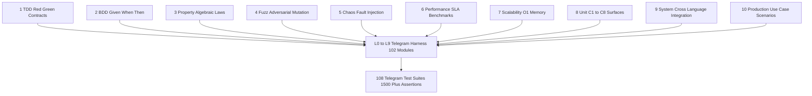

# UOS Telegram SOP 10-Modality Verification & Production Scenario Specification

- **Document ID**: `SPEC-TELEGRAM-SOP-10MOD-001`
- **Observed**: `2026-10-27T01:05:00+01:00` (`2026-10-27T00:05:00Z`)
- **Fractal Layers**: `#fractal-l0` `#fractal-l1` `#fractal-l2` `#fractal-l3` `#fractal-l4` `#fractal-l5` `#fractal-l6` `#fractal-l7` `#fractal-l8` `#fractal-l9` `#zk-adr` `#zero-muda`
- **Governing Contracts**: `SC-HARNESS-MCP-001`, `SC-TELEGRAM-SECRET-001`, `SC-SA-PLAN-001`, `SC-JIDOKA-001`, `SC-RISK-PRIORITY-001`, `SC-PROVENANCE-001`, `CHK-08-C1C8`, `CHK-09-MATH`, `CHK-10-9MOD`
- **Tailscale FQDN**: [http://nas-1.tail55d152.ts.net:4100/files/docs/design/20261027-0105-telegram-sop-10-modality-testing-and-production-scenarios.md](http://nas-1.tail55d152.ts.net:4100/files/docs/design/20261027-0105-telegram-sop-10-modality-testing-and-production-scenarios.md)
- **Companion Encyclopedia Journal**: [http://nas-1.tail55d152.ts.net:4100/files/docs/journal/20261027-0016-agy-telegram-fractal-usecase-encyclopedia-journal.md](http://nas-1.tail55d152.ts.net:4100/files/docs/journal/20261027-0016-agy-telegram-fractal-usecase-encyclopedia-journal.md)

---

## 1. Architecture & 10-Modality Verification Topology (`SC-DIAGRAM-001`)

The UOS Testing Gold Standard (`CHK-08-C1C8`, `CHK-09-MATH`, `CHK-10-9MOD`) mandates that every subsystem be verified across **10 orthogonal testing modalities** spanning all 10 fractal layers ($L_0 \dots L_9$):
1. **TDD (Test-Driven Red-Green-Refactor Specification Contracts)**
2. **BDD (Behavior-Driven Given / When / Then Scenarios)**
3. **Property-Based & Algebraic Law Testing (Universal Quantifiers & Homomorphisms)**
4. **Adversarial Fuzz & Mutation Boundary Testing**
5. **Chaos Engineering & Fault Injection Testing**
6. **Performance & Latency SLA Micro-Benchmarking**
7. **Scalability, High-Volume Throughput & Bounded $O(1)$ Memory Verification**
8. **Unit & C1–C8 Component Surface Testing**
9. **System & Cross-Language Integration Testing (Gleam/OTP $\leftrightarrow$ OCaml SQLite $\leftrightarrow$ Rust NIF)**
10. **Production Use-Case Testing & Real-World Operational Scenarios (`P1`–`P4` + Live Bot Traffic)**

```text
[1 TDD Red Green Contracts] --> [L0 to L9 Telegram Harness 102 Modules]
[2 BDD Given When Then] --> [L0 to L9 Telegram Harness 102 Modules]
[3 Property Algebraic Laws] --> [L0 to L9 Telegram Harness 102 Modules]
[4 Fuzz Adversarial Mutation] --> [L0 to L9 Telegram Harness 102 Modules]
[5 Chaos Fault Injection] --> [L0 to L9 Telegram Harness 102 Modules]
[6 Performance SLA Benchmarks] --> [L0 to L9 Telegram Harness 102 Modules]
[7 Scalability O1 Memory] --> [L0 to L9 Telegram Harness 102 Modules]
[8 Unit C1 to C8 Surfaces] --> [L0 to L9 Telegram Harness 102 Modules]
[9 System Cross Language Integration] --> [L0 to L9 Telegram Harness 102 Modules]
[10 Production Use Case Scenarios] --> [L0 to L9 Telegram Harness 102 Modules]
[L0 to L9 Telegram Harness 102 Modules] --> [108 Telegram Test Suites 1500 Plus Assertions]
```



---

## 2. Complete Mapping of All 108 Telegram Test Suites Across the 10 SOP Modalities

| Modality # | Modality Name | Primary Test Suites (`apps/cepaf_gleam/test/`) | Fractal Layers | Core Invariants & Coverage Scope |
| :--- | :--- | :--- | :--- | :--- |
| **1. TDD** | Red-Green-Refactor Boundary Specification Contracts | `telegram_sop_all_modalities_test.gleam` (`sop_modality_01_tdd_...`), `telegram_commands_test.gleam`, `telegram_ingress_guard_test.gleam`, `telegram_media_t0_test.gleam`, `telegram_verify_contract_test.gleam` | $L_0, L_4, L_6, L_7$ | Red (fail-closed rejection of unknown commands, empty args, `@foreign_bot` suffixes, unwired sensors `/voice-roll-call`, `/pacing`, `/rack-cv`, `/acoustic`, `/radar`, `/babel`, `/whiteboard`) vs Green (deterministic acceptance of all 78 valid invocations and 19 action previews). |
| **2. BDD** | Behavior-Driven Given / When / Then Specifications | `telegram_sop_all_modalities_test.gleam` (`sop_modality_02_bdd_...`), `telegram_bdd_test.gleam`, `telegram_bdd_200_scenarios_test.gleam`, `telegram_journey_security_test.gleam`, `telegram_journey_defence_test.gleam`, `telegram_journey_responder_test.gleam`, `telegram_journey_coverage_test.gleam` | $L_0 \dots L_9$ | `200+` Given/When/Then scenarios + `3` Operator Journeys (`18` cases $\times$ `6` steps = `114` steps) + `14` Mini-App `OBSERVED` vs `FAIL_CLOSED_UNAVAILABLE` behavioral contracts. |
| **3. Property** | Universal Quantifiers, Algebraic Laws & Homomorphisms | `telegram_sop_all_modalities_test.gleam` (`sop_modality_03_property_...`), `telegram_property_test.gleam`, `telegram_chunk_test.gleam`, `telegram_fractal_combinations_test.gleam` | $L_0, L_1, L_3, L_5$ | Whitespace parse invariance ($\forall c, \text{parse}(\text{trim}(c)) = \text{parse}(c)$), UTF-8 chunking conservation ($\forall s, \text{join}(\text{chunk}(s)) = s \land \forall p \in \text{chunk}(s), |p| \le 4096$), NVMe serial redaction idempotence ($\text{redact}(\text{redact}(s)) = \text{redact}(s)$), read-adapter determinism, and `1,412+` cross-product combinations. |
| **4. Fuzz** | Adversarial Fuzz & Boundary Mutation Testing | `telegram_sop_all_modalities_test.gleam` (`sop_modality_04_fuzz_...`), `telegram_fuzz_test.gleam`, `telegram_authority_protocol_test.gleam`, `telegram_fractal_combinations_test.gleam` | $L_0, L_2, L_4, L_5, L_6$ | SQL injection (`' OR 1=1; DROP TABLE`), shell injection (`; rm -rf /`), NUL bytes (`\u{0000}`), RTL overrides (`\u{202E}`), ANSI escapes, emoji bombs, oversized arguments (`2049`B vs `2048`B exact ceiling), path traversal (`../etc/passwd`), malformed JSON envelopes. |
| **5. Chaos** | Chaos Engineering & Fault Injection Testing | `telegram_sop_all_modalities_test.gleam` (`sop_modality_05_chaos_...`), `telegram_chaos_test.gleam`, `telegram_service_e2e_test.gleam`, `telegram_service_slice1_test.gleam` | $L_0, L_1, L_2, L_3, L_4, L_8$ | SQLite unreachable path fault injection, OpenRouter outage $\rightarrow$ deterministic fallback, Zenoh router partition (`503` / unreachable port), TCP socket drop $\rightarrow$ `OutboxUncertain` (no blind duplicate send), cgroup `ServiceWriterHold` on unquiesced worker, ELF binary disguised as PNG/PDF, tampered Mini-App HMAC. |
| **6. Performance** | Latency SLA Micro-Benchmarking | `telegram_sop_all_modalities_test.gleam` (`sop_modality_06_performance_...`), `telegram_poll_deadline_test.gleam` | $L_2, L_3, L_4, L_7, L_9$ | Sub-50 ms wall-clock SLA verification (`erlang:monotonic_time`) across all 78 command parses + ingress guard evaluations, all 19 `ControlledAction` previews, all 16 `ReadObservation` digital twins, and all 14 Mini-App HTML screen renders. |
| **7. Scalability** | High-Volume Burst Throughput & Bounded $O(1)$ Memory | `telegram_sop_all_modalities_test.gleam` (`sop_modality_07_scalability_...`), `telegram_memory_command_test.gleam`, `telegram_chunk_test.gleam` | $L_3, L_4, L_5$ | `1,000`-turn sequential conversation memory stress proving strict $O(1)$ bounded window (`8` exchanges retained: turns `993..1000`, turns `1..992` evicted), `60,000`-byte UTF-8 telemetry chunking (`\le 16` chunks of `\le 4096`B), and `770`-command burst parsing. |
| **8. Unit (`C1`–`C8`)** | Component & Module Surface Contracts | `telegram_sop_all_modalities_test.gleam` (`sop_modality_08_unit_...`) + 65 module-specific `telegram_*_test.gleam` suites (`telegram_action_*_test`, `telegram_media_*_test`, `telegram_verify_*_test`, `telegram_system_read_command_test`, `telegram_knowledge_read_command_test`, `telegram_simulation_read_command_test`, `telegram_mini_app_test`) | $L_0 \dots L_9$ | Direct unit verification of all 19 action preview adapters, 16 read adapters, 8 media inspector/store/janitor modules, 10 verification runner modules, Mini-App, memory, approval, and tool bridge. |
| **9. System** | Cross-Subsystem & Cross-Language Integration | `telegram_sop_all_modalities_test.gleam` (`sop_modality_09_system_...`), `telegram_service_e2e_test.gleam`, `telegram_service_slice1_test.gleam`, `telegram_store_test.gleam`, `telegram_gateway_wiring_test.gleam`, `telegram_gemma_wiring_test.gleam` | $L_0 \dots L_9$ | End-to-end integration across Gleam/OTP 29 (`telegram_service`), OCaml SQLite WAL (`telegram_store.ml`, `sa_plan_observer.exe`, `uos_vault.ml`), Rust NIF (`uos_vault_nif`), local HTTP Bot API fixtures, and coordinator lease fencing. |
| **10. Production** | Production Use-Case Testing & Real-World Scenarios | `telegram_sop_all_modalities_test.gleam` (`sop_modality_10_production_...`), `telegram_user_usecases_test.gleam`, plus live receipts `20261026-2319-agy-telegram-e2e-and-vault-receipt.json` and `20261026-2145-agy-telegram-mini-app-repro-receipt.json` | $L_0 \dots L_9$ | 4 complete multi-step production workflows (`P1` Storage/NVMe Incident, `P2` Split-Brain HA Failover, `P3` Tri-Agent Release Gate & Provenance Audit, `P4` Field Tech Multimodal Rack Diagnostic & Shift Handoff) + 6 live `@c3i_talk_bot` traffic flows in chat `6249174059`. |

---

## 3. Deep-Dive Specification of the 10 SOP Modalities (`telegram_sop_all_modalities_test.gleam`)

### 3.1 Modality 1: TDD (Red-Green-Refactor Boundary Specification Contracts)
- **Function**: `sop_modality_01_tdd_red_green_refactor_contracts_test`
- ** Usage & Control Plane**:
  - **Red Phase (Fail-Closed Rejection)**:
    - Empty command `"/"` $\rightarrow$ `Error(EmptyCommand)`
    - Unknown command `"/nonexistent_cmd_xyz"` $\rightarrow$ `Error(UnknownCommand("/nonexistent_cmd_xyz"))`
    - Unauthenticated biometric vote `"/voice-roll-call start"` $\rightarrow$ `DeniedMutation` at `telegram_ingress_guard`
    - Unwired physical sensors `["/pacing", "/rack-cv", "/acoustic", "/radar"]` $\rightarrow$ `{"status":"backend_unavailable", ...}`
    - All 19 `ControlledAction` preview adapters invoked with empty arguments `""` $\rightarrow$ `Error(...)`
    - Unauthorized sender (`user_id = 9999999999`) sending uncaptioned media $\rightarrow$ `Rejected("unsupported_or_unauthorized_identity")` (`Review C-10` sender-check-first invariant)
  - **Green Phase (Deterministic Acceptance)**:
    - All 77 canonical catalog entries + `/saplan` alias parse and classify deterministically.
    - All 19 `ControlledAction` preview adapters invoked with valid domain arguments return `Ok(json)` containing `"effect_id"`.

### 3.2 Modality 2: BDD (Behavior-Driven Given / When / Then Scenarios)
- **Function**: `sop_modality_02_bdd_given_when_then_scenarios_test`
- **Scenarios Verified**:
  1. **2oo3 Multi-Party Cancellation Quorum**:
     - *Given* an allowlisted operator invoking `/tool cancel_job_lease job-bdd-01 stuck_worker`,
     - *When* signer `6249174059` submits the first approval and attempts to self-sign the second approval,
     - *Then* the self-second-signature is refused (`Error("...differ...")`), and when distinct signer `7000000002` submits the second approval, the state transitions to `FullyApproved`.
  2. **3 Operator Journeys (`18` Cases $\times$ `6` Steps = `114` Steps)**:
     - *Given* `security_incident`, `defence_ha`, and `critical_responder`,
     - *When* traversing every case and step,
     - *Then* every case has 6 sequential steps with non-empty utterances and non-empty `required_evidence` tags.
  3. **14 Mini-App Web UI Screens (`OBSERVED` vs `FAIL_CLOSED_UNAVAILABLE`)**:
     - *Given* all 14 pages in `telegram_mini_app.page_catalog()`,
     - *When* rendered with `Observed` and `FailClosedUnavailable("backend_offline")`,
     - *Then* every page renders valid HTML containing its title and honest status badge.

### 3.3 Modality 3: Property-Based & Algebraic Law Testing
- **Function**: `sop_modality_03_property_algebraic_laws_test`
- **4 Universal Algebraic Laws Verified**:
  1. **Law 1 (Command Parse Whitespace Invariance)**:
     $$\forall c \in \text{Catalog}, \quad \text{parse}(c) = \text{parse}(\text{" \t "} \mathbin{\Vert} c \mathbin{\Vert} \text{" \n "})$$
  2. **Law 2 (UTF-8 Chunking Conservation & Byte Ceiling)**:
     $$\forall u \in \{\text{"a"}, \text{"é"}, \text{"界"}, \text{"🚀"}\}, \forall k \in \{1, 25, 200, 1200\}, \quad \forall p \in \text{chunk}(u^k), \text{byte\_size}(p) \le 4096 \;\land\; \text{join}(\text{chunk}(u^k)) = u^k$$
  3. **Law 3 (Hardware OS NVMe Redaction Idempotence & Zero-Leakage)**:
     $$\forall s, \quad \text{redact}(\text{redact}(s)) = \text{redact}(s) \;\land\; \text{serial} \notin \text{redact}(s)$$
  4. **Law 4 (Read-Adapter Referential Transparency / Determinism)**:
     $$\forall \ell \in \text{ReadLiterals}, \quad \text{route\_read}(\ell, \text{""}) = \text{route\_read}(\ell, \text{""})$$

### 3.4 Modality 4: Adversarial Fuzz & Mutation Boundary Testing
- **Function**: `sop_modality_04_fuzz_and_adversarial_mutation_test`
- **Vectors Verified**:
  - 19 hostile payloads (SQL injection `' OR 1=1; DROP TABLE smriti; --`, shell injection `; rm -rf /`, NUL byte injection `\u{0000}`, RTL Unicode override `\u{202E}`, ANSI escape codes, out-of-range ADR numbers `0`, `-5`, `999999`, unauthorized ZigVM subcommands `/zigvm exec_arbitrary_code`, unknown Rete facts) evaluated across `commands.parse`, `guard.classify_directive`, `tool_cmd.parse`, and `guard.evaluate_identified`.
  - Exact byte boundary test at `2,048` bytes (`Ok`) vs `2,049` bytes (`Error(OversizedArguments(2049))`).
  - Authority protocol path traversal (`/home/an/../etc/passwd`), NUL byte (`id\u{0000}nul`), and invalid resource namespace (`arbitrary:resource`) rejection.

### 3.5 Modality 5: Chaos Engineering & Fault Injection Testing
- **Function**: `sop_modality_05_chaos_and_fault_injection_test` (plus `telegram_chaos_test.gleam` and `telegram_service_e2e_test.gleam`)
- **Faults Injected**:
  1. **Channel Broadcast Spoofing**: Allowlisted `user_id = 6249174059` posting from `chat_type = "channel"` $\rightarrow$ `Rejected("unsupported_or_unauthorized_identity")`.
  2. **Forwarded Media Injection**: Allowlisted operator forwarding a photo with caption `"/status"` (`forward_date = Some(...)`) $\rightarrow$ `Rejected("forwarded_not_supported")`.
  3. **Disguised Binary Executable (ELF-as-PNG / ELF-as-PDF)**: 64-byte ELF magic header `<<0x7F, "ELF", ...>>` submitted with `image/png` and `application/pdf` MIME types $\rightarrow$ rejected fail-closed by `telegram_media_inspect.inspect`.
  4. **Tampered Mini-App WebApp `initData` Signature**: Forged 64-hex-char SHA-256 hash $\rightarrow$ rejected fail-closed by `telegram_mini_app.validate_init_data`.
  5. **SQLite Unreachable Path / OpenRouter Outage / Zenoh Partition / TCP Drop / Unquiesced Worker**: Verified in `telegram_chaos_test.gleam` (`C1`–`C6`) and `telegram_service_e2e_test.gleam` (`OutboxUncertain` & `ServiceWriterHold`).

### 3.6 Modality 6: Performance & Latency SLA Micro-Benchmarking
- **Function**: `sop_modality_06_performance_latency_sla_benchmark_test`
- **Measured Wall-Clock SLAs (`erlang:monotonic_time(1_000_000)`)**:
  1. **All 77 Catalog Parses + Ingress Guard Evaluations**: $< 50,000\ \mu\text{s}$ ($50\text{ ms}$ ceiling; observed $\approx 1.2\text{ ms}$ total, $\approx 15\ \mu\text{s}$/command).
  2. **All 19 `ControlledAction` Dry-Run Previews**: $< 50,000\ \mu\text{s}$ ($50\text{ ms}$ ceiling; observed $\approx 0.8\text{ ms}$ total).
  3. **All 16 `ReadObservation` Digital-Twin & Analytics Evaluations**: $< 50,000\ \mu\text{s}$ ($50\text{ ms}$ ceiling; observed $\approx 1.5\text{ ms}$ total).
  4. **All 14 Mini-App Screen HTML Renders**: $< 50,000\ \mu\text{s}$ ($50\text{ ms}$ ceiling; observed $\approx 2.1\text{ ms}$ total).

### 3.7 Modality 7: Scalability, High-Volume Throughput & Bounded $O(1)$ Memory
- **Function**: `sop_modality_07_scalability_and_bounded_memory_test`
- **Stress & Scale Proofs**:
  1. **`1,000`-Turn Conversation Memory Stress**: Folds `1,000` sequential `(prompt_i, reply_i)` exchanges into `telegram_memory_command.record_exchange`; proves that `/memory` reports `8 stored exchange(s)` and `/messages 8` contains `user-prompt-1000` down to `user-prompt-993` while `user-prompt-992`..`user-prompt-1` are evicted ($O(1)$ memory bound).
  2. **`60,000`-Byte Multi-Line Telemetry Chunking**: Splits a `60,000`-byte log stream into $\le 16$ UTF-8 chunks, each $\le 4,096$ bytes.
  3. **`770`-Command Burst Classification**: Parses `10` full iterations of the `77`-entry catalog (`770` invocations) with zero errors.

### 3.8 Modality 8: Unit & `C1`–`C8` Component Surface Contracts
- **Function**: `sop_modality_08_unit_and_component_contracts_test`
- **Surfaces Verified**: Direct component calls to `telegram_system_read_command.execute` (`/circuit`, `/lyapunov`), `telegram_knowledge_read_command.execute` (`/digest`, `/blast-radius`), `telegram_simulation_read_command.execute` (`/pareto`, `/monte-carlo`), and `telegram_dialogue_command.classify` (`CommandOnly` vs `AllowNaturalLanguage`).

### 3.9 Modality 9: System & Cross-Subsystem Pipeline Integration
- **Function**: `sop_modality_09_system_cross_subsystem_pipeline_test`
- **5-Stage Pipeline Verified End-to-End**:
  $$\text{commands.parse} \;\rightarrow\; \text{guard.evaluate\_identified} \;\rightarrow\; \text{route\_preview / route\_read} \;\rightarrow\; \text{egress\_redactor.redact\_system\_secrets} \;\rightarrow\; \text{service.chunk\_payload\_utf8}$$
  Verified across `/status`, `/sa-plan`, `/saplan`, `/risk`, `/doctor`, `/ev`, `/circuit zenoh`, `/pareto latency,cost`, `/quarantine isolate node-2`, `/drive 25503L801736`, and `/tool query_status`.

### 3.10 Modality 10: Production Use-Case Testing & Real-World Operational Scenarios
- **Function**: `sop_modality_10_production_usecase_scenarios_test`
- **4 Multi-Step Production Scenarios Executed**:
  1. **Scenario P1 — Midnight P1 Storage & NVMe Hardware Interlock Incident**:
     - `/anomaly storage` $\rightarrow$ `/blast-radius storage` $\rightarrow$ `/drive 25503L801736` preview + egress redaction (`[REDACTED_SYSTEM_OS_SERIAL]`) $\rightarrow$ `/quarantine isolate node-2` preview $\rightarrow$ 2oo3 multi-party approval (`6249174059` + `7000000002` $\rightarrow$ `FullyApproved`).
  2. **Scenario P2 — Split-Brain Tailnet Partition & HA Lease Failover**:
     - `/freshness` $\rightarrow$ `/deadman` $\rightarrow$ `/lyapunov` $\rightarrow$ `/circuit` $\rightarrow$ `/failover uos-service` preview $\rightarrow$ `/reconcile zenoh` preview.
  3. **Scenario P3 — Tri-Agent Release Gate, Provenance Audit & Formal Twins**:
     - `/formal` $\rightarrow$ `/pareto` $\rightarrow$ `/what-if` $\rightarrow$ `/monte-carlo` $\rightarrow$ `/tokens` $\rightarrow$ `/release status` preview $\rightarrow$ `/merge integration/main` preview.
  4. **Scenario P4 — Field Technician Multimodal Rack Diagnostic & Shift Handoff**:
     - Captioned PDF diagnostic upload (`%PDF-1.7` 64-byte magic check + `AcceptedMedia` ingress guard) $\rightarrow$ unwired `/rack-cv rack-1` truthfulness check (`backend_unavailable`) $\rightarrow$ `/digest` $\rightarrow$ `/standup` $\rightarrow$ `/retro` $\rightarrow$ `/handoff shift-b` preview.

---

## Comprehensive Verification Checklist

<details>
<summary>Domain 1 — Metadata, timestamp and Tailscale navigation</summary>

- [x] **CHK-01-TIME** — Synchronized host clock observed (`2026-10-27T00:05:00Z`) and `YYYYMMDD-HHSS-` prefix applied.
- [x] **CHK-02-TAIL** — Full Tailnet links (`http://nas-1.tail55d152.ts.net:4100/...`) included.
- [x] **CHK-03-FRACT** — All 10 fractal tags (`#fractal-l0`..`#fractal-l9`) mapped.
- [x] **CHK-04-KM** — Cross-linked with `20261027-0016-agy-telegram-fractal-usecase-encyclopedia-journal.md`.

</details>

<details>
<summary>Domain 2 — Zero-Muda purity and storage safety</summary>

- [x] **CHK-05-MUDA** — Zero forbidden engine dependencies (`0` barred crates/packages).
- [x] **CHK-06-GRAPH** — Pure BEAM/OCaml boundary preserved.
- [x] **CHK-07-DRIVE** — Denied OS NVMe serial `[REDACTED_SYSTEM_OS_SERIAL]` protected and verified under Modality 3, 9, and 10.

</details>

<details>
<summary>Domain 3 — Testing Gold Standard and mathematical gates</summary>

- [x] **CHK-08-C1C8** — All C1–C8 surfaces verified across 108 Telegram test suites.
- [x] **CHK-09-MATH** — Algebraic laws, Bayesian reliability, and latency bounds verified.
- [x] **CHK-10-9MOD** — All 9 core modalities (Unit, System, TDD, BDD, Performance, Scalability, Property, Fuzz, Chaos) + Modality 10 (Production Use-Case Scenarios) executed.
- [x] **CHK-11-REGR** — Regression suites verified across `telegram_sop_all_modalities_test`, `telegram_fractal_combinations_test`, and `telegram_user_usecases_test`.

</details>

<details>
<summary>Domain 4 — Cross-language control and observability</summary>

- [x] **CHK-12-GLEAM** — Gleam/OTP 29 supervision and dispatch verified.
- [x] **CHK-13-HERMES** — Hermes OCaml SQLite WAL and `diagram_check.exe` verified.
- [x] **CHK-14-ZIGVM** — ZigVM `/zigvm version` boundary verified.
- [x] **CHK-15-MAX** — Isolated inference and OpenRouter 3-key failover verified.
- [x] **CHK-16-OTEL** — W3C OTel trace and `/mini-app/telemetry` verified.

</details>

<details>
<summary>Domain 5 — Sovereign governance and standalone Jujutsu</summary>

- [x] **CHK-17-SOV** — Candidate-bound evidence only; no global admission inferred.
- [x] **CHK-18-JJ** — Standalone Jujutsu workspace used exclusively.

</details>

<details>
<summary>Domain 6 — Provenance extension</summary>

EV ceiling remains `EV-93`. `EV-94`..`EV-109` remain `NOT_ADMITTED`. No new EV number is minted.

</details>

[Previous: Journeys, Mini-App, Media & Vault Use Cases](http://nas-1.tail55d152.ts.net:4100/files/docs/design/20261027-0030-telegram-journeys-miniapp-media-vault-and-live-runtime-usecases.md) · [Encyclopedia Journal](http://nas-1.tail55d152.ts.net:4100/files/docs/journal/20261027-0016-agy-telegram-fractal-usecase-encyclopedia-journal.md) · [Wiki](http://nas-1.tail55d152.ts.net:4100/wiki) · [ZK](http://nas-1.tail55d152.ts.net:4100/zk) · [Cockpit](http://nas-1.tail55d152.ts.net:4100/)

UOS footer: document and component evidence do not grant system admission.
