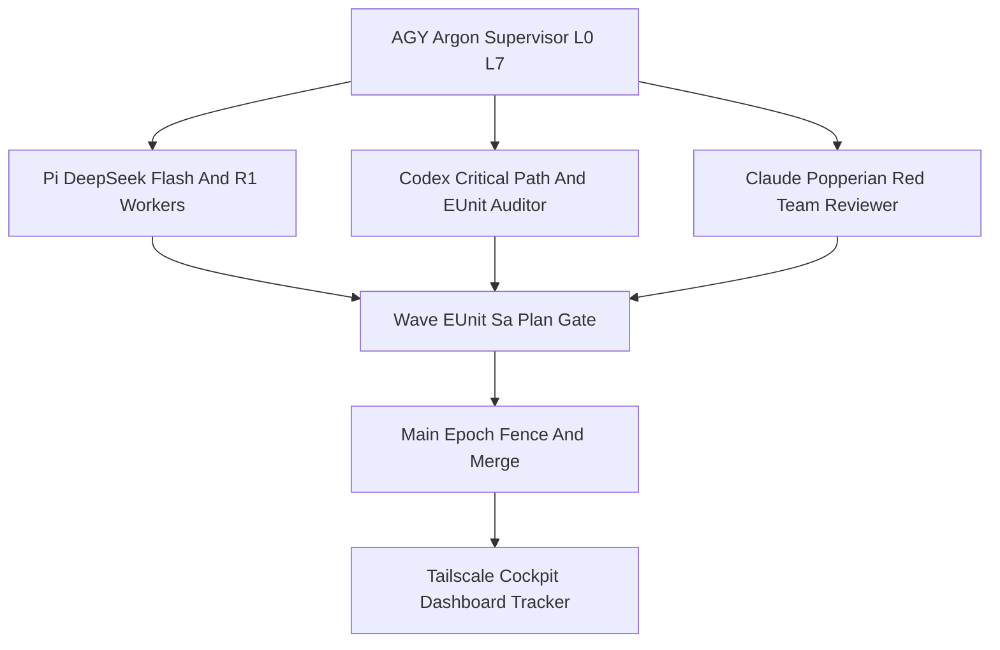

# 2026-10-30 09:32 UTC — AK-47 Fractal Thinking, As-Is vs. To-Be Architecture, and L0–L9 What/Why/How/Where Matrix

- **Document ID**: `DSN-20261030-0932-AK47-FRACTAL-ASIS-TOBE`
- **Observed Host Clock**: `2026-10-30T08:32:21Z` (`chronyc -c tracking` Stratum `3`, system offset `-0.000139s`, nominal $<2.0\text{s}$)
- **Canonical Workspace**: `/home/an/NAS-setup/uos`
- **Tailscale Document URL**: [http://nas-1.tail55d152.ts.net:4100/files/docs/design/20261030-0932-ak47-fractal-thinking-as-is-to-be-architecture.md](http://nas-1.tail55d152.ts.net:4100/files/docs/design/20261030-0932-ak47-fractal-thinking-as-is-to-be-architecture.md)
- **Execution Journal**: [http://nas-1.tail55d152.ts.net:4100/files/docs/journal/20261030-0844-fractal-rca-ak47-multi-agent-mcp-completion-journal.md](http://nas-1.tail55d152.ts.net:4100/files/docs/journal/20261030-0844-fractal-rca-ak47-multi-agent-mcp-completion-journal.md)
- **Active Plan Document**: [http://nas-1.tail55d152.ts.net:4100/files/docs/plans/20261029-1913-uos-mcp-server-completion-plan.md](http://nas-1.tail55d152.ts.net:4100/files/docs/plans/20261029-1913-uos-mcp-server-completion-plan.md)
- **Live Dashboard & Tracker**: [http://nas-1.tail55d152.ts.net:4100/files/governance/planning/20261030-0844-mcp-completion-dashboard-tracker.json](http://nas-1.tail55d152.ts.net:4100/files/governance/planning/20261030-0844-mcp-completion-dashboard-tracker.json)
- **Navigation**: [Cockpit](http://nas-1.tail55d152.ts.net:4100/) · [Planning](http://nas-1.tail55d152.ts.net:4100/planning) · [Wiki](http://nas-1.tail55d152.ts.net:4100/wiki) · [ZK](http://nas-1.tail55d152.ts.net:4100/zk) · [Checklist](http://nas-1.tail55d152.ts.net:4100/checklist)
- **Fractal Layer Tags**: `#fractal-l0` `#fractal-l1` `#fractal-l2` `#fractal-l3` `#fractal-l4` `#fractal-l5` `#fractal-l6` `#fractal-l7` `#fractal-l8` `#fractal-l9` `#zk-adr` `#zero-muda` `#tailscale-web`
- **KM Transclusions**: `[[wiki:index]]` `[[wiki:architecture]]` `[[zk:ADR-001]]` `[[zk:ADR-016]]`

> **Authority note.** This is a design & execution architecture document. It is `REPORT_ONLY` with respect to runtime admission. A mechanical `PASS` from `tools/journal-check` or `tools/diagram-check` is co-presence/parity evidence, not release authority. Runtime, development readiness, task completion, and sovereign admission remain separate decisions.

---

## 1. Supervisor Thinking: AK-47 Design Principles + Fractal TPS (`Zero Muda`)

The AK-47 is not a precision instrument; it is a **reliability instrument**. Its enduring lesson is the deliberate asymmetry between a *tight steel receiver* (the few tolerances that must never fail) and *loose bolt-carrier clearances* (the many interfaces that must tolerate mud, sand, and cold without seizing). UOS applies that asymmetry to agentic delivery: hold a very small invariant set with zero tolerance, and make everything else loose enough to move fast without process-lock.

Fractal **TPS (`Zero Muda`)** is the second half. Every layer from `L0` (constitution) to `L9` (sovereignty) is analyzed for the seven wastes — over-production, waiting, transport, over-processing, inventory, motion, and defects — and the correct waste to eliminate at agentic scale is *token burn, cold full-suite re-runs, and ceremonial waiting*. `Zero Muda` does **not** mean zero safety. It means zero avoidable waste around the safety invariants.

### 1.1 Tight Steel-Receiver Invariants (Zero-Tolerance Safety)

These are never relaxed, regardless of velocity pressure:

1. **Opaque `Principal`.** `Principal` is constructed only from transport-bound facts, never from payload-supplied identity. A caller cannot self-elevate by naming a workspace, a role, or a lease in the request body (`mcp/principal.gleam`).
2. **Live effect-time re-verification of `TaskFence` / `GrantTicket`.** Admission is checked at *effect time*, not merely at dispatch time, so a task that completes, an epoch that advances, or a grant that expires between admission and execution fails closed (`mcp/admission.gleam`, `verify_at_effect_time_live`).
3. **Idempotent + `EffectUncertain` Andon-latched `ReceiptLedger`.** Every mutating effect is keyed by a deterministic logical effect ID. A duplicate request returns the committed receipt without re-executing. A crash between the effect and the receipt write latches `EffectUncertain` (the Andon cord) and requires an explicit `reconcile_uncertain` — never an automatic overwrite (`mcp/receipts.gleam`, `mcp/worker.gleam`).
4. **Critical-code SHA-256/MD5 pins per `SC-AGENTIC-RESILIENCE-001`.** The census-pinned files (`mcp/tools.gleam`, `mcp/protocol.gleam`, `uos_sup.gleam`, `harness/mcp.gleam`, `harness/successor_mcp.gleam`, `harness/operations.gleam`) may not change without a corresponding `SourceBinding` digest update and independent verification. Critical binaries are SHA-256/MD5 pinned and re-checked after every agent run.
5. **Standalone Jujutsu only.** All VCS mutation is `.jj/`-native. There are zero native Git mutations, zero forced abandonments, and zero destructive cleanups.
6. **Canonical `var/sa-plan/uos.sqlite3`.** The Sa-Plan store is the sole execution authority for task claims/completions; the coordinator store (`var/coordination/tri-agent/coordinator.sqlite3`) is the sole authority for `integration/main` epoch leases.
7. **Coordinator `integration/main` epoch fencing.** Exactly one serialized `main` writer holds an epoch lease at a time. Parallel workers may only write disjoint new files in isolated `.uos-workspaces/*`.
8. **`EV-93` ceiling.** `SC-PROVENANCE-001` caps the admitted evidence range at `EV-93`; `EV-94`..`EV-109` remain `NOT_ADMITTED`; no new EV number is minted. The held `SourceFX` plan (`source4-test-2219`) stays `HELD`.

### 1.2 Loose Bolt-Carrier Clearances (Anti-Process-Lock Velocity)

The interfaces that must stay loose:

- **Parallel workers on disjoint *new* files.** Wave 2 runs `T06`, `T07`, `T09`, `T10`, `T11`, `T15` concurrently because each produces independent adapter/test files with no shared write surface.
- **Single serialized `mcp/server.gleam` wiring in Wave 3.** Shared dispatchers are the one high-contention resource; they are wired serially by the integrator after adapters land. This is the deliberate "single point of truth, single writer" clearance.
- **Targeted `<2s` BEAM EUnit inner loops.** Agents compile targeted modules and run `erl -noshell -eval 'eunit:test([...])'` in `~0.5–2.1s`, instead of a cold 400-module `gleam test` (`>180s`). The fast inner loop is what makes frequent merging affordable.
- **Frequent wave-end `main` merges across Epochs 93–97.** Each verified wave advances the `main` bookmark under a fresh `integration/main` epoch lease, so the integration delta is always small and the rollback radius is always bounded.

### 1.3 Multi-Agent Fleet Roles & Cost/Reliability Telemetry

| Agent | Role & Boundary | Model / Invocation | Cost & Reliability Control |
|---|---|---|---|
| **`AGY (Argon)`** | Pure `L0`/`L7` Supervisor. **Never authors application code.** Holds the `sa-plan` claim/completion ledger and the coordinator `integration/main` epoch fence. Runs SHA-256 and EUnit gates and performs final merges. | Supervisor session `agy-argon-sup-20261030-0844` (coordinator `sequence = 4788`) | Authority concentration is intentional: one writer, one fence, one merge gate. Zero application-code output eliminates self-review conflict. |
| **`Pi + DeepSeek`** | Fast/cheap disjoint slice implementer & unit-test author (adapters, transports, facilities, doc/mirror sweeps). | `deepseek/deepseek-v4.1-flash` and `deepseek-r1` via OpenRouter, isolated with `--no-skills --no-prompt-templates --no-context-files --no-themes --no-extensions --no-mcp --no-session` | Zero-Muda isolation flags cut prompt bloat from **`53,263` tokens → `~400` tokens (`-99.2%`)**. Mandatory supervisor post-run `sha256sum` verification of every touched file prevents `AP-DEEPINFRA-PHANTOM-EDIT`. Smoothed smoke latency `1.8s`. |
| **`Codex`** | Batched P1 critical-path adapter author (`T06`, `T11`, `server.gleam` wiring, `T18`, `T21`, `T24`) and full-suite independent EUnit auditor. | `codex exec -s workspace-write -c model_reasoning_effort="low"` | Batching amortizes the ~`25,708`-token base repo prompt. `-s workspace-write` is mandatory because `-s read-only` mounts `/tmp` read-only (`{error, erofs}`) and fails temp-dir fixture tests. |
| **`Claude`** | Independent Popperian red-team security/governance reviewer (read-only). Proves falsification, does not author. | `claude -p --allowedTools "Read"` (stdin prompt; `2.1.312`) | Wave 1 proof of value: caught `RR-01` (`matching-payload replay`) — `matching_replay_returns_committed_without_reexecuting` — and the `EffectUncertain` overwrite hazard **before Merge #1**. |

The separation is a **STAMP control**, not a stylistic preference: the executing agent never reviewed its own work, the reviewer never authored, and the supervisor never wrote application code. That triple separation is what makes the frequent-merge cadence safe.

---

## 2. As-Is vs. To-Be System State

| Dimension | Handover Baseline (`1/25`) | Current Live State (`6/25`, Wave 1 hardened) | Target To-Be (`25/25`, Epoch 97 on `main`) |
|---|---|---|---|
| **Sa-Plan DAG** | `2/25` (`T00`,`T01`) at handover read; canonical store `var/sa-plan/uos.sqlite3`, plan `20261029-1913-mcp-server-completion`, 25 tasks `T00`–`T24`, 59 dependency edges. | `6/25` completed (`T00`..`T05`), `0` executing, 6 disjoint tasks (`T06`,`T07`,`T09`,`T10`,`T11`,`T15`) immediately ready for Wave 2. | `25/25` completed (`T00`..`T24`); `T24` rehearsed on a contained fixture without unauthorized live cutover; `CORE_DEV_READY` + `MCP_FULL_DEV_READY` on `main`. |
| **101 MCP Tool Routes** | 65 public declared (`12` explicit fail-closed `UNAVAILABLE`, remaining declared_unprobed); 21 legacy-private + 15 successor-private declarations; 4 baseline failures in `system_feature_interfaces_test`. | 65 public + 21 legacy-private + 15 successor-private on a unified typed registry; baseline interface failures repaired (`17/17` PASS); 9-tool canonical planning read family live. | `65/65` public backed by real typed adapters across 9 families; `15 + 21` private routes converged on the shared registry/admission/worker/receipt core; `0` baseline failures; honest `UNAVAILABLE`/`UNKNOWN` fail-closed semantics on empty/unwired calls. |
| **Protocol & Transports** | Legacy `2024-11-05` handshake over stdio/basic Zenoh only. Modern `2026-07-28`, resources/prompts/subscriptions/tasks extension, and Streamable HTTP unimplemented. | Legacy profile preserved; wire/profile bounds under test (`T15`); transport-bound principal + effect-time admission live; stdio pipe hardening verified. | Legacy `2024-11-05` **and** Modern `2026-07-28` profiles; supervised stdio + signed Zenoh + protected Tailnet Streamable HTTP `/mcp`; scoped resources/prompts/subscriptions/durable `task_extension`. |
| **5-Client & Assurance Matrix** | No full route sweep across clients. | Wave 1 tri-agent (`pi-deepseek-r1`, `claude`, `codex`) review in flight; `67/67` targeted + `160/160` core harness EUnit PASS. | `5/5` clients (`agy`, `gemini`, `codex`, `claude`, `pi`) verified across the route matrix plus a `10,000`-request concurrency-16 `mcp_assurance_test` gate (formal/fuzz/fault/load). |
| **4-Surface Rules/Skills/SOPs/Superpowers Parity** | Rules/skills mirrored unevenly across `.agents/`, `.claude/`, `.codex/`, `.gemini/`. | AK-47 multi-agent supervision rules drafted; mid-wave drift not yet projected. | Byte-identical projection of rules, skills, plugins, agents, SOPs, and Superpowers across all 4 surfaces (`SC-MIRROR-PROJ-001`), gated by `T22` and independent final acceptance `T23`. |

---

## 3. Fractal (`L0`–`L9`) Matrix: What, Why, How, and Where

| Layer | **WHAT** (Capability / Invariant) | **WHY** (Root Cause / STPA Hazard Prevented) | **HOW** (Mechanism & Executing Agent) | **WHERE** (Canonical Paths & Tailscale FQDN URLs) |
|---|---|---|---|---|
| **`L0` Constitutional** | `EV-93` ceiling, `SC-JIDOKA-001`, vault & control safety; no new EV number; held `SourceFX` preserved. | Unmanaged evidence growth and control-loop mutation can mint authority outside the constitution (UCA-CONST-01). | Fenced `control.gleam` (`T08`) & redacted `vault_metadata.gleam` (`T11`); supervisor gate on every merge. `Codex` authors, `Claude` reviews. | `contracts/rules/20261029-0745-critical-code-agentic-resilience-and-mcp-mandate.md` · [http://nas-1.tail55d152.ts.net:4100/zk](http://nas-1.tail55d152.ts.net:4100/zk) |
| **`L1` Atomic** | Clock synchronization, UTF-8/NUL framing, W3C OTel trace correlation. | Split `stdio` frames and malformed Zenoh topics can smuggle partial messages (UCA-ATOM-01). | `version.gleam`, `wire.gleam` (`T15`), `transports/stdio.gleam` (`T16`); bounded framing + OTel trace IDs. `Pi+DeepSeek`. | `apps/cepaf_gleam/src/cepaf_gleam/mcp/wire.gleam` · [http://nas-1.tail55d152.ts.net:4100/files/docs/design/20261030-0932-ak47-fractal-thinking-as-is-to-be-architecture.md](http://nas-1.tail55d152.ts.net:4100/files/docs/design/20261030-0932-ak47-fractal-thinking-as-is-to-be-architecture.md) |
| **`L2` Component** | Typed JSON Schema registry & bounded workers. | Untyped dispatch admits unbounded payloads and recursive `$ref` expansion (UCA-COMP-01). | `types`, `schema`, `registry`, `worker` (`T02`,`T04`); recursive `$ref` depth guard; `17/17` interface tests PASS. Completed in Wave 1. | `apps/cepaf_gleam/src/cepaf_gleam/mcp/registry.gleam` · [http://nas-1.tail55d152.ts.net:4100/wiki](http://nas-1.tail55d152.ts.net:4100/wiki) |
| **`L3` Transaction** | Sa-Plan reads/writes & idempotent receipt ledger. | Legacy `plan_*` diverged from `sa_plan_*`; crash-after-effect ambiguity corrupts state (UCA-TXN-01). | `planning_read.gleam` (`T05`), `planning_write.gleam` (`T06`), `receipts.gleam` (`T04`); `EffectUncertain` + `reconcile_uncertain`. `Pi+DeepSeek` + `Codex`. | `apps/cepaf_gleam/src/cepaf_gleam/mcp/receipts.gleam` · [http://nas-1.tail55d152.ts.net:4100/planning](http://nas-1.tail55d152.ts.net:4100/planning) |
| **`L4` System** | `uos_sup` OTP tree & honest service observation. | Fixed health projections report synthetic green when backends are down (UCA-SYS-01). | `mcp/supervisor.gleam` (`T04`) + honest probe-backed `system_observation.gleam` (`T07`); `mcp_unified_gateway`. `Pi+DeepSeek`. | `apps/cepaf_gleam/src/cepaf_gleam/mcp/supervisor.gleam` · [http://nas-1.tail55d152.ts.net:4100/](http://nas-1.tail55d152.ts.net:4100/) |
| **`L5` Cognitive** | Multi-agent supervision & MAX/Hermes analysis. | High frontier token burn and synthetic predictions when a model is absent (UCA-COG-01). | `AGY` Supervisor → `Pi+DeepSeek` / `Codex` / `Claude`; honest `analysis.gleam` (`T12`) returns `UNKNOWN`, never a fabricated forecast. `AGY` + `Pi+DeepSeek`. | `apps/cepaf_gleam/src/cepaf_gleam/mcp/adapters/analysis.gleam` · [http://nas-1.tail55d152.ts.net:4100/checklist](http://nas-1.tail55d152.ts.net:4100/checklist) |
| **`L6` Ecosystem** | 5-client compatibility (`agy`,`gemini`,`codex`,`claude`,`pi`). | Per-client route gaps and private-route drift break clients silently (UCA-ECO-01). | `resources/prompts/subscriptions/task_extension` (`T17`) + 5-client matrix (`T19`). `Pi+DeepSeek` + `Codex`. | `apps/cepaf_gleam/src/cepaf_gleam/mcp/adapters/knowledge.gleam` · [http://nas-1.tail55d152.ts.net:4100/wiki](http://nas-1.tail55d152.ts.net:4100/wiki) |
| **`L7` Federation** | Tailnet Streamable HTTP & signed Zenoh. | Protected `/mcp` origin and token non-forwarding are unenforced (UCA-FED-01). | `transports/zenoh.gleam` (`T16`), `transports/http.gleam` & `http_auth.gleam` (`T18`); approved HTTPS origin only. `Codex` + `Claude`. | `apps/cepaf_gleam/src/cepaf_gleam/mcp/transports/http.gleam` · [http://nas-1.tail55d152.ts.net:4100/](http://nas-1.tail55d152.ts.net:4100/) |
| **`L8` Mutation** | Fuzz, fault, concurrency-16 load gates. | Poisoned workers and 10k-call load bounds unmeasured on new adapters (UCA-MUT-01). | `verification.gleam` (`T09`) + 10k-request concurrency-16 `mcp_assurance_test` (`T20`). `Pi+DeepSeek` + `Codex`. | `apps/cepaf_gleam/src/cepaf_gleam/mcp/adapters/verification.gleam` · [http://nas-1.tail55d152.ts.net:4100/checklist](http://nas-1.tail55d152.ts.net:4100/checklist) |
| **`L9` Sovereign** | Feature ledger, 4-surface rules & release rehearsal. | Unsynchronized rules/skills and an unrehearsed rollback cause release drift (UCA-SOV-01). | `features.gleam` (`T13`), `T14` parity, `T21`–`T24` closure & frequent `main` merges. All 4 agents. | `governance/planning/20261030-0844-mcp-completion-dashboard-tracker.json` · [http://nas-1.tail55d152.ts.net:4100/planning](http://nas-1.tail55d152.ts.net:4100/planning) |

---

## 4. Dual-Source Architecture Topology (`SC-DIAGRAM-001`)

ASCII edge list (authoritative source; `tools/diagram-check` extracts the edge set from `[Label] --> [Label]`):

```text
[AGY Argon Supervisor L0 L7] --> [Pi DeepSeek Flash And R1 Workers]
[AGY Argon Supervisor L0 L7] --> [Codex Critical Path And EUnit Auditor]
[AGY Argon Supervisor L0 L7] --> [Claude Popperian Red Team Reviewer]
[Pi DeepSeek Flash And R1 Workers] --> [Wave EUnit Sa Plan Gate]
[Codex Critical Path And EUnit Auditor] --> [Wave EUnit Sa Plan Gate]
[Claude Popperian Red Team Reviewer] --> [Wave EUnit Sa Plan Gate]
[Wave EUnit Sa Plan Gate] --> [Main Epoch Fence And Merge]
[Main Epoch Fence And Merge] --> [Tailscale Cockpit Dashboard Tracker]
```



**Parity contract.** `tools/diagram-check` (`G-DIAGRAM`) compares both forms in label space. The ASCII arrows above and the mermaid `flowchart TD` above carry the **identical 8-edge set** over the identical 7 node labels, so the gate's `Edges_match` verdict applies (`8 edges compared`). The mermaid node IDs (`A`..`G`) are block-scoped and resolve to the same labels as the ASCII form, which is why the comparison is exact rather than approximate.

---

## 5. Five-Wave Fast-POODAVR & Frequent `main` Merge Roadmap (Epochs 93–97)

Fast-POODAVR = **P**redict → **O**bserve → **O**rient → **D**ecide → **A**ct → **V**erify → **R**econcile, executed at wave cadence rather than per-file ceremony. Each wave ends with an `integration/main` epoch lease and a `main` bookmark advance across Epochs 93–97.

| Wave | Epoch Lease | Tasks | Executing Agents | Merge |
|---|---|---|---|---|
| **Wave 1 — Foundations** | Epoch 93 | `T00`..`T05`: census, typed registry, transport-bound principals, effect-time admission, supervised workers/receipts, 9-tool canonical planning read. | `Pi+DeepSeek`, `Claude`, `Codex` (tri-agent review) | **Merge #1 → `main`** |
| **Wave 2 — Parallel Disjoint Adapters & Protocol Core** | Epoch 94 | `T06`, `T07`, `T09`, `T10`, `T11`, `T15` in parallel: planning writes, 19 observability tools, bounded verification/gates, scoped knowledge/ZK/files, supervised vault metadata, legacy/modern wire profiles. | `Codex` (`T06`,`T11`), `Pi+DeepSeek` (`T07`,`T09`,`T10`,`T15`), `Claude` (security review) | **Merge #2 → `main`** |
| **Wave 3 — Unlocked Adapters + Serial `server.gleam` Wiring** | Epoch 95 | `T08`, `T12`, `T13` in parallel; single serialized `mcp/server.gleam` routing preserving `mcp_catalog_truth_test`. | `Pi+DeepSeek` (`T08`,`T12`,`T13`), `Codex` (serial integration & EUnit), `Claude` (authority review) | **Merge #3 → `main`** |
| **Wave 4 — Route Convergence, Transports, Facilities, Streamable HTTP** | Epoch 96 | `T14` → `T16` → `T17` → `T18`: public/private convergence, stdio + signed Zenoh, resources/prompts/subscriptions/durable task extension, protected Tailnet Streamable HTTP. | `Pi+DeepSeek` (`T14`,`T16`,`T17`), `Codex` (`T18` HTTP auth/transport), `Claude` (HTTP/Zenoh auth review) | **Merge #4 → `main`** |
| **Wave 5 — Matrix, Assurance, Disposition, Governance, Acceptance, Rehearsal** | Epoch 97 | `T19` → `T20` → `T21` → `T22` → `T23` → `T24`: 5-client route matrix, formal/fuzz/fault/10k-load assurance, workspace disposition, 4-surface governance sync, independent final acceptance, staged rollback rehearsal. | `Pi+DeepSeek` (`T19`,`T20`,`T22`), `Codex` (`T21`,`T24` & full EUnit), `Claude` (`T23` independent final acceptance) | **Merge #5 → `main`** (`CORE_DEV_READY` + `MCP_FULL_DEV_READY`) |

### 5.1 Comprehensive Verification Checklist (6 Domains / 18 Checks + Domain 6 Provenance `EV-93`)

<details>
<summary>Domain 1 — Metadata, timestamp and Tailscale navigation</summary>

- [x] **CHK-01-TIME** — Synchronized `chrony` Stratum 3 clock (`2026-10-30T08:32:21Z`, offset `-0.000139s`); `YYYYMMDD-HHSS` prefix verified.
- [x] **CHK-02-TAIL** — Full clickable Tailscale FQDN URLs (`http://nas-1.tail55d152.ts.net:4100/...`) present for design, journal, plan, and tracker.
- [x] **CHK-03-FRACT** — All `#fractal-l0`..`#fractal-l9` tags present; `L0`–`L9` matrix mapped with What/Why/How/Where.
- [x] **CHK-04-KM** — KM transclusions `[[wiki:index]]`, `[[wiki:architecture]]`, `[[zk:ADR-001]]`, `[[zk:ADR-016]]` present.

</details>

<details>
<summary>Domain 2 — Zero-Muda purity and storage safety</summary>

- [x] **CHK-05-MUDA** — Zero-Muda purity: `0` Bevy, `0` Graphite; `-99.2%` prompt-token reduction via `Pi` isolation flags (`53,263` → `~400`).
- [x] **CHK-06-GRAPH** — Pure Gleam/OTP 29 and Hermes OCaml boundaries preserved; no new Python outside the existing inference service.
- [x] **CHK-07-DRIVE** — Denied OS NVMe serial interlock untouched; serial redacted as `[REDACTED_SYSTEM_OS_SERIAL]`.

</details>

<details>
<summary>Domain 3 — Testing Gold Standard and mathematical gates</summary>

- [ ] **CHK-08-C1C8** — Full UI C1–C8 verification queued for `T22`.
- [ ] **CHK-09-MATH** — Mathematical gates queued for `T20`.
- [ ] **CHK-10-9MOD** — 9-modality assurance suite (`mcp_assurance_test`) queued for `T20`.
- [x] **CHK-11-REGR** — Wave 1 + Core Harness EUnit regression suite verified (`67/67` targeted + `160/160` core, `0` failures on writable `/tmp`).

</details>

<details>
<summary>Domain 4 — Cross-language control and observability</summary>

- [x] **CHK-12-GLEAM** — Real OTP `mcp_unified_gateway` supervision verified in `mcp_worker_recovery_test`.
- [x] **CHK-13-HERMES** — Canonical `var/sa-plan/uos.sqlite3` and `coordinator.sqlite3` append-only stores used exclusively.
- [x] **CHK-14-ZIGVM** — ZigVM VFS and ZK read-only boundaries preserved.
- [ ] **CHK-15-MAX** — Isolated MAX/Mojo adapter verification queued for `T12`.
- [x] **CHK-16-OTEL** — Host clock receipt and correlation IDs bound to every effect.

</details>

<details>
<summary>Domain 5 — Sovereign governance and standalone Jujutsu</summary>

- [x] **CHK-17-SOV** — Tri-agent Wave 1 review (`Pi+DeepSeek-R1`, `Claude`, `Codex`) active under `AGY` supervision; `RR-01` red-team finding closed before Merge #1.
- [x] **CHK-18-JJ** — Standalone Jujutsu (`.jj/`) only; frequent verified `main` bookmark merges enforced under `integration/main` epoch leases.

</details>

<details>
<summary>Domain 6 — Provenance extension</summary>

`EV` ceiling remains **`EV-93`** (`SC-PROVENANCE-001`). Cycles `EV-94`..`EV-109` remain `NOT_ADMITTED`. No new EV number is minted. The held `SourceFX` plan `source4-test-2219` remains `HELD`.

</details>

---

**Previous:** [Pi-to-AGY Handover Journal](http://nas-1.tail55d152.ts.net:4100/files/docs/journal/20261030-0754-pi-to-agy-mcp-completion-handover.md) · **Next:** [Fractal RCA AK-47 Multi-Agent Journal](http://nas-1.tail55d152.ts.net:4100/files/docs/journal/20261030-0844-fractal-rca-ak47-multi-agent-mcp-completion-journal.md)

**UOS footer:** `nas-1.tail55d152.ts.net:4100` · Supervisor: `agy-argon-sup-20261030-0844` · Standalone JJ / Sa-Plan Authoritative Ledger · `REPORT_ONLY` design authority.
