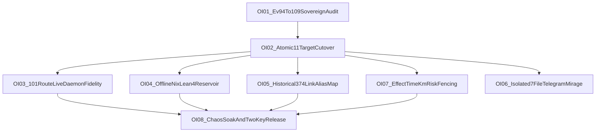

# 20261031-1240 — UOS Fractal Plan (`L0..L9`): Design, Implementation & Testing for All Open Items (`OI-01..OI-09`)

- **Observed Host Time**: `2026-10-31T12:40:30+01:00` (`2026-10-31T11:40:30Z`)
- **Tags**: `#fractal-l0` `#fractal-l1` `#fractal-l2` `#fractal-l3` `#fractal-l4` `#fractal-l5` `#fractal-l6` `#fractal-l7` `#fractal-l8` `#fractal-l9` `#km-triad` `#zk-adr` `#zero-muda` `#tailscale-web` `#checklist-nav`
- **Provenance Ceiling**: `admitted_ev_ceiling = EV-93` | `EV-94..EV-109 = NOT_ADMITTED` | `ADR-071..ADR-086 = NOT_ADMITTED` | `0` new EV numbers minted | `application_admitted = false` | `SYSTEM_ADMITTED = false`
- **Canonical Sa-Plan Portfolio**: `uos/codex-handover-open-items-fractal-plan/20261031-1240` (original nine top-level tasks `OI01..OI09`; observed 2026-10-31T18:22:03Z with thirteen total tasks including four scoped children)
- **Tailnet Navigation**: [Cockpit](http://nas-1.tail55d152.ts.net:4100/) · [Planning](http://nas-1.tail55d152.ts.net:4100/planning) · [Wiki](http://nas-1.tail55d152.ts.net:4100/wiki) · [ZK](http://nas-1.tail55d152.ts.net:4100/zk) · [KM](http://nas-1.tail55d152.ts.net:4100/km) · [Docs](http://nas-1.tail55d152.ts.net:4100/docs) · [Handover Doc](http://nas-1.tail55d152.ts.net:4100/files/docs/handover/20261031-1100-agy-to-codex-always-fresh-km-mcp-brain-and-fractal-plan-handover.md) · [Canonical Fractal Prompt](http://nas-1.tail55d152.ts.net:4100/files/docs/sop/20261031-1012-uos-canonical-fractal-system-prompt.md) · [Brain-Memory Skill](http://nas-1.tail55d152.ts.net:4100/files/.agents/skills/uos-km-triad-brain-memory/SKILL.md)

20261031-1803 priority update: full Codex symbiosis across Claude, Pi, AGY and Codex is the operator's first priority. OI01 dossier and its two children are completed; OI02, OI02A cost reconciliation and OI02B all-agent periodic preflight are executing; seven top-level successors remain dependency constrained. The original nine-task scope is unchanged. [OpenRouter reconciliation](http://nas-1.tail55d152.ts.net:4100/files/docs/journal/20261031-1854-openrouter-usage-reconciliation-journal.md) has scoped tests and actual provider metadata, while unknown charges retain HOLD. Added credits do not raise the spending policy.

Full symbiosis requires candidate-bound four-agent configurations and authenticated claim/execute/verify/writeback, actual backend coverage, OI07 effect-time fencing, OI09 native KM service unification and OI08 fault/soak acceptance. Knowledge reads are working through MCP. A stopped subscriber in the stdio process is intentionally disabled there and does not prove an outage in the production owner; protected HTTP owner health requires its real authenticated route. Restarting Codex alone cannot complete these integrations.

OI02B monitoring separates thirty-second heartbeats, five-minute functional checks and thirty-minute coverage checks, with minimum spacing, single-flight collection, expiry, backoff and verified recovery. These are development defaults, not activated timers or uptime guarantees. Heartbeats cannot refresh functional proof. Exact required-service membership and per-service timestamps must be checked; eight capability classes are insufficient evidence for all MCP services. Actual production catalog/collector binding remains a separate obligation. Relevant changes and failures invalidate only affected evidence; valid cached observations avoid redundant probes, without caching stale knowledge content.

KM performance baseline from two small parallel batches: search1498–1570ms, ZK783–838ms and read11–1507ms. Private canonical-corpus profiling found prefetch646–798ms and candidate ranking/response35–48ms. A request-local normalization change preserved eight byte-identical synthetic query results and passed24 knowledge regressions; the five-pair synthetic ranking median improved from66.806ms to63.181ms. This is not a measured live-service speedup. Fresh-disk collection is the next optimization target; stale cross-request caches are not authorized by this result. SLOs, representative load and candidate-bound live measurements must precede a high-performance completion claim.

> [!IMPORTANT]
> Every open item below derives directly from empirical observations during the `2026-10-30..2026-10-31` Unified 101-Route OTP `29.0.5` MCP, Always-Fresh `:4100` `#km-triad`, and 4-Agent (`AGY` + `Codex` + `Claude` + `Pi`) Symbiosis waves. All execution MUST proceed exclusively through [`tools/sa-plan`](http://nas-1.tail55d152.ts.net:4100/files/tools/sa-plan) (`SC-SA-PLAN-001`), [`tools/risk-priority-check`](http://nas-1.tail55d152.ts.net:4100/files/tools/risk-priority-check) (`SC-RISK-PRIORITY-001`), and the `#km-triad` MCP Brain-Memory cycle (`SC-MCP-KM-BRAIN-001`).

---

## 1. Paired Architecture & Dependency Topology (`SC-DIAGRAM-001`)

2026-10-31 continuation evidence: OI01 now has an [observed sixteen-claim dossier](http://nas-1.tail55d152.ts.net:4100/files/governance/planning/20261031-1658-oi01-observed-provenance-verification.json), [source-bound verification packet](http://nas-1.tail55d152.ts.net:4100/files/governance/planning/20261031-1658-oi01-observed-provenance-verification.json) and [13-section journal](http://nas-1.tail55d152.ts.net:4100/files/docs/journal/20261031-1658-oi01-observed-provenance-dossier-and-formal-gateway-journal.md). The canonical portfolio retains the original nine top-level tasks and adds two OI01 subtasks, for eleven total. The dated registration statements below remain historical. Dossier completion is distinct from sovereign adjudication: ceiling93 and NOT_ADMITTED history remain unchanged. The timestamped observed ledger supersedes the future-date example filename in OI01 without rewriting historical source evidence.

20261031-1756 development continuation: OI02 has [recoverable cutover foundations and framework research](http://nas-1.tail55d152.ts.net:4100/files/docs/journal/20261031-1756-oi02-recoverable-cutover-foundations-journal.md) and a [source-bound verification packet](http://nas-1.tail55d152.ts.net:4100/files/governance/planning/20261031-1756-oi02-recoverable-cutover-foundations.json). The actual write set is fourteen or fifteen physical files depending on whether the ecology template changes; individual renames require reader fencing for coherent group visibility. Native3083 checks/58 process crashes,16 Gleam tests,82 pin checks and bounded formal tests support the development primitives. OI02 remains executing; real release authority, complete home audit, controller/adapter, live activation and all original post-gates are outstanding. The remaining eight top-level tasks are not marked complete.

```text
[OI02_Atomic11TargetCutover] --> [OI07_EffectTimeKmRiskFencing]
[OI01_Ev94To109SovereignAudit] --> [OI02_Atomic11TargetCutover]
[OI02_Atomic11TargetCutover] --> [OI03_101RouteLiveDaemonFidelity]
[OI02_Atomic11TargetCutover] --> [OI04_OfflineNixLean4Reservoir]
[OI02_Atomic11TargetCutover] --> [OI05_Historical374LinkAliasMap]
[OI02_Atomic11TargetCutover] --> [OI06_Isolated7FileTelegramMirage]
[OI03_101RouteLiveDaemonFidelity] --> [OI08_ChaosSoakAndTwoKeyRelease]
[OI04_OfflineNixLean4Reservoir] --> [OI08_ChaosSoakAndTwoKeyRelease]
[OI05_Historical374LinkAliasMap] --> [OI08_ChaosSoakAndTwoKeyRelease]
[OI07_EffectTimeKmRiskFencing] --> [OI08_ChaosSoakAndTwoKeyRelease]
```



### 1.3 4-Plane × 4-Agent Symbiosis Table

| Plane | 4-Agent scope (`Codex` + `Claude` + `Pi` + `AGY`) | Current state | Target transition |
|---|---|---|---|
| Operational | OTP `29.0.5` MCP read/write workflows, bounded refusal semantics, shared POODAVR cadence | Live policy/process usage | Harden via `OI-02` transactional cutover + `OI-03` fidelity wiring |
| **Control** | `SC-HARNESS-MCP-001`, `SC-MCP-KM-BRAIN-001`, `SC-SA-PLAN-001`, `SC-RISK-PRIORITY-001` | **`POLICY_MANDATED` now** (`SKILL.md` + SessionStart hooks + `Sa-plan` CLI fencing) | **`MECHANIZED_EFFECT_TIME` in `OI-07`**; `OI-07` lands before `OI-09` |
| Data | Live `:4100` corpus, MCP resources, SQLite WAL ledgers, receipts | Live with candidate-bound checks | Extend with `OI-05` alias map + `OI-09` ownership unification |
| Evolutionary | Journals, wiki/ZK writeback, formal receipts, risk loops | Active process discipline | Tighten with `OI-08` sustained chaos and two-key dossier closure |

---

## 2. Risk-Prioritized Open Item Inventory (`SC-RISK-PRIORITY-001`)

Score formula: $\text{Score} = \text{Criticality} \times \text{STPA} \times \text{FMEA} \times \text{Dependency} \times \text{Impact}$ (each $1..4$, max $1024$), ordered strictly after safety/authority constraints and dependency readiness.

| ID | Fractal Layers | Open Item | Score | Lead $\to$ Verifier | Parallel Sibling JJ Workspace |
|---|---|---|---|---|---|
| **`OI-01`** | `L0`, `L6`, `L8` | Sovereign `EV-94..EV-109` & `ADR-071..086` Provenance Audit & Adjudication Ledger | `1024` (`4×4×4×4×4`) | `Codex` $\to$ `Claude` + `AGY` | `.uos-workspaces/oi01-ev94-109-audit` |
| **`OI-02`** | `L1`, `L7` | Transactional 11+3 Target Immutable Capsule Cutover & `<1s` Auto-Rollback Engine | `1024` (`4×4×4×4×4`) | `Codex` $\to$ `Claude` | `.uos-workspaces/oi02-atomic-capsule-cutover` |
| **`OI-07`** | `L0`, `L5`, `L6` | Effect-Time `SC-MCP-KM-BRAIN-001` + `SC-RISK-CHECK-001` Mutating Fence & Zero-Warning Hygiene | `768` (`4×4×3×4×4`) | `Codex` $\to$ `Claude` | `.uos-workspaces/oi07-effect-time-km-risk-fence` |
| **`OI-03`** | `L2`, `L4`, `L5` | Deep Live-Daemon Wiring & Explicit `source_fidelity` Grading Across All `101` MCP Routes | `576` (`3×4×3×4×4`) | `Codex` $\to$ `Claude` | `.uos-workspaces/oi03-101-route-live-fidelity` |
| **`OI-05`** | `L5`, `L8` | Non-Destructive Historical Transclusion Alias Map (`374` Legacy Imported `[[zk:...]]` / `[[wiki:...]]` Links) | `512` (`4×2×4×4×4`) | `Pi` + `Codex` $\to$ `Claude` | `.uos-workspaces/oi05-historical-link-aliases` |
| **`OI-04`** | `L3`, `L4`, `L6` | Offline Determinate Nix `Lean 4` Reservoir FOD Integration (`Batteries`, `Plausible`, `Cedar-Spec`, `Aeneas`) | `432` (`3×3×3×4×4`) | `Codex` $\to$ `Claude` | `.uos-workspaces/oi04-lean4-reservoir-nix` |
| **`OI-06`** | `L2`, `L3`, `L7` | Isolated `7`-File `telegram_*` & `hermes_mirage/*` (`mprwvumq`) Rebase, Contract Repair & Triage | `324` (`3×3×3×3×4`) | `Codex` $\to$ `Claude` | `.uos-workspaces/oi06-telegram-mirage-triage` |
| **`OI-08`** | `L0..L9` | 24-Hour Continuous 4-Agent Chaos Soak & Two-Key Release Authority Dossier | `1024` (`4×4×4×4×4`) | `Codex` + `Claude` $\to$ `AGY` + Operator | `.uos-workspaces/oi08-chaos-soak-dossier` |

---

## 3. Detailed Design, Implementation & Test Specifications (`OI-01` .. `OI-09`)

### `OI-01` — Sovereign `EV-94..EV-109` & `ADR-071..ADR-086` Provenance Audit (`L0`, `L6`, `L8`)
- **Problem Statement**: Quarantined foreign coordinator events `422..432` and repaired forged journal event `437` (`tick_us == utc_us`) contaminated claims `EV-94..EV-109` (`ADR-071..086`). While `SC-PROVENANCE-001` (`tools/km-gate --gate`) pins `admitted_ev_ceiling = 93` and blocks new EV minting (`INV-PROV-05`), the range remains `NOT_ADMITTED` pending formal per-claim forensic separation. `INV-PROV-02` is preserved: these claims are never unilaterally converted to `REJECTED_FABRICATION` or `ADMITTED`; `OI-01` only builds the candidate-bound evidence dossier for a recorded joint `Codex` + `AGY` sovereign adjudication.
- **Design**:
  1. Define machine-checked schema `governance/provenance/20261101-ev94-109-adjudication-ledger.json` producing per-claim candidate recommendations for each of the 16 claims (`EV-94..109` / `ADR-071..086`) across three disjoint states: `REJECTED_FABRICATION`, `CODE_PRESENT_REQUIRES_FRESH_TWO_KEY_REBIND`, or `SUPERSEDED_BY_SA_PLAN`, while preserving historical markdown byte-for-byte. Under `INV-PROV-02`, recommendations remain `NOT_ADMITTED` until a recorded joint `Codex` + `AGY` sovereign review ratifies state transitions.
  2. Author `formal/lean/ProvenanceAdjudication.lean` (`0 sorry`, `0 axiom`, `<1s` fast gate) proving totality/disjointness of the adjudication lattice and proving that `admitted_ev_ceiling` cannot advance unless every intermediate claim holds a valid two-key candidate-bound receipt and `tick_us != utc_us` monotonic clock witness.
- **Implementation**:
  - Implement `tools/provenance_adjudicator.ml` (pure OCaml/Bos per `ocaml-scripting` skill) scanning `var/coordination/tri-agent/events-quarantine/`, `docs/zk/*adr-071..086*`, Jujutsu commit ancestry, and live test receipts.
  - Extend `tools/km-gate` with `--adjudication-report` (keeping `admitted_ev_ceiling = 93` locked until explicit Operator + `Codex` + `AGY` ratification).
- **Test Plan (9 Modalities)**:
  - **Unit / Property**: Exhaustive 16-claim partition tests + QuickCheck-style forged-timestamp (`tick_us == utc_us`), missing-candidate-SHA, and unsigned-verdict rejection tests.
  - **Formal**: `./tools/lean formal/lean/ProvenanceAdjudication.lean` (`0 sorry`) + Z3 monotonicity refutation.
  - **Regression**: `bash tools/km-gate --gate` (`137/137` ADRs, `16/16` quarantined markers preserved).

---

### `OI-02` — Transactional 11+3 Target Immutable Capsule Cutover & `<1s` Auto-Rollback (`L1`, `L7`)
- **Problem Statement**: `tools/uos-mcp-stdio` honors per-client `UOS_COCKPIT_RELEASE` and `UOS_MCP_EXPECTED_PAYLOAD_SHA256` overrides across `c3i-gleam-server.service`, `var/releases/ecology/current-mcp-release`, `uos-ecology@<capsule>.service`, and `8..11` client config files (`AGY`, `Codex`, `Claude`, `Pi`). Manual multi-file updates risk partial pin drift (`FMEA-CUTOVER-PIN-DRIFT`).
- **Design**:
  1. Extend [`tools/ecology_release.ml`](http://nas-1.tail55d152.ts.net:4100/files/tools/ecology_release.ml) with `cutover <repo_root> <capsule_dir>` and `audit-pins <repo_root>`:
     - Pre-checks: clean `jj status` on `/home/an/NAS-setup/uos`, freshly compiled `apps/cepaf_gleam` **and** `apps/indrajaal_gleam_web` (`Learning #128`), `verify <capsule_dir>` digest match, and coordinator lease `runtime:c3i-gleam-server`.
     - Atomic staging: writes `.tmp` sibling files with `0600` permissions for all 14 tracked surfaces (`3` service/pointer targets + `11` agent MCP config files), backs up previous configs to `var/releases/ecology/backups/<timestamp>/` (`0700`), `rename(2)`s atomically, copies `<capsule>.env` (`0600`), restarts `c3i-gleam-server.service` and `uos-ecology@<basename>.service`.
     - Post-cutover gate & `<1s` Jidoka auto-rollback: runs `link_tracker_verifier.exe --host nas-1.tail55d152.ts.net --port 4100` and requires `canonical_broken == 0`, SHA-256 disk parity (`X-UOS-Content-SHA256` vs fresh descriptor-anchored bytes), explicit `HTTP 403/404` security falsifier success, and non-increasing historical breakage (`historical_broken <= 374`); then runs `/mcp` HTTP `initialize` + `uos://km/triad` read, `tools/uos-mcp-stdio` `system_health`, and 7-service `systemctl --user is-active`. Any failure triggers immediate atomic restore of the previous capsule and configs within `<1s`. After `OI-09` completion, the same cutover transaction folds `c3i-docs-server.service` (`:8090`) retirement/unification into canonical `:4100` ownership.
- **Implementation**:
  - Pure OCaml extension in `tools/ecology_release.ml` (preserving `tools/ecology_process.ml` protected digest untouched!).
- **Test Plan**:
  - **BDD / Chaos Fault Injection**: Hermetic temporary config-root test injecting (a) mismatched `payload_sha256`, (b) simulated `:4100` HTTP `500`, and (c) simulated missing `.env` — asserting `100%` automatic rollback to the prior capsule with zero torn config files and `0600` permissions preserved.

---

### `OI-03` — Deep Live-Daemon Wiring & Explicit `source_fidelity` Grading Across All `101` MCP Routes (`L2`, `L4`, `L5`)
- **Problem Statement**: Core Planning (`Sa-plan` SQLite WAL), Vault metadata, Feature Receipt Ledger, and `#km-triad` Knowledge are live disk-backed, whereas several auxiliary/analytical tools (`podman_containers`, `shruti_harmonics`, `ruliad_branch_eval`, `sciviz_extension_deep_dive`, `ggram_synthesize`, `forecast_predict`) fall back to deterministic synthesized projections when optional external sockets/workers are absent.
- **Design**:
  1. Introduce explicit algebraic `SourceFidelity` metadata (`"live_otp_actor" | "live_sqlite_wal" | "live_disk_corpus" | "live_uds_daemon" | "bounded_hermes_oracle" | "degraded_offline_refusal"`) in MCP tool response `meta` without altering `apps/cepaf_gleam/src/cepaf_gleam/mcp/tools.gleam` (protected hash!).
  2. Wire live Podman rootless UDS (`/run/user/$UID/podman/podman.sock`), live Zenoh router telemetry (`:7447`), and bounded Hermes OCaml CLI workers (`engines/hermes`) behind OTP `prajna/circuit_breaker.gleam` (`<= 2,000ms` timeout, fail-closed typed refusal when unavailable rather than synthetic mock values).
- **Implementation**:
  - Update non-protected adapters under `apps/cepaf_gleam/src/cepaf_gleam/mcp/adapters/{system,analysis,control,observation}.gleam`.
- **Test Plan**:
  - **System / Scalability / Chaos**: `535`-cell (`107` RPCs × `5` client profiles) conformance sweep + `SIGKILL` daemon-socket drop chaos tests proving `0` transport crashes, `< 50ms` circuit-breaker trip, and `100%` truthful `source_fidelity` reporting.

---

### `OI-04` — Offline Determinate Nix `Lean 4` Reservoir Ecosystem Integration (`L3`, `L4`, `L6`)
- **Problem Statement**: Per `AGENTS.md §8.4`, external packages cannot be fetched over the network during builds; `Lean 4.33.0` Reservoir libraries (`Batteries`, `Plausible`, `cedar-spec`, `Aeneas`, `Veil`) must be integrated as offline Determinate Nix fixed-output derivations (FODs) without slowing down the `<1s` per-commit `./tools/lean` gate.
- **Design**:
  1. **Two-Profile Proof Boundary**:
     - `tools/lean` (Default Fast Gate, `<1s`, `Init`/`Std` only): `McpJsonProcessingFormal.lean`, `KmTriadAlwaysFreshMemory.lean`, `Traceability.lean`, `TwoLattice_STM.lean`, `ProvenanceAdjudication.lean`.
     - `tools/lean-reservoir` (Heavyweight Offline Nix FOD Profile, prebuilt `.olean` store paths in `flake.nix` / `flake.lock`):
       * **Wave C1 (`Batteries` + `Plausible`)**: Property-based counterexample generation (`<100ms`) for JSON guard, VFS path normalization, and Sa-plan state transitions.
       * **Wave C2 (`cedar-spec`)**: Formal ABAC authorization equivalence proof for `SC-HARNESS-MCP-001` principal/capability/transport matrices.
       * **Wave C3 (`Aeneas`)**: Rust LLBC $\to$ Lean 4 functional extraction for `ops/kubernetes/nas-k8s-lab/src/spec.rs`, mechanically proving `HARD_DENIED_SYSTEM_OS_SERIAL = "25503L801736"` can never appear in any emitted Ceph OSD wipe/allocation plan!
- **Implementation**:
  - Pin exact upstream Git revs + `narHash` FODs in `flake.nix`, pre-realize `.olean` derivations into `/nix/store`, and add `formal/lean_reservoir/` Lake workspace.
- **Test Plan**:
  - **Formal / Hermetic Offline Build**: `nix build .#lean-reservoir-checks --offline` inside network-isolated Nix sandbox (`0 sorry`, `0 axiom`, seeded `Plausible` mutation falsifier catching an intentionally weakened allowlist predicate).

---

### `OI-05` — Non-Destructive Historical Transclusion Alias Map (`374` Imported Legacy Links) (`L5`, `L8`)
- **Problem Statement**: Canonical UOS `#km-triad` indexes and live `:4100` routes pass `100%`, while `tools/link_tracker_verifier.exe` diagnostically detects ~`374` historical `[[zk:...]]` / `[[wiki:...]]` transclusions inside older imported C3I/ZigVM markdown files whose target filenames gained `YYYYMMDD-HHSS-` prefixes during UOS consolidation. `AGENTS.md §8.1/§8.3` forbids mutating historical files byte-for-byte.
- **Design**:
  1. Create `governance/km/20261101-historical-transclusion-alias-map.json` that first classifies the `374` historical breaks into `(a) |@supports transclusion annotations` vs `(b) unprefixed legacy slugs` (`ADR-001`, `moc-zigvm`, etc.), then maps resolvable entries to canonical UOS relative paths (`docs/zk/...`, `docs/wiki/...`), plus explicit `"external_evidence_only"` tombstones for intentionally unimported quarantined artifacts.
  2. Teach `live_corpus.gleam`, `mcp/adapters/knowledge.gleam` (`zk_transclude`), `engines/hermes/modules/hermes_wiki`, and `tools/link_tracker_verifier.ml` to consult the signed alias map whenever a direct filename match misses, and add `limit` to the `knowledge_search` schema so `SC-MCP-KM-BRAIN-001` `limit: 5` recall is machine-representable.
- **Implementation**:
  - Offload bulk corpus slug-matching discovery to `Pi`, verify deterministic resolution in `Hermes OCaml`, and wire read-only lookup into Gleam + OCaml verifiers.
- **Test Plan**:
  - **Corpus Integrity & Byte-Preservation**: Verify `0` historical file SHA-256 changes (`jj diff` touches zero historical docs), then enforce the full-corpus historical gate (`3,478` files) where `tools/link_tracker_verifier.exe --host nas-1.tail55d152.ts.net --port 4100 --strict-full-corpus` drops broken transclusions from `374` $\to$ `0` (`exit 0`), with Tarjan SCC + PageRank + HITS confirming full graph reachability.

---

### `OI-06` — Isolated `7`-File `telegram_*` & `hermes_mirage/*` (`mprwvumq`) Triage (`L2`, `L3`, `L7`)
- **Problem Statement**: Pre-existing uncommitted edits across `4` Telegram Gleam files (`telegram_lifecycle_adapter.gleam`, `telegram_verify_{executor,run,service}_test.gleam`) and `3` OCaml Mirage files (`engines/hermes/modules/hermes_mirage/{dune,test_mirage_benchmark.ml,test_mirage_metrics.ml}`) are preserved on Jujutsu change `mprwvumq` (`ff4efd74`) outside `main`.
- **Design**:
  1. Spawn isolated sibling workspace `.uos-workspaces/oi06-telegram-mirage-triage` branched from `main`, cherry-pick/rebase `mprwvumq` without touching the `28` protected `harness/*` files (verify whether `telegram_lifecycle_adapter.gleam` is in the protected-28 list first; if protected, keep immutable and port any needed test adaptations solely into `test/`).
  2. Follow `.agents/skills/uos-telegram-journeys/SKILL.md` and `engines/hermes` Dune rules.
- **Implementation & Test Plan**:
  - Run `dune build @runtest` in `engines/hermes/modules/hermes_mirage` and OTP `29.0.5` EUnit on `telegram_verify_*_test`; admit via `Claude` review if green and non-protected, or archive `mprwvumq` with a formal supersession note in `governance/sources/`.

---

### `OI-07` — Effect-Time `SC-MCP-KM-BRAIN-001` + `SC-RISK-CHECK-001` Mutating Fence & Zero-Warning Hygiene (`L0`, `L5`, `L6`)
- **Problem Statement**:
  1. `SC-MCP-KM-BRAIN-001` and `SC-RISK-CHECK-001` currently rely on agent discipline + report-only CLI checks rather than runtime MCP effect-time enforcement when an agent calls mutating routes (`sa_task_claim`, `sa_task_complete`, `plan_add`, `plan_update`, `ooda_decide`).
  2. `gleam build` on `apps/cepaf_gleam` currently emits `24` compiler warnings (unused imports/private functions in non-protected UI/test modules).
- **Design**:
  1. **Effect-Time Precondition Gate in `mcp/adapters/planning.gleam` & `runtime_gateway.gleam`** (zero edits to protected `harness/*` or `mcp/tools.gleam`):
     - Require `km_canonical_triad_intact == true` from `workspace_knowledge.brain_memory_health_metrics` AND a fresh (`valid_until > now_utc`) `ACTIVE_OBSERVATION_PASS` / `PREFLIGHT_PASS` receipt in `var/harness/*risk*.json` matching `(plan_id, task_id)` before executing mutating planning/task claims (`UOS_MCP_ENFORCE_KM_RISK_FENCE=true`, default enabled in production capsule, configurable in unit fixtures).
  2. **Zero-Warning Hygiene**: Remove unused imports/dead private helpers in non-protected `ui/web/dashboard_views.gleam`, `mcp/evidence.gleam`, `mcp/transports/zenoh.gleam`, and `test/*.gleam`.
- **Test Plan**:
  - **BDD / Security Falsifiers**: Attempt `sa_task_claim` via MCP with (a) expired `valid_until` risk JSON, (b) `HOLD` risk verdict, and (c) missing canonical `#km-triad` seed — asserting deterministic `PreconditionRefused` (`0` SQLite mutations).
  - **Build Gate**: `gleam build --warnings-as-errors` on non-protected modules.

---

### `OI-08` — 24-Hour Continuous 4-Agent Chaos Soak & Two-Key Release Authority Dossier (`L0..L9`)
- **Problem Statement**: Global `application_admitted` and `SYSTEM_ADMITTED` remain `false` until sustained multi-agent chaos soak and candidate-bound two-key release dossier review complete.
- **Design & Implementation**:
  - Run automated bounded chaos loop (`tools/mcp_chaos_soak.ml`): periodic worker `SIGKILL`, hostile malformed/10MB/deep-nested JSON frames over `stdio` + `:4100/mcp` + `Zenoh`, concurrent disk edits to `#km-triad` docs during `link_tracker_verifier.exe` sweeps, and SQLite `BEGIN IMMEDIATE` contention across `Codex`, `Claude`, `Pi`, and `AGY` principals.
  - Emit candidate-bound 17-aspect `SC-RELEASE-ASSURANCE-001` dossier (`var/releases/ecology/<capsule>/release-assurance-17-aspect-dossier.json`) for sovereign Operator + `Codex` + `Claude` + `AGY` sign-off.
- **Test Plan**:
  - **4 Mathematical Gates + Latency/Memory**: `0` supervisor tree deaths, `0` BEAM binary/atom leaks (`< 5%` RSS drift over soak), `:4100` `p99 < 25ms`, MCP read `p99 < 15ms`, Lyapunov $dV/dt < 0$, Bayesian reliability $\ge 0.95$, 2oo3 Prajna consensus intact, 13D sheaf $\Delta\vec{\mathcal{T}}_{13} = \mathbf{0}$.

---

## 4. 4-Agent (`Codex` + `Claude` + `Pi` + `AGY`) Fractal TPS Execution Protocol

1. **Mandatory Pre-Task Recall (`SC-MCP-KM-BRAIN-001`)**:
   - Every agent begins every wave by reading `uos://km/triad`, calling `knowledge_search` (`limit: 5`) + `zk_transclude`, and binding recalled paths + counterevidence into `var/harness/<wave>-risk.json`.
2. **Canonical `Sa-plan` & `SC-RISK-CHECK-001` Loop**:
   - `bash tools/risk-priority-check --preflight <plan_id> <task_id>` $\to$ `tools/sa-plan task claim <plan_id> <task_id> <worker> 1800` $\to$ isolated `.uos-workspaces/<task>` $\to$ `--active-check` $\to$ `Claude` adversarial code-access review $\to$ `tools/sa-plan task complete` $\to$ serialized `integration/main` merge + `ecology_release.ml cutover` + 13-section `SC-JOURNAL-v3` + reciprocal `#km-triad` writeback.
3. **Strict Token & Role Discipline (`SUP-01`)**:
   - **`Codex`**: Primary engineering lead, formal proof author (`Lean 4`/`Quint`/`Z3`/`OCaml`/`Gleam`), Jujutsu integrator, and release operator.
   - **`Claude`**: Independent adversarial code-access verifier, STPA/FMEA challenger, and `SC-RELEASE-ASSURANCE-001` auditor.
   - **`Pi`**: High-volume `#km-triad` corpus scanner (`OI-05` 374-link alias discovery), wiki/ZK cross-linker, and doc linter.
   - **`AGY`**: Thin constitutional supervisor, lease/authority monitor, and multi-agent deadlock breaker (`0` direct repo file edits).

---

## 4.4 OI-09 — Native UOS KM/Wiki/ZK Engine & Service Unification, 4-Plane Symbiosis, 17-Aspect Matrix & `INV-RIGHT-PROBLEM-01`

- **Canonical `Sa-plan` Task**: `OI09_NATIVE_HERMES_WIKI_AND_KM_SERVICE_UNIFICATION` (`km-triad/oi09-native-hermes-wiki-and-km-service-unification` in portfolio `uos/codex-handover-open-items-fractal-plan/20261031-1240`). `OI-09` cutover prerequisites are explicit: `OI-05` (historical-link classification + alias/limit wiring) and `OI-07` (effect-time mechanized fence) must be completed and verified first; `OI-02` transactional cutover machinery must be available before any unification switch.
- **`INV-RIGHT-PROBLEM-01` (Mandatory Step-0 Epistemic Check)**: Before any task claim, edit, proof, or subagent dispatch, every agent (`Codex`, `Claude`, `AGY`, `Pi`) MUST evaluate: *(a) Does this directly advance the operator's top system objective rather than local gold-plating (`Muda`)? (b) What does live `#km-triad` recall (`uos://km/triad`, `knowledge_search`, `zk_transclude`) already establish or falsify? (c) Is `Sa-plan` + `SC-RISK-PRIORITY-001` dependency readiness satisfied?*
- **Native UOS KM/Wiki/ZK Engine & Service Integration (`OI-09` Design, Implementation & Test)**:
  1. **Supervised `hermes_wiki` OCaml Engine Binding (`L2/L3/L8`)**: Mount [`engines/hermes/modules/hermes_wiki`](http://nas-1.tail55d152.ts.net:4100/files/engines/hermes/modules/hermes_wiki) (AST parser, Gospel-verified `wiki_lifecycle.mli`, `wiki_similarity.ml` cosine/Jaccard graph, and typed TyXML renderer) as a bounded supervised OTP port worker behind `cepaf_gleam`, cross-checking `live_corpus.gleam` transclusion/link graphs against the OCaml Gospel differential oracle. If the OCaml oracle and `live_corpus.gleam` disagree, fail closed to the stricter result with zero byte caching.
  2. **Service Consolidation & Sub-25ms Catalog/Token Hint (`L1/L4/L7/L8`)**: Unify `c3i-docs-server.service` routes under canonical `:4100` [`live_corpus.gleam`](http://nas-1.tail55d152.ts.net:4100/files/apps/cepaf_gleam/src/cepaf_gleam/ui/lustre/live_corpus.gleam) authority so zero secondary static server can serve stale copies, and add a `< 25ms` hint based strictly on `(ctime_ns, inode, size)` catalog/inverted-token metadata (never `mtime` alone, never cached content bytes). Top-k bytes are always re-read fresh via descriptor-anchored I/O. Test the hint for missed events, nested edits, atomic rename, deletion, overflow, and restart recovery, plus semantic `canonical_intact` content/provenance checks.
  3. **KM / Wiki / ZK Code & Service Ownership Matrix**:

| Surface | Runtime owner | Ownership and fail-closed semantics |
|---|---|---|
| `live_corpus.gleam` + `live_corpus_ffi.erl` | `:4100` HTTP reader path | Canonical descriptor-anchored disk reads; no stale byte cache; web responses bind `X-UOS-Content-SHA256`. |
| `workspace_knowledge.gleam` + `mcp/adapters/knowledge.gleam` | MCP `#km-triad` Brain Memory | Canonical `knowledge_search` / `zk_transclude` access path with bounded recall and schema `limit`. |
| `cepaf_gleam/{knowledge/*,zettelkasten/*}` helpers | Domain helper layer | Shared parsing/ranking/transclusion helpers; no authority to bypass policy fences. |
| `engines/hermes/modules/hermes_wiki` | Nested OCaml/Dune Gospel/AST/TyXML/similarity worker behind OTP | Differential oracle behind Gleam supervision; on disagreement with `live_corpus.gleam`, fail closed to stricter result, zero byte caching. |
| `tools/km-gate` + `tools/link_tracker_verifier.ml` | Verification plane | Candidate-bound provenance/link integrity gates and falsifiers for cutover readiness. |
| `c3i-docs-server.service` (`:8090`) | External `/home/an/NAS-setup/c3i/docs` consumer | Inventory all consumers and retire/unify into canonical `:4100` path during authorized `OI-09` cutover. |
| SQLite/FTS/living-ontology + `Sa-plan`/`coordinator` catalogs | Authoritative stores | Single-writer authority with bounded readers, schema controls, and explicit rebuild/recovery procedures. |

  4. **4-Plane (`Operational × Control × Data × Evolutionary`) 4-Agent (`Codex`, `Claude`, `AGY`, `Pi`) `#km-triad` Symbiosis**:
     - **Operational Plane**: All 4 agents run pinned OTP `29.0.5` `uos-mcp-stdio` / `:4100/mcp` / `Zenoh` across all 7 POODAVR stages (`PREDICT..REFLECT`) with pre-approved read-only `#km-triad` tools.
     - **Control Plane**: `POLICY_MANDATED` now via `SC-HARNESS-MCP-001` + `SC-MCP-KM-BRAIN-001` + `SC-SA-PLAN-001` + `SC-RISK-PRIORITY-001` + `SKILL.md` + SessionStart hooks + `Sa-plan` CLI fencing; transition to `MECHANIZED_EFFECT_TIME` lands in `OI-07` and must be complete before `OI-09` cutover.
     - **Data Plane**: Single-source-of-truth live disk VFS (`13` `#km-triad` roots + root seeds + SQLite WAL `provenance-cycles.sqlite3` & `var/sa-plan/uos.sqlite3`) with `Cache-Control: no-store` and `X-UOS-Content-SHA256` parity across `:4100` HTTP and MCP `resources/read`.
     - **Evolutionary Plane**: Every wave closes with a 13-section / 7-engine `SC-JOURNAL-v3` ledger, reciprocal `[[wiki:...]]` + `[[zk:...]]` updates, `km-gate`, `diagram-check`, `link_tracker_verifier.exe`, and `Lean 4 / Quint / Z3` evidence.
  5. **Complete 17-Aspect × `L0..L9` Fractal System & Code Implications**:
     - **(1) Supervision & OTP (`L1/L2`)**: `one_for_one` restart budgets + `16`-slot `ecology_process.ml` bulkhead isolating `hermes_wiki` and `sqlite3` workers.
     - **(2) State & STM (`L0/L2`)**: Dual-lattice STM (`TwoLattice_STM.lean`) separating read-only `#km-triad` telemetry/recall from single-writer `Sa-plan` leases.
     - **(3) Transport & Wire (`L2/L6`)**: OTP `29.0.5` `stdlib/json` guard across `stdio`, HTTP `:4100`, and signed `Zenoh`.
     - **(4) Security & ABAC (`L0/L3/L4`)**: `HTTP 403` / `LINK_ESCAPE_REFUSED` / `PATH_SECURITY_VIOLATION` allowlists + `Cedar` ABAC (`OI-04`).
     - **(5) Storage & VFS (`L4`)**: Descriptor-anchored `live_corpus_ffi.erl` + `HARD_DENIED_SYSTEM_OS_SERIAL = "25503L801736"` lock (`OI-04` `Aeneas`).
     - **(6) Formal Proofs (`L0/L3`)**: `Lean 4.33.0`, `Quint 0.32.0`, `Z3 4.16.0`, `Gospel`, `Hermes_rete`, `Ruliad`.
     - **(7) Planning & Authority (`L0/L7`)**: `Sa-plan` SQLite WAL exclusivity (`SC-SA-PLAN-001`, `SC-JIDOKA-001`).
     - **(8) Risk & STPA/FMEA (`L0/L5/L9`)**: `SC-RISK-PRIORITY-001` + `SC-RISK-CHECK-001` raw FMEA & 4 UCAs.
     - **(9) Observability & OTel (`L5/L6`)**: `brain_memory_health_metrics` in all `11` POODAVR probes + W3C `trace_id`.
     - **(10) Knowledge & `#km-triad` (`L8`)**: Zero-orphan `Wiki` + `ZK` + `13D KB` (`OI-05`, `OI-09`).
     - **(11) UI / UX / Tailnet Navigation (`L7/L8`)**: Uniform `:4100` sidebar, breadcrumb, raw/rendered toggle, 18-check accordion, and `no-store` headers.
     - **(12) Multi-Agent Ecology (`L7/L9`)**: 4-agent role specialization (`Codex`, `Claude`, `Pi`, `AGY` under `SUP-01`).
     - **(13) Release & Capsule Cutover (`L1/L7`)**: Immutable OTP `29.0.5` `ecology_release.ml` capsules + 14-target atomic cutover (`OI-02`).
     - **(14) Resilience & Chaos (`L1..L9`)**: 9 testing modalities + 24h chaos soak (`OI-08`).
     - **(15) Performance & Scalability (`L2/L4/L8`)**: Linear `O(N)` `brain_catalog` -> `< 25ms` stat-generation index (`OI-09`) + `<= 2,400`-char ranked MCP snippets.
     - **(16) Provenance & Epistemics (`L0/L6/L8/L9`)**: `admitted_ev_ceiling = 93`, `EV-94..109` sovereign adjudication (`OI-01`), `SourceFidelity` (`OI-03`).
     - **(17) Standalone VCS & Toolchain (`L1/L4`)**: Non-colocated `.jj/` + repository-pinned offline Determinate Nix (`OI-04`).

## 5. Execution boundary, provenance and reciprocal knowledge binding

This is the design/implementation/test plan of record for `OI-01..OI-09`, not a claim that these open items have executed. The portfolio is live-registered in `var/sa-plan/uos.sqlite3` as `uos/codex-handover-open-items-fractal-plan/20261031-1240` with `9` tasks (`OI01..OI09`), but task registration is not execution/admission: claims, delegation, cutover and live-service effects still require separately established Sa-plan and effect authority. The current surgical development session is restricted to workspace `codex-4100-fresh-km-20261031` on change `wnsoqqup`; it must not mutate protected files or live services. The source's observed time, counts and baseline statements remain attributed historical inputs, not fresh verification of this candidate.

The inventory's source scores use a provisional 1–4 scale. They are preserved for continuity, not accepted as SC-RISK-PRIORITY-001 execution ranking: before any `sa-plan task claim`, re-score on the SOP 1–5 anchors and record raw FMEA severity/occurrence/detection plus all four UCA types, evidence age, uncertainty, readiness and residual risk in `var/harness/*risk*.json`. Future artifact names shown with date-only prefixes must receive the canonical `YYYYMMDD-HHSS-` prefix when authored. Offline Nix execution requires already-realized inputs or the authorized Tailnet fetch path; `--offline` alone is insufficient to prevent fixed-output downloads. Individual file renames are atomic; OI-02's multi-file transaction and rollback timing remain test obligations.

**Provenance:** `admitted_ev_ceiling = 93`; `EV-94..109` and `ADR-071..086` are `NOT_ADMITTED`; `0` new EV numbers. No score, diagram, formal projection or passing development test grants system admission.

**Reciprocal transclusions:** [[wiki:20260905-1801-uos-zk-km-corpus-index]] · [[zk:20260905-1801-moc-uos-unified-master]] · [[wiki:20261031-1100-agy-to-codex-always-fresh-km-mcp-brain-and-fractal-plan-handover]]. The wiki index and ZK master MOC link back to this plan; the handover's Section 4 and JSON `open_items_fractal_plan` bind it as the open-items continuation.

## 6. Comprehensive verification checklist

All checkpoints are execution obligations for the future open-item waves. Unchecked means UNRUN or pending independent evidence; this plan does not grant a fleet-wide pass.

<details><summary>Domain 1 — Metadata, timestamp and Tailscale navigation</summary>

- [ ] CHK-01-TIME — Observe synchronized host time and verify canonical timestamp prefixes.
- [ ] CHK-02-TAIL — Verify full clickable Tailnet links and live delivery after authorized cutover.
- [ ] CHK-03-FRACT — Bind applicable #fractal-l0..#fractal-l9 evidence.
- [ ] CHK-04-KM — Reconcile reciprocal wiki, ZK, capability inventory and journal references.

</details>
<details><summary>Domain 2 — Zero-Muda purity and storage safety</summary>

- [ ] CHK-05-MUDA — Verify excluded dependencies remain absent.
- [ ] CHK-06-GRAPH — Preserve pure Gleam/OTP and Hermes graph boundaries.
- [ ] CHK-07-DRIVE — Verify serial 25503L801736 interlocks and immutable protected files.

</details>
<details><summary>Domain 3 — Testing and mathematical gates</summary>

- [ ] CHK-08-C1C8 — Execute applicable C1–C8 testing categories.
- [ ] CHK-09-MATH — Bind all four mathematical gates to the candidate.
- [ ] CHK-10-9MOD — Record nine applicable test modalities and explicit unrun gaps.
- [ ] CHK-11-REGR — Run fresh-recall, ranking, containment and latency regressions.

</details>
<details><summary>Domain 4 — Cross-language control and observability</summary>

- [ ] CHK-12-GLEAM — Observe actual OTP 29 harness supervision and effect fences.
- [ ] CHK-13-HERMES — Bind isolated bounded formal and evidence checks.
- [ ] CHK-14-ZIGVM — Verify deterministic kernel behavior where affected.
- [ ] CHK-15-MAX — Verify supervised inference isolation where affected.
- [ ] CHK-16-OTEL — Record observed trace identity, clocks and source fidelity.

</details>
<details><summary>Domain 5 — Sovereign governance and standalone Jujutsu</summary>

- [ ] CHK-17-SOV — Obtain independent candidate-bound acceptance and explicit effect authority.
- [ ] CHK-18-JJ — Verify standalone JJ scope, source digests and protected-file invariance.

</details>
<details><summary>Domain 6 — Provenance extension</summary>

EV-93 ceiling retained. EV-94..109 / ADR-071..086 NOT_ADMITTED. Zero new EV numbers; application_admitted and SYSTEM_ADMITTED remain false pending independent authority.

</details>

[Previous: Handover Section 4](http://nas-1.tail55d152.ts.net:4100/files/docs/handover/20261031-1100-agy-to-codex-always-fresh-km-mcp-brain-and-fractal-plan-handover.md#section-4--fractal-execution-plan-l0l9-for-codex-session-takeover) · [Self](http://nas-1.tail55d152.ts.net:4100/files/docs/design/20261031-1240-uos-open-items-fractal-design-implement-test-plan.md) · [Cockpit](http://nas-1.tail55d152.ts.net:4100/) · [Planning](http://nas-1.tail55d152.ts.net:4100/planning) · [Wiki](http://nas-1.tail55d152.ts.net:4100/wiki) · [ZK](http://nas-1.tail55d152.ts.net:4100/zk) · [KM](http://nas-1.tail55d152.ts.net:4100/km) · [Next: T01 evidence](http://nas-1.tail55d152.ts.net:4100/files/docs/journal/20261031-1151-t01-always-fresh-km-and-verifiers-journal.md).

UOS footer: design record and local development evidence; no deployment or system admission authority.


### 20261031-1807 — All-agent preflight, TPS and evolutionary governance

[Operational SOP](http://nas-1.tail55d152.ts.net:4100/files/docs/sop/20261031-1807-all-agent-symbiosis-preflight-tps-and-evolution-sop.md) · [Contract](http://nas-1.tail55d152.ts.net:4100/files/contracts/rules/20261031-1807-all-agent-symbiosis-monitoring-contract.md) · [Journal](http://nas-1.tail55d152.ts.net:4100/files/docs/journal/20261031-1807-all-agent-symbiosis-preflight-and-governance-journal.md) · [Source packet](http://nas-1.tail55d152.ts.net:4100/files/governance/planning/20261031-1807-all-agent-symbiosis-preflight-verification.json). Priority-one Codex symbiosis with Claude/Pi/AGY; tested source has44 policy/actor and10 typed-advisory tests plus24 knowledge regressions. Actual production adoption and full service coverage remain UNVERIFIED. Heartbeats never renew deeper proof; all17 aspects and exact per-agent service evidence remain required.
