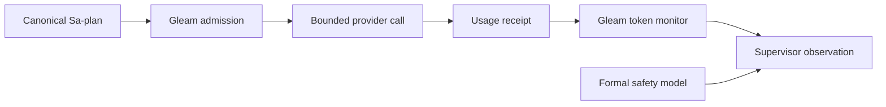

# 20261031-1432 — Agent-control mathematical safety check and Gleam token monitor

Observed at 2026-10-31T14:47:32Z. Sa-plan `uos/hive-agent-control-math/20261031-1431`: M01_CONTROL_SAFETY and M02_TOKEN_MONITOR. Development candidate; no runtime actuation or admission.

#fractal-l0 #fractal-l1 #fractal-l2 #fractal-l3 #fractal-l4 #fractal-l5 #fractal-l6 #fractal-l7 #fractal-l8 #fractal-l9 #km-triad #zk-adr #zero-muda

[Self](http://nas-1.tail55d152.ts.net:4100/files/docs/design/20261031-1432-hive-agent-control-formal-check-and-token-monitor.md) · [Journal](http://nas-1.tail55d152.ts.net:4100/files/docs/journal/20261031-1432-hive-agent-control-math-and-token-monitor-journal.md) · [Observation packet](http://nas-1.tail55d152.ts.net:4100/files/governance/planning/20261031-1432-hive-agent-control-math-and-token-observations.json) · [Planning](http://nas-1.tail55d152.ts.net:4100/planning) · [KM](http://nas-1.tail55d152.ts.net:4100/km).

[[wiki:20260905-1801-uos-zk-km-corpus-index]]
[[zk:20260905-1801-moc-uos-unified-master]]

## Right-problem check and POODAVR

The problem is safe, economical execution under concurrency and uncertain outcomes. A larger swarm and a cheap token price do not establish more accepted work. Predict stale-command replay, duplicate accounting and hidden retry costs; observe the current MCP/KM and actual receipts; orient against the existing coordinator and budget policy; decide bounded development scope through Sa-plan/risk checks; act in isolated source paths; verify the model and real receipt adapters; reflect counterexamples and residual obligations here and in the journal.

MCP KM health was healthy with canonical triad intact, EV ceiling93 and no effect authority. Recall included the full [TwoLattice_STM precedent](http://nas-1.tail55d152.ts.net:4100/files/formal/lean/TwoLattice_STM.lean) and bounded lease-mutex search. The knowledge_search schema lacks a limit argument; no invented successful limit call is asserted.

## Reuse of UOS infrastructure

| Existing component | Extension or obligation |
|---|---|
| [coord.gleam](http://nas-1.tail55d152.ts.net:4100/files/apps/uos_swarm/src/uos_swarm/coord.gleam) | Reuse its Usage carrier. Its additive record_usage remains unchanged; the new monitor performs idempotent snapshot reduction before any future projection. |
| [daily_budget.gleam](http://nas-1.tail55d152.ts.net:4100/files/apps/cepaf_gleam/src/cepaf_gleam/ecology/daily_budget.gleam) | Retain pure request bounds and provider ceilings. No monitor result creates a Reservation. |
| [ecology_budget.ml](http://nas-1.tail55d152.ts.net:4100/files/tools/ecology_budget.ml) | Retain the sole append-only daily liability ledger; no new budget DB, refund or pricing authority. |
| [board_reader.gleam](http://nas-1.tail55d152.ts.net:4100/files/apps/uos_swarm/src/uos_swarm/board_reader.gleam) | Reuse bounded manifest read. A small OTP adapter reads regular receipt files and binds descriptor identity plus digest. |
| Canonical Sa-plan and session coordinator | Retain task/attempt leases, integration fencing and durable ownership. Formal truth and telemetry cannot claim a task or deploy. |
| Existing signed MCP/Zenoh transport | Future interface binding must share Gleam admission state and canonical readback; notification ACKs never establish an effect. |

The new source modules live in apps/uos_swarm: token_monitor, token_monitor_input, token_monitor_native, token_monitor_manifest and token_monitor_cli. The bounded Erlang adapter adapts the existing uos_peer_json_ffi duplicate-key/depth technique to this package; no framework dependency is installed. Protected MCP sources and ecology_process.ml remain outside this slice.

## Mathematical control contract

Let S contain generation g, coordinator epoch e, trusted time t, desired target d, typed occupied slots O, permanent effect history H, one-use provider reservations U, and monetary liabilities L. The three slots are W0, W1, R0. Every reserved, starting, running, uncertain or draining occupant counts against capacity:

- writers(S) ≤ 2, reviewers(S) ≤ 1, occupied(S) ≤ 3.
- A smaller target may be below occupied capacity during drain. It does not justify forgetting an occupant.
- A fresh new admission requires a free role-compatible slot, occupied(S) < d, no drain, current authority and budget. The selected limit is a configuration invariant, never a body override.
- Every effective dispatch rechecks g and e, strict t < deadline and t < lease expiry, plus independently observed grant, task, attempt, candidate and risk predicates.
- effect_id binds an immutable logical payload. Identical replay conserves state, capacity and liability; conflicting reuse refuses. Permanent history survives capacity release and restart.
- An uncertain result holds its slot. Only current authoritative stopped readback for that effect releases capacity. A network ACK, timeout or telemetry disappearance cannot do so.
- Each provider request consumes one unique reservation once. Monetary units are microUSD: 250000 per reservation and at most10000000 per trusted UTC day. No refund occurs on release; lifetime liability is monotonic. Day rollover requires a strictly newer trusted day.

[AgentScaleControl.lean](http://nas-1.tail55d152.ts.net:4100/files/formal/lean/AgentScaleControl.lean) is an abstract serialized model, not extracted executable control code. Its mathematical safety claim is initial invariant plus preservation under each defined transition, hence invariance over all finite reachable model histories. Typed slots enforce cardinality structurally; this does not prove distinct worker IDs, native process uniqueness, lease-store linearizability, remote clock correctness or price compliance.

The external Env/readback oracles are assumptions, not proofs that a supplied boolean is authoritative. The implementation must obtain them from admitted Gleam/Sa-plan interfaces at effect time. Ledger correspondence, durable recovery and a native-Gleam simulation/refinement relation are separate obligations. No unconditional liveness, eventual drain, fairness, crypto theorem or 10x speedup is claimed. Independent negative controls must show that missing replay/fencing/unknown-capacity guards can break the intended property; executable examples are finite checks, not a substitute for induction.

## Token-accounting contract

For a final invocation r, uncached input i, output o, cache read c and cache write w form disjoint accounting categories. T(r)=i+o+c+w. Reasoning q is optional with 0≤q≤o and is never added to T. A normalized counter is nonnegative, ≤one billion, and combined T≤one billion. At most4096 unique receipts are retained in an in-memory snapshot; native manifest ingestion is additionally bounded to256 source entries, one MiB manifest,64KiB per raw receipt and JSON depth16.

The monitor denotes a map from (provider, stable invocation ID) to immutable final receipt. Identical replay is idempotent; disagreement on counters, metadata, cost, reasoning or failure flag refuses. Aggregation commutes for compatible disjoint receipts. Missing/malformed/in-flight usage remains UNKNOWN and recommends HOLD, not zero usage. Unknown cost is retained separately; estimates are unverified SDK/list-price/receipt estimates, not an invoice.

Native adapter rules:

- Claude CLI: require final result marker and matching session_id; use aggregate top-level usage once, never add modelUsage again.
- Pi wrapper: only a settled one-assistant/no-tool invocation with supported terminal stop reason is supported. The last response of a multi-assistant invocation is not an aggregate; such records are UNKNOWN.
- DeepSeek Chat: prompt_tokens includes cache hits. Require hit+miss=prompt; normalize input to miss, cache_read to hit, cache_write to zero, and verify prompt+completion=reported total. Require matching native completion ID/kind.
- Physical aliases use descriptor device/inode identity; byte-identical copies under different logical IDs are conservatively ambiguous and HOLD. Identical bytes may be legitimate different Pi calls, so reconciliation requires independent registry evidence, never silent dedup or invention.
- Per-call failure means the native receipt reported an invocation error. It does not establish generated-code test success, accepted work or task completion. Those outcomes require separate candidate review.

The snapshot recommendation compares known token totals and unique calls to caller-selected diagnostic thresholds. It cannot approve a future call or enforce a hard cap. Unknown usage blocks an affirmative recommendation. Canonical budget/task/effect-time fences remain mandatory.

## Run the development monitor

From the candidate workspace's apps/uos_swarm directory, using the pinned UOS Gleam and OTP29 environment:

```text
gleam run --no-print-progress -m token_monitor_cli -- native ABSOLUTE_MANIFEST_PATH
gleam run --no-print-progress -m token_monitor_cli -- ABSOLUTE_NORMALIZED_COUNTER_FILE
```

The native manifest is schema_version1 with max_tokens, max_calls and sources. Each source has format, provider, request_id, agent, model and explicit local path; supported formats are claude_cli, pi_sdk and deepseek_chat. A normalized file replaces sources with receipts containing required nullable usage/reasoning_tokens/estimated_nanodollars and an explicit failure-observed boolean named failed in schema1. Raw paths and transcript text are not emitted in the public report. Caller annotations, file hashes and native IDs are observations, not provider-authenticated attestations.

This is a local diagnostic CLI, not a newly deployed MCP tool or background collector. It reads one bounded snapshot per invocation; shell polling is not an admitted production supervisor. Files must be operator-selected local regular receipts. The file precheck does not prove descriptor-relative race freedom or a wall-time bound on an adversarial filesystem; production exposure needs the existing supervised I/O boundary, allowed roots and recovery tests.

## Current observation and optimization

The initial selected snapshot contains20 known Pi/Claude invocations:2061712 tokens, comprising26313 uncached input,137300 output including reasoning,1637093 cached reads and261006 cache writes. Known receipt estimates total4054055178 nanodollars, aboutUSD4.0541, across different billing bases. Canonical OpenRouter liability is separatelyUSD2.50 for10 reservations, USD7.50 remaining of the USD10 ledger ceiling, with actual spend UNKNOWN.

A subsequent registered Claude proof call timed out at300seconds with no aggregate receipt. The updated snapshot therefore has21 registered invocations,20 known usage and1 unknown usage/cost, returning HOLD_UNKNOWN_USAGE. Known totals are lower bounds; do not infer zero cost for the timeout. Supervisor/relay goal metrics form a different population with unknown overlap and must not be blindly added to provider totals. Scope coverage is explicitly incomplete.

A one-million-token diagnostic threshold was selected to expose overhead, not as a user-approved global cap. About85.06% of known input categories are cached reads. Preserve stable instruction/tool prefixes where useful, place changing context after them, retrieve only needed fresh KM excerpts, and measure accepted-work yield and repair cost before changing models. A high cache-hit share is not itself evidence of waste. Native invocation failure count does not capture compiler/test failures in generated output; the failed Pi normalizer draft remains a rejected work product.

## Public framework findings and UOS mapping

Primary sources were read on2026-10-31. External implementations remain evidence; no code/package is imported.

| Source | Observed pattern | UOS design inference |
|---|---|---|
| [Google ADK parallel workflow](https://adk.dev/agents/workflow-agents/parallel-agents/) | Parallel subagents run independently; explicit synchronization is needed for shared state. | Disjoint worker paths, bounded fan-out and one serialized integration/admission lane; ETS is a disposable observation mirror. |
| [Google ADK runtime configuration](https://adk.dev/runtime/runconfig/) and [callbacks](https://adk.dev/callbacks/) | Run configuration offers LLM-call bounds; lifecycle callbacks can inspect or stop a step. | Reuse Gleam request preparation and effect-time fences for per-call admission; a callback or call-count bound alone is not a monetary guarantee. |
| [Microsoft checkpoints](https://learn.microsoft.com/en-us/agent-framework/workflows/checkpoints) | Checkpoints support restoration/resumption of workflow state. | Recover from canonical Sa-plan intent/outcome history; retain uncertain reservations and tombstones, re-observe effects before retry. |
| [Microsoft observability](https://learn.microsoft.com/en-us/agent-framework/user-guide/observability?pivots=programming-language-python) and [workflow telemetry](https://learn.microsoft.com/en-us/agent-framework/workflows/observability) | Per-invocation/model/tool spans and token metrics; sensitive message capture is configurable. | Emit counters and trace references through existing telemetry without publishing raw prompts/results; distinguish causal links from nested call ownership. |
| [DeepSeek usage schema](https://api-docs.deepseek.com/api/create-chat-completion/) and [context caching](https://api-docs.deepseek.com/guides/kv_cache/) | Prompt cache hit/miss partition, completion/reasoning breakdown, matching persisted cache prefixes. | Provider-specific normalization, no subset double-counting, measured cache ratios and stable-prefix experiments. |
| [DeepSeek model pricing](https://api-docs.deepseek.com/quick_start/pricing/) and [OpenRouter Pro0813](https://openrouter.ai/deepseek/deepseek-v4-pro-0813) | Direct-provider and router pages expose different prices/routes; current router output headline exceeds the pinned UOS Pro ceiling. | No new paid Pi dispatch until actual provider/model route and price satisfy existing admission; advertised minimums are insufficient. |

No universal cheapest/best model is established. Current Pi normalizer generation failed compilation/accounting checks, despite low estimated price; Claude proof generation timed out. Both count against delivery economics. Continue bounded, role-specific experiments only after unknown-cost reconciliation and route-price verification. The latest direct-provider model alias is not automatically the exact OpenRouter allowlisted snapshot.

## Fractal responsibilities and topology

L0 defines grants/admission boundaries; L1 assigns canonical plan and lease; L2 schedules dependency-ready disjoint work; L3 mediates effect fences; L4 prepares bounded provider requests; L5 runs isolated backends; L6 normalizes receipts; L7 correlates telemetry and uncertain outcomes; L8 maintains KM evidence; L9 reviews learning and forecasts. Worker layer affinities are not extra workers. No per-layer runtime parallelism measurement is manufactured from tags.

```ascii
[Canonical Sa-plan] --> [Gleam admission]
[Gleam admission] --> [Bounded provider call]
[Bounded provider call] --> [Usage receipt]
[Usage receipt] --> [Gleam token monitor]
[Gleam token monitor] --> [Supervisor observation]
[Formal safety model] --> [Supervisor observation]
```



## Complementary mathematical techniques and applicability

M03_METHOD_COVERAGE extends the same canonical plan. Technique coverage is not a claim that every branch of mathematics applies, or that all runtime obligations are proved.

| Technique | Concrete use | Evidence class and boundary |
|---|---|---|
| Type theory and inductive proof | Lean typed role slots, Reach history, financial and consumed-request invariants | Kernel proofs for the abstract serialized model; external oracle assumptions and native refinement remain explicit. |
| Temporal/interleaving modeling | Independent [Quint model](http://nas-1.tail55d152.ts.net:4100/files/formal/quint/agent_scale_control.qnt) with fresh/replayed commands, uncertainty and drain | Seeded bounded simulation and a deliberately false invariant; not exhaustive checking, fairness or unconditional liveness. |
| SMT / linear integer arithmetic | [QF_LIA constraints](http://nas-1.tail55d152.ts.net:4100/files/docs/design/20261031-1432-hive-agent-control-formal-check-and-token-monitor.md#smt-source-and-reproduction) derive post-admission capacity, liability and strict-time bounds | Guarded unsafe query UNSAT, positive control SAT, two weakened-rule counterexamples SAT. Solver workers are bounded. |
| Independent differential oracle | [OCaml integer evaluator](http://nas-1.tail55d152.ts.net:4100/files/tools/agent_control_smt_oracle.ml) re-evaluates every SAT witness and enumerates a finite refutation domain | Three witness evaluations,246000 finite candidates and16800 admissible cases; not an independent general proof of solver UNSAT. Unknown verdicts/bad witnesses fail closed. |
| Algebraic / metamorphic laws | Compatible bounded receipt maps have identity, idempotent insertion, order-independent sums and conflict refusal | Independent list oracle, permutations/replays,4096 boundary and raw provider fixtures on real OTP; not native-to-Lean refinement. |
| Set/cardinality / injectivity analysis | Count held typed slots once globally and expose missing real worker-ID injectivity proof |3 modeled slots do not prove3 distinct real worker processes or per-layer telemetry coverage. |
| Control theory / Lyapunov | Violation function V=max(0,O-3)+max(0,W-2)+max(0,R-1)+max(0,L-cap) | Reachable abstract states have V=0 and discrete deltaV=0. No real-fleet asymptotic stability or drain convergence is established. |
| Queueing / network calculus | With measured service capacity mu and p independent execution lanes, stationary load requires lambda < p*mu under its model assumptions | No measured arrival/service envelope, independence or distribution is available; no M/M/c latency or deterministic deadline guarantee is asserted. Safety remains valid if backlog grows, but progress is not proved. |
| Critical-path / Amdahl bounds | For parallel fraction f and p lanes, ideal active-work speedup ≤1/((1-f)+f/p), before coordination/repair overhead | At p=3 this bound is≤3 for unchanged equal-resource work. A10x goal additionally needs reduced work/cache/retrieval improvements measured on accepted outcomes. A fixed24h soak cannot be parallelized away. |
| Optimization / decision analysis | Minimize total bounded cost per accepted, independently verified work unit, subject to task, safety, memory, concurrency and budget constraints | Include failed drafts, repair, all participating agents and unknown costs. No cheapest-model optimum from headline prices or token counts alone. |
| Probability / forecasting | Explicit precommitted outcome forecast and Brier score; descriptive prior only with named event population | No calibrated reliability model, IID test-count posterior, queue distribution or learned controller is inferred. |
| STPA / FMEA | Four UCA types, raw S/O/D and residuals across L0–L9 | Ordinal prioritization and hazard analysis advise/veto; scores and AI opinions never grant effect authority. |
| Information theory | Cache/uncached/output partitions and bounded provenance capsules guide experiments | Cache hit share is a measured category ratio; no entropy-to-correctness theorem or10x claim. |
| Rewrite confluence / numeric FP / ML | Not governing this finite integer control/admission slice | INAPPLICABLE here. There is no rewrite transform, floating-point safety kernel or adequate labeled training population to justify those techniques as guards. |

The numerical SMT slice includes an independent finite refutation check, positive admissible witness and two genuine counterexamples: counting only running workers can admit a fourth held slot, and a closed deadline permits the exact expired boundary. This diversity catches different mistakes; agreement does not establish cross-model equivalence or deployed enforcement.


## SMT source and reproduction

The canonical source is formal/smt/agent_scale_control.smt2. The current file viewer refuses that extension with403, so the exact non-sensitive query text is included here for review. Its bytes are bound to the source hash in the observation packet. The solver worker must retain both the SMT timeout and an external process deadline; any timeout/unknown fails closed. Reproduce from UOS using:

```text
timeout --kill-after=2s 12s tools/z3 -smt2 formal/smt/agent_scale_control.smt2
ocaml tools/agent_control_smt_oracle.ml PATH_TO_CAPTURED_Z3_OUTPUT
```

```smt2
; UOS agent-control numeric admission slice, QF_LIA, report-only.
; Budget is RESERVED LIABILITY in microUSD, not provider invoice/spend.
; All queries additionally require a bounded external worker invocation.
(set-logic QF_LIA)
(set-option :timeout 3000)
(declare-const running_w Int)
(declare-const uncertain_w Int)
(declare-const running_r Int)
(declare-const uncertain_r Int)
(declare-const dw Int)
(declare-const dr Int)
(declare-const target Int)
(declare-const liability Int)
(declare-const now Int)
(declare-const deadline Int)
(declare-const lease Int)
(define-fun w () Int (+ running_w uncertain_w))
(define-fun r () Int (+ running_r uncertain_r))
(define-fun pre () Bool (and
 (>= running_w 0) (>= uncertain_w 0) (>= running_r 0) (>= uncertain_r 0)
 (<= w 2) (<= r 1) (<= (+ w r) 3)
 (>= target 0) (<= target 3) (>= liability 0) (<= liability 10000000)
 (>= now 0) (>= deadline 0) (>= lease 0)
 (or (and (= dw 1) (= dr 0)) (and (= dw 0) (= dr 1)))))
(define-fun guard () Bool (and pre
 (< (+ w r) target)
 (=> (= dw 1) (< w 2))
 (=> (= dr 1) (< r 1))
 (<= liability 9750000) (< now deadline) (< now lease)))
(define-fun unsafe_post () Bool (or
 (> (+ w dw) 2) (> (+ r dr) 1) (> (+ w r dw dr) 3)
 (> (+ liability 250000) 10000000)
 (>= now deadline) (>= now lease)))
(echo "GUARDED_UNSAFE")
(push)
(assert guard)
(assert unsafe_post)
(check-sat)
(pop)
(echo "VALID_ADMISSION")
(push)
(assert guard)
(assert (= running_w 1))
(assert (= uncertain_w 0))
(assert (= running_r 1))
(assert (= uncertain_r 0))
(assert (= dw 1))
(assert (= dr 0))
(assert (= target 3))
(assert (= liability 0))
(assert (= now 0))
(assert (= deadline 1))
(assert (= lease 1))
(check-sat)
(get-value (running_w uncertain_w running_r uncertain_r dw dr target liability now deadline lease))
(pop)
(echo "MUTANT_RUNNING_ONLY")
(push)
(assert pre)
(assert (< (+ running_w running_r) target))
(assert (=> (= dw 1) (< running_w 2)))
(assert (=> (= dr 1) (< running_r 1)))
(assert (<= liability 9750000))
(assert (< now deadline))
(assert (< now lease))
(assert unsafe_post)
(check-sat)
(get-value (running_w uncertain_w running_r uncertain_r dw dr target liability now deadline lease))
(pop)
(echo "MUTANT_CLOSED_EXPIRY")
(push)
(assert pre)
(assert (< (+ w r) target))
(assert (=> (= dw 1) (< w 2)))
(assert (=> (= dr 1) (< r 1)))
(assert (<= liability 9750000))
(assert (<= now deadline))
(assert (< now lease))
(assert (= now deadline))
(check-sat)
(get-value (running_w uncertain_w running_r uncertain_r dw dr target liability now deadline lease))
(pop)

```

The current MCP file reader also refuses this design's filename because the harmless documentation name contains the credential marker “token”; direct read was refused and is not counted as passing MCP delivery. Fresh search observes the updated inventory/MOC/handover references, and HTTP delivers the allowed document bytes. Direct discovery/expansion of this file remains an OI09 integration gap pending an independently reviewed access-policy repair. No protected policy was changed or bypassed.


## Verification obligations

The observation packet pins actual source digests, test counts, negative-control results and reviewer scopes. The new controller model is report-only. Model-to-Gleam conformance, signed live MCP/Zenoh scale control, production token-budget attachment, invoice reconciliation, cross-plan dependency repair and the original nine-task handover remain open until their own canonical evidence passes.

<details><summary>Domain 1 — Metadata and navigation</summary>

- [x] CHK-01-TIME — Host clock observed; filename uses YYYYMMDD-HHSS, hour plus seconds.
- [ ] CHK-02-TAIL — Live candidate delivery and byte parity require publication proof.
- [x] CHK-03-FRACT — L0–L9 responsibilities recorded.
- [ ] CHK-04-KM — Reciprocal wiki, ZK, inventory and journal registrations require final reconciliation.

</details>
<details><summary>Domain 2 — Purity and storage</summary>

- [x] CHK-05-MUDA — No excluded runtime or package added.
- [x] CHK-06-GRAPH — Gleam owns policy; bounded OTP JSON/file adapter only.
- [x] CHK-07-DRIVE — No storage provisioning or interlock change.

</details>
<details><summary>Domain 3 — Tests and mathematical gates</summary>

- [ ] CHK-08-C1C8 — UI categories outside this CLI/model slice remain UNRUN.
- [ ] CHK-09-MATH — Source-bound kernel proof, independent review and mutant controls require final receipts; no blanket four-gate claim.
- [x] CHK-10-9MOD — Unit, negative, metamorphic and native-receipt checks are applicable; broader modalities remain UNRUN.
- [x] CHK-11-REGR — Replay, alias, missing usage, cache and reasoning boundaries have explicit falsifiers.

</details>
<details><summary>Domain 4 — Control and observability</summary>

- [ ] CHK-12-GLEAM — Development CLI executes on OTP29; production supervisor attachment is pending.
- [x] CHK-13-HERMES — Formal/evidence work is separate from effect authority.
- [ ] CHK-14-ZIGVM — Deterministic kernel unchanged; runtime integration UNRUN.
- [ ] CHK-15-MAX — Isolated inference unchanged; runtime integration UNRUN.
- [ ] CHK-16-OTEL — Host observation timestamps exist; full live exporter/span binding pending.

</details>
<details><summary>Domain 5 — Governance and Jujutsu</summary>

- [ ] CHK-17-SOV — Independent candidate acceptance and release authority remain separate.
- [x] CHK-18-JJ — Isolated standalone JJ workspace; no native Git mutation.

</details>
<details><summary>Domain 6 — Provenance extension</summary>

EV-93 ceiling. EV-94..109 / ADR-071..086 remain NOT_ADMITTED. No new EV identifier, runtime admission or sovereign adjudication follows.

</details>

[Previous: master handover](http://nas-1.tail55d152.ts.net:4100/files/docs/handover/20261031-1100-agy-to-codex-always-fresh-km-mcp-brain-and-fractal-plan-handover.md) · [Wiki](http://nas-1.tail55d152.ts.net:4100/wiki) · [ZK](http://nas-1.tail55d152.ts.net:4100/zk) · [Next: journal](http://nas-1.tail55d152.ts.net:4100/files/docs/journal/20261031-1432-hive-agent-control-math-and-token-monitor-journal.md).

UOS footer: development observations and mathematical model proofs confer no runtime effect authority or system admission.

