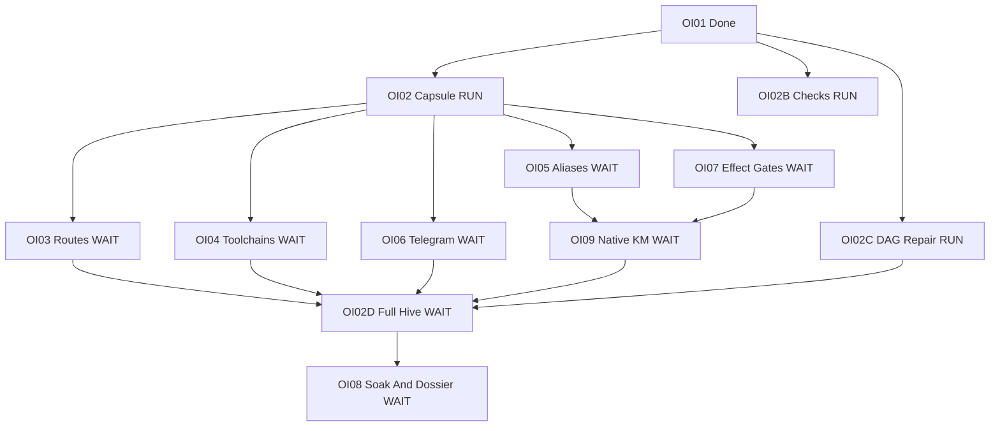

# 20261031-1908 — All outstanding UOS full-hive tasks

#fractal-l0 #fractal-l1 #fractal-l2 #fractal-l3 #fractal-l4 #fractal-l5 #fractal-l6 #fractal-l7 #fractal-l8 #fractal-l9 #km-triad #zk-adr #zero-muda

Observed 2026-10-31T19:33:08Z. Canonical Sa-plan uos/codex-handover-open-items-fractal-plan/20261031-1240: **15 tasks,4 completed,3 executing,8 available**. Available does not mean dependency-ready. Eleven tasks remain. [Self](http://nas-1.tail55d152.ts.net:4100/files/docs/design/20261031-1908-full-hive-outstanding-task-graph.md) · [Full hive specification](http://nas-1.tail55d152.ts.net:4100/files/docs/sop/20261031-1918-full-hive-service-activation-and-checks.md) · [Planning cockpit](http://nas-1.tail55d152.ts.net:4100/planning).

## Dependency view

This is a transitive reduction for readability: omitted direct prerequisites remain enforced by Sa-plan. The original nine tasks retain their scope. Three completed supporting tasks are listed below rather than expanding the dependency drawing. RUN means executing, WAIT means available with unfinished dependencies. These are task states, not runtime readiness badges.

```ascii
[OI01 Done] --> [OI02 Capsule RUN]
[OI01 Done] --> [OI02B Checks RUN]
[OI01 Done] --> [OI02C DAG Repair RUN]
[OI02 Capsule RUN] --> [OI03 Routes WAIT]
[OI02 Capsule RUN] --> [OI04 Toolchains WAIT]
[OI02 Capsule RUN] --> [OI05 Aliases WAIT]
[OI02 Capsule RUN] --> [OI06 Telegram WAIT]
[OI02 Capsule RUN] --> [OI07 Effect Gates WAIT]
[OI05 Aliases WAIT] --> [OI09 Native KM WAIT]
[OI07 Effect Gates WAIT] --> [OI09 Native KM WAIT]
[OI03 Routes WAIT] --> [OI02D Full Hive WAIT]
[OI04 Toolchains WAIT] --> [OI02D Full Hive WAIT]
[OI06 Telegram WAIT] --> [OI02D Full Hive WAIT]
[OI09 Native KM WAIT] --> [OI02D Full Hive WAIT]
[OI02C DAG Repair RUN] --> [OI02D Full Hive WAIT]
[OI02D Full Hive WAIT] --> [OI08 Soak And Dossier WAIT]
```



| Task | Required completion |
|---|---|
| OI02 | Candidate-bound capsule/configuration cutover, complete physical-target audit, reader fencing, independently authorized release and tested rollback |
| OI02B | All-agent authenticated collectors/catalog, monitor ownership, durable sink integration, effect consumers, cost/dashboard coverage and recovery |
| OI02C | Tested additive prerequisite API, exact live OI09/full-hive-to-soak edges, durable audit, independent source acceptance and publication |
| OI03 | Actual 101-route backend fidelity and truthful capability states |
| OI04 | Repository-pinned offline Nix/Lean4 formal toolchain reservoir and actual invocations |
| OI05 | Historical 374-link/alias disposition with semantic content and fragment checks |
| OI06 | Isolated seven-file Telegram/Mirage disposition and applicable operational acceptance |
| OI07 | Mandatory KM/risk/task/identity/budget/effect-time fences, bypass containment and refusal/replay tests |
| OI09 | Native Hermes Wiki/knowledge-service unification, fresh read/writeback and measured performance |
| OI02D | Required canonical hive functionality and provenance-verified adaptation; supervised real services, four-agent operations, homeostasis and controlled self-evolution acceptance |
| OI08 | Planned 24-hour four-agent chaos/soak, operational mathematical gates, recovery and 17-aspect two-key dossier |

Completed: OI01 provenance dossier, OI01A observed scanner, OI01B formal gateway and OI02A OpenRouter usage reconciliation. OI01 completion does not admit EV94..109. OI02A retains unknown provider charges explicitly.

The full direct dependency sets of the two final stages are: OI02D requires OI02,OI02C,OI03,OI04,OI05,OI06,OI07,OI09; OI08 requires OI02D,OI03,OI04,OI05,OI07,OI09. OI02B runtime acceptance remains open and its components are integrated during the full-hive work; no invented B-to-D execution edge or self-authorizing completion is implied.

## Work inside full-hive activation

These are acceptance work packages of OI02D, not independently claimed task records. Any independently dispatched work must first be represented in Sa-plan.

1. Reconcile canonical service manifests, missing launchers, existing owners and external C3I drift.
2. Bind authenticated native Codex/Claude/Pi/AGY clients to the canonical harness and exact service catalog.
3. Connect monitor, durable receipt worker/transport, mandatory effect gates and uncertainty reconciliation.
4. Integrate fresh Wiki/ZK/KB, model routing/reservations/cost accounting and truthful dashboard/API/TUI.
5. Connect real attributed telemetry, bounded homeostatic actuators and per-variable target bands.
6. Exercise reviewed self-evolution proposals through isolated implementation, independent verification, release/rollback and outcome learning.
7. Verify function, performance, operation, fault/recovery, identity/replay and resource limits across relevant layers/aspects.
8. Import/adapt only justified missing functionality from pinned sanitized independently verified evidence; optional framework oracles are not required daemons.

## Parallelism and forecast

Current disjoint development lanes cover supervision/integration, dependency repair, durable evidence and independent review/inventory, within four local slots. Native advisory invocations and service probes have separate counts. Following OI02, eligible OI03..OI07 work can parallelize within actual capacity and ownership constraints. Integration, state effects and release gates serialize. OI09 waits for OI05/OI07; full hive waits for its canonical prerequisites; OI08 follows full-hive activation. The soak requires its own 24-hour elapsed window after entry gates. No whole-program finish date or tenfold speedup is established.

## Comprehensive verification checklist

<details><summary>Domain 1 — Metadata and navigation</summary>

- [x] CHK-01-TIME — Host timestamp basis recorded.
- [ ] CHK-02-TAIL — Published byte parity pending.
- [x] CHK-03-FRACT — L0–L9 tags and scoped implications.
- [ ] CHK-04-KM — Final reciprocal registration pending.

</details>
<details><summary>Domain 2 — Purity and storage</summary>

- [x] CHK-05-MUDA — No new runtime dependency.
- [x] CHK-06-GRAPH — Canonical Gleam/Hermes boundaries preserved.
- [x] CHK-07-DRIVE — No device effects.

</details>
<details><summary>Domain 3 — Testing and mathematics</summary>

- [ ] CHK-08-C1C8 — Full UI acceptance remains open.
- [ ] CHK-09-MATH — Four operational mathematical gates remain OI08 obligations.
- [ ] CHK-10-9MOD — Full applicable test modalities remain open.
- [ ] CHK-11-REGR — Full-hive regression/soak remains open.

</details>
<details><summary>Domain 4 — Control and observability</summary>

- [ ] CHK-12-GLEAM — Full runtime supervision/consumer adoption unverified.
- [ ] CHK-13-HERMES — Candidate-bound evidence integration outstanding.
- [ ] CHK-14-ZIGVM — Applicable kernel/VFS acceptance required.
- [ ] CHK-15-MAX — Applicable isolated inference acceptance required.
- [ ] CHK-16-OTEL — Actual runtime clocks/traces/ages required.

</details>
<details><summary>Domain 5 — Governance and Jujutsu</summary>

- [ ] CHK-17-SOV — Runtime release and two-key acceptance outstanding.
- [ ] CHK-18-JJ — Final source publication receipt pending.

</details>
<details><summary>Domain 6 — Provenance extension</summary>

EV93 ceiling; EV94..109/ADR071..086 NOT_ADMITTED. No new EV or blanket admission.

</details>

[[wiki:20260905-1801-uos-zk-km-corpus-index]] · [[zk:20260905-1801-moc-uos-unified-master]]

[Previous execution plan](http://nas-1.tail55d152.ts.net:4100/files/docs/design/20261031-1240-uos-open-items-fractal-design-implement-test-plan.md) · [Wiki](http://nas-1.tail55d152.ts.net:4100/wiki) · [ZK](http://nas-1.tail55d152.ts.net:4100/zk) · [Next full-hive specification](http://nas-1.tail55d152.ts.net:4100/files/docs/sop/20261031-1918-full-hive-service-activation-and-checks.md).

UOS footer: current task projection and acceptance specification; full runtime readiness remains unverified.
