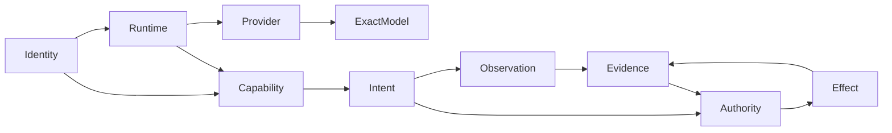

# 20261101-0502 — UOS Four-Agent Capability Ontology and Algebraic Intent Architecture

#fractal-l0 #fractal-l1 #fractal-l2 #fractal-l3 #fractal-l4 #fractal-l5 #fractal-l6 #fractal-l7 #fractal-l8 #fractal-l9 #km-triad #zk-adr #zero-muda #tailscale-web #checklist-nav

**Status: DEVELOPMENT DRAFT / NOT_ADMITTED.** This is a reviewable design specification for Pi, Claude, AGY and Codex. It records source facts and proposes typed relationships; it is not implementation, task completion, runtime proof, provider contact, release authorization or system admission. No EV number is assigned. The admitted EV ceiling remains EV-93; EV-94..EV-109 and ADR-071..ADR-086 remain NOT_ADMITTED.

Intended after authorized publication, not yet verified live: [rendered design](http://nas-1.tail55d152.ts.net:4100/docs/design/20261101-0502-uos-four-agent-capability-ontology-intent-spec.md) · [raw source](http://nas-1.tail55d152.ts.net:4100/files/docs/design/20261101-0502-uos-four-agent-capability-ontology-intent-spec.md). Existing navigation: [Cockpit](http://nas-1.tail55d152.ts.net:4100/) · [Planning](http://nas-1.tail55d152.ts.net:4100/planning) · [Wiki](http://nas-1.tail55d152.ts.net:4100/wiki) · [ZK](http://nas-1.tail55d152.ts.net:4100/zk).

The author reported deriving prefix `20261101-0502-` from an observed UTC `date +%Y%m%d-%H%S` after a chrony check. The exact full authoring timestamp was not retained. Chrony reported stratum 3, reference time `2026-11-01T05:48:46Z` and last offset `+0.000070417s`; the reference time is not the document creation time.

## 1. Scope and decision

Define one shared ontology for four distinct agent runtimes while keeping provider, exact model, identity, capability, observation, authority and evidence independent. Define a closed intent algebra whose values describe requested work and requirements without conferring execution permission. Reuse existing UOS code by mapping responsibility to source modules, and implement only after separate Sa-plan authorization, risk preflight and review.

Target: expose or migrate all required system capabilities through admitted MCP interfaces and Gleam/OTP harness ownership, including their control, status, evidence and reconciliation operations. A direct review call is an operator-authorized fallback only when the needed MCP interface is unavailable; it is not an alternative permanent control plane, does not authorize task mutation, and is not evidence of runtime admission. Record its exact scope, model, outcome and uncertain charges, and migrate that capability to MCP rather than normalizing the fallback.

The candidate source `apps/cepaf_gleam/src/cepaf_gleam/harness/agent_capabilities.gleam` already has `Agent`, `AgentRuntime`, `InferenceProvider`, exact `ModelRef`, `Capability`, source registrations, scoped `ContextData`, bounded observations, requirement combination, `Intent`, and a data-only lifecycle projection. Its own comments state that declarations are not availability, checked observations do not authenticate collectors, and even `Verified` retains `AdmissionRequired`. This specification treats those comments and contracts as constraints.

The reviewed development source is bound to SHA-256 `cd1cf720810eff27e42b61b464962c97f2f33932565ed39e229d7e0d232dd9f1` for `agent_capabilities.gleam` and `3c5d5be068e81e5fe072b96cfaac481d92f160c1a89eae8619b3d1f297168118` for `agent_ecology.gleam`. The isolated development receipt has SHA-256 `fdf01b63f0b39d3b567cabfaee6e5d4aff031bf829c4d197332d643d7cad2e5c`; it is not a release or live-delivery receipt.

Knowledge recall performed through the UOS harness: `system_health` reported healthy KM status and intact canonical triad; the capability-ontology query returned source excerpts for `governance/capability-inventory/agents.toml`, the four-agent handover, the local master MOC, and other architecture references; bounded ZK transclusion returned the MOC and related precedents. The search tool schema did not expose the requested `limit: 5` or a resource-read operation, so this draft records excerpts and returned resource URIs as bounded advisory recall rather than claiming full-document inspection. Relevant pointers: [agent capability inventory](http://nas-1.tail55d152.ts.net:4100/files/governance/capability-inventory/agents.toml), [four-agent continuation handover](http://nas-1.tail55d152.ts.net:4100/files/docs/journal/20261029-0710-codex-to-pi-agy-single-document-handover.md), and [master ZK MOC](http://nas-1.tail55d152.ts.net:4100/files/docs/zk/20260905-1801-moc-uos-unified-master.md). Historical/catalog statements remain unverified unless supported by current evidence.

## 2. Ontology: independent typed coordinates

The ontology is a product of typed dimensions, not a single overloaded “agent” label:

| Type | Meaning | Evidence boundary |
|---|---|---|
| `Runtime` | Pi, Claude, AGY or Codex execution environment | Runtime identity does not imply an active process or harness connection. |
| `Provider` | OpenRouter, Google, Anthropic, OpenAI or unspecified upstream | Provider is routing/vendor metadata, not model identity. |
| `ExactModel` | Provider + namespace/catalog + exact bounded model ID | Requested model data is not observed selection, availability, or custody. |
| `Identity` | Authenticated principal and session/worker/attempt binding | Names and caller-provided strings are not authentication. Bind to trusted roster/session proof. |
| `Capability` | Closed operation class such as `KnowledgeRead` or `ToolExecution` | Catalogue membership is not implementation, grant, or runtime support. |
| `Observation` | Time-bounded, candidate-bound statement about a capability | Must bind runtime, principal, source/candidate digest, task scope, clock domain and expiry; collector authenticity is separate. |
| `Authority` | Typed, scoped authorization to permit one effect under policy | No intent, model, observation or evidence constructor creates authority. |
| `Evidence` | Immutable receipt(s) supporting a claim, with source, revision, freshness, provenance and verification method | Evidence status is explicit: `UNRUN`, `UNKNOWN`, `OBSERVED`, `VERIFIED`; never infer `VERIFIED` from a declaration. |

Proposed relationships: `Runtime × Provider × ExactModel` describes inference routing; `Identity × Runtime` binds an authenticated actor to a session; `Capability × Runtime` gives a declared source map; `Observation` is a fresh claim over that binding; `Authority` independently gates a specific intent; `Evidence` records and supports each transition. These relations are partial. The exact model for Claude and Codex remains unspecified by the inspected registry. AGY's source declaration is `gemini-4-argon-high` with provider unspecified; Pi's legacy declaration is Google / `gemini-2.5-flash`. Neither is proof of current model use.

## 3. Four backend maps and explicit gaps

The seven registry columns are `ConfigureMcp`, `KnowledgeRead`, `AdvisoryCompletion`, `ToolExecution`, `TaskLifecycle`, `EvolutionProposal`, `ReleaseDeployment`. The inspected source returns `ClientConfigurationSource("harness/client_mcp.gleam")` for MCP configuration, shared `harness/operations.gleam` for KnowledgeRead/TaskLifecycle/EvolutionProposal, an AGY job source for AGY advisory/tool entries, a legacy Pi bridge source for Pi advisory/tool entries, and no mapped adapter for Claude/Codex advisory/tool or any release/deployment. These are source mappings, not live backend support.

| Backend | Four source-supported capability coordinates | Known gaps / qualification |
|---|---|---|
| Pi | MCP configuration; shared harness scoped read; shared task lifecycle; shared evolution proposal | Advisory/tool route is tagged legacy and unintegrated in the registry. Pi bridge files exist, but their existence does not prove an admitted connection. No release/deployment adapter is mapped in this registry. Full KM triad and authenticated fresh collector coverage unproven. |
| Claude | MCP configuration; shared harness scoped read; shared task lifecycle; shared evolution proposal | No mapped advisory-completion, tool-execution or release/deployment adapter in this registry. Exact model unspecified. Native Claude Code protocol mapping file is not an admitted backend binding. |
| AGY | MCP configuration; shared harness scoped read; shared task lifecycle; shared evolution proposal | AGY job source exists for advisory completion and tool execution, but does not establish admitted runtime connection or effect authority. Exact source model is declared with provider unspecified. No release/deployment adapter is mapped in this registry. |
| Codex | MCP configuration; shared harness scoped read; shared task lifecycle; shared evolution proposal | No mapped advisory-completion, tool-execution or release/deployment adapter in this registry. Exact model unspecified. |

“Shared harness scoped read” means only the source-level `read_file` mapping described in the module comments. It does not mean the full KM search, bounded ZK transclusion, reciprocal writeback, preflight or performance contract is covered. Runtime availability, authentication, catalog completeness and required-service coverage remain `UNKNOWN` until independently observed.

## 4. Closed intent algebra and outcome state

The current source algebra is `Inspect(Capability) | Perform(Capability) | Sequence(List(Intent))`. It is a closed in-memory type, not a wire parser. A future parser must reject unrecognized operations and must not provide an arbitrary shell string or “generic execute” constructor. `Sequence` describes ordered intent, whereas `combine` performs canonical finite-set union of requirements. Requirement conjunction is commutative/idempotent; effect order is not. Do not reorder effects by sorting the set of requirements.

The source requirement set includes authenticated principal, candidate binding, fresh clock, current task fence, scoped grant, durable intent, durable liability, admitted tool policy, workspace ownership, confirmed process cleanup, independent verification, release approval and reader barrier. Resolve each requirement at the operation boundary through its owning subsystem; a local `Result` or caller assertion is not an external fence.

The current DATA-only state projection contains `Idle → Prepared → Reserved → Dispatched → Verified`, plus `Unknown` and `Quarantined`; it does not establish durable reconciliation, settlement or process cleanup. For the proposed controller, `Unknown` must retain the liability, block duplicate dispatch and require operation-specific reconciliation using the same idempotency key. A timeout alone must not become failure or success. Settlement requires attributable outcome and billing evidence; release of capacity requires confirmed process cleanup. Existing `IntentState` uses a fixed illustrative liability amount, not production pricing or a complete protocol.

Budget semantics: preflight provider/model cost, token/tool/time ceilings and maximum retries; reserve a bounded liability before dispatch; reconcile actual usage from attributable evidence; retain unknown charges as HOLD; stop escalation when budget or evidence is unknown. Use the cheapest model that meets acceptance, bounded excerpts, and only top one or two needed documents. Escalate difficult reasoning only when current price/usage evidence and a declared uncertainty justify it. No provider call or price claim is made by this design.

## 5. Existing UOS module reuse map

| Responsibility | Existing source location | Reuse boundary |
|---|---|---|
| Task-scoped development controller and effect/reconciliation | `apps/cepaf_gleam/src/cepaf_gleam/harness/successor_mcp.gleam` | Reuse existing durable intent and reconciliation behavior; gateway and registry are also dispatch surfaces, so unique runtime ownership is not established. |
| Admission and effect requirements | `.../harness/admission.gleam`, `.../harness/operations.gleam` | Bind typed grants, task scope and capability-specific requirements; do not bypass Sa-plan. |
| Client/backend profiles and MCP configuration | `.../harness/client_profiles.gleam`, `.../harness/client_mcp.gleam` | Reuse profiles; configuration is not a runtime connection proof. |
| Four-agent ontology and data-only intent | `.../harness/agent_capabilities.gleam` | Current source baseline for types, registrations, observation checks and deliberately non-authorizing state. |
| AGY job interface | `.../harness/agy_dispatch.gleam` | Source mapping only; bind authentic agent/session and observed job outcomes before claiming support. |
| Existing Pi daemon/RPC/tools/supervision | `.../bridge/pi_daemon.gleam`, `pi_rpc.gleam`, `pi_tools.gleam`, `pi_supervisor.gleam` | Legacy evidence and potential adapter boundary; no lease-free leadership and no fake shell success. |
| Pi↔Claude Code protocol translation | `.../bridge/pi_claude_code.gleam` | Protocol mapping only; does not certify a Claude backend. |
| Model policy and usage evidence | `apps/uos_swarm/src/uos_swarm/openrouter_worker.gleam`, `token_monitor_native.gleam`, `token_monitor_billing.gleam` | Reuse routing/measurement surfaces; preserve provider vs model vs runtime separation. |
| Health, coverage and supervision | `apps/uos_swarm/src/uos_swarm/symbiosis_preflight.gleam`, `symbiosis_watchdog.gleam` | Reuse exact service registry and separate function, performance and operation observations; collector and runtime ownership still need proof. |
| Existing capability services | `apps/cepaf_gleam/src/cepaf_gleam/ecology/capability_port.gleam` | Map service bindings and activation masks into the ontology; a registry entry is not a verified backend. |
| Model spend control | `apps/cepaf_gleam/src/cepaf_gleam/ecology/daily_budget.gleam`, `openrouter_engine.gleam`, `tools/ecology_budget.ml` | Reuse pure budget admission and the owner-injected fenced reservation/dispatch hook; durable reservations belong to the OCaml ledger. Billing reconciliation needs separately bound evidence; report-only routing budgets confer no authority. |
| Planning and release | `.../harness/planning_intents.gleam`, `.../ecology/release_intent.gleam`, `release_authority.gleam`, `cutover_protocol.gleam` | Reuse stable intent/outcome vocabulary and keep task execution and release authority distinct; source existence does not prove integration. |
| Budget and process cleanup | `tools/ecology_budget.ml`, `tools/ecology_process.ml` | Reuse bounded backend mechanisms behind Gleam-owned control; confirm liability and process lifecycle with current receipts. |
| Ecology catalog | `apps/cepaf_gleam/src/cepaf_gleam/harness/agent_ecology.gleam` | Catalog metadata is not runtime admission. |

The existing source relation map describes only observed code call relationships. Do not invent a Pi/Claude/Codex dispatch edge, advertise simulated success as success, allow leader selection without a current scoped lease, or expose raw shell execution as a generic capability. Missing adapter support is a typed `Unsupported`/`Unknown` outcome, never a fabricated successful response.

## 6. L0–L9 fractal placement and preserved 17-aspect taxonomy

Apply the same types and invariants recursively; layer coordinates are tags, not permission levels. The labels below follow the `agent_ecology.gleam` L0–L9 taxonomy; applications are proposed traceability examples, not established enforcement. The all-agent symbiosis SOP and the older `verification/codex_fractal_system_mapping.gleam` use distinct layer descriptions, the latter L0–L10: do not equate labels by ordinal without an explicit versioned crosswalk.

| Layer | Application to this ontology |
|---|---|
| L0 Constitutional | EV-93 provenance ceiling and no inferred authority |
| L1 Atomic | Bound individual intents and result identities |
| L2 Component State | Runtime, provider, model and adapter state |
| L3 Transaction History | Durable intents, liabilities and receipts |
| L4 System Runtime | OTP supervision, process cleanup and resource limits |
| L5 Cognitive Reasoning | Model selection, analysis and advisory evidence |
| L6 Swarm Ecosystem | Agent capability registry, assignment and coordination |
| L7 Federation Egress | MCP, Zenoh and provider boundaries |
| L8 Living Knowledge | KM, wiki, ZK and evidence-linked learning |
| L9 SRE Homeostasis | Health, performance, recovery and operational feedback |

The 17 aspect names and ordering are preserved from the [all-agent symbiosis SOP](http://nas-1.tail55d152.ts.net:4100/files/docs/sop/20261031-1807-all-agent-symbiosis-preflight-tps-and-evolution-sop.md):

1. Substrate/storage
2. JJ
3. Purity/provenance
4. OTP supervision
5. ZigVM/VFS
6. Hermes evidence
7. Mathematics
8. Feedback/authority
9. Isolated inference
10. Mesh/observability
11. Agent events
12. Declarative UI
13. Multi-interface/accessibility
14. Tailnet navigation
15. Verification checklist
16. KM triad
17. Durable execution

Each capability-intent record should carry layer and aspect references without collapsing the taxonomy/version. Unknown or unrun aspects remain explicitly so; 17 listed aspects do not imply 17 passed aspects.

## 7. Lifecycle and guarded acceptance

Proposed phases are documentation-level gates; actual planning and task execution remain exclusively under Sa-plan.

1. **Inventory:** Bind exact candidate/source digests; inventory the existing registry, module call edges and all four backend identities. Preserve unsupported values as explicit gaps.
2. **Formalize:** Specify type laws, closed parsing, requirement union laws, ordered sequence semantics, identity/clock binding, UNKNOWN reconciliation, liability and cleanup invariants in Gospel/Lean or the repository's admitted formal path.
3. **Plan and risk gate:** Create/claim work only through Sa-plan; complete local risk preflight and dependency/readiness checks; record FMEA, all four STPA UCA types, evidence age, uncertainty and residual risk.
4. **Implement one bounded adapter at a time:** Route required capabilities through MCP and the Gleam/OTP harness using owned source modules. A specifically operator-authorized direct review may be used only while the needed MCP capability is unavailable; record and reconcile that fallback and migrate the capability. Bind authenticated principal/session, capability, model, task lease, candidate and current grant at effect time.
5. **Candidate-bound verification:** Test unit/property laws, stale/replay/wrong-candidate rejection, timeout-to-UNKNOWN, duplicate prevention, process cleanup and recovery. Observe actual OTP/ERTS backend behavior and independent formal specification on the same candidate. A test plan is not test evidence.
6. **Independent review and staged activation:** Obtain peer review, release/state authority, rollback proof and applicable 17-aspect plus six-domain/18-core-check evidence before any authorized release. Deployment, publication and admission require their separate approvals and live Tailnet proof.

Acceptance for this design is only that a reviewer can identify types, source facts, missing edges, algebra, safety invariants, reuse points and guarded follow-up work. Runtime support, full service coverage, release, cost improvement, admission and system-wide acceptance remain unproven.

## 8. Diagram: intent through independent evidence and authority

ASCII and Mermaid carry the same nodes and directed edges.

```ascii
[Identity] --> [Runtime]
[Runtime] --> [Provider]
[Provider] --> [ExactModel]
[Identity] --> [Capability]
[Runtime] --> [Capability]
[Capability] --> [Intent]
[Intent] --> [Observation]
[Observation] --> [Evidence]
[Intent] --> [Authority]
[Evidence] --> [Authority]
[Authority] --> [Effect]
[Effect] --> [Evidence]
```



Interpretation: arrows denote information or dependency, never creation of authority. An intent may be observed and recorded without authority; an effect is possible only after independently established authority. An effect receipt feeds evidence and reconciliation. The diagram does not assert that any adapter currently realizes these edges.

## 9. Unknowns and non-claims

- Exact Claude and Codex model selections; actual upstream provider custody for AGY's source-declared model.
- Authentic per-agent identity/session roster, live adapter state, required-service coverage and collector uniqueness.
- Whether legacy Pi bridge paths are activated or safely integrated with current admission/effect fences.
- Provider pricing, usage attribution, budget accuracy and any achieved cost reduction.
- Formal proof status for the proposed algebra beyond source-level data checks.
- The requested AGY Argon and Claude Fable independent reviews have not produced review results. One direct AGY attempt returned an empty partial result after its own timeout, and one direct Claude attempt timed out without output. Their usage and provider outcomes are unknown; neither is an independent acceptance. Local Codex review is not a substitute attribution. Do not redispatch either ambiguous attempt without an operation-specific reconciliation.
- Current all-aspect runtime evidence, independent review, rollback/soak and live published bytes.

The local source check was documentary inspection; no runtime or plan/DB effect, publication or EV number is claimed. The later direct AGY and Claude review attempts are recorded above; provider execution and usage are UNKNOWN. A subsequent diagram check verified the paired source topology; the earlier documentary check itself ran no tests.

## 10. Six-domain checklist alignment

This checklist reports this draft's scope; unchecked items are not passing evidence.

<details><summary>Domain 1 — Metadata, timestamp and Tailnet navigation</summary>

- [ ] CHK-01-TIME — Prefix was reported from a UTC clock after a chrony check; exact full authoring timestamp was not retained.
- [ ] CHK-02-TAIL — Live published bytes not verified; URLs are canonical FQDN links.
- [x] CHK-03-FRACT — L0–L9 tags and mapping included.
- [ ] CHK-04-KM — Search/transclusion performed; reciprocal wiki/ZK/inventory/journal writeback not authorized in this slice.

</details>
<details><summary>Domain 2 — Zero-Muda purity and storage safety</summary>

- [x] CHK-05-MUDA — No dependency, runtime role or prohibited source added.
- [x] CHK-06-GRAPH — Proposed control remains pure Gleam/OTP with existing bounded OCaml ownership.
- [ ] CHK-07-DRIVE — Storage safety not revalidated; no storage operation performed.

</details>
<details><summary>Domain 3 — Testing and mathematical gates</summary>

- [ ] CHK-08-C1C8 — No tests run.
- [ ] CHK-09-MATH — No mathematical gate claimed.
- [ ] CHK-10-9MOD — No test modality evidence generated.
- [ ] CHK-11-REGR — No regression suite run.

</details>
<details><summary>Domain 4 — Cross-language control and observability</summary>

- [ ] CHK-12-GLEAM — Harness health/recall was observed, not this design's runtime behavior.
- [ ] CHK-13-HERMES — No Hermes proof run.
- [ ] CHK-14-ZIGVM — No ZigVM behavior affected or verified.
- [ ] CHK-15-MAX — No MAX/Mojo behavior verified; direct AGY/Claude review attempts remain inconclusive.
- [ ] CHK-16-OTEL — Chrony data is recorded, but no operation trace was observed.

</details>
<details><summary>Domain 5 — Tri-sovereign governance and standalone JJ</summary>

- [ ] CHK-17-SOV — Independent acceptance/release authority not obtained or claimed.
- [x] CHK-18-JJ — Work confined to the named isolated standalone-JJ workspace; no JJ mutation performed.

</details>
<details><summary>Domain 6 — Provenance extension</summary>

EV-93 ceiling preserved; EV-94..EV-109 and ADR-071..ADR-086 remain NOT_ADMITTED; no new EV number minted. This draft itself is NOT_ADMITTED.

</details>

## 11. Sources and navigation

- Candidate implementation: `apps/cepaf_gleam/src/cepaf_gleam/harness/agent_capabilities.gleam`.
- Existing source ownership inventory: same module's `owned_sources()` and `source_relations()`.
- 17-aspect list and acceptance constraints: [all-agent symbiosis SOP](http://nas-1.tail55d152.ts.net:4100/files/docs/sop/20261031-1807-all-agent-symbiosis-preflight-tps-and-evolution-sop.md).
- Current global constraints: [AGENTS.md](http://nas-1.tail55d152.ts.net:4100/files/AGENTS.md).
- Knowledge precedents: [agent catalog](http://nas-1.tail55d152.ts.net:4100/files/governance/capability-inventory/agents.toml), [four-agent handover](http://nas-1.tail55d152.ts.net:4100/files/docs/journal/20261029-0710-codex-to-pi-agy-single-document-handover.md), [master ZK MOC](http://nas-1.tail55d152.ts.net:4100/files/docs/zk/20260905-1801-moc-uos-unified-master.md).

**Footer:** Development specification only. Source mappings are not observations; observations are not authority; evidence is candidate- and scope-bound; process guidance does not establish runtime enforcement, release or system admission.
