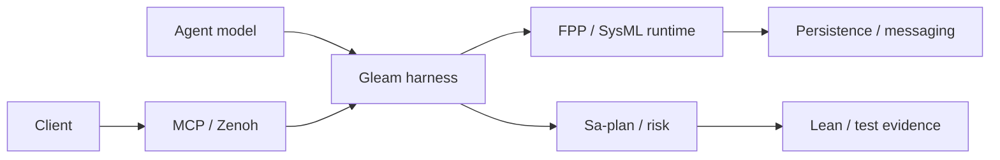

# Harness recovery and FPP/SysML integration: development specification

**Status:** DRAFT / DEVELOPMENT ONLY / NOT ADMITTED  
**Observed:** 2026-11-01T09:28:27Z; filename prefix uses UTC hour and seconds.  
**Latest evidence:** 2026-11-01T11:48:28Z; observations below retain their own timestamps.  
**Tags:** #fractal-l0 #fractal-l1 #fractal-l2 #fractal-l3 #fractal-l4 #fractal-l5 #fractal-l6 #fractal-l7 #fractal-l8 #fractal-l9 #zk-adr #zero-muda #km-triad  
**Planning:** `uos/harness-build-recovery/20261101-0913` and `uos/fpp-sysml-integration/20261101-0852`; Sa-plan is the execution authority.  
**References:** [Harness contract](http://nas-1.tail55d152.ts.net:4100/files/contracts/rules/20260909-0412-gleam-harness-agent-operation-contract.md), [FPP and model plan](http://nas-1.tail55d152.ts.net:4100/files/docs/design/20260906-0817-uos-implementation-03-models-and-actors.md), [Zenoh plan](http://nas-1.tail55d152.ts.net:4100/files/docs/design/20260906-0817-uos-implementation-04-zenoh-native-and-ecosystem.md). These are intended locators; publication of this draft has not been checked.

**External reference-only authorities:** [NASA FPP repository](https://github.com/nasa/fpp)
contains the FPP analysis and translation tools; [OMG SysML 2.0](https://www.omg.org/spec/SysML)
publishes the language specification and machine-readable abstract syntax.
[MCP transport guidance](https://blog.modelcontextprotocol.io/posts/2025-12-19-mcp-transport-future/)
describes stdio and Streamable HTTP as the interoperable standard transports
and allows custom transports. [Zenoh's storage guide](https://zenoh.io/docs/getting-started/first-app/)
states that a router starts without a configured storage by default.
These references are not an imported implementation or a conformance claim.
Select, pin and independently qualify exact versions before differential testing.

## Problem and intended boundary

The user requests FPP and SysML capabilities integrated with Gleam/OTP, Lean,
MCP, Zenoh, persistence, and agent model access. Existing implementations are
partial projections, not full NASA FPP or OMG SysML compilers. A development
grant was independently reviewed for a small FPP/SysML slice. The unified MCP
gateway refused its initial claim while the task was available; the dedicated
successor MCP established the actual Sa-plan lease and coordinator epoch, after
which the unified gateway attached. FPP and SysML regression tests were written
in the isolated candidate through MCP. Its first build failed because its
restricted PATH had no `cc`. The recorded failed result lacks a post-effect
manifest and end fence; the current pending-effect guard therefore prevents a
fresh attach. The failure is retained and is not a successful test.
At the latest status observation, Sa-plan still listed FPP `IMPLEMENT` as
executing and `REVIEW` as complete; the original failure nevertheless remains
unresolved. The FPP risk evidence expired at 09:24Z. The grant artifact's
12:57Z expiry alone does not establish current task authority, lease validity,
or permission to resume the stopped effect.

The following target has not been fully implemented or admitted:

```text
[Agent model] --> [Gleam harness]
[Client] --> [MCP / Zenoh]
[MCP / Zenoh] --> [Gleam harness]
[Gleam harness] --> [FPP / SysML runtime]
[Gleam harness] --> [Sa-plan / risk]
[FPP / SysML runtime] --> [Persistence / messaging]
[Sa-plan / risk] --> [Lean / test evidence]
```



## Current recovery candidate

The separate candidate adds the locked Nix C compiler output to the flake and
devenv packages, exposes `cc` through both resolver tables, replaces a host C
compiler reference in the release runner, permits only its existing bounded OTP
test environment override, and adds compile-and-run preflight checks. A diagnostic Gleam
classifier distinguishes a canonical nonzero build/test exit from a known
write conflict and from an unknown result. It does **not** settle the pending
effect, permit replay, establish that no files changed, or prove quiescence.
Its failed-check diagnostic binds both intent and result paths and hashes.
The candidate requires present typed receipt identities, binds them to the
current grant and task, and checks the task/coordinator fence before effect
reconciliation and immediately before the existing sidecar writes. These
checks are not atomic with the filesystem effect; they do not implement safe
failed-check retirement or establish process containment.
For dangling intents without results, the candidate writes the global intent
and signature tombstones before publishing the per-grant quarantine record,
and can retry an identical completed prefix. Existing matching files are
re-synced and their bytes rechecked before use; a successful retry is not
inferred from presence alone. An interrupted file write or
conflicting bytes remain held; the three files are not one atomic transaction.
The signature itself includes grant and attempt. The global intent tombstone
blocks an exact reused intent ID across grants, but an equivalent operation
under a different intent ID is not deduplicated by this candidate.

The candidate re-scans task work after a per-intent reconciliation and keeps
the stop and execution context when another record remains pending or the scan
fails. Existing exact bound resolutions can be read again. The planning CURRENT
pointer is checked against the task and logical ID; newly submitted planning
IDs must also fit the MCP reconciliation identifier syntax. An inspection of
12 existing planning IDs found none outside that syntax, but it did not prove
that all historical IDs are compatible. Older incompatible IDs remain held.

The reconciliation path now refuses an identifier present in more than one
of the assessment, planning, effect or completion namespaces, including
orphan completion-resolution records. This prevents silent precedence; it
does not provide a resolution procedure for a genuine collision. The guard
reads records for the current grant and is not an atomic snapshot: a concurrent
writer may change records after its checks. Missing parent directories and
read failures remain held. Other-grant effects and global burned-intent markers
are not included in this per-intent guard; concurrent creation and real MCP
interleavings also need integration tests and transactional fencing.

An independent review and a failing regression identified an additional MCP
admission defect: effect-time revalidation could reconstruct a previously
admitted call using a different valid task fence or principal. The candidate
now revalidates the current authority and then requires the same actor, client,
transport, workspace, session, plan, task, attempt and grant identity as the
admitted call. A lease extension with unchanged identity remains allowed.
This is continuity checking, not an agent authentication mechanism: the
`ValidatedCall` constructor remains public, trusted transport identity is not
established here, and the route grant is not independently re-read at effect
time. Production fencing and protection against forged in-process calls remain
separate requirements.

`formal/lean/HarnessFailedCheck.lean` models this limited classification and
proves that build/test failures do not settle merely because a resolution flag
is present. Its canonical-parsing bit is an abstraction. The proof does not
establish refinement to Gleam, process-tree containment, or persistence.

The candidate also makes writes to agent instruction and skill files, contract
Markdown/JSON, SOP Markdown/JSON, and agent policy Markdown/JSON candidate-source writes. They require exact source
manifest membership and a registered nonempty candidate workspace. Separate
explicitly scoped non-policy Markdown/JSON evidence writes still target the
canonical evidence root unless listed as candidate sources; their authorization
is a remaining review concern, not proof of publication authority.
This stricter classification also means existing empty-root grants for any
Markdown/JSON in those protected directories will be refused; compatibility
with existing workflows needs explicit migration and integration testing.
`formal/lean/HarnessSourceScope.lean` models these decisions after path
classification. Its five theorems cover source-list membership, candidate
placement for policy writes, and rejection of unauthorized/nonpublic writes;
they do not verify the concrete string classifier, workspace registration or
the relationship between the model and the running Gleam implementation.
`formal/lean/HarnessReceiptBinding.lean` additionally models nonmissing paired
identities, positive attempts/epochs and their ordering against a supplied
current binding. Its quarantine state model proves publication follows both
completed abstract tombstone steps. It does not observe a live lease, model a
torn write, or prove Gleam refinement. A separate abstract stop model covers
pending and unknown scan results, assuming the supplied scan result is correct.
The abstract effect-time model proves that changed session, attempt or grant
identities violate its stable-binding predicate; the model assumes its inputs
are already trusted and is not a proof of the Gleam implementation.

`formal/lean/HarnessAxiomAudit.lean` is a development prototype for a trusted
post-compilation audit. **Its current imported-wrapper invocation is UNSAFE
for untrusted modules and must not be used as a proof-admission gate.** An
independent review and a reproduced adversarial test showed that a target
initializer can exit successfully before the audit, and a target command
elaborator can suppress the audit while a forbidden axiom is present. A
successful process exit or printed marker does not establish audit execution.
For fixed trusted fixtures, the helper checks exact requested theorem names and module
origin, scans every declaration attributed to that module, and rejects
transitive axioms outside a fixed foundational allowlist. Its direct bootstrap
tests cover custom and macro-generated axioms, `sorry`, `admit`, native proof
axioms, missing or foreign declarations and an unrequested incomplete helper.
An axiom-clean theorem with the wrong statement still passes this check, and
different source files with the same module name can both pass. A trusted
wrapper must separately check the required statement and bind source bytes and
import closure. The prototype does not scan unused axioms in other modules,
isolate elaborator effects, or provide an MCP receipt.

`formal/lean/HarnessDataAudit.lean` is a separate development-only native
driver that imports fixed test artifacts as module data with extensions and
plugins disabled. Its selected theorem must match an independently selected
expected declaration modulo alpha-renaming of bound variables and universe
parameters; definitionally equivalent but syntactically different types may
be refused. The driver scans target-module declarations and their transitive
dependencies for unapproved axioms and unresolved names, rejects reserved
builtin-module shadows, and ignores the ambient `LEAN_PATH`. The driver emits
`AXIOM_METADATA_CHECKED_NO_KERNEL_REPLAY`, not a proof-admission result.

Fixed adversarial fixtures showed why both artifact provenance and kernel
replay are necessary. A forged builtin and a missing dependency initially
evaded the original metadata collector; the candidate now refuses those
fixtures. Replacing a dependency with one that retains its name but changes its
value still passes the metadata check, while a separate `leanchecker` replay of
the target rejects the changed proof. A selected specification, theorem,
artifact paths, complete import closure, source hashes and toolchain identity
must be bound independently to a current task grant; the prototype currently
accepts these as caller-provided inputs. Replay must cover the required trusted
closure, rather than assume that a successful target-only replay authenticates
all imports. Symlink/path validation, work and output bounds, atomic snapshot
binding, effect fencing and an independently verified receipt are also open.

The 28 fixed-fixture data-audit checks cover changed statements, universe
renaming, direct and multi-hop imported forbidden axioms, an unused target
axiom, mutual inductive declarations, a missing mutual constructor and altered
dependencies. Three additional host-specific
probes ran the native driver in bounded transient units with read-only mounts:
one clean fixture passed, an early-exit initializer did not run, and one hostile
elaborator/axiom fixture was refused. These observations do not establish general safety for arbitrary artifacts
or replace a qualified sandbox and proof route.
The optional invocation was `UOS_LEAN_DATA_SANDBOX_PROBE=1 bash
tools/test-harness-lean-data-audit`; its retained output is
`var/harness/20261101-1147-data-audit-sandbox.log` with SHA-256
`0fe5996ee0de74cfd69f7c421b516ce7d0eeebeca58528fc2d73d3874999994e`.

`tools/test-harness-lean-sandbox` is a separate development-only probe. It
uses a uniquely named transient user unit, a bounded cgroup and separate PID
and network namespaces. Four fixed probes observed Lean elaboration with host
home and a sentinel environment variable hidden, refusal of a write to the
mounted source, an axiom audit that accepts a fixed good theorem and rejects
`sorry`, a distinct network namespace, and termination of one detached test
child after a deadline. These observations do not qualify arbitrary process
trees, prove network nonreachability, pin the host isolation tools, or supply
task fencing, immutable source/import binding or an MCP proof receipt.

## Evidence and limits

| Observation | Result and boundary |
|---|---|
| Isolated Nix profile | Locked compiler and OTP outputs resolved; the C compiler built and ran a minimal program. |
| Candidate toolchain preflight | 33 checks passed with an explicitly linked canonical Mojo environment; a negative run without `cc` failed as intended. Re-run after candidate changes. These direct bootstrap runs are diagnostic, not admission. |
| Nix pin-check derivation | The already-realized inputs built a local check that compiled and ran C and checked OTP 29. |
| Application build | Isolated cold build succeeded in 82.17 s; warm build took approximately 0.30 s. The active harness has a 60 s build bound, so cold-build viability is not established. |
| Targeted recovery tests | 188 tests across eight harness/MCP modules passed, including typed receipt binding, policy grants, fence ordering, interrupted quarantine prefixes, a simulated torn tombstone, task-wide stop behavior, namespace collisions and effect-time binding. An earlier broader run had 187 passes and one `SA_PLAN_STORE_UNAVAILABLE` failure: that test expected an in-memory store while pointing to the canonical workspace. Its fixture now uses a unique temporary workspace. The full suite and task-bound MCP receipts remain required. |
| Existing receipt compatibility | A read-only JSON comparison found all 491 complete current effect pairs consistent on the identity fields inspected. This is not an execution of the candidate matcher, a proof of provenance, or a live lease check. |
| Lean | Twenty-eight abstract theorems in three models checked with Lean 4.33.0. Explicit audits allow only `propext`; sixteen identity, stop and effect-binding theorems need no axioms. The runtime correspondence is not proved. |
| Lean axiom-audit prototype | Twenty-one direct bootstrap fixture checks passed, including demonstrations that an axiom-clean but wrong statement requires a separate type check and same-named modules require source binding. | No task-bound MCP route, source/import hash binding, process isolation or code-to-model refinement. |
| Lean data-only prototype | Twenty-eight fixed-fixture checks passed; three additional bounded-unit fixtures passed. The changed-dependency fixture also showed that the metadata audit alone is insufficient, and separate target replay rejected that particular altered proof. | Caller-supplied spec and artifacts are not task/hash bound; complete-closure replay, containment qualification, and MCP receipt remain unverified. |
| Lean adversarial audit gate | FAILED: a fixed test reproduced both an early successful initializer exit and command-elaborator suppression of the audit. | The current imported-wrapper approach is not suitable for untrusted modules, regardless of sandboxing. |
| Lean sandbox prototype | Four direct development probes passed, including a good/sorry audit in a transient bounded unit and cleanup of one detached test child. | Host systemd/bubblewrap identities, complete cleanup, network, output bounds and real task-bound dispatch are not qualified. |
| Claude / AGY | Both reviewed an earlier candidate and returned `REVISE`; a follow-up AGY review also returned `REVISE`. A follow-up Claude request hit its budget without a verdict and reported a substantial estimated overrun. Later candidate changes are not externally approved. |

The two reviewers raised a PATH concern; inspection shows the runner's first
PATH component is the profile directory via `Filename.dirname(tool "erl")`.
The profile had lacked `cc`. The resolved compiler is the Nix `gcc-wrapper`
output, and the isolated candidate compiled the actual SQLite port driver; the
reviewers' speculation that this specific output is an unwrapped compiler is
therefore not supported by that observation. The guardian reports real timeout
conditions as `timeout` or `guardian_timeout`; both remain unknown and held.

At 2026-11-01T09:56Z the live MCP `system_health` observation reported the KM
brain healthy and canonical triad intact. The separate Zenoh observation
reported reachable REST/TCP endpoints but a stopped subscriber and a degraded
status. Those point-in-time probes are observational and do not establish
delivery. The connected `knowledge_search` schema did not expose the required
`limit` argument; bounded `zk_transclude` was used, and the schema gap remains.
An earlier [failed-check recovery observation](http://nas-1.tail55d152.ts.net:4100/files/governance/planning/20261028-2242-failed-check-recovery-observation.json)
likewise retained an original failure, prohibited retry and required independent
quiescence and remote-effect analysis. It is precedent, not current evidence.

## Concrete integration map and acceptance criteria

The following table describes proposed work, not implemented interfaces or
proof of conformance. Reference entries identify existing candidate code; no
semantic equivalence to NASA or OMG tools is assumed.

| Concern | Existing UOS seam | Required behavior and falsifying check |
|---|---|---|
| FPP structure | `fpp/domain.gleam` defines model, component, port, parameter, topology and state-machine types; `fpp/topology.gleam` provides a canonical projection. | Check identity uniqueness, complete references, type/direction compatibility, queue bounds and instance ID ranges. Compare valid and invalid fixtures with a pinned NASA FPP tool; a disagreement holds the claimed subset. |
| FPP execution | `fpp/interp.gleam` exposes machine initialization, signal dispatch and queues. | Define deterministic transitions and bounded queue behavior; run shared transition fixtures against the interpreter and Lean model, including invalid states, exhaustion and restart. |
| Parameter persistence | `fpp/prm_db.gleam` currently replies to `SaveParams` using an in-memory count. | Refuse a save while no durable owner is configured. For an owner-backed implementation, return success only after an identified commit and readback; test crash before/after commit, duplicate request, concurrent saves and restart recovery. Ambiguous outcomes remain unknown. |
| SysML subset | `fpp/sysml_validator.gleam` defines parts, ports, connections and requirements. | Reject duplicate IDs and unresolved composition, requirement and satisfaction references; check declared port type/direction. A `verified_by` label is not observed test evidence. Define the empty-requirements ratio and compare supported fixtures against a pinned OMG-compatible implementation. |
| Ontology and Lean | `fpp/ontology.gleam` derives a graph; `formal/lean/POODAVR_FPrime_Semantics.lean` and `Traceability.lean` contain existing models. | Define model well-formedness and exhibit at least one inhabitant to avoid vacuous consistency claims; prove selected properties over explicit assumptions. Bind theorem, model schema, code revision and executable fixtures; a changed parser, transition or schema must invalidate stale evidence. |
| MCP and Zenoh | Existing Gleam harness controls task-fenced MCP effects; Zenoh ingress requires separate admission. | Define typed versioned validate/query/transition/save requests with task identity, correlation ID, deadline and idempotency key. Test duplicate, out-of-order, disconnected, backpressured, stale-lease and authorization-denied cases; transport delivery is not a durable commit. |
| Agent access and spend | Actual AGY and Claude direct reviews were observed; the requested complete harness route is unverified. | Provide task-scoped development grants for the full set of required Codex, Claude, AGY and Pi operations, including model execution, review, source changes, build, tests, proof and messaging within the task scope. Surface a missing capability or expired grant as a hold and renew/recover through the controller rather than silently dropping it. Route model work through an admitted task-scoped adapter with measured assembled context, model and output limits, pre-reserved spend and provider reconciliation. A locally reported threshold alone is insufficient; test refusal before dispatch and overspend handling with a fake provider. |

MCP is the typed tool and control interface. Zenoh can carry addressed events
and data synchronization between the Gleam controller and agent adapters. An
MCP-over-Zenoh connection requires a custom transport or bridge; clients that
only implement standard MCP transports cannot be assumed to support it. Zenoh
publication alone is not a durable commit: an explicitly configured persistence
owner and verified commit/readback are required. Each
adapter still needs observed start, control, result, cancellation, heartbeat,
authorization and recovery behavior; transport connectivity alone does not
establish that all four agents are controllable. Task-scoped development grants
do not assert production admission or remove lease, effect and budget checks.
Existing `harness/client_profiles.gleam` declares stdio MCP client profiles for
all four requested agents, and `mcp/runtime_gateway.gleam` contains a Zenoh
subscriber seam. Those source declarations do not prove live agent execution,
mutual communication or an enabled subscriber.

At 2026-11-01T11:47Z the live MCP capability-inventory projection returned
101 declared routes, 89 marked implemented, and zero marked observed or admitted;
it also described its ledger as self-attested and unpinned. These are the
projection's fields, not a proof that no individual operation works or that
the declared implementations provide the requested capabilities.

### Task-scoped agent capability contract

The operator's desired development route grants the complete capability set
needed for the task, rather than silently dropping a requested agent or tool.
Before an agent is dispatched, the controller must bind an independently
authenticated agent/session to the current plan, task, attempt, workspace,
lease and reviewed grant. The grant must cover source and knowledge access,
model invocation and review, task-scoped changes, build/test/proof, addressed
MCP/Zenoh messaging, persisted evidence, cancellation and status. Required
operations remain confined to that task's resources. It must observe and renew
leases/grants before expiry where authorized, and surface a missing capability,
revocation, unresolved effect or expired fence as a hold instead of claiming a
full route. This paragraph specifies the target behavior; it is not evidence
that automatic issuance, renewal or every operation is implemented.

| Agent | Existing source profile | Evidence in this investigation | Still needed |
|---|---|---|---|
| Codex | Declared stdio MCP profile. | Task-bound MCP attached and wrote two isolated FPP/SysML tests; its build failed and the task remains held. | Complete recovery, proofs, messaging and durable operations through the current task route. |
| Claude | Declared stdio MCP profile. | A direct review of an earlier candidate returned `REVISE`. | Authenticated task-bound MCP/Zenoh control, cancellation and a reviewed latest-candidate result with pre-dispatch cost control. |
| AGY | Declared stdio MCP profile. | Direct reviews of an earlier candidate returned `REVISE`. | Authenticated task-bound MCP/Zenoh control, cancellation and a reviewed latest-candidate result. |
| Pi | Declared stdio MCP profile. | No task-bound Pi execution is established by these observations. | Demonstrate start, result, cancellation and recovery through its authenticated task route. |

For each increment, record candidate revision, toolchain and fixture hashes,
actual result, formal assumptions, counterexamples and residual risk. A passing
abstract Lean theorem does not establish the implementation-to-model relation;
runtime traces, differential tests and separately reviewed refinement evidence
are needed. No unsupported FPP/SysML construct may silently be treated as valid.

## Prioritized implementation plan

1. **P0 — safe recovery:** preserve the original failed intent/result and partial
   build artifacts. Specify a hash-bound terminal-failure or quarantine record,
   process-containment evidence, ownership and a fresh isolated build directory.
   Do not classify a failed build as `KNOWN_NOT_APPLIED`. Review and test the
   recovery path before using it; malformed, stale, timeout and forged records
   must remain held. A diagnostic classifier alone is not recovery.
2. **P0 — build execution:** bind compiler, lockfile, profile and candidate
   identities to build evidence. Provide a cold-build path that respects bounded
   workers, rather than relying on a warmed cache or silently widening limits.
   Restore task-bound MCP read/write/build/test/clock, replay and refusal checks.
   Review canonical evidence-write authority separately and exercise a policy
   grant through real decode, JJ registration and the complete operation path.
3. **P1 — FPP:** remove false save acknowledgements; define a separately owned,
   supervised parameter store with transaction, concurrency, restart and
   ambiguous-outcome semantics. Expand the existing Gleam domain/interpreter
   against a pinned official FPP toolchain and differential fixtures.
4. **P1 — SysML:** reject dangling composition/requirement/satisfaction
   references, duplicate identifiers and incompatible port directions. Treat
   verification labels as declarative mappings until evidence is resolved.
   Define the supported SysML subset and test it against a pinned official or
   independently qualified parser; do not call projections full conformance.
5. **P1 — transport and storage:** expose typed task-fenced FPP/SysML intents
   through MCP and admitted Zenoh ingress. Specify addressed delivery,
   correlation, idempotency, replay, backpressure, restart and timeout behavior.
   Bind durable writes and readback to an owner-managed store; exercise restart
   and fault injection before claiming durability.
6. **P1 — Lean and traceability:** extend the supported ontology and transition
   models, map each theorem to exact code and shared executable fixtures, audit
   axioms and proof dependencies, and check candidate/toolchain digests. Keep
   abstract proofs distinct from implementation refinement and runtime evidence.
   First provide a bounded task-scoped Lean operation with an exact source and
   theorem allowlist, immutable import closure and pinned toolchain identity.
   Compile in an isolated, resource-limited process with no ambient credentials
   or network, then perform a trusted transitive axiom audit; `sorryAx`, custom
   axioms, missing declarations, timeouts, changed inputs and unknown cleanup
   outcomes are nonpassing. A Lean exit code alone is only a typecheck, not an
   axiom audit or proof of runtime refinement. One independent initial model
   can cover FPP connector endpoint resolution and output-to-input direction,
   with valid and invalid fixtures; add separately authorized Gleam/Lean
   differential fixtures only after the model and runtime scopes are aligned.
7. **P2 — agent intelligence and operations:** route Codex, Claude, AGY and Pi
   through admitted capabilities with task scopes, budgets, observed provider
   usage, deadlines and explicit unavailability. Test actual provider access,
   model-cost limits, hierarchy, monitoring and failure handling. Do not infer
   live agent access from configuration or a catalog. Pause further paid calls
   until pre-dispatch context accounting and a separately enforced spending cap
   are implemented and provider usage is reconciled; a CLI post-call threshold
   is not a hard cap. The local request trace shows 167 attached instruction
   files totaling 1,244,534 bytes for the overrun review, in addition to the
   34,350-byte submitted packet. Future preflight must account for the assembled
   request and its cache-write rates, not merely the visible packet.

The older [isolated fixture recovery precedent](http://nas-1.tail55d152.ts.net:4100/files/governance/planning/20261028-2310-pipe-recovery-scope.json)
records an independent Sa-plan task and workspace while the prior failed effect
remained held. A new formal-only FPP task could follow that pattern without
rewriting or retrying this failure, subject to a reviewed task grant, fresh
risk evidence and an operational task-bound Lean checker. This candidate does
not yet provide such a checker, and no new task or proof receipt is implied.

## Risk and control constraints

Scores are analyst estimates on 1–5 scales, not measured probabilities.

| Failure mode | S | O | D | RPN | Required control |
|---|---:|---:|---:|---:|---|
| Failed build represented as clean or successful | 5 | 2 | 3 | 30 | Bind exact intent/result hashes; retain failure and require independent recovery evidence. |
| Missing receipt fields compare equal or ownership becomes stale | 5 | 2 | 3 | 30 | Require typed current-task identity and observed fence; implement atomic fence/effect semantics before admission. |
| A validated call is rebound to another task or agent session | 5 | 2 | 4 | 40 | Compare the admitted principal and task/grant identity after current authority is checked; separately authenticate identities, seal call provenance and re-read route grants. |
| An imported Lean module suppresses its own audit | 5 | 3 | 5 | 75 | Hold proof admission; require a trusted data-only verifier, non-forgeable completion evidence and negative tests for initialization and elaborator hijacking. |
| A dependency changes behind an unchanged module name | 5 | 3 | 5 | 75 | Bind independently reviewed source and compiled-artifact hashes for the complete import closure and replay the required proofs; metadata-only checks are non-admitting. |
| Same identifier occurs in multiple reconciliation namespaces | 4 | 3 | 4 | 48 | Refuse ambiguous recovery, preserve the stop and design explicit namespace selection with a task-bound audit trail; test concurrent creation. |
| Quarantine is interrupted or a duplicate uses a new intent ID | 5 | 2 | 4 | 40 | Burn stable intent first, repair completed prefixes, and separately implement durable semantic identity and atomic effect fencing. |
| Pinned compiler absent from restricted PATH | 4 | 3 | 3 | 36 | Pin and functionally probe the compiler; no host fallback. |
| Cold build exceeds the worker deadline | 3 | 4 | 3 | 36 | Bounded staged builds with explicit timeout, cleanup and candidate binding. |
| Parameter save reports success without durable commit | 4 | 3 | 3 | 36 | Fail closed until a durable owner-managed adapter confirms commit. |
| Agent policy is written as canonical evidence | 5 | 2 | 3 | 30 | Classify agent instructions, skills, rules and SOPs as candidate sources; test complete admission and separately review remaining evidence writes. |
| Model review consumes an unexpectedly large context | 4 | 4 | 5 | 80 | Stop paid dispatch; measure the assembled prompt and enforce a cost limit before provider execution. |
| Zenoh subscriber is stopped while transport endpoints are reachable | 4 | unknown | unknown | unknown | Investigate through the owning service and task fence; verify delivered and acknowledged messages before claiming integration. |

STPA control-action constraints cover all four UCA types: do not omit the stop
when evidence is missing; do not provide a success/clean classification for a
failure; do not resume on a stale lease or before containment evidence; and do
not keep a bootstrap or lease active outside its bounded scope. The guardian
reaps its own process group but does not contain children that create new
sessions; this residual is not removed by a recorded exit code.
The release-runner candidate constrains inherited `OPAM_SWITCH_PREFIX` and
`OCAMLPATH` for its child processes, but its own interpreter has already started
before that constraint and it still inherits `HOME`; neither boundary is yet
proven safe from ambient configuration.

## Verification checklist

- [ ] CHK-01 Timestamp and clock evidence bound to final candidate.
- [ ] CHK-02 Tailnet publication and byte identity observed after authorized cutover.
- [ ] CHK-03 Fractal tags and relevant layers checked.
- [ ] CHK-04 Wiki, ZK, KM and journal reciprocal links verified.
- [ ] CHK-05 Zero-Muda dependency and source exclusions checked.
- [ ] CHK-06 Graph and native-kernel boundaries verified.
- [ ] CHK-07 Storage safety interlocks preserved and tested in scope.
- [ ] CHK-08 Applicable C1–C8 checks executed.
- [ ] CHK-09 Applicable mathematical gates evaluated with real evidence.
- [ ] CHK-10 Unit, property, fault and performance tests executed as applicable.
- [ ] CHK-11 Regression and runtime observations bound to the candidate.
- [ ] CHK-12 Gleam/OTP supervision and restart behavior observed.
- [ ] CHK-13 Hermes and bounded worker evidence verified.
- [ ] CHK-14 ZigVM behavior and storage boundaries verified where used.
- [ ] CHK-15 Inference isolation and actual model access verified where used.
- [ ] CHK-16 Trace and telemetry propagation observed.
- [ ] CHK-17 Required independent reviews and effect authority verified.
- [ ] CHK-18 Standalone JJ candidate and Sa-plan evidence reconciled.
- [ ] Provenance: EV-93 ceiling retained; EV-94–109 not treated as admitted.
