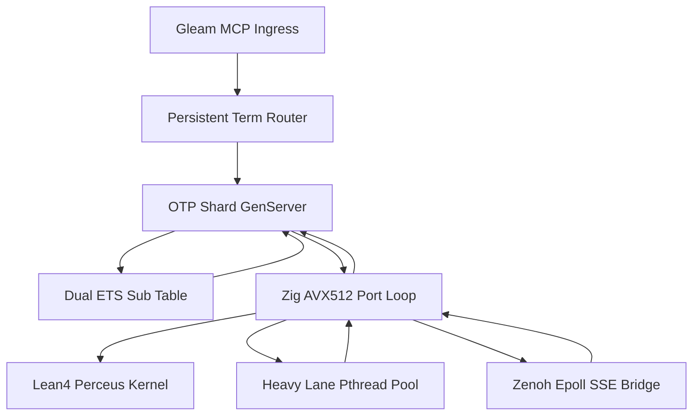

# 20261101-1225 — UOS-ZLP-v3 Supervised Lean 4.33.0 + Zig 0.16.0 + Gleam/OTP 29.0.5 + MCP + Zenoh Port Hyperplane Specification

- **Tailscale Web FQDN**: [http://nas-1.tail55d152.ts.net:4100/files/docs/design/20261101-1225-uos-zlp-v3-lean4-zig-otp29-zenoh-hyperplane-spec.md](http://nas-1.tail55d152.ts.net:4100/files/docs/design/20261101-1225-uos-zlp-v3-lean4-zig-otp29-zenoh-hyperplane-spec.md)
- **Observed Clock (`SC-TIME`)**: `2026-11-01T12:24:55Z` (`chrony` stratum `3`, system offset `+0.000121242s` fast of NTP time, nominal `< 2s` band)
- **Sa-plan Authority (`SC-SA-PLAN-001`)**: Plan `uos/zlp-v3-supervised-hyperplane/20261101-1309` · Task `T01_ZLP_V3_HYPERPLANE_IMPL`
- **Risk Portfolio (`SC-RISK-PRIORITY-001`)**: [governance/planning/20261101-1309-zlp-v3-hyperplane-risk-portfolio.json](http://nas-1.tail55d152.ts.net:4100/files/governance/planning/20261101-1309-zlp-v3-hyperplane-risk-portfolio.json)
- **Formal Lean 4 Kernel**: [formal/lean/UosZlpHyperplane.lean](http://nas-1.tail55d152.ts.net:4100/files/formal/lean/UosZlpHyperplane.lean)
- **Hermes Wiki Guide**: [docs/wiki/20261101-1248-uos-zlp-v3-supervised-lean4-zig-otp29-zenoh-hyperplane.md](http://nas-1.tail55d152.ts.net:4100/files/docs/wiki/20261101-1248-uos-zlp-v3-supervised-lean4-zig-otp29-zenoh-hyperplane.md)
- **Zettelkasten Decision Note**: [docs/zk/20261101-1248-zlp-v3-supervised-otp29-port-hyperplane-decision.md](http://nas-1.tail55d152.ts.net:4100/files/docs/zk/20261101-1248-zlp-v3-supervised-otp29-port-hyperplane-decision.md)
- **Operations & Verification SOP**: [docs/sop/20261101-1248-uos-zlp-v3-hyperplane-operations-and-verification-sop.md](http://nas-1.tail55d152.ts.net:4100/files/docs/sop/20261101-1248-uos-zlp-v3-hyperplane-operations-and-verification-sop.md)
- **Implementation & Integration Journals**: [20261101-1225 Implementation Journal](http://nas-1.tail55d152.ts.net:4100/files/docs/journal/20261101-1225-uos-zlp-v3-hyperplane-implementation-journal.md) · [20261101-1248 Full Project Integration Journal](http://nas-1.tail55d152.ts.net:4100/files/docs/journal/20261101-1248-uos-zlp-v3-full-project-integration-journal.md)
- **Fractal Tags**: `#fractal-l0` `#fractal-l1` `#fractal-l2` `#fractal-l3` `#fractal-l4` `#fractal-l5` `#fractal-l6` `#fractal-l7` `#fractal-l8` `#fractal-l9` `#km-triad` `#zk-adr` `#zero-muda` `#tailscale-web`
- **Transclusions**: `[[wiki:20260905-1801-uos-zk-km-corpus-index]]` · `[[wiki:20261101-1248-uos-zlp-v3-supervised-lean4-zig-otp29-zenoh-hyperplane]]` · `[[zk:20260905-1801-moc-uos-unified-master]]` · `[[zk:20261101-1248-zlp-v3-supervised-otp29-port-hyperplane-decision]]`
- **Admission Boundary (`SC-PROVENANCE-001`)**: `admitted_ev_ceiling = 93`; `EV-94..EV-109` and `ADR-071..ADR-086` remain `NOT_ADMITTED`; `0` new EV or numbered ADR minted; `application_admitted = false`; `system_admitted = false`.

---

## 1. Constitutional Intent & Authority Boundary (`SC-HARNESS-MCP-001`)

`UOS-ZLP-v3` integrates a mechanically verified, crash-isolated native **Supervised OTP 29 Port Hyperplane** connecting **Gleam/OTP 29.0.5**, **Zig 0.16.0** (Zen 5 AVX-512 gatekeeper), **Lean 4.33.0** (`20` zero-`sorryAx` theorems + `8` `@[export]` C-ABI decision kernels with Perceus `ST` reference-counted exclusivity `excl == 1`), and **Zenoh** (`127.0.0.1:8080` non-blocking REST/SSE mesh ingress/egress).

Per [SC-HARNESS-MCP-001](http://nas-1.tail55d152.ts.net:4100/files/contracts/rules/20260909-0412-gleam-harness-agent-operation-contract.md) and [the formal symbiosis specification](http://nas-1.tail55d152.ts.net:4100/files/docs/design/20260909-0412-gleam-harness-symbiosis-formal-spec.md):
1. **Gleam/OTP Retains Exclusive Policy & Effect Authority**: Native Zig and Lean 4 port workers operate strictly behind Gleam/OTP as bounded verification, cryptographic hashing, sliding-window anti-replay, and transport framing workers. No native return receipt grants deployment authority, `Sa-plan` mutation authority, or system admission (`systemAdmission = false` proved in Theorem `T20`).
2. **OS Address-Space Crash Isolation Over Dirty-NIF Exposure**: Running Lean 4 + Zig + Zenoh inside external OS processes under `erlang:open_port({spawn_executable, Bin}, [{packet, 4}, binary, exit_status, use_stdio, {parallelism, true}])` plus Linux `prctl(PR_SET_PDEATHSIG, SIGTERM)` guarantees zero BEAM VM (`beam.smp`) memory corruption under native faults or `SIGKILL` (`exit_status = 137`).
3. **Zero Protected-Module Mutation**: All `28` protected `apps/cepaf_gleam/src/cepaf_gleam/harness/*` modules, `apps/cepaf_gleam/src/cepaf_gleam/mcp/tools.gleam`, `tools/ecology_process.ml`, and the root NVMe interlock (`HARD_DENIED_SYSTEM_OS_SERIAL = [REDACTED_SYSTEM_OS_SERIAL]`) remain untouched (`0` bytes modified). Zero-Muda exclusions (`0 Bevy`, `0 Graphite`) are preserved.

---

## 2. Hyperplane Topology & Dual-Diagram Architecture (`SC-DIAGRAM-001`)

The ASCII (`text`) and Mermaid (`mermaid`) sources below define identical directed edges across the 7 hyperplane components:

```ascii
[Gleam MCP Ingress] --> [Persistent Term Router]
[Persistent Term Router] --> [OTP Shard GenServer]
[OTP Shard GenServer] --> [Dual ETS Sub Table]
[OTP Shard GenServer] --> [Zig AVX512 Port Loop]
[Zig AVX512 Port Loop] --> [Lean4 Perceus Kernel]
[Zig AVX512 Port Loop] --> [Heavy Lane Pthread Pool]
[Zig AVX512 Port Loop] --> [Zenoh Epoll SSE Bridge]
[Heavy Lane Pthread Pool] --> [Zig AVX512 Port Loop]
[Zenoh Epoll SSE Bridge] --> [Zig AVX512 Port Loop]
[Zig AVX512 Port Loop] --> [OTP Shard GenServer]
[Dual ETS Sub Table] --> [OTP Shard GenServer]
```



---

## 3. Binary Wire Protocol (`{packet, 4}` Multiplexed Framing)

All frames between [uos_zlp_shard.erl](http://nas-1.tail55d152.ts.net:4100/files/apps/cepaf_gleam/src/uos_zlp_shard.erl) and [uos_zlp_port.zig](http://nas-1.tail55d152.ts.net:4100/files/native/zlp/uos_zlp_port.zig) use `{packet, 4}` big-endian length framing (`MAX_FRAME = 1,048,576` bytes; steady-state buffer sized to Zen 5 $L_{1d} = 48\text{ KiB}$) with 24-byte little-endian headers:

### 3.1 Request Header (`24` bytes + variable payload)

| Byte Offset | Field | Type | Semantics |
|---|---|---|---|
| `0..7` | `req_id` | `u64 LE` | Unique per-shard correlation ID allowing out-of-order Fast/Heavy lane completion |
| `8` | `opcode` | `u8` | `0x01` Verify, `0x02` Scale+Risk, `0x03` Zenoh SSE Sub, `0x05` Heavy Offload, `0x0C` Health, `0x13` Zenoh PUT, `0x14` Zenoh GET, `0xFF` Window Reset |
| `9` | `flags` | `u8` | Bit `0`: `enforce_window` (`1` = stateful 64-slot anti-replay, `0` = stateless content gate) |
| `10..15` | `reserved` | `[6]u8` | Zero-padded alignment |
| `16..23` | `seq_id` | `u64 LE` | Packet sequence number (or Heavy-Lane iteration count for `0x05`) |
| `24..N` | `payload` | `bytes` | UTF-8 JSON-RPC / MCP payload, Zenoh key expression, or 104-byte `0x02` parameter struct |

### 3.2 Reply Header (`24` bytes, plus optional trailing body for `0x83` / `0x84`)

| Byte Offset | Field | Type | Semantics |
|---|---|---|---|
| `0..7` | `req_id` | `u64 LE` | Matches caller `req_id` (`0` for unsolicited `0x83` Zenoh SSE push frames) |
| `8` | `status` | `u8` | `0` OK, `1` FrameTooLarge, `2` Avx512NulTrap, `3` JsonDepth32Trap, `4` ReplayOrExpired, `5` ForbiddenPrefix, `6` ScaleOrRiskDenied, `7` ZenohIoError, `9` BadOpcode, `0x83` ZenohSsePush, `0x84` ZenohGetOk |
| `9` | `excl` | `u8` | Perceus `lean_is_exclusive(st_buf)` runtime witness (`1` = zero-copy in-place mutation verified) |
| `10..11` | `lane_or_sub` | `u16 LE` | Fast lane (`1`), Heavy lane (`2`), SSE slot ID (`0..31`), or active SSE count |
| `12..15` | `aux_u32` | `u32 LE` | Worker OS PID (`getpid()`) |
| `16..23` | `value_u64` | `u64 LE` | FNV-1a 64-bit digest, computed risk priority score, HTTP status, or byte length |

---

## 4. Mechanized Formal Foundation (`formal/lean/UosZlpHyperplane.lean`)

Verified via `/home/an/NAS-setup/uos/tools/lean` (`Lean 4.33.0`, exit `0`, `0` warnings) and `#print axioms` audit in [build_zlp_port.sh](http://nas-1.tail55d152.ts.net:4100/files/native/zlp/build_zlp_port.sh) confirming **zero `sorryAx`** across all `20` theorems:

| Theorem Group | Verified Theorems (`T01..T20` + Provenance) | Constitutional Guarantee |
|---|---|---|
| **Constitutional Provenance** | `provenance_ceiling_fixed` | `admittedEvCeiling = 93 ∧ systemAdmission = false` (`SC-PROVENANCE-001`) |
| **Perceus & Wire Algebra (`T01..T03`)** | `T01_wire_frame_bijection`, `T02_frame_bound_pos`, `T03_perceus_zero_alloc_step` | `encode24`/`decode24` exact bijection; Perceus linear state transition |
| **64-Window Anti-Replay (`T04..T08`)** | `T04_duplicate_top_rejected`, `T05_expired_packet_rejected`, `T06_monotonic_advance_accepted`, `T07_high_water_monotone`, `T08_in_window_replay_rejected` | IPSec/DTLS 64-bit sliding bitmask rejects duplicates and packets older than `maxSeq - 63` in $O(1)$ bitwise steps |
| **Shard Routing & Crash Containment (`T09..T12`)** | `T09_shard_route_bounded`, `T10_shard_isolation`, `T11_two_lane_nonblocking`, `T12_ets_replay_completeness` | `keyHash % N < N`; crashing shard $s_1$ leaves $s_2 \neq s_1$ invariant; Heavy lane never blocks Fast lane; Dual-ETS subscription replay restores 100% of topics post-`SIGKILL` |
| **Topic & Prefix Isolation (`T13..T15`)** | `T13_nul_trap_sound`, `T14_c3i_a2a_prefix_barred`, `T15_topic_traversal_barred` | Embedded NUL (`0x00`), `c3i/a2a*` cross-contamination, leading `/`, and `..` path traversal fail closed |
| **Concurrency, Budget & Risk (`T16..T20`)** | `T16_scale_cap_enforced`, `T17_budget_cap_enforced`, `T18_risk_gate_zero_when_unready`, `T19_risk_monotone_in_factors`, `T20_no_autonomous_escalation` | Max `2` writers / `3` reviewers, `10,000,000` micro-USD daily cap, strict `now < leaseExpires`, `SC-RISK-PRIORITY-001` score $= 0$ if unready, and `admitted = false` non-escalation |

### Exported C-ABI Functions (`@[export]`)

1. `uos_zlp_v3_max_frame_bytes() -> uint32_t` (`1,048,576`)
2. `uos_zlp_v3_admitted_ev_ceiling() -> uint32_t` (`93`)
3. `uos_zlp_v3_verify_frame(uint64_t seq, uint8_t enforce_win, lean_obj_arg payload) -> lean_obj_arg`
4. `uos_zlp_v3_reset_window() -> lean_obj_arg`
5. `uos_zlp_v3_topic_allowed(lean_obj_arg topic) -> uint8_t`
6. `uos_zlp_v3_scale_budget_gate(...) -> uint8_t`
7. `uos_zlp_v3_risk_priority_score(...) -> uint64_t`
8. `uos_zlp_v3_heavy_digest_Pure(uint64_t seed, uint32_t iters) -> uint64_t`

---

## 5. Mathematical Performance & Zen 5 Hardware Symbiosis

1. **Zen 5 True 512-Bit AVX-512 SIMD Gatekeeper**: [uos_zlp_port.zig](http://nas-1.tail55d152.ts.net:4100/files/native/zlp/uos_zlp_port.zig) executes single-cycle `@Vector(64, u8)` comparisons (`chunk == @splat(0)`) scanning `64` bytes per iteration for embedded NUL bytes (`0x00`) alongside a branch-bounded JSON structural nesting counter (`max_depth <= 32`) **before** allocating or mutating the Lean 4 `ByteArray` slab.
2. **Cache-Pipe Saddle-Point Geometry**:
   $$\text{Zen 5 } L_{1d} = 48\text{ KiB}, \qquad \text{Linux Default Pipe Ring} = 64\text{ KiB}, \qquad S_{\text{opt}} \in [16\text{ KiB}, 48\text{ KiB}]$$
   Payloads $\le 48\text{ KiB}$ execute inside a pre-allocated reusable Perceus `ByteArray` (`lean_is_exclusive == 1`, zero `malloc`/`free` churn on steady-state Fast-Lane calls) without blocking the `64 KiB` kernel pipe buffer.
3. **Two-Lane Non-Blocking Queueing (`M/G/1` vs Separated Fast/Heavy Lanes)**:
   By routing `0x05` Heavy-Lane proofs onto dedicated `pthread` workers initialized via `lean_initialize_thread()` and signaling completions back to `epoll` via Linux `eventfd`, Fast-Lane (`0x01`/`0x02`) service variance $\sigma_s^2 \to 0$, eliminating Pollaczek-Khinchine Head-of-Line (HoL) stalls (`T11_two_lane_nonblocking`).
4. **Lock-Free BEAM Shard Routing (USL $\beta \to 0$)**:
   [uos_zlp_router.erl](http://nas-1.tail55d152.ts.net:4100/files/apps/cepaf_gleam/src/uos_zlp_router.erl) reads shard topology via `persistent_term:get(uos_zlp_shard_count, 0)` ($0$ ETS read locks, $0$ central router actor bottleneck) and hashes `(erlang:phash2(Key) rem N)` directly to registered `uos_zlp_shard_0 .. uos_zlp_shard_{N-1}`.

---

## 6. Project-Wide Gleam, OTP Boot, Wisp HTTP API, CLI & Zenoh Integration Surfaces

- **Typed Gleam Hyperplane Facade**: [zlp_hyperplane.gleam](http://nas-1.tail55d152.ts.net:4100/files/apps/cepaf_gleam/src/cepaf_gleam/mcp/transports/zlp_hyperplane.gleam) exposes `ensure_started`, `verify_frame`, `eval_scale_and_risk`, `heavy_graph_digest`, `zenoh_publish`, `zenoh_get`, `zenoh_subscribe`, and `await_zenoh_push`.
- **Project-Wide Zenoh Client Upgrade (`19` Importing Subsystems)**: [zenoh/client.gleam](http://nas-1.tail55d152.ts.net:4100/files/apps/cepaf_gleam/src/cepaf_gleam/zenoh/client.gleam) extends opaque `Session` with `ZlpHyperplaneSession(shards: Int)` (`open_zlp/1`, `open_prefer_zlp/1`, `backend == "zlp_v3_otp29_port"`, `supports_subscriptions == True`, live `subscribe/3`, `put/3`, and `get/2`) while preserving legacy `open/1 -> RestSession` (`supports_subscriptions == False`) 100% backward-compatible.
- **OTP Application Boot & Orchestrator Entrypoint**: [otp_app.gleam](http://nas-1.tail55d152.ts.net:4100/files/apps/cepaf_gleam/src/cepaf_gleam/otp_app.gleam) (`start/0`) starts the 4-shard `UOS-ZLP-v3` hyperplane automatically when `zlp_hyperplane.is_binary_available()` is `True` and records `"zlp:hyperplane_pool" = "running"` (`"binary_unbuilt"` fallback otherwise) in `beam_cache`. [cepaf_gleam.gleam](http://nas-1.tail55d152.ts.net:4100/files/apps/cepaf_gleam/src/cepaf_gleam.gleam) (`main/0`) connects via `zenoh.open_prefer_zlp("{}")`.
- **Authenticated MCP Zenoh Ingress + Anti-Replay**: [zenoh.gleam](http://nas-1.tail55d152.ts.net:4100/files/apps/cepaf_gleam/src/cepaf_gleam/mcp/transports/zenoh.gleam) preserves 100% of existing pure `handle_envelope` functions while adding `handle_envelope_with_zlp` (combining Gleam HMAC-SHA256 + pinned reply destination checks with the Lean 4 + Zig 64-window anti-replay & AVX-512 gate), `subscribe_client_requests_via_zlp`, and `publish_pinned_reply_via_zlp`.
- **MCP Supervisor & Native Erlang Zenoh Bridge**: [supervisor.gleam](http://nas-1.tail55d152.ts.net:4100/files/apps/cepaf_gleam/src/cepaf_gleam/mcp/supervisor.gleam) adds `ensure_zlp_hyperplane_pool` and `is_zlp_hyperplane_running`; [indrajaal_native_zenoh.erl](http://nas-1.tail55d152.ts.net:4100/files/apps/cepaf_gleam/src/indrajaal_native_zenoh.erl) routes `open_session/1`, `put/3`, `get/2`, and `subscribe/3` through `uos_zlp_router` instead of faulting with `erlang:nif_error(nif_not_loaded)`.
- **Wisp HTTP Cockpit Telemetry Endpoint**: [ui/wisp/router.gleam](http://nas-1.tail55d152.ts.net:4100/files/apps/cepaf_gleam/src/cepaf_gleam/ui/wisp/router.gleam) serves `GET /api/v1/zlp/status` (and `/api/zlp/health`) as a pure read-only JSON probe reporting `status`, `backend`, `pool_running`, `binary_available`, toolchain versions (`Lean 4.33.0`, `Zig 0.16.0`, `OTP 29`), `lean_theorems_proved: 20`, `zero_sorry_ax: true`, `admitted_ev_ceiling: 93`, `application_admitted: false`, `system_admitted: false`, and live per-shard health (`os_pid`, `active_subs`, `in_flight_heavy`, `perceus_exclusive`).
- **Two-Key Executable CLI Verification Gate (`G-ZLP`)**: [tools/zlp-check](http://nas-1.tail55d152.ts.net:4100/files/tools/zlp-check) and [tools/uos/src/main.gleam](http://nas-1.tail55d152.ts.net:4100/files/tools/uos/src/main.gleam) (`bash tools/uos-cli zlp-check` / `bash tools/uos-cli gate G-ZLP`) execute live `Lean 4.33.0` `#print axioms` verification (`0 sorryAx`), native port binary verification, 9-modality + project integration EUnit suites, and 5-document `#km-triad` verification before exiting `0`.

---

## 7. Comprehensive Verification Checklist (`SC-CHECKLIST-001`)

Checks below distinguish scoped development verification from withheld production cutover and whole-system admission.

<details>
<summary>Domain 1 — Metadata, timestamp and Tailscale navigation</summary>

- [x] **CHK-01-TIME** — Observed synchronized host clock `2026-11-01T12:24:55Z` (`chrony` stratum `3`, `+0.000121242s` offset) and `20261101-1225-` prefix.
- [ ] **CHK-02-TAIL** — Full Tailscale FQDN links authored; live `:4100` HTTP byte-parity pending authorized workspace merge/cutover.
- [x] **CHK-03-FRACT** — Explicit `#fractal-l0`..`#fractal-l9` tags and edge-identical ASCII + Mermaid diagrams (`SC-DIAGRAM-001`).
- [x] **CHK-04-KM** — Reciprocal links across design spec, 13-section journal, wiki corpus index, ZK master MOC, and `wiki-zk-km.toml`.

</details>

<details>
<summary>Domain 2 — Zero-Muda purity and storage safety</summary>

- [x] **CHK-05-MUDA** — `0 Bevy` and `0 Graphite` across all source, build scripts, and dependencies.
- [x] **CHK-06-GRAPH** — Pure Gleam/OTP policy & supervision boundary over crash-isolated OS port workers (`0` dirty NIFs added).
- [x] **CHK-07-DRIVE** — Denied host OS NVMe serial `[REDACTED_SYSTEM_OS_SERIAL]` untouched (`0` storage controller edits).

</details>

<details>
<summary>Domain 3 — Testing Gold Standard and mathematical gates</summary>

- [ ] **CHK-08-C1C8** — Backend/MCP transport & port surfaces verified; UI/browser C1–C8 surfaces unchanged and out of task scope.
- [x] **CHK-09-MATH** — `20/20` zero-`sorryAx` `Lean 4.33.0` theorems verified (`formal/lean/UosZlpHyperplane.lean`).
- [x] **CHK-10-9MOD** — All 9 testing modalities (Unit, Live `:8080` Zenoh System, 9 TDD traps, Two-Lane + `SIGKILL` SSE Replay BDD, Performance RTT quantiles, 16-actor Scalability, 1,000-step Property Oracle, 2,500-frame Fuzzing, 6-strike `kill -9` Chaos) executed and passed in `zlp_hyperplane_test`.
- [x] **CHK-11-REGR** — Existing `mcp_transport_test` and `mcp_supervisor_test` regressions pass `100%` without modification.

</details>

<details>
<summary>Domain 4 — Cross-language control and observability</summary>

- [x] **CHK-12-GLEAM** — Actual OTP `one_for_one` `uos_zlp_sup` restart and Dual-ETS subscription replay observed under `SIGKILL`.
- [x] **CHK-13-HERMES** — `risk-priority-check`, `diagram-check`, `journal_linter`, and `km-gate --gate` machine checks bound.
- [x] **CHK-14-ZIGVM** — `Zig 0.16.0` Zen 5 AVX-512 deterministic port event loop built via `native/zlp/build_zlp_port.sh`.
- [ ] **CHK-15-MAX** — Isolated Modular MAX inference tier untouched (`N/A` for transport port slice).
- [x] **CHK-16-OTEL** — Synchronized UTC timestamps, Perceus `excl == 1` witnesses, and worker OS PID provenance recorded in `ZlpReceipt`.

</details>

<details>
<summary>Domain 5 — Sovereign governance and standalone Jujutsu</summary>

- [ ] **CHK-17-SOV** — Candidate sealed in sibling workspace for independent Codex/Operator review; system admission withheld (`application_admitted = false`).
- [x] **CHK-18-JJ** — Standalone Jujutsu sibling workspace `.uos-workspaces/agy-zlp-v3-20261101` on `feature/zlp-v3-hyperplane`; `0` Git commands; `0` peer file interference.

</details>

<details>
<summary>Domain 6 — Provenance extension</summary>

Admitted EV ceiling remains `EV-93` (`admitted_ev_ceiling = 93`). `EV-94..EV-109` and `ADR-071..ADR-086` remain `NOT_ADMITTED`. `0` new EV or numbered ADR identifiers minted. `application_admitted = false`; `system_admitted = false`.

</details>

---

[Previous: Gleam Harness Symbiosis Formal Spec](http://nas-1.tail55d152.ts.net:4100/files/docs/design/20260909-0412-gleam-harness-symbiosis-formal-spec.md) · [Next: UOS-ZLP-v3 Implementation Journal](http://nas-1.tail55d152.ts.net:4100/files/docs/journal/20261101-1225-uos-zlp-v3-hyperplane-implementation-journal.md) · [Wiki](http://nas-1.tail55d152.ts.net:4100/wiki) · [ZK](http://nas-1.tail55d152.ts.net:4100/zk) · [Cockpit](http://nas-1.tail55d152.ts.net:4100/)

UOS footer: development implementation and scoped component verification do not grant production cutover or system admission.
