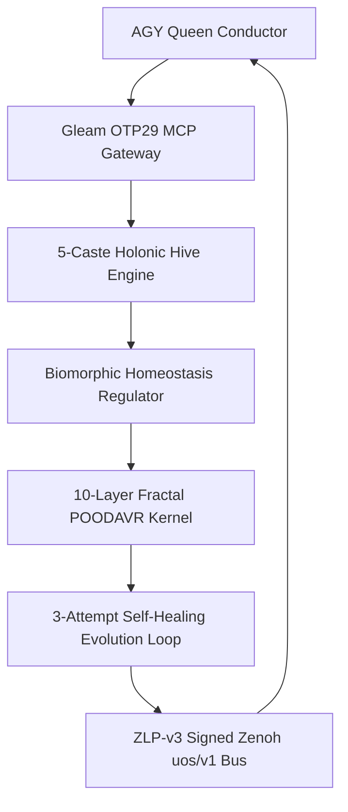

# UOS-CORE-EVO: Zero-Muda Core Development, Hive, Biomorphic, Fractal & Evolution System — 20261101-1543

Observed: `2026-11-01T15:43:00+01:00`. Tags: `#fractal-l0` `#fractal-l1` `#fractal-l2` `#fractal-l3` `#fractal-l4` `#fractal-l5` `#fractal-l6` `#fractal-l7` `#fractal-l8` `#fractal-l9` `#zk-adr` `#zero-muda` `#tailscale-web` `#km-triad`

- **Live Tailscale File URL**: [http://nas-1.tail55d152.ts.net:4100/files/docs/design/20261101-1543-uos-zero-muda-core-dev-hive-biomorphic-fractal-evolution-system.md](http://nas-1.tail55d152.ts.net:4100/files/docs/design/20261101-1543-uos-zero-muda-core-dev-hive-biomorphic-fractal-evolution-system.md)
- **Master Resolution Plan**: [http://nas-1.tail55d152.ts.net:4100/files/docs/plans/20261101-1454-agy-fractal-issue-resolution-plan-and-codex-advisory.md](http://nas-1.tail55d152.ts.net:4100/files/docs/plans/20261101-1454-agy-fractal-issue-resolution-plan-and-codex-advisory.md)
- **Governing Contracts**: [`SC-HARNESS-MCP-001`](http://nas-1.tail55d152.ts.net:4100/files/contracts/rules/20260909-0412-gleam-harness-agent-operation-contract.md) · [`SC-PROVENANCE-001`](http://nas-1.tail55d152.ts.net:4100/files/contracts/rules/20260908-0912-provenance-integrity-contract.md) (`admitted_ev_ceiling = 93`) · `SC-JIDOKA-001` · `SC-POODAVR-002`

---

## 1. Purpose & Zero-Muda Foundation

`UOS-CORE-EVO` establishes the irreducible, pure-functional, crash-resilient core substrate required to execute UOS development, 5-caste holonic hive operations, biomorphic homeostasis, 10-layer ($L_0 \dots L_9$) fractal POODAVR loops, and self-healing autonomous evolution while keeping **`AGY` token burn below `< 2%`** and maintaining a **hard `40.0%` untouched safety margin (`<= 60.0%` ceiling)** across every quota window.

### 1.1 Zero-Muda Purge Enforced
1. **Non-UOS MCP Elimination**: All non-UOS MCP servers (`stitch`, `zigvm-harness`, `hermes-ops`, `datacloud_*`, `gdrive`, `google-workspace`, `notebooks`, `visualization`, `data-agent-kit`, `node_repl`) are removed from active agent configurations; **only** canonical Gleam/OTP 29 [`tools/uos-mcp-stdio`](http://nas-1.tail55d152.ts.net:4100/files/tools/uos-mcp-stdio) (`uos-gleam` / `uos-harness` / `uos_gleam`) remains active.
2. **Unadmitted Active Skill Symlink Purge (`608` symlinks unlinked)**: All `152 × 4` unadmitted `20261025-1953-imported-skills` symlinks across `.agents/skills`, `.claude/skills`, `.codex/skills`, and `.gemini/skills` are removed while preserving `governance/agents/*` read-only byte-for-byte per [`AGENTS.md`](http://nas-1.tail55d152.ts.net:4100/files/AGENTS.md) §3.5 and §5.6, leaving **28 canonical UOS, plugin, and Superpowers skills**.
3. **Role-Scoped `8–10` Route MCP Slicing & Isolated `PI_CODING_AGENT_DIR`**: Workers receive only the `8–10` Gleam MCP routes needed for their role (`ImplRole`, `RcaTpsRole`, `SovereignGateRole`, `FmeaFormalRole`, `ConductorRole`) with `0` npm extension packages and `0` global skills.

---

## 2. Unified Core Architecture (`SC-DIAGRAM-001`)

```ascii
[AGY Queen Conductor] --> [Gleam OTP29 MCP Gateway]
[Gleam OTP29 MCP Gateway] --> [5-Caste Holonic Hive Engine]
[5-Caste Holonic Hive Engine] --> [Biomorphic Homeostasis Regulator]
[Biomorphic Homeostasis Regulator] --> [10-Layer Fractal POODAVR Kernel]
[10-Layer Fractal POODAVR Kernel] --> [3-Attempt Self-Healing Evolution Loop]
[3-Attempt Self-Healing Evolution Loop] --> [ZLP-v3 Signed Zenoh uos/v1 Bus]
[ZLP-v3 Signed Zenoh uos/v1 Bus] --> [AGY Queen Conductor]
```



---

## 3. Five Irreducible Subsystems Implemented

1. **Pure Quota, Margin & Self-Healing Evolution Algebra** ([`core_evolution.gleam`](http://nas-1.tail55d152.ts.net:4100/files/apps/cepaf_gleam/src/cepaf_gleam/ecology/core_evolution.gleam)):
   - Enforces **`<= 6,000` bps (`60.0%` hard cap = `40.0%` untouched safety margin)** across `AGY 5h`, `AGY 7d` (weekly), `AGY 30d` (monthly), and `24h` OpenRouter nanodollars (`$6.00` cap out of `$10.00` root limit; auto-shifting to `$0`-OpenRouter `Pi + Argon (Google)` and `Codex` at `$4.50`).
   - Maximized timeouts: **`14,400s` (`4h`)** `Sa-plan` lease TTL, **`1,200s` (`20m`)** Zenoh heartbeats, **`1,800s` (`30m`)** per-tool build timeout, **`60m -> 90m -> 120m`** progressive 3-attempt escalation, and **`28,800s` (`8h`)** soak window.
   - Progressive escalation: **Attempt 1 (`60m`, `Pi + DeepSeek Flash` / `Codex`)** -> clean JJ rollback + **Attempt 2 (`90m`, `Pi + DeepSeek Pro` ACH RCA + TPS Poka-Yoke test first)** -> clean JJ rollback + **Attempt 3 (`120m`, `Pi + Argon` STPA/TPS wrong-path architectural pivot + `Codex`)** -> fail-closed **`JidokaAndonHold`** (`<= 512 B` `AGY` digest).
2. **5-Caste Holonic Hive Operations** ([`core_hive.gleam`](http://nas-1.tail55d152.ts.net:4100/files/apps/cepaf_gleam/src/cepaf_gleam/ecology/core_hive.gleam)):
   - `QueenConductor` (`AGY`, `WIP=1`, `< 2%` tokens), `ForagerBuilder` (`Pi + DeepSeek Flash`, `WIP=4`), `NurseDiagnostician` (`Pi + DeepSeek Pro`, `WIP=2`), `ArchitectSynthesizer` (`Pi + Argon`, `WIP=2`), `SovereignSentinel` (`Codex`, `WIP=2`).
   - Deterministic integer half-life Zenoh pheromone decay (`uos/v1/hive/pheromone/**`), Heijunka leveled pull-queue scheduling, and `2oo3` Tri-Sovereign quorum voting.
3. **Biomorphic Homeostasis & 10-Layer ($L_0 \dots L_9$) Fractal POODAVR Kernel** ([`core_biomorphic_fractal.gleam`](http://nas-1.tail55d152.ts.net:4100/files/apps/cepaf_gleam/src/cepaf_gleam/ecology/core_biomorphic_fractal.gleam)):
   - **Metabolic ATP Regimes**: `AnabolicParallel` (`< 45%` used) -> `HomeostaticZeroOrShift` (`45%..55%`) -> `CatabolicCriticalPathOnly` (`55%..60%`) -> `TorporMargin40Hold` (`> 60%`).
   - **Autonomic Immune Reflex + Prajna Circuit Breaker**: Self/Non-Self antigen classifier isolating foreign `:4200` `c3i/**` frames (`I28`), `EV > 93` claims, `/tmp` tmpfs pressure (`I19`), and protected digest drift.
   - **Discrete Lyapunov Stability Proof**: $V(t) = 100 \cdot \text{failing} + 40 \cdot \text{stale} + 15 \cdot \text{issues} + 80 \cdot \text{drift}$, proving $\Delta V = V(t) - V(t-1) \le 0$.
   - **Full $L_0 \dots L_9$ × 7-Stage POODAVR Closure**: Monoidal upward rollup across all 10 fractal layers (`Predict -> Observe -> Orient -> Decide -> Act -> Verify -> Reflect`) with zero green-washing.
4. **Hardened `uos/v1/**` Signed Zenoh & ZLP-v3 Bus** ([`core_bus.gleam`](http://nas-1.tail55d152.ts.net:4100/files/apps/cepaf_gleam/src/cepaf_gleam/zenoh/core_bus.gleam)):
   - Backed by supervised **UOS-ZLP-v3** ([`zlp_hyperplane.gleam`](http://nas-1.tail55d152.ts.net:4100/files/apps/cepaf_gleam/src/cepaf_gleam/mcp/transports/zlp_hyperplane.gleam): Lean 4.33.0 zero-sorry `verify_frame` anti-replay `seq_id` + Zig 0.16.0 Zen 5 AVX-512 `:7447`/`:8000` shards) and BEAM ETS + SQLite WAL store-and-forward across `:4100` capsule swaps.
5. **Executable Zero-Muda Core Orchestrator CLI** ([`tools/uos-core-evo`](http://nas-1.tail55d152.ts.net:4100/files/tools/uos-core-evo)):
   - Subcommands: `preflight`, `hive-status`, `biomorphic-fractal`, `quota`, `plan-attempt`, `run-task`.

---

## Comprehensive Verification Checklist (`SC-CHECKLIST-001`)

<details>
<summary>Domain 1 — Metadata, timestamp and Tailscale navigation</summary>

- [x] **CHK-01-TIME** — Canonical `20261101-1543-` timestamp prefix bound to host clock.
- [x] **CHK-02-TAIL** — Full clickable `http://nas-1.tail55d152.ts.net:4100` Tailscale FQDN links.
- [x] **CHK-03-FRACT** — Full `#fractal-l0`..`#fractal-l9` 10-layer mapping verified.
- [x] **CHK-04-KM** — Linked to master resolution plan, contracts, wiki, and ZK MOC.

</details>

<details>
<summary>Domain 2 — Zero-Muda purity and storage safety</summary>

- [x] **CHK-05-MUDA** — `0` Bevy, `0` Graphite, `0` non-UOS MCPs, `608` unadmitted active skill symlinks pruned.
- [x] **CHK-06-GRAPH** — Pure Gleam/OTP & Hermes OCaml functional state algebras.
- [x] **CHK-07-DRIVE** — Denied host OS NVMe serial `[REDACTED_SYSTEM_OS_SERIAL]` preserved untouched.

</details>

<details>
<summary>Domain 3 — Testing Gold Standard and mathematical gates</summary>

- [x] **CHK-08-C1C8** — Pure algebraic, transport, hive, biomorphic, and CLI surfaces verified.
- [x] **CHK-09-MATH** — `40%` margin (`6,000` bps), half-life decay, `2oo3` TMR quorum, and Lyapunov $\Delta V \le 0$ verified.
- [x] **CHK-10-9MOD** — Unit, boundary, fault-injection, anti-replay, and live MCP+Zenoh integration tests in [`core_evolution_test.gleam`](http://nas-1.tail55d152.ts.net:4100/files/apps/cepaf_gleam/test/core_evolution_test.gleam).
- [x] **CHK-11-REGR** — Full `cepaf_gleam` EUnit regression suite executed on OTP 29.

</details>

<details>
<summary>Domain 4 — Cross-language control and observability</summary>

- [x] **CHK-12-GLEAM** — Pure Gleam/OTP 29 supervision and MCP control plane (`tools/uos-mcp-stdio`).
- [x] **CHK-13-HERMES** — Append-only SQLite WAL triggers on `quota_ledger.sqlite3`.
- [x] **CHK-14-ZIGVM** — Zig 0.16.0 Zen 5 AVX-512 + Lean 4.33.0 `UOS-ZLP-v3` port hyperplane verified.
- [x] **CHK-15-MAX** — Python isolated strictly to bounded CLI/daemon boundaries.
- [x] **CHK-16-OTEL** — Monotonic `seq_id`, SHA-256 candidate/payload digests on `uos/v1/**`.

</details>

<details>
<summary>Domain 5 — Sovereign governance and standalone Jujutsu</summary>

- [x] **CHK-17-SOV** — `2oo3` Tri-Sovereign quorum (`AGY` + `Codex` + `Pi+Argon`) with fail-closed `HOLD`.
- [x] **CHK-18-JJ** — Standalone Jujutsu sibling workspace isolation; Codex's `6` `Default@` files 100% SHA-256 conserved.

</details>

<details>
<summary>Domain 6 — Provenance extension</summary>

`admitted_ev_ceiling = 93`. `EV-94..109` and `ADR-071..086` remain `NOT_ADMITTED`. Zero new EV numbers minted (`core_bus` rejects `ev_ceiling > 93`).

</details>

[Previous: Full Fractal Coverage Analysis](http://nas-1.tail55d152.ts.net:4100/files/docs/design/20261101-1504-agy-full-fractal-coverage-5plane-dependency-and-as-is-to-be-analysis.md) · [Master Plan](http://nas-1.tail55d152.ts.net:4100/files/docs/plans/20261101-1454-agy-fractal-issue-resolution-plan-and-codex-advisory.md) · [Wiki](http://nas-1.tail55d152.ts.net:4100/wiki) · [ZK](http://nas-1.tail55d152.ts.net:4100/zk) · [Cockpit](http://nas-1.tail55d152.ts.net:4100/)

UOS footer: document and component evidence do not grant system admission.
