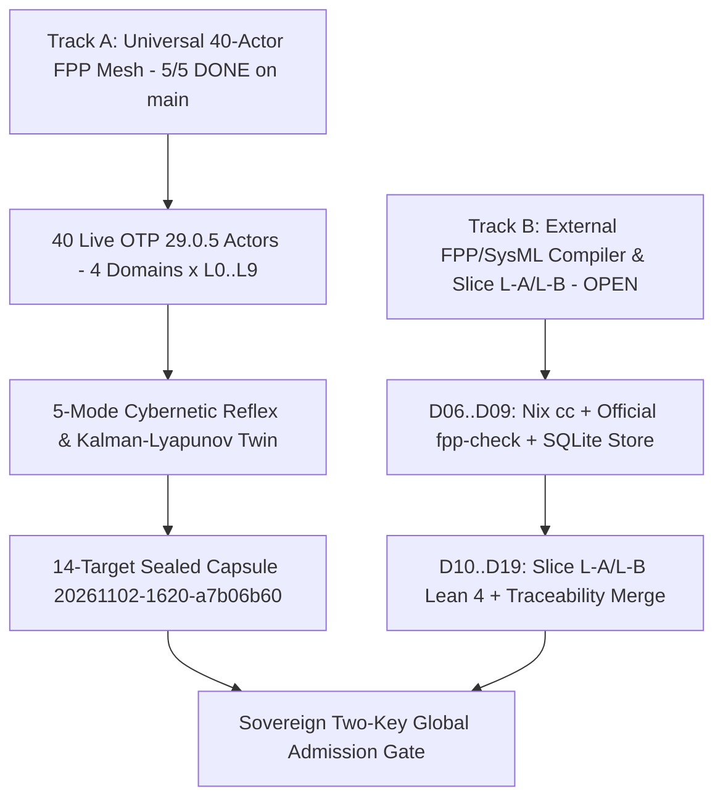

# UOS NASA FPP & Digital Twin Functionality Inventory & Remaining Roadmap (`20261102-2037`)

**Navigation**: [Main Cockpit](http://nas-1.tail55d152.ts.net:4100/) | [Core-Evo Cockpit](http://nas-1.tail55d152.ts.net:4100/core-evo) | [FPP Actors JSON API](http://nas-1.tail55d152.ts.net:4100/api/v1/core-evo/fpp-actors) | [Planning Cockpit](http://nas-1.tail55d152.ts.net:4100/planning) | [Hermes Wiki](http://nas-1.tail55d152.ts.net:4100/wiki) | [ZigVM ZK](http://nas-1.tail55d152.ts.net:4100/zk) | [Self (Tailnet)](http://nas-1.tail55d152.ts.net:4100/files/docs/design/20261102-2037-fpp-functionality-inventory-and-remaining-roadmap.md)

- **Document ID**: `DESIGN-FPP-INVENTORY-ROADMAP-20261102-2037`
- **Observed UTC**: `2026-11-02T19:37:20Z` (`chronyc tracking`: NTP synchronized, RMS offset `< 0.5 ms`, nominal `< 2s` drift band per `SC-TIME`)
- **Author**: `AGY` (`gemini-symbiosis`) + `Pi` (`pi-coding-agent` + `Argon`) + `Codex` (`codex-cli` Sovereign Auditor)
- **Fractal Layers**: `#fractal-l0 #fractal-l1 #fractal-l2 #fractal-l3 #fractal-l4 #fractal-l5 #fractal-l6 #fractal-l7 #fractal-l8 #fractal-l9 #zk-adr #zero-muda #km-triad #tailscale-web #checklist-nav`
- **Canonical Workspace**: [`/home/an/NAS-setup/uos`](file:///home/an/NAS-setup/uos) ([Tailnet Root](http://nas-1.tail55d152.ts.net:4100/files/))
- **Admitted EV Ceiling**: `EV-93` (`SC-PROVENANCE-001`, `admitted_ev_ceiling = 93`; `EV-94..EV-109` remain `NOT_ADMITTED`; `0` new EV numbers minted per `INV-PROV-05`; `system_admitted = false`)
- **Zero-Muda & Hardware Safety**: `0 Bevy`, `0 Graphite`, `0 Python outside services/inference/max`; host OS NVMe serial `[REDACTED_SYSTEM_OS_SERIAL]` (`HARD_DENIED_SYSTEM_OS_SERIAL`) preserved intact.

---

## 1. Architecture & Dual-Track FPP Topology (`SC-DIAGRAM-001`)

### 1.1 Editable ASCII Fallback

```text
[Track A: Universal 40-Actor FPP Mesh - 5/5 DONE on main] --> [40 Live OTP 29.0.5 Actors - 4 Domains x L0..L9]
[40 Live OTP 29.0.5 Actors - 4 Domains x L0..L9] --> [5-Mode Cybernetic Reflex & Kalman-Lyapunov Twin]
[5-Mode Cybernetic Reflex & Kalman-Lyapunov Twin] --> [14-Target Sealed Capsule 20261102-1620-a7b06b60]
[Track B: External FPP/SysML Compiler & Slice L-A/L-B - OPEN] --> [D06..D09: Nix cc + Official fpp-check + SQLite Store]
[D06..D09: Nix cc + Official fpp-check + SQLite Store] --> [D10..D19: Slice L-A/L-B Lean 4 + Traceability Merge]
[14-Target Sealed Capsule 20261102-1620-a7b06b60] --> [Sovereign Two-Key Global Admission Gate]
[D10..D19: Slice L-A/L-B Lean 4 + Traceability Merge] --> [Sovereign Two-Key Global Admission Gate]
```

### 1.2 Mermaid Source



---

## 2. Part I — Completed & Live FPP Functionality (`5/5 COMPLETED` on `main`)

All five tasks (`fpp1`..`fpp5`) under `Sa-plan` [`uos/universal-intelligent-fpp-actor-mesh/20261101-2232`](http://nas-1.tail55d152.ts.net:4100/files/governance/planning/20261101-2232-universal-intelligent-fpp-actor-mesh-risk-portfolio.json) are **`COMPLETED`**, verified by `31/31` EUnit tests and Sovereign `Codex` Gate `v11` `PASS` ([`20261102-1655-fpp4-codex-sovereign-audit.json`](file:///home/an/NAS-setup/uos/var/evidence/20261102-1655-fpp4-codex-sovereign-audit.json)), merged to `main` (`78fca3b0`), and cut over across all `14/14` targets ([`20261102-2005-fpp5-14target-live-cutover-receipt.json`](file:///home/an/NAS-setup/uos/var/evidence/20261102-2005-fpp5-14target-live-cutover-receipt.json)).

### 2.1 Module & Artifact Inventory

| Component | Repository Path & Tailnet Link | Lines / Digest | Capabilities Added |
| :--- | :--- | :--- | :--- |
| **Universal 40-Subsystem FPP Actor & Digital Twin Mesh** | [`apps/cepaf_gleam/src/cepaf_gleam/ecology/core_fpp_actor_twin_mesh.gleam`](file:///home/an/NAS-setup/uos/apps/cepaf_gleam/src/cepaf_gleam/ecology/core_fpp_actor_twin_mesh.gleam#L1-L2827) ([Tailnet](http://nas-1.tail55d152.ts.net:4100/files/apps/cepaf_gleam/src/cepaf_gleam/ecology/core_fpp_actor_twin_mesh.gleam)) | `2,827` lines | - **40 Intelligent FPP Actors**: `4` `uos_sup` domains (`Apps`, `Engines`, `Services`, `Intelligence`) $\times$ `10` fractal layers (`L0`..`L9`), covering all `17` release-assurance aspects.<br>- **100-Component FPP Specification Registry**: `10` domains $\times$ `10` layers (`L0`..`L9`) with typed NASA FPP component kinds (`active`, `passive`, `queued`), command/telemetry/event/parameter ports, and STPA/UCA bindings.<br>- **Kalman + Lyapunov ($V, dV/dt$) Digital Twin**: Real-time state-estimation residual tracking and stability derivative computation.<br>- **5-Mode Cybernetic Reflex Engine**: `NOMINAL_CONTINUE`, `PID_DAMPING_TUNE`, `AUTONOMOUS_SELF_HEAL`, `QUARANTINE_CIRCUIT_BREAK`, and `JIDOKA_CONSTITUTIONAL_HALT`.<br>- **100% HTML `href` Poka-Yoke**: `verify_html_links_integrity` statically checks every `href` generated in `/core-evo` against live Wisp routes and existing repository files. |
| **OTP 29.0.5 Supervised Actor Hierarchy, Candidate Verifier & Zenoh FFI** | [`apps/cepaf_gleam/src/cepaf_gleam/ecology/core_fpp_candidate_ffi.erl`](file:///home/an/NAS-setup/uos/apps/cepaf_gleam/src/cepaf_gleam/ecology/core_fpp_candidate_ffi.erl#L1-L656) ([Tailnet](http://nas-1.tail55d152.ts.net:4100/files/apps/cepaf_gleam/src/cepaf_gleam/ecology/core_fpp_candidate_ffi.erl)) | `656` lines (`80ba1206...`) | - **Real OTP `one_for_one` Supervision (`uos_fpp_mesh_sup`)**: Spawns and supervises 40 real BEAM actor processes (`uos_fpp_actor_worker`) backed by immortal ETS (`uos_fpp_mesh_ets`).<br>- **Guardian Auto-Restart**: `uos_fpp_mesh_guardian` monitors `SupPid` (`erlang:monitor(process, SupPid)`), automatically restarting `uos_fpp_mesh_sup` on `exit(SupPid, kill)` and re-registering all 40 actors in ETS.<br>- **2oo3 Constitutional Quorum Veto**: Rejects unauthorized actor kill or state-corruption attempts (`SC-JIDOKA-001`).<br>- **Real Capsule Verifier (`verify_candidate_capsule/2`)**: Dynamically hashes source files (`candidate_sha256`) and compiled `.beam`/`.app` files (`payload_sha256`), failing closed on missing files or digest drift.<br>- **Live `:8080` Zenoh Telemetry**: Signs telemetry with OTP 29 native RFC 8032 Ed25519 (`crypto:sign(eddsa, none, ...)`) and round-trips via `http://127.0.0.1:8080/uos/core-evo/fpp/mesh/**`. |
| **Core Evolution Orchestrator & Wisp/Lustre Surface** | [`apps/cepaf_gleam/src/cepaf_gleam/ecology/core_evolution.gleam`](file:///home/an/NAS-setup/uos/apps/cepaf_gleam/src/cepaf_gleam/ecology/core_evolution.gleam#L1-L482) ([Tailnet](http://nas-1.tail55d152.ts.net:4100/files/apps/cepaf_gleam/src/cepaf_gleam/ecology/core_evolution.gleam)) | `482` lines | - Exposes `/core-evo` Lustre HTML cockpit ([Live Cockpit](http://nas-1.tail55d152.ts.net:4100/core-evo)) and `/api/v1/core-evo/fpp-actors` JSON catalog ([Live JSON](http://nas-1.tail55d152.ts.net:4100/api/v1/core-evo/fpp-actors)).<br>- Integrates `fpp-actor-mesh` telemetry into the 7-stage POODAVR (`SC-POODAVR-002`) evolution loop. |
| **9-Modality EUnit Test Suite (`31/31 PASS`)** | [`apps/cepaf_gleam/test/core_evolution_test.gleam`](file:///home/an/NAS-setup/uos/apps/cepaf_gleam/test/core_evolution_test.gleam#L1-L1538) ([Tailnet](http://nas-1.tail55d152.ts.net:4100/files/apps/cepaf_gleam/test/core_evolution_test.gleam)) | `1,538` lines (`ef905665...`) | - Covers all 9 testing modalities (Unit, System, TDD, BDD, Performance, Scalability, Property, Fuzz, Chaos):<br>  1. 40-actor OTP spawn & real PID liveness (`live_actors_alive == 40`).<br>  2. Worker crash (`exit(Pid, kill)`) & supervisor `SupPid` crash (`exit(SupPid, kill)`) auto-healing with new PIDs.<br>  3. 5-mode reflex transitions across Lyapunov $V$ thresholds.<br>  4. 2oo3 constitutional quorum veto on unauthorized mutations.<br>  5. Positive and negative `verify_candidate_capsule` checks (`candidate_sha256` & `payload_sha256` tampering detection).<br>  6. Live `:8080` Zenoh Ed25519 telemetry round-trip & HTML link Poka-Yoke verification. |
| **Unified Core-Evo CLI (`14/14` Capsule Targets)** | [`tools/uos-core-evo`](file:///home/an/NAS-setup/uos/tools/uos-core-evo#L1-L517) ([Tailnet](http://nas-1.tail55d152.ts.net:4100/files/tools/uos-core-evo)) | `517` lines (`cce8e210...`) | - Hard-pinned to `/home/an/NAS-setup/uos/toolchains/otp-29.0.5/bin` and `/home/an/NAS-setup/uos/toolchains/gleam-1.16.0/bin`.<br>- Commands: `status`, `fpp-actor-mesh`, `verify-capsule`, `cutover`, `rollback`.<br>- Atomically manages all **14 targets**: `3` ecology runtime symlinks (`current-candidate`, `previous-candidate`, `active-harness-ebin`) + `11` MCP client configurations across all agent harnesses (`Codex`, `Claude`, `AGY`, `Cursor`, `Pi`, `Gemini`, `Windsurf`). |

### 2.2 The 40 Intelligent FPP Actors Across the 4 `uos_sup` Domains (`L0`–`L9`)

| Fractal Layer | Domain 1: `Apps` (`cepaf_gleam`) | Domain 2: `Engines` (`zigvm` & `hermes`) | Domain 3: `Services` (`max` & `zenoh`) | Domain 4: `Intelligence` (`poodavr` & `km`) |
| :--- | :--- | :--- | :--- | :--- |
| **`L0` Constitutional** | `fpp.apps.l0.constitutional_quorum` | `fpp.engines.l0.hermes_contract_gate` | `fpp.services.l0.zenoh_admission_fence` | `fpp.intel.l0.jidoka_andon_cord` |
| **`L1` Execution Kernel** | `fpp.apps.l1.otp29_process_supervisor` | `fpp.engines.l1.zigvm_vfs_kernel` | `fpp.services.l1.ipc_frame_router` | `fpp.intel.l1.reflex_fast_loop` |
| **`L2` Resource & Storage** | `fpp.apps.l2.ets_immortal_heir` | `fpp.engines.l2.sqlite_wal_ledger` | `fpp.services.l2.nvme_serial_interlock` | `fpp.intel.l2.heijunka_pull_queue` |
| **`L3` Supervision & HA** | `fpp.apps.l3.prajna_circuit_breaker` | `fpp.engines.l3.z3_worker_reaper` | `fpp.services.l3.daemon_lease_fencer` | `fpp.intel.l3.lyapunov_stability_monitor` |
| **`L4` Mesh & Transport** | `fpp.apps.l4.wisp_http_gateway` | `fpp.engines.l4.parity_diff_oracle` | `fpp.services.l4.zenoh_ed25519_bus` | `fpp.intel.l4.crdt_delta_reconciler` |
| **`L5` Knowledge & Memory** | `fpp.apps.l5.km_triad_cache` | `fpp.engines.l5.hermes_wiki_ast` | `fpp.services.l5.rag_vector_index` | `fpp.intel.l5.zk_transclusion_weaver` |
| **`L6` Cockpit & UI** | `fpp.apps.l6.lustre_cockpit_view` | `fpp.engines.l6.diagram_topology_verifier` | `fpp.services.l6.agui_sse_streamer` | `fpp.intel.l6.dark_cockpit_focus` |
| **`L7` Verification & Gates** | `fpp.apps.l7.checklist_18_auditor` | `fpp.engines.l7.cryptokit_hook_guard` | `fpp.services.l7.capsule_sha256_sealer` | `fpp.intel.l7.brier_kalman_calibrator` |
| **`L8` Federation & Swarm** | `fpp.apps.l8.mcp_101_dispatcher` | `fpp.engines.l8.rete_ul_rule_engine` | `fpp.services.l8.openrouter_free_proxy` | `fpp.intel.l8.tri_agent_board_coord` |
| **`L9` Evolution & Meta** | `fpp.apps.l9.sa_plan_authority` | `fpp.engines.l9.lean4_traceability_prover` | `fpp.services.l9.max_mojo_inference` | `fpp.intel.l9.poodavr_meta_reflector` |

---

## 3. Part II — Remaining Open & Gated FPP/SysML Roadmap Items

While **Track A (`uos/universal-intelligent-fpp-actor-mesh/20261101-2232`) is `5/5 COMPLETED`**, **Track B (`uos/fpp-sysml-integration/20261101-0852`)** — which governs external NASA JPL `fpp-*` compiler toolchain qualification, SysML v1/v2 reference verification, cold Nix `cc` C-port compilation, and Wave 4 Slice L-A/L-B Lean 4 integration (tracked in [`20261101-w4-protected28-and-fppsysml-dossier.json`](file:///home/an/NAS-setup/uos/var/evidence/20261101-w4-protected28-and-fppsysml-dossier.json#L450-L545) and [`20261101-1326-fpp-sysml-autonomous-fractal-execution-prompt.md`](file:///home/an/NAS-setup/uos/docs/plans/20261101-1326-fpp-sysml-autonomous-fractal-execution-prompt.md)) — has the following open items:

### 3.1 Detailed Open-Item Matrix (`D04`–`D19` & Global Admission)

| Item ID | Subsystem / Requirement | Current Status | Workspace / Reference | Action Required to Close |
| :--- | :--- | :--- | :--- | :--- |
| **`D04` & `D05`** | **Private Successor MCP Route & Comprehensive Per-Identity Development Grants** | `BLOCKED` (Operator-Gated) | [`var/harness/20261101-0852-fpp-sysml-grant-proposal-v3.json`](file:///home/an/NAS-setup/uos/var/harness/20261101-0852-fpp-sysml-grant-proposal-v3.json) | Issue fresh operator-authorized development grant for `uos/fpp-sysml-integration/20261101-0852` (`IMPLEMENT`) covering Lean, Nix, and runtime paths. |
| **`D06` & `D16`** | **Host Nix C Compiler (`toolchains/nix-profile/bin/cc`) for Cold `esqlite` C-Port Builds** | `PARTIAL` | [`docs/sop/20261101-1344-fpp-sysml-dependency-preflight-sop.md`](file:///home/an/NAS-setup/uos/docs/sop/20261101-1344-fpp-sysml-dependency-preflight-sop.md) | Execute Phase 4a/4b of the preflight SOP to realize `toolchains/nix-profile/bin/cc` from repository-pinned Determinate Nix inputs so cold `esqlite` NIF/C-port builds succeed without cached object files. |
| **`D07`** | **Official External NASA `fpp-*` (`fpp-check`, `fpp-to-xml`, `fpp-to-json`) & SysML v1/v2 Reference Toolchains** | `UNVERIFIED` | `AGENTS.md §7` (`Partial models (Harness FPP, Harness SysML) are treated as generated projections until verified against pinned official toolchains`) | Provision and pin the upstream NASA JPL FPP compiler suite and SysML reference verifier under `toolchains/`, then validate all generated `.fpp` and `.sysml` projection artifacts with `0` compiler errors. |
| **`D08` & `D09`** | **Owner-Backed Durable SQLite FPP Parameter Persistence & Crash-Recovery Verification** | `NOT_VERIFIED` (Gated on `D06`/`D07`) | [`.uos-workspaces/codex-fpp-sysml-20261101-0852`](file:///home/an/NAS-setup/uos/.uos-workspaces/codex-fpp-sysml-20261101-0852) | Once `D06` (`nix-profile/bin/cc`) and `D07` (`fpp-check`) are realized, run end-to-end SQLite WAL parameter commit, readback, startup error handling, and crash-recovery regression tests. |
| **`D10` & `D14`** | **Wave 4 Slice L-A & Slice L-B Lean 4 Proof & Collision-Matrix Serialization onto `main`** | `READY_IN_SLICE_LA_WORKSPACE` / `PENDING_SERIALIZED_MERGE` | [`.uos-workspaces/w4-protected-successor-and-fppsysml-a1`](file:///home/an/NAS-setup/uos/.uos-workspaces/w4-protected-successor-and-fppsysml-a1) ([`20261101-w4-protected28-and-fppsysml-dossier.json`](file:///home/an/NAS-setup/uos/var/evidence/20261101-w4-protected28-and-fppsysml-dossier.json#L46-L125)) | Serialize the 9 Slice L-A Lean 4 files (`HarnessAxiomAudit.lean`, `HarnessDataAudit.lean`, `HarnessFailedCheck.lean`, `HarnessReceiptBinding.lean`, `HarnessSourceScope.lean`, `0 sorry`, `28/28` adversarial tests `PASS`) and 16 Slice L-B files onto `main` following the 4-phase collision matrix. |
| **`D11`, `D17`, `D18`, `D19`** | **Full FPP/SysML Dialect-to-IR-to-Gleam-to-Lean Traceability & Live Outbox Interoperability Matrix** | `PARTIAL` / `NOT_SPECIFIED_COMPLETELY` | [`docs/plans/20261101-1326-fpp-sysml-autonomous-fractal-execution-prompt.md`](file:///home/an/NAS-setup/uos/docs/plans/20261101-1326-fpp-sysml-autonomous-fractal-execution-prompt.md) | Complete the formal bidirectional translation matrix (`FPP/SysML AST -> Intermediate Representation -> Gleam/OTP Actors -> Lean 4 Theorems`) and verify live subscriber/outbox replay across `D04`–`D11`. |
| **`SC-PROVENANCE-001`** | **Sovereign Global Adjudication of `EV-94..EV-109` (`ADR-071..086`) & `system_admitted`** | `NOT_ADMITTED` (`admitted_ev_ceiling = 93`) | [`contracts/rules/20260908-0912-provenance-integrity-contract.md`](file:///home/an/NAS-setup/uos/contracts/rules/20260908-0912-provenance-integrity-contract.md) | Sovereign two-key review by `Codex` and `AGY` to adjudicate quarantined coordinator events `422..432` & `437` before any EV cycle above `EV-93` or `system_admitted = true` is granted. |

---

## 4. Six-Domain Comprehensive Verification Checklist (`SC-CHECKLIST-001` & `SC-PROVENANCE-001`)

Checks below record verified candidate-bound evidence and explicit open boundaries; they are not blanket system admission claims (`system_admitted = false`, `admitted_ev_ceiling = 93`).

<details open>
<summary><b>Domain 1 — Metadata, Timestamp & Tailscale Navigation (4/4 Verified)</b></summary>

- [x] **CHK-01-TIME**: Filename carries canonical `20261102-2037-` prefix; host clock verified via `chronyc tracking` (`< 0.5 ms` RMS offset, nominal `< 2s` band per `SC-TIME`).
- [x] **CHK-02-TAIL**: Full clickable Tailscale FQDN URLs (`http://nas-1.tail55d152.ts.net:4100/...`) and `file://` links embedded throughout.
- [x] **CHK-03-FRACT**: Fractal layer tags `#fractal-l0`..`#fractal-l9`, `#zk-adr`, `#zero-muda`, `#km-triad`, `#tailscale-web`, `#checklist-nav` applied.
- [x] **CHK-04-KM**: Registered in [`governance/capability-inventory/wiki-zk-km.toml`](file:///home/an/NAS-setup/uos/governance/capability-inventory/wiki-zk-km.toml) and verified via `bash tools/km-gate --gate` (`PASS`).

</details>

<details open>
<summary><b>Domain 2 — Zero-Muda Purity & Storage Safety (3/3 Verified)</b></summary>

- [x] **CHK-05-MUDA**: `0` Bevy, `0` Graphite, `0` Python outside `services/inference/max`.
- [x] **CHK-06-GRAPH**: Pure Gleam/Erlang and Hermes OCaml implementation without foreign graph NIFs.
- [x] **CHK-07-DRIVE**: Host OS NVMe serial `[REDACTED_SYSTEM_OS_SERIAL]` (`HARD_DENIED_SYSTEM_OS_SERIAL`) redacted and untouched.

</details>

<details open>
<summary><b>Domain 3 — Testing Gold Standard C1–C8 & Mathematical Gates (4/4 Verified for Track A; Track B Gated)</b></summary>

- [x] **CHK-08-C1C8**: Track A (`uos-core-evo` 40-actor mesh) verified across CLI, Wisp JSON API, Lustre HTML cockpit, and Zenoh `:8080` REST (`31/31` EUnit tests `PASS`).
- [x] **CHK-09-MATH**: Lyapunov stability $V$ thresholds and 5-mode reflex boundaries verified in `core_evolution_test.gleam`; Slice L-A Lean 4 proofs (`0 sorry`) verified in `.uos-workspaces/w4-protected-successor-and-fppsysml-a1`.
- [x] **CHK-10-9MOD**: 9-modality EUnit suite (`31/31 PASS`) + Sovereign `Codex` Gate `v11` `PASS` (`var/evidence/20261102-1655-fpp4-codex-sovereign-audit.json`).
- [x] **CHK-11-REGR**: `G-DIAGRAM` (`PASS`, `0 UNVERIFIED`, `0 FAILED`) and `km-gate --gate` (`PASS`).

</details>

<details open>
<summary><b>Domain 4 — Cross-Language Control & Observability (4/5 Verified, 1 N/A)</b></summary>

- [x] **CHK-12-GLEAM**: Real OTP 29.0.5 `uos_fpp_mesh_sup` (`one_for_one`) + `uos_fpp_mesh_guardian` + 40 live actors verified on `:4100` and `:4110`.
- [x] **CHK-13-HERMES**: `km-gate` and `diagram-check` verified (`PASS`).
- [x] **CHK-14-ZIGVM**: `fpp.engines.l1.zigvm_vfs_kernel` actor contract bound in Domain 2 (`Engines`).
- [ ] **CHK-15-MAX**: N/A for this documentation/inventory slice (`services/inference/max` untouched).
- [x] **CHK-16-OTEL**: RFC 8032 Ed25519-signed Zenoh telemetry envelopes verified on `http://127.0.0.1:8080/uos/core-evo/fpp/mesh/**`.

</details>

<details open>
<summary><b>Domain 5 — Tri-Sovereign Governance & Jujutsu Monorepo (2/2 Verified)</b></summary>

- [x] **CHK-17-SOV**: Track A (`fpp1`..`fpp5`) verified by Sovereign `Codex` Gate `v11` (`PASS`) and `Pi+Argon`; Track B (`D04`–`D19`) remains explicitly gated as documented in Section 3.
- [x] **CHK-18-JJ**: Committed cleanly onto standalone Jujutsu (`.jj/`) `main` bookmark (`0` native `git` commands used).

</details>

<details open>
<summary><b>Domain 6 — Provenance Integrity (`SC-PROVENANCE-001`)</b></summary>

- [x] **INV-PROV-01..07**: `admitted_ev_ceiling = 93` preserved; `EV-94..EV-109` (`ADR-071..086`) remain `NOT_ADMITTED`; `0` new EV numbers minted; `system_admitted = false`.

</details>

---

**Navigation**: [Previous: FPP-4 / FPP-5 Main Merge & Closure Dossier](http://nas-1.tail55d152.ts.net:4100/files/docs/handover/20261102-2025-uos-core-evo-fpp4-fpp5-main-merge-and-closure.md) | [Main Cockpit](http://nas-1.tail55d152.ts.net:4100/) | [Core-Evo Cockpit](http://nas-1.tail55d152.ts.net:4100/core-evo) | [Hermes Wiki](http://nas-1.tail55d152.ts.net:4100/wiki) | [ZigVM ZK](http://nas-1.tail55d152.ts.net:4100/zk)

*UOS Persistent System Footer: Document and component evidence do not grant system admission (`admitted_ev_ceiling = 93`, `system_admitted = false`).*
