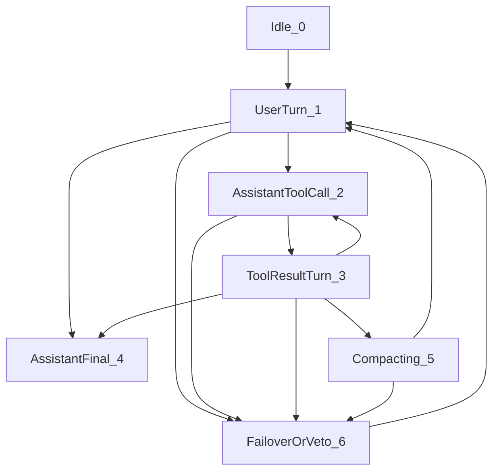

# UOS Agent Provider API Holarchy + Agent + FPP Common Ontology & Interaction State Machine Specification (`SC-PROVIDER-API-ONTOLOGY-001`)

- **Document ID**: `20261107-2046-agent-provider-api-holarchy-fpp-state-machine-spec.md`
- **Observed UTC**: `2026-11-07T19:46:00Z`
- **Canonical Sa-Plan ID**: `plan-provider-api-holarchy-fpp-twin-20261107-2046` (`uos/provider-api-holarchy-fpp-twin/20261107-2046`)
- **Provenance Ceiling**: `admitted_ev_ceiling = 93` (`SC-PROVENANCE-001`; `EV-94..EV-109` `NOT_ADMITTED`; no new EV minted)
- **Fractal Layer Tags**: `#fractal-l0` `#fractal-l1` `#fractal-l2` `#fractal-l3` `#fractal-l4` `#fractal-l5` `#fractal-l6` `#fractal-l7` `#fractal-l8` `#fractal-l9` `#zk-adr` `#zero-muda` `#tailscale-web` `#checklist-nav`
- **Tailnet Live Viewer**: [http://nas-1.tail55d152.ts.net:4100/files/docs/design/20261107-2046-agent-provider-api-holarchy-fpp-state-machine-spec.md](http://nas-1.tail55d152.ts.net:4100/files/docs/design/20261107-2046-agent-provider-api-holarchy-fpp-state-machine-spec.md)
- **Canonical JSON Registry**: [http://nas-1.tail55d152.ts.net:4100/files/governance/agents/policy/20261107-2046-uos-agent-provider-api-holarchy-fpp-ontology.json](http://nas-1.tail55d152.ts.net:4100/files/governance/agents/policy/20261107-2046-uos-agent-provider-api-holarchy-fpp-ontology.json)

---

## 1. Purpose & Gap Closed

Prior to this specification, [`formal/lean/UosAgentCapabilityProfile.lean`](file:///home/an/NAS-setup/uos/formal/lean/UosAgentCapabilityProfile.lean#L126-L130) ([Tailnet](http://nas-1.tail55d152.ts.net:4100/files/formal/lean/UosAgentCapabilityProfile.lean)) modeled `Intelligence` as an untyped string wrapper (`localModel (modelId : String) | remoteModel (modelId : String)`). It did not formally specify:
1. The **7 distinct Provider APIs** (`LocalMaxQwenApi`, `OpenRouterChatCompletionsApi`, `GoogleGenerativeAiV1BetaApi`, `DeepSeekReasoningChatApi`, `AnthropicClaudeMessagesApi`, `OpenAiCodexResponsesApi`, `UosHarnessMcpAndZenohApi`);
2. Their **FPP port contracts** (`input_port`, `output_port`, `companion_machine`) and **7-state Interaction State Machine** (`Idle`, `UserTurn`, `AssistantToolCall`, `ToolResultTurn`, `AssistantFinal`, `Compacting`, `FailoverOrVeto`);
3. Protocol-specific invariants that cause runtime HTTP 400 / 402 failures when violated across model switches or compaction:
   - **Google Generative AI (`v1beta`)**: Requires strict `UserTurn -> AssistantToolCall -> ToolResultTurn` turn alternation and a valid base64 `thoughtSignature` (or base64 bypass sentinel `c2tpcF90aG91Z2h0X3NpZ25hdHVyZV92YWxpZGF0b3I=`) on every historical `functionCall` part when `thinkingConfig` is enabled.
   - **OpenRouter Chat Completions (`openrouter/google/gemini-4-argon`)**: Encrypts `reasoning_details` (`type: "reasoning.encrypted", format: "google-gemini-v1"`) with OpenRouter's AES key (`AY89a1...`); rejects raw unencrypted Google `thoughtSignature` blobs (`EmQKYg...`) inside `reasoning.encrypted.data`, requires preserving OpenRouter's `thinkingSignature` JSON array across model switches or attaching `c2tpcF90aG91Z2h0X3NpZ25hdHVyZV92YWxpZGF0b3I=`, and enforces credit-cap failover on HTTP 402 (`prompt_tokens > credit_cap_prompt_tokens`).
   - **DeepSeek Chat Completions (`openrouter/deepseek/deepseek-v3.2`)**: Requires `reasoning_content` on assistant messages when `thinking` is enabled and uses `max_tokens` rather than `max_completion_tokens`.
   - **Local MAX Qwen (`razr15-1:8000`)**: Zero remote tokens billed (`remote_tokens_billed = 0`), guarded by the 24-export Lean 4 C-ABI library (`libuos_lean_guard.so`, `SHA-256: bcd2a09dfb7e70c18ade09bd537d8582b41deb8b8543d26698402e352cc82690`), covering all 17 System Aspects (`A01..A17`).

---

## 2. Dual-Source Holarchy + Agent + FPP Provider API State Machine Diagram (`SC-DIAGRAM-001`)

```text
[Idle_0] --> [UserTurn_1]
[UserTurn_1] --> [AssistantToolCall_2]
[UserTurn_1] --> [AssistantFinal_4]
[UserTurn_1] --> [FailoverOrVeto_6]
[AssistantToolCall_2] --> [ToolResultTurn_3]
[AssistantToolCall_2] --> [FailoverOrVeto_6]
[ToolResultTurn_3] --> [AssistantToolCall_2]
[ToolResultTurn_3] --> [AssistantFinal_4]
[ToolResultTurn_3] --> [Compacting_5]
[ToolResultTurn_3] --> [FailoverOrVeto_6]
[Compacting_5] --> [UserTurn_1]
[Compacting_5] --> [FailoverOrVeto_6]
[FailoverOrVeto_6] --> [UserTurn_1]
```



---

## 3. Canonical 7-API Holarchy + Agent + FPP Matrix & Code Coordinates

| API ID | Canonical Enum (`ProviderApiId`) | Endpoint / Protocol | Bound Agents (`AgentId`) | Holarchy Layers | FPP Input / Output Ports & Companion State Machine | Signature & State-Machine Invariants | Reference Code & Twin Coordinates |
| :--- | :--- | :--- | :--- | :--- | :--- | :--- | :--- |
| **`0`** | `LocalMaxQwenApi` | `http://razr15-1.tail55d152.ts.net:8000/v1/chat/completions` (`openai-completions-local-max`) | `agy`, `pi`, `codex`, `claude`, `deepseek` | $L_2, L_4, L_5, L_6, L_8$ (`A01..A17`) | `FppLocalMaxChatRequestPort` $\rightarrow$ `FppLocalMaxChatCompletionPort` (`LocalMaxDualPlane14StageStateMachine`) | `remote_tokens_billed == 0`; C-ABI 24-export guard verified (`lean_c_abi_guard_verified == true`); no `thought_signature` required | [`max_qwen_server.py:129-225`](file:///home/an/NAS-setup/uos/ops/nodes/razr15-1-wsl2/max_qwen_server.py#L129-L225), [`uos-agent-failover.ml:130-165`](file:///home/an/NAS-setup/uos/tools/uos-agent-failover.ml#L130-L165), [`Razr15_Max_Qwen_Digital_Twin.lean`](file:///home/an/NAS-setup/uos/formal/lean/Razr15_Max_Qwen_Digital_Twin.lean) |
| **`1`** | `OpenRouterChatCompletionsApi` | `https://openrouter.ai/api/v1/chat/completions` (`openai-completions-openrouter`) | `pi`, `deepseek`, `argon`, `agy` | $L_4, L_6, L_8$ | `FppOpenRouterChatRequestPort` $\rightarrow$ `FppOpenRouterReasoningStreamPort` (`OpenRouterReasoningDetailsStateMachine`) | Preserves OpenRouter `thinkingSignature` JSON array (`[`); attaches `reasoning.encrypted` with `c2tpcF90aG91Z2h0X3NpZ25hdHVyZV92YWxpZGF0b3I=` when Gemini tool calls lack OpenRouter reasoning; fails over to `LocalMaxQwenApi` / `DeepSeekReasoningChatApi` when `prompt_tokens > credit_cap_prompt_tokens` (`2879` on `$2/M` tier) | [`openai-completions-EJNYB6IX.js`](file:///home/an/.pi/agent/runtime/pi-coding-agent/dist/bundle/chunks/openai-completions-EJNYB6IX.js), [`chunk-7O7QKK6A.js`](file:///home/an/.pi/agent/runtime/pi-coding-agent/dist/bundle/chunks/chunk-7O7QKK6A.js), [`pi_session.gleam:204-261`](file:///home/an/NAS-setup/uos/apps/cepaf_gleam/src/cepaf_gleam/bridge/pi_session.gleam#L204-L261) |
| **`2`** | `GoogleGenerativeAiV1BetaApi` | `https://generativelanguage.googleapis.com/v1beta/models/{model}:generateContent` (`google-generative-ai`) | `agy`, `pi`, `argon` | $L_0, L_5, L_6, L_8$ | `FppGoogleGenerateContentRequestPort` $\rightarrow$ `FppGoogleCandidatePartsStreamPort` (`GoogleThoughtSignatureAndTurnAlternationStateMachine`) | Every `functionCall` part carries valid base64 `thoughtSignature` or `c2tpcF90aG91Z2h0X3NpZ25hdHVyZV92YWxpZGF0b3I=`; `AssistantToolCall` must follow `UserTurn` or `ToolResultTurn` | [`chunk-B46VJEHW.js`](file:///home/an/.pi/agent/runtime/pi-coding-agent/dist/bundle/chunks/chunk-B46VJEHW.js), [`pi-native.js`](file:///home/an/.pi/agent/npm/node_modules/billion-context/dist/agent/pi-native.js), [`UosFullSystemCodeUnifiedDigitalTwin.lean`](file:///home/an/NAS-setup/uos/formal/lean/UosFullSystemCodeUnifiedDigitalTwin.lean) |
| **`3`** | `DeepSeekReasoningChatApi` | `https://openrouter.ai/api/v1/chat/completions` (`deepseek/deepseek-v3.2`) | `pi`, `deepseek` | $L_4, L_5, L_6$ | `FppDeepSeekChatRequestPort` $\rightarrow$ `FppDeepSeekReasoningContentPort` (`DeepSeekReasoningContentStateMachine`) | Default model in Pi (`settings.json` + `.pi/acp.json`); emits `reasoning_content` when thinking is enabled; uses `max_tokens` field; no `thought_signature` required | [` ~/.pi/agent/settings.json`](file:///home/an/.pi/agent/settings.json), [`.pi/acp.json`](file:///home/an/NAS-setup/uos/.pi/acp.json), [`openai-completions-EJNYB6IX.js`](file:///home/an/.pi/agent/runtime/pi-coding-agent/dist/bundle/chunks/openai-completions-EJNYB6IX.js) |
| **`4`** | `AnthropicClaudeMessagesApi` | `https://api.anthropic.com/v1/messages` (`claude-opus-4-6`) | `claude`, `agy` | $L_0, L_1, L_3, L_8, L_9$ | `FppAnthropicMessagesRequestPort` $\rightarrow$ `FppAnthropicThinkingAndToolUsePort` (`AnthropicSignedThinkingStateMachine`) | Preserves `thinking.signature` and `redacted_thinking` on tool-use continuations; applies ephemeral `cache_control` | [`anthropic-messages-BWGCKOF4.js`](file:///home/an/.pi/agent/runtime/pi-coding-agent/dist/bundle/chunks/anthropic-messages-BWGCKOF4.js), [`uos-agent-failover.ml`](file:///home/an/NAS-setup/uos/tools/uos-agent-failover.ml) |
| **`5`** | `OpenAiCodexResponsesApi` | `https://api.openai.com/v1/responses` (`gpt-6-luna` `xhigh`) | `codex`, `agy` | $L_1, L_2, L_6, L_8, L_9$ | `FppOpenAiResponsesRequestPort` $\rightarrow$ `FppOpenAiEncryptedReasoningItemPort` (`OpenAiResponses40CharToolCallIdStateMachine`) | Normalizes `tool_call_id` to $\le 40$ chars (`[a-zA-Z0-9_-]`); preserves encrypted reasoning items | [`openai-responses-MD3562FB.js`](file:///home/an/.pi/agent/runtime/pi-coding-agent/dist/bundle/chunks/openai-responses-MD3562FB.js), [`openai-codex-responses-QAWLOQSN.js`](file:///home/an/.pi/agent/runtime/pi-coding-agent/dist/bundle/chunks/openai-codex-responses-QAWLOQSN.js) |
| **`6`** | `UosHarnessMcpAndZenohApi` | `http://nas-1.tail55d152.ts.net:4100/mcp` (`uos-mcp-jsonrpc2-and-zenoh`) | `agy`, `pi`, `codex`, `claude`, `deepseek`, `argon` | $L_0 \dots L_9$ (all 10 layers) | `FppMcpJsonRpc2AndZenohIngressPort` $\rightarrow$ `FppMcp104RouteAuditedReceiptPort` (`GleamOtpSaPlanCedarGuardStateMachine`) | 104 MCP surfaces (53 tools, 38 resources, 10 prompts, 3 templates); Cryptokit SHA-256 + Cedar VGD + 23-export Lean C-ABI guard | [`tools/uos-mcp-stdio`](file:///home/an/NAS-setup/uos/tools/uos-mcp-stdio), [`UosMcpUnifiedGatewayTwin.lean`](file:///home/an/NAS-setup/uos/formal/lean/UosMcpUnifiedGatewayTwin.lean), [`mcp_gateway_oracle.mojo`](file:///home/an/NAS-setup/uos/formal/mojo/mcp_gateway_oracle.mojo) |

---

## 4. Continuous Verification & Evolution Protocol

Every evolution cycle or provider adapter update MUST execute the 4-stage verification loop:
1. **Lean 4 Digital Twin + C-ABI Guard (`L_8/L_0`)**:
   - `formal/lean/UosFullSystemCodeUnifiedDigitalTwin.lean` (`Section 15`: `ProviderApiId`, `ApiInteractionState`, `stepApiInteractionStateMachine`, `THM_FSYS_53..54`; `Section 16`: `ProviderApiRecoveryAction`, `resolveProviderApiRecovery`, `THM_FSYS_55`; `Section 17`: `UosSystemServiceId`, `UosServiceHolarchyFppZenohMcpSpec`, `canonical12UosServiceSpecs`, `verifyUosServiceMeshBinding`, `THM_FSYS_56..58`; `Section 18`: `UosDirectoryObjectKind`, `UosSystemDirectoryEntry`, `canonical52SystemDirectoryEntries`, `verifySystemDirectoryObject`, `THM_FSYS_59..60`, `60` theorems total).
   - `formal/lean/UosLeanRuntimeGuard.lean` (`Export #23`: `uos_lean_verify_provider_api_transition` (`392/392` states); `Export #24`: `uos_lean_resolve_provider_api_recovery` (`64/64` states); `Export #25`: `uos_lean_verify_service_mesh_binding` (`192/192` states); `Export #26`: `uos_lean_verify_system_directory_object` (`2,080/2,080` states across `52` objects $\times$ `5` kinds $\times$ `8` boolean combinations) in `var/zlp/libuos_lean_guard.so`, `26` C-ABI exports total).
2. **Mojo Differential Oracle & FFI Bridge (`L_8/L_2`)**:
   - `./tools/mojo run -I formal/mojo formal/mojo/lean_ffi_bridge.mojo` (exhaustively checks `392` transition states, `64` recovery states, `192` service-mesh states, and `2,080` System Directory Service states against C-ABI Exports #23, #24, #25, and #26).
   - `./tools/mojo run -I formal/mojo formal/mojo/full_system_code_oracle.mojo` (`87/87 PASS`, `60` theorems) and `./tools/mojo run -I formal/mojo formal/mojo/fractal_context_pipeline.mojo` (`19/19 PASS`).
3. **Verification Plane Simulator (`L_9`)**:
   - `./toolchains/opam-ocaml/bin/ocaml -I +unix unix.cma tools/verification_plane_simulate.ml` (`12/12` modes covered, `0 MANIFESTS`; includes `FM-10` thought-signature strip, `FM-11` unsanctioned Python, `FM-12` provider API turn-order & credit-cap violation, and `FM-13` provider API unrecovered HTTP 402/429/5xx crash when failover is available).
4. **18-Pair Lean-Mojo Differential Gate (`L_9`)**:
   - `./toolchains/opam-ocaml/bin/ocaml -I +unix unix.cma tools/lean_mojo_differential.ml` (`18/18 PASS`).

---

## 5. Unified 12-Service `Holarchy + Agents + FPP + Zenoh + MCP` Mesh (`THM_FSYS_56..57`, Export #25)

All 12 canonical UOS System Services (`Svc00`..`Svc11`) are formally bound into the unified `Holarchy + Agents + FPP + Zenoh + MCP` service mesh in Lean 4 (`formal/lean/UosFullSystemCodeUnifiedDigitalTwin.lean`, Section 17, `THM_FSYS_56..57`), exported via C-ABI Export #25 (`uos_lean_verify_service_mesh_binding` in `formal/lean/UosLeanRuntimeGuard.lean`), and exhaustively checked across all `12 × 16 = 192` states in Mojo (`formal/mojo/lean_ffi_bridge.mojo` & `formal/mojo/fractal_context_pipeline.mojo`):

| Service ID | Canonical Enum (`UosSystemServiceId`) | Layer | FPP Component & Ports | Zenoh Topic Prefix | MCP Route | Bound Provider API (`ProviderApiId`) |
| :--- | :--- | :--- | :--- | :--- | :--- | :--- |
| **`0`** | `Svc00_GleamOtpRootSupervisor` | $L_3$ | `FppGleamOtpRootSupervisorComp` | `uos/svc/00/gleam_otp_supervisor` | `system_health` | `UosHarnessMcpAndZenohApi` (`6`) |
| **`1`** | `Svc01_ZigVmDeterministicKernel` | $L_2$ | `FppZigVmDeterministicKernelComp` | `uos/svc/01/zigvm_kernel` | `integrity_check` | `UosHarnessMcpAndZenohApi` (`6`) |
| **`2`** | `Svc02_HermesOcamlEvidenceInterceptor` | $L_1$ | `FppHermesOcamlInterceptorComp` | `uos/svc/02/hermes_interceptor` | `system_verification` | `UosHarnessMcpAndZenohApi` (`6`) |
| **`3`** | `Svc03_ModularMaxMojoInferenceDaemon` | $L_5$ | `FppModularMaxQwenDaemonComp` | `uos/svc/03/max_qwen_inference` | `metabolic_state` | `LocalMaxQwenApi` (`0`) |
| **`4`** | `Svc04_ZenohMeshPubSubBus` | $L_7$ | `FppZenohMeshPubSubRouterComp` | `uos/svc/04/zenoh_mesh_bus` | `system_zenoh` | `UosHarnessMcpAndZenohApi` (`6`) |
| **`5`** | `Svc05_UosMcpStdio104RouteServer` | $L_4$ | `FppUosMcp104RouteGatewayComp` | `uos/svc/05/mcp_104_gateway` | `mcp_capability_inventory` | `UosHarnessMcpAndZenohApi` (`6`) |
| **`6`** | `Svc06_SaPlanCanonicalSqliteEngine` | $L_3$ | `FppSaPlanSqliteEngineComp` | `uos/svc/06/sa_plan_sqlite` | `sa_plan_status` | `UosHarnessMcpAndZenohApi` (`6`) |
| **`7`** | `Svc07_PiMultiAgentCliGateway` | $L_6$ | `FppPiMultiAgentCliGatewayComp` | `uos/svc/07/pi_agent_gateway` | `agent_hierarchy` | `DeepSeekReasoningChatApi` (`3`) |
| **`8`** | `Svc08_OtelFractalTelemetryCollector` | $L_8$ | `FppOtelFractalCollectorComp` | `uos/svc/08/otel_fractal_collector` | `evolution_metrics` | `UosHarnessMcpAndZenohApi` (`6`) |
| **`9`** | `Svc09_KmTriadWikiZkOntologyServer` | $L_4$ | `FppKmTriadWikiZkServerComp` | `uos/svc/09/km_triad_server` | `knowledge_search` | `UosHarnessMcpAndZenohApi` (`6`) |
| **`10`** | `Svc10_K8sRookCephStorageInterlock` | $L_0$ | `FppK8sStorageInterlockComp` | `uos/svc/10/k8s_storage_interlock` | `podman_containers` | `UosHarnessMcpAndZenohApi` (`6`) |
| **`11`** | `Svc11_CockpitLustreTuiTelegramSurface` | $L_9$ | `FppCockpitTripleSurfaceComp` | `uos/svc/11/cockpit_triple_surface` | `system_dashboard` | `UosHarnessMcpAndZenohApi` (`6`) |

---

## 6. Canonical 52-Object UOS System Directory Service (`SC-SYSTEM-DIRECTORY-SERVICE-001`, `THM_FSYS_59..60`, Export #26)

All 52 canonical UOS System Objects are registered in the **UOS System Directory Service** (`UosSystemDirectoryEntry`, `canonical52SystemDirectoryEntries`, `verifySystemDirectoryObject` in [`formal/lean/UosFullSystemCodeUnifiedDigitalTwin.lean`](file:///home/an/NAS-setup/uos/formal/lean/UosFullSystemCodeUnifiedDigitalTwin.lean#L1429-L1546), C-ABI Export #26 `uos_lean_verify_system_directory_object` in [`formal/lean/UosLeanRuntimeGuard.lean`](file:///home/an/NAS-setup/uos/formal/lean/UosLeanRuntimeGuard.lean#L628-L664), Mojo FFI parity in [`formal/mojo/lean_ffi_bridge.mojo`](file:///home/an/NAS-setup/uos/formal/mojo/lean_ffi_bridge.mojo#L372-L403), and Gleam OTP runtime verifier `verify_system_directory_object` in [`apps/cepaf_gleam/src/cepaf_gleam/harness/agent_ecology.gleam`](file:///home/an/NAS-setup/uos/apps/cepaf_gleam/src/cepaf_gleam/harness/agent_ecology.gleam#L1522-L1534)):

| Kind ID | Canonical Enum (`UosDirectoryObjectKind`) | Directory ID Range (`dirId`) | Object Count | Canonical Objects Registered | Required Invariants (`2,080/2,080` States Verified) |
| :--- | :--- | :--- | :--- | :--- | :--- |
| **`0`** | `DirKind0_SystemService` | `0..11` | `12` | `Svc00_GleamOtpRootSupervisor` .. `Svc11_LustreWispTuiTripleCockpit` | `Holarchy(L0..L9) + 7 Agents + 6 FPP Ports + Zenoh + MCP + W3C OTel(128/64) + 17 Aspects(0x1FFFF)` |
| **`1`** | `DirKind1_ProviderApi` | `12..18` | `7` | `LocalMaxQwenApi` .. `UosHarnessMcpAndZenohApi` | `392-state interaction machine + 64-state recovery lattice + W3C OTel(128/64) + 17 Aspects(0x1FFFF)` |
| **`2`** | `DirKind2_SovereignAgent` | `19..24` | `6` | `agy`, `pi`, `codex`, `claude`, `deepseek`, `argon` | `Filtration-aligned (`UosOntologyAtlas.lean`) + FPP/MCP/Zenoh/OTel + 17 Aspects(0x1FFFF)` |
| **`3`** | `DirKind3_HolarchyLayer` | `25..34` | `10` | `L0_Constitutional` .. `L9_Sovereign` | `Aligned with `fractal-concern` (`SC-FRACTAL-TAXONOMY-001`) + FPP/MCP/Zenoh/OTel + 17 Aspects(0x1FFFF)` |
| **`4`** | `DirKind4_SystemAspect` | `35..51` | `17` | `A01_ScopeAndCanonicalTruth` .. `A17_SystematicRiskPrioritization` | `Aligned with `ontology-aspect` Set A (`aspect_coverage_engine.gleam`) + 170 Janus holons` |
