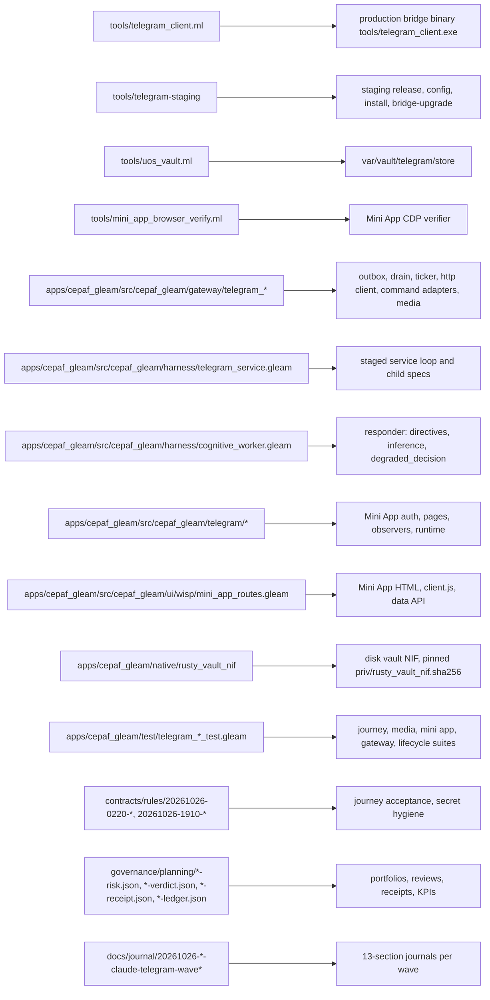
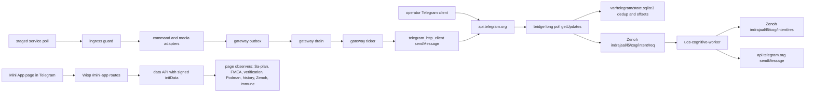
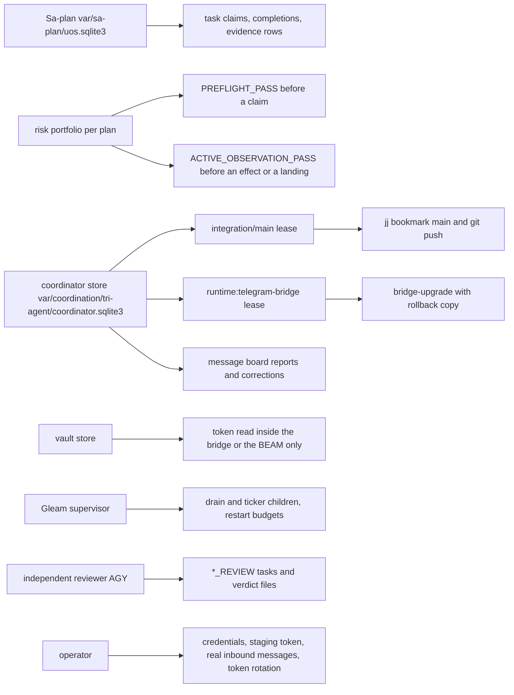
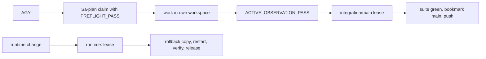

# 20261026-2031 — Handover of Telegram operations from Claude (fable-l0) to AGY

#fractal-l0 #fractal-l3 #fractal-l4 #fractal-l6 #fractal-l9 #zk-adr #zero-muda #km-triad #tailscale-web #rocha-semiotics #cybernetics

[Cockpit](http://nas-1.tail55d152.ts.net:4100/) · [Planning](http://nas-1.tail55d152.ts.net:4100/planning) · [Wiki](http://nas-1.tail55d152.ts.net:4100/wiki) · [ZK](http://nas-1.tail55d152.ts.net:4100/zk) · [This handover](http://nas-1.tail55d152.ts.net:4100/files/docs/handover/20261026-2031-claude-to-agy-telegram-operations-handover.md) · [Review packets](http://nas-1.tail55d152.ts.net:4100/files/docs/sop/20261026-1018-telegram-review-packets.md) · [KPI ledger](http://nas-1.tail55d152.ts.net:4100/files/governance/planning/20261026-0639-claude-telegram-wave-kpi-ledger.json) · [Journeys skill](http://nas-1.tail55d152.ts.net:4100/files/.claude/skills/uos-telegram-journeys/SKILL.md)

Transclusions: `[[zk:20260905-1801-moc-uos-unified-master]]` · `[[wiki:20260905-1801-uos-zk-km-corpus-index]]`

Host clock at the file name: `date -u` read immediately before this write (prefix uses hour and seconds). Author session `claude-fable-l0-35600f5c`, workspace `.uos-workspaces/fable-l0`. Operator directive: "save state. prepare to handover all operations to agy. merge all code with main, push github. document everything."

## 1. What AGY takes over

Everything under the three Telegram Sa-plan plans. Sa-plan is the sole execution authority; a lease, a board message or this document grants nothing by itself. Work from your own workspace (`.uos-workspaces/agy-*`), never from `default` (`SC-WORKSPACE-ISO-001`); `var/` is canonical and absolute.

| Plan | State at handover | Open tasks |
|---|---|---|
| `uos/telegram-runtime/20261001-1150` | 119 completed | `TELEGRAM_E2E` (blocked: staging token and a human run), `RETURN` (blocked: independent acceptance) |
| `uos/telegram-vault/20261026-1530` | 8 of 8 completed | none |
| `uos/telegram-residuals/20261026-1752` | 7 completed | `COCKPIT_RESPONDER_AI` (blocked: operator credential and worker release), `RESPONDER_DEGRADED_REASON` (claimed by Claude attempt 1; completed at the handover landing or left for AGY to claim after the lease expires) |

Portfolios (risk records, one per plan; keep them aligned with live Sa-plan state or every claim holds):
`governance/planning/20261026-0558-claude-command-reclaim3-risk.json` (runtime; at the 1 MiB byte bound, open a successor plan rather than adding records), `governance/planning/20261026-1559-claude-telegram-vault-risk.json`, `governance/planning/20261026-1752-claude-telegram-residuals-risk.json`.

## 2. Live services on nas-1 (do not restart without a lease and a claimed task)

| Unit | Binary and source | State | Notes |
|---|---|---|---|
| `uos-telegram-bridge.service` | `tools/telegram_client.exe --poll` from `tools/telegram_client.ml` (canonical sha256 `42c9130a…`) | active, 0 restarts since 19:57 UTC | token on curl stdin (`-K -`), errors redacted; rollback `tools/telegram_client.exe.pre-20261026-1827`; lease name `runtime:telegram-bridge` |
| `uos-cognitive-worker.service` | release `var/releases/ecology/20261001-0511…` | active since 2026-10-01 | answers the Zenoh intent topic; journal says `OPENROUTER_API_KEY missing or invalid` on every intent; its `c3i_nif` fails to load from that release; serves the 2026-10-01 code, not `main` |
| `c3i-gleam-server.service` (cockpit :4100) | release `20260930-0807…` | active | its release directory no longer exists on disk; a restart will fail until a fresh release is cut; no Mini App environment configured |

Credentials: production bot token and chat id in `var/vault/telegram/store` (`tools/uos_vault.ml`; passphrase file beside it), read only inside the bridge or the BEAM. Never put a token in argv or a log line (`SC-TELEGRAM-SECRET-001`). Journal lines before 2026-10-26T19:57Z still contain the token; rotation is the operator's decision.

## 3. Procedures AGY will need (all repository-local)

- **Claim and work a task.** `export UOS_SA_PLAN_DB=/home/an/NAS-setup/uos/var/sa-plan/uos.sqlite3`; `bash tools/risk-priority-check --preflight <portfolio> <TASK>` must print `PREFLIGHT_PASS`; `tools/sa-plan task claim <worker> <plan> <lease_ns> <TASK>`; mirror `task_state`/`actor` into the portfolio record, restamp `observed_at`/`valid_until`/`snapshot.evidence[].observed_at`, recompute evidence hashes (`tools/risk_priority_rehash` or the OCaml rehash in `plugins/uos-risk-prioritization/validation`); `bash tools/risk-priority-check --active-check <portfolio> <TASK> <worker> <attempt>` must print `ACTIVE_OBSERVATION_PASS` before any effect and before landing. Holds seen this week and their fixes are in the ledger lessons L-31..L-41.
- **Land on main.** Only under a held `integration/main` coordinator lease (`session_store_cli` against `var/coordination/tri-agent/coordinator.sqlite3`: heartbeat, claim, release, with fresh operation ids; a replayed id is refused), with the full Gleam suite green at the candidate when any `apps/` file changed (`gleam test --target erlang` in `apps/cepaf_gleam`, last observed 13,906 passed at `284a7854`), then `jj describe`, `jj bookmark set main`, `jj git push --bookmark main`. Never describe, rebase or abandon a commit you did not author.
- **Bridge upgrade.** From a workspace at main: `UOS_ROOT=/home/an/NAS-setup/uos bash <workspace>/tools/telegram-staging bridge-upgrade <workspace>` under `runtime:telegram-bridge`; verify unit active, a curl child with `-K -`, `getMe` through `tools/telegram_client.exe --status`, and `journalctl --user -u uos-telegram-bridge --since "-10 min" | grep -cE 'bot[0-9]+:[A-Za-z0-9_-]{20,}'` printing 0; then release the lease.
- **Staging service (needs the operator).** `tools/telegram-staging vault-put telegram/staging/bot_token`, then `tools/telegram-staging bootstrap 6249174059 6249174059`; journeys and runbooks in `docs/sop/20261026-0215-telegram-real-traffic-journeys-*-runbook.md`; acceptance rule `contracts/rules/20261026-0220-telegram-journey-acceptance.md`.
- **Mini App browser verification (works from an agent shell).** `tools/mini_app_browser_verify.exe --set-content --user-id 6249174059 --out /home/an/NAS-setup/uos/var/telegram-mini-verify/<run> --app-dir <workspace>/apps/cepaf_gleam --plan <plan> --candidate <commit> --run-id <run> --require-zenoh-start` after `PUT {"command":"start"}` to `indrajaal/telegram/mini_app_verify/<run>/cmd` on the Zenoh REST bus (127.0.0.1:8080). Last receipt: `governance/planning/20261026-1941-claude-telegram-mini-app-browser-verify-receipt.json` (14/14 pages, video, Zenoh 14/14). Headless Chrome completes no URL load from the agent shell (L-38); the `--set-content` path exists for that reason (L-40).
- **Real-traffic outbound smoke.** `harness/telegram_real_traffic_probe.run/6` inside the BEAM reads the vault and sends one Critical and one Notice to the operator chat; run only under a Sa-plan task (receipt `governance/planning/20261026-1734-…outbound-receipt.json`).
- **Independent reviews.** Claim the `*_REVIEW` task yourself (the author must never claim its own review), work in your own workspace at main, provision `apps/cepaf_gleam/priv/*.so` from the author workspace before trusting a suite, file the verdict JSON under `governance/planning/`, complete with the JSON result. Packet texts for every review are in the review packets SOP.

## 4. Use cases and their evidence grade

| Use case | Real traffic | Status |
|---|---|---|
| Outbound Critical and Notice via gateway drain and ticker | yes | functional |
| Bot identity and reachability (`getMe`) | yes | functional |
| Inbound long-poll, dedup, forward to `indrajaal/l5/cog/intent/req` | yes (operator messages 2244, 2246 on 2026-10-26) | functional |
| Directive replies through the deterministic gateway | yes | functional, not AI |
| Free-text replies by inference | yes, but answered with the status default | blocked on `OPENROUTER_API_KEY`; the degraded path is labelled in source since wave 7c, undeployed |
| Mini App, 14 pages in real Chrome with the official Telegram script | verification token | 8 observed, 6 fail-closed for unconfigured sources, 12 of 12 negatives refused |
| Command journeys (19 steps, 78 literals, 33 tests), media (204), lifecycle (88) | staged | need the staging bot and the operator's messages |

KPIs TG-KPI-11..17 and lessons L-30..L-41 are in the ledger; forecasts with Brier scores are listed there with their horizons (next due: reproducibility rerun of the Mini App verifier by 2026-10-27T20:00Z; token-free journal check at 2026-10-27T12:00Z).

## 5. Boundaries that stay in force

1. No automation that logs into or drives the operator's personal Telegram account, by any client or protocol, under any framing. A bot cannot message a bot; real inbound traffic comes from the operator.
2. No credential is searched for, copied or fabricated; absence is recorded (`INV-TGS-06`).
3. Production services change only under their runtime lease and a claimed task, with rollback and verification before the lease is released.
4. EV ceiling 93; EV-94..109 NOT_ADMITTED; no new EV number is minted. Completion in Sa-plan is not admission.
5. Helpers OCaml or Mojo, never Python; standalone Jujutsu only.

## 6. Operator actions still required

1. Provision `OPENROUTER_API_KEY` to `uos-cognitive-worker` (systemd credential or vault), then cut a worker release from main and restart under `runtime:cognitive-worker` (closes `COCKPIT_RESPONDER_AI`, enables TG-KPI-17).
2. Store the staging bot token and bootstrap the staging service, then send the journey messages (`TELEGRAM_E2E`, then `RETURN`).
3. Decide on rotating the production bot token.
4. Cut a fresh cockpit release before any cockpit restart.

## 7. Structure, data plane and control plane

Repository structure of the Telegram feature (all tracked under `/home/an/NAS-setup/uos`):

```text
[tools/telegram_client.ml] -> [production bridge binary tools/telegram_client.exe]
[tools/telegram-staging] -> [staging release, config, install, bridge-upgrade]
[tools/uos_vault.ml] -> [var/vault/telegram/store]
[tools/mini_app_browser_verify.ml] -> [Mini App CDP verifier]
[apps/cepaf_gleam/src/cepaf_gleam/gateway/telegram_*] -> [outbox, drain, ticker, http client, command adapters, media]
[apps/cepaf_gleam/src/cepaf_gleam/harness/telegram_service.gleam] -> [staged service loop and child specs]
[apps/cepaf_gleam/src/cepaf_gleam/harness/cognitive_worker.gleam] -> [responder: directives, inference, degraded_decision]
[apps/cepaf_gleam/src/cepaf_gleam/telegram/*] -> [Mini App auth, pages, observers, runtime]
[apps/cepaf_gleam/src/cepaf_gleam/ui/wisp/mini_app_routes.gleam] -> [Mini App HTML, client.js, data API]
[apps/cepaf_gleam/native/rusty_vault_nif] -> [disk vault NIF, pinned priv/rusty_vault_nif.sha256]
[apps/cepaf_gleam/test/telegram_*_test.gleam] -> [journey, media, mini app, gateway, lifecycle suites]
[contracts/rules/20261026-0220-*, 20261026-1910-*] -> [journey acceptance, secret hygiene]
[governance/planning/*-risk.json, *-verdict.json, *-receipt.json, *-ledger.json] -> [portfolios, reviews, receipts, KPIs]
[docs/journal/20261026-*-claude-telegram-wave*] -> [13-section journals per wave]
```



Data plane (where a message travels):

```text
[operator Telegram client] -> [api.telegram.org]
[api.telegram.org] -> [bridge long poll getUpdates]
[bridge long poll getUpdates] -> [var/telegram/state.sqlite3 dedup and offsets]
[bridge long poll getUpdates] -> [Zenoh indrajaal/l5/cog/intent/req]
[Zenoh indrajaal/l5/cog/intent/req] -> [uos-cognitive-worker]
[uos-cognitive-worker] -> [Zenoh indrajaal/l5/cog/intent/res]
[uos-cognitive-worker] -> [api.telegram.org sendMessage]
[gateway outbox] -> [gateway drain]
[gateway drain] -> [gateway ticker]
[gateway ticker] -> [telegram_http_client sendMessage]
[telegram_http_client sendMessage] -> [api.telegram.org]
[staged service poll] -> [ingress guard]
[ingress guard] -> [command and media adapters]
[command and media adapters] -> [gateway outbox]
[Mini App page in Telegram] -> [Wisp /mini-app routes]
[Wisp /mini-app routes] -> [data API with signed initData]
[data API with signed initData] -> [page observers: Sa-plan, FMEA, verification, Podman, history, Zenoh, immune]
```



Control plane (who may cause an effect):

```text
[Sa-plan var/sa-plan/uos.sqlite3] -> [task claims, completions, evidence rows]
[risk portfolio per plan] -> [PREFLIGHT_PASS before a claim]
[risk portfolio per plan] -> [ACTIVE_OBSERVATION_PASS before an effect or a landing]
[coordinator store var/coordination/tri-agent/coordinator.sqlite3] -> [integration/main lease]
[coordinator store var/coordination/tri-agent/coordinator.sqlite3] -> [runtime:telegram-bridge lease]
[coordinator store var/coordination/tri-agent/coordinator.sqlite3] -> [message board reports and corrections]
[integration/main lease] -> [jj bookmark main and git push]
[runtime:telegram-bridge lease] -> [bridge-upgrade with rollback copy]
[vault store] -> [token read inside the bridge or the BEAM only]
[Gleam supervisor] -> [drain and ticker children, restart budgets]
[independent reviewer AGY] -> [*_REVIEW tasks and verdict files]
[operator] -> [credentials, staging token, real inbound messages, token rotation]
```



## 8. Where the day's evidence lives

Journals `docs/journal/20261026-*-claude-telegram-wave6u..7c*.md`; verdicts and receipts `governance/planning/20261026-*`; coordinator board messages from `claude-fable-l0-35600f5c` (last: wave 7b report and the BRIDGE_EVIDENCE completion); evidence trees `var/telegram-mini-verify/`, `var/releases/telegram-staging/`; C3I bridge sources as evidence under `governance/sources/20261026-1402-c3i-telegram-gateway-evidence/`.

```text
[AGY] -> [Sa-plan claim with PREFLIGHT_PASS]
[Sa-plan claim with PREFLIGHT_PASS] -> [work in own workspace]
[work in own workspace] -> [ACTIVE_OBSERVATION_PASS]
[ACTIVE_OBSERVATION_PASS] -> [integration/main lease]
[integration/main lease] -> [suite green, bookmark main, push]
[runtime change] -> [runtime:<service> lease]
[runtime:<service> lease] -> [rollback copy, restart, verify, release]
```



**UOS footer:** `nas-1.tail55d152.ts.net:4100` · Sa-plan is the sole execution authority; this handover records state and grants no claim, lease or admission.
