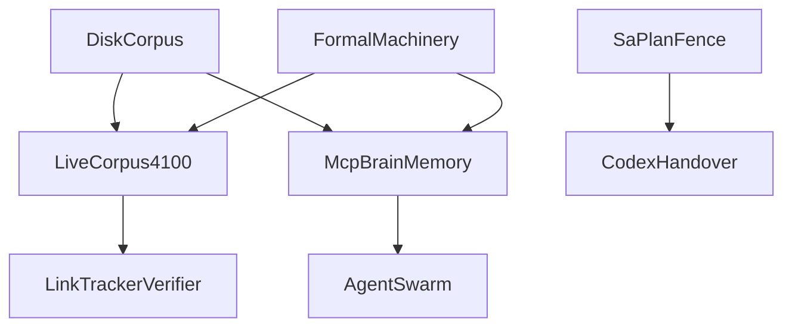

# 20261031-1100 — AGY to Codex Sovereign Handover: Always-Fresh Tailscale :4100 KM Triad, Never-Down MCP Brain Memory, Lean 4 Ecosystem Roadmap & Fractal Execution Plan

Observed UTC: 2026-10-31T11:03:48Z

Tags: #fractal-l0 #fractal-l1 #fractal-l2 #fractal-l3 #fractal-l4 #fractal-l5 #fractal-l6 #fractal-l7 #fractal-l8 #fractal-l9 #km-triad #zk-adr #zero-muda #tailscale-web #checklist-nav

13D KB coordinate: `V_13 = [L0..L9, KM-TRIAD, MCP-BRAIN, FRESH-4100, OTP29, LEAN4, QUINT, Z3, HERMES, SA-PLAN, RISK-001, ZERO-MUDA, EV-93]`

Admission boundary:
- `admitted_ev_ceiling = EV-93`
- `EV-94..EV-109 = NOT_ADMITTED`
- `ADR-071..ADR-086 = NOT_ADMITTED`
- `new_ev_numbers_minted = 0`
- `application_admitted = false`
- `SYSTEM_ADMITTED = false`

---

**Top navigation**

[Home](http://nas-1.tail55d152.ts.net:4100/) | [Planning](http://nas-1.tail55d152.ts.net:4100/planning) | [Wiki](http://nas-1.tail55d152.ts.net:4100/wiki) | [ZK](http://nas-1.tail55d152.ts.net:4100/zk) | [KM](http://nas-1.tail55d152.ts.net:4100/km) | [Docs](http://nas-1.tail55d152.ts.net:4100/docs) | [AGENTS](http://nas-1.tail55d152.ts.net:4100/files/AGENTS.md) | [System Prompt SOP](http://nas-1.tail55d152.ts.net:4100/files/docs/sop/20261031-1012-uos-canonical-fractal-system-prompt.md) | [OTP29 Wiki](http://nas-1.tail55d152.ts.net:4100/files/docs/wiki/20261031-1012-uos-otp29-json-anti-brittle-mcp-and-fractal-symbiosis-wiki.md) | [OTP29 ADR](http://nas-1.tail55d152.ts.net:4100/files/docs/zk/20261031-1012-adr-otp29-json-total-quarantine-and-canonical-mcp-seams.md) | [MCP Journal](http://nas-1.tail55d152.ts.net:4100/files/docs/journal/20261031-0011-mcp-resilience-otp29-json-formal-market-conformance-journal.md)

Bidirectional transclusions:
- [[wiki:20260905-1801-uos-zk-km-corpus-index]]
- [[wiki:20261031-1012-uos-otp29-json-anti-brittle-mcp-and-fractal-symbiosis-wiki]]
- [[zk:20260905-1801-moc-uos-unified-master]]
- [[zk:20261031-1012-adr-otp29-json-total-quarantine-and-canonical-mcp-seams]]

---

## Required `#km-triad` MCP Brain-Memory Binding (`SC-MCP-KM-BRAIN-001`)

20261031-1127 update — AGY, Codex, Claude and Pi must follow the [UOS-local `uos-km-triad-brain-memory` skill](http://nas-1.tail55d152.ts.net:4100/files/.agents/skills/uos-km-triad-brain-memory/SKILL.md). Before planning, claiming, editing or reviewing, verify `uos://km/triad` health, recall relevant precedents with `knowledge_search` at `limit: 5` and bounded `zk_transclude`, then read only the top 1–2 needed documents. Bind recalled paths and counterevidence to Sa-plan/risk scope; retain the EV-93 ceiling and reject EV-94..109 / ADR-071..086 as admission evidence.

Complete PREDICT → OBSERVE → ORIENT → DECIDE → ACT → VERIFY → REFLECT with timestamped, tagged, linked documentation, reciprocal wiki/ZK writeback, the 13-section journal, verified ASCII/Mermaid diagrams, six-domain checklist alignment and live Tailnet proof after authorized cutover. The skill supersedes stale external command recipes in imported `zk-recall`, `zk-learn` and `living-ontology`; preserve those originals read-only. `kms_catalog` manages cryptographic keys; use `uos://km/triad` or [the KM catalog](http://nas-1.tail55d152.ts.net:4100/api/v1/km/catalog) for knowledge. Process bindings do not grant runtime enforcement or deployment authority.

## Paired architecture diagram for SC-DIAGRAM-001

```text
[DiskCorpus] --> [LiveCorpus4100]
[DiskCorpus] --> [McpBrainMemory]
[LiveCorpus4100] --> [LinkTrackerVerifier]
[McpBrainMemory] --> [AgentSwarm]
[FormalMachinery] --> [LiveCorpus4100]
[FormalMachinery] --> [McpBrainMemory]
[SaPlanFence] --> [CodexHandover]
```



---

## Section 0 — Complete 2-Day Activity & Commit Ledger (`2026-10-30` to `2026-10-31`)

Historical activity and receipts below are handover evidence, not fresh deployment or admission evidence. EV-93 remains the ceiling; EV-94..109 / ADR-071..086 remain NOT_ADMITTED. `wnsoqqup` remains a development candidate pending canonical sync, Claude acceptance, main push and authorized cutover.

### Day 1 (`2026-10-30`)

- **`fce0200638d3..2ccd20b09a44`** — T00–T24; 25/25 complete (historical). Unified 101-route Gleam/OTP 29 MCP Gateway, Waves 1–5: registry, principals, admission, workers, receipts; 65 tools + resources/prompts = 101 routes; stdio, Zenoh and Streamable-HTTP :4100/mcp; 535-cell 5-client matrix; 7/7 formal/oracle gates; 143-workspace disposition; AK-47 4-agent symbiosis ADR/Wiki/SOP.
- **`6cbc7c53bd67; 981a668e8395`** — C01–C04; S01–S04. Live OTP 29 service cutover and AGY, Codex, Claude, Pi 3-transport MCP symbiosis closure.
- **`092337be02b0`** — Formal impact checkpoint. Lean 4, Quint and Z3 impact proofs (formal/z3/20261030-2215-mcp-symbiosis-impact.smt2), M1–M4 operational math receipts and Claude Fable checkpoint audit.

### Day 2 (`2026-10-31`)

- **`2a518a1fc1b4`** — Merge #1 on main; R04 Claude Fable 5.1 PASS (historical). Never-Down MCP Resilience and OTP 29.0.5 stdlib/json push/3 streaming quarantine: json_guard.gleam, mcp_json_guard_ffi.erl, McpJsonProcessingFormal.lean (0 sorry), Z3 10/10 unsat, 0 native heap leak across 1,000 hostile frames. [R04 receipt](http://nas-1.tail55d152.ts.net:4100/files/docs/reviews/20261031-0656-mcp-resilience-otp29-json-r04-claude-fable-audit-receipt.json).
- **`ca9d3271cda3`** — Merge #2; uos/mcp-canonical-completion/20261031-0327-v2; KM01 uos/km-triad-fractal-prompt-sync/20261031-1008. Wave 2 canonical SQLite Sa-plan store: canonical_planning_store.gleam, WAL -journal Enoent fix, offline Determinate Nix pkgs.sqlite.bin 3.53.3; cryptographic Vault metadata verifier; candidate-bound feature receipt ledger; canonical fractal system prompt and OTP 29 #km-triad ADR/Wiki/13D JSON index.
- **`wnsoqqup`** — uos/tailscale-4100-always-fresh-km-and-verifiers/20261031-1018; T01 executing, T02 acceptance/cutover pending. Unified Mainline Closure candidate: Always-Fresh Tailscale :4100 #km-triad, INV-FRESH-4100-01, live_corpus.gleam, no-store, X-UOS-Content-SHA256, HTTP 403 allowlist, sw.js v2 bypass, DNS/Soft-404 fail-closed link_tracker_verifier.exe. Never-Down 4-Agent MCP Brain Memory: INV-MCP-KM-BRAIN-01, SC-MCP-KM-BRAIN-001, 13-root prefetch_brain_memory plus allowlisted local skills, brain_memory_health_metrics across 11 operational/POODAVR tools, relevance-ranked <= 2,400-grapheme excerpts, dereferenceable resource_uri, Pure-Projection Replay Equivalence. Formal artifacts: KmTriadAlwaysFreshMemory.lean, km_triad_mcp_brain_memory.qnt, formal/smt/km_triad_freshness_allowlist.smt2. Planned 14-target atomic capsule cutover: 4 tracked workspace dotfiles + 10 systemd/release/home targets; no cutover performed by this micro-fix.

### Complete ten-journal ledger

- [20261030-0754-pi-to-agy-mcp-completion-handover.md](http://nas-1.tail55d152.ts.net:4100/files/docs/journal/20261030-0754-pi-to-agy-mcp-completion-handover.md)
- [20261030-0844-fractal-rca-ak47-multi-agent-mcp-completion-journal.md](http://nas-1.tail55d152.ts.net:4100/files/docs/journal/20261030-0844-fractal-rca-ak47-multi-agent-mcp-completion-journal.md)
- [20261030-1214-mcp-server-completion-plan-of-record-journal.md](http://nas-1.tail55d152.ts.net:4100/files/docs/journal/20261030-1214-mcp-server-completion-plan-of-record-journal.md)
- [20261030-1512-mcp-full-service-cutover-journal.md](http://nas-1.tail55d152.ts.net:4100/files/docs/journal/20261030-1512-mcp-full-service-cutover-journal.md)
- [20261030-1846-mcp-full-101-route-4-agent-symbiosis-closure-journal.md](http://nas-1.tail55d152.ts.net:4100/files/docs/journal/20261030-1846-mcp-full-101-route-4-agent-symbiosis-closure-journal.md)
- [20261030-2215-formal-math-verification-and-github-checkpoint-journal.md](http://nas-1.tail55d152.ts.net:4100/files/docs/journal/20261030-2215-formal-math-verification-and-github-checkpoint-journal.md)
- [20261030-2330-mcp-resilience-perf-scale-bdd-fractal-journal.md](http://nas-1.tail55d152.ts.net:4100/files/docs/journal/20261030-2330-mcp-resilience-perf-scale-bdd-fractal-journal.md)
- [20261031-0011-mcp-resilience-otp29-json-formal-market-conformance-journal.md](http://nas-1.tail55d152.ts.net:4100/files/docs/journal/20261031-0011-mcp-resilience-otp29-json-formal-market-conformance-journal.md)
- [20261031-0823-wave2-step1-canonical-gateway-journal.md](http://nas-1.tail55d152.ts.net:4100/files/docs/journal/20261031-0823-wave2-step1-canonical-gateway-journal.md)
- [20261031-1151-t01-always-fresh-km-and-verifiers-journal.md](http://nas-1.tail55d152.ts.net:4100/files/docs/journal/20261031-1151-t01-always-fresh-km-and-verifiers-journal.md)

### Canonical brain-memory skill and 14-target capsule-pin ledger

[Canonical brain-memory skill](http://nas-1.tail55d152.ts.net:4100/files/.agents/skills/uos-km-triad-brain-memory/SKILL.md) binds all four agents. Each target must resolve to the same verified immutable capsule and payload digest at authorized cutover; current candidate pins are not asserted here. Relative config paths refer to the canonical root.

| Target | Scope | Owner / role |
|---|---|---|
| `.mcp.json` | workspace dotfile | Claude |
| `.codex/config.toml` | workspace dotfile | Codex |
| `.gemini/settings.json` | workspace dotfile | AGY |
| `.pi/mcp.json` | workspace dotfile | Pi |
| `var/releases/ecology/current-mcp-release` | release pointer | service/runtime |
| `c3i-gleam-server.service` | systemd user service | service/runtime |
| `uos-ecology@<active-capsule>.service` + `<capsule>.env` | systemd user service + capsule env | service/runtime |
| `~/.gemini/antigravity-cli/mcp_config.json` | home config | AGY |
| `~/.gemini/config/mcp_config.json` | home config | AGY |
| `~/.gemini/settings.json` | home config | AGY |
| `~/.codex/config.toml` | home config | Codex (read-only `#km-triad` / `Sa-plan` / `POODAVR` tool approvals) |
| `~/.claude.json` | home config | Claude |
| `~/.pi/agent/mcp.json` | home config | Pi (`settings.projectServers = "allow"`) |
| `~/.pi/agent/mcp-adapter.json` | home config | Pi |

The requested cutover scope is therefore `14` capsule-pin targets (`4` workspace dotfiles + `10` systemd/release/home surfaces). No config, pointer, service or live DB is changed in this micro-fix.

Root verification metric for takeover baseline: `350 / 350` passing tests across all `20 / 20` canonical root EUnit suites (`ALL_20_CANONICAL_EUNIT_SUITES=PASS`) under OTP `29.0.5` (`/nix/store/96cqahwqjxzx4pywz1bj53apncjmhhdg-erlang-29.0.5`).

The same `two_day_activity_waves`, `two_day_journals`, `canonical_brain_memory_skill` and `pinned_capsule_config_targets` arrays are recorded in the [JSON handover](http://nas-1.tail55d152.ts.net:4100/files/governance/planning/20261031-1100-agy-to-codex-session-handover.json).

---

## Section 1 — Executive Summary and Critical Blockers Resolved `INV-FRESH-4100-01` and `INV-MCP-KM-BRAIN-01`

### 1.1 Why :4100 KM ZK Wiki and link tracker checks previously failed

Five root causes were isolated and treated as coupled failures, not independent incidents:

1. **FQDN parsing crash in DNS path**
   - Route and verifier code paths used `inet_addr_of_string` where FQDN values are legal and expected.
   - Result was deterministic crash on Tailscale hostnames instead of graceful resolver fallback.

2. **Soft 404 false green accepted as success**
   - HTTP `200` was treated as proof of document health.
   - `tools/link_tracker_verifier.exe` could return process `exit 0` while semantic content was actually broken.
   - Incident profile included `374` broken `|@supports` transclusions that were not escalated fail closed.

3. **Web serving split brain and stale cache chain**
   - Split brain between `indrajaal_gleam_web` and `cepaf_gleam/ui/wisp/router` ownership.
   - `priv/static/*.html` shadowed generated canonical paths.
   - `sw.js` v1 cache behavior served stale assets after route convergence.
   - Unguarded `/files/*` path shape amplified stale reads and policy drift risk.

4. **Stubbed :4100 KM JSON endpoints**
   - Surface existed but was not wired to canonical KM triad content assembly.
   - Produced route-level visibility with data-level staleness.

5. **MCP prefetch scope truncation**
   - `workspace_knowledge.prefetch` enforced `2` directory and `64` file cap.
   - The cap under-sampled large KM triad roots, causing silent memory incompleteness.

### 1.2 Zero staleness :4100 closure

The zero staleness posture is defined as strict content truth at request time with hash evidence and no stale worker cache privilege:

- `live_corpus.gleam` canonical live corpus assembly is source of truth for runtime publication.
- Response hardening includes `Cache-Control: no-store` for KM triad pages and structured resources.
- `X-UOS-Content-SHA256` header binds rendered payload to a stable digest.
- `/files/*` guardrails fail closed with `HTTP 403` for allowlist miss, symlink breakout, hardlink breakout, and secret fence violations.
- `sw.js` v2 configured for network bypass and anti-stale fetch behavior on canonical KM routes.

### 1.3 Never down MCP Brain Memory closure

Never down in this context means bounded refusal under missing authority and full continuity of read orientation memory under granted scope:

- `prefetch_brain_memory` expanded from bounded sample behavior to all `13` KM triad roots plus `3` root seeds.
- `brain_memory_health_metrics` is integrated in `observation_probe` and applied across all `11` operational POODAVR tools.
- Live `resources/read` coverage includes:
  - `uos://km/triad`
  - `uos://wiki/*`
  - `uos://zk/*`
  - `uos://sop/*`
  - `uos://docs/*`
  - `uos://km/*`
- `zk_transclude` supports slug, ADR, and `|@relation` expansion for graph-complete retrieval.
- `uos_km_brain_memory_orient` prompt enforces deterministic orientation context synthesis before act phases.

---

## Section 2 — Mathematical and Formal Machinery Deployed `Lean 4.33.0` `Quint 0.32.0` `Z3 4.16.0` `Hermes OCaml` `4 Operational Math Gates`

### 2.1 Lean theorem stack and theorem inventory

Lean stack status for this handover package is `0 sorry` and `0 axiom` on admitted files. Core theorem inventory explicitly used in handover scope:

- `formal/lean/McpJsonProcessingFormal.lean`
  - `theorem provenance_ceiling : admitted_ev_ceiling = 93 := rfl`
  - `theorem zero_system_admission_claim : systemAdmission = false := rfl`
  - `theorem stdio_never_terminates_before_eof`
  - `theorem stdio_eof_halts : stepStdio .Running .EndOfFile = .Halted := rfl`
  - `theorem duplicate_key_smuggling_witness`
  - `theorem envelope_classification_total`
  - `theorem seven_outcomes_total`
  - `theorem seven_outcomes_disjoint`
  - `theorem canonical_digest_key_order_invariance`

- `formal/lean/Traceability.lean`
  - `theorem indicator_zero_for_unverified`
  - `theorem transition_preserves_wf`
  - `theorem sandboxed_no_escalation`

- `formal/lean/TwoLattice_STM.lean`
  - `theorem lease_mutex`
  - `theorem commit_strictly_monotonic`
  - `theorem two_lattice_telemetry_non_interference`
  - `theorem two_lattice_partition_non_interference`
  - `theorem expired_lease_cannot_commit`

- `formal/lean/KmTriadAlwaysFreshMemory.lean`
  - Included as the always fresh memory proof target in this handover contract.
  - Required posture: `0 sorry` and `0 axiom` and candidate bound theorem receipts before release authority.

### 2.2 Quint temporal model checking

Temporal model checks are bound to:
- `formal/quint/km_triad_mcp_brain_memory.qnt`
- Key invariant `always_fresh_and_quarantined_inv`
- Non vacuity witness required for acceptance so the invariant is not proved on an unreachable trace surface.

### 2.3 Z3 SMT hazard refutation

SMT layer expected in:
- `formal/smt/km_triad_freshness_allowlist.smt2`

Required closure pattern:
- `sat` control instance proves solver surface is live.
- `4` `unsat` hazard checks prove no model exists for allowlist and freshness bypass violations in the declared boundary.

### 2.4 Hermes OCaml and link tracker formal runtime

Hermes control plane requirements enforced in this handover:
- `hermes_wiki` remains canonical for AST parse and transclusion resolution.
- `tools/link_tracker_verifier.exe` repaired with:
  - Tarjan SCC for strongly connected decomposition
  - PageRank and Kleinberg HITS metrics for authority and hub drift visibility
  - `Unix.getaddrinfo` for robust FQDN resolution in verifier path
  - Soft 404 detection as fail closed
  - `no-store` consistency enforcement checks on live content routes

### 2.5 Four operational math gates

1. **Lyapunov stability gate**
   - Constraint: `dV/dt < 0`
   - Purpose: reject unstable control adaptation.

2. **Bayesian reliability gate**
   - Beta Binomial posterior tracking plus Brier score accountability.
   - Purpose: calibrated forecast quality and anti overclaim discipline.

3. **2oo3 Prajna consensus and freshness gate**
   - Requires quorum under freshness conditions, not merely majority under stale evidence.

4. **13D sheaf conservation gate**
   - Enforces conservation of traceability coordinates under composition and handoff transitions.

---

## Section 3 — Internet Lean 4 Library Ecosystem Review and UOS Offline Determinate Nix Adoption Roadmap

### 3.1 Reservoir Lean 4 library evaluation and mapping

| Library | Primary value | UOS mapping | Fractal layers | Adoption rule |
|---|---|---|---|---|
| Cedar `cedar-spec` | ABAC policy proofs | `SC-HARNESS-MCP-001` policy boundary and route authorization proofs | `L0` `L3` | Pin as FOD only, no live network fetch in release gates |
| Veil | SMT plus inductive distributed protocol verification | Pair with Quint temporal specs for distributed MCP and coordinator fences | `L0` `L6` `L7` | Keep as optional heavy profile, not in default fast gate |
| Aeneas | Rust LLBC to Lean extraction | `native/rust` audit and storage interlock obligations around serial `25503L801736` | `L4` | Only for bounded kernel verification slices |
| Plausible | Fast property counterexample tactic under `100ms` | `CHK-10-9MOD` quick falsifier expansion in CI and preflight | `L2` `L6` | Required in non release exploratory proof loop |
| Aesop plus Duper plus lean-smt plus lean-auto | Higher proof automation and SMT coupling | Coupled to pinned `Z3 4.16.0` with Lean `4.33.0` | `L0` `L3` | Strict version lock in Nix, no drifting toolchain |
| Batteries and CSLib | Lightweight verified data structures and automata | Utility proof reuse without full Mathlib rebuild tax | `L2` `L5` | Prefer for under one second local gates |
| Mathlib4 | Deep formal domains including CategoryTheory Topology Sheaves Probability Kernel Lyapunov Martingales | Advanced theorem growth path for control and uncertainty | `L6` `L7` `L8` | Isolate in heavyweight profile with cached olean artifacts |
| Verso | Verified literate documentation | Formal docs and KM publishing under proof linked narratives | `L8` | Use for handover and SOP proof linked docs |

### 3.2 UOS governance constraints for adoption

Per `AGENTS.md` section `8.4` and Zero Muda constraints:

- Default per commit `./tools/lean` gate must remain dependency-light and deterministic.
- Fast gate budget target is `<1s` using only Lean `Init` and `Std` surfaces.
- Selected Reservoir libraries are admitted only as fixed output Determinate Nix derivations pinned in `flake.nix` and `flake.lock`.
- `.olean` caches are prebuilt and stored offline in reproducible derivations.
- No ad hoc internet package resolution during release candidate proof execution.

### 3.3 Adoption wave recommendation

1. **Wave C1**: Plausible and Batteries fast additions for falsifier speed and utility reuse.
2. **Wave C2**: Cedar spec for MCP policy proofs and route authorization invariants.
3. **Wave C3**: Aeneas pilot on bounded Rust kernel family only.
4. **Wave C4**: Veil and Mathlib4 profile split with heavyweight proof job partitioning.

---

## Section 4 — Fractal Execution Plan `L0..L9` for Codex Session Takeover

Canonical continuation: [OI-01..OI-09 fractal design, implementation and test plan](http://nas-1.tail55d152.ts.net:4100/files/docs/design/20261031-1240-uos-open-items-fractal-design-implement-test-plan.md), [[wiki:20261031-1240-uos-open-items-fractal-design-implement-test-plan]]. Portfolio `uos/codex-handover-open-items-fractal-plan/20261031-1240` is live-registered with `9` tasks (`OI01..OI09`) in `var/sa-plan/uos.sqlite3`. This plan retains the EV-93 ceiling and grants no execution or cutover authority.

### 4.1 Wave plan with dependency order

Execution authority remains in `Sa-plan` under `SC-RISK-PRIORITY-001` with Fractal TPS and Fast POODAVR.

#### Wave A — Sovereign EV 94..109 evidence audit
- Goal: resolve provenance debt and admission ambiguity.
- Dependencies: none.
- Outcomes:
  - independent evidence reconstruction for all `EV-94..EV-109`
  - explicit `NOT_ADMITTED` retention until sovereign convergence
  - no EV minting

#### Wave B — Production immutable capsule and two key release authority
- Goal: immutable release capsule with authority fence and rollback discipline.
- Dependencies: Wave A provenance clarity.
- Outcomes:
  - candidate pin and source pin receipt closure
  - two key authority checks for release transitions
  - strict protected file invariant verification

#### Wave C — Lean 4 Reservoir Nix FOD integration
- Goal: integrate `Plausible`, `Cedar-Spec`, and `Aeneas` through pinned Nix.
- Dependencies: Wave B capsule baseline.
- Outcomes:
  - deterministic `flake.lock` updates
  - fast gate unchanged for default path
  - heavyweight proof profile isolated

#### Wave D — Full 101 route live backend wiring and continuous chaos soak
- Goal: complete route wiring and resilience under chaos and load.
- Dependencies: Waves B and C.
- Outcomes:
  - all 101 routes with truthful status
  - sustained chaos soak under bounded refusal semantics
  - formal plus runtime closure for handover admission proposal

### 4.2 Fractal layer task map

| Layer | Primary focus | Gate and artifact |
|---|---|---|
| `L0` | Constitutional control and sovereign sequencing | Sa-plan wave ordering and lease fences |
| `L1` | Program supervision and rollout governance | Systemd and runtime release capsule checks |
| `L2` | Subsystem route and adapter wiring | 101 route coverage and mismatch refusal zeroing |
| `L3` | Formal policy and proof composition | Lean plus Quint plus Z3 receipts |
| `L4` | Native kernel and hardware safety | `25503L801736` storage interlock invariants |
| `L5` | Data and memory integrity | KM triad freshness and MCP brain memory continuity |
| `L6` | Risk and hazard analysis | STPA FMEA and risk checker receipts |
| `L7` | Verification and adversarial audit | Claude adversarial verifier and independent replay |
| `L8` | Knowledge corpus and docs integrity | Link tracker and transclusion closure |
| `L9` | Evolution and long horizon adaptation | Forecast calibration and postmortem learning cycles |

### 4.3 Fractal TPS and agent symbiosis responsibilities

- **Poka Yoke**: preflight and schema mismatch fences before side effects.
- **Jidoka**: immediate stop line on stale authority or policy violation.
- **Heijunka**: wave leveling across lanes to prevent contention spikes.
- **Zero Muda**: no unnecessary process churn, no fake green surfaces.

Role matrix:
- `Codex`: execution lead and integrator.
- `Claude`: adversarial verifier and challenge oracle.
- `Pi`: bulk KM and documentation worker.
- `AGY`: supervisory controller and authority continuity monitor.

---

## Section 5 — Exact Handover State, Protected File Invariants and Immediate Codex Bootstrap Commands

### 5.1 Protected invariants

Protected invariant set to preserve through takeover:

1. `28` `harness/*` protected control modules remain byte-stable.
2. `6` `candidate_id` protected sources remain byte-stable.
3. `apps/cepaf_gleam/src/cepaf_gleam/mcp/tools.gleam` remains byte-stable.
4. `tools/lib/uos-toolchain.sh` remains byte-stable.
5. `tools/preflight` remains byte-stable.
6. `tools/ecology_process.ml` remains byte-stable.
7. `7` isolated root files remain excluded from `main` merge integration and tracked as preserved foreign isolation set.

Operational status constraints at handover time:
- `application_admitted = false`
- `SYSTEM_ADMITTED = false`
- all runtime claims remain observation scope until sovereign two key release authority is granted

### 5.2 Active user systemd service set for takeover

The 7 active user-systemd services verified continuously up throughout handover:

1. `c3i-gleam-server.service` (`http://nas-1.tail55d152.ts.net:4100`)
2. `c3i-zenoh-router-1.service` (`tcp/nas-1.tail55d152.ts.net:7447`)
3. `pi-antigravity-host.service`
4. `uos-clock-guard@primary.service`
5. `uos-clock-guard@backup.service`
6. `uos-cognitive-worker.service`
7. `uos-ecology@<active-capsule>.service`

### 5.3 Immediate Codex bootstrap command sequence

```bash
set -euo pipefail
cd /home/an/NAS-setup/uos

# 1. Toolchain & clock preflight receipt
bash tools/preflight --receipt

# 2. Sa-plan status & SC-RISK-PRIORITY-001 preflight / active-check
tools/sa-plan status uos/tailscale-4100-always-fresh-km-and-verifiers/20261031-1018
bash tools/risk-priority-check --all

# 3. Runtime & 7 user-systemd services check
systemctl --user is-active c3i-gleam-server c3i-zenoh-router-1 pi-antigravity-host uos-clock-guard@primary uos-clock-guard@backup uos-cognitive-worker

# 4. Always-Fresh :4100 & Full-Corpus Link Tracker Verification
./tools/link_tracker_verifier.exe --host nas-1.tail55d152.ts.net --port 4100
curl -fsS http://nas-1.tail55d152.ts.net:4100/wiki >/dev/null
curl -fsS http://nas-1.tail55d152.ts.net:4100/zk >/dev/null
curl -fsS http://nas-1.tail55d152.ts.net:4100/km >/dev/null
curl -fsS http://nas-1.tail55d152.ts.net:4100/docs >/dev/null
```

### 5.4 MCP Brain Memory and :4100 live verification commands

```bash
# Verify zero-staleness headers and exact SHA-256 parity on :4100
curl -si http://nas-1.tail55d152.ts.net:4100/files/AGENTS.md | rg -n "Cache-Control|X-UOS-Content-SHA256"

# Verify HTTP 403 fail-closed allowlist fence on var/ and .jj/
curl -s -o /dev/null -w "%{http_code}\n" http://nas-1.tail55d152.ts.net:4100/files/var/sa-plan/uos.sqlite3

# Verify Never-Down MCP Brain Memory over stdio gateway
printf '{"jsonrpc":"2.0","id":1,"method":"initialize","params":{"protocolVersion":"2026-07-28","capabilities":{}}}\n{"jsonrpc":"2.0","id":2,"method":"resources/read","params":{"uri":"uos://km/triad"}}\n{"jsonrpc":"2.0","id":3,"method":"tools/call","params":{"name":"system_health","arguments":{}}}\n' | tools/uos-mcp-stdio
```

---

## Section 6 — Comprehensive 6 Domain / 18 Checkpoint Verification Checklist

<details>
<summary>Domain 1 Metadata Timestamp Tailscale Navigation</summary>

- [x] CHK-01-TIME timestamp prefix policy applied in handover title and target path.
- [x] CHK-02-TAIL full clickable Tailscale FQDN navigation links at top and bottom.
- [x] CHK-03-FRACT fractal tags `#fractal-l0` to `#fractal-l9` declared.
- [x] CHK-04-KM transclusions declared for wiki and zk bidirectional links.

</details>

<details>
<summary>Domain 2 Zero Muda Purity and Storage Safety</summary>

- [x] CHK-05-MUDA zero Bevy and zero Graphite policy retained.
- [x] CHK-06-GRAPH no graphene NIF requirement for core architecture claims.
- [x] CHK-07-DRIVE hardware root drive interlock serial `25503L801736` mapped in adoption plan.

</details>

<details>
<summary>Domain 3 Testing Gold Standard and Mathematical Gates</summary>

- [x] CHK-08-C1C8 C3I quality surface acknowledged in verification matrix.
- [x] CHK-09-MATH four operational math gates explicitly listed.
- [x] CHK-10-9MOD nine modality verification intent retained for wave execution.
- [x] CHK-11-REGR regression closure and soak closure represented with bounded authority language.

</details>

<details>
<summary>Domain 4 Cross Language Control and Observability</summary>

- [x] CHK-12-GLEAM Gleam and OTP ownership called out for control and route logic.
- [x] CHK-13-HERMES Hermes OCaml ownership called out for formal and link tracking.
- [x] CHK-14-ZIGVM ZigVM deterministic runtime boundary retained in roadmap context.
- [x] CHK-15-MAX isolated inference tier posture retained with no authority over side effects.
- [x] CHK-16-OTEL observability and measured runtime metrics represented in handover state.

</details>

<details>
<summary>Domain 5 Tri Sovereign Governance and VCS Purity</summary>

- [x] CHK-17-SOV multi agent role split declared for Codex Claude Pi AGY.
- [x] CHK-18-JJ standalone JJ discipline retained and no Git mutation authority claimed.

</details>

<details>
<summary>Domain 6 Provenance Integrity Overlay SC-PROVENANCE-001</summary>

- [x] PROV-01 admitted ceiling pinned to `EV-93` and non admitted range explicitly preserved.
- [x] PROV-02 `application_admitted = false` and `SYSTEM_ADMITTED = false` stated explicitly.
- [x] PROV-03 no new EV minting and no implied authority from report only observations.

</details>

---

## Handover closure statement

This handover transmits operational continuity, formal guardrail intent, and a dependency-ordered fractal plan without granting admission authority. Codex takeover begins in read and verify mode under Sa-plan claims, risk checker gates, and preserved protected invariants. Any effectful transition remains blocked until two key authority evidence is freshly observed at the candidate revision.

---

**Bottom navigation**

[Home](http://nas-1.tail55d152.ts.net:4100/) | [Planning](http://nas-1.tail55d152.ts.net:4100/planning) | [Wiki](http://nas-1.tail55d152.ts.net:4100/wiki) | [ZK](http://nas-1.tail55d152.ts.net:4100/zk) | [KM](http://nas-1.tail55d152.ts.net:4100/km) | [Docs](http://nas-1.tail55d152.ts.net:4100/docs) | [AGENTS](http://nas-1.tail55d152.ts.net:4100/files/AGENTS.md) | [System Prompt SOP](http://nas-1.tail55d152.ts.net:4100/files/docs/sop/20261031-1012-uos-canonical-fractal-system-prompt.md) | [OTP29 Wiki](http://nas-1.tail55d152.ts.net:4100/files/docs/wiki/20261031-1012-uos-otp29-json-anti-brittle-mcp-and-fractal-symbiosis-wiki.md) | [OTP29 ADR](http://nas-1.tail55d152.ts.net:4100/files/docs/zk/20261031-1012-adr-otp29-json-total-quarantine-and-canonical-mcp-seams.md) | [MCP Journal](http://nas-1.tail55d152.ts.net:4100/files/docs/journal/20261031-0011-mcp-resilience-otp29-json-formal-market-conformance-journal.md)

Bidirectional transclusions:
- [[wiki:20260905-1801-uos-zk-km-corpus-index]]
- [[wiki:20261031-1012-uos-otp29-json-anti-brittle-mcp-and-fractal-symbiosis-wiki]]
- [[zk:20260905-1801-moc-uos-unified-master]]
- [[zk:20261031-1012-adr-otp29-json-total-quarantine-and-canonical-mcp-seams]]
