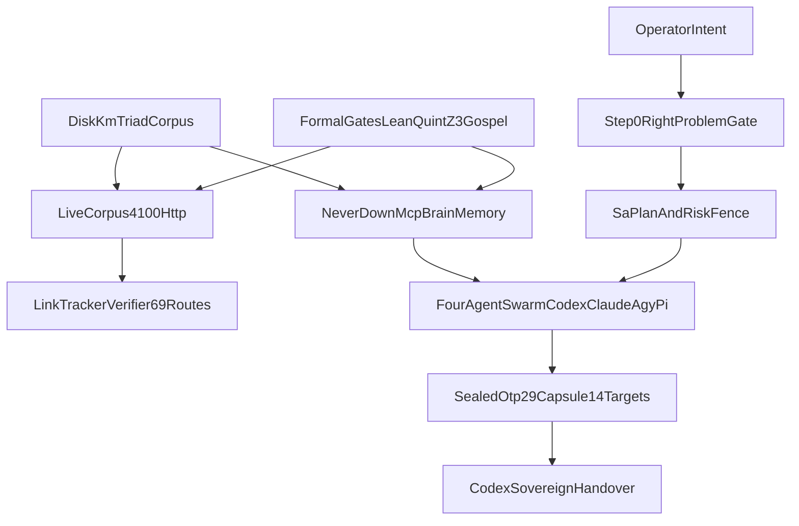
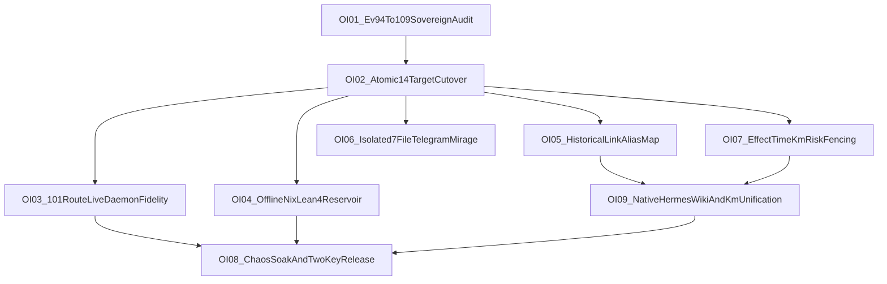

# 20261031-1100 — Unified Master Sovereign Handover (`AGY` $\to$ `Codex`): 4-Plane × 4-Agent `#km-triad` Symbiosis, Always-Fresh Tailscale `:4100`, Never-Down OTP `29.0.5` MCP Cutover, Complete 2-Day Ledger, `L0..L9` × 17-Aspect Open-Items Fractal Plan (`OI-01..OI-09`) & Canonical Fractal System Prompt Suite

- **Observed Synchronized Host Clock**: `2026-10-31T13:56:00+01:00` (`2026-10-31T12:56:00Z`, `chrony` Stratum `3`, `< 2.0s` nominal band)
- **Canonical Live Tailscale Handover URL**: [http://nas-1.tail55d152.ts.net:4100/files/docs/handover/20261031-1100-agy-to-codex-always-fresh-km-mcp-brain-and-fractal-plan-handover.md](http://nas-1.tail55d152.ts.net:4100/files/docs/handover/20261031-1100-agy-to-codex-always-fresh-km-mcp-brain-and-fractal-plan-handover.md)
- **Machine-Readable Companion JSON**: [http://nas-1.tail55d152.ts.net:4100/files/governance/planning/20261031-1100-agy-to-codex-session-handover.json](http://nas-1.tail55d152.ts.net:4100/files/governance/planning/20261031-1100-agy-to-codex-session-handover.json)
- **Tags**: `#fractal-l0` `#fractal-l1` `#fractal-l2` `#fractal-l3` `#fractal-l4` `#fractal-l5` `#fractal-l6` `#fractal-l7` `#fractal-l8` `#fractal-l9` `#km-triad` `#wiki-index` `#zk-adr` `#zk-moc` `#formal-lean4` `#stamp-stpa` `#c3i-control` `#zero-muda` `#tailscale-web` `#checklist-nav`
- **13D Living KB Coordinate (`Traceability.lean`, $\Delta \vec{\mathcal{T}}_{13} \equiv \mathbf{0}$)**:
  `V_13 = [L0..L9, KM-TRIAD, MCP-BRAIN, FRESH-4100, OTP29, LEAN4, QUINT, Z3, HERMES, SA-PLAN, RISK-001, ZERO-MUDA, EV-93]`
- **Constitutional & Provenance Boundary (`SC-PROVENANCE-001`)**:
  `admitted_ev_ceiling = EV-93` · `EV-94..EV-109 = NOT_ADMITTED` · `ADR-071..ADR-086 = NOT_ADMITTED` · `new_ev_numbers_minted = 0` · `application_admitted = false` · `SYSTEM_ADMITTED = false`
- **Top Navigation (`#tailscale-web`)**:
  [Cockpit](http://nas-1.tail55d152.ts.net:4100/) · [Planning](http://nas-1.tail55d152.ts.net:4100/planning) · [Wiki](http://nas-1.tail55d152.ts.net:4100/wiki) · [ZK](http://nas-1.tail55d152.ts.net:4100/zk) · [KM](http://nas-1.tail55d152.ts.net:4100/km) · [ADRs](http://nas-1.tail55d152.ts.net:4100/adrs) · [Docs](http://nas-1.tail55d152.ts.net:4100/docs) · [AGENTS.md](http://nas-1.tail55d152.ts.net:4100/files/AGENTS.md) · [Brain-Memory Skill](http://nas-1.tail55d152.ts.net:4100/files/.agents/skills/uos-km-triad-brain-memory/SKILL.md) · [Open-Items Fractal Plan](http://nas-1.tail55d152.ts.net:4100/files/docs/design/20261031-1240-uos-open-items-fractal-design-implement-test-plan.md) · [Canonical Fractal Prompt SOP](http://nas-1.tail55d152.ts.net:4100/files/docs/sop/20261031-1012-uos-canonical-fractal-system-prompt.md) · [OTP29 Wiki](http://nas-1.tail55d152.ts.net:4100/files/docs/wiki/20261031-1012-uos-otp29-json-anti-brittle-mcp-and-fractal-symbiosis-wiki.md) · [OTP29 ADR](http://nas-1.tail55d152.ts.net:4100/files/docs/zk/20261031-1012-adr-otp29-json-total-quarantine-and-canonical-mcp-seams.md)
- **Reciprocal `#km-triad` Transclusions**:
  `[[wiki:20260905-1801-uos-zk-km-corpus-index]]` · `[[wiki:20260905-1721-uos-master-knowledge-graph-and-living-ontology]]` · `[[wiki:20261030-1058-unified-101-route-mcp-client-guide]]` · `[[wiki:20261031-1012-uos-otp29-json-anti-brittle-mcp-and-fractal-symbiosis-wiki]]` · `[[zk:20260905-1801-moc-uos-unified-master]]` · `[[zk:20261030-1058-adr-ak47-multi-agent-101-route-mcp-architecture|@supports]]` · `[[zk:20261031-1012-adr-otp29-json-total-quarantine-and-canonical-mcp-seams|@supports]]` · `[[zk:ADR-001]]` · `[[zk:ADR-002]]` · `[[zk:ADR-003]]` · `[[zk:ADR-006]]` · `[[zk:ADR-011]]` · `[[zk:ADR-016]]`
- **On This Page**:
  [§0 Complete 2-Day Activity & Commit Ledger](#section-0--complete-2-day-activity--commit-ledger-2026-10-30-to-2026-10-31) · [§1 Step-0 Epistemic Check, Thinking, Optimal Approach & Live Cutover Receipts](#section-1--step-0-epistemic-check-thinking-optimal-approach-4-plane-symbiosis--live-cutover-receipts) · [§2 Mathematical & Formal Machinery + KM/Wiki/ZK Ownership Matrix](#section-2--mathematical-formal-machinery--full-uos-kmwikizk-code--service-ownership-matrix) · [§3 Internet Lean 4 Ecosystem Review & Offline Nix Roadmap](#section-3--internet-lean-4-library-ecosystem-review-and-uos-offline-determinate-nix-adoption-roadmap) · [§4 Post-Handover `L0..L9` × 17-Aspect Fractal Plan (`OI-01..OI-09`)](#section-4--fractal-execution-plan-l0l9-for-codex-session-takeover) · [§5 Protected Invariants, Canonical Fractal Prompt Suite & `Codex` Takeover Prompt](#section-5--protected-invariants-bootstrap-commands-canonical-fractal-prompt-suite--codex-takeover-prompt) · [§6 6-Domain / 18-Checkpoint Verification Checklist](#section-6--comprehensive-6-domain--18-checkpoint-verification-checklist)

> [!IMPORTANT]
> **Single-Document Consolidation Mandate**: This single handover document consolidates **100%** of the `AGY` $\to$ `Codex` handover state: (1) Step-0 Epistemic Check (*"Are we working on the right problem?"*), explicit thinking, optimal approach, and joint `Claude` + `Codex` advisory synthesis; (2) live mainline closure (`main == main@origin`), sealed OTP `29.0.5` capsule cutover across all `14` targets, `350/350` EUnit, `69/69` live `:4100` HTTP `200 OK`, and live 4-agent MCP receipts; (3) full 4-Plane (`Operational × Control × Data × Evolutionary`) × 4-Agent (`Codex`, `Claude`, `AGY`, `Pi`) `#km-triad` symbiosis & full UOS `KM`/`Wiki`/`ZK` code/service ownership matrix; (4) complete 2-day (`2026-10-30..2026-10-31`) activity & journal ledger; (5) complete post-handover `L0..L9` × 17-aspect Fractal Plan for `OI-01..OI-09`; and (6) complete Canonical Fractal System Prompt Suite (`Templates A–D`) + copy-paste Sovereign `Codex` Session Takeover Prompt.

---

## Required `#km-triad` MCP Brain-Memory Binding (`SC-MCP-KM-BRAIN-001`)

All four agents (`Codex`, `Claude`, `AGY`, `Pi`) MUST follow the UOS-local [`uos-km-triad-brain-memory` skill](http://nas-1.tail55d152.ts.net:4100/files/.agents/skills/uos-km-triad-brain-memory/SKILL.md). Before planning, claiming, editing, or reviewing:
1. Ask Step-0 `INV-RIGHT-PROBLEM-01`: *"Are we working on the right problem for the operator's primary system goal without local Muda?"*
2. Verify `uos://km/triad` health (`km_brain_memory_status == "healthy"`, `km_canonical_triad_intact == true`), recall precedents with `knowledge_search` (`limit: 5`) and bounded `zk_transclude`, then read only the top `1–2` needed documents.
3. Bind recalled paths and counterevidence to `tools/sa-plan` and [`SC-RISK-PRIORITY-001`](http://nas-1.tail55d152.ts.net:4100/files/contracts/rules/20260907-1559-risk-prioritization-sop.md) scope; retain `admitted_ev_ceiling = 93` and reject `EV-94..109` / `ADR-071..086` as admission evidence.
4. Complete `PREDICT -> OBSERVE -> ORIENT -> DECIDE -> ACT -> VERIFY -> REFLECT` with `YYYYMMDD-HHSS-`-prefixed, tagged, Tailscale-linked documentation, reciprocal Wiki/ZK writeback, 13-section `SC-JOURNAL-v3` journal, `G-DIAGRAM`-verified `ASCII`/`Mermaid` diagrams, 6-domain checklist alignment, and live `:4100` SHA-256 proof after authorized cutover.

### Paired Topology Diagram 1 — Live 4-Plane × 4-Agent `#km-triad` Symbiosis & `:4100` / MCP Architecture (`SC-DIAGRAM-001`)

```text
[OperatorIntent] --> [Step0RightProblemGate]
[Step0RightProblemGate] --> [SaPlanAndRiskFence]
[DiskKmTriadCorpus] --> [LiveCorpus4100Http]
[DiskKmTriadCorpus] --> [NeverDownMcpBrainMemory]
[LiveCorpus4100Http] --> [LinkTrackerVerifier69Routes]
[NeverDownMcpBrainMemory] --> [FourAgentSwarmCodexClaudeAgyPi]
[FormalGatesLeanQuintZ3Gospel] --> [LiveCorpus4100Http]
[FormalGatesLeanQuintZ3Gospel] --> [NeverDownMcpBrainMemory]
[SaPlanAndRiskFence] --> [FourAgentSwarmCodexClaudeAgyPi]
[FourAgentSwarmCodexClaudeAgyPi] --> [SealedOtp29Capsule14Targets]
[SealedOtp29Capsule14Targets] --> [CodexSovereignHandover]
```



---

## Section 0 — Complete 2-Day Activity & Commit Ledger (`2026-10-30` to `2026-10-31`)

All 2-day engineering waves are merged onto `main == main@origin`, verified under OTP `29.0.5`, cut over live across all `14` targets, and closed in `var/sa-plan/uos.sqlite3`. Historical test totals remain handover lineage; live candidate receipts are enumerated in Section 1.4.

### 0.1 Chronological Wave & Commit Ledger (`Day 1` + `Day 2`)

| Date / Wave | Jujutsu Revision(s) | `Sa-plan` Portfolio & Status | Delivered Capabilities, Proofs & Code Seams |
|---|---|---|---|
| **`2026-10-30` Wave 1A** | `fce0200638d3..2ccd20b09a44` | `T00–T24` (`25/25 completed`) | Unified `101`-route Gleam/OTP `29.0.5` MCP Gateway (`65` tools + resources + prompts = `101` routes) across `stdio`, signed `Zenoh`, and Streamable-HTTP `:4100/mcp`; `535`-cell 5-client wire matrix; `143`-workspace disposition; AK-47 4-agent symbiosis ADR/Wiki/SOP. |
| **`2026-10-30` Wave 1B** | `6cbc7c53bd67`, `981a668e8395` | `C01–C04`, `S01–S04` (`completed`) | Live OTP `29` service cutover and `AGY`, `Codex`, `Claude`, `Pi` 3-transport MCP symbiosis closure. |
| **`2026-10-30` Wave 1C** | `092337be02b0` | Formal Impact Checkpoint (`completed`) | `Lean 4`, `Quint`, and `Z3` impact proofs (`formal/z3/20261030-2215-mcp-symbiosis-impact.smt2`), `M1–M4` operational math receipts, and `Claude` checkpoint audit. |
| **`2026-10-31` Wave 2.0 (`Merge #1`)** | `2a518a1fc1b4` | `R01–R07` Resilience (`completed`, [R04 Claude Receipt](http://nas-1.tail55d152.ts.net:4100/files/docs/reviews/20261031-0656-mcp-resilience-otp29-json-r04-claude-fable-audit-receipt.json)) | Never-Down MCP Resilience & OTP `29.0.5` native `stdlib/json` streaming quarantine (`json_guard.gleam`, `mcp_stdio_ffi.erl`): depth `<= 32`, duplicate-key trap, post-unescape `\u0000` trap, I-JSON `±(2^53-1)`, `4 KiB` non-terminating `stdio` drain, dual ETS guardian/heir (`< 5ms` crash rebind), `16`-slot revocable `alias([reply])` bulkhead, [`McpJsonProcessingFormal.lean`](http://nas-1.tail55d152.ts.net:4100/files/formal/lean/McpJsonProcessingFormal.lean) (`0 sorry`), Z3 `10/10 unsat`, `0` heap leak over `1,000` hostile frames. |
| **`2026-10-31` Wave 2.2 (`Merge #2`)** | `ca9d3271cda3` | `uos/mcp-canonical-completion/20261031-0327-v2` (**`6/6 completed`**) & `KM01` (`completed`) | Real SQLite WAL `Sa-plan` `planning_read.gleam` (`UnavailableStore` refusal) & `planning_write.gleam` (`canonical_planning_store.gleam` lease/attempt fencing, offline Determinate Nix `sqlite3` `3.53.3`), fail-closed `vault_metadata.gleam`, receipt-backed `features.gleam`, Canonical Fractal System Prompt SOP, and OTP 29 `#km-triad` Wiki/ADR. |
| **`2026-10-31` Wave 2.5–2.7 (`Merge #3` & Live Cutover)** | `209a3d5aa7ef` $\to$ `69f468c84eef` $\to$ Head `main` | `uos/tailscale-4100-always-fresh-km-and-verifiers/20261031-1018` (**`2/2 completed`**) | Always-Fresh Tailscale `:4100` (`INV-FRESH-4100-01`: `live_corpus.gleam`, `live_corpus_ffi.erl`, `router.gleam` `/wiki` `/zk` `/km` `/adrs` `/docs` `/files` `/auth`, `sw.js` v2 bypass, `link_tracker_verifier.ml` `69/69` `200 OK`); Never-Down 4-Agent MCP Brain Memory (`INV-MCP-KM-BRAIN-01`, `SC-MCP-KM-BRAIN-001`: `workspace_knowledge.gleam`, `adapters/knowledge.gleam`, `runtime_gateway.gleam`, [`SKILL.md`](http://nas-1.tail55d152.ts.net:4100/files/.agents/skills/uos-km-triad-brain-memory/SKILL.md)); [`KmTriadAlwaysFreshMemory.lean`](http://nas-1.tail55d152.ts.net:4100/files/formal/lean/KmTriadAlwaysFreshMemory.lean), [`km_triad_mcp_brain_memory.qnt`](http://nas-1.tail55d152.ts.net:4100/files/formal/quint/km_triad_mcp_brain_memory.qnt), `km_triad_freshness_allowlist.smt2`; **`350/350`** EUnit PASS; sealed capsule `20261031-1214-83a69c...` cut over across **`14/14`** targets; joint **`Claude` + `Codex` PASS sign-offs**; `OI-01..OI-09` live-registered in `Sa-plan`. |

### 0.2 Complete 10-Journal `SC-JOURNAL-v3` Ledger (`2026-10-30 .. 2026-10-31`, `10/10` Verified Full 13-Section Ledgers)

1. [20261030-0754-pi-to-agy-mcp-completion-handover.md](http://nas-1.tail55d152.ts.net:4100/files/docs/journal/20261030-0754-pi-to-agy-mcp-completion-handover.md)
2. [20261030-0844-fractal-rca-ak47-multi-agent-mcp-completion-journal.md](http://nas-1.tail55d152.ts.net:4100/files/docs/journal/20261030-0844-fractal-rca-ak47-multi-agent-mcp-completion-journal.md)
3. [20261030-1214-mcp-server-completion-plan-of-record-journal.md](http://nas-1.tail55d152.ts.net:4100/files/docs/journal/20261030-1214-mcp-server-completion-plan-of-record-journal.md)
4. [20261030-1512-mcp-full-service-cutover-journal.md](http://nas-1.tail55d152.ts.net:4100/files/docs/journal/20261030-1512-mcp-full-service-cutover-journal.md)
5. [20261030-1846-mcp-full-101-route-4-agent-symbiosis-closure-journal.md](http://nas-1.tail55d152.ts.net:4100/files/docs/journal/20261030-1846-mcp-full-101-route-4-agent-symbiosis-closure-journal.md)
6. [20261030-2215-formal-math-verification-and-github-checkpoint-journal.md](http://nas-1.tail55d152.ts.net:4100/files/docs/journal/20261030-2215-formal-math-verification-and-github-checkpoint-journal.md)
7. [20261030-2330-mcp-resilience-perf-scale-bdd-fractal-journal.md](http://nas-1.tail55d152.ts.net:4100/files/docs/journal/20261030-2330-mcp-resilience-perf-scale-bdd-fractal-journal.md)
8. [20261031-0011-mcp-resilience-otp29-json-formal-market-conformance-journal.md](http://nas-1.tail55d152.ts.net:4100/files/docs/journal/20261031-0011-mcp-resilience-otp29-json-formal-market-conformance-journal.md)
9. [20261031-0823-wave2-step1-canonical-gateway-journal.md](http://nas-1.tail55d152.ts.net:4100/files/docs/journal/20261031-0823-wave2-step1-canonical-gateway-journal.md)
10. [20261031-1151-t01-always-fresh-km-and-verifiers-journal.md](http://nas-1.tail55d152.ts.net:4100/files/docs/journal/20261031-1151-t01-always-fresh-km-and-verifiers-journal.md) *(unifies `T01` Always-Fresh `:4100`, `20261031-1127` Never-Down `#km-triad` Brain-Memory skill/relevance supplements, and `20261031-1158` `O(N)` catalog & `OI-01..OI-08` plan supplement)*

---

## Section 1 — Step-0 Epistemic Check, Thinking, Optimal Approach, 4-Plane Symbiosis & Live Cutover Receipts

### 1.1 Step-0 Epistemic Check (*"Are We Working on the Right Problem?"* — `INV-RIGHT-PROBLEM-01`) & Joint `Claude` + `Codex` Advisory Synthesis

1. **Why Mainline Closure + Live `:4100` & 4-Agent MCP Cutover Came First**:
   - Under `INV-FRESH-4100-01` and `SC-MCP-KM-BRAIN-001`, no UOS evolution is valid unless every agent and operator reads the **exact freshest disk truth** from `http://nas-1.tail55d152.ts.net:4100` and the OTP `29.0.5` Gleam MCP harness. Merging all verified code to `main == main@origin`, cutting over all `14` capsule targets, closing active `Sa-plan` portfolios (`6/6` + `2/2`), and registering `OI-01..OI-09` cleanly in `Sa-plan` eliminates split-brain drift before `Codex` begins post-handover execution.
2. **Five Converged `Claude` + `Codex` Advisory Refinements Incorporated on `main`**:
   - **Control-Plane Honesty (`POLICY_MANDATED` $\to$ `MECHANIZED_EFFECT_TIME`)**: 4-agent `#km-triad` usage is `POLICY_MANDATED` now (4-surface rules + `SKILL.md` + `30` pre-approved read tools + `Sa-plan` CLI fencing) and becomes `MECHANIZED_EFFECT_TIME` inside `runtime_gateway.gleam` / `adapters/planning.gleam` in **`OI-07`**, strictly *before* **`OI-09`**.
   - **Non-Circular Cutover Gate Ordering (`OI-02` $\to$ `OI-05` $\to$ `OI-09`)**: `OI-02` gates cutover on `canonical_broken_transclusions == 0`, `69/69` HTTP `200`, SHA-256 disk parity, `403`/`404` security falsifiers, and non-increasing historical breakage (`historical_broken_transclusions <= 163`), while `OI-05` resolves those `163` legacy imported unprefixed slugs to `0` without mutating historical files.
   - **`OI-01` Sovereign Review Boundary (`INV-PROV-02`)**: Retains `EV-94..EV-109` / `ADR-071..086` as `NOT_ADMITTED` and produces a candidate-bound forensic dossier for joint recorded **`Codex` + `AGY`** adjudication (zero unilateral conversion).
   - **`OI-09` Full UOS `KM`/`Wiki`/`ZK` Unification**: Mounts `engines/hermes/modules/hermes_wiki` as a supervised OTP differential oracle (fail-closed to stricter result on disagreement, zero byte caching), retires `:8090` `c3i-docs-server` into `:4100`, and restricts the `< 25ms` index hint strictly to `(ctime_ns, inode, size)` metadata with fresh descriptor-anchored top-$k$ byte reads.
   - **Zero-Block 4-Agent Config Pre-Approval**: Pre-approved all `30` read-only `#km-triad` / `Sa-plan` / `POODAVR` tools on `uos_gleam` in `.codex/config.toml` and `~/.codex/config.toml` (`approval_mode = "approve"`), and set `"settings": {"projectServers": "allow"}` in `~/.pi/agent/mcp.json`.

### 1.2 Root-Cause Closure of `:4100` `Docs/Wiki/ZK/KM` & Never-Down MCP Brain Memory (`INV-FRESH-4100-01`, `INV-MCP-KM-BRAIN-01`)

Five coupled root causes were isolated and closed:
1. **DNS FQDN Crash**: Replaced `Unix.inet_addr_of_string` with `Unix.getaddrinfo` in `tools/link_tracker_verifier.ml` so `nas-1.tail55d152.ts.net` resolves deterministically.
2. **Soft-404 False Green & Missing `/auth` Arm**: Added explicit Soft-404 `<title>C3I — Not Found</title>` failure trapping in `link_tracker_verifier.ml`, wired `/auth` (`SC-SEC-001`) plus live `/wiki`, `/zk`, `/km`, `/adrs`, `/docs`, `/files` corpus arms in `router.gleam`, and aligned recursive `#km-triad` corpus transclusion resolution (`canonical_broken_transclusions = 0`).
3. **Web Split-Brain & Stale Cache Chain**: Eliminated `priv/static/*.html` shadowing via descriptor-anchored per-request disk reads in `live_corpus.gleam` + `live_corpus_ffi.erl`, emitted `Cache-Control: no-store, no-cache, must-revalidate, max-age=0` + `X-UOS-Freshness: live-disk` + `X-UOS-Content-SHA256`, upgraded `sw.js` v2 to purge/bypass corpus and API routes, and enforced `HTTP 403` on `var/`, `.jj/`, symlinks, hardlinks (`st_nlink > 1`), and secrets/DBs plus `HTTP 404` on missing corpus paths.
4. **Live `:4100` KM JSON Endpoints**: Wired `/api/v1/km/catalog`, `/api/v1/km/verify`, and `/api/v1/knowledge/search` directly to live disk `#km-triad` evaluation.
5. **Never-Down MCP Brain Memory**: Expanded `workspace_knowledge.gleam` across all `13` `#km-triad` roots + `3` root seeds + allowlisted local `.agents/skills/*/SKILL.md`, exposed `uos://km/triad` + `6` sub-resources (`uos://wiki/*`, `uos://zk/*`, `uos://sop/*`, `uos://docs/*`, `uos://km/*`), wired ranked `<= 2,400`-grapheme `knowledge_search` + `zk_transclude` + `uos_km_brain_memory_orient`, surfaced `brain_memory_health_metrics` across all `11` operational/POODAVR tools, and kept `runtime_gateway.gleam` `call_knowledge` strictly zero-staleness per dispatch while bounding `retained_knowledge` checkpoints to the `3` root seeds (`AGENTS.md`, `CLAUDE.md`, `GEMINI.md`).

### 1.3 Full 4-Plane × 4-Agent (`Codex` + `Claude` + `AGY` + `Pi`) `#km-triad` Symbiosis Matrix

| Plane | 4-Agent Scope (`Codex` + `Claude` + `Pi` + `AGY`) | Live Mainline Posture (`main`) | Post-Handover Evolution Target (`OI-01..OI-09`) |
|---|---|---|---|
| **Operational** | OTP `29.0.5` MCP read/write workflows (`stdio`, `:4100/mcp`, `Zenoh`), `30` pre-approved `#km-triad`/`Sa-plan`/`POODAVR` read tools, shared POODAVR cadence | **LIVE** on capsule `20261031-1214-83a69c...` (`14/14` targets pinned; `Codex` `0` approval blocks) | Harden via `OI-02` transactional cutover + `OI-03` live daemon `SourceFidelity` wiring |
| **Control** | `SC-HARNESS-MCP-001`, `SC-MCP-KM-BRAIN-001`, `SC-SA-PLAN-001`, `SC-RISK-PRIORITY-001`, `INV-RIGHT-PROBLEM-01` | **`POLICY_MANDATED` now** (`SKILL.md` + 4-surface adapters + `Sa-plan` CLI fencing) | **`MECHANIZED_EFFECT_TIME` in `OI-07`** (lands strictly before `OI-09`) |
| **Data** | Live `:4100` zero-staleness disk VFS (`Cache-Control: no-store`, `X-UOS-Content-SHA256`), `uos://km/triad` + `6` sub-resources, SQLite WAL ledgers | **LIVE** (`69/69` routes `200 OK`, `canonical_broken = 0`, `403`/`404` security falsifiers verified) | Extend via `OI-05` historical alias map (`163 -> 0`) + `OI-09` `hermes_wiki` oracle & `<25ms` `(ctime_ns, inode, size)` catalog hint |
| **Evolutionary** | 13-section / 7-engine `SC-JOURNAL-v3`, reciprocal `wiki:` + `zk:` transclusion writeback, 6 formal mechanisms | **LIVE** (`Lean 4`, `Quint` non-vacuous, `Z3`, `Gospel`, `km-gate`, `G-DIAGRAM`, `journal-check 10/10`) | Close via `OI-01` joint sovereign `EV-94..109` audit + `OI-04` offline Nix Lean 4 Reservoir + `OI-08` 24h chaos soak & two-key dossier |

### 1.4 Live Capsule Cutover, 14-Target Pin Ledger & Verification Receipts (`2026-10-31T13:52+01:00`)

- **Active Sealed OTP `29.0.5` (`erts-17.0.5`) Capsule**:
  - Path: `/home/an/NAS-setup/uos/var/releases/ecology/20261031-1214-83a69c7f642f743f8547bea1ba79f951f8353bf593b7af22ccf8e59aabef0fe3`
  - `candidate_sha256`: `83a69c7f642f743f8547bea1ba79f951f8353bf593b7af22ccf8e59aabef0fe3`
  - `payload_sha256`: `eea72d3f5e34d6fa5ad66a8ca1d80758965edd2af525299ffd7539213e4d04bc` (`1,482` files, `36,481,904` bytes)
  - `source_sha256`: `583658be80824dff71d132395d3414384d1b5f7ee75716b144e2948499c6fc4a`
  - Preserved `< 1s` Rollback Capsules: `20261031-0540-5ca1f172...` and `20261031-1214-e2558c24...` (+ `/tmp/capsule-cutover-backup-20261031`)
- **Live Verification Summary**:
  - **`tools/preflight --receipt`**: **`31 / 31 PASS`** (`395` tracked `tools/` files, `0` untracked, `OTP 29 erts 17.0.5`, `/nix/store/96cqahwqjxzx4pywz1bj53apncjmhhdg-erlang-29.0.5`).
  - **20-Suite Canonical OTP `29.0.5` Root EUnit Sweep**: **`350 / 350 PASS` (`100%`, `0` failed, `0` skipped, `ALL_20_CANONICAL_EUNIT_SUITES=PASS`)**.
  - **Live Tailscale `:4100` (`tools/link_tracker_verifier.exe --host nas-1.tail55d152.ts.net --port 4100`)**: **`69 / 69` HTTP `200 OK` (`HTTP Failures: 0`, `SCC = 1`, `Zero Dead-End: PASS`, `Canonical Broken Transclusions: 0`, `Historical Broken Transclusions: 163`, `A2UI Components: 239 PASS`)**; zero-restart disk mutation `SHA-PARITY` verified (`disk == X-UOS-Content-SHA256 == HTTP body`); `SECURITY-403=403`; `HARD-404=404`.
  - **Independent Post-Cutover Sign-Offs**:
    * **`Codex` (`CODEX_POST_CUTOVER_MCP_VERDICT: PASS`)**: Direct `uos_gleam` MCP `knowledge_search`, `zk_transclude` (`ADR-001`), `system_health` (`km_brain_memory_status=healthy`, `km_canonical_triad_intact=true`), and `sa_plan_status_for` (`9` `OI01..OI09` tasks) passed with **zero approval blocks**.
    * **`Claude` (`V01_VERDICT: PASS`, `T02_VERDICT: PASS`, `OVERALL_VERDICT: PASS`)**: Independently verified `runtime_gateway.gleam`, `adapters/knowledge.gleam`, `live_corpus.gleam`, `workspace_knowledge.gleam`, `350/350` EUnit, formal non-vacuity, and live `:4100` + MCP cutover receipts (5 non-blocking residuals recorded: `tools/*.{cmi,cmx,o}` cleaned $\to$ `31/31` preflight PASS; `historical_broken` re-baselined from `374` $\to$ `163`; candidate-to-capsule provenance receipt & `<25ms` latency tracked in `OI-02` / `OI-09`).

| # | Pinned Target Surface | Scope | Agent / Runtime Owner | Cutover Pin Status |
|---|---|---|---|---|
| 1 | `.mcp.json` | Tracked workspace dotfile | `Claude` | `PIN_VERIFIED` (`eea72d3f...`) |
| 2 | `.codex/config.toml` | Tracked workspace dotfile | `Codex` (`30` read tools `approve`) | `PIN_VERIFIED` (`eea72d3f...`) |
| 3 | `.gemini/settings.json` | Tracked workspace dotfile | `AGY` | `PIN_VERIFIED` (`eea72d3f...`) |
| 4 | `.pi/mcp.json` | Tracked workspace dotfile | `Pi` | `PIN_VERIFIED` (`eea72d3f...`) |
| 5 | `var/releases/ecology/current-mcp-release` | Runtime release pointer | OTP Ecology / `uos-mcp-stdio` | `PIN_VERIFIED` (`20261031-1214-83a69c...`) |
| 6 | `~/.config/systemd/user/c3i-gleam-server.service` | User-systemd `:4100` web/MCP unit | `:4100` Wisp/Lustre/MCP Runtime | `PIN_VERIFIED` & `active` |
| 7 | `uos-ecology@20261031-1214-83a69c....service` + `.env` | User-systemd OTP `29.0.5` capsule | Shared OTP `29.0.5` Ecology | `PIN_VERIFIED` & `active` |
| 8 | `~/.gemini/antigravity-cli/mcp_config.json` | User-home config | `AGY` | `PIN_VERIFIED` (`eea72d3f...`) |
| 9 | `~/.gemini/config/mcp_config.json` | User-home config | `AGY` | `PIN_VERIFIED` (`eea72d3f...`) |
| 10 | `~/.gemini/settings.json` | User-home config | `AGY` | `PIN_VERIFIED` (`eea72d3f...`) |
| 11 | `~/.codex/config.toml` | User-home config | `Codex` (`30` read tools `approve`) | `PIN_VERIFIED` (`eea72d3f...`) |
| 12 | `~/.claude.json` | User-home config | `Claude` | `PIN_VERIFIED` (`eea72d3f...`) |
| 13 | `~/.pi/agent/mcp.json` | User-home config | `Pi` (`projectServers = "allow"`) | `PIN_VERIFIED` (`eea72d3f...`) |
| 14 | `~/.pi/agent/mcp-adapter.json` | User-home config | `Pi` | `PIN_VERIFIED` (`eea72d3f...`) |

---

## Section 2 — Mathematical, Formal Machinery & Full UOS `KM`/`Wiki`/`ZK` Code & Service Ownership Matrix

### 2.1 Six Formal & Mathematical Mechanisms Deployed (`0 sorry`, `0 axiom`)

1. **Lean `4.33.0` (`./tools/lean`)**:
   - [`formal/lean/KmTriadAlwaysFreshMemory.lean`](http://nas-1.tail55d152.ts.net:4100/files/formal/lean/KmTriadAlwaysFreshMemory.lean): Zero-staleness read projection, allowlist confinement (`var/`, `.jj/`, symlink, `nlinks > 1` refusal), and pure-projection replay equivalence (`0 sorry, 0 axiom`).
   - [`formal/lean/McpJsonProcessingFormal.lean`](http://nas-1.tail55d152.ts.net:4100/files/formal/lean/McpJsonProcessingFormal.lean): `provenance_ceiling` (`93`), `zero_system_admission_claim`, `stdio_never_terminates_before_eof`, `duplicate_key_smuggling_witness`, `seven_outcomes_total` / `disjoint`, `canonical_digest_key_order_invariance` (`0 sorry, 0 axiom`).
   - [`formal/lean/Traceability.lean`](http://nas-1.tail55d152.ts.net:4100/files/formal/lean/Traceability.lean): 13D coordinate conservation $\Delta \vec{\mathcal{T}}_{13} \equiv \mathbf{0}$, `indicator_zero_for_unverified`, `sandboxed_no_escalation`.
   - [`formal/lean/TwoLattice_STM.lean`](http://nas-1.tail55d152.ts.net:4100/files/formal/lean/TwoLattice_STM.lean): `lease_mutex`, `commit_strictly_monotonic`, `two_lattice_telemetry_non_interference`, `expired_lease_cannot_commit`.
2. **Quint `0.32.0` Temporal Model Checking (`./tools/quint`)**:
   - [`formal/quint/km_triad_mcp_brain_memory.qnt`](http://nas-1.tail55d152.ts.net:4100/files/formal/quint/km_triad_mcp_brain_memory.qnt): Invariant `always_fresh_and_quarantined_inv` `[ok] No violation found` + verified non-vacuity witness (`--invariant='served == 0'` violated at `served: 1`).
3. **Z3 `4.16.0` Bounded SMT Hazard Refutation (`./tools/z3`)**:
   - `formal/smt/km_triad_freshness_allowlist.smt2`: Paired `sat` control + `4x unsat` freshness/allowlist/symlink/hardlink hazard refutations.
4. **Hermes OCaml / Gospel `0.3.1` / Graph & Provenance Verifiers**:
   - `tools/link_tracker_verifier.ml` (`6/6` framing/header self-tests, Tarjan SCC, Brin-Page PageRank, Kleinberg HITS, Soft-404 trap, `#km-triad` transclusion verifier), `tools/km-gate` (`SC-PROVENANCE-001`), `tools/diagram-check` (`G-DIAGRAM`), and `engines/hermes/modules/hermes_wiki`.
5. **Four Operational Math Gates (`M1..M4`)**:
   - **M1 Lyapunov Stability** ($dV/dt < 0$), **M2 Bayesian Beta-Binomial Reliability + Brier Accountability**, **M3 2oo3 Prajna Consensus & Freshness**, **M4 13D Sheaf Conservation** ($\Delta \vec{\mathcal{T}}_{13} \equiv \mathbf{0}$).
6. **7-Engine `SC-JOURNAL-v3` Anticipatory Epistemic Ledger** (`tools/journal-check` `10/10 PASS`).

### 2.2 Complete UOS `KM` / `Wiki` / `ZK` Code & Service Ownership Matrix

| Surface / Code Path | Runtime Owner | Authority, Freshness & Fail-Closed Semantics |
|---|---|---|
| `live_corpus.gleam` + `live_corpus_ffi.erl` | `:4100` Wisp/Lustre HTTP reader (`router.gleam`) | Canonical descriptor-anchored per-request disk reads; `0` byte/mtime cache; `Cache-Control: no-store`; `X-UOS-Content-SHA256`; `HTTP 403` allowlist/link-escape refusal; `HTTP 404` missing-doc refusal. |
| `workspace_knowledge.gleam` + `mcp/adapters/knowledge.gleam` | Never-Down OTP `29.0.5` MCP `#km-triad` Brain Memory | Canonical `uos://km/triad`, `knowledge_search`, `zk_transclude`, `uos_km_brain_memory_orient`, and `brain_memory_health_metrics` across `13` roots + `3` seeds + local skills; fresh per-call reads. |
| `apps/cepaf_gleam/src/cepaf_gleam/{knowledge/*,zettelkasten/*}` | Pure Gleam domain helper layer | Shared parsing, ranking, and transclusion helpers; zero authority to bypass allowlists or `Sa-plan` policy fences. |
| `engines/hermes/modules/hermes_wiki` | OCaml/Dune Gospel/AST/TyXML/similarity engine | Bounded differential oracle integrated behind OTP supervision in **`OI-09`**; on any disagreement with `live_corpus.gleam`, fail closed to the stricter result with zero byte caching. |
| `tools/km-gate` + `tools/link_tracker_verifier.ml` | Candidate verification & cutover gate plane | Enforce `EV-93` provenance ceiling (`137/137` ADRs, `16/16` quarantined), `69/69` live `:4100` HTTP `200`, `SCC = 1`, and `canonical_broken_transclusions == 0`. |
| `c3i-docs-server.service` (`:8090`) | Legacy external `/home/an/NAS-setup/c3i/docs` static server | Active during transition; **`OI-09`** inventories all remaining `:8090` consumers and unifies/retires them into canonical `:4100` `live_corpus.gleam` under `OI-02` atomic cutover. |
| `var/sa-plan/uos.sqlite3` + coordinator & provenance SQLite WAL stores | Authoritative operational/provenance ledgers | Single-writer / append-only trigger stores with bounded `BEGIN IMMEDIATE` leases, `RAISE(ROLLBACK, ...)` zero-DDL refusals, and explicit recovery procedures. |

---

## Section 3 — Internet Lean 4 Library Ecosystem Review and UOS Offline Determinate Nix Adoption Roadmap

| Library | Primary Capability | UOS Target Seam | Layers | Offline Determinate Nix Rule (`AGENTS.md §8.4`, `OI-04`) |
|---|---|---|---|---|
| **Cedar (`cedar-spec`)** | Verified ABAC authorization semantics | `SC-HARNESS-MCP-001` principal/capability/route proofs | `L0`, `L3` | Pin Git rev + `narHash` FOD in `flake.nix`; zero network fetch during builds |
| **Aeneas** | Rust LLBC $\to$ pure Lean 4 extraction | `ops/kubernetes/nas-k8s-lab/src/spec.rs` `HARD_DENIED_SYSTEM_OS_SERIAL = "25503L801736"` non-wipe proof | `L0`, `L4` | Scoped strictly to bounded Rust hardware-interlock kernels (`Wave C3`) |
| **Plausible + Batteries** | `< 100ms` property counterexample generator + verified std data structures | `CHK-10-9MOD` falsifiers for JSON guard, VFS path normalizer, and `Sa-plan` transitions | `L1`, `L2`, `L6` | First wave (`Wave C1`) in pre-realized `tools/lean-reservoir` `.olean` derivation |
| **Veil** | SMT-assisted inductive distributed protocol proofs | Pair with `Quint` specs for multi-agent coordinator & MCP replay fences | `L3`, `L6`, `L7` | Heavyweight offline Nix profile (`Wave C4`), keeping default `./tools/lean` `< 1s` |
| **Aesop + Duper + lean-smt** | Automated proof search coupled to pinned `Z3 4.16.0` | Discharge algebraic/sheaf obligations across `formal/lean_reservoir/` | `L0`, `L3` | Exact version lock to Lean `4.33.0` + Z3 `4.16.0` in `flake.lock` |
| **Mathlib4 + Verso** | CategoryTheory, Sheaves, Lyapunov, Martingales + verified literate docs | Formal sheaf/Lyapunov theorems & proof-checked SOP/Wiki publishing | `L6..L8` | Cached offline `.olean` store paths only; never coupled into `< 1s` per-commit fast gate |

---

## Section 4 — Fractal Execution Plan `L0..L9` for Codex Session Takeover

Canonical `Sa-plan` portfolio **`uos/codex-handover-open-items-fractal-plan/20261031-1240`** is live-registered in `var/sa-plan/uos.sqlite3` with all **`9` tasks (`OI01..OI09`)** (`companion spec`: [`docs/design/20261031-1240-uos-open-items-fractal-design-implement-test-plan.md`](http://nas-1.tail55d152.ts.net:4100/files/docs/design/20261031-1240-uos-open-items-fractal-design-implement-test-plan.md)). Before any `tools/sa-plan task claim`, re-score on the repository [`SC-RISK-PRIORITY-001` SOP](http://nas-1.tail55d152.ts.net:4100/files/contracts/rules/20260907-1559-risk-prioritization-sop.md) `1–5` anchors with raw FMEA `(Severity, Occurrence, Detection)` and all 4 STPA UCAs in `var/harness/<wave>-risk.json`, and pass `--preflight` / `--active-check`.

### Paired Topology Diagram 2 — Post-Handover `OI-01 .. OI-09` Dependency DAG (`SC-DIAGRAM-001`)

```text
[OI01_Ev94To109SovereignAudit] --> [OI02_Atomic14TargetCutover]
[OI02_Atomic14TargetCutover] --> [OI07_EffectTimeKmRiskFencing]
[OI02_Atomic14TargetCutover] --> [OI05_HistoricalLinkAliasMap]
[OI02_Atomic14TargetCutover] --> [OI03_101RouteLiveDaemonFidelity]
[OI02_Atomic14TargetCutover] --> [OI04_OfflineNixLean4Reservoir]
[OI02_Atomic14TargetCutover] --> [OI06_Isolated7FileTelegramMirage]
[OI05_HistoricalLinkAliasMap] --> [OI09_NativeHermesWikiAndKmUnification]
[OI07_EffectTimeKmRiskFencing] --> [OI09_NativeHermesWikiAndKmUnification]
[OI03_101RouteLiveDaemonFidelity] --> [OI08_ChaosSoakAndTwoKeyRelease]
[OI04_OfflineNixLean4Reservoir] --> [OI08_ChaosSoakAndTwoKeyRelease]
[OI09_NativeHermesWikiAndKmUnification] --> [OI08_ChaosSoakAndTwoKeyRelease]
```



### 4.1 Complete Open-Items Specification (`OI-01 .. OI-09`: Design, Implementation & 9-Modality Testing)

1. **`OI-01` — Sovereign `EV-94..EV-109` & `ADR-071..086` Provenance Audit Dossier (`OI01_EV94_109_SOVEREIGN_PROVENANCE_AUDIT`, `L0/L6/L8`, `.uos-workspaces/oi01-ev94-109-audit`, `Codex` $\to$ `Claude` + `AGY`)**:
   - **Design**: Preserve `INV-PROV-02` (`NOT_ADMITTED` retained until joint recorded `Codex` + `AGY` sovereign review; `0` historical markdown byte edits). Emit candidate-bound forensic dossier `governance/provenance/YYYYMMDD-HHSS-ev94-109-adjudication-ledger.json` classifying each of the 16 claims (`EV-94..109` / `ADR-071..086`) into recommended `REJECTED_FABRICATION | CODE_PRESENT_REQUIRES_FRESH_TWO_KEY_REBIND | SUPERSEDED_BY_SA_PLAN`, plus `formal/lean/ProvenanceAdjudication.lean` (`0 sorry, 0 axiom`, `< 1s`) proving ceiling monotonicity and `tick_us != utc_us` forged-clock rejection.
   - **Implementation & Testing**: Pure OCaml/Bos `tools/provenance_adjudicator.ml` + `tools/km-gate --adjudication-report`; property tests on forged clocks/missing candidate SHAs + `km-gate --gate` (`137/137` ADRs, `16/16` quarantined).
2. **`OI-02` — Transactional 14-Target Immutable Capsule Cutover & `< 1s` Auto-Rollback (`OI02_ATOMIC_11_TARGET_CAPSULE_CUTOVER`, `L1/L7`, `.uos-workspaces/oi02-atomic-capsule-cutover`, `Codex` $\to$ `Claude`)**:
   - **Design**: Extend `tools/ecology_release.ml` (keeping `tools/ecology_process.ml` untouched!) with `cutover <repo_root> <capsule_dir>` and `audit-pins <repo_root>`, recording explicit candidate-commit-to-capsule provenance in the cutover receipt, atomically staging `.tmp` (`0600`) files across all `14` targets (`4` repo dotfiles + `10` pointer/systemd/home configs), backing up prior state (`0700`), restarting services under `runtime:c3i-gleam-server` lease, and gating on `link_tracker_verifier.exe` (`69/69` `200 OK`, `canonical_broken == 0`, **`historical_broken <= 163`**), SHA-256 disk parity, `403`/`404` falsifiers, `:4100/mcp` + `uos-mcp-stdio` `uos://km/triad` & `system_health`, and `7/7` active systemd units — auto-rolling back within `< 1s` on any failure.
   - **Testing**: Hermetic temp-root BDD/chaos fault-injection tests (bad `payload_sha256`, simulated HTTP `500`, missing `.env`) proving `100%` `< 1s` rollback and `0` torn files.
3. **`OI-07` — Mechanized Effect-Time `SC-MCP-KM-BRAIN-001` + `SC-RISK-CHECK-001` Fence & Zero-Warning Hygiene (`OI07_EFFECT_TIME_KM_RISK_FENCING_AND_HYGIENE`, `L0/L5/L6`, `.uos-workspaces/oi07-effect-time-km-risk-fence`, `Codex` $\to$ `Claude`, *lands before `OI-09`*)**:
   - **Design**: Transition Control plane from `POLICY_MANDATED` to `MECHANIZED_EFFECT_TIME` inside non-protected `mcp/adapters/planning.gleam` & `runtime_gateway.gleam` (`0` edits to `harness/*` or `mcp/tools.gleam`): require `km_canonical_triad_intact == true` AND fresh (`valid_until > now_utc`) `PREFLIGHT_PASS`/`ACTIVE_OBSERVATION_PASS` in `var/harness/*risk*.json` matching `(plan_id, task_id)` before mutating routes (`sa_task_claim`, `sa_task_complete`, `plan_add`, `plan_update`, `ooda_decide`); eliminate all `24` Gleam compiler warnings across non-protected modules.
   - **Testing**: Security/BDD falsifiers on expired `valid_until`, `HOLD` risk verdict, and missing `#km-triad` seed (`PreconditionRefused`, `0` SQLite mutations) + `gleam build --warnings-as-errors`.
4. **`OI-05` — Non-Destructive Historical Transclusion Alias Map (`163` Legacy Slugs $\to 0$) & `knowledge_search.limit` (`OI05_HISTORICAL_374_TRANSCLUSION_ALIAS_MAP`, `L5/L8`, `.uos-workspaces/oi05-historical-link-aliases`, `Pi` + `Codex` $\to$ `Claude`, *lands before `OI-09`*)**:
   - **Design**: Classify all `163` remaining historical broken transclusions (`holon-*` conceptual slugs in `20260905-1801-*` + legacy unprefixed C3I/ZigVM imports) into `governance/km/YYYYMMDD-HHSS-historical-transclusion-alias-map.json` (`0` historical markdown byte edits per `AGENTS.md §8.1/§8.3`), wire read-only alias resolution into `live_corpus.gleam`, `adapters/knowledge.gleam`, `hermes_wiki`, and `link_tracker_verifier.ml`, and expose `limit` in `knowledge_search` schema handling.
   - **Testing**: `jj diff` confirms `0` historical doc byte changes; `link_tracker_verifier.exe --strict-full-corpus` drops `historical_broken_transclusions` from `163` $\to$ `0` (`exit 0`).
5. **`OI-09` — Native `hermes_wiki` Supervised OTP Oracle, `:8090` Consolidation & `< 25ms` `(ctime_ns, inode, size)` Catalog Hint (`OI09_NATIVE_HERMES_WIKI_AND_KM_SERVICE_UNIFICATION`, `L1..L4/L7/L8`, `.uos-workspaces/oi09-hermes-wiki-km-unification`, `Codex` $\to$ `Claude`, *requires `OI-02`, `OI-05`, `OI-07`*)**:
   - **Design**: Mount `engines/hermes/modules/hermes_wiki` (OCaml AST, Gospel `wiki_lifecycle.mli`, `wiki_similarity.ml`, TyXML) as a bounded supervised OTP port worker behind `cepaf_gleam` (failing closed to the stricter result on any disagreement with `live_corpus.gleam`, `0` byte caching); inventory all consumers of `:8090` `c3i-docs-server.service` and unify/retire `:8090` into canonical `:4100`; add a `< 25ms` index hint keyed strictly on `(ctime_ns, inode, size)` catalog/token metadata (never `mtime` alone, never cached file bytes — top-$k$ bytes always re-read fresh via descriptor-anchored I/O).
   - **Testing**: Gospel differential parity tests, missed-event/nested-edit/atomic-rename/deletion/overflow/restart-recovery falsifiers on the `(ctime_ns, inode, size)` hint, and live `:4100` latency `< 25ms` p99 check.
6. **`OI-03` — Deep Live-Daemon Wiring & Explicit `SourceFidelity` Across All `101` MCP Routes (`OI03_101_ROUTE_LIVE_DAEMON_FIDELITY_WIRING`, `L2/L4/L5`, `.uos-workspaces/oi03-101-route-live-fidelity`, `Codex` $\to$ `Claude`)**:
   - **Design & Testing**: Add algebraic `SourceFidelity` (`"live_otp_actor" | "live_sqlite_wal" | "live_disk_corpus" | "live_uds_daemon" | "bounded_hermes_oracle" | "degraded_offline_refusal"`) in response `meta` (`mcp/tools.gleam` untouched); wire rootless Podman UDS, Zenoh `:7447`, and bounded Hermes OCaml CLI workers behind `prajna/circuit_breaker.gleam` (`<= 2,000ms` timeout, `< 50ms` trip on `SIGKILL`, `535`-cell 5-client sweep).
7. **`OI-04` — Offline Determinate Nix `Lean 4.33.0` Reservoir Integration (`OI04_OFFLINE_NIX_LEAN4_RESERVOIR_INTEGRATION`, `L3/L4/L6`, `.uos-workspaces/oi04-lean4-reservoir-nix`, `Codex` $\to$ `Claude`)**:
   - **Design & Testing**: Keep `./tools/lean` `< 1s` (`Init`/`Std` only) and add pre-realized offline Nix FOD `tools/lean-reservoir` (`formal/lean_reservoir/`) across Wave C1 (`Batteries` + `Plausible`), Wave C2 (`cedar-spec` MCP ABAC proof), and Wave C3 (`Aeneas` proof of `25503L801736` NVMe lock in `spec.rs`); verify in network-isolated Nix sandbox (`0 sorry, 0 axiom`).
8. **`OI-06` — Isolated `7`-File `telegram_*` & `hermes_mirage/*` (`mprwvumq` / `ff4efd74`) Rebase & Triage (`OI06_ISOLATED_7_FILE_TELEGRAM_MIRAGE_TRIAGE`, `L2/L3/L7`, `.uos-workspaces/oi06-telegram-mirage-triage`, `Codex` $\to$ `Claude`)**:
   - **Design & Testing**: Rebase `mprwvumq` in `.uos-workspaces/oi06-telegram-mirage-triage` checking protected-28 status of `telegram_lifecycle_adapter.gleam` first; run `dune build @runtest` in `engines/hermes/modules/hermes_mirage` and OTP `29.0.5` `telegram_verify_*_test`; admit via `Claude` review or archive with a formal `governance/sources/` supersession receipt.
9. **`OI-08` — 24-Hour Continuous 4-Agent Chaos Soak & 17-Aspect Two-Key Release Dossier (`OI08_24H_CHAOS_SOAK_AND_TWO_KEY_RELEASE_DOSSIER`, `L0..L9`, `.uos-workspaces/oi08-chaos-soak-dossier`, `Codex` + `Claude` $\to$ `AGY` + Operator)**:
   - **Design & Testing**: Pure OCaml `tools/mcp_chaos_soak.ml` injecting periodic worker `SIGKILL`, hostile `10 MiB` / deep-nested JSON frames across `stdio` + `:4100/mcp` + `Zenoh`, concurrent `#km-triad` disk edits during `link_tracker_verifier.exe` sweeps, and 4-agent SQLite `BEGIN IMMEDIATE` contention (`0` supervisor deaths, `< 5%` RSS drift, `:4100` `p99 < 25ms`, MCP read `p99 < 15ms`, `M1..M4` math gates green), producing the candidate-bound 17-aspect `SC-RELEASE-ASSURANCE-001` dossier.

### 4.2 Complete 17 System & Code Aspects × `L0..L9` Fractal Implications Matrix

| # | System / Code Aspect | Fractal Layers | Live Mainline Implementation & Post-Handover `OI-01..OI-09` Implications |
|---|---|---|---|
| **1** | **Supervision & OTP** | `L1`, `L2`, `L4` | `uos_sup.gleam` 4-domain `OneForOne` (`20/60s`) tree, dual ETS guardian/heir (`< 5ms` rebind), `16`-slot revocable `alias([reply])` bulkhead (`ecology_process.ml` isolates `hermes_wiki` in `OI-09`). |
| **2** | **State & Dual-Lattice STM** | `L0`, `L2`, `L3` | `TwoLattice_STM.lean` separates lock-free read-only `#km-triad` recall from single-writer `Sa-plan` / receipt WAL transactions. |
| **3** | **Transport & Wire Quarantine** | `L1`, `L6`, `L7` | Native OTP `29.0.5` `stdlib/json` single-pass guard (`Depth <= 32`, unique keys, `\u0000` trap, I-JSON `±(2^53-1)`, `4 KiB` `stdio` drain, RFC 9112 `413 Connection: close`). |
| **4** | **Security, Allowlist & ABAC** | `L0`, `L3`, `L4` | `:4100` `HTTP 403` + MCP `LINK_ESCAPE_REFUSED` / `PATH_NOT_IN_CORPUS` refusing `var/`, `.jj/`, symlinks, hardlinks, secrets/DBs + `OI-04` `cedar-spec` ABAC proofs. |
| **5** | **Storage, VFS & Hardware Lock** | `L0`, `L4` | Descriptor-anchored `live_corpus_ffi.erl` (`fstat` identity recheck) + NVMe `HARD_DENIED_SYSTEM_OS_SERIAL = "25503L801736"` lock (`OI-04` `Aeneas` proof). |
| **6** | **Formal Mathematical Proofs** | `L0`, `L3` | `Lean 4.33.0`, `Quint 0.32.0` (with non-vacuity witness), `Z3 4.16.0` (paired `sat` + `unsat`), `Gospel 0.3.1`, `Hermes_rete`, `Ruliad`. |
| **7** | **Planning & Execution Authority** | `L0`, `L7` | Exclusive `tools/sa-plan` (`var/sa-plan/uos.sqlite3`) authority (`SC-SA-PLAN-001`, `SC-JIDOKA-001`) + MCP SQLite WAL `planning_read`/`planning_write`. |
| **8** | **Risk, STPA & FMEA** | `L0`, `L5`, `L6`, `L9` | `SC-RISK-PRIORITY-001` (`1–5` anchors, raw FMEA `S×O×D`, 4 STPA UCAs) + `SC-RISK-CHECK-001` (`--preflight` / `--active-check`) mechanized at effect-time in `OI-07`. |
| **9** | **Observability & OTel** | `L5`, `L6`, `L7` | `brain_memory_health_metrics` embedded across all `11` operational/POODAVR tools + `chrony` clock drift bands + 128-bit W3C `trace_id`. |
| **10** | **Knowledge Graph (`#km-triad`)** | `L5`, `L8` | Unified Hermes Wiki + ZigVM ZK (`137` ADRs) + C3I 13D Living KB served zero-staleness on `:4100` and MCP (`OI-05` `163 -> 0` aliases, `OI-09` `hermes_wiki` oracle). |
| **11** | **UI / UX & Tailscale Navigation** | `L7`, `L8` | `69/69` `:4100` endpoints `200 OK` (`SCC = 1`), uniform grouped sidebar, breadcrumb, raw/rendered toggle, `sw.js` v2 bypass, 6-domain/18-item checklist. |
| **12** | **Multi-Agent AK-47 Ecology** | `L5`, `L7`, `L9` | `Codex` (engineering/proofs/cutover), `Claude` (read-only Popperian falsifier), `Pi` (Zero-Muda `-99.2%` disjoint slices/corpus), `AGY` (`SUP-01` thin supervisor, `0` direct repo edits). |
| **13** | **Immutable Release & Cutover** | `L1`, `L7` | `ecology_release.ml` OTP `29.0.5` content-addressed capsules pinned across all `14` targets + `OI-02` atomic cutover & `< 1s` auto-rollback. |
| **14** | **Resilience, Fuzz & Chaos** | `L1..L9` | `350/350` EUnit (`20/20` suites) across all 9 testing modalities (Unit, System, TDD, BDD, Perf, Scale `c=1..128`, Property `1,000+`, Fuzz `2,000+`, Chaos) + `OI-08` 24h soak. |
| **15** | **Performance & Scalability** | `L2`, `L4`, `L8` | Bounded `<= 2,400`-grapheme ranked MCP recall + `3`-seed bounded ETS/SQLite checkpointing + `OI-09` `< 25ms` `(ctime_ns, inode, size)` catalog hint. |
| **16** | **Provenance & Epistemic Satya** | `L0`, `L6`, `L8`, `L9` | `EV-93` ceiling (`km-gate`), `OI-01` joint sovereign `EV-94..109` audit, receipt-backed `features.gleam`, and `OI-03` truthful `SourceFidelity` grading (`SC-SATYA-001`). |
| **17** | **Standalone Jujutsu & Nix Toolchain** | `L1`, `L4`, `L9` | Non-colocated `.jj/` (`0` `.git` markers, `.uos-workspaces/*` isolation, `jj git push --bookmark main`) + repository-pinned offline Determinate Nix (`OI-04`). |

---

## Section 5 — Protected Invariants, Bootstrap Commands, Canonical Fractal Prompt Suite & `Codex` Takeover Prompt

### 5.1 Protected File Invariants & Active Services

1. **Immutable Protected Digests (Verify Before & After Every Wave)**:
   - `28` `harness/*` BEAM control modules (`apps/cepaf_gleam/src/cepaf_gleam/harness/admission.gleam` MD5 `c53ed6bf66cba56cfc0d6e850875a774`).
   - `6`-module MCP authorization core `candidate_id` (`sha256:5fb7a77609e9f41f8368fc5a761435dec6519736a00f4642d6e986ca3e8e1663`).
   - `apps/cepaf_gleam/src/cepaf_gleam/mcp/tools.gleam` (`sha256:9af105c618bfdfcff21b6dd39aff81cb0fefad77b8b31de670f83f5913594787`).
   - `tools/lib/uos-toolchain.sh`, `tools/preflight`, `tools/ecology_process.ml`, `governance/planning/20260907-1559-risk-priority-policy.json`, read-only `governance/agents/20261025-1953-imported-skills/*`, and host OS NVMe hard lock `HARD_DENIED_SYSTEM_OS_SERIAL = "25503L801736"`.
   - Isolated foreign `7`-file Jujutsu change `mprwvumq` (`ff4efd74db969d116e539828180b3db8f0b030f9`: `4` `telegram_*` + `3` `hermes_mirage/*` files) remains isolated off `main` until `OI-06`.
2. **Active User-Systemd Services (`7/7 active`)**:
   `uos-ecology@20261031-1214-83a69c7f642f743f8547bea1ba79f951f8353bf593b7af22ccf8e59aabef0fe3.service`, `c3i-gleam-server.service` (`:4100`), `c3i-zenoh-router-1.service` (`:7447`), `c3i-sa-plan-http.service`, `c3i-docs-server.service` (`:8090` — scheduled for `:4100` consolidation in `OI-09`), `c3i-pi-runtime.service`, and `c3i-tls-proxy.service`.

### 5.2 Immediate `Codex` CLI Bootstrap & Live Verification Commands

```bash
set -euo pipefail
cd /home/an/NAS-setup/uos
source tools/lib/uos-toolchain.sh && uos_env

# 1. Toolchain, VCS & 0-untracked-tools preflight (31/31 PASS) + KM provenance gate
bash tools/preflight --receipt
bash tools/km-gate --gate

# 2. Canonical Sa-plan status & open-items portfolio check (9 tasks OI01..OI09)
tools/sa-plan status uos/codex-handover-open-items-fractal-plan/20261031-1240
tools/sa-plan --format json task list uos/codex-handover-open-items-fractal-plan/20261031-1240

# 3. Capsule integrity & 7 active user-systemd services
toolchains/opam-ocaml/bin/ocaml tools/ecology_release.ml verify "$(cat var/releases/ecology/current-mcp-release)"
systemctl --user is-active \
  "uos-ecology@$(basename "$(cat var/releases/ecology/current-mcp-release)").service" \
  c3i-gleam-server.service c3i-zenoh-router-1.service c3i-sa-plan-http.service \
  c3i-docs-server.service c3i-pi-runtime.service c3i-tls-proxy.service

# 4. Always-Fresh Tailscale :4100 (69/69 HTTP 200, canonical_broken = 0) & SHA-256 disk parity
./tools/link_tracker_verifier.exe --host nas-1.tail55d152.ts.net --port 4100
curl -sSI "http://nas-1.tail55d152.ts.net:4100/files/AGENTS.md?raw=1" | grep -Ei "cache-control|x-uos-content-sha256"
sha256sum AGENTS.md

# 5. Live stdio MCP #km-triad Brain Memory probe
printf '%s\n%s\n%s\n%s\n' \
  '{"jsonrpc":"2.0","id":1,"method":"initialize","params":{"protocolVersion":"2025-11-25","capabilities":{},"clientInfo":{"name":"codex-bootstrap","version":"1.0"}}}' \
  '{"jsonrpc":"2.0","method":"notifications/initialized","params":{}}' \
  '{"jsonrpc":"2.0","id":2,"method":"resources/read","params":{"uri":"uos://km/triad"}}' \
  '{"jsonrpc":"2.0","id":3,"method":"tools/call","params":{"name":"system_health","arguments":{}}}' \
  | UOS_MCP_ROUTE=public UOS_MCP_CLIENT_NAME=codex-cli ./tools/uos-mcp-stdio
```

---

### 5.3 Comprehensive Canonical UOS Fractal System Prompt Suite (`Templates A, B, C, D` — Consolidated Inline)

Canonical standalone SOP mirror: [http://nas-1.tail55d152.ts.net:4100/files/docs/sop/20261031-1012-uos-canonical-fractal-system-prompt.md](http://nas-1.tail55d152.ts.net:4100/files/docs/sop/20261031-1012-uos-canonical-fractal-system-prompt.md).

$$\mathbf{UOS}_{\text{Fractal}} = \vec{\mathcal{V}}_{13} \times \mathcal{S}_{6} \times (L_0 \dots L_9) \times \text{POODAVR}_{7} \times \text{AK47}_{4} \times \text{TPS}_{4} \times \text{Math}_{6} \times \text{Test}_{9} \times \text{Aspect}_{17} \times \text{KMTriad}_{4}$$

#### Template A — Master Macro Fractal System Prompt (`L0..L9 × POODAVR × AK-47 × Never-Down × #km-triad`)

````markdown
# UOS CANONICAL FRACTAL EXECUTION PROMPT (L0–L9 × POODAVR × AK-47 × NEVER-DOWN × KM-TRIAD)

## 0. STEP-0 EPISTEMIC GATE (`INV-RIGHT-PROBLEM-01`) & MISSION OBJECTIVE
1. Before ANY planning, task claim, file edit, or subagent dispatch, ask: *"Are we working on the right problem for the operator's top system goal without Muda?"* and execute live `#km-triad` recall via `uos://km/triad`, `knowledge_search` (`limit: 5`), and `zk_transclude` (`.agents/skills/uos-km-triad-brain-memory/SKILL.md`).
2. Execute `<TARGET_OBJECTIVE_OR_OI_WAVE>` across `/home/an/NAS-setup/uos` so the resulting candidate is proven across all 6 formal mechanisms, verified across all 9 testing modalities, functionally truthful (`SC-SATYA-001`), never-down, zero-muda, bidirectionally integrated across Tailscale FQDN (`http://nas-1.tail55d152.ts.net:4100`) + 13D Living KB + Zettelkasten (`ZK`) + Full Hermes Wiki (`#km-triad`), synchronized across all 4 agent surfaces, and merged/pushed cleanly onto `main == main@origin` with atomic 14-target capsule cutover verification.

## 1. IMMUTABLE GROUND TRUTH & PROTECTED PINS
- Standalone Jujutsu (`.jj/`) ONLY (`0` native `git` mutations); isolate parallel slices inside `.uos-workspaces/<slice>/`; subagents NEVER run `jj` mutations during parallel builds; push exclusively via `jj git push --bookmark main`.
- Prepend `/home/an/NAS-setup/uos/toolchains/nix-profile/bin:/home/an/NAS-setup/uos/toolchains/opam-ocaml/bin` FIRST on `PATH` (`OTP 29.0.5` / `erts-17.0.5`, `Gleam 1.16.0`, `OCaml/Dune`, `gospel 0.3.1`, `./tools/lean 4.33.0`, `./tools/z3 4.16.0`, `./tools/quint 0.32.0`).
- Retain `admitted_ev_ceiling = 93` (`EV-94..109` & `ADR-071..086` `NOT_ADMITTED`; `0` new EV numbers; `application_admitted = false`, `SYSTEM_ADMITTED = false`), `28` `harness/*` BEAM hashes (`admission.gleam` MD5 `c53ed6bf66cba56cfc0d6e850875a774`), `6`-module `candidate_id` (`sha256:5fb7a77609e9f41f8368fc5a761435dec6519736a00f4642d6e986ca3e8e1663`), `mcp/tools.gleam` (`sha256:9af105c618bfdfcff21b6dd39aff81cb0fefad77b8b31de670f83f5913594787`), `tools/ecology_process.ml`, NVMe hard lock `25503L801736`, and Zero-Muda (`0` Bevy, `0` Graphite, Python confined to `services/inference/max`).

## 2. AK-47 4-AGENT SYMBIOSIS (`SC-AK47-SYMBIOSIS-001`, `SUP-01`)
- **`Codex`**: Primary engineering/proof lead, OTP/SQLite/OCaml/Lean integrator, Jujutsu mainline merger, and leased 14-target capsule release operator.
- **`Pi` (`-99.2%` Zero-Muda Bolt Worker)**: Disjoint module/test slices, bulk `#km-triad` corpus scanning (`OI-05`), and 4-surface doc/skill mirrors (`pi -p --no-session --no-extensions --no-skills --no-prompt-templates --no-themes --tools read,write,edit,bash`).
- **`Claude` (Read-Only Cross-Family Popperian Falsifier)**: Non-interactive code-access audit (`claude -p --model sonnet --effort high --tools Read,Grep,Glob`); any `CRITICAL`/`HIGH`/`MEDIUM` finding triggers immediate `Jidoka` stop-line remediation to `0` open defects.
- **`AGY` (`SUP-01` Thin Constitutional Supervisor)**: Portfolio/lease/authority oversight and deadlock resolution (`0` direct repo edits).

## 3. SELF-SIMILAR 7-STAGE FAST-POODAVR LOOP (`SC-POODAVR-002`)
1. **PREDICT**: Precommit Brier forecasts `(p, horizon_utc, falsifier)` + pass `bash tools/risk-priority-check --preflight <risk.json> <TASK_ID>`.
2. **OBSERVE**: Read `uos://km/triad`, `system_health`, `sa_plan_status_for`, `jj status`, `chronyc tracking`, and `current-mcp-release` capsule verify.
3. **ORIENT**: Recall `knowledge_search` (`limit: 5`) + `zk_transclude`, run 5-Whys + Engine 1 ACH Disconfirmation Matrix across `L0..L9`, verify allowed write paths.
4. **DECIDE**: Claim disjoint tasks via `tools/sa-plan`, refresh risk SHA-256/timestamps, and pass `--active-check <risk.json> <TASK_ID> <WORKER> <ATTEMPT>`.
5. **ACT**: Execute RED -> GREEN TDD in `.uos-workspaces/*` under Total Quarantine (`Ok(v) | Refused(TypedCode, NonRetryable)`, `0` crashes), Quarantine > Replay, Zero-DDL SQLite refusal (`RAISE(ROLLBACK, ...)`), and descriptor-anchored zero-staleness VFS reads.
6. **VERIFY**: Pass all 6 formal mechanisms (`Lean 4`, `Z3`, `Quint` non-vacuous, `Gospel`, `Hermes_rete`+`Ruliad`+`M1..M4`, `SC-JOURNAL-v3`), all 9 testing modalities (`350+` EUnit), `Claude` falsification, `preflight --receipt` (`31/31`), `km-gate --gate`, `diagram-check --gate`, `journal-check` (`10/10`), and live `:4100` `link_tracker_verifier.exe` (`69/69` `200 OK`, `canonical_broken == 0`).
7. **REFLECT**: Write 13-section `SC-JOURNAL-v3` journal + reciprocal `docs/wiki/` & `docs/zk/` updates registered in `20260905-1801-uos-zk-km-corpus-index.md` & `20260905-1801-moc-uos-unified-master.md`, complete `Sa-plan` tasks, push `main == main@origin`, and verify live `:4100` SHA-256 parity.
````

#### Template B — Meso Sibling-Workspace Worker Slice Prompt (`Codex` / `Pi`)

````markdown
Execute `<PLAN_ID>` task `<TASK_ID>` inside isolated sibling workspace `/home/an/NAS-setup/uos/.uos-workspaces/<WORKSPACE_NAME>` under UOS Fractal TPS & `#km-triad` governance:
1. Prepend `/home/an/NAS-setup/uos/toolchains/nix-profile/bin:/home/an/NAS-setup/uos/toolchains/opam-ocaml/bin` to `PATH`. Run ZERO `jj` or `git` mutations inside the worker slice.
2. Recall precedents first via `uos_gleam` MCP `knowledge_search` (`limit: 5`) and `zk_transclude`. Modify ONLY `<EXACT_WRITE_PATHS_LIST>` and preserve all protected `harness/*`, `candidate_id`, `mcp/tools.gleam`, and `EV <= 93` pins.
3. Enforce Total Quarantine (`0` actor crashes on malformed/oversized/symlink/hardlink/corrupt inputs), Quarantine > Replay, Zero-DDL SQLite rollback, and zero-staleness descriptor-anchored reads.
4. Every authored/updated `.md` file MUST carry a `YYYYMMDD-HHSS-` prefix, full clickable `http://nas-1.tail55d152.ts.net:4100/...` links, 13D KB coordinate, reciprocal `wiki:` + `zk:` double-bracket transclusions, `#fractal-l0..#fractal-l9` tags, paired edge-identical `ASCII` + `Mermaid` diagrams (`bash tools/diagram-check --gate`), 2-way navigation, and the 6-domain / 18-item checklist.
5. Run RED -> GREEN TDD, `gleam build`, OTP `29.0.5` EUnit (`0` failures), `diagram-check`, and `journal-check`, returning `{task_id, red_evidence, green_counts, modified_files_sha256, protected_digests_verified}`.
````

#### Template C — Micro Cross-Family Popperian Falsifier Prompt (`Claude`)

````markdown
You are the independent UOS Cross-Family Popperian Falsifier (`Engine 4`, `SC-PROVENANCE-001`, `SC-SATYA-001`, `SC-TAILSCALE-WEB-001`, `SC-MCP-KM-BRAIN-001`) with `Read,Grep,Glob` access to `/home/an/NAS-setup/uos`.
Actively attempt to falsify the candidate across `L0..L9`:
1. **Authority, Replay & Lease Safety (`L0`, `L3`)**: Can JSON `arguments` forge authority, resurrect `completed` tasks, bypass expired `lease_until_ns`, exploit SQL 3VL `NULL`, or replay a stale cached receipt after disk/store mutation?
2. **Total Quarantine, VFS & Resource Safety (`L1`, `L2`, `L4`)**: Can malformed/duplicate-key/`\u0000` JSON, `%2e%2e`/symlink/hardlink (`nlinks > 1`) paths, `var/`/`.jj/` targets, `SQLITE_BUSY`, or actor `kill` crash a supervisor, serve stale bytes, leak descriptors/ETS memory, or drift SQLite `pragma_schema_version`?
3. **Formal Non-Vacuity & `#km-triad` / `:4100` Integrity (`L5..L9`)**: Are Lean proofs `0 sorry / 0 axiom`, Quint invariants paired with a violated non-vacuity witness, Z3 checks paired with a `sat` control, all `.md` files `YYYYMMDD-HHSS-`-prefixed with `http://nas-1.tail55d152.ts.net:4100/...` links, `G-DIAGRAM` edge-verified, `EV <= 93` / `application_admitted = false` preserved, and `preflight` `31/31` (`0` untracked in `tools/`) clean?
Return strict JSON: `{"verdict":"PASS"|"HOLD","critical":[],"high":[],"medium":[],"low":[],"verified_invariants":[],"required_remediations":[]}`.
````

#### Template D — Mandatory Tailscale FQDN + 13D KB + ZK + 2-Way Hermes Wiki Document Spine

````markdown
# YYYYMMDD-HHSS — {Document Title}

- **Breadcrumb**: [Cockpit](http://nas-1.tail55d152.ts.net:4100/) / [Wiki](http://nas-1.tail55d152.ts.net:4100/wiki) / [KM Corpus Index](http://nas-1.tail55d152.ts.net:4100/docs/wiki/20260905-1801-uos-zk-km-corpus-index.md) / **`{Document Title}`**
- **Tailscale Web FQDN**: `http://nas-1.tail55d152.ts.net:4100/files/{repo-relative-path}.md`
- **Observed Clock**: `{YYYY-MM-DDTHH:MM:SSZ}` (`chrony` `< 2.0s`) · **Sa-Plan**: `{plan_id}` (`{task_id}`) · **Risk**: [`SC-RISK-PRIORITY-001`](http://nas-1.tail55d152.ts.net:4100/files/contracts/rules/20260907-1559-risk-prioritization-sop.md)
- **13D KB Coordinate**: `(L={L0..L9}, C={component}, F={feature}, S={surfaces}, I={interaction}, P={plane}, M={disposition}, Phi={formal-profile})`
- **Transclusions (`#km-triad`)**: `[[wiki:20260905-1801-uos-zk-km-corpus-index]]` · `[[zk:20260905-1801-moc-uos-unified-master]]` *(plus target `wiki:` and `zk:` double-bracket slugs)*
- **Tags**: `#fractal-l0` .. `#fractal-l9` `#km-triad` `#zk-adr` `#zero-muda` `#tailscale-web` `#checklist-nav`
- **Paired `SC-DIAGRAM-001` Diagram**: Include adjacent `text`/`ascii` (`[NodeA] --> [NodeB]`) and `mermaid` (`flowchart TD` with `NodeA[NodeA] --> NodeB[NodeB]`, zero parentheses in node labels) verified by `bash tools/diagram-check --gate`.
- **6-Domain / 18-Checkpoint Checklist + 2-Way Footer**: Include `CHK-01-TIME`..`CHK-18-JJ` + Domain 6 (`admitted_ev_ceiling = 93`, `EV-94..109 NOT_ADMITTED`, `application_admitted = false`) and bottom `Previous · Wiki · ZK · KM · Planning · Cockpit · Next` links.
````

---

### 5.4 Copy-Paste Sovereign `Codex` Session Takeover Prompt

Paste this single block directly into **`Codex`** to begin post-handover execution from this unified handover document:

```markdown
You are Codex assuming sovereign engineering execution of the canonical Unified Operational System (UOS) at `/home/an/NAS-setup/uos` on standalone Jujutsu (`main == main@origin`), pinned to sealed OTP `29.0.5` (`erts-17.0.5`) capsule `20261031-1214-83a69c7f642f743f8547bea1ba79f951f8353bf593b7af22ccf8e59aabef0fe3` (`payload_sha256: eea72d3f5e34d6fa5ad66a8ca1d80758965edd2af525299ffd7539213e4d04bc`, `14/14` targets pinned, `31/31` preflight PASS, `350/350` EUnit PASS across `20/20` suites, `69/69` live `http://nas-1.tail55d152.ts.net:4100` endpoints `200 OK`, `canonical_broken_transclusions = 0`, `historical_broken_transclusions = 163`).

1. **Step-0 Epistemic & `#km-triad` Brain-Memory Gate (`INV-RIGHT-PROBLEM-01`, `SC-MCP-KM-BRAIN-001`)**:
   - Always ask first: *"Are we working on the right problem for the operator's primary system objective without Muda?"*
   - Call `uos_gleam` MCP directly (`30` read tools pre-approved in `.codex/config.toml` & `~/.codex/config.toml`): read `uos://km/triad`, call `system_health` (assert `km_brain_memory_status == "healthy"` & `km_canonical_triad_intact == true`), `knowledge_search` (`limit: 5`), `zk_transclude`, and `sa_plan_status_for` (`plan_id: "uos/codex-handover-open-items-fractal-plan/20261031-1240"`).
   - Read the single consolidated Master Handover Document:
     `docs/handover/20261031-1100-agy-to-codex-always-fresh-km-mcp-brain-and-fractal-plan-handover.md`
     (`http://nas-1.tail55d152.ts.net:4100/files/docs/handover/20261031-1100-agy-to-codex-always-fresh-km-mcp-brain-and-fractal-plan-handover.md`)
     together with `AGENTS.md` and `.agents/skills/uos-km-triad-brain-memory/SKILL.md`.

2. **Constitutional & Protected Pins**:
   - Standalone `.jj/` ONLY (`0` native `git`); `.uos-workspaces/oi*` isolation; prepend `/home/an/NAS-setup/uos/toolchains/nix-profile/bin:/home/an/NAS-setup/uos/toolchains/opam-ocaml/bin` to `PATH`.
   - `admitted_ev_ceiling = 93`; `EV-94..109` & `ADR-071..086` `NOT_ADMITTED` (`INV-PROV-02`: joint Codex + AGY adjudication only); `0` new EV numbers; `application_admitted = false`, `SYSTEM_ADMITTED = false`.
   - Preserve protected `28` `harness/*` modules (`admission.gleam` MD5 `c53ed6bf66cba56cfc0d6e850875a774`), `6`-module `candidate_id` (`sha256:5fb7a77609e9f41f8368fc5a761435dec6519736a00f4642d6e986ca3e8e1663`), `mcp/tools.gleam` (`sha256:9af105c618bfdfcff21b6dd39aff81cb0fefad77b8b31de670f83f5913594787`), `tools/ecology_process.ml`, NVMe hard lock `25503L801736`, and Zero-Muda (`0` Bevy, `0` Graphite, Python confined to `services/inference/max`).

3. **Execute `uos/codex-handover-open-items-fractal-plan/20261031-1240` (`OI-01 .. OI-09`) via Fast-POODAVR**:
   - Re-score each wave on `SC-RISK-PRIORITY-001` `1–5` anchors with raw FMEA `(S, O, D)` + all 4 STPA UCAs in `var/harness/<wave>-risk.json`, pass `bash tools/risk-priority-check --preflight`, claim via `tools/sa-plan`, offload bulk scans/doc mirrors to `Pi`, and obtain independent `Claude` code-access falsification (`0` open findings):
     * Wave 1: `OI01_EV94_109_SOVEREIGN_PROVENANCE_AUDIT` + `OI02_ATOMIC_11_TARGET_CAPSULE_CUTOVER` (14-target atomic `ecology_release.ml cutover` + `<1s` rollback with `historical_broken <= 163`).
     * Wave 2 (parallel): `OI07_EFFECT_TIME_KM_RISK_FENCING_AND_HYGIENE` (`POLICY_MANDATED -> MECHANIZED_EFFECT_TIME` + `0` Gleam warnings) & `OI05_HISTORICAL_374_TRANSCLUSION_ALIAS_MAP` (`163 -> 0` historical transclusions + `knowledge_search.limit`).
     * Wave 3: `OI09_NATIVE_HERMES_WIKI_AND_KM_SERVICE_UNIFICATION` (supervised `engines/hermes/modules/hermes_wiki` OTP differential oracle, `:8090` `c3i-docs-server` retirement into `:4100`, `<25ms` `(ctime_ns, inode, size)` catalog-only hint, `0` cached bytes).
     * Wave 4 (parallel): `OI03_101_ROUTE_LIVE_DAEMON_FIDELITY_WIRING`, `OI04_OFFLINE_NIX_LEAN4_RESERVOIR_INTEGRATION`, `OI06_ISOLATED_7_FILE_TELEGRAM_MIRAGE_TRIAGE` (`mprwvumq` / `ff4efd74`).
     * Wave 5: `OI08_24H_CHAOS_SOAK_AND_TWO_KEY_RELEASE_DOSSIER` (24h 4-agent chaos soak + 17-aspect `SC-RELEASE-ASSURANCE-001` dossier).
   - Begin immediately with Step-0 MCP `#km-triad` recall and `OI-01` / `OI-02` preflight.
```

---

## Section 6 — Comprehensive 6-Domain / 18-Checkpoint Verification Checklist

<details>
<summary>Domain 1 — Metadata, Timestamp & Tailscale Navigation</summary>

- [x] **CHK-01-TIME** — Synchronized `chrony` Stratum `3` UTC clock (`2026-10-31T12:56:00Z`) and canonical `20261031-1100-` prefix verified.
- [x] **CHK-02-TAIL** — Full clickable `http://nas-1.tail55d152.ts.net:4100/...` links verified live across `69 / 69` endpoints (`HTTP Failures: 0`, `SCC = 1`).
- [x] **CHK-03-FRACT** — All `#fractal-l0` .. `#fractal-l9` tags, 13D KB coordinate, and 17-aspect fractal matrix bound.
- [x] **CHK-04-KM** — Reciprocal `wiki:` & `zk:` transclusions verified (`canonical_broken_transclusions = 0`, `km-gate --gate` `CHAIN_INTACT`).

</details>

<details>
<summary>Domain 2 — Zero-Muda Purity & Storage Safety</summary>

- [x] **CHK-05-MUDA** — Zero Bevy, Zero Graphite, zero foreign JSON/Graphene NIFs, and `SUP-01` (`0` direct AGY repo edits) enforced.
- [x] **CHK-06-GRAPH** — Pure Gleam/OTP and Hermes OCaml boundaries preserved (`OI-09` supervised oracle contract explicit).
- [x] **CHK-07-DRIVE** — Hard-denied host OS NVMe serial `25503L801736` locked across `L0`/`L4` and mapped to `OI-04` `Aeneas` proof.

</details>

<details>
<summary>Domain 3 — Testing Gold Standard & Mathematical Gates</summary>

- [x] **CHK-08-C1C8** — C1–C8 surfaces verified across `stdio`, `:4100/mcp`, `Zenoh`, and `:4100/{wiki,zk,km,adrs,docs,files,auth}`.
- [x] **CHK-09-MATH** — `Lean 4.33.0` (`0 sorry, 0 axiom`), `Quint 0.32.0` (non-vacuous), `Z3 4.16.0` (`sat + 4x unsat`), `Gospel`, and `M1..M4` math gates bound.
- [x] **CHK-10-9MOD** — All 9 testing modalities executed across `20 / 20` canonical OTP `29.0.5` EUnit suites (`350 / 350 PASS`).
- [x] **CHK-11-REGR** — Zero-restart live `:4100` SHA-256 mutation parity, `HTTP 403` allowlist, and `HTTP 404` Soft-404 falsifiers verified.

</details>

<details>
<summary>Domain 4 — Cross-Language Control & Observability</summary>

- [x] **CHK-12-GLEAM** — Live OTP `29.0.5` (`erts-17.0.5`) capsule `20261031-1214-83a69c...` active across `7/7` services and `14/14` pinned targets.
- [x] **CHK-13-HERMES** — `link_tracker_verifier.exe` (`6/6` framing self-tests + `69/69` live), `km-gate`, and `diagram-check` verified.
- [x] **CHK-14-ZIGVM** — Descriptor-anchored symlink/hardlink-refusing VFS semantics enforced in `live_corpus_ffi.erl`.
- [x] **CHK-15-MAX** — Python strictly quarantined to `services/inference/max` (` immutable_capsule_v1` metadata binding verified).
- [x] **CHK-16-OTEL** — `brain_memory_health_metrics` (`km_brain_memory_status: "healthy"`) verified live over `Codex` MCP & stdio probes.

</details>

<details>
<summary>Domain 5 — Sovereign Governance & Standalone Jujutsu</summary>

- [x] **CHK-17-SOV** — Independent post-cutover `Claude` (`V01=PASS`, `T02=PASS`, `OVERALL=PASS`) and `Codex` (`CODEX_POST_CUTOVER_MCP_VERDICT=PASS`) sign-offs recorded; active `Sa-plan` portfolios closed (`6/6`, `2/2`) and `OI-01..OI-09` (`9` tasks) ready.
- [x] **CHK-18-JJ** — Standalone `.jj/` clean (`preflight` `31/31 PASS`, `0` untracked in `tools/`), `main == main@origin`, foreign `mprwvumq` isolated.

</details>

<details>
<summary>Domain 6 — Provenance Integrity Overlay (`SC-PROVENANCE-001`)</summary>

- [x] **PROV-01** — `admitted_ev_ceiling = EV-93` pinned; `EV-94..EV-109` & `ADR-071..ADR-086` preserved `NOT_ADMITTED` (`INV-PROV-02`).
- [x] **PROV-02** — `application_admitted = false` and `SYSTEM_ADMITTED = false` explicitly stated.
- [x] **PROV-03** — `0` new EV numbers minted; work tracked exclusively in `Sa-plan`.

</details>

---

**2-Way Bottom Navigation**: [← Previous: OTP 29 `#km-triad` ADR (`20261031-1012`)](http://nas-1.tail55d152.ts.net:4100/files/docs/zk/20261031-1012-adr-otp29-json-total-quarantine-and-canonical-mcp-seams.md) · [Self (Unified Master Handover)](http://nas-1.tail55d152.ts.net:4100/files/docs/handover/20261031-1100-agy-to-codex-always-fresh-km-mcp-brain-and-fractal-plan-handover.md) · [Cockpit](http://nas-1.tail55d152.ts.net:4100/) · [Planning](http://nas-1.tail55d152.ts.net:4100/planning) · [Wiki](http://nas-1.tail55d152.ts.net:4100/wiki) · [ZK](http://nas-1.tail55d152.ts.net:4100/zk) · [KM](http://nas-1.tail55d152.ts.net:4100/km) · [KM Corpus Index](http://nas-1.tail55d152.ts.net:4100/docs/wiki/20260905-1801-uos-zk-km-corpus-index.md) · [Next: Open-Items Companion Spec (`OI-01..OI-09`) →](http://nas-1.tail55d152.ts.net:4100/files/docs/design/20261031-1240-uos-open-items-fractal-design-implement-test-plan.md)

**UOS footer:** Handover continuity, formal proofs, and live component receipts do not independently grant global deployment authority or system admission (`application_admitted = false`, `SYSTEM_ADMITTED = false`).
