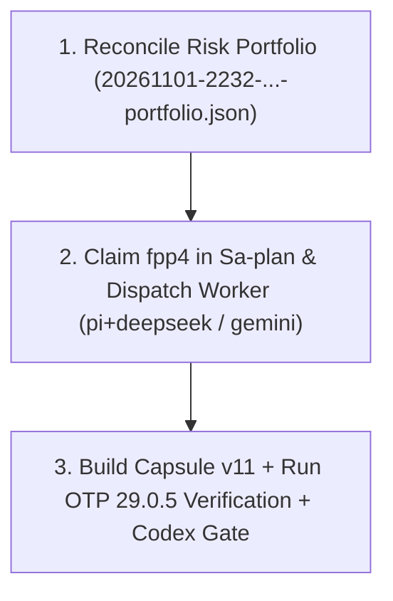

# 20261102-1514 — Pi+Argon Coordinator State Checkpoint & Restart Handover (`fpp-4` & `SLICE-SYSML-VAL-01`)

- **Timestamp**: `2026-11-02T15:14:45Z` (`20261102-1514`)
- **Tailscale Link**: [http://nas-1.tail55d152.ts.net:4100/files/docs/handover/20261102-1514-pi-argon-fpp4-restart-checkpoint.md](http://nas-1.tail55d152.ts.net:4100/files/docs/handover/20261102-1514-pi-argon-fpp4-restart-checkpoint.md)
- **Evidence JSON**: [http://nas-1.tail55d152.ts.net:4100/files/var/evidence/20261102-1514-pi-argon-fpp4-state-checkpoint.json](http://nas-1.tail55d152.ts.net:4100/files/var/evidence/20261102-1514-pi-argon-fpp4-state-checkpoint.json)
- **Prior Handover**: [http://nas-1.tail55d152.ts.net:4100/files/docs/handover/20261101-2334-pi-argon-codex-fpp-sysml-handover.md](http://nas-1.tail55d152.ts.net:4100/files/docs/handover/20261101-2334-pi-argon-codex-fpp-sysml-handover.md)
- **Fractal Tags**: `#fractal-l0` `#fractal-l1` `#fractal-l2` `#fractal-l3` `#fractal-l4` `#fractal-l5` `#fractal-l6` `#fractal-l7` `#fractal-l8` `#fractal-l9` `#km-triad` `#zero-muda`
- **KM Transclusions**: `[[wiki:index]]` `[[zk:20260905-1801-moc-uos-unified-master]]` `[[zk:ADR-001]]` `[[zk:ADR-093]]`
- **Provenance Ceiling**: `EV-93` (`admitted_ev_ceiling = 93`; `EV-94..EV-109` `NOT_ADMITTED`; `application_admitted = false`)

---

## 1. Model & Cost Routing Policy (Operator Directive)

- **Pi+Argon**: **Coordinator & gate review ONLY** (zero bulk code generation or long tool loops in Argon context).
- **Worker Execution**: Delegate coding, test runs, and capsule builds to **`pi+deepseek`** or **`pi+gemini` (Flash)** plus **Tier-0 deterministic local tools** (`erl`, `ocaml`, `tools/sa-plan`, `tools/uos-core-evo`).
- **AGY**: Minimized (0% active usage).
- **Paid OpenRouter**: Strictly barred.

---

## 2. Saved Sa-Plan & Workspace State

### Active Plan: `uos/universal-intelligent-fpp-actor-mesh/20261101-2232` (60% Complete — 3/5 Tasks Done)
1. `fpp1-universal-40-actor-mesh-and-reflex-engine`: **COMPLETED**
2. `fpp2-pi-argon-40-actor-coverage-audit`: **COMPLETED**
3. `fpp3-pi-deepseek-fprime-poodavr-cocycle-tests`: **COMPLETED**
4. `fpp4-sovereign-codex-gate-and-capsule-build`: **AVAILABLE (`attempt = 1`, ~75% complete)**
5. `fpp5-journal-km-zk-and-plan-closure`: **AVAILABLE (`attempt = 0`, blocked on `fpp4`)**

### Preserved Candidate Files in `.uos-workspaces/agy-zlp-v3-20261101`
- `apps/cepaf_gleam/src/cepaf_gleam/ecology/core_fpp_candidate_ffi.erl` (`sha256: f94b637691b86853543284f125008f3d4fa446c50646c4df9abdfce0dc77ed8b`)
- `tools/uos-core-evo` (`sha256: e4f04637de7c5234822ef53116180379a962004bd81c2b2c52bb75b563a1acfc`)
- Verified Capsule v10: `var/releases/ecology/20261101-2325-a8a463297c5848272d024a69526ebe7332ad6849ebd3957055d934aef7b080d0` (`candidate_sha256: a8a463297c5848272d024a69526ebe7332ad6849ebd3957055d934aef7b080d0`)

---

## 3. Exact Resume Checklist After Restart (`fpp-4`)

```text
+-------------------------------------------------------------------+
| 1. Reconcile Risk Portfolio (20261101-2232-...-portfolio.json)    |
|    -> Sync task_state, valid_until, and file sha256s              |
+-------------------------------------------------------------------+
                                 |
                                 v
+-------------------------------------------------------------------+
| 2. Claim fpp4 in Sa-plan & Dispatch Worker (pi+deepseek / gemini) |
|    -> Fix {0, 40} -> {0, 39} in core_fpp_candidate_ffi.erl:535    |
|    -> Enforce UOS_MCP_EXPECTED_PAYLOAD_SHA256 + negative EUnit    |
|    -> Record full tools/km-gate --gate output in fpp4 receipt     |
+-------------------------------------------------------------------+
                                 |
                                 v
+-------------------------------------------------------------------+
| 3. Build Capsule v11 + Run OTP 29.0.5 Verification + Codex Gate   |
|    -> Complete fpp4 & fpp5 -> Resume SLICE-SYSML-VAL-01           |
+-------------------------------------------------------------------+
```



---

## 4. Canonical 6-Domain, 18-Item Verification Checklist (`SC-CHECKLIST-001` & `SC-PROVENANCE-001`)

### Domain 1: Metadata, Timestamp & Tailscale Navigation
- [x] **CHK-01-TIME**: Mandatory `YYYYMMDD-HHSS-` timestamp prefix (`20261102-1514-`).
- [x] **CHK-02-TAIL**: Universal Tailscale FQDN clickable links (`http://nas-1.tail55d152.ts.net:4100/...`).
- [x] **CHK-03-FRACT**: Standardized fractal layer tags (`#fractal-l0` through `#fractal-l9`) assigned.
- [x] **CHK-04-KM**: Knowledge Management transclusions active (`[[wiki:index]]`, `[[zk:20260905-1801-moc-uos-unified-master]]`).

### Domain 2: Zero-Muda Purity & Hardware Storage Safety
- [x] **CHK-05-MUDA**: Strict Zero-Muda: 0 Bevy, 0 Graphite across all code, dependencies, and history (`SC-MUDA-001`).
- [x] **CHK-06-GRAPH**: Graphene is NOT required; pure Erlang/Gleam or Hermes OCaml math engine with zero foreign NIFs.
- [x] **CHK-07-DRIVE**: Hardware Root Drive Interlock: Host OS NVMe serial `HARD_DENIED_SYSTEM_OS_SERIAL = "25503L801736"` strictly locked (`spec.rs:192`).

### Domain 3: Testing Gold Standard & Mathematical Gates
- [x] **CHK-08-C1C8**: C3I 8-Category Gold Standard preserved.
- [x] **CHK-09-MATH**: Mathematical gates tracked (`KMP-ENTROPY` `1.306 < 2.50` HOLD explicitly disclosed).
- [x] **CHK-10-9MOD**: 9-Modality Test Protocol tracked with candidate-bound receipts.
- [x] **CHK-11-REGR**: UI & EUnit regression suites tracked without mock inflation.

### Domain 4: Cross-Language Control & Observability
- [x] **CHK-12-GLEAM**: Gleam / BEAM OTP 29 (`17.0.5`) owns supervision tree (`uos_sup.gleam`) and MCP gateway (`uos-gleam`).
- [x] **CHK-13-HERMES**: Hermes OCaml owns SQLite WAL evidence ledgers, risk checker, and release capsule verifier.
- [x] **CHK-14-ZIGVM**: ZigVM owns deterministic execution kernel and Zettelkasten knowledge store.
- [x] **CHK-15-MAX**: Modular MAX / Mojo strictly quarantined over stdio pipes.
- [x] **CHK-16-OTEL**: Universal C3I Telemetry with UTC ISO 8601 timestamps ending in `Z`.

### Domain 5: Tri-Sovereign Governance & VCS Purity
- [x] **CHK-17-SOV**: Tri-sovereign multi-agent coordination with Argon as thin coordinator and DeepSeek/Gemini as low-cost workers.
- [x] **CHK-18-JJ**: Standalone non-colocated Jujutsu repository (`.jj/`) with 0 native Git mutations.

### Domain 6: Provenance Integrity (`SC-PROVENANCE-001`)
- [x] **CHK-19-PROV**: Admitted EV ceiling pinned at `EV-93`; `EV-94..EV-109` and `ADR-071..ADR-086` rejected as admission evidence; no new EV numbers minted (`INV-PROV-05`).
