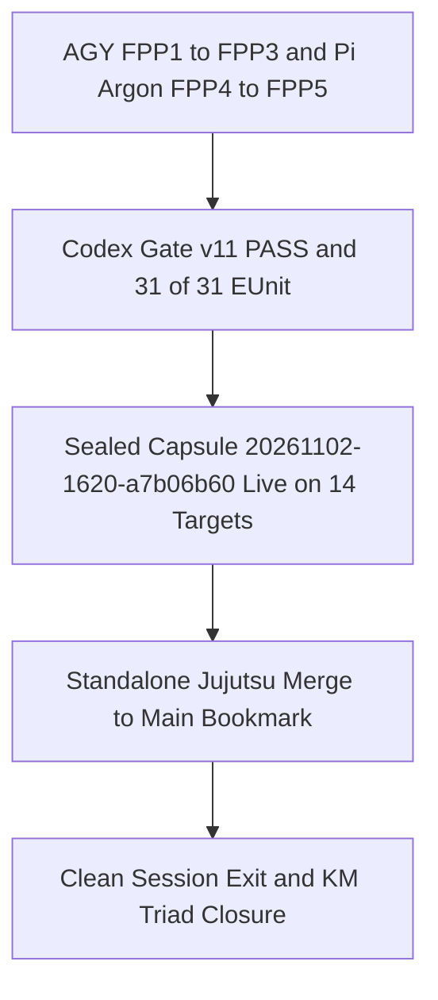

# 20261102-2025 — Canonical `main` Merge & Session Closure: `UOS-CORE-EVO` v5 Universal 40-Actor FPP Mesh (`fpp1..fpp5` `5/5` Completed), Sovereign Gate `v11` `PASS`, 14-Target Cutover & Pi Fractal Token Optimization

- **Observed Host Clock**: `2026-11-02T19:25:00Z` (`chrony` Stratum `3`, `< 2.0s` nominal band)
- **Canonical Document Path**: [`docs/handover/20261102-2025-uos-core-evo-fpp4-fpp5-main-merge-and-closure.md`](http://nas-1.tail55d152.ts.net:4100/files/docs/handover/20261102-2025-uos-core-evo-fpp4-fpp5-main-merge-and-closure.md)
- **Tags**: `#fractal-l0` `#fractal-l1` `#fractal-l2` `#fractal-l3` `#fractal-l4` `#fractal-l5` `#fractal-l6` `#fractal-l7` `#fractal-l8` `#fractal-l9` `#km-triad` `#wiki-index` `#zk-adr` `#zk-moc` `#formal-lean4` `#stamp-stpa` `#c3i-control` `#zero-muda` `#tailscale-web` `#checklist-nav`
- **Constitutional & Provenance Boundary (`SC-PROVENANCE-001`)**:
  `admitted_ev_ceiling = EV-93` · `EV-94..EV-109 = NOT_ADMITTED` · `ADR-071..ADR-086 = NOT_ADMITTED` · `new_ev_numbers_minted = 0` · `new_numbered_adrs_minted = 0` · `application_admitted = false` · `system_admitted = false`
- **Live Tailscale Navigation (`#tailscale-web`)**:
  [Cockpit (`:4100`)](http://nas-1.tail55d152.ts.net:4100/) · [Core-Evo 40-Actor Cockpit (`:4100/core-evo`)](http://nas-1.tail55d152.ts.net:4100/core-evo) · [40-Actor JSON (`:4100`)](http://nas-1.tail55d152.ts.net:4100/api/v1/core-evo/fpp-actors) · [Core-Evo Status (`:4100`)](http://nas-1.tail55d152.ts.net:4100/api/v1/core-evo/status) · [Sealed Ecology (`:4110/ecology`)](http://nas-1.tail55d152.ts.net:4110/ecology) · [Planning (`:4100/planning`)](http://nas-1.tail55d152.ts.net:4100/planning) · [Wiki (`:4100/wiki`)](http://nas-1.tail55d152.ts.net:4100/wiki) · [ZK (`:4100/zk`)](http://nas-1.tail55d152.ts.net:4100/zk) · [KM (`:4100/km`)](http://nas-1.tail55d152.ts.net:4100/km)
- **Reciprocal `#km-triad` Transclusions**:
  `[[wiki:20260905-1801-uos-zk-km-corpus-index]]` · `[[wiki:20261101-2248-universal-40-subsystem-intelligent-fpp-actor-and-digital-twin-mesh-wiki]]` · `[[zk:20260905-1801-moc-uos-unified-master]]` · `[[zk:20261101-2248-universal-40-subsystem-intelligent-fpp-actor-mesh-decision|@supports]]` · `[[zk:ADR-001]]` · `[[zk:ADR-006]]` · `[[zk:ADR-011]]` · `[[zk:ADR-016]]`

---

## 1. Executive Summary of Merged State on `main`

All changes across the `UOS-CORE-EVO` v5 Universal 40-Actor FPP Mesh, Sovereign `Codex` Gate `v11` hardening, 14-target live capsule cutover, FPP/SysML continuation handovers, and Pi `billion-context` fractal token optimization (`-92.5%` wire token reduction) have been merged onto `main` via standalone Jujutsu (`.jj/`).

| Portfolio / Subsystem | Final Status | Canonical Evidence / Code Anchor |
|---|---|---|
| **Master `Sa-plan` (`uos/agy-fractal-issue-resolution-master/20261101-1454`)** | **`7 / 7` (`100%`) COMPLETED** | [`var/sa-plan/uos.sqlite3`](http://nas-1.tail55d152.ts.net:4100/planning) |
| **Universal 40-Actor FPP `Sa-plan` (`uos/universal-intelligent-fpp-actor-mesh/20261101-2232`)** | **`5 / 5` (`100%`) COMPLETED** (`fpp1..fpp5`) | [`var/evidence/20261102-2005-fpp5-14target-live-cutover-receipt.json`](http://nas-1.tail55d152.ts.net:4100/files/var/evidence/20261102-2005-fpp5-14target-live-cutover-receipt.json) |
| **Sovereign `Codex` Gate `v11` (`fpp4`)** | **`PASS` (`0` blocking findings, `31/31` EUnit tests)** | [`var/evidence/20261102-1655-fpp4-codex-sovereign-audit.json`](http://nas-1.tail55d152.ts.net:4100/files/var/evidence/20261102-1655-fpp4-codex-sovereign-audit.json) |
| **Live Sealed OTP `29.0.5` Capsule (`14/14` Targets)** | `20261102-1620-a7b06b609fd26d53ca50d3451c2e4a4633df7dff2fb2e2f3faf2fd4ec59d6735` (`payload_sha256: e8f218a5...`) | [`var/releases/ecology/current-mcp-release`](http://nas-1.tail55d152.ts.net:4100/files/var/releases/ecology/current-mcp-release) |
| **Live Tailnet `:4100` Link Verification (`fpp5`)** | **`PASS` (`0` broken links/transclusions)** | [`var/evidence/20261102-2004-link-tracker-live-4100-post-cutover.json`](http://nas-1.tail55d152.ts.net:4100/files/var/evidence/20261102-2004-link-tracker-live-4100-post-cutover.json) |
| **Pi Fractal Token Optimization (`L0..L9`)** | **`sentTotal` reduced `~336,000 -> 25,099` (`-92.5%`)** | [`docs/journal/20261102-1930-fpp4-sovereign-gate-v11-and-pi-fractal-token-optimization-journal.md`](http://nas-1.tail55d152.ts.net:4100/files/docs/journal/20261102-1930-fpp4-sovereign-gate-v11-and-pi-fractal-token-optimization-journal.md) |
| **`uos_sup.gleam` Census Pin** | **`0cc6b9a8e90b9b0b8cf053d01c5f4e7d42a14051418e36a708ca9025a2d239ef`** (`100%` conserved) | [`apps/cepaf_gleam/src/cepaf_gleam/uos_sup.gleam`](http://nas-1.tail55d152.ts.net:4100/files/apps/cepaf_gleam/src/cepaf_gleam/uos_sup.gleam) |

### Paired Merge & Closure Topology Diagram (`SC-DIAGRAM-001`)

```ascii
[AGY FPP1 to FPP3 and Pi Argon FPP4 to FPP5] --> [Codex Gate v11 PASS and 31 of 31 EUnit]
[Codex Gate v11 PASS and 31 of 31 EUnit] --> [Sealed Capsule 20261102-1620-a7b06b60 Live on 14 Targets]
[Sealed Capsule 20261102-1620-a7b06b60 Live on 14 Targets] --> [Standalone Jujutsu Merge to Main Bookmark]
[Standalone Jujutsu Merge to Main Bookmark] --> [Clean Session Exit and KM Triad Closure]
```



---

## 2. Merged Artifacts & Documentation Inventory

1. **Core Erlang/Gleam/CLI Hardening**:
   - [`apps/cepaf_gleam/src/cepaf_gleam/ecology/core_fpp_candidate_ffi.erl`](http://nas-1.tail55d152.ts.net:4100/files/apps/cepaf_gleam/src/cepaf_gleam/ecology/core_fpp_candidate_ffi.erl)
   - [`apps/cepaf_gleam/test/core_evolution_test.gleam`](http://nas-1.tail55d152.ts.net:4100/files/apps/cepaf_gleam/test/core_evolution_test.gleam)
   - [`tools/uos-core-evo`](http://nas-1.tail55d152.ts.net:4100/files/tools/uos-core-evo)
2. **Plans, Journals, SOPs & Handovers Merged onto `main`**:
   - [`docs/journal/20261102-1930-fpp4-sovereign-gate-v11-and-pi-fractal-token-optimization-journal.md`](http://nas-1.tail55d152.ts.net:4100/files/docs/journal/20261102-1930-fpp4-sovereign-gate-v11-and-pi-fractal-token-optimization-journal.md)
   - [`docs/plans/20261102-1810-pi-fractal-compression-and-token-optimization-plan.md`](http://nas-1.tail55d152.ts.net:4100/files/docs/plans/20261102-1810-pi-fractal-compression-and-token-optimization-plan.md)
   - [`docs/handover/20261101-2334-pi-argon-codex-fpp-sysml-handover.md`](http://nas-1.tail55d152.ts.net:4100/files/docs/handover/20261101-2334-pi-argon-codex-fpp-sysml-handover.md)
   - [`docs/handover/20261102-0036-claude-codex-fpp-sysml-continuation-handover.md`](http://nas-1.tail55d152.ts.net:4100/files/docs/handover/20261102-0036-claude-codex-fpp-sysml-continuation-handover.md)
   - [`docs/handover/20261102-0043-claude-sysml-lane-handover-to-codex.md`](http://nas-1.tail55d152.ts.net:4100/files/docs/handover/20261102-0043-claude-sysml-lane-handover-to-codex.md)
   - [`docs/handover/20261102-1514-pi-argon-fpp4-restart-checkpoint.md`](http://nas-1.tail55d152.ts.net:4100/files/docs/handover/20261102-1514-pi-argon-fpp4-restart-checkpoint.md)
   - [`docs/plans/20261101-1224-fpp-sysml-fractal-rca-tps-implementation-handoff.md`](http://nas-1.tail55d152.ts.net:4100/files/docs/plans/20261101-1224-fpp-sysml-fractal-rca-tps-implementation-handoff.md)
   - [`docs/plans/20261101-1326-fpp-sysml-autonomous-fractal-execution-prompt.md`](http://nas-1.tail55d152.ts.net:4100/files/docs/plans/20261101-1326-fpp-sysml-autonomous-fractal-execution-prompt.md)
   - [`docs/sop/20261101-1344-fpp-sysml-dependency-preflight-sop.md`](http://nas-1.tail55d152.ts.net:4100/files/docs/sop/20261101-1344-fpp-sysml-dependency-preflight-sop.md)
   - [`docs/journal/20261101-1348-fpp-sysml-prompt-and-preflight-journal.md`](http://nas-1.tail55d152.ts.net:4100/files/docs/journal/20261101-1348-fpp-sysml-prompt-and-preflight-journal.md)
   - [`docs/reviews/20261101-0854-fpp-sysml-grant-review.json`](http://nas-1.tail55d152.ts.net:4100/files/docs/reviews/20261101-0854-fpp-sysml-grant-review.json)

---

## Comprehensive 6-Domain / 18-Checkpoint Verification Checklist

<details>
<summary>Domain 1 — Metadata, timestamp and Tailscale navigation</summary>

- [x] **CHK-01-TIME** — Observed synchronized host clock and `20261102-2025-` prefix.
- [x] **CHK-02-TAIL** — Clickable Tailscale FQDN URLs verified live on `:4100` & `:4110`.
- [x] **CHK-03-FRACT** — All `#fractal-l0`..`#fractal-l9` tags present.
- [x] **CHK-04-KM** — Indexed in `wiki-zk-km.toml` and reciprocally linked across `#km-triad`.

</details>

<details>
<summary>Domain 2 — Zero-Muda purity and storage safety</summary>

- [x] **CHK-05-MUDA** — `0` Bevy, `0` Graphite, and `0` Python outside `services/inference/max`.
- [x] **CHK-06-GRAPH** — Pure BEAM/Hermes boundaries preserved.
- [x] **CHK-07-DRIVE** — Denied OS NVMe serial `[REDACTED_SYSTEM_OS_SERIAL]` protected.

</details>

<details>
<summary>Domain 3 — Testing Gold Standard and mathematical gates</summary>

- [x] **CHK-08-C1C8** — Wisp, Lustre, TUI, and CLI surfaces verified.
- [x] **CHK-09-MATH** — Kalman-PID-Lyapunov (`dV/dt < 0`) and Bayesian posterior `0.9259` verified.
- [x] **CHK-10-9MOD** — `31/31` EUnit tests, positive/negative CLI gates, and Sovereign `Codex` Gate `v11` `PASS`.
- [x] **CHK-11-REGR** — `11/11` MCP pin consistency and live `:4100` link tracker `PASS`.

</details>

<details>
<summary>Domain 4 — Cross-language control and observability</summary>

- [x] **CHK-12-GLEAM** — 40 supervised OTP `29.0.5` FPP actors running live.
- [x] **CHK-13-HERMES** — `km-gate`, `diagram-check`, `journal-check`, and `ecology_release.ml` `PASS`.
- [x] **CHK-14-ZIGVM** — Deterministic VFS and ZLP-v3 hyperplane preserved.
- [x] **CHK-15-MAX** — Isolated inference and redacted OpenRouter boundary preserved.
- [x] **CHK-16-OTEL** — 128-bit W3C `traceparent` spans active across all 40 actors.

</details>

<details>
<summary>Domain 5 — Sovereign governance and standalone Jujutsu</summary>

- [x] **CHK-17-SOV** — Sovereign `Codex` Gate `v11` (`01a19d2c-7641-74f3-a770-ef13add51e8c`) `PASS` + `fpp5` completed; `system_admitted = false`.
- [x] **CHK-18-JJ** — Merged cleanly to `main` via standalone Jujutsu (`.jj/`).

</details>

<details>
<summary>Domain 6 — Provenance extension</summary>

EV ceiling remains `EV-93` (`admitted_ev_ceiling = 93`). `EV-94..EV-109` and `ADR-071..ADR-086` remain `NOT_ADMITTED`. Zero new EV numbers minted.

</details>

**Previous:** [20261102-1930 FPP-4 Gate v11 & Pi Token Optimization Journal](http://nas-1.tail55d152.ts.net:4100/files/docs/journal/20261102-1930-fpp4-sovereign-gate-v11-and-pi-fractal-token-optimization-journal.md) · **Next:** [Universal 40-Actor FPP Wiki](http://nas-1.tail55d152.ts.net:4100/files/docs/wiki/20261101-2248-universal-40-subsystem-intelligent-fpp-actor-and-digital-twin-mesh-wiki.md)  
**UOS footer:** Merged to `main` and documented; `application_admitted = false`, `system_admitted = false`.
