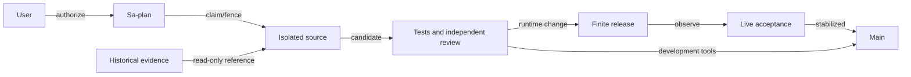

# 20260930-0829 Capability recovery and stabilization

Status: OPERATIONAL ACCEPTANCE PASS; FINAL HISTORICAL SOURCE RECONCILIATION IN PROGRESS. Independently verified source0131154f1b02e78e4b5067476c9d75cac672a381 merged into main after live stabilization. Historical development repairs and lifecycle closure remain pending.
#fractal-l0 #fractal-l2 #fractal-l4 #fractal-l8 #zk-adr #zero-muda

[Dashboard](http://nas-1.tail55d152.ts.net:4100/static/20260930-0633-restoration-dashboard.html) · [Cockpit](http://nas-1.tail55d152.ts.net:4100/) · [Planning](http://nas-1.tail55d152.ts.net:4100/planning) · [Evidence](http://nas-1.tail55d152.ts.net:4100/files/governance/planning/20260930-0754-capability-evidence/new-release-stage.json)
Plan: `uos/capability-restoration/20260930-0734`. Prior recovery remains recorded in [its journal](http://nas-1.tail55d152.ts.net:4100/files/docs/journal/20260930-0659-full-restoration.md).

## 1. Scope & Trigger

The operator requested full restoration, actual Google AGY execution, a truthful AS-IS/TO-BE dashboard and mainline integration after stabilization. This continuation repairs the measured remaining free-advisory and cockpit transport failures while retaining verified coordinator/cycle recovery, strict MAX metadata verification, independent release review and EV ceiling93. Engine5 uses existing typed contracts and executable falsifiers; no new formal theorem or universal feature admission is asserted.

## 2. Pre-State Assessment

The recovered coordinator/cycle stores and four managed services were healthy, enabled and without current-invocation restarts. OpenRouter's fixed free-model identifier was absent from the observed public catalog; cockpit attempted an unavailable broad native facade. HTTP availability did not prove those capabilities. Main9d905802 contained the prior restoration. Engine7 prior is this observed mixed-capability state, not an invented Kalman estimate.

## 3. Execution Detail

Actual Google AGY Antigravity session954b9a82-15dc-4bd5-ae31-dd9670e583ca, pane w2:p9, executed isolated canonical tasks. It replaced the unavailable free default with the allowlisted openrouter/free router, then enforced zero-cost free receipts, output-token limits and truthful live-catalog prices centrally. Frozen AGY8823c08a contains both changes.

The bounded transport repair uses pure Gleam validation and existing OTP HTTP parsing/socket IO with a fixed Tailnet endpoint, finite deadline/response size and concrete key/payload limits. GET/PUT are supported; subscription requests fail explicitly. Cockpit reports actual backend reachability/publication acknowledgment. MCP/Telegram do not falsely announce subscriptions. Raw c3i/a2a board writes are rejected at both Gleam and FFI boundaries.

An expired AGY attempt exposed a preflight/reclaim deadlock. Separate plan uos/claim-recovery/20260930-0758 implemented independently reviewed read-only reclaim observation bound to the same owner, previous attempt and exact expired deadline. It grants no effect authority. AGY subsequently claimed attempt2, passed a fresh active check and completed. [Separate journal](http://nas-1.tail55d152.ts.net:4100/files/docs/journal/20260930-0839-expired-claim-recovery.md).

Integrated source0131154f was built and packaged as immutable capsule5fdb0051061cf1c2dd7cf6e8a5af8f842df205d4c10d6ae04cd41fe1397f2872:1241files,31,229,400payloadbytes. Source SHA25679ec668c955830a50b71c415f22fa1297efe01271eb6d59ced1fb05b26d5abd5; payload935bf0f0341fc478e47ef2dc18440d0f2f1a598c6d744ac9728486e6703f0df1. The capsule is the sole release input. Later Gleam testing changed three generated .app metadata files in the current build tree; independent review found no source/BEAM mismatch and verified immutable payload unchanged. Current build-tree byte equality is not claimed.

Private capsule startup performed real MAX26.5 graph inference and advanced ecology cycles; packaged REST roundtrip succeeded on the owned c3i/agui/events recovery key. Private startup had no credential and explicitly reported free advisory unavailable. REVIEW completed with independent capsule verification and34+69 packaged-runtime tests. RELEASE used fresh task/resource fences and independently reviewed exact-byte grants.

Managed startup08:33:51UTC performed real MAX inference but its actual free-provider request returned HTTP429. That failure remains preserved. Later cutover steps held. One new, independently reviewed stop/start reconciliation after more than60seconds local backoff succeeded at08:36:50UTC. No provider Retry-After was observed; no automatic retry loop or paid fallback occurred. New invocationf904f1d21c26408f82b75985d9827de5/PID292729 engaged MAX and OpenRouter: actual Novita inclusionai/ling-3.0-flash-sante:free reply,109completiontokens of256, reported/actual cost0.0,2334ms of12000ms. Ecology cycles advanced24→177 with coherent OTP29/ERTS17.0.5 identity.

Reviewed cockpit restart produced invocationf754337b1ea9410e9424160cbccb8e31/PID293276. Actual startup reported zenoh_rest reachable and publication acknowledged; native subscriptions explicitly unavailable. Independent live review observed five Tailnet routesHTTP200, four services running/enabled/NRestarts0, both clocks healthy/fault0/floor316, coordinator35events integrityPASS and cycle332/24/0PASS. New ecology was enabled and old ecology stopped/disabled. Stable source0131154f moved to main08:39UTC only after these observations.

Final dashboard verification exposed a separate current-plan rendering defect: HTML assumed a MERGE task existed. The capability plan has no such task. The fixed renderer uses explicit integration evidence with a safe historical-task fallback. Actual production JavaScript with current snapshot and minimal DOM/fetch adapters rendered8tasks/9risks and mainIntegrated; servedHTML byte equality passed. This is script/data verification, not browser layout or visual acceptance.

The final all-code ancestry census found15 nonempty historical unbookmarked heads. Independent byte/lineage analysis classified rewritten EV01, root snapshot, unification and telemetry work as integrated counterparts or superseded behavior, preserving historical receipts and never replaying live-board bytes. Two real gaps remained: five historical EV02 governance tools were absent, and three Mirage named gates still claimed verified from file presence alone. HISTORY_REPAIR and HISTORY_REVIEW were added to canonical Sa-plan before completion. Actual Google AGY completed HISTORY_REPAIR attempt1, preserving exact originals in5ed70fe2 and freezing adapted08c44553debe82e825f5bf444103737538832e33. Readers enforce bounded regular-file, entry/count/byte and mutation checks; writers use explicit timestamped exclusive outputs and refuse traversal/symlink ancestors; runner uses monotonic deadlines through pipe EOF and child exit, process-group cleanup and reaped-child tracking. Policy results use JSON encoding and one observed content snapshot. Mirage named gates and aliases report inventory separately from unavailable verification, returning HOLD/exit1. The deployed immutable capsule is unchanged.

Independent final review repeated seven OCaml suites, seven focused Gleam tests, five actual complete-inventory Mirage CLI invocations and positive/negative writer controls. It found one remaining evidence-binding defect: silent-command output was saved as a display marker while its receipt hashed empty bytes. Candidate integration held; canonical HISTORY_BIND was added and assigned to actual AGY in a separate child workspace, preserving the reviewed baseline. A one-file repair and exact saved-byte digest regression are pending independent recheck. AGY's initial handoff also misstated a full commit suffix; actual JJ identity was independently checked and AGY explicitly corrected the ACK. Reported counts never replace source identity or observed artifact equality.

## 4. Root Cause Analysis

Engine1 ACH disconfirmation matrix and fractal RCA:

| Layer / hypothesis | Evidence / falsifier | Outcome and containment |
|---|---|---|
| H1 / L0: green historical counts prove present capabilities | Current missing model and unavailable native backend contradict historical status | Reject; require current candidate/runtime receipts |
| H2 / L2: expiry permits silent task reuse | Ordinary preflight/active checks correctly HOLD expired execution | Exact read-only reclaim observation; fresh canonical attempt and active check |
| L4: model name alone proves free eligibility | Public catalog removed fixed ID; free suffix can carry nonzero prices | Router allowlist, exact catalog prices, zero receipt cost, bounded tokens |
| L4: transport reachability proves subscriptions/durability | REST server supports GET/PUT but this client implements no subscriptions | Explicit unsupported result, no actor/listening false claim |
| L8: any owned key is a harmless probe | Raw text under board envelope namespace triggered strict clock parsing failure | Preserve failure; remove only exact new owned artifact after review and rereads; prohibit raw board writes |
| L8: current build tree equals staged package forever | Three generated metadata files changed after packaging | Verify immutable package; record mismatch, never substitute mutable build tree |
| L4: valid free policy guarantees external capacity | First actual managed invocation received429; one separately reviewed later invocation succeeded | Separate availability from price/authority, retain failure and finite recovery |
| L6: one plan's task IDs are universal dashboard schema | Current capability plan lacks MERGE, causing undefined dereference | Explicit integration evidence plus safe legacy lookup; execute real rendering script against current data |
| L4: historical governance tooling is safe to restore unchanged | Fixed evidence paths, unbounded child waits/reads, and inventory-only Mirage success were observed | Preserve originals in JJ; adapt in isolated AGY workspace and require independent negative controls before integration |
| L4: a green negative-test suite proves refusal | Draft writer helper caught its own failed assertion | Reject draft evidence; require non-vacuous assertions and actual CLI failure observations |
| L4: formatting cannot change evidence validity | OCaml escaping can produce invalid JSON; a second file read can describe a different snapshot | Use JSON encoding and one bounded observation snapshot; independently review exact frozen source |
| L4: a generated digest necessarily identifies its saved artifact | Independent review found silent child output saved as a marker but hashed as empty bytes | Hold candidate; canonical HISTORY_BIND repair uses one stored-byte value and digest-to-file regression |

The raw-board probe incident and cleanup receipts remain preserved. No foreign or preexisting shared key was deleted. A parent sequencing defect completed TRANSPORT before inspecting an active-check HOLD caused by evidence time and expired AGY lease. Later checks do not retroactively authorize it. Fresh reviewed integration/release gates were mandatory and passed before subsequent work.

The expanded historical review outlasted ACCEPT attempt1 at09:39:07UTC. Parent performed exact read-only reclaim preflight bound to worker, attempt1 and deadline1790761147033592268; only after PASS did Gleam claim attempt2 through10:39:29UTC and pass a fresh active check. No dependent source/runtime effects occurred under the expired attempt. The prior attempt and both recovery receipts remain preserved.

## 5. Fix Taxonomy

Engine6 Poka-Yoke: free-price/cost/token invariants; bounded fixed-endpoint transport; raw-board namespace rejection; exact reclaim bindings; immutable release/dependency/control identities. Jidoka: unknown prices, missing costs, excess tokens, stale leases, malformed replies and unsupported subscriptions fail closed. Muda: reuse pinned tools, existing HTTP parser and isolated MAX service; no new packages, broad native activation or paid fallback.

## 6. Patterns & Anti-Patterns Discovered

Engine4 Devil's Advocate falsification rejected mocked cheap receipts that contradicted requested token limits, misleading free suffixes, arbitrary router suffixes, malformed/wrong-key replies, and control/config drift. Independent review found and drove the centralized AGY receipt-guard repair. Tests count correlated examples, not independent reliability trials. Preserve failures instead of relabeling them; inspect gate exit before dependent action; ownership of a test key does not override its namespace schema.

## 7. Verification Matrix

Engine2 Admiralty evidence quality is assessed B2 for directly observed and independently repeated bounded claims; this is not admission.

| Check | Observed result / limitation |
|---|---|
| Final swarm |695PASS |
| Final closure focused / web |45PASS /37PASS; overlapping suites not additive |
| Independent capsule production modules |34REST/runtime/ecology/budget +69worker/route PASS |
| Risk checker |375baseline +32860adversarial PASS, including32768DAG cases; report-only |
| Private exact capsule |Actual MAX output [0.9820137619972229,0.01798621006309986]; ecology cycle23, OTP29/ERTS17.0.5 |
| Private REST |Owned stored key roundtrip PASS; initial eval syntax failure preserved |
| Immutable capsule |Independent source/payload/dependency verification PASS |
| Canonical RELEASE |Fresh attempt1 checks and finite independent grants PASS; managed scoped acceptance independently PASS |
| Actual free advisory |Initial429 preserved; one reviewed recovery returned109/256tokens,actual/reported0.0,2334/12000ms |
| Managed services |Four running/enabled/NRestarts0; new ecology on5fdb capsule,old ecology inactive/disabled; clocks unchanged healthy |
| Coordinator / cycle |Independent35event integrity PASS;332rows/24holds/0releases PASS |
| Main |Stable source0131154f merged only after live acceptance; all bookmarked source heads are ancestors |
| Dashboard |Current8task/9risk script-data render PASS; servedbytes match; visual/manual acceptance UNRUN |

## 8. Files Modified

Source0131154f integrates AGY8823c08a and transport/reclaim eec94435 with prior main ancestry. Changes concern OpenRouter policy/defaults/tests, REST/client/FFI/main/consumer refusal propagation, finite release workflow binding, risk reclaim checker and tests, plus timestamped contract/journal. Configuration proposals are ops/release/20260930-0855-capability-cockpit.service and20260930-0855-capability-ecology.env. Current child contains review/release evidence, dashboard/risk updates and this journal. Private credentials and live databases are excluded from source control; original history remains preserved.

## 9. Architectural Observations

Engine5 consistency crosses explicit boundaries: Gleam owns selection, admission and release; bounded OTP IO provides transport; OCaml verifies immutable files and canonical cycles; MAX remains isolated. REST is a usable publication/query backend without implicit native-subscription authority. Runtime40hex aecd4cd26ee703eb7f93eb14114256e4617ca9e2 is the source-manifest SHA1, not a JJ revision or attestation. No sheaf/category proof invocation is claimed.

Editable ASCII source (same nodes, edges and labels as Mermaid):

```text
[User] --authorize--> [Sa-plan] --claim/fence--> [Isolated source]
[Historical evidence] --read-only reference--> [Isolated source]
[Isolated source] --candidate--> [Tests and independent review]
[Tests and independent review] --runtime change--> [Finite release]
[Finite release] --observe--> [Live acceptance] --stabilized--> [Main]
[Tests and independent review] --development tools--> [Main]
```



## 10. Remaining Gaps

Live managed MAX/OpenRouter invocation, cockpit REST startup, durable service configuration, independent scoped integrity acceptance and stable recovery-source main advancement passed. Historical source reconciliation, its independent review, lifecycle retirement and final evidence closure remain underway. Native subscriptions remain explicitly unsupported; a separate legacy cockpit component still logs its absent broad c3i_nif. No native-feature restoration is claimed. External free-provider capacity is not guaranteed and never triggers paid fallback. Browser automation is unavailable, so no visual/manual UI acceptance is claimed. Global EV/formal admission, cross-host failover and long-duration reliability remain separate obligations.

## 11. Metrics Summary

Engine3: measured test results and short runtime observations are retained without fabricated Bayesian posterior, half-life decay or Lyapunov derivative. Failures were classified and structurally contained. Eight of eleven canonical recovery tasks completed; HISTORY_BIND addresses the independent review finding, HISTORY_REVIEW awaits its recheck, and ACCEPT attempt2 owns final integration/lifecycle/evidence closure. No test count substitutes for runtime evidence. One explicit provider retry is distinct from service NRestarts0, which counts automatic restarts on the current invocation.

## 12. STAMP & Constitutional Alignment

All four UCA types are considered: omit necessary repair; activate unsafe paid/unbounded behavior; act with stale or moving authority; continue beyond bounded duration. Raw FMEA S4×O3×Det3=36; constrained score960 is prioritization only. Finite reviewed grants bind source/config/dependencies, host/boot, task attempt, resource epoch and expiry; startup verifies full capsule. Original recovery evidence and prior capsule remain available. EV ceiling93 and quarantine remain intact; no new EV or device operation.

| Release aspect | Evidence / limit |
|---|---|
| A01 storage |Prior verified recovery retained; no drive mutation |
| A02 JJ |Frozen multi-parent source on main after independent live stabilization |
| A03 Zero-Muda |No new prohibited dependency/package |
| A04 OTP |Actual capsule OTP29/ERTS17.0.5, bounded IO |
| A05 ZigVM |Unchanged; global kernel proofs UNRUN |
| A06 Hermes |Canonical risk and cycle oracles; no new solver claim |
| A07 mathematical authority |Executable negative/differential checks; global math gates UNRUN |
| A08 control boundary |Typed policy, task and runtime fences, exact independent grants |
| A09 MAX |Actual private and managed capsule graph inference PASS |
| A10 Zenoh |Exact capsule GET/PUT roundtrip PASS; subscriptions unsupported |
| A11 AG-UI |Own event namespace used; full event protocol audit UNRUN |
| A12 A2UI |Existing routes retained; component-wide retest UNRUN |
| A13 interfaces |HTTP/API checks; visual/manual UI acceptance UNRUN |
| A14 Tailnet |Canonical FQDN endpoints; remote independent host test UNRUN |
| A15 checklist |Explicit bounded18-checkpoint status below |
| A16 KM |Prior verified ledgers retained; no forged admission promoted |
| A17 Sa-plan |Canonical task/attempt/dependency and effect fencing |

<details><summary>18-checkpoint verification and provenance</summary>

| Domain | Checkpoint status |
|---|---|
|1 metadata|CHK-01-TIME synchronized host; CHK-02-TAIL FQDN; CHK-03-FRACT tags; CHK-04-KM linked evidence|
|2 purity/storage|CHK-05-MUDA no new barred dependency; CHK-06-GRAPH no NIF added; CHK-07-DRIVE untouched|
|3 tests|CHK-08-C1C8 scoped suites PASS; CHK-09-MATH global UNRUN; CHK-10-9MOD negative/integration PASS; CHK-11-REGR candidate PASS|
|4 language/observability|CHK-12-GLEAM actual OTP; CHK-13-HERMES bounded oracles; CHK-14-ZIGVM unchanged/UNRUN; CHK-15-MAX actual private PASS; CHK-16-OTEL full propagation UNRUN|
|5 governance/JJ|CHK-17-SOV independent source/package/grant/live review PASS; CHK-18-JJ stabilized source on main|
|6 provenance|EV93 ceiling; historical failures preserved; no new EV|

</details>

## 13. Conclusion

Engine7 Forecast made2026-09-30T08:29UTC, Horizon09:05UTC: assuming unchanged capsule/dependencies and current free-provider capacity, finite reviewed cutover should yield advancing ecology, a zero-cost bounded advisory receipt, truthful REST cockpit startup and healthy clocks before main advancement. Resolved true by08:38UTC independent scoped live acceptance after one explicit reviewed recovery from429; main advanced afterward. This is uncalibrated; no numerical Brier score is invented. Historical failures and scope limits remain visible.

[Previous](http://nas-1.tail55d152.ts.net:4100/files/docs/journal/20260930-0659-full-restoration.md) · [Dashboard](http://nas-1.tail55d152.ts.net:4100/static/20260930-0633-restoration-dashboard.html) · [Wiki](http://nas-1.tail55d152.ts.net:4100/wiki) · [ZK](http://nas-1.tail55d152.ts.net:4100/zk)

UOS footer: bounded operational evidence does not grant universal system or EV admission.
