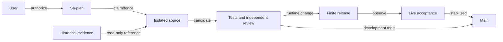

# 20260930-0829 Capability recovery and stabilization

Status: SCOPED RECOVERY AND SOURCE CONSOLIDATION PASS. All14canonical tasks completed. Main change tnmlrlyk integrates accepted runtime0131154f and independently reviewed historical source1a816aeb after stabilization. Completion cleanup releases integration ownership and retires this recovery session; the final read-only post-retirement observation is retained in the recovery evidence plane.
#fractal-l0 #fractal-l2 #fractal-l4 #fractal-l8 #zk-adr #zero-muda

[Dashboard](http://nas-1.tail55d152.ts.net:4100/static/20260930-0633-restoration-dashboard.html) · [Cockpit](http://nas-1.tail55d152.ts.net:4100/) · [Planning](http://nas-1.tail55d152.ts.net:4100/planning) · [Evidence](http://nas-1.tail55d152.ts.net:4100/files/governance/planning/20260930-0754-capability-evidence/new-release-stage.json)
Plan: `uos/capability-restoration/20260930-0734`. Prior recovery remains recorded in [its journal](http://nas-1.tail55d152.ts.net:4100/files/docs/journal/20260930-0659-full-restoration.md).

## 1. Scope & Trigger

The operator requested full restoration, actual Google AGY execution, a truthful AS-IS/TO-BE dashboard and mainline integration after stabilization. This continuation repairs the measured remaining free-advisory and cockpit transport failures while retaining verified coordinator/cycle recovery, strict MAX metadata verification, independent release review and EV ceiling93. Engine5 uses existing typed contracts and executable falsifiers; no new formal theorem or universal feature admission is asserted.

## 2. Pre-State Assessment

The recovered coordinator/cycle stores and four managed services were healthy, enabled and without current-invocation restarts. OpenRouter's fixed free-model identifier was absent from the observed public catalog; cockpit attempted an unavailable broad native facade. HTTP availability did not prove those capabilities. Main9d905802 contained the prior restoration. Engine7 prior is this observed mixed-capability state, not an invented Kalman estimate.

## 3. Execution Detail

Actual Google AGY Antigravity session954b9a82-15dc-4bd5-ae31-dd9670e583ca, pane w2:p9, executed isolated canonical tasks. It replaced the unavailable free default with the allowlisted openrouter/free router, then enforced zero-cost free receipts, output-token limits and truthful live-catalog prices centrally. Frozen AGY8823c08a contains both changes.

The bounded transport repair uses pure Gleam validation and existing OTP HTTP parsing/socket IO with a fixed Tailnet endpoint, finite deadline/response size and concrete key/payload limits. GET/PUT are supported; subscription requests fail explicitly. Cockpit reports actual backend reachability/publication acknowledgment. MCP/Telegram do not falsely announce subscriptions. Raw c3i/a2a board writes are rejected at both Gleam and FFI boundaries.

An expired AGY attempt exposed a preflight/reclaim deadlock. Separate plan uos/claim-recovery/20260930-0758 implemented independently reviewed read-only reclaim observation bound to the same owner, previous attempt and exact expired deadline. It grants no effect authority. AGY subsequently claimed attempt2, passed a fresh active check and completed. [Separate journal](http://nas-1.tail55d152.ts.net:4100/files/docs/journal/20260930-0839-expired-claim-recovery.md).

Integrated source0131154f was built and packaged as immutable capsule5fdb0051061cf1c2dd7cf6e8a5af8f842df205d4c10d6ae04cd41fe1397f2872:1241files,31,229,400payloadbytes. Source SHA25679ec668c955830a50b71c415f22fa1297efe01271eb6d59ced1fb05b26d5abd5; payload935bf0f0341fc478e47ef2dc18440d0f2f1a598c6d744ac9728486e6703f0df1. The capsule is the sole release input. Later Gleam testing changed three generated .app metadata files in the current build tree; independent review found no source/BEAM mismatch and verified immutable payload unchanged. Current build-tree byte equality is not claimed.

Private capsule startup performed real MAX26.5 graph inference and advanced ecology cycles; packaged REST roundtrip succeeded on the owned c3i/agui/events recovery key. Private startup had no credential and explicitly reported free advisory unavailable. REVIEW completed with independent capsule verification and34+69 packaged-runtime tests. RELEASE used fresh task/resource fences and independently reviewed exact-byte grants.

Managed startup08:33:51UTC performed real MAX inference but its actual free-provider request returned HTTP429. That failure remains preserved. Later cutover steps held. One new, independently reviewed stop/start reconciliation after more than60seconds local backoff succeeded at08:36:50UTC. No provider Retry-After was observed; no automatic retry loop or paid fallback occurred. New invocationf904f1d21c26408f82b75985d9827de5/PID292729 engaged MAX and OpenRouter: actual Novita inclusionai/ling-3.0-flash-sante:free reply,109completiontokens of256, reported/actual cost0.0,2334ms of12000ms. Ecology cycles advanced24→177 with coherent OTP29/ERTS17.0.5 identity.

Reviewed cockpit restart produced invocationf754337b1ea9410e9424160cbccb8e31/PID293276. Actual startup reported zenoh_rest reachable and publication acknowledged; native subscriptions explicitly unavailable. Independent live review observed five Tailnet routesHTTP200, four services running/enabled/NRestarts0, both clocks healthy/fault0/floor316, coordinator35events integrityPASS and cycle332/24/0PASS. New ecology was enabled and old ecology stopped/disabled. Stable source0131154f moved to main08:39UTC only after these observations.

Final dashboard verification exposed a separate current-plan rendering defect: HTML assumed a MERGE task existed. The capability plan has no such task. The fixed renderer uses explicit integration evidence with a safe historical-task fallback. Actual production JavaScript with current snapshot and minimal DOM/fetch adapters rendered8tasks/9risks and mainIntegrated; servedHTML byte equality passed. This is script/data verification, not browser layout or visual acceptance.

The final all-code ancestry census found15 nonempty historical unbookmarked heads. Independent byte/lineage analysis classified rewritten EV01, root snapshot, unification and telemetry work as integrated counterparts or superseded behavior, preserving historical receipts and never replaying live-board bytes. Two real gaps remained: five historical EV02 governance tools were absent, and three Mirage named gates still claimed verified from file presence alone. HISTORY_REPAIR and HISTORY_REVIEW were added to canonical Sa-plan before completion. Actual Google AGY completed HISTORY_REPAIR attempt1, preserving exact originals in5ed70fe2 and freezing adapted08c44553debe82e825f5bf444103737538832e33. Readers enforce bounded regular-file, entry/count/byte and mutation checks; writers use explicit timestamped exclusive outputs and refuse traversal/symlink ancestors; runner uses monotonic deadlines through pipe EOF and child exit, process-group cleanup and reaped-child tracking. Policy results use JSON encoding and one observed content snapshot. Mirage named gates and aliases report inventory separately from unavailable verification, returning HOLD/exit1. The deployed immutable capsule is unchanged.

Independent final review repeated seven OCaml suites, seven focused Gleam tests, five actual complete-inventory Mirage CLI invocations and positive/negative writer controls. It found one remaining evidence-binding defect: silent-command output was saved as a display marker while its receipt hashed empty bytes. Candidate integration held; canonical HISTORY_BIND was added and assigned to actual AGY in a separate child workspace, preserving the reviewed baseline. The one-file repair in a7b939a6b4afe3ac9a8010b2b823d580d8b07268 passed independent recheck at09:53UTC, including actual saved-byte SHA256 comparison for silent and nonempty commands. AGY's initial handoff also misstated a full commit suffix; actual JJ identity was independently checked and AGY explicitly corrected the ACK. Reported counts never replace source identity or observed artifact equality.

The broader census then tested the original selection rule against empty working-copy descendants. Selecting nonempty revisions before heads exposed four additional historical lineages and33unique ancestor commits. Independent review classified two as evidence-only and two as genuine omitted development capabilities: later EV02 clause/schema/staging controls and EV86 recorded-preview tooling. Canonical HISTORY_SUPERSET and SUPERSET_REVIEW were added before implementation. AGY is adapting those capabilities in an isolated child of a7b939a6, retaining current bounded I/O and process cleanup, default-disabled preview behavior, and historical UNKNOWN/UNRUN results. The runtime capsule and main remain at the accepted operational source while this source review proceeds.

Read-only early review at10:20UTC found four defects in the moving EV02 draft: staging helpers were not yet connected to the CLI; duplicate-key checks depended on whitespace; added readers weakened size/metadata checks; and mapping validation accepted error HOLD without complete observation rows. Parent also observed unbounded subprocess/file paths in draft preview/census helpers. These findings were returned to AGY within HISTORY_SUPERSET before freezing or task completion. They are development findings, not accepted fixes or runtime regressions; final evidence must bind the corrected frozen candidate and actual falsifiers.

Subsequent early review corrected aggregate inventory bounds, partial-stage cleanup, exact child reaping, checked process-group cleanup, all-failure raw response capture, bounded log draining, connection polling and success publication after cleanup. The census regression was reduced to a pure three-node model with no external effects; it does not prove actual JJ history. Fixture-dependent web cases were separated from ordinary unit discovery, retaining an explicit integration entrypoint and avoiding unrun cases counted as PASS. Actual AGY froze11source/test paths in6aa2f5fe180bce28ddeb33f1df8dff21d95d0edb with clean child4a39af98 and a quiesced ACK. Ten transcripts are preserved under the20260930-1106-agy-superset prefix in the evidence directory; their original1300prefix records local host time (11:00UTC). The gate stdout transcript is empty; the structured governance JSON is the substantive result.

HISTORY_SUPERSET attempt1 expired at11:01:18UTC while source was quiesced and completion awaited source binding. Parent rehashed47files at11:01:49UTC and observed exact reclaim preflight PASS at11:02:14UTC. Actual AGY claimed attempt2, observed active PASS and completed. SUPERSET_REVIEW attempt1 then claimed through Gleam and passed its active check at11:05:54UTC. Independent execution passed43default web cases,11runner controls,3HTTP polling falsifiers,7stage cases,7governance controls and15private HTTP cases;21output digests matched actual files, and4251staged bindings matched disk. These scoped results overlap and are not additive system reliability evidence.

The frozen review also found two companion helpers that still retained unsafe historical behavior: ev86_music_fixtures.ml had lexical-only private paths, unbounded reads and truncating writes; test_ev86_capture.ml had unbounded reads and blocking child waits. The candidate remains HOLD. Canonical HISTORY_HELPERS was created with a separate child workspace of6aa, preserving all47frozen bindings. Actual AGY claimed attempt1 and obtained active PASS at11:10:28UTC for narrowly scoped path/read/write/process repairs and negative controls. A reviewer active check at11:10:13UTC caught the intervening task/portfolio state mismatch and paused; after synchronization, its fresh active check passed at11:10:45UTC. No later observation retroactively authorizes the held interval.

At10:14UTC a post-context-transition coordinator check refused a stale parent heartbeat. Parent published actual current progress, refreshed the heartbeat, observed integration/main epoch2 valid and obtained a fresh ACCEPT attempt2 active PASS before further dependent effects. This freshness gap is preserved; the later check does not retroactively authorize actions during the gap.

At11:19UTC, the four managed services remained active/enabled with zero restarts and ecology cycle9756. Both clock guards truthfully flagged this recovery actor stale after a communication gap. A fresh typed board heartbeat at11:19:46 was delivered to both ledger and Zenoh; fresh11:20 observations returned healthy=true/fault_count0 with Lamportfloor316. No service restart or stale-state suppression was used. Parent review of helper draftfaf762ba found output-flood descriptor leakage and a remaining truncating fixture-scope metadata write; AGY is repairing both before final independent acceptance.

AGY froze helper successor1a816aeb0dd2b4266cda28d40728ce968a70b10a with a clean empty child after repairing descriptor closure, exclusive fixture and capture metadata, source ancestor validation, and regression controls. At11:29UTC all47previous source hashes were unchanged; two frozen helper bindings brought the portfolio to49. Fresh helper active PASS at11:30:32 preceded canonical HISTORY_HELPERS attempt1 completion. Portfolio task state was synchronized before independent SUPERSET_REVIEW active PASS at11:31:11. AGY reports12fixture-safety,11capture-safety and13static-response checks PASS; canonical transcript copies retain local13:28source provenance as11:28UTC. Final independent acceptance remains required.

Final independent review passed on1a816aeb:12fixture-safety,11capture-safety,13exact-source static captures,17explicit Gleam fixture groups and4actual capture CLI refusal cases. The reviewer retained earlier unchanged6aa safe-path evidence and accepted the scoped19-lineage reconciliation, completing SUPERSET_REVIEW at11:35:50UTC. Parent merged via standalone JJ with no conflicts; all18restored source hashes matched. Canonical43web and41CLI tests passed. The initial parent web test invocation used an incorrect relative toolchain path and exited127; its transcript remains preserved, and the corrected absolute pinned invocation passed. Main advanced only after source acceptance and integration tests.

Final11:37–11:38 observations found ecology cycle10823, four active/enabled services with zero restarts, coordinator133events passing all integrity checks, and cycles332/24/0. A second own-board heartbeat gap was detected by both clock guards; the typed heartbeat restored healthy=true/fault_count0 without restart. Both the initial refusal and subsequent accepted observation are retained. Capsule payload935bf0f0 remained exact. ACCEPT attempt3 completed at11:38:29UTC after fresh49-binding active PASS; the dashboard and portfolio are projections of the completed14-task canonical plan. Session retirement is completion cleanup, not a new runtime release.

## 4. Root Cause Analysis

Engine1 ACH disconfirmation matrix and fractal RCA. Concern-layer labels follow SC-FRACTAL-TAXONOMY-001; trace depth is a separate axis.

| Layer / hypothesis | Evidence / falsifier | Outcome and containment |
|---|---|---|
| H1 / L9: green historical counts prove present capabilities | Current missing model and unavailable native backend contradict historical status | Reject; require current candidate/runtime receipts |
| H2 / L3: expiry permits silent task reuse | Ordinary preflight/active checks correctly HOLD expired execution | Exact read-only reclaim observation; fresh canonical attempt and active check |
| L6: model name alone proves free eligibility | Public catalog removed fixed ID; free suffix can carry nonzero prices | Router allowlist, exact catalog prices, zero receipt cost, bounded tokens |
| L4: transport reachability proves subscriptions/durability | REST server supports GET/PUT but this client implements no subscriptions | Explicit unsupported result, no actor/listening false claim |
| L6: any owned key is a harmless probe | Raw text under board envelope namespace triggered strict clock parsing failure | Preserve failure; remove only exact new owned artifact after review and rereads; prohibit raw board writes |
| L3: current build tree equals staged package forever | Three generated metadata files changed after packaging | Verify immutable package; record mismatch, never substitute mutable build tree |
| L6: valid free policy guarantees external capacity | First actual managed invocation received429; one separately reviewed later invocation succeeded | Separate availability from price/authority, retain failure and finite recovery |
| L2: one plan's task IDs are universal dashboard schema | Current capability plan lacks MERGE, causing undefined dereference | Explicit integration evidence plus safe legacy lookup; execute real rendering script against current data |
| L3: historical governance tooling is safe to restore unchanged | Fixed evidence paths, unbounded child waits/reads, and inventory-only Mirage success were observed | Preserve originals in JJ; adapt in isolated AGY workspace and require independent negative controls before integration |
| L5: a green negative-test suite proves refusal | Draft writer helper caught its own failed assertion | Reject draft evidence; require non-vacuous assertions and actual CLI failure observations |
| L1: formatting cannot change evidence validity | OCaml escaping can produce invalid JSON; a second file read can describe a different snapshot | Use JSON encoding and one bounded observation snapshot; independently review exact frozen source |
| L1: a generated digest necessarily identifies its saved artifact | Independent review found silent child output saved as a marker but hashed as empty bytes | Hold candidate; canonical HISTORY_BIND repair uses one stored-byte value and digest-to-file regression |
| L9: nonempty tips enumerate all unmerged code | Filtering after heads omitted executable ancestors hidden below empty workspace heads; four older lineages contained33unique commits | Filter nonempty revisions before selecting heads, classify unique ancestors, and require a synthetic empty-child counterexample |
| L2/L3: hardening the principal runner covers companion helpers | Frozen review found unsafe fixture and capture drivers among the same11restored paths | Inventory every executable helper; isolate corrections and repeat actual boundary controls before whole-candidate acceptance |
| L5: fixture-dependent tests can join the default suite unchanged | Restored integration cases required UOS_MUSIC_ROOT and broke ordinary test execution | Retain43default cases and separately execute17fixture cases; no silent skip presented as PASS |

Canonical cross-layer propagation audit (coverage is not admission):

| Concern | Causal boundary and current control |
|---|---|
| L0 constitutional | Inventory/test success must not become deployment or admission authority; typed task/release gates and explicit HOLD remain mandatory. |
| L1 atomic | Raw bytes, saved artifact bytes, JSON encoding, absence and errors stay distinct; hash actual stored bytes and refuse malformed inputs. |
| L2 component | Missing verifier/preview files and incompatible dashboard task IDs exposed stale component assumptions; reconcile exact source and schema before use. |
| L3 transaction | Deadline, child cleanup, immutable package and task expiry each need their own control; no renewed observation retroactively authorizes an expired action. |
| L4 system | Coordinator/cycle recovery, strict MAX startup and four managed services require observed coherent runtime; current capsule remains unchanged during development ports. |
| L5 cognitive | Competing hypotheses, failed controls, source omissions and limits are preserved; a selftest count alone cannot establish correctness. |
| L6 ecosystem | External free-provider capacity/pricing and Zenoh namespace schemas are observed separately; reject paid fallback and malformed board writes. |
| L7 federation | Eight Tailnet routes were observed on nas-1; cross-host failover remains UNRUN and is not inferred from local HTTP availability. |
| L8 evolutionary | A restoration must preserve later safety improvements as well as earlier code; compare capability deltas across all unique historical ancestors. |
| L9 sovereign | Quarantined lineage and EV93 ceiling remain intact; independent source/runtime evidence gates main consolidation and never promotes old claims. |

The raw-board probe incident and cleanup receipts remain preserved. No foreign or preexisting shared key was deleted. A parent sequencing defect completed TRANSPORT before inspecting an active-check HOLD caused by evidence time and expired AGY lease. Later checks do not retroactively authorize it. Fresh reviewed integration/release gates were mandatory and passed before subsequent work.

The expanded historical review outlasted ACCEPT attempt1 at09:39:07UTC. Parent performed exact read-only reclaim preflight bound to worker, attempt1 and deadline1790761147033592268; only after PASS did Gleam claim attempt2 through10:39:29UTC and pass a fresh active check. No dependent source/runtime effects occurred under the expired attempt. The prior attempt and both recovery receipts remain preserved.

Review corrections also outlasted ACCEPT attempt2 at10:39:29UTC. Exact reclaim preflight at10:39:56UTC bound worker, previous attempt2 and deadline1790764769436664018. Gleam then claimed attempt3 with deadline1790768411443814836 (11:40:11UTC), followed by ACTIVE_OBSERVATION_PASS at10:40:12UTC before dependent work resumed. No expired-attempt execution is inferred or retrospectively authorized.

## 5. Fix Taxonomy

Engine6 Poka-Yoke: free-price/cost/token invariants; bounded fixed-endpoint transport; raw-board namespace rejection; exact reclaim bindings; immutable release/dependency/control identities. Jidoka: unknown prices, missing costs, excess tokens, stale leases, malformed replies and unsupported subscriptions fail closed. Muda: reuse pinned tools, existing HTTP parser and isolated MAX service; no new packages, broad native activation or paid fallback.

## 6. Patterns & Anti-Patterns Discovered

Engine4 Devil's Advocate falsification rejected mocked cheap receipts that contradicted requested token limits, misleading free suffixes, arbitrary router suffixes, malformed/wrong-key replies, and control/config drift. Independent review found and drove the centralized AGY receipt-guard repair. Tests count correlated examples, not independent reliability trials. Preserve failures instead of relabeling them; inspect gate exit before dependent action; ownership of a test key does not override its namespace schema.

## 7. Verification Matrix

Engine2 Admiralty evidence quality is assessed B2 for directly observed and independently repeated bounded claims; this is not admission.

| Check | Observed result / limitation |
|---|---|
| Final swarm |695PASS |
| Final closure focused / web |45PASS /37PASS; overlapping suites not additive |
| Independent capsule production modules |34REST/runtime/ecology/budget +69worker/route PASS |
| Risk checker |375baseline +32860adversarial PASS, including32768DAG cases; report-only |
| Private exact capsule |Actual MAX output [0.9820137619972229,0.01798621006309986]; ecology cycle23, OTP29/ERTS17.0.5 |
| Private REST |Owned stored key roundtrip PASS; initial eval syntax failure preserved |
| Immutable capsule |Independent source/payload/dependency verification PASS |
| Canonical RELEASE |Fresh attempt1 checks and finite independent grants PASS; managed scoped acceptance independently PASS |
| Actual free advisory |Initial429 preserved; one reviewed recovery returned109/256tokens,actual/reported0.0,2334/12000ms |
| Managed services |Four running/enabled/NRestarts0; new ecology on5fdb capsule,old ecology inactive/disabled; clocks unchanged healthy |
| Coordinator / cycle |Initial independent35event integrity PASS; fresh parent124event chain/digest/replay/trigger check PASS at11:21UTC;332rows/24holds/0releases PASS |
| Main |JJ change tnmlrlyk integrates runtime0131154f and reviewed1a816aeb;18restored source hashes exact, no conflicts;19original historical lineages safely reconciled |
| Historical source |Independent scoped PASS on1a816aeb;12fixture/11capture-safety/13static/17Gleam groups/4CLI negatives; original HOLD/UNKNOWN/UNRUN evidence retained |
| Canonical integration |43web and41CLI PASS; initial wrong-path invocation127 retained separately |
| Dashboard |14completed tasks and11risks; final script/data and served-byte verification recorded separately; visual/manual acceptance UNRUN |

## 8. Files Modified

Source0131154f integrates AGY8823c08a and transport/reclaim eec94435 with prior main ancestry. Changes concern OpenRouter policy/defaults/tests, REST/client/FFI/main/consumer refusal propagation, finite release workflow binding, risk reclaim checker and tests, plus timestamped contract/journal. Configuration proposals are ops/release/20260930-0855-capability-cockpit.service and20260930-0855-capability-ecology.env. Main additionally contains18restored source paths, the19-lineage classification, final helper and source reviews, canonical integration-test transcripts, dashboard/risk projections and this journal. Private credentials and live databases are excluded from source control; original history remains preserved.

## 9. Architectural Observations

Engine5 consistency crosses explicit boundaries: Gleam owns selection, admission and release; bounded OTP IO provides transport; OCaml verifies immutable files and canonical cycles; MAX remains isolated. REST is a usable publication/query backend without implicit native-subscription authority. Runtime40hex aecd4cd26ee703eb7f93eb14114256e4617ca9e2 is the source-manifest SHA1, not a JJ revision or attestation. No sheaf/category proof invocation is claimed.

Editable ASCII source (same nodes, edges and labels as Mermaid):

```text
[User] --authorize--> [Sa-plan] --claim/fence--> [Isolated source]
[Historical evidence] --read-only reference--> [Isolated source]
[Isolated source] --candidate--> [Tests and independent review]
[Tests and independent review] --runtime change--> [Finite release]
[Finite release] --observe--> [Live acceptance] --stabilized--> [Main]
[Tests and independent review] --development tools--> [Main]
```



## 10. Remaining Gaps

Live managed MAX/OpenRouter invocation, cockpit REST startup, durable service configuration, independent scoped integrity acceptance and stable recovery-source main advancement passed. Historical source reconciliation and independent review passed; all14tasks completed and applicable reviewed code is on main. Typed session retirement and post-retirement read-only observation close the coordination lifecycle. Native subscriptions remain explicitly unsupported; a separate legacy cockpit component still logs its absent broad c3i_nif. No native-feature restoration is claimed. External free-provider capacity is not guaranteed and never triggers paid fallback. Browser automation is unavailable, so no visual/manual UI acceptance is claimed. Global EV/formal admission, cross-host failover and long-duration reliability remain separate obligations.

## 11. Metrics Summary

Engine3: measured test results and short runtime observations are retained without fabricated Bayesian posterior, half-life decay or Lyapunov derivative. Failures were classified and structurally contained. Fourteen of fourteen canonical recovery tasks completed. HISTORY_SUPERSET and HISTORY_HELPERS froze reviewed source; SUPERSET_REVIEW passed; ACCEPT attempt3 closed observed integration and operational acceptance. Original HOLD receipts remain preserved and are superseded only for their explicitly repaired source scope. No test count substitutes for runtime evidence. One explicit provider retry is distinct from service NRestarts0, which counts automatic restarts on the current invocation.

## 12. STAMP & Constitutional Alignment

All four UCA types are considered: omit necessary repair; activate unsafe paid/unbounded behavior; act with stale or moving authority; continue beyond bounded duration. Raw FMEA S4×O3×Det3=36; constrained score960 is prioritization only. Finite reviewed grants bind source/config/dependencies, host/boot, task attempt, resource epoch and expiry; startup verifies full capsule. Original recovery evidence and prior capsule remain available. EV ceiling93 and quarantine remain intact; no new EV or device operation.

| Release aspect | Evidence / limit |
|---|---|
| A01 storage |Prior verified recovery retained; no drive mutation |
| A02 JJ |Frozen multi-parent source on main after independent live stabilization |
| A03 Zero-Muda |No new prohibited dependency/package |
| A04 OTP |Actual capsule OTP29/ERTS17.0.5, bounded IO |
| A05 ZigVM |Unchanged; global kernel proofs UNRUN |
| A06 Hermes |Canonical risk and cycle oracles; no new solver claim |
| A07 mathematical authority |Executable negative/differential checks; global math gates UNRUN |
| A08 control boundary |Typed policy, task and runtime fences, exact independent grants |
| A09 MAX |Actual private and managed capsule graph inference PASS |
| A10 Zenoh |Exact capsule GET/PUT roundtrip PASS; subscriptions unsupported |
| A11 AG-UI |Own event namespace used; full event protocol audit UNRUN |
| A12 A2UI |Existing routes retained; component-wide retest UNRUN |
| A13 interfaces |HTTP/API checks; visual/manual UI acceptance UNRUN |
| A14 Tailnet |Canonical FQDN endpoints; remote independent host test UNRUN |
| A15 checklist |Explicit bounded18-checkpoint status below |
| A16 KM |Prior verified ledgers retained; no forged admission promoted |
| A17 Sa-plan |Canonical task/attempt/dependency and effect fencing |

<details><summary>18-checkpoint verification and provenance</summary>

| Domain | Checkpoint status |
|---|---|
|1 metadata|CHK-01-TIME synchronized host; CHK-02-TAIL FQDN; CHK-03-FRACT tags; CHK-04-KM linked evidence|
|2 purity/storage|CHK-05-MUDA no new barred dependency; CHK-06-GRAPH no NIF added; CHK-07-DRIVE untouched|
|3 tests|CHK-08-C1C8 scoped suites PASS; CHK-09-MATH global UNRUN; CHK-10-9MOD negative/integration PASS; CHK-11-REGR candidate PASS|
|4 language/observability|CHK-12-GLEAM actual OTP; CHK-13-HERMES bounded oracles; CHK-14-ZIGVM unchanged/UNRUN; CHK-15-MAX actual private PASS; CHK-16-OTEL full propagation UNRUN|
|5 governance/JJ|CHK-17-SOV independent source/package/grant/live review PASS; CHK-18-JJ stabilized source on main|
|6 provenance|EV93 ceiling; historical failures preserved; no new EV|

</details>

## 13. Conclusion

Engine7 Forecast made2026-09-30T08:29UTC, Horizon09:05UTC: assuming unchanged capsule/dependencies and current free-provider capacity, finite reviewed cutover should yield advancing ecology, a zero-cost bounded advisory receipt, truthful REST cockpit startup and healthy clocks before main advancement. Resolved true by08:38UTC independent scoped live acceptance after one explicit reviewed recovery from429; main advanced afterward. This is uncalibrated; no numerical Brier score is invented. Historical failures and scope limits remain visible.

[Previous](http://nas-1.tail55d152.ts.net:4100/files/docs/journal/20260930-0659-full-restoration.md) · [Dashboard](http://nas-1.tail55d152.ts.net:4100/static/20260930-0633-restoration-dashboard.html) · [Wiki](http://nas-1.tail55d152.ts.net:4100/wiki) · [ZK](http://nas-1.tail55d152.ts.net:4100/zk)

UOS footer: bounded operational evidence does not grant universal system or EV admission.
