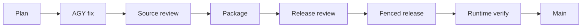

# Canonical direct tool dispatch: recovery, RCA and verified release

Status: SCOPED LOCAL READ DISPATCH RESTORED;13/13 canonical tasks completed; accepted source integrated into main.
Plan: `uos/direct-dispatch/20261001-0440`. Created 2026-10-01T04:50:43Z; updated 2026-10-01T05:52:00Z.
#fractal-l0 #fractal-l3 #fractal-l4 #fractal-l5 #fractal-l9 #zk-adr #zero-muda

[Dashboard](http://nas-1.tail55d152.ts.net:4100/static/20260930-0633-restoration-dashboard.html) | [Planning](http://nas-1.tail55d152.ts.net:4100/planning) | [Specification](http://nas-1.tail55d152.ts.net:4100/files/docs/design/20261001-0443-direct-tool-dispatch-invariants.json) | [Prior recovery](http://nas-1.tail55d152.ts.net:4100/files/docs/journal/20261001-0255-fractal-rca-mainline-recheck.md)

## 1. Scope & Trigger

Engine 5: the operator requested restoration with Google AGY, fractal RCA, stabilized branch integration, direct tool dispatch and a truthful pending-items dashboard. The delivered interface is a trusted local CLI for two bounded reads: `query_doctor` and `query_saplan`. Telegram payload authority, mutations and an actual stdio MCP transport remain outside this accepted interface. Optional clarification received no answer; the local scope was stated during execution. Machine-readable predicates and executable falsifiers bind the reviewed candidate; no global theorem or system admission is inferred.

Baseline main: `fd4950eebf490b9972e204488e719978ee7a5522`.
Reviewed source: `77699b99f269aecd254f5931cccfa676fc41e093`.
Immutable release: `f080822e321b03cc044a906130ab4a2b129b6fbf0a16c6c979e188478982ee3e`.

## 2. Pre-State Assessment

Engine 7 prior is observed service state, not a numerical Kalman estimate. At intake the restored cognitive worker PID891443, cockpit, ecology and two clock guards were operating; ecology advanced at cycle72168. Coordinator/cycle recovery from the preceding plan was preserved. Direct /tool and /action deliberately refused missing canonical authority. Several broader handlers still returned static health or mutation success. Process availability therefore did not establish usable direct tools.

All bookmarked branches were already ancestors of baseline main. Nineteen original historical heads were preserved with applicable source accounted for by independent selective-port classifications. Replaying their old ledgers or rejected authority code was not an acceptable restoration method.

## 3. Execution Detail

### Canonical authority and AGY implementation

Sa-plan owns all13 tasks. Actual Google AGY session954b9a82-15dc-4bd5-ae31-dd9670e583ca in pane w2:p9 authored the implementation and repair in isolated Jujutsu siblings. Parent held integration/main epoch4 and runtime:cognitive-worker epoch2. Typed board posts and coordinator heartbeats retained the unique board actor reference.

The first AGY candidate widened the shared development-role fence and received parent HOLD. AGY restored shared development byte-for-byte. Combined candidate5a23e76d then received independent HOLD for four further defects. A new AGY_FIX task produced835b6d1f and a clean child87f63640. Corrected combined candidate77699b99 passed the second independent source review.

### Release and observation

The full indrajaal web build closure was compiled with pinned Gleam1.16.0 and OTP29, packaged read-only, and independently reviewed. Capsule tests passed before release. The reviewer bound three finite private grants to exact source,22 control identities, six dependencies, host/boot and resource epochs. The parent executed install, daemon-reload and restart through the Gleam restoration executor. The original unit was preserved; effective unit SHA256 matched the independently predicted fdb06fb372b49ba7e7e53411214d1715efa756029ca21cfc7387a7c3610bd623.

New cognitive PID996576, invocation587a23ff68064b7989dea49ebc8bbbc4, started05:40:42UTC. Independent observations05:42:05-05:43:40UTC confirmed stable PIDs, zero automatic restarts, exact five startup module identities, healthy clock reports and advancing ecology. Real CLI reads ran from the immutable capsule with a current VERIFY task binding. No synthetic outbound message or live task-database mutation was used.

### Preserved failures

Earlier active risk checks correctly held stale assessment state; refreshed canonical evidence passed. A large risk write exceeded argv limits before mutation; chunked Gleam writes corrected it. Initial invocation syntax/expectation mistakes were preserved rather than counted as product failures. A parent heartbeat gap caused stale-actor refusal; canonical heartbeat repair restored healthy guards without code changes or restart. AGY's first completed-task negative probe was heartbeat-contaminated; independent review isolated the actual completed-task refusal with a fresh coordinator lease.

The original AGY receipt was overwritten by its author; the parent preserved its first observed semantic content and explicitly did not claim original byte preservation. Independent HOLD remains intact. A reviewer initially expected a later task error and then verified the correct earlier refusal. One coordinator wrapper timed out because halt was omitted; the corrected bounded observation passed.

The initial journal/dashboard serialization incorrectly encoded Unicode. The dashboard was repaired with ASCII JSON and served equality verified. This journal's invalid-UTF8 working copy was preserved as an administrative recovery artifact before replacement with ASCII text. These serialization fixes do not change executable source. The first final journal check held four documentation-label omissions (H1/H2 identifiers, Admiralty, Red Team and Forecast capitalization); explicitly labeling the existing evidence corrected those omissions without changing test outcomes.

### Editable execution diagram

ASCII source:

```text
Plan -> AGY fix -> Source review -> Package -> Release review -> Fenced release -> Runtime verify -> Main
```

Mermaid source:



## 4. Root Cause Analysis

Engine 1 ACH disconfirmation matrix:

| Hypothesis | Disconfirming observation | Result |
|---|---|---|
| H1: Worker crash caused unavailable tools | Healthy original PID still refused missing authority | Disconfirmed |
| H2: Caller lease fields establish permission | Fields did not read canonical task/coordinator state | Disconfirmed |
| Health-shaped handler text proves execution | Static success and health strings existed | Disconfirmed |
| Printed green tests establish live dispatch | Completed-task probe skipped or only logged failure | Disconfirmed |
| Bounded SQL always yields complete counts | LIMIT257 lacked overflow refusal | Disconfirmed |
| Existing launcher defaults were sufficient | Missing explicit role and mixed fallback fields accepted | Disconfirmed |
| Fixes require weakening shared development policy | Read-only internal fence adaptation passed with unchanged shared module | Disconfirmed |

Fractal causes recur at L0 identity, L3 task/lease fencing, L4 transport/schema, L5 truthful feedback and L9 admission claims. The implementation now checks all seven explicit launcher fields, strict empty JSON object arguments, current task owner/attempt/dependencies, coordinator session/epoch and before/after clock continuity. Overflow refuses rather than reporting a partial total.

## 5. Fix Taxonomy

Engine 6 Poka-Yoke: implemented-tool allowlist, strict JSON schema,256-task sentinel, explicit launcher binding and bounded output. Jidoka: unsupported mutations, stale authority, changed post-fence and unavailable operations stop with nonzero CLI refusal. Muda: reuse Gleam control, existing Sa-plan/coordinator adapters and pinned closure; no new packages or native control plane.

The shared development module remains byte-identical to baseline. Direct-read adaptation only observes its existing fence; it does not call the development mutation dispatcher.

## 6. Patterns & Anti-Patterns Discovered

Engine 4 Red Team falsification separated deterministic tests from strict live probes. A printed count is not evidence: the test main invokes33 deterministic checks but prints32; independent accounting records33. The discrepancy is retained as a cosmetic limitation, not inflated into an extra test.

Trusted same-Unix-user environment is a cooperative boundary, not IAM. Read repeats safely reobserve current state and do not establish durable delivery or exactly-once effects. MCP response helper functions do not constitute an implemented transport. Historical failed systemd units are preserved records, separate from healthy current replacements.

## 7. Verification Matrix

Engine 2 Admiralty Grade B2: independently repeated candidate-bound observations support scoped B2 acceptance; this grade does not grant global admission.

| Check | Result and scope |
|---|---|
| Corrected source | Independent PASS77699b99; nine reviewed paths match; shared development unchanged |
| Deterministic dispatch | 33 actual invocations PASS; printed32 discrepancy recorded |
| Release policy | 9 EUnit tests PASS |
| Doctor truth | 14 focused tests PASS against packaged production modules |
| Strict schema and launcher | Empty-object whitespace accepted; blank/primitives/arrays/fields refused; all7fields required; no fallback |
| Bounds and privacy | 256 tasks pass,257 refuse; private sentinel omitted |
| Real capsule CLI | doctor, sanitized Sa-plan13 and repeated read PASS |
| Authority negatives | Missing/invalid role, wrong worker and completed canonical task refused; unsupported mutation exit1 |
| Artifact | 1248 files,31346282 payload bytes; strict immutable verify PASS; OTP29/ERTS17.0.5 |
| Effect authority | Three independently reviewed grants executed once; original unit preserved |
| Loaded runtime | Five module identities equal reviewed capsule; five current services stable0automatic restarts over95seconds |
| State integrity | Coordinator245-event chain/replay/triggers PASS; cycles332,holds24,releases0 |
| Ecology | Cycle75836 to75931 across independent observation |
| Dashboard | Served JSON equality and actual-script smoke checked; visual browser acceptance UNRUN |
| Global gates | Unrun global mathematical, cross-host and admission evidence remains UNRUN |

[Source review](http://nas-1.tail55d152.ts.net:4100/files/governance/planning/20261001-0440-direct-dispatch-evidence/20261001-0508-independent-source-review2-pass.json) and [release review](http://nas-1.tail55d152.ts.net:4100/files/governance/planning/20261001-0440-direct-dispatch-evidence/20261001-0526-independent-release-review-pass.json) preserve exact bindings. Runtime and closure receipt links are recorded in the dashboard evidence.

## 8. Files Modified

Executable scope: direct_read_dispatch.gleam, direct_read_dispatch_cli.gleam, cognitive_worker.gleam, cognitive_runtime_cli.gleam and restoration_runtime_cli.gleam. Focused tests: direct_read_dispatch_test.gleam, restoration_runtime_test.gleam and telegram_gemma_wiring_test.gleam. Shared development.gleam is unchanged.

Administrative scope: this13-section journal, invariant JSON, risk/evidence portfolio, dashboard HTML/state and the reviewed cognitive unit proposal. Standalone Jujutsu diff accounting records exact files. No secret values, live DB/WAL/SHM or downloaded source enter this change.

## 9. Architectural Observations

Engine 5 consistency requires separate identity, task, coordinator, clock, capability and release boundaries. Gleam owns supervision and policy; Hermes/native bounded adapters observe canonical stores; Sa-plan remains execution authority. Two observations around a read support bounded acceptance, not transactional exactly-once mutation. The immutable cognitive worker and the independently exercised local CLI share reviewed production module bytes.

### Operational invocation

Use a current canonical executing task and its coordinator task-resource lease. Set UOS_DIRECT_ROLE=direct_read and the six explicit UOS_DIRECT_PLAN, UOS_DIRECT_TASK, UOS_DIRECT_WORKER, UOS_DIRECT_ATTEMPT, UOS_DIRECT_SESSION and UOS_DIRECT_EPOCH values from that live authority. Invoke direct_read_dispatch_cli:main() from the reviewed capsule code path with arguments `query_doctor '{}'` or `query_saplan '{}'`. A completed example task is deliberately unusable. Help documents the interface; arbitrary tool names and caller-supplied authority payloads do not expand scope.

## 10. Remaining Gaps

Authenticated Telegram handoff; actual stdio MCP dispatch transport; durable per-request acknowledgements/replay control before mutations; unavailable native subscriptions and broader facade; variable free-provider capacity; cross-host failover and long-duration reliability; visual browser acceptance; EV94-109 and global formal/system admission remain pending.

The current MCP inventory contains65 declared tools,12 unavailable and53 declared-unprobed; catalog counts are not successful execution counts. Doctor reports unobserved runtime details honestly rather than manufacturing passing health or purity. Historical failed units remain retained. None of these limitations is silently marked complete by this bounded read release.

## 11. Metrics Summary

Engine 3:13 canonical tasks cover intake, implementation, first review, correction, second review, launcher, documentation/status, packaging, release review, release, runtime verification and closure. The first review completed its work with HOLD; completion did not mean candidate acceptance. Test counts above are scoped, not added to historical recovery totals.

Raw observations support neither a Bayesian reliability posterior nor a calibrated decay rate or Lyapunov derivative; those are NOT_ESTIMATED. The independent stability window was95seconds. Current automatic-restart counts are0, not a long-duration reliability guarantee.

## 12. STAMP & Constitutional Alignment

Raw FMEA S4 x O3 x Det3=36,band4. Occurrence is a scenario estimate with unquantified uncertainty. Four UCAs: omit required reads; provide unverified execution; execute after expiry or before review; continue beyond bounded task ownership. Criticality4 x STPA4 x FMEA4 x dependency4 x impact3=768. Scores never confer authority.

| Release aspect | Evidence or remaining limit |
|---|---|
| A01 storage | No drive operation; denied serial remains unchanged |
| A02 JJ | Standalone source, reviewed integration, historical lineages preserved |
| A03 purity | No dependency added or barred runtime introduced |
| A04 OTP | Pinned OTP29/ERTS17.0.5 and five loaded IDs observed |
| A05 ZigVM | No kernel change; global verification UNRUN |
| A06 Hermes | Canonical Sa-plan and cycle oracle reused |
| A07 mathematics | Executable invariant falsifiers; global proofs UNRUN |
| A08 control | Task/coordinator/clock and finite effect fences |
| A09 MAX | No inference-service change |
| A10 Zenoh | Typed board/heartbeat; no synthetic queued messages |
| A11 AG-UI | Full request trace propagation UNRUN |
| A12 A2UI | Dashboard served state; visual acceptance UNRUN |
| A13 interfaces | Local two-tool CLI accepted; Telegram/MCP transport pending |
| A14 Tailnet | Canonical FQDN navigation and live endpoints |
| A15 checklist | Explicit18 checkpoints below |
| A16 KM | Prior recovery and failed evidence preserved |
| A17 Sa-plan | Sole task authority; completed grants cannot be reused |

<details><summary>Comprehensive verification: 18 checkpoints, five domains plus provenance</summary>

- CHK-01 TIME: synchronized host observation and bounded expiry.
- CHK-02 TAILNET: canonical FQDN links and served state.
- CHK-03 FRACTAL: L0,L3,L4,L5,L9 traced.
- CHK-04 KM: prior evidence and failed reviews retained.
- CHK-05 ZERO-MUDA: no new dependency; no global purity proof claimed.
- CHK-06 GRAPH: no foreign graph dependency introduced.
- CHK-07 STORAGE: no storage effect.
- CHK-08 C1-C8: focused scope only; full system suite UNRUN.
- CHK-09 MATH: global gates UNRUN.
- CHK-10 TESTS: candidate/capsule positives and refusals PASS.
- CHK-11 REGRESSION: doctor and release-policy regressions PASS.
- CHK-12 GLEAM: control/runtime identities observed.
- CHK-13 HERMES: Sa-plan and cycle oracle verified.
- CHK-14 ZIGVM: unchanged.
- CHK-15 MAX: unchanged.
- CHK-16 OTEL: typed board trace and canonical heartbeats.
- CHK-17 SOVEREIGN: independent source,release,runtime reviews.
- CHK-18 JJ: accepted source and closure integrated; quarantine not admitted.

Domain6 provenance: EV93 ceiling; EV94-109 NOT_ADMITTED; no new EV; no historical journal replay.

</details>

## 13. Conclusion

Engine 7 precommitted Forecast: Probability p=0.8 that bounded read-only canonical dispatch passes independent authority falsifiers; Horizon before this plan CLOSE. Observed outcome=true, Brier score=(0.8-1)^2=0.04. This is one uncalibrated analyst forecast, not a reliability bound. Local read dispatch is restored and independently verified; broader capabilities remain explicitly pending. Final task completion, main revision and post-retirement observations are recorded in closure evidence.

[Previous](http://nas-1.tail55d152.ts.net:4100/files/docs/journal/20261001-0255-fractal-rca-mainline-recheck.md) | [Dashboard](http://nas-1.tail55d152.ts.net:4100/static/20260930-0633-restoration-dashboard.html) | [Wiki](http://nas-1.tail55d152.ts.net:4100/wiki) | [ZK](http://nas-1.tail55d152.ts.net:4100/zk)

UOS footer: bounded observations and source integration grant no universal admission.
