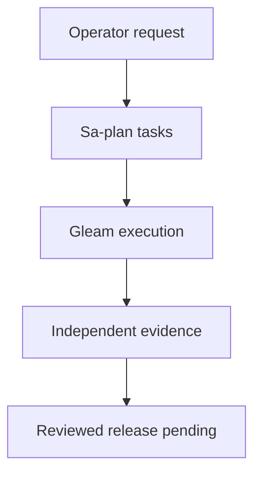

# 20261011-1224 Telegram recovery verification update

Observed: 2026-10-11T12:58:24.668Z. **IN PROGRESS — NOT ADMITTED**.
#fractal-l0 #fractal-l3 #fractal-l5 #zk-adr #zero-muda
[Home](http://nas-1.tail55d152.ts.net:4100/) · [Planning](http://nas-1.tail55d152.ts.net:4100/planning) · [Previous ledger](http://nas-1.tail55d152.ts.net:4100/files/docs/journal/20261011-1229-telegram-recovery-feature-ledger.md) · [Raw source](http://nas-1.tail55d152.ts.net:4100/files/docs/journal/20261011-1224-telegram-recovery-verification-update.md)

Breadcrumb: UOS / Journal / Telegram recovery.

## 1. Scope & Trigger

The operator requested completion of all Telegram features, actual AGY execution, plan review with AGY/Gemini and Claude, and any missing execution tools. This is a progress ledger for REPORT2 in Sa-plan uos/telegram-tools/20261011-1115, worker codex-telegram-20261011, attempt 1. It does not close the operator goal. Engine 5 formal gateway: no system admission proof or release authority is asserted.

| Key task | As-is | To-be | Completion status | Criticality / risk | Mitigation approach |
|---|---|---|---|---|---|
| Execution tools and expired claims | Recovery checker and canonical ownership recovered; transport has 18 fresh tests | Reliable bounded dispatch through Gleam and Sa-plan | Development checks passed | High: stale worker or unbounded child | Exact-set recovery, current attempts, process deadlines and cleanup |
| Mini App signature/freshness | AGY patch independently passes 72 tests, 768 HMAC assertions and 8 malformed encoding cases | Authenticated HTTP identity and allowlisted features | Module verified; HTTP integration pending | High: forgery or stale identity | Byte-correct HMAC, strict parsing, freshness; connect validator to API |
| Native store | Digest collision fixed; supplied 124 tests pass, six independent negatives fail | Strict schema/UTF8/path boundary and tested atomic recovery | HOLD; AGY NATIVE_FIX2 executing | High: malformed committed state or unsafe directory | Reproduce exact framed requests; independent verification after fix |
| Feature matrix | Mechanical count: 79 arms, 89 route literals, 77 unique commands; heuristic errors corrected | Every route mapped to actual behavior and acceptance | Claude SURFACE_PLAN executing | High: false completeness from static text | Read bodies, distinguish help from operational claims, check actual adapters |
| Mini App browser | All 14 screens render defaults; three inert action buttons, invalid routes return dashboard | Observed data, authenticated actions, correct routing and checklist | Audit complete with HOLD | High: false healthy display; missing functionality | Fresh 17-route browser receipt and screenshots; targeted integration |
| Durable store consumer and service | Pure ledger and bounded transport exist; integrated codec/poller/outbox unverified | Durable single poller, authorized dispatch, explicit uncertain delivery | Pending | High: duplicate/lost messages and unsafe effects | Atomic input/offset and result/chunks; task fences; no blind resend |
| Callbacks, media, conversation, streaming | Source components exist in differing languages; complete wiring unverified | One coherent supervised Telegram feature surface | Pending concrete matrix and implementation | High: unsupported capabilities or duplicate routes | Real backend bindings and family-specific positive/negative/recovery tests |
| Release, live Telegram and mainline | No new release, real Telegram send or mainline merge | Independently reviewed release, rollback and authorized live acceptance | Pending | High: unreviewed deployment or false admission | Candidate-bound tests, recipient-scoped live test, standalone JJ integration |

## 2. Pre-State Assessment

The previous ledger at 12:23:29Z recorded broken Mini App authentication and the native digest collision. The corrected auth module has now passed independent tests. The first native patch repaired the digest but left malformed fields, invalid UTF8 and unsafe ancestor permissions accepted. Those defects were not exposed by its supplied suite.

Engine 7 predictive prior: end-to-end Telegram usability remains UNKNOWN. No measured Kalman covariance/state estimate exists for this intervention. Public Mini App pages rendering without credentials are not by themselves evidence of confidential-data exposure: the observed pages render default/static models. They also do not establish authenticated usability.

## 3. Execution Detail

Actual AGY/Gemini implemented the auth and native patches. Root freshly compiled auth in an isolated package and generated 128 independent signatures using Node standard crypto. Each signature received six semantic checks; eight malformed percent/UTF8 cases were also run. Formatter-only corrections were included in the final source binding.

Root copied the native candidate into a private build directory, rebuilt it and reproduced 124 passing assertions. An independent framed executable driver then demonstrated six failures: wrong-typed optional db_path accepted; wrong-typed expected_sha256 treated as absent and committed; raw invalid UTF8 accepted; decoded invalid UTF8 stored; non-JSON summary stored; current-UID world-writable ancestor accepted. Independent standard-crypto digests differed for the old collision pair, and the changed operation was correctly refused as a replay.

Root built a bounded OCaml browser adapter from existing repository controller helpers. It observed 14 actual Mini App pages plus three invalid/query routes at 390px width. Only exact GET document routes were allowed; redirects, external SDK traffic, other HTTP requests and sockets were refused. Keyboard navigation to Tasks worked. Three known inert buttons produced no body change or network attempt. Five screenshots were retained; the Alerts screenshot was visually inspected.

Engine 6: Sa-plan records review delivery separately from candidate acceptance. NATIVE_REVIEW and MINI_HTTP_AUDIT are completed review tasks with HOLD verdicts. NATIVE_FIX2 and SURFACE_PLAN remain executing in the snapshot.

## 4. Root Cause Analysis

Engine 1 ACH matrix uses 0 consistent, 1 neutral and 2 inconsistent with a hypothesis.

| Evidence | H1: incomplete boundary and UI integration | H2: stale binaries alone | H3: browser/network outage |
|---|---:|---:|---:|
| Fresh native build accepts malformed values | 0 | 2 | 2 |
| Old collision pair now has distinct independently calculated digests | 0 | 2 | 1 |
| Actual browser reproduces default health text and inert controls | 0 | 1 | 2 |
| Source shows no Mini App API/auth caller and path-only routing | 0 | 2 | 2 |
| Total disconfirmation score | 0 | 7 | 7 |

Fractal RCA: L0 evidence quality failed when absence of a keyword was mistaken for absence of a property. L3 schema handling collapsed invalid present optional values into absence. L5 identity encoding was repaired, but the HTTP integration is still missing. Native storage checks assumed trusted ownership also meant safe permissions. UI initial/default values were presented as live assurance. At the control boundary, the web server currently empties the body before forwarding to the router, so a new Mini App API needs a reviewed bounded body path and explicit authentication, without bypassing other route controls.

## 5. Fix Taxonomy

Poka-Yoke: byte-correct HMAC, strict typed optional fields, scalar UTF8 and standard JSON validation, exact directory permission rules, exact path segments. Jidoka: independent negative tests retain HOLD despite 124 positive assertions. Muda reduction: reuse Gleam supervision, existing process transport and typed OCaml browser bindings. Corrective work still required includes exception-safe statement/transaction cleanup and actual controlled process-kill recovery tests.

## 6. Patterns & Anti-Patterns Discovered

Engine 4 Red Team tests reached actual native commits rather than only helper functions. The second review again found gaps invisible to the supplied suite. Test counts describe tested cases, not full correctness.

Claude retracted unsupported claims that the ledger lacked idempotency, the guard only checked identity, and poller/callback source was absent. The implemented ledger compares stable identities and handles replay; the guard restricts directive/tool names; the OCaml client contains polling and callbacks. Actual service wiring remains unverified. Informational help is legitimately static and must not be counted as an unimplemented action.

AGY's initial native report misattributed per-suite counts and claimed zero Python despite an observed contradictory pane message. Its additive erratum is retained. Direct file/native operations and later observed Gleam-mediated operations are distinguished; no blanket compliance claim is made. A peer added an unsupported claim_receipt field to the strict risk schema; its metadata was preserved in an allowed field. Concurrent portfolio writes also reverted a task's declared state. Root re-read canonical state, repaired the observation and required a new passing active check.

## 7. Verification Matrix

Admiralty B1/B2 grades below apply only to bounded observations. They do not confer system admission.

| Check | Result | Reliability | Credibility | Grade | Evidence |
|---|---|---|---|---|---|
| Auth existing/new module tests | PASS 72 | B | 1 | B1 | [Independent auth verification](http://nas-1.tail55d152.ts.net:4100/files/governance/planning/20261011-1228-telegram-auth-independent-verification.json) |
| Independent HMAC vectors | PASS 768 assertions over 128 cases; 8 malformed encodings pass | B | 1 | B1 | [Independent auth verification](http://nas-1.tail55d152.ts.net:4100/files/governance/planning/20261011-1228-telegram-auth-independent-verification.json) |
| Native supplied tests | PASS 124; candidate HOLD | B | 1 | B1 | [Independent native HOLD](http://nas-1.tail55d152.ts.net:4100/files/governance/planning/20261011-1202-telegram-native-independent-review.json) |
| Independent native checks | 5 expected outcomes pass; 6 required refusals fail | B | 1 | B1 | [Independent native HOLD](http://nas-1.tail55d152.ts.net:4100/files/governance/planning/20261011-1202-telegram-native-independent-review.json) |
| Mini App browser/source audit | Observed 17 routes; feature completeness HOLD | B | 1 | B1 | [Mini App HTTP/browser audit](http://nas-1.tail55d152.ts.net:4100/files/governance/planning/20261011-1217-telegram-mini-http-audit.json) |
| Real Telegram SDK/session/send and integrated service | UNRUN | F | 6 | F6 | No acceptance asserted |
| New native corrections | Under AGY development; independent verification pending | E | 3 | E3 | NATIVE_FIX2 |
| Global formal stability and release | UNRUN for a completed candidate | F | 6 | F6 | No admission asserted |

## 8. Files Modified

AGY changed native/ocaml/telegram_store source/tests/specification; root preserves the old independently tested candidate under var/recovery-runtime/20261011-1244-native-independent. Earlier accepted auth changes remain in telegram/auth.gleam and telegram_auth_golden_test.gleam. Exact auth source hash is 1514b26366e1665c831fa8f8600ee82d778327e5365098c5580ebce218521c45; final receipt binds all tests.

Root added private independent framed-wire and OCaml browser adapters, timestamped review receipts, browser evidence, risk/task records and this ledger/status JSON. No root product-source changes were made during these two audits. Existing unrelated dirty files and standalone Jujutsu history are preserved. A clean working tree is not claimed. Mainline integration remains unperformed.

## 9. Architectural Observations

The auth module can prove a Telegram signature/freshness property without proving any HTTP request calls it. Native durability can preserve a transaction without granting authority to send a message. A rendered Mini App can look usable without having a data or action backend. Acceptance must cross each of these boundaries with observed evidence.

Engine 5 sheaf/category consistency remains an obligation, not a measured formal proof. Engine 6 policy observations never grant execution authority.

```text
[Operator request] -> [Sa-plan tasks]
[Sa-plan tasks] -> [Gleam execution]
[Gleam execution] -> [Independent evidence]
[Independent evidence] -> [Reviewed release pending]
```



## 10. Remaining Gaps

Complete NATIVE_FIX2 and independent NATIVE_VERIFY2; implement the Gleam durable codec/consumer and supervised service; complete the full route/interface matrix and missing Telegram bindings. Mini App work includes actual authenticated data/actions, correct routing/query handling, truthful stale/unavailable displays, body handling, mobile navigation and the 18-checkpoint structure.

Real Telegram SDK and recipient-scoped live acceptance, browser testing of a reviewed private candidate, independent release/rollback, applicable formal/provenance gates and stabilized main integration remain pending. A supported refusal contains a missing capability but does not implement it. Total physical storage quota and power-loss durability remain UNKNOWN; the main DB bound excludes WAL/SHM.

## 11. Metrics Summary

Runtime snapshot: 38 tasks, 29 completed, 2 executing, 7 available. Completed counts include HOLD reviews and historical components, not 29 admitted Telegram features. No feature-completion percentage is inferred. The tools plan has nine completed tasks and REPORT2 executing.

Engine 3 Bayesian Beta-Binomial reasoning: correlated assertions and deliberately selected adversarial cases are not production reliability trials. No calibrated posterior is claimed; Beta(1,1) is only an illustrative uninformative prior. Freshness decay remains C(t)=C0*2^(-delta/t_half), with source edits invalidating candidate applicability immediately.

Lyapunov dV/dt<0 for the live system and Kalman forecasting remain UNRUN. The earlier expired-claim backlog decreased from two to zero; this is a local integrity progress metric, not system stability proof. Newly discovered gaps can increase the task backlog without representing a new runtime regression.

## 12. STAMP & Constitutional Alignment

Raw FMEA ratings for unauthorized effects, lost/duplicate delivery and false status remain S4/O3/Det3, RPN36, P1 analyst judgments. All four UCA types are retained: required action not provided is visible pending work; unsafe action is constrained by identity, scope and task fences; wrong timing requires freshness and current attempts; excessive duration is bounded by leases/deadlines and uncertain-delivery containment.

No EV above 93 is admitted and no new EV is minted. Excluded dependencies remain excluded; no storage hardware action was taken. Two-key review, source ownership, finite budgets, standalone JJ and release authority remain required. Board ACKs and task completion do not replace those controls.

## 13. Conclusion

The Mini App authentication module is independently verified in development. Native storage and the Mini App UI still have concrete acceptance failures, and AGY is correcting the storage candidate while Claude refines the complete implementation matrix. The operator's full Telegram and restoration goal remains open.

Engine 7 Forecast resolution: the previous p=0.80 forecast for auth verification by 2026-10-11T13:30:00Z achieved outcome o=1 at 12:33Z, with candidate-bound receipt. Brier score (0.80-1)^2=0.04; the original forecast remains unchanged. This is one uncalibrated forecast, not a reliability estimate.

New forecast precommitment at 2026-10-11T12:58:24.668Z: Probability p=0.65 that a corrected native candidate will pass the six independent refusal cases and controlled process-kill recovery verification by Horizon 2026-10-11T14:15:00Z. Outcome o=1 only if a fresh independent receipt covers every obligation; otherwise o=0. Brier B=(p-o)^2. No release authority follows from the forecast.

### Comprehensive verification checklist

Unchecked items are obligations; no18/18passing claim is made.

<details>
<summary>Domain 1 — Metadata, timestamp and Tailscale navigation</summary>

- [ ] **CHK-01-TIME** — Observe synchronized clock evidence and document prefix.
- [ ] **CHK-02-TAIL** — Verify full Tailnet links and actual serving status.
- [ ] **CHK-03-FRACT** — Verify L0–L9 tags and applicable layer mapping.
- [ ] **CHK-04-KM** — Reconcile specification, wiki, ZK and journal links.

</details>

<details>
<summary>Domain 2 — Zero-Muda purity and storage safety</summary>

- [ ] **CHK-05-MUDA** — Verify exclusions against the candidate dependencies.
- [ ] **CHK-06-GRAPH** — Verify the pure BEAM/Hermes graph boundary.
- [ ] **CHK-07-DRIVE** — Preserve the denied OS serial and test real interlocks only in scope.

</details>

<details>
<summary>Domain 3 — Testing Gold Standard and mathematical gates</summary>

- [ ] **CHK-08-C1C8** — Verify all applicable C1–C8 surfaces.
- [ ] **CHK-09-MATH** — Measure the four declared mathematical gates.
- [ ] **CHK-10-9MOD** — Apply relevant unit, system, TDD, BDD, performance, scalability, property, fuzz and chaos checks.
- [ ] **CHK-11-REGR** — Run applicable regressions and bounded observation.

</details>

<details>
<summary>Domain 4 — Cross-language control and observability</summary>

- [ ] **CHK-12-GLEAM** — Observe actual OTP control/supervision behavior.
- [ ] **CHK-13-HERMES** — Observe bounded analysis and authoritative evidence.
- [ ] **CHK-14-ZIGVM** — Verify deterministic execution and descriptor-relative VFS.
- [ ] **CHK-15-MAX** — Observe actual isolated inference when applicable.
- [ ] **CHK-16-OTEL** — Verify clock and nonzero trace/span identity.

</details>

<details>
<summary>Domain 5 — Sovereign governance and standalone Jujutsu</summary>

- [ ] **CHK-17-SOV** — Obtain candidate-bound independent review and authorized admission.
- [ ] **CHK-18-JJ** — Preserve standalone JJ, source ownership and exact candidate identity.

</details>

<details>
<summary>Domain 6 — Provenance extension</summary>

EV ceiling remains 93. EV-94..109 remain NOT_ADMITTED. No new EV number is minted.

</details>

[Previous: formal specification](http://nas-1.tail55d152.ts.net:4100/files/docs/design/20260909-0412-gleam-harness-symbiosis-formal-spec.md) · [Wiki](http://nas-1.tail55d152.ts.net:4100/wiki) · [ZK](http://nas-1.tail55d152.ts.net:4100/zk) · [Cockpit](http://nas-1.tail55d152.ts.net:4100/)

UOS footer: document and component evidence do not grant system admission.

[Previous ledger](http://nas-1.tail55d152.ts.net:4100/files/docs/journal/20261001-1202-telegram-browser-admission-recovery.md) · [Next: planning status](http://nas-1.tail55d152.ts.net:4100/planning)

