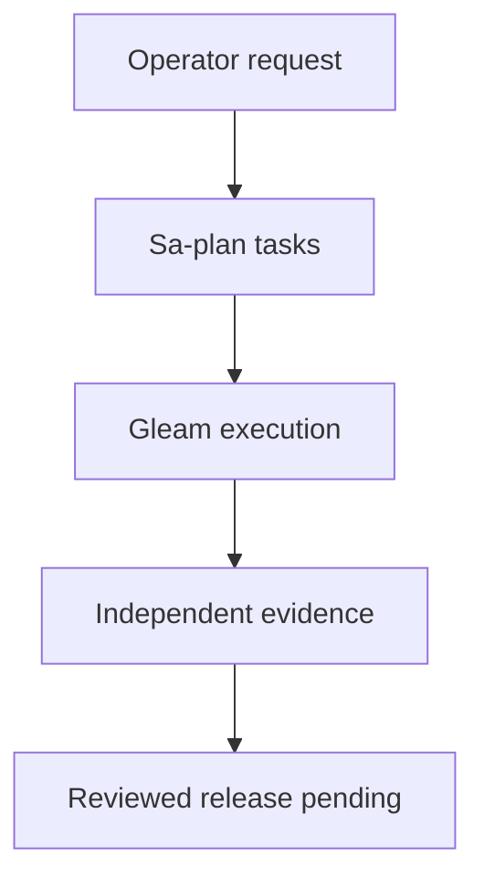

# 20261011-1229 Telegram recovery and feature completion ledger

Observed: 2026-10-11T12:23:29Z. Status: **IN PROGRESS — NOT ADMITTED**.
#fractal-l0 #fractal-l3 #fractal-l5 #zk-adr #zero-muda
[Home](http://nas-1.tail55d152.ts.net:4100/) · [Planning](http://nas-1.tail55d152.ts.net:4100/planning) · [Wiki](http://nas-1.tail55d152.ts.net:4100/wiki) · [Raw source](http://nas-1.tail55d152.ts.net:4100/files/docs/journal/20261011-1229-telegram-recovery-feature-ledger.md)
Breadcrumb: UOS / Journal / Telegram recovery.

## 1. Scope & Trigger

The operator requested all Telegram functionality completed using actual AGY execution, with plan review by AGY/Gemini and Claude and creation of missing execution tools. This ledger records the current development recovery, not completion of that request. Execution authority is Sa-plan `uos/telegram-tools/20261011-1115` and `uos/telegram-runtime/20261001-1150`; this report is task REPORT, worker codex-telegram-20261011, attempt 1. Broader browser/global admission/mainline work remains open.

| Key task | As-is at observation | To-be | Completion status | Criticality / risk | Mitigation approach |
|---|---|---|---|---|---|
| Peer execution and plan review | Actual AGY/Gemini and Claude reached through Gleam Herdr; both supplied reviews and corrections | Reviewable execution with truthful provenance | Tool recovery complete | High: wrong peer or unsupported review claims | Bound pane/session, inspect actual responses and source |
| Expired task recovery | Two expired claims reconciled by Sa-plan CAS only | Current owners and ordinary integrity checks | Complete; formal task released, not falsely completed | High: stale worker effects | Exact-set observation, quiescence checks, sequential claims, active checks |
| Storage transport | 18 fresh tests pass | Bounded supervised native calls | Development verified | High: stuck child or ambiguous response | Framing/deadline/process cleanup and pinned source/binary evidence |
| Native storage | 85 baseline tests pass; independent falsifiers expose integrity defects | Atomic initialization, distinct digests, strict schema/path checks, explicit uncertainty | HOLD; AGY repair queued | High: false replay, partial state | Reproduce failures, repair, independent private DB tests |
| Mini App authentication | Empty-hash forgery reproduced in baseline; AGY repair in progress | Correct signatures, strict bounded parsing and freshness | Under implementation/review | High: identity forgery | Independent HMAC vectors, malformed input and timestamp tests |
| Feature inventory | AGY report contains unsupported commands/counts; Claude correction underway | Every actual command/interface mapped to behavior and acceptance | In progress | High: declaring stubs complete | Compare command cases mechanically; inspect target functions |
| Durable codec/service/outbox | Pure state and transport components exist; integrated service unverified | Authenticated single poller, durable inbox/results/outbox and finite dispatch | Pending | High: lost/duplicate messages, unauthorized effects | Atomic state transitions, effect-time checks, uncertain-send quarantine |
| Browser and real Telegram acceptance | No new end-to-end acceptance observed this session | Candidate-bound browser and authorized operator traffic | Pending | High: untested deployment | Private integration first, reviewed immutable release, explicit recipient scope |
| Mainline and global admission | Main remains 83dca039; unrelated dirty work preserved | Reviewed stabilized inclusion and applicable admission gates | Pending | High: false global assurance | Standalone JJ integration after reviews; EV ceiling 93 unchanged |

Engine 5 formal gateway: no new Lean/Gospel/Z3 system admission proof has been run for this intervention. Component test results are not a substitute.

## 2. Pre-State Assessment

The runtime plan contained two expired October 1 executing claims. The ordinary checker correctly refused them; its single-task reclaim mode could not observe the complete expired set. Four UI MCP tools were exposed as read-only, while compiled Gleam execution adapters and actual peers were available. The native candidate was isolated in the AGY sibling workspace. Its historical 85 assertions were stale until independently rerun today.

Engine 7 state prior: Telegram end-to-end usability UNKNOWN; Mini App baseline authentication defective; native storage HOLD; mainline/global admission NOT_GRANTED. No calibrated Kalman state/covariance model was measured. Forecasts below are explicit analyst estimates.

## 3. Execution Detail

### Tool recovery

AGY implemented an exact-set observation mode in the bounded OCaml risk checker. Root review found permissive parsing and required corrections. The corrected CLI accepts exact plan/task/worker/attempt/decimal-string deadline bindings, rejects malformed membership and schemas, and preserves ordinary preflight refusals. Root observed 375 baseline and 32,903 adversarial checks passing, including 32,768 DAG scenarios. Seven independent CLI negative cases refused as expected.

Both expired tasks were reclaimed using canonical Sa-plan operations after bounded cooperative quiescence observations. FORMAL_FIX was released to available without claiming its repair complete. STORE_TRANSPORT_REVIEW received 18 fresh passing tests and was completed. No direct canonical DB edits were used.

### Independent feature falsification

Root freshly compiled the original Mini App auth source in a private package. An independently calculated synthetic HMAC was rejected, an empty hash authenticated the supplied synthetic user, and future/negative-clock freshness cases returned true. AGY is repairing the module and adding tests.

Root freshly built the preserved native source in a private directory: all 85 baseline assertions passed. A separate native test then demonstrated different read sets sharing one digest and the second request being accepted as a replay. Ancestor symlinks, duplicate read-set keys and unknown JSON fields were accepted. These failures remain evidence; native acceptance is HOLD.

### Review discipline

AGY's inventory hashes matched source, but its line counts, command mapping and several test claims did not. Claude's first correction also omitted hyphenated commands. Root's anchored case extraction finds 52 tokens in 49 core arms and 37 tokens in 30 cognitive arms: 77 distinct commands and 12 dual routes. Claude is completing the corrected behavioral inventory. Review comments do not grant release authority.

Engine 6 consistency rule: failed falsifiers imply HOLD even if a component test suite passes. Actual model/peer task claims and process deviations remain distinguishable from runtime enforcement.

## 4. Root Cause Analysis

Engine 1 ACH disconfirmation scoring uses 0 = consistent, 1 = neutral, 2 = inconsistent. Hypotheses concern the reproduced component failures, not the whole operating system.

| Evidence | H1: encoding/state/input-contract defects | H2: host/toolchain failure | H3: stale binaries alone |
|---|---:|---:|---:|
| Fresh exact-source auth build accepts empty hash and rejects correct signature | 0 | 2 | 2 |
| Fresh native build passes old suite but accepts changed-request replay | 0 | 2 | 2 |
| Independent case extraction disagrees with model inventory | 0 | 1 | 2 |
| Total disconfirmation score | 0 | 5 | 6 |

L0 governance: observation was at risk of being mistaken for admission. L3 tooling: recovery lacked an exact-set observer and later required strict schema repair. L5 identity: raw HMAC bytes were incorrectly decoded as UTF-8, with failure collapsed into the empty string. Native storage: delimiter concatenation lacked an injective representation; initialization omitted a encompassing transaction; input/path checks were incomplete. Evidence reporting: model-generated prose was substituted for actual enumeration.

## 5. Fix Taxonomy

Poka-Yoke: exact schema/membership checks and decimal-string lease bindings; byte-correct signature handling and bounded parser work in progress. Jidoka: preserved refusal/HOLD receipts prevent broken candidates advancing to service integration. Muda reduction: reuse compiled Gleam adapters, canonical Sa-plan and the existing bounded transport. Recovery: reconcile canonical ownership without rewriting journals or deleting state. Native repairs remain pending.

## 6. Patterns & Anti-Patterns Discovered

Engine 4 Red Team falsifiers were materially stronger than supplied tests: the digest collision reached actual apply/replay, and the auth forgery reached an authenticated result in freshly compiled code. Passing counts and correct source hashes cannot establish behavioral claims by themselves.

Preserve failed artifacts and append corrections. Treat aliases and separate command surfaces explicitly. Never count simulated responses as successful physical or administrative actions. AGY and Claude used some direct file/shell tools despite harness guidance; one AGY inventory claimed zero Python in contradiction to its observed pane. Those deviations are recorded rather than retroactively certified as compliant. Later bounded execution evidence covers only the calls actually observed through that adapter.

## 7. Verification Matrix

Admiralty grades apply to the stated bounded observation only. B1/B2 passing evidence cannot confer broader admission; E3/F6 claims cannot certify it.

| Evidence / check | Result | Reliability | Credibility | Grade | Receipt |
|---|---|---|---|---|---|
| Corrected recovery checker suite | PASS: 375 baseline, 32903 adversarial | B | 1 | B1 | [Independent parser review](http://nas-1.tail55d152.ts.net:4100/files/governance/planning/20261011-1154-telegram-parser-independent-review.json) |
| Strict CLI and ordinary-reclaim refusal controls | PASS: seven independent negatives; old refusals retained | B | 1 | B1 | Same parser receipt |
| Canonical expired claim reconciliation | PASS for scoped ownership recovery | B | 1 | B1 | [Recovery receipt](http://nas-1.tail55d152.ts.net:4100/files/governance/planning/20261011-1157-telegram-expired-claim-recovery.json) |
| Storage transport | PASS: 18 fresh tests; fixture limits retained | B | 1 | B1 | [Transport review](http://nas-1.tail55d152.ts.net:4100/files/governance/planning/20261011-1200-telegram-store-transport-fresh-review.json) |
| Native baseline suite | PASS: 85 assertions, candidate nevertheless HOLD | B | 1 | B1 | [Native review](http://nas-1.tail55d152.ts.net:4100/files/governance/planning/20261011-1216-telegram-native-baseline-independent-review.json) |
| Independent native falsifiers | FAIL candidate: collision/replay and input/path defects reproduced | B | 1 | B1 | Same native review |
| Baseline auth golden/forgery/freshness | FAIL candidate: forgery reproduced | B | 1 | B1 | [Auth review](http://nas-1.tail55d152.ts.net:4100/files/governance/planning/20261011-1210-telegram-mini-auth-independent-review.json) |
| AGY repaired auth test claims | Independent verification pending | E | 3 | E3 | [AGY draft result](http://nas-1.tail55d152.ts.net:4100/files/governance/planning/20261011-1212-agy-mini-auth-fix.json) |
| Full runtime, browser, real Telegram and global formal gates | UNRUN for new candidate | F | 6 | F6 | No admission asserted |

## 8. Files Modified

| Area | Task-owned delta | Evidence accounting |
|---|---|---|
| plugins/uos-risk-prioritization/validation/{checker,validate,adversarial}.ml | Exact-set recovery observation and strict negative cases | Exact hashes in independent parser review |
| apps/cepaf_gleam/src/cepaf_gleam/telegram/auth.gleam | AGY signature/parser/freshness repair, still under review | Baseline hash and successive candidate reports preserved |
| apps/cepaf_gleam/test/telegram_auth_golden_test.gleam | AGY synthetic signature and boundary regressions | Independent run pending at this snapshot |
| governance/planning/20261011-* Telegram artifacts | Plans, complete risk portfolios, peer reviews, errata and observed receipts | Original failures preserved; current portfolio observations are not immutable completion receipts |
| var/recovery-runtime/20261011-* | Private builds, fixtures and test-only DBs | Runtime/test artifacts, not production state or source ingestion |
| This journal and paired status JSON | Current bounded progress report | REPORT task; linter result to be recorded |

Standalone Jujutsu is preserved. No root Git mutation, branch deletion, main movement or unrelated dirty-file overwrite was performed. A clean-tree claim is not made; exact candidate source manifests, not the preexisting dirty workspace label, bind individual observations.

## 9. Architectural Observations

Gleam owns control and policy; the native OCaml worker owns bounded storage mechanics. The codec must bind domain identities and resource reservations to atomic state. The transport itself does not supply canonical task authority or exact-once network delivery. A send whose outcome is unknown must remain uncertain until explicit reconciliation.

Engine 5 cross-boundary consistency remains an integration obligation, not a claimed sheaf/category proof. Engine 6 observes task/receipt consistency but does not make advisory policy text into runtime enforcement.

```text
[Operator request] -> [Sa-plan tasks]
[Sa-plan tasks] -> [Gleam execution]
[Gleam execution] -> [Independent evidence]
[Independent evidence] -> [Reviewed release pending]
```



## 10. Remaining Gaps

P1: independently verify final Mini App auth candidate; repair/review native store; complete trustworthy behavior inventory; implement the strict Gleam codec, durable consumer and supervised single-poller service; close command/callback/media/conversation/UI gaps with truthful acceptance cases. P1 release: private end-to-end tests, browser coverage, recipient-scoped live acceptance, immutable release/rollback and independent runtime review. Broader global formal repair, provenance gates and stabilized main integration remain open.

Physical total-directory storage quota and hardware power-loss durability remain UNKNOWN; the main DB size bound does not include WAL/SHM. Cooperative process cleanup is not a defense against hostile same-UID actors. Finite unsupported responses are necessary containment but do not count as implementing every requested capability.

## 11. Metrics Summary

At 12:23:29Z the runtime plan had 33 tasks: 22 completed, 2 executing, 9 available. Completion includes delivered HOLD reviews; it is not 22 admitted features. The eight original tool-recovery tasks are complete; REPORT is executing. Expired canonical runtime claims changed from 2 to 0 during the observed recovery.

Engine 3: a Beta-Binomial reliability estimate from correlated assertion counts would be unjustified. No calibrated production posterior is asserted; Beta(1,1) remains an illustrative uninformative prior, not evidence. For report freshness only, use the prescribed decay expression C(t)=C0*2^(-delta/t_half); machine receipts have seven-day half-life and unverified model observations one day. Source edits invalidate candidate applicability immediately, regardless of time decay.

Lyapunov: the discrete recovery backlog measure V=expired_claim_count decreased by delta V=-2 over the bounded recovery interval. This is a task-integrity progress measure, not proof of dV/dt<0 for the production system. Actual system Lyapunov/Kalman stability verification is UNRUN and remains an admission gap.

## 12. STAMP & Constitutional Alignment

All four UCA categories remain explicit: missing action is surfaced as pending/failed; unsafe action is constrained by numeric identity and current task authority; wrong timing is checked with current attempts and source evidence; excessive duration is bounded by leases, deadlines and uncertain-send containment. Raw FMEA for the Telegram authority/delivery path remains S4/O3/Det3, RPN36, class P1 in the canonical portfolio; these are analyst ratings, not measured event probabilities.

No EV above 93 is admitted; EV94..109 remain NOT_ADMITTED. No new EV is minted. The denied OS storage serial is represented only as [REDACTED_SYSTEM_OS_SERIAL] here; no storage hardware mutation occurred. No excluded dependencies were introduced by these changes. Two-key release and global admission safeguards remain obligations. Documentation, board acknowledgments and successful task claims confer no deployment authority.

## 13. Conclusion

The execution/recovery tools and storage transport have fresh bounded verification. Independent tests have also exposed real auth and storage defects, which prevent claiming a usable completed Telegram system. Actual AGY is implementing repairs and actual Claude is correcting the feature inventory; these reviews remain subject to independent checks.

Engine 7 Forecast precommitment at 2026-10-11T12:23:29Z: Probability p = 0.80 that the repaired Mini App authentication module will pass independent valid-signature, empty-hash, future-time and bounded-parser tests by Horizon 2026-10-11T13:30:00Z. Falsifier: any required case fails or no candidate-bound independent receipt exists at that horizon. Outcome o is 1 only if all conditions hold; Brier score B=(p-o)^2, either 0.04 or 0.64. This forecast is uncalibrated and grants no authority.

The overall operator goal remains open. This snapshot must not be read as a release certificate.

### Comprehensive verification checklist

Unchecked items are obligations; no18/18passing claim is made.

<details>
<summary>Domain 1 — Metadata, timestamp and Tailscale navigation</summary>

- [ ] **CHK-01-TIME** — Observe synchronized clock evidence and document prefix.
- [ ] **CHK-02-TAIL** — Verify full Tailnet links and actual serving status.
- [ ] **CHK-03-FRACT** — Verify L0–L9 tags and applicable layer mapping.
- [ ] **CHK-04-KM** — Reconcile specification, wiki, ZK and journal links.

</details>

<details>
<summary>Domain 2 — Zero-Muda purity and storage safety</summary>

- [ ] **CHK-05-MUDA** — Verify exclusions against the candidate dependencies.
- [ ] **CHK-06-GRAPH** — Verify the pure BEAM/Hermes graph boundary.
- [ ] **CHK-07-DRIVE** — Preserve the denied OS serial and test real interlocks only in scope.

</details>

<details>
<summary>Domain 3 — Testing Gold Standard and mathematical gates</summary>

- [ ] **CHK-08-C1C8** — Verify all applicable C1–C8 surfaces.
- [ ] **CHK-09-MATH** — Measure the four declared mathematical gates.
- [ ] **CHK-10-9MOD** — Apply relevant unit, system, TDD, BDD, performance, scalability, property, fuzz and chaos checks.
- [ ] **CHK-11-REGR** — Run applicable regressions and bounded observation.

</details>

<details>
<summary>Domain 4 — Cross-language control and observability</summary>

- [ ] **CHK-12-GLEAM** — Observe actual OTP control/supervision behavior.
- [ ] **CHK-13-HERMES** — Observe bounded analysis and authoritative evidence.
- [ ] **CHK-14-ZIGVM** — Verify deterministic execution and descriptor-relative VFS.
- [ ] **CHK-15-MAX** — Observe actual isolated inference when applicable.
- [ ] **CHK-16-OTEL** — Verify clock and nonzero trace/span identity.

</details>

<details>
<summary>Domain 5 — Sovereign governance and standalone Jujutsu</summary>

- [ ] **CHK-17-SOV** — Obtain candidate-bound independent review and authorized admission.
- [ ] **CHK-18-JJ** — Preserve standalone JJ, source ownership and exact candidate identity.

</details>

<details>
<summary>Domain 6 — Provenance extension</summary>

EV ceiling remains 93. EV-94..109 remain NOT_ADMITTED. No new EV number is minted.

</details>

[Previous: formal specification](http://nas-1.tail55d152.ts.net:4100/files/docs/design/20260909-0412-gleam-harness-symbiosis-formal-spec.md) · [Wiki](http://nas-1.tail55d152.ts.net:4100/wiki) · [ZK](http://nas-1.tail55d152.ts.net:4100/zk) · [Cockpit](http://nas-1.tail55d152.ts.net:4100/)

UOS footer: document and component evidence do not grant system admission.

[Previous ledger](http://nas-1.tail55d152.ts.net:4100/files/docs/journal/20261001-1202-telegram-browser-admission-recovery.md) · [Next: planning status](http://nas-1.tail55d152.ts.net:4100/planning)
