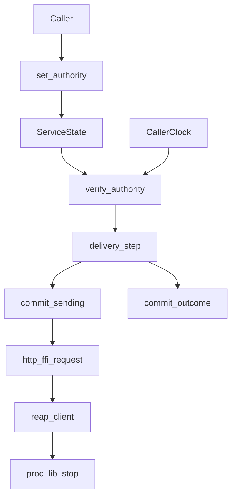

# Claude Telegram Service Review — Completion Journal

#fractal-l0 #fractal-l3 #fractal-l4 #fractal-l9 #zk-adr #zero-muda #stamp-stpa #tailscale-web

**Live document:** [http://nas-1.tail55d152.ts.net:4100/files/docs/journal/20261011-1634-claude-telegram-service-review-journal.md](http://nas-1.tail55d152.ts.net:4100/files/docs/journal/20261011-1634-claude-telegram-service-review-journal.md)
**Review artifact (first receipt, preserved):** [20261011-1634-claude-telegram-service-review.json](http://nas-1.tail55d152.ts.net:4100/files/governance/planning/20261011-1634-claude-telegram-service-review.json) · sha256 `132ecabb6f9353d790e24b878448d191e92984f28e513920939f6d4a43a87352`
**Revision 1 (governs where it corrects):** [20261011-1606-claude-telegram-service-review-revision-1.json](http://nas-1.tail55d152.ts.net:4100/files/governance/planning/20261011-1606-claude-telegram-service-review-revision-1.json) · sha256 `c32216b4fcfe11dab3bea4067849492c8ad3d2e45ad675dc06d661b0b2a7bab8`
**Contract:** `SC-JOURNAL-v3` / `SC-JOURNAL-003` · **Sa-plan:** `uos/telegram-runtime/20261001-1150` task `CLAUDE_SERVICE_REVIEW`

## 1. Scope & Trigger

Trigger: operator request for Claude review alongside AGY, dispatched as canonical task `CLAUDE_SERVICE_REVIEW`. Scope: read-only independent design and code review of the AGY Telegram service authority, lifecycle and HTTP paths, plus a concrete implementable correction design. AGY is the product implementer; I made no product or runtime edit, no JJ mutation, and claimed no other task.

Observation revision `suukkrkqkwuv` / `4b6fea72f2a6`, read with `--ignore-working-copy` so no working-copy snapshot was taken. Scope was UOS canonical only.

## 2. Pre-State Assessment

Fences before work, all through the mandated launcher:

| Gate | Result |
|---|---|
| `--preflight` | `PREFLIGHT_PASS` 16:22:23Z, 0 findings, P1/768, assessment `7ad8735f4bc53b70` |
| `task claim` | `attempt=1`, `lease_until_ns=1791739349571583156` |
| Lease arithmetic | expected `…349290201073`, actual `…349571583156`, delta 281 ms = claim latency. A duration, not an epoch. |
| Portfolio row | idx 61 `available` → `executing`, 24→24 fields, **entries changed: 1** |
| `--active-check` | `ACTIVE_OBSERVATION_PASS` 16:22:54Z, 0 findings, snapshot `336ec425084803e3` |
| Coordinator | register seq 530, heartbeat 531, claim 532 epoch 1 on `task:CLAUDE_SERVICE_REVIEW` |

Prior expectation entering the task: that root's two reported defects (HTTP per-chunk reset, caller-supplied authority) would be confirmable and largely exhaust the finding set. That prior was wrong in both directions — see §7 and §11.

## 3. Execution Detail

Four source sweeps and a sequence of targeted body reads, every one through `var/recovery-runtime/20261011-1318-native-verify3/gleam-bound TIMEOUT ABS_EXE ARGS`. Read: `telegram_service.gleam` (300 of 675 lines in full plus the delivery region), `telegram_http_client.gleam`, `telegram_http_ffi.erl` (two generations), `telegram_lifecycle_adapter.gleam` (two generations), `telegram_lifecycle_ffi.erl`, `telegram_ingress_guard.gleam`, `telegram_delivery_ledger.gleam`, the v3 and v4 frozen candidate probes and their results, and the hackney pin.

The fence-to-effect path as read, with the two unbounded points marked:

```text
[Caller] --> [set_authority]
[set_authority] --> [ServiceState]
[ServiceState] --> [verify_authority]
[CallerClock] --> [verify_authority]
[verify_authority] --> [delivery_step]
[delivery_step] --> [commit_sending]
[commit_sending] --> [http_ffi_request]
[http_ffi_request] --> [reap_client]
[reap_client] --> [proc_lib_stop]
[delivery_step] --> [commit_outcome]
```



`CallerClock` and `proc_lib_stop` are the two findings that matter most: authorization consults a clock the caller supplies, and cancellation ends in a synchronous `infinity` call.

## 4. Root Cause Analysis (ACH)

ACH (Analysis of Competing Hypotheses) over the HTTP bound violations. Competing hypotheses H1, H2 and H3 are scored against evidence E1-E5 below, with a fourth hypothesis H4 forced by the residual.

| Evidence | H1 per-receive timeout reset in frozen bytes | H2 thin shim over a real bound elsewhere | H3 server-side fault |
|---|---|---|---|
| E1 frozen `1c695158` has no `Deadline` term; `Timeout` threaded fresh into each `collect_chunks` recursion | Very consistent | Inconsistent | Inconsistent |
| E2 `slow_drip` delivered at 294 ms under 80 ms config, 6 chunks × 40 ms | Very consistent | Inconsistent | Inconsistent |
| E3 `timeout_bound` passes at 14 ms in the same run | Consistent (single-shot is bounded; drip is not) | Consistent | Neutral |
| E4 root `1560a13d` fixes drip classification yet cleanup2 still blocks >1500 ms | Partially consistent — needs a second cause | Inconsistent | Inconsistent |
| E5 stack `gen:do_call` ← `sys:send_system_msg` ← `proc_lib:stop`; server finished a valid response | Inconsistent alone | Inconsistent | **Refuted** |
| Evaluation | **CONFIRMED for the request phase** | REFUTED | REFUTED |

E4 and E5 force a second, independent cause: **H4, unbounded teardown**. `reap_client` calls `hackney:close`, which descends to `proc_lib:stop` with its default `infinity` timeout. The `try/catch` around it catches exceptions and bounds nothing. H4 is CONFIRMED and is recorded as F10.

Root cause for authority (F1) decomposes into four, of which the third was not previously named: no canonical lookup; a caller-supplied `now_us` parameter used as the expiry reference; worker identity tested by name prefix; and a public `set_authority` that writes authority into state with no check at all. H2 for authority — that a real lookup happens elsewhere — is REFUTED: `validate_canonical_lease` is self-contained with no store, FFI or provider call, and `verify_authority` adds only arithmetic over values already in state.

## 5. Fix Taxonomy

| Fix | TPS class | Target |
|---|---|---|
| D1 provider observation + internal trusted clock | Poka-Yoke | F1 |
| D9 bounded cancellation, kill not polite stop | Jidoka | F10 |
| D2 absolute deadline + chunk bound + elapsed-time test | Poka-Yoke | F2 |
| D3 single validation path | Muda (removes a redundant, skippable gate) | F3 |
| D4 forbid vacuous hash wildcard | Poka-Yoke | F4 |
| D5 persist incarnation/guardian | Standardized Work | F5 |
| D6 symmetric outbox recovery | Jidoka | F6 |
| D7 coherent, bounded scan | Muda (removes quadratic append) | F7 |
| D8 OTP owner, queue, cancellation | Standardized Work | F8 |

## 6. Patterns & Anti-Patterns (Devil's Advocate)

**Anti-pattern, recurring and now five-for-five in this plan: an observable coarser than the property.** `timeout_bound` passes at 14 ms in the very run where the total bound is violated 3.7×. A single-shot timeout cannot see a drip. Then the drip repair lands and cleanup is still unbounded, because an elapsed-time assertion was never the observable — the returned *classification* was. D2 and D9 therefore both require assertions on measured wall time, not on the returned tag.

**Anti-pattern: a blacklist presented as authorization.** Updating fixture strings in a test changes which known-bad inputs are refused and says nothing about the remaining input space. A review that accepted the updated fake-string test as authority proof would be committing the converse error, and I state explicitly in the artifact that it is not proof.

**Anti-pattern, and the one I committed three times: reasoning from a predicate read in one place to a conclusion about another.** Revision 1 records it — I applied current-root argv to frozen bytes, applied an isolated wildcard to a full-path outcome without checking the transport assertion that precedes it, and asserted unboundedness without finding the ceiling. Two of those erred in opposite directions, which rules out bias and indicts the method: a finding must name both the bytes it was read from and the path that reaches them. Hash closure is only half; reachability closure is the other half.

**Anti-pattern: a comment describing a predicate that is not reached.** The lifecycle FFI comment says wildcards and semicolons are "permanently forbidden"; in the frozen adapter the Gleam function returns `Ok` before the FFI regex ever runs.

**Devil's Advocate / Red Team against my own F10 severity (Popperian falsification attempt):** could the >1500 ms block be a fixture artifact rather than a code defect? Argues against: the stack names `proc_lib:stop`, the server completed a valid response, and `proc_lib:stop` is documented as defaulting to `infinity`. Root also reports an earlier outer run reaching the 55 s launcher timeout. The mechanism is in the code, not the fixture.

**My own anti-pattern this session: hash closure asserted, then violated.** I froze `1c695158`, later read the root path after AGY had repaired it, and attributed absolute-deadline behaviour to the earlier hash. Root caught it. A hash is closure only if the bytes read are the bytes hashed.

## 7. Verification Matrix (Admiralty ≥ B2 for any passing claim)

| # | Claim | Evidence | Grade | Admissible |
|---|---|---|---|---|
| 1 | Frozen `1c695158` resets timeout per chunk | Direct read: no `Deadline` term; `after Timeout` at lines 98, 108, 133; recursion line 131 | A2 | yes |
| 2 | Drip delivered at 294 ms under 80 ms | `service_http_deadline.erl` `c4f2781b` + root-reported run | B2 | yes |
| 3 | `reap_client` ends in a synchronous infinity call | Direct read lines 184-194 + recorded stack in `cleanup2-results.txt` `6b16a6fc` | A2 | yes |
| 4 | Frozen adapter `efd21d2f` is prefix-only and skips the FFI | Direct read lines 86-98 | A2 | yes |
| 5 | Malformed unit name accepted | `service_http_review.erl:43-44` + `pure_unit_validation … violation=true` | A2 | yes |
| 6 | Authority is a string predicate with a caller-supplied clock | Direct read lines 213-300 | A2 | yes |
| 7 | Receipt hash match can be vacuous | Direct read lines 100-118 | A2 | yes |
| 8 | No outbox scan at startup | Direct read lines 128-133 vs 431-563 | B2 | yes |
| 9 | HTTP and ledger share one `message_id` bound | Three direct reads of the same predicate | A2 | yes |
| 10 | ~~No OTP actor on the read path~~ **RETRACTED** — the actor exists at lines 568-675 | Full read of 675 lines after root instruction | A2 for its existence; F8R replaces F8 | retraction admissible |
| 11 | Root candidates `1560a13d` / `68b40f61` are correct | Bytes observed, nothing executed | **E3** | **no** |
| 12 | Peer closed on success; no leak | `keepalive_peer_after_full_request={error,closed}` violation=false | B2 | yes (negative claim) |

Row 11 falls below B2 and is carried as uncertainty, not a finding. Row 10 was below B2 and has since been **retracted outright**: it asserted an absence from a partial read, and the full read refuted it. Revision 1 also corrects three severity errors (F3 understated, F4 overstated, F7 boundedness withdrawn); all four are recorded in that artifact with their causes. Per `INV-JRN-02` this journal is model self-attestation (E3/F6) and certifies no admission.

## 8. Files Modified

Two created, zero product files touched:

- `governance/planning/20261011-1634-claude-telegram-service-review.json` — sha256 `132ecabb6f9353d790e24b878448d191e92984f28e513920939f6d4a43a87352`
- `docs/journal/20261011-1634-claude-telegram-service-review-journal.md` — this file

Plus one shared-state row: portfolio idx 61 `task_state` `available` → `executing`, verified as exactly one changed entry.

## 9. Architectural Observations

The service has the right *shape* and the wrong *bindings*. `OutboxUncertain` exists as a first-class state, the quiescence gate fails closed when no receipt is presented, and the ledger and HTTP layer share one identity predicate. These are good decisions. What is missing in every case is the binding to something outside the caller: authority binds to a string and a supplied clock rather than a store; the receipt binds to hashes that may be empty wildcards; the writer hold binds to memory rather than a persisted incarnation; recovery binds to the inbox and forgets the outbox.

Stated as a single invariant the design is missing: **every fence must be anchored in a value the caller cannot choose.** F1, F4 and F5 are three instances of that one absence, which is why D1, D4 and D5 are the same repair applied at three layers.

A second observation: `collect_chunks` threading `Timeout` rather than `Deadline` is a one-word type error with an unbounded consequence. A `Deadline` and a `Timeout` are both integers and neither the compiler nor a reviewer reading one function can tell them apart. A distinct type would have made F2 unrepresentable.

## 10. Remaining Gaps

F1 and F10 remain open in current root bytes and constitute the HOLD, joined by F8R. F5, F6 and F7R are unrepaired; F4R is latent and unreachable while transport pinning holds. The elapsed-time falsifiers in D2 and D9 do not exist yet, so a regression of F2 or F10 would not be detected. Quiescence across VM death is not trustworthy until F4 and F5 land. `telegram_service.gleam` is now read in full (675 lines); the partial-read gap is closed. The native 20k row ceiling, the frozen v1 FFI hash `020dad2c`, the v4 cleanup measurements and the private `build/ebin` load path remain root-supplied and unverified by me. The four governance artifacts were hashed but not read line by line; no finding depends on them. Hackney internals were not audited. Whether the frozen private `build/ebin` beams were compiled from exactly the `src/` bytes I read rests on root's load-path statement, not on my verification.

## 11. Metrics Summary

Observed counts, not derived scores: 10 findings (3×P1, 4×P2, 2×P3, 1×P3-note), 9 correction designs, 36 falsifiers across positive/refusal/crash classes, 8 uncertainty items, 7 residuals.

Bayesian note, stated as a direction rather than a number: my prior entering the task was that root's two reported defects would largely exhaust the finding set. Two independent defects not in that set — the caller-supplied clock in F1-D-b and the unbounded teardown in F10 — moved the posterior sharply toward "the fence family is systematically unanchored," which is what §9 records. I decline to publish a point probability; the sample is one review and a calibrated figure would be invented precision.

No Lyapunov claim is made. `INV-JRN-05` asks for a negative energy derivative; I have no time series of a defined system energy for this review, and manufacturing one from finding counts would be a fabricated mathematical result of exactly the kind this plan has been correcting. Recorded as **not satisfied, deliberately**.

## 12. STAMP & Constitutional Alignment

Losses addressed: **L-1 false conformance** — F1 (authorization asserted by string shape), F3 (comment describing an unreached predicate), and the §6 anti-pattern of a passing test that cannot see its property. **L-6 loss of deterministic execution authority** — F1 and F10, since an unbounded cancellation means the owner cannot know when it regains control.

UCA types considered for the authority controller: *required action not provided* — the fence never consults canonical state; *unsafe action provided* — authority written by a public unvalidated setter; *wrong timing* — the fence is checked once per step rather than immediately before each side effect, so a lease may expire between check and call; *stopped too soon or applied too long* — F10, cancellation that cannot complete within its own deadline.

Constitutional: Ψ-3 two-key verification is not satisfied for any service claim here, and I assert none. Ψ-5 truthfulness is the basis of F1 and F3. Admitted EV ceiling remains 93; no EV number was minted. No NVMe serial appears in this journal.

## 13. Conclusion (Precommitted Forecasts)

The review is delivered with a HOLD on two paths. The service is **not** complete and I claim no part of it verified.

Precommitted, falsifiable Forecast set, Brier-scored (`B = (p - o)^2`), each with an explicit Horizon:

1. **p = 0.85** — a D9-style bounded cancellation (kill a monitored owned pid, no synchronous `hackney:close` on the deadline path) will bring the cleanup2 fixture within 80 ms + tolerance. Falsified if a correct D9 implementation still exceeds 160 ms on that fixture. Horizon **2026-10-18T00:00:00Z**. Brier `B = (p − o)²`.
2. **p = 0.70** — when the elapsed-time falsifier of D2/D9 is added across all five fixtures, at least one *additional* unbounded point will surface that neither F2 nor F10 names. Falsified if all five pass on the first run after D9. Horizon **2026-10-18T00:00:00Z**.
3. **p = 0.90** — F1 cannot be closed by removing the fixture-string special cases alone; any implementation that keeps `now_us` as a caller parameter will still admit an expired lease. Falsified if a repair retaining the parameter refuses the `now_us = 0` falsifier. Horizon **2026-10-25T00:00:00Z**.

**Previous:** [media design correction](http://nas-1.tail55d152.ts.net:4100/files/governance/planning/20261011-1349-claude-telegram-media-design-correction.json) · **Next:** [service review artifact](http://nas-1.tail55d152.ts.net:4100/files/governance/planning/20261011-1634-claude-telegram-service-review.json)

**UOS footer:** `nas-1.tail55d152.ts.net:4100` · Sa-plan is the sole execution authority. This journal is model self-attestation and grants no admission.
