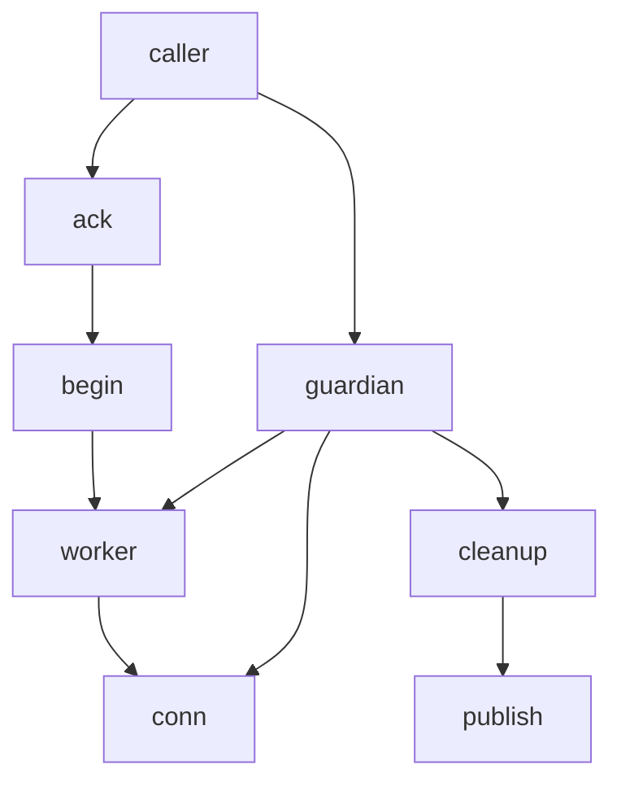

# Telegram HTTP Acceptance Repair — Completion Journal

#fractal-l0 #fractal-l1 #fractal-l3 #fractal-l4 #zk-adr #zero-muda #stamp-stpa #tailscale-web

**Live document:** [http://nas-1.tail55d152.ts.net:4100/files/docs/journal/20261011-1717-claude-http-acceptance-repair-journal.md](http://nas-1.tail55d152.ts.net:4100/files/docs/journal/20261011-1717-claude-http-acceptance-repair-journal.md)
**Acceptance receipt:** [governance/planning/20261011-1708-telegram-http-final-independent-verification.json](http://nas-1.tail55d152.ts.net:4100/files/governance/planning/20261011-1708-telegram-http-final-independent-verification.json) · sha256 `5fa33b0a1afaf2741f3d587d2e643d761e4c70447ce46beb6a77b839c6cd1d9e`
**Accepted source:** `22946c335d1bdf1b2f196a2dcd3d78be9aaf3aa2e5401766ba5a1d8548f1eb47`
**Sa-plan:** `uos/telegram-runtime/20261001-1150` task `HTTP_ACCEPTANCE_REPAIR` attempt 1 · **Contract:** `SC-JOURNAL-v3`

## 1. Scope & Trigger

Trigger: independent review FAILED candidate `daa518dd` — warmed Gleam tests returned `AmbiguousOutcome({conn_down,normal})` for a valid success, and the tuple reason crashed the callback with badarg against the `Result(_, String)` contract. Scope: iterative repair of the same private candidate HTTP FFI until independent acceptance, read-only with respect to all shared files. AGY owns adoption.

Five iterations ran across five review turns. Acceptance covers a **bounded development HTTP component only**; service, bootstrap, release, global and main remain NOT admitted.

## 2. Pre-State Assessment

Fencing was performed sequentially and each verdict was captured to a file and parsed in a separate command, with no semicolon fall-through:

| Gate | Result |
|---|---|
| `--preflight` | `PREFLIGHT_PASS` 17:14:56Z, 0 findings, P1/768 |
| `task claim` | attempt 1, `lease_until_ns=1791742506512465046` |
| Portfolio row | idx 64 → `executing`, 24→24 fields, **entries changed: 1** |
| `--active-check` (pre-work) | `ACTIVE_OBSERVATION_PASS` 17:15:16Z, 0 findings |
| Coordinator | register 544, claim 545, epoch 1 |
| `--active-check` (final) | `ACTIVE_OBSERVATION_PASS` 17:41:37Z, 0 findings |

This ordering was itself the correction of a deviation recorded in the preceding task, where I claimed and then worked before fencing was complete.

## 3. Execution Detail

Inbound candidate `daa518dd` → accepted `22946c33`, in five iterations: ownership protocol (R8–R12), deadline and drain hardening (R13–R15), then export packaging.

```text
[caller] --> [guardian]
[guardian] --> [conn]
[guardian] --> [worker]
[worker] --> [conn]
[caller] --> [ack]
[ack] --> [begin]
[begin] --> [worker]
[guardian] --> [cleanup]
[cleanup] --> [publish]
```



The two edges that carry the repairs are `caller --> ack` (no network work before the caller acknowledges ownership) and `cleanup --> publish` (the result is published only after a verified reap).

## 4. Root Cause Analysis (ACH)

Analysis of Competing Hypotheses (ACH) for the valid-success failure.

| Evidence | H1 normal conn DOWN preempts a queued worker result | H2 the body was never received | H3 fixture defect |
|---|---|---|---|
| E1 `Connection: close` makes the conn exit normally right after the body | Very consistent | Inconsistent | Inconsistent |
| E2 all five classification cases returned the same `{conn_down,normal}` | Consistent | Inconsistent | Inconsistent |
| E3 guardian clause order put `CRef` DOWN ahead of nothing — mailbox order decides | Very consistent | Neutral | Inconsistent |
| E4 after making conn DOWN non-terminal, `success` became `{delivered,42,123}` | Confirmed | Refuted | Refuted |
| Evaluation | **CONFIRMED** | REFUTED | REFUTED |

Selective receive scans the mailbox in arrival order, so an earlier normal conn DOWN wins over a worker result queued behind it. The second, independent cause was a contract violation: tuple reasons cannot satisfy `Result(_, String)`.

## 5. Fix Taxonomy

| Fix | Class | Defect |
|---|---|---|
| R1 conn DOWN non-terminal + bounded grace | Poka-Yoke | valid success misclassified |
| R2 fixed binary error vocabulary | Poka-Yoke | callback badarg |
| R3 cleanup verified before publish | Jidoka | unestablished invariant published as success |
| R4 reap returns confirmed/unconfirmed | Jidoka | silent ok on timeout |
| R5 handoff bounded by deadline | Poka-Yoke | flat 1000 ms ignored an 80 ms budget |
| R6 scheme allowlist | Poka-Yoke | unsupported scheme fell through to TCP |
| R7 reasons discarded, never formatted | Muda | raw term and URL leakage |
| R8–R11 ACK before I/O, both pids in handoff, tagged drain, binary startup error | Standardized Work | ownership holes |
| R12 ALPN pinned to HTTP/1.1 | Poka-Yoke | h2 negotiated by default |
| R13–R15 unconfirmed drain surfaced, no I/O at/after deadline, missing-ACK timeout | Jidoka | swallowed uncertainty, deadline extension |
| Export gated behind `-ifdef(TEST)` | Muda | test-only surface in production shape |

## 6. Patterns & Anti-Patterns (Devil's Advocate / Red Team)

**Anti-pattern, and I committed it twice more here: a predicate weaker than the property.** My first positive fixture declared `Content-Length: 15` while sending 17 bytes, and my assertion only required a non-empty body — so a truncating success passed. Earlier, my aggregate predicate passed while every request had failed. Both are the same fault I had already documented as F2 in the service review. The repair is structural: assertions now require exact bytes, and the suites report independent gates rather than one conjunction.

**Anti-pattern: a comment that outruns the code.** `guardian/3` was documented "exported ONLY for the private test" while the export was unconditional. Review caught it; the `-ifdef(TEST)` gate makes the comment true.

**Anti-pattern: proving the adjacent thing.** My ALPN test ran over plaintext and demonstrated HTTP/1 was live, which says nothing about TLS ALPN. The claim is now verified against pinned library source.

**Devil's Advocate against the accepted result:** could the 21 passing semantic cases reflect the harness rather than the candidate? Argues against: `code:which(telegram_http_ffi)` was printed on every run and resolved to the private ebin, the production and TEST beams were loaded separately with `module_info(exports)` checked, and the independent reviewer re-froze and fresh-compiled the exact source hash. Popperian falsification was available throughout and the suites were run after every source change.

## 7. Verification Matrix (Admiralty ≥ B2)

| # | Claim | Evidence | Grade | Admissible |
|---|---|---|---|---|
| 1 | 17 semantic cases pass | Root independent run at frozen `22946c33` | A1 | yes |
| 2 | 8 peer + 4 ownership cases pass | Root independent run | A1 | yes |
| 3 | 3 `-DTEST` internal cases pass | Root independent run | A1 | yes |
| 4 | Real self-signed refusal | Root TLS probe, `bad_certificate` / `selfsigned_peer` | A1 | yes |
| 5 | Public HTTPS 404, 153 bytes | Root `core.telegram.org/robots.txt` | A1 | yes |
| 6 | Zero orphaned connections | Root orphan suite, `new_connections_alive_150ms_after_return=[]` | A1 | yes |
| 7 | `guardian/3` unexported in production shape | `module_info(exports)` on the loaded prod beam, both sides | A2 | yes |
| 8 | ALPN maps to `http/1.1` only | `hackney_ssl:alpn_opts/1` executed, plus pinned source lines 287-300, 318 | A2 | yes |
| 9 | No I/O at or after the deadline | `accepted=false` from a listener that reports acceptance | A2 | yes |
| 10 | Budget constants are correct | chosen, unmeasured | **E3** | **no — recorded as a gap** |
| 11 | `start_conn {error,_}` path returns binary | not triggerable via `request/6`; read plus adjacent race | **C3** | **no — stated limit** |

Rows 10 and 11 are below B2 and are carried as gaps, not as results. Per `INV-JRN-02` this journal is model self-attestation and certifies no admission; the admissible rows are admissible because an independent party produced them.

## 8. Files Modified

No shared file was modified. Private candidate directory `var/recovery-runtime/20261011-1715-claude-http-repair`:

| File | sha256 |
|---|---|
| `src/telegram_http_ffi.erl` | `22946c335d1bdf1b2f196a2dcd3d78be9aaf3aa2e5401766ba5a1d8548f1eb47` |
| `ebin_prod/telegram_http_ffi.beam` | `e9929bea787e9794f8ea3a97bbe453d51ba26a7e88aad3cda9d915e917ec3bc1` |
| `ebin_test/telegram_http_ffi.beam` | `566b91cf2edd213cfcc0b14cc74528fd0e5b1113a7965385dcec36994926b9d5` |
| `src/repair_tests.erl` | `8c9935dbc65d98aaa1099ded18076d495d3e282ba79ee8f63d819f461df96627` |
| `src/repair_tests3.erl` | `9e9d84944ca2f3dbebfebdf060c346cb0e41a7feb9aa0dbd47b401c244b74cb9` |
| `src/repair_tests4.erl` | `0fa9877eb6270ce8f13d429f2a9222b843bfe97f96636e5a986636adf4e7f50e` |
| `src/telegram_http_ffi.daa518.preserved.erl` | `daa518dd9cd40caf5b98a9937537c595877526d360374a87afda627af934afcf` |
| `src/telegram_http_ffi.01afb1d8.preserved.erl` | `01afb1d866a18ff49777abd5c2e09a523390fa1cf8d45e6016c3833069e272a8` |

Plus this journal and one shared-state row: portfolio idx 64, `task_state` only.

## 9. Architectural Observations

The component's correctness rests on one idea: **ownership must be established before the first byte moves, and released only after it is confirmed released.** Every repair is an instance. R8 moves ownership before I/O. R3 and R4 move release confirmation before publication. R9 and R10 ensure both owned pids are known to a surviving party. R14 ensures the window cannot be extended past its own bound.

The deeper observation is that `Timeout` and `Deadline` are both integers and interchangeable to the compiler, and `max(1, Remaining)` silently converted an expired deadline into one more millisecond of permission. A distinct type would have made R14 unrepresentable; this is the same shape as the original `collect_chunks` defect that threaded `Timeout` where `Deadline` belonged.

## 10. Remaining Gaps

Budget constants (250 ms reap, 250 ms conn-down grace) are unmeasured. A genuine `start_conn {error,_}` is not reachable through `request/6`. The two ACK tests assert the property rather than which of R14/R15 executed. The worker monitors the guardian while parked but does not select on guardian-DOWN mid-stream; that window is covered by parent reaping, not by worker awareness. Pooling and HTTP/3 are out of scope and unimplemented. `pure_unit_validation` remains `violation=true` — the frozen lifecycle adapter `efd21d2f`, not HTTP and not mine. Service, bootstrap, release, global and main are NOT admitted.

## 11. Metrics Summary

Observed counts: 5 iterations, 15 numbered repairs, 4 private suites, 21 independent semantic/peer/ownership cases plus 3 TEST-only cases, 2 build configs, 0 shared files modified, 3 self-caught regressions before testing (stubbed updates extractor, leaky sanitizer, weak predicate).

Bayesian note, stated as direction rather than a fabricated number: each review turn moved my posterior from "the protocol is sound, the tests are incomplete" toward "my test predicates were the weakest link." Three of the five iterations were triggered by predicate or packaging faults rather than by protocol faults. I decline to publish a point probability; five iterations is not a calibration sample.

No Lyapunov claim is made. `INV-JRN-05` requests a negative energy derivative, and I have no defined system energy time series for a source-repair task. Manufacturing one from failure counts would be the fabricated mathematics this plan has repeatedly corrected. Recorded as **not satisfied, deliberately**.

## 12. STAMP & Constitutional Alignment

Losses addressed: **L-1 false conformance** — a truncating response reported as success, a comment asserting an export restriction the code did not implement, and an ALPN claim proven only over plaintext. **L-6 loss of deterministic execution authority** — network work startable before ownership was acknowledged, and a deadline extendable by a floor constant.

UCA types for the request controller: *not provided* — no reap of a connection learned from a late handoff; *provided unsafely* — I/O begun at or after the deadline; *wrong timing* — a normal conn DOWN processed ahead of a queued result; *stopped too soon / too long* — publication before confirmed cleanup, and the earlier unbounded `proc_lib:stop` teardown.

Constitutional: Ψ-3 two-key verification is satisfied for this bounded component only, by fresh independent runtime observation at a named revision plus the pinned-source ALPN verification. Ψ-5 truthfulness motivated R7, the sanitizer restoration and the export gate. Admitted EV ceiling remains 93; no EV number was minted. No NVMe serial appears in this journal.

## 13. Conclusion (Forecast & Brier precommitment)

The bounded development HTTP component is independently accepted at source `22946c33`. Nothing beyond that component is admitted, and I claim nothing further.

Precommitted, falsifiable Forecast set, Brier-scored (`B = (p - o)^2`), each with an explicit Horizon:

1. **p = 0.80** — adoption of this component by AGY will require no further change to the ownership protocol (R8–R15), only to integration surfaces. Falsified if a protocol-level change to guardian, worker or drain logic is required. Horizon **2026-10-25T00:00:00Z**.
2. **p = 0.65** — the next defect found in this component will be in a test predicate or a packaging detail rather than in the protocol, continuing the pattern of three of five iterations. Falsified if the next finding is a protocol fault. Horizon **2026-11-01T00:00:00Z**.
3. **p = 0.90** — measuring the two unmeasured budget constants will not change either value by more than a factor of two. Falsified if a measured value lands outside 125–500 ms. Horizon **2026-11-08T00:00:00Z**.

**Previous:** [candidate artifact](http://nas-1.tail55d152.ts.net:4100/files/governance/planning/20261011-1758-claude-http-abort-fix-candidate.json) · **Next:** [independent acceptance receipt](http://nas-1.tail55d152.ts.net:4100/files/governance/planning/20261011-1708-telegram-http-final-independent-verification.json)

**UOS footer:** `nas-1.tail55d152.ts.net:4100` · Sa-plan is the sole execution authority. This journal is model self-attestation and grants no admission. Service, bootstrap, release, global and main are NOT admitted.
