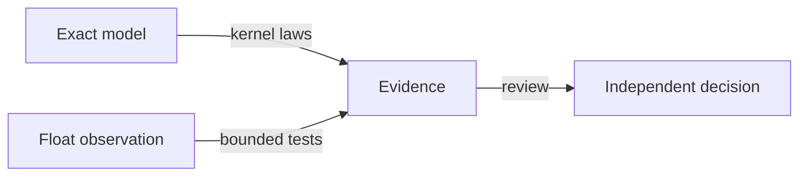

# Telegram numeric contract recovery candidate journal

Observed 2026-10-11T20:29:48.652Z · #fractal-l0 #fractal-l3 #fractal-l6 #fractal-l9 #zk-adr #zero-muda

[Candidate](http://nas-1.tail55d152.ts.net:4100/files/governance/planning/20261011-2029-telegram-numeric-candidate-handoff.json) · [Planning](http://nas-1.tail55d152.ts.net:4100/planning)

## 1. Scope & Trigger

FORMAL_FIX, plan uos/telegram-runtime/20261001-1150, worker codex-telegram-20261011, attempt 3. The all-Telegram request requires truthful formal gates before integration. Engine 5: repair the numeric assurance gap without claiming that IEEE arithmetic satisfies exact field identities. This is a development candidate for actual independent AGY/Claude review; the task remains executing.

## 2. Pre-State Assessment

Engine 7 prior UNKNOWN. Earlier compiler repairs preserved five invalid unrestricted Float claims as unproved propositions. The actual Gleam atlas accepted an empty chart domain, had unbounded chart loops, and could glue out-of-domain sections. The health arithmetic exposed no checked input wrapper. The finite cocycle counterexample exists within ordinary finite numbers, so excluding infinity alone does not repair the claim. Main remains a8adcc6958e5c2378678b56adf9d5d14f44f02b3.

## 3. Execution Detail

### Formal model and preserved falsifiers

Copied the 18 prior compiler repair sources from the canonical workspace only after matching their recorded hashes. Added Telegram_Numeric_Contract: exact rational chart transport on Fin 10, identity/composition/residual/equilibrium laws, and an explicit bounded observation predicate. Added Telegram_Numeric_Counterexamples: five negations of the preserved Float claims, checked using Lean kernel reduction with decide +kernel. No native_decide, sorry or added axiom is used.

### Runtime boundary

Added a bounded atlas observation API: one to ten charts, a finite sample between -1e12 and 1e12, no more than 1000 triples, and an observed residual below the declared 0.0001 tolerance. Added checked transition and gluing guards. Compatible duplicate sections remain accepted. Added health-score wrappers for [0,1] inputs and a finite elapsed-time/sample-count domain. Existing low-level arithmetic kernels remain public with documented preconditions. Corrected comments that incorrectly inferred physical convergence or error halving time from one sampled rate.

### Reproducible tools

Three Node orchestration tools run repository-pinned Lean, Gleam and Erlang without package downloads. Lean compilation and theorem-closure audit run in ordered batches of six with a seven-second per-process bound. Every successful compiled .olean is hashed in the compiler receipt and checked again before and after auditing. Source hashes are also checked. Runtime tests use a private compile-package build and existing dependency metadata. Engine 6 Rete-UL runtime enforcement was not newly established.

## 4. Root Cause Analysis

Engine 1 ACH disconfirmation matrix:

| Hypothesis | Falsifying observation | Result |
|---|---|---|
| H1 Unrestricted Float operations form the exact chart algebra | Kernel-checked finite rounding and overflow counterexamples | Rejected |
| H2 Excluding infinities is sufficient | Finite 0 to 2 to 4 cocycle at 0.1 differs | Rejected |
| H3 An empty chart set verifies a useful atlas | Original code accepts an empty loop | Rejected; bounded entry point refuses |
| H4 Every duplicate section must be rejected | Existing compatible duplicates describe the same local observation | Rejected; preserved compatibility |
| H5 Green compilation proves applicability to the runtime | Exact rational carrier differs from Float carrier | Rejected; scope remains explicit |
| H6 A sampled negative energy difference proves future stability | Finite observation gives no global dynamics hypothesis | Rejected; comments and interfaces state the limit |

Initial proof elaboration, test syntax and overstrict duplicate-policy failures remain preserved in the manifest. No failure was erased to produce a green result.

## 5. Fix Taxonomy

Poka-Yoke: typed finite chart model, checked numeric domains, explicit observation count and residual. Jidoka: empty, oversized and out-of-domain requests refuse instead of returning misleading assurance. Muda: retain the two existing Gleam kernels, use the pinned Lean toolchain, and reuse existing dependency metadata. No new runtime framework or package was installed.

## 6. Patterns & Anti-Patterns Discovered

Engine 4 Devil's Advocate: mutate the lower chart bound and invert the transport scale; independent boundary/positive-control tests must fail. Do not count generated theorem declarations as independent scientific claims. The initial duplicate rejection was an unsupported policy change and was removed; final baseline evidence separates five real missing guards from one passing compatibility case.

## 7. Verification Matrix

Engine 2 STANAG B2 is the working direct-observation assessment, pending independent peer acceptance.

| Surface | Observed result | Bound |
|---|---|---|
| Lean corpus | 73/73 kernel elaborations pass | Exact listed candidate files |
| Axiom closure | 73/73 module audits; 4048 theorem closures use only propext, Classical.choice, Quot.sound or none | Includes generated theorems; not 4048 independent claims |
| New reference/counterexamples | 10 source reference theorems and 5 counterexample theorems | Different carrier; no Float equivalence |
| Gleam runtime | 51/51 focused tests pass | Private component build |
| Original baseline | Five refusal tests fail; compatible duplicate test passes | Confirms boundary defects without inventing a duplicate prohibition |
| Fault mutation | Empty-domain mutation fails one test; inverse-scale mutation fails two | Two distinct laws exercised |
| Full system/release | UNRUN | No production or global admission |

The final bound corpus and axiom logs are var/recovery-runtime/20261011-2028-numeric-bound-lean. Its directory label was allocated before completion; individual receipts contain actual host observation times. Final runtime source/comment check is var/recovery-runtime/20261011-2026-numeric-reviewed-comments. Both intentional mutations and original failures remain available.

## 8. Files Modified

The frozen sibling candidate is d75fe43304baf32f611cf775a510e676535f0dc1, change uuuxtmoltkvqsnwxyvxkswuurmzurrrx, based on main a8adcc69. Its manifest enumerates 27 added/modified files and all 82 verification source/tool inputs: 18 prior repaired Lean modules, two new Lean modules, two Gleam product modules, two new test modules and three tools. Two unchanged legacy test modules and the remaining corpus files are included as verification inputs. No AGY service source was edited.

## 9. Architectural Observations

Engine 5 semantic consistency: exact model and observed runtime are separate contracts. Their relationship is explicit comparison against bounded inputs and residuals, not an unproved equivalence theorem. Gleam remains the policy owner. Lean only produces evidence.

Editable ASCII:
```text
[Exact model] -- kernel laws --> [Evidence]
[Float observation] -- bounded tests --> [Evidence]
[Evidence] -- review --> [Independent decision]
```

Editable Mermaid:


## 10. Remaining Gaps

Actual AGY/Claude review is pending. These modules currently have no production caller of the new checked entry points; no deployed behavior changed. Low-level public kernels still require preconditions. A JavaScript-target numeric run, complete clean repository build, implementation equivalence theorem, whole-system Lyapunov stability and global cohomology proof are not claimed. The five original unrestricted Float statements are false, not awaiting a future proof. Full Telegram service/command/media/Mini/gateway integration and authorized main merge remain open.

### Reproduction

Under current Sa-plan authority and the Gleam bounded launcher, run telegram_numeric_lean.js NEW_OUTPUT START for START 0,6,...,72. Then run telegram_numeric_axioms.js SAME_OUTPUT START in the same sequence. Run telegram_numeric_candidate.js NEW_OUTPUT for the runtime suite; use separate new directories with --baseline, --mutant-empty and --mutant-scale. The latter three intentionally return failure for the expected negative evidence. All output paths must be private absolute directories under canonical var/recovery-runtime.

## 11. Metrics Summary

73 compiled modules, 4048 audited theorem closures, 51 runtime tests and two caught mutations. These are correlated assurance observations, not independent reliability trials. Engine 3 Bayesian Beta-Binomial posterior NOT_ESTIMATED; half-life decay and physical Lyapunov dV/dt UNRUN. No overall feature completion percentage is inferred.

## 12. STAMP & Constitutional Alignment

FMEA S4/O3/Det3 gives RPN36 for false numeric assurance. UCAs: not_provided—missing domain refusal; provided_unsafe—false algebraic proof; wrong_timing—stale source/proof pairing; duration—unbounded chart enumeration. Controls: finite domains, kernel falsifiers, compiled artifact/source hashes, bounded work and independent review. EV ceiling stays 93; no new EV number. The authority remains development only.

## 13. Conclusion

The candidate is implemented, built and executed; independent verification and integration remain pending. Engine 7 Forecast p=.60 of an actual candidate-bound AGY review decision by Horizon 2026-10-11T21:15:00Z. Brier outcome PENDING until that horizon. FORMAL_FIX is not marked complete by this journal.

<details>
<summary>Domain 1 — Metadata, timestamp and Tailscale navigation</summary>

- [ ] **CHK-01-TIME** — Observe synchronized clock evidence and document prefix.
- [ ] **CHK-02-TAIL** — Verify full Tailnet links and actual serving status.
- [ ] **CHK-03-FRACT** — Verify L0–L9 tags and applicable layer mapping.
- [ ] **CHK-04-KM** — Reconcile specification, wiki, ZK and journal links.

</details>

<details>
<summary>Domain 2 — Zero-Muda purity and storage safety</summary>

- [ ] **CHK-05-MUDA** — Verify exclusions against the candidate dependencies.
- [ ] **CHK-06-GRAPH** — Verify the pure BEAM/Hermes graph boundary.
- [ ] **CHK-07-DRIVE** — Preserve the denied OS serial and test real interlocks only in scope.

</details>

<details>
<summary>Domain 3 — Testing Gold Standard and mathematical gates</summary>

- [ ] **CHK-08-C1C8** — Verify all applicable C1–C8 surfaces.
- [ ] **CHK-09-MATH** — Measure the four declared mathematical gates.
- [ ] **CHK-10-9MOD** — Apply relevant unit, system, TDD, BDD, performance, scalability, property, fuzz and chaos checks.
- [ ] **CHK-11-REGR** — Run applicable regressions and bounded observation.

</details>

<details>
<summary>Domain 4 — Cross-language control and observability</summary>

- [ ] **CHK-12-GLEAM** — Observe actual OTP control/supervision behavior.
- [ ] **CHK-13-HERMES** — Observe bounded analysis and authoritative evidence.
- [ ] **CHK-14-ZIGVM** — Verify deterministic execution and descriptor-relative VFS.
- [ ] **CHK-15-MAX** — Observe actual isolated inference when applicable.
- [ ] **CHK-16-OTEL** — Verify clock and nonzero trace/span identity.

</details>

<details>
<summary>Domain 5 — Sovereign governance and standalone Jujutsu</summary>

- [ ] **CHK-17-SOV** — Obtain candidate-bound independent review and authorized admission.
- [ ] **CHK-18-JJ** — Preserve standalone JJ, source ownership and exact candidate identity.

</details>

<details>
<summary>Domain 6 — Provenance extension</summary>

EV ceiling remains 93. EV-94..109 remain NOT_ADMITTED. No new EV number is minted.

</details>

[Previous: formal specification](http://nas-1.tail55d152.ts.net:4100/files/docs/design/20260909-0412-gleam-harness-symbiosis-formal-spec.md) · [Wiki](http://nas-1.tail55d152.ts.net:4100/wiki) · [ZK](http://nas-1.tail55d152.ts.net:4100/zk) · [Cockpit](http://nas-1.tail55d152.ts.net:4100/)

UOS footer: document and component evidence do not grant system admission.

[Previous ledger](http://nas-1.tail55d152.ts.net:4100/files/docs/journal/20261001-1202-telegram-browser-admission-recovery.md) · [Next: planning status](http://nas-1.tail55d152.ts.net:4100/planning)

