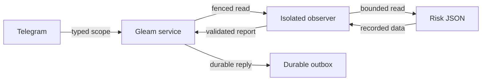

# 20261024-2355 Telegram recorded FMEA evidence

Observed 2026-10-24T23:56:53.680Z. #fractal-l0 #fractal-l1 #fractal-l3 #fractal-l4 #fractal-l9 #zk-adr #zero-muda

[Checkpoint](http://nas-1.tail55d152.ts.net:4100/files/governance/planning/20261024-2355-telegram-fmea-checkpoint.json) · [Coverage](http://nas-1.tail55d152.ts.net:4100/files/governance/planning/20261024-2355-telegram-command-reachability.json) · [Plan](http://nas-1.tail55d152.ts.net:4100/files/docs/design/20261024-1044-telegram-completion-critical-path.md)

## 1. Scope & Trigger

### Requirement
Continue the full Telegram/direct-tool goal by replacing the missing FMEA backend with actual recorded risk evidence. COMMAND_IMPL attempt12; frozen candidate509d993f1496d7f74425f42798d523f28c4838f3. Scope remains77command literals, nine non-command families, real browser/live acceptance, independent release/global admission and applicable main integration.

### Outcome
/fmea, task-specific /fmea and query_fmea now read configured-plan assessments through the bounded observation path. Production source enrollment is explicitly pending; default configuration remains unconfigured rather than inventing risk data.

## 2. Pre-State Assessment

### Evidence before the change
The legacy cognitive formatter appended fixed Zero Critical text. Its native FMEA query returned zero on SQLite errors and always emitted an empty failure_modes array. Reconnecting that path would create false assurance. The previous accepted health candidate had25reachable command literals;52were missing. Existing canonical risk JSON held raw failure modes, scores, timestamps and plan/task identities.

### Uncertainty
These files contain engineering assessments, not measured incident frequencies. Current-file identity cannot prove referenced evidence validity. No calibrated Kalman prior was computed.

## 3. Execution Detail

### Implementation
Added a pure Gleam report decoder/validator and isolated reader. Extended the existing regular-file mechanics and hash-bound child launcher. Added strict deterministic UTC parsing, trusted source configuration, typed command/direct-tool routes and service reply handling. The source is bounded to1MiB,1000records and32modes per record; output is at most32768bytes. Default reporting returns top5task assessments by maximum RPN, then task ID, with truncation explicit. A task selector retrieves a specific configured-plan record.

### Agent work
AGYcfc23bc2 coding job timed out with an empty response and no edits; the failed job remains recorded. Codex completed implementation. Actual AGY551f438d independently reviewed the57917byte exact diff/support packet in29.11seconds and returned PASS. No broad coding-job retry was launched. CLI help exposed auto and permission options, but the cause of coding stalls remains a hypothesis, not an established permission diagnosis.

## 4. Root Cause Analysis

### ACH matrix
H1: existing FMEA output accurately represents no failures. Disconfirmed by query_int converting database failures to zero and the fixed success formatter. H2: direct reads of recorded assessment data can provide a truthful FMEA view. Supported by schema/arithmetic checks, changing-source service evidence and a live71task source observation. H3: task text must be interpreted as a filesystem path. Disconfirmed: the selector remains a data identifier under the configured plan; source paths are launcher-owned.

### Failures corrected
Initial compilation found the newly appended config field missing from older generated test fixtures and a reserved Erlang atom in a fixture; both were corrected. Initial tests exposed an obsolete catalog expectation that FMEA was model advice and an incorrect assumption that a valid task identifier was a path override. Tests now assert recorded-observation classification and actual source/plan override refusals. The risk active-check detected source hash drift after edits; its HOLD receipt was preserved, source hashes re-observed, and the check passed.

## 5. Fix Taxonomy

### Poka-Yoke
Validate raw score ranges, exact RPN multiplication, unique task/mode identities, bounded text, UTC windows, selected plan and output bounds. Source arguments never come from Telegram. Plain JSON data remains data.

### Jidoka and Muda
Missing, invalid, stale/future and unconfigured evidence stay visible. Freshness labels do not grant authority. Existing current_read checks fence the observation before/after and the guardian bounds/reaps the child. Reuse existing store/outbox, source mechanics and dispatcher; no new database, scheduler, daemon or model call.

## 6. Patterns & Anti-Patterns Discovered

### Devil's Advocate
Stale data may be useful but must not masquerade as current assurance; the output reports age and fresh/stale/future labels. A zero-row or failed source is unavailable, never zero risk. Foreign-plan rows are not projected. A changing source must be re-observed; the service scenario reads RPN36, changes the file, then returns RPN60.

### Limits of review
AGY described ancestor checks positively. The precise implementation checks ancestors before opening and compares opened/named file identity afterward; it is not descriptor-relative atomic traversal against a privileged concurrent writer. The acceptance record retains that narrower guarantee.

## 7. Verification Matrix

### Candidate-bound development evidence
Admiralty B2 scoped evidence:63unit/native tests,8service scenarios and2configuration/authority regressions pass,73distinct checks. Six FMEA service scenarios cover current/changed data, stale reporting, caller-scope refusal, corrupt source, missing source, unconfigured source and missing-task isolation. Health and managed expired-approval recovery also pass at the candidate.

### Falsification and real data
Two isolated mutations, removed RPN validation and removed plan filtering, were KILLED by the tests. Original bytes were restored, rebuilt and the9projection tests passed again. A real guarded read of the canonical risk file found71tasks and returned COMMAND_IMPL with3modes/RPN36, fresh at observation, bound to source SHA2564c5f8eaa29875a3f217ea69c5da319fb568209d3a6778a09b1e4ad29ad7c9772. No live Telegram transport, full-system suite or new formal theorem is claimed.

## 8. Files Modified

### Source accounting
The candidate changes19files: report/reader, strict timestamp mechanics, existing file/binding integration, command/catalog/tool/service routes, test runner/build binding, six test files and timestamped safety analysis. The manifest binds97canonical source pairs and645files, with1untraversed dependency symlink. Five generated independent fixture modules were additionally adapted to the appended optional config field in the isolated verification package; they are not canonical source matches.

### Retention
Bookmark integration/telegram-fmea-20261024-2355 retains509d993f. Empty child53b66556 is ready for remaining backends. Main was not merged. Failed build/test/code-job receipts are retained alongside the final passing receipts.

## 9. Architectural Observations

### Control and observation flow
Gleam owns typed scope and current authority; the isolated worker reads and validates evidence; the service persists a normal reply in the existing outbox. The FMEA file is an observation source, not execution authority.

Editable ASCII:
```text
[Telegram] --typed scope--> [Gleam service] --fenced read--> [Isolated observer]
[Gleam service] <--validated report-- [Isolated observer]
[Isolated observer] --bounded read--> [Risk JSON]
[Isolated observer] <--recorded data-- [Risk JSON]
[Gleam service] --durable reply--> [Durable outbox]
```

Editable Mermaid:


### Consistency
The source remains recorded engineering evidence with explicit NOT_GRANTED. Category/sheaf consistency is an architectural observation; no new mathematical proof is asserted.

## 10. Remaining Gaps

### Telegram scope
51command literals still lack routes.26reachable literals do not prove complete feature acceptance.13MiniAppbackends and real browser testing, sevenmedia types, gateway, provider availability, authorized live Telegram, reviewed release/global admission and stabilized applicable main integration remain.

### Slice residuals
Production launcher enrollment of a concrete canonical risk source remains release work. Source windows do not validate underlying evidence. Generic Telegram unavailable responses intentionally do not reveal whether failure was a missing task or malformed source. The coding-job stall needs a bounded execution trace before changing dispatcher permission behavior.

## 11. Metrics Summary

### Measured
73distinct final focused checks passed,0failed;2mutants killed,0survived; restored9test projection baseline passed. One independent AGY review passed; one coding job discarded with no source edits. Reachability26/77=33.77%, not feature completion. Runtime61/71 and release25/33task counts remain unchanged.

### Forecast accounting
The prior p=.55 forecast for one further truthful command family by00:10 was achieved by this scoped FMEA acceptance; Brier=.2025 for one observation. No calibrated Bayesian posterior, Kalman improvement or Lyapunov derivative was measured. The journal linter establishes document structure only, not execution of seven analysis engines.

## 12. STAMP & Constitutional Alignment

### Safety controls
The2352safety analysis records all4UCA classes and raw FMEA estimates. Its1..10engineering analysis scale is distinct from the existing1..5assessment schema consumed by the report. Source scope, shape and arithmetic constraints prevent false operational claims; current task/runtime fencing and process bounds preserve observation lifecycle control.

### Authority
Sa-plan COMMAND_IMPL attempt12/coordinator12/workspace2 remains execution authority. No native Git mutation, EV increment, production release or global admission occurred. A reviewer verdict and source digest do not authorize deployment.

## 13. Conclusion

### Goal contribution
The FMEA command family now exposes actual recorded risk data through the Telegram/direct-tool service, with positive, negative, changing-source and independent review evidence. The full goal remains active.

### Next falsifiable forecast
Forecast p=.60,Horizon2026-10-25T00:20:00Z: at least one additional missing operational command reaches a truthful backend with positive/refusal evidence. Brier=(0.60-outcome)^2 will be recorded at that horizon. This is uncalibrated and not a delivery guarantee.

<details><summary>Verification domain 1</summary>

- [ ] CHK-01 Timestamp — scoped evidence above; no blanketPASS
- [ ] CHK-02 Tailnet navigation — scoped evidence above; no blanketPASS
- [ ] CHK-03 Fractal scope — scoped evidence above; no blanketPASS
- [ ] CHK-04 Knowledge links — scoped evidence above; no blanketPASS

</details>

<details><summary>Verification domain 2</summary>

- [ ] CHK-05 Dependency exclusions — scoped evidence above; no blanketPASS
- [ ] CHK-06 Pure graph boundary — scoped evidence above; no blanketPASS
- [ ] CHK-07 Storage safety — scoped evidence above; no blanketPASS

</details>

<details><summary>Verification domain 3</summary>

- [ ] CHK-08 C1-C8 — scoped evidence above; no blanketPASS
- [ ] CHK-09 Math gates — scoped evidence above; no blanketPASS
- [ ] CHK-10 Test modalities — scoped evidence above; no blanketPASS
- [ ] CHK-11 Regression — scoped evidence above; no blanketPASS

</details>

<details><summary>Verification domain 4</summary>

- [ ] CHK-12 GleamOTP — scoped evidence above; no blanketPASS
- [ ] CHK-13 Hermes — scoped evidence above; no blanketPASS
- [ ] CHK-14 ZigVM — scoped evidence above; no blanketPASS
- [ ] CHK-15 MAX — scoped evidence above; no blanketPASS
- [ ] CHK-16 Trace correlation — scoped evidence above; no blanketPASS

</details>

<details><summary>Verification domain 5</summary>

- [ ] CHK-17 Independentreview — scoped evidence above; no blanketPASS
- [ ] CHK-18 Jujutsu — scoped evidence above; no blanketPASS

</details>

Provenance: EV>93 NOT_ADMITTED.


[Previous](http://nas-1.tail55d152.ts.net:4100/files/docs/journal/20261024-2059-telegram-current-task-bridge.md) · [Next: completion plan](http://nas-1.tail55d152.ts.net:4100/files/docs/design/20261024-1044-telegram-completion-critical-path.md)

UOS footer: scoped component evidence is not admission.
