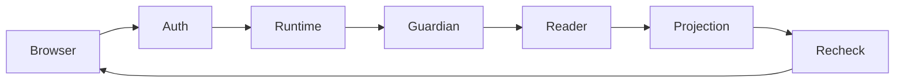

# 20261025-0150 — Telegram Mini App evidence reads and acceptance

Observed 2026-10-25T01:52:08.029Z. #fractal-l0 #fractal-l3 #fractal-l4 #fractal-l9 #zk-adr #zero-muda

[Checkpoint](http://nas-1.tail55d152.ts.net:4100/files/governance/planning/20261025-0149-telegram-mini-evidence-checkpoint.json) · [Plan](http://nas-1.tail55d152.ts.net:4100/files/docs/design/20261024-1044-telegram-completion-critical-path.md)

## 1. Scope & Trigger

The operator requested full Telegram functionality with minimal waste and visible completion tracking. This packet executes under MINI_API_IMPL attempt1 in canonical Sa-plan. It adds two read-only Mini App data paths—FMEA assessments and candidate verification records—while preserving all remaining command, Mini App, media, gateway and release obligations. Candidate50ce74fff6c87161077f2f4874562503af719137 is development evidence, not production admission.

## 2. Pre-State Assessment

### Observed baseline

Accepted parent76360aa3 had14 public/authenticated page shells and one real Tasks read path;13backends remained unavailable. The21-file baseline was rechecked and its8boundary tests rerun. Command reachability remained32/77, with45routes unfinished. The canonical runtime/release plans reported61/71 and25/33 completed tasks; those coarse counters do not measure feature completion.

### Prediction limits

Kalman state, Bayesian reliability calibration and a global completion ETA are unmeasured. Earlier p=.7 forecast required both the baseline and a real adapter packet by01:35Z; the packet launched01:36Z, so outcome0 and Brier.49. Earlier p=.55 for an additional accepted flow by01:25Z also failed, Brier.3025. Management repairs do not satisfy a feature-delivery forecast.

## 3. Execution Detail

### Implementation

Reused ten exact files from independently accepted command candidate0c9e0ddf; JJ byte comparisons precede copying into the owned Mini workspace. Server-owned FMEA source/plan and verification source/hash/candidate configuration feed existing bounded readers. Authenticated requests invoke the existing guardian and isolated Erlang reader with3second/32768byte bounds. The new pure display projection keeps engineering-estimate limitations, source digests, candidate identity, explicit truncation, recorded outcomes and stale evidence. It does not run verification gates.

### Verification and agent execution

Two distinct actual AGY Gemini4ArgonHigh coding requests timed out at180and120seconds with no usable source. Both were collected as INCOMPLETE_OR_FAILED and jobs discarded. Codex implemented the packet; actual AGY23183256 independently reviewed the frozen candidate in47.35seconds and returned PASS. The review's pending negative-browser residual was then satisfied on the same candidate. No identical retry, invented peer ACK or permission weakening occurred.

## 4. Root Cause Analysis

### ACH disconfirmation matrix

| Hypothesis | Observation | Result |
|---|---|---|
| H1: Expired lease shown active because task claim remained valid | Private fixture lease was1ns; actual HTTP rendered executing after expiry | Disconfirmed as authority explanation |
| H2: Seconds/nanoseconds comparison caused brief stale display | Source rounded current time to seconds; exact comparison fixes before/equal/after tests and HTTP | Supported |
| H3: Random FMEA row order was source ranking | Large BEAM dictionary iteration scattered independent fields; explicit API ordering groups details | Disconfirmed; serialization order was cause |
| H4: Backend failure means missing implementation | Deliberately absent source and wrong pinned digest reach integrated readers and refuse | Disconfirmed; UI message now covers unavailable/configuration states |
| H5: Missing full-permission flag caused AGY timeouts | Existing dispatcher already has bounded permission flags; review succeeds with the same authority path | Disconfirmed; coding-stall cause remains unresolved |

Preserved early receipts include a test grouping syntax error, an OCaml parenthesis error and the real HTTP lease failure. None was counted as passing evidence.

## 5. Fix Taxonomy

Poka-Yoke: server-only source selection, candidate/hash binding, strict projection envelopes, bounded fields, actual record age and exact nanosecond lease comparison. Jidoka: malformed configuration, source failure, wrong identity and mismatched artifact yield refusal or empty unavailable data. Muda: reuse existing readers, authenticated boundary, native guardian, browser controller, Sa-plan and the same development harness; add no orchestration service. Two unsuccessful coding experiments changed the next approach to proven bounded review.

## 6. Patterns & Anti-Patterns Discovered

Devil's Advocate: a fresh HTTP response could launder stale evidence into healthy status. The negative test uses an expired real candidate record and observes3STALE,15UNKNOWN and0recordedpasses; the pure stale fixture likewise cannot render RECORDED_PASS. Popperian falsifiers include wrong candidate, wrong source hash, missing source, wrong user, malformed JSON, old/future transport timestamps and expired authorization. Each is a refusal/empty-state obligation, not optional polish.

A bounded summary must disclose omitted detail. FMEA shows at most5assessments and3highest-RPN modes per assessment, with explicit selected/total and omitted counts. This is not full drill-down functionality.

## 7. Verification Matrix

### Admiralty B2 scoped evidence

| Surface | Current candidate result | Practical limit |
|---|---|---|
| Unit/native boundary |18passed:8baseline and10new tests | Not the full system suite |
| Authenticated HTTP |33positive/refusal checks plus2backend failures passed | Synthetic signed identity; private service |
| Real Chromium |6positive/identity/SDK scenarios plus2backend-failure scenarios passed | Desktop/mobile fixture, not live Telegram WebApp |
| Source binding |31compiled source/test hashes match;10reused sources match accepted JJ revision | Artifact observations are development-scoped |
| Independent review |AGY23183256 PASS exact50ce74ff | Does not grant runtime admission |
| Visual inspection |Mobile FMEA, desktop verification and unavailable screenshots inspected | Long FMEA remains a summary view |

The61focused checks are counted once on the final candidate. Earlier runs and repeated regressions are not added. Inherited warnings remain: Erlang deprecated catch, record type naming and OCaml mtime.clock.os deprecation. The journal linter is a structural check, not execution of all seven verification engines.

## 8. Files Modified

Candidate50ce74ff contains19files: ten reused reader/FFI modules, mini_api/mini_runtime/mini_app_routes edits, new mini_evidence and its tests, bounded builder/HTTP/browser tests, and timestamped safety analysis. The full list and31source hashes are in the checkpoint and artifact manifest. Separate canonical reporting changes update this journal, the checkpoint and current critical-path JSON/Markdown. Bookmark integration/telegram-mini-evidence-20261025-0151 preserves the candidate; its child is empty. Main is unchanged.

## 9. Architectural Observations

Gleam retains authentication, scope and time policy. Bounded native workers perform IO; pure Gleam projects observed records. Every read remains observation-only. The following equivalent ASCII and Mermaid sources describe the relevant path; they are explanatory, not formal proofs.

```text
Browser -> Auth -> Runtime -> Guardian -> Reader -> Projection -> Recheck -> Browser
```



No new sheaf/category-theoretic theorem, runtime scheduler or cryptographic reviewer identity is claimed. Existing stable-handle file mechanics and current authorization remain separate from truth of upstream engineering assessments.

## 10. Remaining Gaps

Eleven Mini backend paths remain: dashboard,health,alerts,immune,inference,chat,config,containers,federation,telemetry,zenoh. Full page interactions and verification gate execution remain open even on pages with read paths. Also pending:45command literals,7media types plus gateway, working privacy-compliant free inference route, explicitly authorized live recipient, live WebApp/Telegram acceptance, same-candidate integrated checks, independently evaluated release/admission and applicable main integration. No task-family completion is asserted.

## 11. Metrics Summary

Mini pages with scoped read paths increase1to3of14; this is not a percentage of all Mini functionality. Command reachability remains32/77=41.56%. Runtime61/71 and release25/33 remain unchanged because MINI_API_IMPL is still executing. Final candidate61focused checks;2AGY coding timeouts;1successful47.35second source review; no accepted AGY code from the failed packets. Bayesian Beta-Binomial calibration, half-life decay and Lyapunov dV/dt are unmeasured. The current source and tests support local behavior only.

## 12. STAMP & Constitutional Alignment

### Four unsafe-control-action types

Not provided: missing or withheld evidence leaves the operator uninformed—show explicit unavailable/UNKNOWN and counts. Unsafe provided: counterfeit healthy or admission labels—retain candidate/hash/scope checks and recorded states. Wrong timing: stale evidence or expired task lease appears current—keep record age and exact lease comparison. Too long: access or subprocess persists beyond authority—retain signature expiry, post-read recheck, finite guardian and systemd process bounds.

Raw FMEA1–5 analyst estimates: misleading evidence S4/O3/D3 RPN36; unauthorized read S4/O2/D3 RPN24; backend blockage S3/O2/D2 RPN12. Residual source-author truth and full live acceptance remain. Existing EVceiling93, standalone JJ, denied storage serial and exclusion rules remain intact. No package install, external send, production deployment or main mutation occurred.

## 13. Conclusion

The two read adapters, lease precision fix and deterministic display are independently reviewed and observed in development. Precommitted p=.65 forecast in the selection journal required a real Mini adapter built/tested by02:00Z; achieved before01:44Z, outcome1,Brier.1225. This is one uncalibrated event, not a reliable delivery model. Forecast p=.6, Horizon 2026-10-25T02:10:00Z: one additional missing Mini read backend is built and passes positive/refusal tests; Brier=(.6-outcome)^2 will be recorded afterward. Full Telegram restoration remains the active goal.

<details><summary>Verification domain 1</summary>

- [ ] CHK-01 Timestamp — scoped evidence above; no blanketPASS
- [ ] CHK-02 Tailnet navigation — scoped evidence above; no blanketPASS
- [ ] CHK-03 Fractal scope — scoped evidence above; no blanketPASS
- [ ] CHK-04 Knowledge links — scoped evidence above; no blanketPASS

</details>

<details><summary>Verification domain 2</summary>

- [ ] CHK-05 Dependency exclusions — scoped evidence above; no blanketPASS
- [ ] CHK-06 Pure graph boundary — scoped evidence above; no blanketPASS
- [ ] CHK-07 Storage safety — scoped evidence above; no blanketPASS

</details>

<details><summary>Verification domain 3</summary>

- [ ] CHK-08 C1-C8 — scoped evidence above; no blanketPASS
- [ ] CHK-09 Math gates — scoped evidence above; no blanketPASS
- [ ] CHK-10 Test modalities — scoped evidence above; no blanketPASS
- [ ] CHK-11 Regression — scoped evidence above; no blanketPASS

</details>

<details><summary>Verification domain 4</summary>

- [ ] CHK-12 GleamOTP — scoped evidence above; no blanketPASS
- [ ] CHK-13 Hermes — scoped evidence above; no blanketPASS
- [ ] CHK-14 ZigVM — scoped evidence above; no blanketPASS
- [ ] CHK-15 MAX — scoped evidence above; no blanketPASS
- [ ] CHK-16 Trace correlation — scoped evidence above; no blanketPASS

</details>

<details><summary>Verification domain 5</summary>

- [ ] CHK-17 Independentreview — scoped evidence above; no blanketPASS
- [ ] CHK-18 Jujutsu — scoped evidence above; no blanketPASS

</details>

Provenance: EV>93 NOT_ADMITTED.


[Previous](http://nas-1.tail55d152.ts.net:4100/files/docs/journal/20261024-2059-telegram-current-task-bridge.md) · [Next](http://nas-1.tail55d152.ts.net:4100/files/docs/design/20261024-1044-telegram-completion-critical-path.md)

UOS footer: component evidence is not admission.
