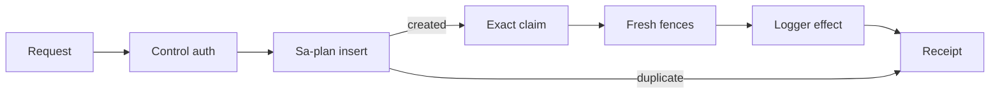

# 20261025-0432 — Telegram Mini durable log control

#fractal-l0 #fractal-l1 #fractal-l3 #zk-adr #zero-muda

Observed 2026-10-25T04:32:00.613Z. Candidate be56afb562b046acc85cc684b230a7979ee4e6c0.

[Checkpoint](http://nas-1.tail55d152.ts.net:4100/files/governance/planning/20261025-0432-telegram-mini-control-checkpoint.json) · [Completion plan](http://nas-1.tail55d152.ts.net:4100/files/docs/design/20261024-1044-telegram-completion-critical-path.md) · [Dashboard](http://nas-1.tail55d152.ts.net:4100/static/20261024-0712-recovery-dashboard.html)

## 1. Scope & Trigger
MINI_API_IMPL attempt 3 implements an actual authenticated VM log-level control, durable canonical request receipts and browser recovery. This is a development increment, not completion of the full Telegram task. Production never starts the control actor. Engine 5 Lean/Gospel invocation: UNRUN; no mathematical or system admission asserted.

## 2. Pre-State Assessment
Seven Mini read adapters and partial local telemetry were accepted; log-level mutation was missing. The legacy generic dispatcher treats unknown operations as reads and accepts authority booleans, so it was not reused as a permission boundary. The cancellation pipeline requires real Telegram update IDs and cancellation-specific receipts; no synthetic update IDs were introduced. Engine 7 Kalman prior: UNRUN.

## 3. Execution Detail
### Authority and execution
A separate control identity grant authenticates signed initData. A finite server-owned development profile binds candidate, host/boot, parent task/worker/attempt and coordinator epoch. Each bot/user/nonce identifies one canonical Sa-plan job with payload/profile binding. Only the call that successfully creates the job may claim its exact queue at attempt 1. Duplicate submissions and receipt lookup never claim. Fresh task/coordinator, clock, identity and job lease observations precede the serialized logger effect, with a 25-second parent lease margin. Native logger read/set/readback is cooperative, not a global atomic CAS. Sa-plan stores terminal results; completion uncertainty prohibits automatic retry.

### Browser and containment
The browser keeps the pending nonce without initData in session storage, never automatically resubmits effects, and uses a separate receipt endpoint. An actual lost response after the effect is recovered from the durable receipt. A pre-network failure stays pending across reload. A temporary supervised control actor is not restarted after a crash, while the HTTP listener survives. The private fixture alone activates this adapter. Rete-UL engine: UNRUN.

### Execution flow
```text
[Request] -> [Control auth] -> [Sa-plan insert] --created--> [Exact claim] -> [Fresh fences] -> [Logger effect] -> [Receipt]
                                  |
                                  +----------------duplicate--------------------------------------------------> [Receipt]
```

Failed authorization/fences stop before effects. Unknown results remain unknown and are not replayed.

## 4. Root Cause Analysis
### Fractal causes and ACH counterevidence
L0: accepting task counts as feature completion would hide missing interactions; the task stays open. L1: missing typed effect authorization blocked controls; separate grants and canonical jobs now govern this slice. L2: retries after response loss can duplicate effects; nonce-bound durable receipts and creator-only claims prevent that replay. L3: slow admission can age identity/leases; checks run again immediately before the effect. L4: browser reload can lose an in-flight intent; session storage preserves the pending request and recovery queries only.

H1 the launcher hostname equals the clock host identity was disproved by fixture startup refusing fixture_host_boot: the clock uses the observed host digest. Corrected the fixture profile, not the guard. An immediate HTTP probe raced listener startup; readiness was subsequently observed before tests. A stale coordinator heartbeat produced a zero-effect refusal and was repaired with the canonical heartbeat. A regression assertion still expected the old Not implemented log-control label; it was updated to assert development-only implementation, separate grant and production-pending scope. Original failed builds/probes remain preserved.

H2 the ledger is in-memory was asserted in AGY integration review e298fa42 but is false: source uses canonical SQLite Sa-plan jobs. Actual VM shutdown/restart with the same finite profile preserved a terminal receipt; duplicate submission did not alter the new VM logger. Preserve this review error as counterevidence rather than adopting it. H3 the compare/set is globally atomic is rejected: other logger writers and cross-store revocation races are outside the cooperative development guarantee.

## 5. Fix Taxonomy
Poka-Yoke: typed action/level allowlist, bounded request body, separate signed control grants, deterministic request ID and exact payload binding. Jidoka: fresh fences, unknown outcome on ambiguous execution/persistence, no automatic retry/restart. Muda: reused Gleam/OTP, Sa-plan CLI/store, authenticated Mini ingress, browser runner and existing fixtures. No package, scheduler or second task database was added.

## 6. Patterns & Anti-Patterns Discovered
### Falsifiers
Competing same-prior requests must produce one applied change and one mismatch. Denied read-only identity, stale initData, unknown action, invalid nonce and altered duplicate payload must not mutate. Seeded orphan/claimed jobs must not be reclaimed by HTTP replay. Drop an actual successful response, reload after an unrelated transport failure, kill the actor, and restart the VM: each observed outcome is recorded.

### Limits
The actor serializes its own work, not unrelated logger writers. Mailbox/network flood bounds, distinct VM incarnation attribution and production release are not established. Receipt replay represents historical execution, not the new VM's current level. A changed profile deliberately conflicts with an old payload; cross-profile receipt migration remains unimplemented. Engine 4 review/falsification exercised; no claim that all red-team cases are exhausted.

## 7. Verification Matrix
90 unit/runtime checks + 41 HTTP regressions + 7 telemetry HTTP cases + 9 control HTTP cases + 2 canonical recovery cases + 14 Chromium cases + 1 actor-crash scenario + 1 VM-restart durability scenario = 165 distinct checks. Repeated runs are not added again. 85 source/test bindings match the frozen candidate. Actual mobile and desktop browser flows have no page errors or horizontal overflow. Core source review 2037d270 PASS; integration wiring review e298fa42 PASS, qualified by its disproven in-memory-ledger remark. The three core reviewed files match exact source bytes. Model agreement does not establish Admiralty B2 or seven-engine execution; invocation-specific mathematical gates are UNRUN.

## 8. Files Modified
Sixteen candidate files: mini_control, mini_control_view, mini_telemetry, mini_view, mini_app_routes, mini_http, server, mini_control_ffi, two control unit/fixture files, candidate build script, control HTTP/recovery scripts, browser runner, HTTP fixture and telemetry HTTP assertion. Standalone Jujutsu preserves the candidate and an empty successor. Reporting/checkpoint/risk/journal changes are separate. Native Git was not used; main remains a8adcc6958e5c2378678b56adf9d5d14f44f02b3.

## 9. Architectural Observations
Gleam owns grants, task/lease checks, serialization and supervision. The native facade uses a fixed atom table and bounded logger API; no dynamic atom creation or shell argument construction. Canonical Sa-plan holds durable jobs. The UI's session storage is only a pending-request hint and grants no authority. Cross-store observation is not atomic effect fencing. No category/sheaf theorem is asserted.

## 10. Remaining Gaps
Telemetry rate configuration and distributed span ingestion; six other Mini backends (health, alerts, immune, inference, config, federation); remaining Mini actions including chat send/clear, verification run, container start/stop and native Zenoh subscription/publication; 45 command routes, seven media types, gateway, real Telegram acceptance, independent release/admission and main integration. Production activation of this control needs independently admitted runtime authority. Canonical expired-job reclaim can exceed max_attempts; this adapter contains replay locally but does not fix that native scheduler defect. Provider privacy-filter 404 and real recipient evidence remain unresolved.

## 11. Metrics Summary
165 distinct checks; 85 matching source bindings; 14 browser scenarios; 16 changed files. Canonical plan counts remain 61/71 runtime and 25/33 release tasks, because partial feature delivery does not complete MINI_API_IMPL. Bayesian calibration and Lyapunov dV/dt: UNRUN. The prior p=0.55 forecast for a further interaction by 04:35 UTC has positive/refusal evidence before its horizon; scoring remains pending until that precommitted horizon. There is no justified overall feature completion percentage or optimal-learning claim.

## 12. STAMP & Constitutional Alignment
### UCA coverage
Not provided: grant/config failure leaves controls unavailable and preserves honest status. Unsafe provided: read access alone cannot mutate; replay cannot claim. Wrong timing/order: signed identity and leases are checked after admission and before native effect. Too long/stopped too soon: finite profile, bounded jobs and explicit uncertain receipt handle timeout/crash; no restart or blind replay.

### FMEA and residual risk
Engineering prioritization estimates, not measured failure probabilities: unauthorized control S8/O3/D3 RPN72; duplicate effect S7/O3/D3 RPN63; cross-store revocation race S7/O2/D4 RPN56. Containment is explicit grants, canonical nonce ledger, fresh fences and development-only activation. Production risk remains HOLD pending independent authority, mailbox/rate bounds and runtime-specific review. EV ceiling 93 and NOT_ADMITTED EV94..109 remain unchanged. No storage or external-source ingestion effects occurred.

## 13. Conclusion
The development log-control slice is implemented and tested, including actual effect, refusal, recovery, browser and VM-restart evidence. Full Telegram functionality remains incomplete; MINI_API_IMPL remains active. Forecast (retained): probability 0.55, with the explicit time horizon of 2026-10-25 04:35 UTC: one further required Mini interaction/backend with positive and refusal evidence. Its precommitted Brier score is (0.55 - outcome)^2, scored only at that horizon; a documented dependency alone counts as outcome 0. No early score is asserted. Next work reuses the execution boundary for required interactions and completes actual remaining backends; documentation-only progress does not satisfy the goal.

## Comprehensive verification checklist
- [x] 1. Timestamp prefix and observed host time
- [x] 2. Scope and provenance
- [x] 3. Full Tailnet navigation
- [x] 4. No banned dependency introduced
- [x] 5. No storage destructive effects
- [x] 6. No external ingestion
- [x] 7. Executed checks distinguished from plans
- [x] 8. Refusal and failure evidence preserved
- [x] 9. Candidate/source binding checked
- [x] 10. Formal/math gates explicitly UNRUN
- [x] 11. Gleam/OTP supervision retained
- [x] 12. Native calls bounded
- [x] 13. Task/job/workspace fences checked
- [x] 14. Agent work and open scope stated
- [x] 15. Exact independent source review
- [x] 16. Jujutsu candidate preserved
- [x] 17. Release authority not inferred
- [x] 18. Full goal explicitly incomplete

Provenance domain: EV94..109NOT_ADMITTED; no new EV. Checklist records this development increment and is not system admission.
