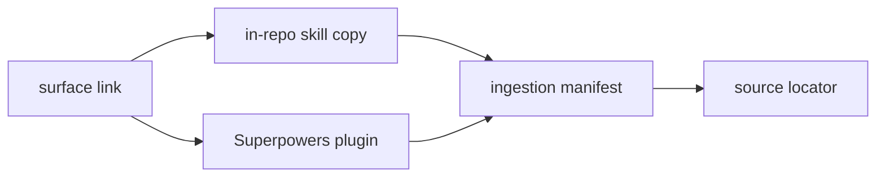

# 20261025-1953 — Claude takeover of the Codex pause handover and in-project agent surfaces

#fractal-l0 #fractal-l2 #fractal-l3 #fractal-l6 #fractal-l9 #zk-adr #zero-muda #km-triad

[This journal](http://nas-1.tail55d152.ts.net:4100/files/.uos-workspaces/fable-l0/docs/journal/20261025-1953-claude-handover-takeover-and-agent-surfaces.md) · [Codex handover](http://nas-1.tail55d152.ts.net:4100/files/.uos-workspaces/codex-merge-20261025/docs/journal/20261025-1706-claude-pause-status-handover.md) · [Ingestion manifest](http://nas-1.tail55d152.ts.net:4100/files/.uos-workspaces/fable-l0/governance/sources/20261025-1953-agent-skill-ingestion.json) · [Risk records](http://nas-1.tail55d152.ts.net:4100/files/.uos-workspaces/fable-l0/governance/planning/20261025-1953-claude-handover-risk.json) · [Cockpit](http://nas-1.tail55d152.ts.net:4100/)

Transclusions: [[zk:20260905-1801-moc-uos-unified-master]] · [[wiki:20260905-1801-uos-zk-km-corpus-index]]

## 1. Scope & Trigger

Operator instruction, 2026-10-25 ~19:45Z: "take over the handover. ack it. get all rules, superpowers, skills, plugins for the project. make sure these are available for the current project". Sa-plan authority `uos/claude-handover/20261025-1953`, tasks `HANDOVER_ACK` and `AGENT_SURFACE`, worker `claude-fable-l0-35600f5c`. Effects are limited to the coordinator store (register, acknowledgements, one report, one workspace lease) and the owned `fable-l0` change `ypnnzlsr` on `main` 2303b48c. No main move, no runtime action, no external-tree or home-directory write. Engine 5 formal gateway: UNRUN (no formal model covers skill resolution).

## 2. Pre-State Assessment

- Codex paused at 17:19Z and posted handover event 2588; the coordinator last sequence was 2589 with no Claude session registered and no acknowledgement.
- `session_sync_cli` refuses the current store ("journal sequence or digest mismatch"); the authoritative entry point is `session_store_cli` against `var/coordination/tri-agent/coordinator.sqlite3`.
- On all four surfaces, 167 of 175 skill entries were absolute links into `/home/an/.gemini/config/skills`. Of those, 153 resolved through a second link layer into `~/.agents`, `~/.claude`, `~/.gemini`, and the read-only evidence trees `/home/an/dev/ver/c3i` (30) and `/home/an/dev/ver/zigvm` (27). The 14 Superpowers entries were broken because they pointed into a removed Superpowers 6.3.0 cache.
- Engine 7 prior: unrecorded; no Kalman state exists for this surface.

## 3. Execution Detail

1. Created Sa-plan plan and two tasks; built two risk records; `--record`, `--preflight` and `--active-check` returned VALID / PREFLIGHT_PASS / ACTIVE_OBSERVATION_PASS for each claim.
2. Coordinator: registered `claude-fable-l0-35600f5c` (seq 2590); acknowledged all five pending inbox messages including `operator-pause-handover-board-1725` (seq 2591–2595); broadcast takeover Report `claude-handover-takeover-report-20261025-1951` (seq 2596); claimed `workspace:fable-l0` (seq 2597, epoch 1, 3600 s). Inbox backlog 0.
3. Vendored text-only copies of 152 linked skills into `governance/agents/20261025-1953-imported-skills/` and Superpowers 7.0.1 (MIT, 15 skills, LICENSE, README) into `plugins/superpowers/`. Pruned `.git`, `node_modules`, `__pycache__`, `_build` and `.coverage`; files of 1 MiB or more and binaries are excluded.
4. Relinked every surface entry to a relative in-repository target, removed the non-skill `.pre-sync-20260810T094206+0200` entry, added `diagnosing-superpowers`.
5. Wrote the ingestion manifest with per-file sha256, source locator, source kind, git revision and dirty-entry count.
6. Task `ARTIFACT_INDEX`, added on the operator's follow-up "make sure all artifacts from codex and agy are available to claude":
   - **Inventory:** read-only inventory of 72 `codex-*`/`agy-*` workspaces (59 Codex, 13 AGY).
   - **Unprotected commits:** only three non-empty commits were reachable from nothing but a working copy. They are now bookmarked as `preserved/agy-telemetry-20261024` (622edd37), `preserved/codex-agy-ops-20261024` (39794f70) and `preserved/codex-merge-wip-20261025` (9fc7eb67). No peer commit was rewritten.
   - **Handover journal:** Codex's journal had never been snapshotted by jj. A byte-identical copy (sha256 `4894eea4…`) is kept under `governance/agents/20261025-2015-peer-artifacts/codex-01a0f051/`.
   - **Index:** `governance/agents/20261025-2015-codex-agy-artifact-index.json` lists workspaces, preserved work, 152 Codex/AGY Sa-plan plans, `var/` evidence by absolute path, and AGY/Codex home state (presence-only).
   - **Pointer rule:** `20261025-2015-codex-agy-artifact-index.md` was added to all four rule surfaces.

Engine 6 Rete-UL rule firing: UNRUN; consistency between sections was checked by hand.

## 4. Root Cause Analysis

ACH (Analysis of Competing Hypotheses) disconfirmation matrix:

| Evidence | H1: skills were never vendored; links target host state | H2: link format bug on one surface | H3: a writer deleted the skills |
|---|---|---|---|
| E1: all four surfaces carry identical absolute links | Consistent | Inconsistent (would differ per surface) | Neutral |
| E2: the 14 broken links share one removed cache version (6.3.0) | Consistent | Inconsistent | Inconsistent (cache was replaced by 7.0.1, not deleted by a UOS writer) |
| E3: 57 resolving entries end in read-only external trees | Consistent | Neutral | Inconsistent |
| Evaluation | **CONFIRMED** | REFUTED | REFUTED |

The root cause is structural. Skills were registered by link into the operator's home and the external evidence trees, so availability depended on host state outside UOS authority. A plugin cache upgrade broke one family silently, and no check detected it.

## 5. Fix Taxonomy

- **Poka-Yoke:** relative in-repository links only; every surface entry must have a SKILL.md; four-surface equality.
- **Jidoka:** compiler caches and binaries are excluded rather than copied; 8 unverified `.agents`-only "ratified" rules are held, not mirrored.
- **Muda:** one canonical copy per skill shared by four surfaces through links; no duplicated trees.

## 6. Patterns & Anti-Patterns Discovered

- **Anti-pattern:** a link chain repo → home → evidence tree makes "available" a property of one user on one host. It also turns read-only evidence trees into live runtime dependencies.
- **Anti-pattern:** a broken link does not raise an error; the agent simply lacks the skill.
- **Devil's Advocate (Popperian falsification):**
  - Is copying external text an ingestion that violates §3? Writer quiescence was not verified. Each copy is therefore marked `IMPORTED_NOT_ADMITTED`, carries its revision and dirty count, and grants no authority.
  - Does vendoring freeze stale skills? Yes, deliberately. Updates now require a recorded re-ingestion instead of silent drift.
  - Did the secret screen miss something? It is pattern-based, so a novel credential format would pass. Residual risk is recorded in section 10.

## 7. Verification Matrix

| Check | Result | Admiralty |
|---|---|---|
| Surface entries | 176 on each of .claude/.gemini/.agents/.codex | B2 (machine count) |
| Broken / absolute links | 0 / 0 on every surface | B2 |
| Entries with SKILL.md | 176/176 on every surface | B2 |
| Four-surface link equality | identical | B2 |
| Secret screen, sources (439 text files) | 9 hits, all code examples; 0 credentials | B2 |
| Secret screen, vendored copies | 0 hits; 423 files all text (us-ascii/utf-8) | B2 |
| jj diff accounting | 429 A, 664 M, 4 D; matches 421 files + 8 bookkeeping additions, 166×4 relinks, 1×4 removals | B2 |
| Coordinator writes | seq 2590–2597 ok; inbox backlog 0 | B2 |
| Risk checker | VALID, PREFLIGHT_PASS, ACTIVE_OBSERVATION_PASS | B2 (report-only) |
| Skill behaviour in an agent session | UNRUN | none |
| Build on pinned OTP 29 (gleam 1.16.0 in-project) | uos_swarm, uos_tui, indrajaal_gleam, indrajaal_gleam_web PASS; cepaf_gleam test tree FAILS to compile (pre-existing on main, see section 10) | B2 |
| Tests on OTP 29 | 945 passed, 0 failed (uos_swarm 701, uos_tui 198, indrajaal_gleam_web 43, indrajaal_gleam 3); cepaf_gleam suite UNRUN (does not compile at main or candidate) | B2 |
| Landing on main | Fast-forward under integration/main epoch 26; gates in `var/recovery-runtime/20261025-2035-claude-land-agent-surfaces/gates.json` | B2 |

## 8. Files Modified

All files are in `fable-l0` change `ypnnzlsr` on top of `main` 2303b48c:

- `governance/agents/20261025-1953-imported-skills/**`: 152 skills.
- `plugins/superpowers/**`: Superpowers 7.0.1, 15 skills, LICENSE and README.
- `.claude/skills/*`, `.gemini/skills/*`, `.agents/skills/*`, `.codex/skills/*`: 166 links repointed, 1 removed and 1 added on each surface.
- `governance/sources/20261025-1953-agent-skill-ingestion.json`
- `governance/planning/20261025-1953-claude-handover-risk.json`
- `governance/agents/20261025-2015-codex-agy-artifact-index.json`, `governance/agents/20261025-2015-peer-artifacts/codex-01a0f051/**` (byte-identical peer copy), and `.{claude,gemini,agents,codex}/rules/20261025-2015-codex-agy-artifact-index.md`
- this journal

Rules, agents and hooks are unchanged.

## 9. Architectural Observations

```text
[surface link] --> [in-repo skill copy]
[in-repo skill copy] --> [ingestion manifest]
[ingestion manifest] --> [source locator]
[surface link] --> [Superpowers plugin]
[Superpowers plugin] --> [ingestion manifest]
```



Each surface entry now resolves inside the repository, so any `jj workspace add` at this revision has the same skills without host provisioning. The manifest is the only edge back to external state. Engine 5 sheaf/category consistency: UNRUN.

## 10. Remaining Gaps

- **Pre-existing on main, not caused here:** since commit f6c3c5eb (15:38Z) added `impact_source` to `ServiceConfiguration`, `apps/cepaf_gleam/test/telegram_service_slice1_test.gleam` (lines 538 and 1344) no longer compiles. So the full `cepaf_gleam` suite cannot run on main. Codex built selected modules only, so the gap went unseen. This needs its own Sa-plan repair task.
- `c3i_nif.so` and `rule_engine_nif.so` in the canonical `priv/` do not match their pinned digests and were not loaded.
- **`default` is not updated.** The canonical checkout still sits on old main `a8adcc69` with 1021 uncommitted files and a divergent `suukkrkq`. Sessions rooted there keep the old links until the `default` refresh (decision D5) happens.
- **8 `.agents`-only rules** dated 2026-09-16 assert ratification (SC-TRANS-CAT-001 and related). They are not mirrored and await an operator or sovereign decision.
- 18 imported skills came from dirty external paths. Writer quiescence was not verified.
- **Residual risk:** the pattern-based secret screen.
- Imported skill text such as `using-git-worktrees` conflicts with jj-only policy. UOS rules override it, but nothing enforces that mechanically.
- COMMAND_IMPL is not resumed and needs a fresh reviewed claim.
- The peer artifact index is a point-in-time snapshot: workspace heads move, so regenerate it before relying on a head. Codex holds 16 and AGY 2 stale `executing` Sa-plan tasks; they were not reclaimed.

## 11. Metrics Summary

- **Resolvability:** before, 153 of 167 external entries resolved, and only through host state; after, 176 of 176 per surface resolve in the repository.
- **Size:** 421 files, 4.4 MB vendored. 38 MB of build cache and binary was kept out.
- **Coordinator:** 8 events written, 0 refused after the TTL correction.
- Bayesian posterior and Lyapunov dV/dt: UNKNOWN. No time series exists for this surface and no value is invented.

## 12. STAMP & Constitutional Alignment

All four UCA types were considered, and both risk records hold them:

- **Omitted handover acknowledgement:** resolved by seq 2595.
- **ACK used as authority:** refused. The report states that no resumption and no authority follow from it.
- **Wrong timing:** every write was preceded by fresh status observation.
- **Duration:** the workspace lease is bounded to 3600 s.

FMEA:
- FM-SKILL-SECRET: S5 O1 Det2, RPN 10, band 5.
- FM-SKILL-OVERRIDE: S3 O3 Det3, RPN 27, band 3.
- FM-ACK-AUTHORITY: S4 O2 Det3, RPN 24, band 4.

The EV-93 ceiling is preserved. No EV number was minted. The OS disk serial appears in no narrative here (`[REDACTED_SYSTEM_OS_SERIAL]`). Standalone jj only.

## 13. Conclusion

The handover is acknowledged and Claude holds only its own workspace. Every skill, including all 15 Superpowers, now resolves inside the repository on all four surfaces in `fable-l0`. That availability reaches other workspaces only after the change lands on `main`, and reaches `default` only after D5.

**Forecast:** p = 0.8 that, after landing on `main`, a fresh `jj workspace add` at the new tip shows 176/176 resolvable skill entries on each surface with zero absolute links.
- Horizon: 2026-10-26T12:00:00Z.
- Falsifier: any broken or absolute entry, or the change not landed by the horizon (outcome 0).
- Brier score: B = (0.8 − o)².

## Comprehensive verification checklist

Checks below are obligations, not blanket passing claims.

<details><summary>Domain 1 — Metadata, timestamp and Tailscale navigation</summary>

- [x] **CHK-01-TIME** — Host UTC prefix `20261025-1953-`; chrony offset 0.0007 s observed by the risk checker.
- [ ] **CHK-02-TAIL** — Tailnet links provided; serving of workspace paths not re-verified.
- [x] **CHK-03-FRACT** — L0, L2, L3, L6, L9 assigned for authority, component, transaction, ecosystem and provenance concerns.
- [x] **CHK-04-KM** — MOC and corpus index transcluded.

</details>

<details><summary>Domain 2 — Zero-Muda purity and storage safety</summary>

- [ ] **CHK-05-MUDA** — Not scanned for this change; no dependency added.
- [ ] **CHK-06-GRAPH** — Not applicable to text skills; not evaluated.
- [ ] **CHK-07-DRIVE** — No storage action; interlock not exercised.

</details>

<details><summary>Domain 3 — Testing Gold Standard and mathematical gates</summary>

- [ ] **CHK-08-C1C8** — Not applicable; no UI change.
- [ ] **CHK-09-MATH** — Not measured.
- [ ] **CHK-10-9MOD** — Mechanical link checks only.
- [ ] **CHK-11-REGR** — Not run.

</details>

<details><summary>Domain 4 — Cross-language control and observability</summary>

- [ ] **CHK-12-GLEAM** — Coordinator CLI exercised; no supervision change.
- [ ] **CHK-13-HERMES** — Not exercised.
- [ ] **CHK-14-ZIGVM** — Not exercised.
- [ ] **CHK-15-MAX** — Not exercised.
- [ ] **CHK-16-OTEL** — Not evaluated.

</details>

<details><summary>Domain 5 — Sovereign governance and standalone Jujutsu</summary>

- [ ] **CHK-17-SOV** — No independent review of this change yet.
- [x] **CHK-18-JJ** — Standalone jj in owned workspace; no native Git mutation inside UOS (read-only `git rev-parse`/`status` on external trees only).

</details>

<details><summary>Domain 6 — Provenance extension</summary>

EV ceiling remains 93. EV-94..109 remain NOT_ADMITTED. No new EV number is minted. Imported skills are IMPORTED_NOT_ADMITTED.

</details>

[Previous: Codex handover](http://nas-1.tail55d152.ts.net:4100/files/.uos-workspaces/codex-merge-20261025/docs/journal/20261025-1706-claude-pause-status-handover.md) · [ZK Master MOC](http://nas-1.tail55d152.ts.net:4100/zk) · [Wiki Corpus Index](http://nas-1.tail55d152.ts.net:4100/wiki)

UOS footer: `nas-1.tail55d152.ts.net:4100` · peer `vm-1.tail55d152.ts.net:4100` · document evidence grants no system admission.
