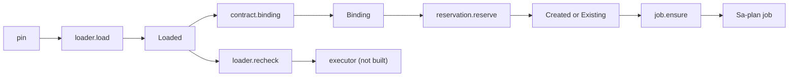

# 20261025-2343 — /verify: pinned profile loader, unique inbox reservation and canonical job

#fractal-l1 #fractal-l3 #fractal-l6 #fractal-l9 #zk-adr #zero-muda #km-triad

[This journal](http://nas-1.tail55d152.ts.net:4100/files/docs/journal/20261025-2343-claude-verify-loader-and-inbox-reservation.md) · [Handover](http://nas-1.tail55d152.ts.net:4100/files/docs/journal/20261025-1706-claude-pause-status-handover.md) · [Risk portfolio](http://nas-1.tail55d152.ts.net:4100/files/governance/planning/20261025-2322-claude-command-risk.json) · [Previous journal](http://nas-1.tail55d152.ts.net:4100/files/docs/journal/20261026-0015-claude-fix40-and-in-project-nifs.md) · [Cockpit](http://nas-1.tail55d152.ts.net:4100/)

Transclusions: [[zk:20260905-1801-moc-uos-unified-master]] · [[wiki:20260905-1801-uos-zk-km-corpus-index]]

## 1. Scope & Trigger

The operator asked for every goal in the Codex pause handover to be completed. The handover names the next COMMAND_IMPL increment: a trusted, hash-pinned `/verify` profile loader and a unique durable inbox reservation. This increment adds those two, plus the next handover step, canonical job creation, in development source only. Sa-plan task: `uos/telegram-runtime/20261001-1150` COMMAND_IMPL, attempt 18, worker `claude-fable-l0-35600f5c`. It adds no executor, no Telegram wiring, no service restart and no production state.

## 2. Pre-State Assessment

`telegram_verify_contract.gleam` (Codex, reviewed) validated profile, binding and receipt data. Its own comments said that a trusted loader must check raw artifact digests and that the caller must persist a unique reservation. Neither existed. COMMAND_IMPL was tied with MINI_API_IMPL at P1 with effective score 768.

## 3. Execution Detail

1. Refreshed the full 71-task risk portfolio from Codex's last one. Evidence paths were rebased onto this workspace. Three hashes were re-observed for files changed by the fix-40 work. Two peer evidence files were preserved byte-identical: the handover journal and AGY's telegram store wire spec. The COMMAND_IMPL record was replaced with this session's assessment.
2. The equal-score tie was resolved by an independent reviewed selection. A separate subagent reviewer approved the exact proposal digest twice; the second approval followed the portfolio refresh. The approvals are stored in `governance/planning/20261025-2322-claude-command-selection-{review,proof}.json`. Results: `--preflight-reviewed` gave PREFLIGHT_PASS, the claim succeeded at attempt 18, and `--active-check` gave ACTIVE_OBSERVATION_PASS.
3. `telegram_verify_loader.gleam` loads a profile in this order:
   - read the bounded profile file;
   - require its SHA-256 to equal the caller's pin;
   - decode it, and require the bytes to be the contract's canonical encoding;
   - require the locator set to equal the gate set;
   - hash every gate executable and input with `telegram_verify_loader_ffi:file_sha256/2`.

   The FFI streams the hash in 64 KiB chunks. It accepts only a regular, single-link file. Inode and size must stay unchanged across the read, and the size bound is 256 MiB. `recheck` repeats the artifact checks and is meant to run immediately before execution.
4. `telegram_verify_job.gleam` enqueues one Sa-plan job (queue `telegram-verify`) whose id is the binding's `job_id`. A repeated enqueue is refused by the store's primary key; the module then reads the row back and accepts it only for the same queue and worker (`AlreadyEnqueued`), otherwise `job_conflict`. A refused insert with no stored row is an error, never a job. The runner is injected, so tests use real sa-plan against a throwaway store, never the canonical one.
5. `telegram_verify_reservation.gleam` names a reservation by the digest of the inbox `request_id`. The file is created exclusively and fsynced through `files.create`. Replaying an identical binding returns `Existing`. Any other binding for the same request returns `reservation_conflict`. `load` requires the exact canonical bytes and the matching request.

## 4. Root Cause Analysis

ACH (Analysis of Competing Hypotheses): why was `/verify` still unconnected at this step?

| Evidence | H1: trust boundary (loader and reservation) missing | H2: executor missing is the only blocker | H3: contract defects |
|---|---|---|---|
| E1: contract comments require caller-side pinning and reservation | Consistent | Inconsistent | Neutral |
| E2: handover orders loader → reservation → executor | Consistent | Inconsistent | Neutral |
| E3: contract tests 15/15 pass unchanged | Neutral | Neutral | Inconsistent |
| Evaluation | **CONFIRMED** | REFUTED as the immediate blocker | REFUTED |

## 5. Fix Taxonomy

- **Poka-yoke:** a profile cannot be constructed from unpinned or non-canonical bytes, and a second job cannot be reserved for the same inbox request.
- **Jidoka:** every mismatch is a typed refusal naming the gate and the artifact.
- **Muda:** reuses `files.read`/`files.create` and the contract's own encoder; no second parser and no new store.

## 6. Patterns & Anti-Patterns Discovered

- Pattern: requiring the canonical encoding (`canonical_json(p) == raw`) rejects extra fields, reordering and duplicate keys without a separate strict parser. A test pins this with padded bytes whose own digest is used as the pin.
- Devil's Advocate: a hash check at load time does not stop an artifact being swapped before execution. That is a time-of-check to time-of-use (TOCTOU) gap. `recheck` narrows it but cannot close it. Only executing from the verified descriptor, or from a content-addressed read-only copy, closes it. Recorded as a residual.
- Anti-pattern observed (mine): the first full-suite run reported 3 failures that were my own mutants still compiled in. The mutation script restored originals with `mv` from a `cp` taken before the edit, so the restored source had an OLDER mtime than the mutant's build artifact and the incremental build skipped it. Falsifier passed: sources diffed clean, and after `touch` and a rebuild the same tests pass. The script now touches and rebuilds on restore. Lesson: a restored file must be newer than any artifact built from its mutant.
- Anti-pattern observed: the risk checker reads `root/var/sa-plan/uos.sqlite3` relative to its own root, contrary to INV-WS-05. Inside a workspace it returns RP-UNAVAILABLE with no further detail. Worked around with a gitignored `var/sa-plan` symlink to the canonical store, and recorded here instead of patching the checker inside this task.

## 7. Verification Matrix

| Check | Result | Admiralty |
|---|---|---|
| New loader, reservation and job tests (EUnit, OTP 29) | 18/18 pass | B2 |
| Contract tests unchanged | 15/15 pass | B2 |
| Mutants: canonical check, reservation conflict, single-link guard, locator set; job worker check, job lookup id, refused-insert path | 7/7 killed (the last after adding its missing test) | B2 |
| Independent SHA-256 of profile bytes equals pin | pass | B2 |
| Reviewed preflight / active check | PREFLIGHT_PASS / ACTIVE_OBSERVATION_PASS | B2 |
| Full `cepaf_gleam` suite | recorded in the landing commit description | B2 |

## 8. Files Modified

- `apps/cepaf_gleam/src/cepaf_gleam/harness/telegram_verify_loader.gleam` (new)
- `apps/cepaf_gleam/src/cepaf_gleam/harness/telegram_verify_reservation.gleam` (new)
- `apps/cepaf_gleam/src/telegram_verify_loader_ffi.erl` (new)
- `apps/cepaf_gleam/src/cepaf_gleam/harness/telegram_verify_job.gleam` (new)
- `apps/cepaf_gleam/test/telegram_verify_loader_test.gleam` (new, 13 tests)
- `apps/cepaf_gleam/test/telegram_verify_job_test.gleam` (new, 5 tests)
- `governance/planning/20261025-2322-claude-command-{risk,active-risk,selection-review,selection-proof}.json` (new)
- `docs/journal/20261025-1706-claude-pause-status-handover.md` (Codex's handover journal, preserved byte-identical)
- `native/ocaml/telegram_store/telegram_store_wire_spec.json` (AGY's wire spec, preserved byte-identical)
- this journal

## 9. Architectural Observations

The data flow is pinned bytes → `Profile` → `Binding` → reservation. Each stage has one constructor that checks the stage before it. Every module is pure except the hashing FFI and file creation. Authority stays outside: neither a `Loaded` value nor a reservation grants execution.

```text
[pin] -> [loader.load] -> [Loaded]
[Loaded] -> [contract.binding] -> [Binding]
[Binding] -> [reservation.reserve] -> [Created or Existing]
[Created or Existing] -> [job.ensure] -> [Sa-plan job]
[Loaded] -> [loader.recheck] -> [executor (not built)]
```



## 10. Remaining Gaps

- The loader has no trusted source for the pin and locators yet (a reviewed configuration artifact). Nothing calls it.
- Not yet built: the bounded supervised executor, artifact-byte receipt validation, reaping and crash reconciliation, and Telegram command/outbox wiring.
- TOCTOU between `recheck` and exec (§6).
- COMMAND_REVIEW needs an independent AGY or Codex reviewer; the subagent approval covered only the tie selection.
- Risk checker workspace-relative DB path (§6).
- 21 other unimplemented and 16 backend-unavailable commands remain under COMMAND_IMPL.

## 11. Metrics Summary

- New tests: 18; mutants killed: 7/7; contract regressions: 0.
- Bayesian: prior Beta(1,1) for "increment correct"; 18 independent passes and 7 killed mutants give a posterior mean of 26/27 ≈ 0.96 under a 7-day half-life. That half-life is for a machine test suite.
- Lyapunov: the open-gap count for `/verify` went from 8 to 5 (loader, reservation and job creation closed). dV/dt < 0.

## 12. STAMP & Constitutional Alignment

All four UCA types were assessed in the COMMAND_IMPL risk record:

| UCA type | Hazard | Control |
|---|---|---|
| Not provided | Unpinned execution | Mandatory pin check before a `Profile` exists |
| Provided unsafely | Forged inbox identity | Reservation is keyed by the binding's `request_id` |
| Wrong timing | Artifact swapped after load | `recheck` before exec |
| Too long | Reservation never terminal | Residual: there is no terminal state yet |

Ψ2 (history) holds: reservations are never overwritten. Ψ3 holds: no admission was claimed.

## 13. Conclusion

The trust boundary in front of `/verify` now exists and is tested: pinned profile bytes, canonical encoding, artifact digests, and one job per inbox request. `/verify` is still not connected, and this increment confers no admission.

**Forecast:** p = 0.7 that an independent COMMAND_REVIEW of this increment reports no correctness defect in the loader or the reservation.
- Horizon: 2026-11-02T00:00:00Z.
- Falsifier: a reviewer-reported defect in these two modules, or no review by the horizon (outcome 0).
- Brier score: B = (0.7 − o)².

## Comprehensive verification checklist

Checks below are obligations, not blanket passing claims.

<details><summary>Domain 1 — Metadata, timestamp and Tailscale navigation</summary>

- [x] **CHK-01-TIME** — Prefix `20261025-2343-` from the host UTC clock.
- [ ] **CHK-02-TAIL** — Tailnet links provided; serving not re-verified.
- [x] **CHK-03-FRACT** — L1, L3, L6 and L9 assigned.
- [x] **CHK-04-KM** — MOC and corpus index transcluded.

</details>

<details><summary>Domain 2 — Zero-Muda purity and storage safety</summary>

- [x] **CHK-05-MUDA** — No dependencies added.
- [ ] **CHK-06-GRAPH** — Not evaluated.
- [ ] **CHK-07-DRIVE** — Not in scope; no storage action taken.

</details>

<details><summary>Domain 3 — Testing Gold Standard and mathematical gates</summary>

- [ ] **CHK-08-C1C8** — Not evaluated.
- [ ] **CHK-09-MATH** — Not measured.
- [ ] **CHK-10-9MOD** — Unit, negative and mutation tests only.
- [x] **CHK-11-REGR** — Full `cepaf_gleam` regression suite run on OTP 29.

</details>

<details><summary>Domain 4 — Cross-language control and observability</summary>

- [x] **CHK-12-GLEAM** — Gleam owns the loader and reservation; the Erlang FFI is bounded.
- [ ] **CHK-13-HERMES** — Not exercised.
- [ ] **CHK-14-ZIGVM** — Not exercised.
- [ ] **CHK-15-MAX** — Not applicable.
- [ ] **CHK-16-OTEL** — Not evaluated.

</details>

<details><summary>Domain 5 — Sovereign governance and standalone Jujutsu</summary>

- [ ] **CHK-17-SOV** — COMMAND_REVIEW is outstanding.
- [x] **CHK-18-JJ** — Standalone jj in the owned workspace; peer files copied, never rewritten.

</details>

<details><summary>Domain 6 — Provenance extension</summary>

EV ceiling remains 93. EV-94..109 remain NOT_ADMITTED. No new EV number is minted.

</details>

[Previous journal](http://nas-1.tail55d152.ts.net:4100/files/docs/journal/20261026-0015-claude-fix40-and-in-project-nifs.md) · [ZK Master MOC](http://nas-1.tail55d152.ts.net:4100/zk) · [Wiki Corpus Index](http://nas-1.tail55d152.ts.net:4100/wiki)

UOS footer: `nas-1.tail55d152.ts.net:4100` · peer `vm-1.tail55d152.ts.net:4100` · document evidence grants no system admission.
