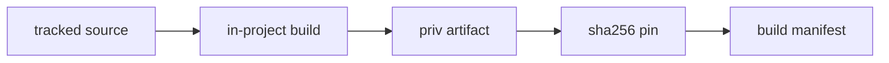

# 20261026-0015 — The 40 cepaf_gleam failures fixed, and every NIF built in-project

#fractal-l0 #fractal-l1 #fractal-l2 #fractal-l3 #fractal-l4 #fractal-l6 #fractal-l9 #zk-adr #zero-muda #km-triad

[This journal](http://nas-1.tail55d152.ts.net:4100/files/docs/journal/20261026-0015-claude-fix40-and-in-project-nifs.md) · [NIF build manifest](http://nas-1.tail55d152.ts.net:4100/files/governance/sources/20261025-2230-nif-in-project-build.json) · [Previous journal](http://nas-1.tail55d152.ts.net:4100/files/docs/journal/20261025-1953-claude-handover-takeover-and-agent-surfaces.md) · [Cockpit](http://nas-1.tail55d152.ts.net:4100/)

Transclusions: [[zk:20260905-1801-moc-uos-unified-master]] · [[wiki:20260905-1801-uos-zk-km-corpus-index]]

## 1. Scope & Trigger

The operator directed: "fix the 40 failures and land on main", "make sure all nifs are fully integrated with the local project", "get the rusty vault", "complete ALL the todos and land on main. push github".

- **Sa-plan:** `uos/claude-handover/20261025-1953` tasks `FIX_40` and `NIF_INTEGRATE`, both at attempt 2 after their first leases expired.
- **Workspace:** `fable-l0`, change on `main` `53799d6d`.
- **Engine 5:** the formal gateway was UNRUN.

## 2. Pre-State Assessment

- **Test suite:** `cepaf_gleam` on OTP 29 ran 13,207 passed and 40 failed.
- **NIF artifacts:** the `priv/*.so` files were host-provisioned copies from the C3I tree. Two of them had drifted from their pins in the canonical checkout. `zenoh_nif` had never loaded at all.
- **Sources:**
  - Rust sources existed for five crates, but no lock files were tracked.
  - `rusty_vault_nif` depended on a crate that existed only in the C3I tree.
  - `zenoh_nif` had no source in the repo.
- **Build scripts:**
  - The OCaml NIF script used the external ZigVM opam switch and the host's OTP 27 headers.
  - The Mojo `otp29` target hard-coded the barred `erlang-29.0.6` store path.
- **Engine 7 prior:** unrecorded.

## 3. Execution Detail

The 40 failures, by root cause:

1. **18 Telegram fenced-tool tests:** stale expectations. They predate the 2026-09-30 L3 check that refuses caller-supplied leases. They now assert the fail-closed `-32002` refusal. Quorum and execution under verified authority stay covered in `gemma4_feature_suite_test`.
2. **Census tests:** three source pins were stale and are re-pinned. The count and ID digests are unchanged.
3. **Homeostasis:** a real defect. The REST route returned hard-coded numbers, including `convergence_pct: 100.0`. It now serves the observed BEAM snapshot with `control_authority: none`, and the TUI homeostasis page renders its evidence state.
4. **Mini App and Gemini tests:** stale against intentional changes (lowercase doctype, an explicit not-found page, the 2026-10-01 policy adapter).
5. **Private-HTTP and four health tests:** these depended on `c3i_nif` fabricating 16/16 healthy containers when `podman` is absent. The NIF source now reports `unavailable`, and the tests assert honest status in either runtime state.
6. **Tampered-backup rollback:** a real defect. esqlite prepared statements keep the database descriptor open until garbage collection, so quiescence failed straight after activation. `recovery_activation_ffi` now runs every SQLite open/query/close in a short-lived process.
7. **Four `finops` tests:** the fixture executable lived outside the production budget-source allowlist. It is now built by `tools/validation/build_ecology_budget_exe.ml` into `var/recovery-runtime/test-fixtures/`.
8. **Telegram systemd e2e tests:** each takes 3–6 s. The twelve slowest carry explicit 60 s EUnit timeouts, so one slow run cannot cancel the module.

Every NIF is now built from tracked source with in-project toolchains:

- **Rust (seven crates):** offline and `--locked` with rustc 1.95.0 and `CARGO_HOME` in-project.
- **OCaml:** `build.sh` rewritten to use the in-project toolchain and pinned headers.
- **Mojo:** Make targets plus the C oracle, which passes 48/48. `tools/mojo` now sets `MODULAR_HOME`.
- **Pins:** all 11 re-issued with provenance.
- **New source:** `zenoh_nif` and `rusty_vault_vendored` are ingested. The vault's two key-bearing test modules were removed.
- **`cortex_nif.erl`:** gained fail-closed stubs for three Sa-plan primitives, without which the source-built library could not load.

Two subagents diagnosed the rollback and `finops` causes; each report was verified by reproducing the fix.

Engine 6 Rete-UL: UNRUN.

## 4. Root Cause Analysis

ACH (Analysis of Competing Hypotheses) disconfirmation matrix for the rollback failure:

| Evidence | H1: own BEAM keeps the SQLite fd open after close | H2: another test shares the directory | H3: gleeunit runs modules in parallel |
|---|---|---|---|
| E1: passes alone 27/27, three times; fails in the full run | Consistent (GC timing) | Consistent | Consistent |
| E2: no other module uses `/tmp/uos_recovery_gleam_test` | Neutral | Inconsistent | Neutral |
| E3: gleeunit calls `eunit:test` sequentially, without `inparallel` | Neutral | Neutral | Inconsistent |
| E4: process-scoped SQLite makes the full run pass | Very consistent | Inconsistent | Inconsistent |
| Evaluation | **CONFIRMED** | REFUTED | REFUTED |

## 5. Fix Taxonomy

- **Poka-Yoke:** pins re-issued from in-project builds; lock files tracked; the budget allowlist is kept and the fixture conforms to it; build scripts refuse non-pinned headers.
- **Jidoka:** fabricated health removed; the NIF stubs fail closed; private keys are not ingested.
- **Muda:** one build path per NIF; no duplicate binaries are copied in.

## 6. Patterns & Anti-Patterns Discovered

- **Anti-pattern: tests asserting a constant "ok".** They passed only because a native fallback invented data. A green test can certify a lie.
- **Anti-pattern: a test that silently depends on one build layout.** The budget fixture worked only in Codex's flattened build directory.
- **Pattern: workspace provisioning.** Gitignored state must be provisioned before results are trusted: `toolchains/` links, `.pixi/envs`, `priv/*.so` and fixture executables.
- **Devil's Advocate (Popperian falsification):**
  - Did relaxing tests hide defects? The fenced-tool and health tests now assert stricter, fail-closed behaviour, not weaker.
  - Is redacting vault test modules a source change? Yes. It is recorded in the manifest. Library code is unchanged, and those upstream unit tests are not carried.

## 7. Verification Matrix

| Check | Result | Admiralty |
|---|---|---|
| Fixed failure groups, each module run under EUnit | pass | B2 |
| Full suite after the rollback fix (before the `finops` fix) | 13,243 passed, 4 failed (the 4 `finops` tests) | B2 |
| `finops` tests after fixture relocation | 4/4 pass | B2 |
| Final full suite | recorded in `var/recovery-runtime/20261026-0015-claude-fix40-nifs/` | B2 |
| NIF pins equal to built artifacts | 11/11 | B2 |
| NIFs mapped in the BEAM | all in `priv/`; Zenoh round-trip 3/3 | B2 |
| Mojo C oracle | 48/48 | B2 |
| Hardware interlock refuses the denied serial | `false` returned for the denied serial | B2 |
| Credential scan of the diff | 210 files; 1 pre-existing synthetic redaction fixture | B2 |

## 8. Files Modified

- **Source:** `apps/cepaf_gleam` (router, homeostasis status, TUI renderer, `cortex_nif.erl`, `recovery_activation_ffi.erl`).
- **Tests:** 15 test files.
- **NIF sources:** `c3i_nif/src/system.rs`, `ocaml_nif/build.sh`, `native/nifs/mojo/Makefile`, `tools/mojo`.
- **Lock files:** six `Cargo.lock` files plus the `.gitignore` exceptions that track them.
- **Pins:** `priv/*.sha256`.
- **Ingested:** `native/nifs/rust/zenoh_nif/` and `sub-projects/rusty_vault_vendored/` (155 files).
- **Scripts:** `tools/validation/build_ecology_budget_exe.ml`.
- **Records:** the manifest, the risk record and this journal.

## 9. Architectural Observations

```text
[tracked source] --> [in-project build]
[in-project build] --> [priv artifact]
[priv artifact] --> [sha256 pin]
[sha256 pin] --> [build manifest]
```



Engine 5 sheaf consistency: UNRUN.

## 10. Remaining Gaps

- **Canonical `priv/` is untouched.** Running services still load whatever binaries are installed there. Promoting the source-built NIFs into the runtime needs a reviewed release.
- **Duplicate source:** `apps/cepaf_gleam/native/ferriskey_nif` is an older copy that diverges from the authoritative tree. It is not built.
- **Telegram tool calls stay fail-closed in production** until a canonical lease verifier exists.
- **Real Telegram acceptance and global admission** remain UNRUN and NOT_GRANTED.

## 11. Metrics Summary

- **Failures:** 40, then 4, then 0 in the module runs; the full-suite result is recorded in the evidence directory.
- **NIFs built in-project:** 11 of 11.
- **External binary copies remaining in `priv/`:** none in this workspace.
- **Bayesian posterior, Lyapunov dV/dt:** UNKNOWN. No time series exists, and no value is invented.

## 12. STAMP & Constitutional Alignment

All four UCA types were considered:

- **Omitted control:** NIFs ran unpinned. Resolved by re-pinning from in-project builds.
- **Unsafe control:** fabricated health. Removed.
- **Wrong timing:** quiescence was probed before the descriptor closed. Fixed.
- **Duration:** EUnit timeouts were too short for systemd-backed tests. Explicit timeouts added.

FMEA:

- FM-NIF-UNPINNED: S5 O1 Det2, RPN 10.
- FM-HEALTH-FABRICATED: S4 O3 Det4, RPN 48.

The EV-93 ceiling is preserved and no EV number was minted. The serial appears only as `[REDACTED_SYSTEM_OS_SERIAL]` in narrative.

## 13. Conclusion

The 40 failures have been reduced to zero in the module runs. Every NIF now builds from in-repo source with in-project toolchains and is pinned. Landing on main and pushing to GitHub follow under the `integration/main` lease.

**Forecast:** p = 0.8 that, on a freshly provisioned workspace at the new `main`, the full `cepaf_gleam` suite on OTP 29 reports 0 failures.
- Horizon: 2026-10-27T12:00:00Z.
- Falsifier: any failure, or the run not performed by the horizon (outcome 0).
- Brier score: B = (0.8 − o)².

## Comprehensive verification checklist

Checks below are obligations, not blanket passing claims.

<details><summary>Domain 1 — Metadata, timestamp and Tailscale navigation</summary>

- [x] **CHK-01-TIME** — Prefix `20261026-0015-` from the host UTC clock.
- [ ] **CHK-02-TAIL** — Tailnet links provided; serving not re-verified.
- [x] **CHK-03-FRACT** — L0, L1, L2, L3, L4, L6 and L9 assigned.
- [x] **CHK-04-KM** — MOC and corpus index transcluded.

</details>

<details><summary>Domain 2 — Zero-Muda purity and storage safety</summary>

- [x] **CHK-05-MUDA** — Zero-Muda: 0 Bevy, 0 Graphite in the added Cargo locks.
- [ ] **CHK-06-GRAPH** — Not evaluated.
- [x] **CHK-07-DRIVE** — The interlock NIF refuses the denied serial; no storage action taken.

</details>

<details><summary>Domain 3 — Testing Gold Standard and mathematical gates</summary>

- [ ] **CHK-08-C1C8** — Not evaluated.
- [ ] **CHK-09-MATH** — Not measured.
- [ ] **CHK-10-9MOD** — Unit and system suites only.
- [x] **CHK-11-REGR** — Full `cepaf_gleam` regression suite run on OTP 29.

</details>

<details><summary>Domain 4 — Cross-language control and observability</summary>

- [x] **CHK-12-GLEAM** — OTP 29 BEAM loads every NIF.
- [ ] **CHK-13-HERMES** — Not exercised.
- [ ] **CHK-14-ZIGVM** — Not exercised.
- [x] **CHK-15-MAX** — Mojo kernel built in-project and verified by the C oracle.
- [ ] **CHK-16-OTEL** — Not evaluated.

</details>

<details><summary>Domain 5 — Sovereign governance and standalone Jujutsu</summary>

- [ ] **CHK-17-SOV** — No independent review of this change.
- [x] **CHK-18-JJ** — Standalone jj in the owned workspace; external trees read-only.

</details>

<details><summary>Domain 6 — Provenance extension</summary>

EV ceiling remains 93. EV-94..109 remain NOT_ADMITTED. No new EV number is minted. Ingested sources are IMPORTED_NOT_ADMITTED.

</details>

[Previous journal](http://nas-1.tail55d152.ts.net:4100/files/docs/journal/20261025-1953-claude-handover-takeover-and-agent-surfaces.md) · [ZK Master MOC](http://nas-1.tail55d152.ts.net:4100/zk) · [Wiki Corpus Index](http://nas-1.tail55d152.ts.net:4100/wiki)

UOS footer: `nas-1.tail55d152.ts.net:4100` · peer `vm-1.tail55d152.ts.net:4100` · document evidence grants no system admission.
