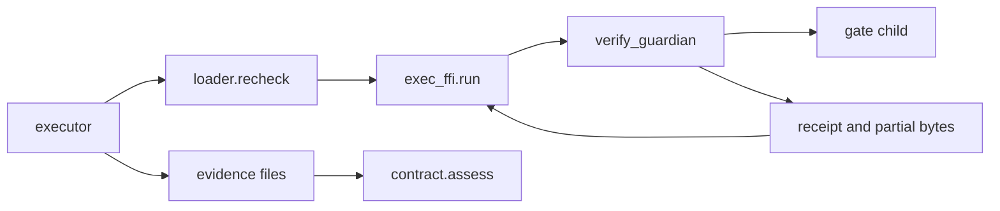

# 20261026-0038 — /verify: bounded gate executor that keeps partial output

#fractal-l1 #fractal-l3 #fractal-l4 #fractal-l9 #zk-adr #zero-muda #km-triad

[This journal](http://nas-1.tail55d152.ts.net:4100/files/docs/journal/20261026-0038-claude-verify-bounded-executor.md) · [Guardian build manifest](http://nas-1.tail55d152.ts.net:4100/files/governance/sources/20261026-0038-verify-guardian-build.json) · [Previous journal](http://nas-1.tail55d152.ts.net:4100/files/docs/journal/20261025-2343-claude-verify-loader-and-inbox-reservation.md) · [Handover](http://nas-1.tail55d152.ts.net:4100/files/docs/journal/20261025-1706-claude-pause-status-handover.md) · [Cockpit](http://nas-1.tail55d152.ts.net:4100/)

Transclusions: [[zk:20260905-1801-moc-uos-unified-master]] · [[wiki:20260905-1801-uos-zk-km-corpus-index]]

## 1. Scope & Trigger

The operator said "continue" after the loader, reservation and job landed. The handover's next step is a bounded supervised executor, with process reaping, that preserves partial failure output and does not use `obs_guardian`. Same Sa-plan task: `uos/telegram-runtime/20261001-1150` COMMAND_IMPL, attempt 18. Development source only. No Telegram wiring, no service restart, no production state.

## 2. Pre-State Assessment

`obs_guardian` kills and reaps correctly. On every path except a clean exit, it discards the bytes it captured. Its Erlang adapter (`sa_plan_observer_ffi`) also returns payload only when the child exits with 0. A failing gate's evidence was therefore lost at two layers.

## 3. Execution Detail

1. `tools/validation/verify_guardian.ml` is derived from `obs_guardian.ml`. Fork, setsid, group SIGKILL, the WNOHANG reap loop, the monotonic deadline and the control-channel abort are unchanged. Differences:
   - a distinct marker, `uos.telegram.verify.guardian.v1`;
   - on every path where a child ran, the captured bytes are capped at `max_bytes`, printed and declared by `output_sha256` and `truncated`.

   It was built twice in separate directories, with the identical SHA-256 `d1dc2995…`, and is pinned in the build manifest.
2. `telegram_verify_exec_ffi.erl` handles the guardian port:
   - verifies the guardian binary against its pin before spawning;
   - keeps the port (the guardian's control stdin) open for the whole run, so the caller dying aborts the gate;
   - on overrun, signals abort without closing and never signals a remembered pid;
   - accepts a receipt only when result, cleanup and exit status form an exact pairing, the declared byte count equals the payload, and the payload hashes to the declared digest.
3. `telegram_verify_executor.gleam` runs the gates of a loaded profile in order. For each gate it:
   1. rechecks every artifact pin;
   2. runs the gate under the guardian with the gate's own deadline;
   3. writes the preserved bytes to an exclusive evidence file, `evidence/<digest(job_id)>/<gate>.out`.

   It then writes `receipt.json` and classifies the result with the reviewed `telegram_verify_contract.assess`. Any of these stops the run with an error, never a verdict: changed artifacts, a guardian pin mismatch, unknown cleanup, or evidence that already exists.

## 4. Root Cause Analysis

ACH (Analysis of Competing Hypotheses): why was failure evidence lost?

| Evidence | H1: the guardian drops partial bytes | H2: only the adapter drops them | H3: gates produce no output on failure |
|---|---|---|---|
| E1: `obs_guardian` report prints `""` on kill paths | Consistent | Inconsistent | Neutral |
| E2: the adapter `interpret` returns payload only for `{ok, confirmed}` | Consistent | Consistent | Neutral |
| E3: probe — a hanging gate printed `partial-before-hang`, now preserved | Consistent | Neutral | Inconsistent |
| Evaluation | **CONFIRMED** (both layers) | Partial | REFUTED |

## 5. Fix Taxonomy

- **Poka-yoke:** the guardian is pinned; an artifact swapped after load is refused before spawn; evidence files are never overwritten.
- **Jidoka:** unknown cleanup stops the run; it is never a FAIL row.
- **Muda:** the reviewed guardian mechanics are reused unchanged, and the contract's `assess` stays the single classifier.

## 6. Patterns & Anti-Patterns Discovered

- Pattern: a dishonest-guardian test. A pinned shell script prints a forged receipt. It kills the "trust the receipt" mutants: digest lie, exit-code/result mismatch, foreign marker.
- Devil's Advocate: `verify_guardian.ml` duplicates about 200 lines of `obs_guardian.ml`. A shared module would change `obs_guardian`'s pinned binary, which production budget paths depend on. Duplication was chosen and recorded; extraction is a reviewed follow-up.
- Falsification probe: after the hung-gate test, `pgrep "sleep 10"` found no survivor. The process-group kill reaped the grandchild.
- Residual: for a killed gate, the measured elapsed time exceeds the gate timeout. The contract then fails the receipt as invalid rather than reporting `gate_not_passed`. The verdict is correct (not verified); the reason string is less specific.

## 7. Verification Matrix

| Check | Result | Admiralty |
|---|---|---|
| Guardian probe: pass, fail, hang, signal, output bound, bad pin | partial output and digest preserved on every child path; `truncated` set at the bound | B2 |
| Executor tests (EUnit, OTP 29), including 3 dishonest-guardian tests | 11/11 pass | B2 |
| Loader, reservation and job tests together | 29/29 pass | B2 |
| Mutants: PASS mapping, recheck skipped, digest check, deadline pairing, marker, exit-0 pairing | 6/6 killed | B2 |
| No orphan after deadline kill | `pgrep` empty | B2 |
| Reproducible guardian build | identical SHA-256 twice | B2 |
| Full `cepaf_gleam` suite | recorded in the landing commit description | B2 |

## 8. Files Modified

- `tools/validation/verify_guardian.ml`, `tools/validation/verify_guardian.exe` (new, pinned)
- `governance/sources/20261026-0038-verify-guardian-build.json` (new)
- `apps/cepaf_gleam/src/telegram_verify_exec_ffi.erl` (new)
- `apps/cepaf_gleam/src/cepaf_gleam/harness/telegram_verify_executor.gleam` (new)
- `apps/cepaf_gleam/test/telegram_verify_executor_test.gleam` (new, 11 tests)
- this journal

## 9. Architectural Observations

Gleam owns policy: pins, ordering and classification. Erlang owns only the port. The native guardian owns the child process.

```text
[executor] -> [loader.recheck] -> [exec_ffi.run]
[exec_ffi.run] -> [verify_guardian] -> [gate child]
[verify_guardian] -> [receipt and partial bytes] -> [exec_ffi.run]
[executor] -> [evidence files] -> [contract.assess]
```



## 10. Remaining Gaps

- Crash reconciliation: on restart, compare the reservation, job and evidence directory, and classify the run as complete, partial or never started. Not built.
- `/verify` is not wired to the Telegram command handler or outbox. The executor is not called by any service.
- No trusted source for the pin and locators (a reviewed configuration artifact).
- TOCTOU between the pre-gate `recheck` and the guardian's own digest of the executable. The guardian re-hashes the executable before exec, which narrows the gap to the exec call itself.
- COMMAND_REVIEW needs an independent AGY or Codex reviewer for the loader, reservation, job, guardian and executor.
- The guardian and adapter duplicate the observer mechanics (§6).

## 11. Metrics Summary

- New tests: 11; mutants killed: 6/6; regressions in the verify modules: 0.
- Bayesian: prior Beta(1,1); 11 passes and 6 killed mutants give a posterior mean of 18/19 ≈ 0.95, with a 7-day half-life for a machine test suite.
- Lyapunov: the open `/verify` gap count went from 5 to 4 (executor closed). dV/dt < 0.

## 12. STAMP & Constitutional Alignment

| UCA type | Hazard | Control |
|---|---|---|
| Not provided | A gate is not killed at its deadline | Guardian deadline, group kill, confirmed reap |
| Provided unsafely | An unpinned gate or guardian runs | Guardian pin check; pre-gate recheck; guardian digest of the executable |
| Wrong timing | Artifact swapped between load and run | Recheck immediately before each gate |
| Too long | A caller's death leaves a gate running | Port held open; EOF is the guardian's abort |

Ψ2 holds: evidence files are exclusive and never overwritten. Ψ5 holds: partial output is preserved rather than reported as clean.

## 13. Conclusion

A gate can now run under a pinned guardian with its output preserved on every path, and the run is classified only by the reviewed contract. `/verify` is still not connected to Telegram, and this confers no admission.

**Forecast:** p = 0.65 that an independent COMMAND_REVIEW reports no correctness defect in the guardian or adapter pairing rules.
- Horizon: 2026-11-02T00:00:00Z.
- Falsifier: a reviewer-reported defect in `verify_guardian.ml` or `telegram_verify_exec_ffi.erl`, or no review by the horizon (outcome 0).
- Brier score: B = (0.65 − o)².

## Comprehensive verification checklist

Checks below are obligations, not blanket passing claims.

<details><summary>Domain 1 — Metadata, timestamp and Tailscale navigation</summary>

- [x] **CHK-01-TIME** — Prefix `20261026-0038-` from the host UTC clock.
- [ ] **CHK-02-TAIL** — Tailnet links provided; serving not re-verified.
- [x] **CHK-03-FRACT** — L1, L3, L4 and L9 assigned.
- [x] **CHK-04-KM** — MOC and corpus index transcluded.

</details>

<details><summary>Domain 2 — Zero-Muda purity and storage safety</summary>

- [x] **CHK-05-MUDA** — No new dependencies; OCaml packages already in the in-project switch.
- [ ] **CHK-06-GRAPH** — Not evaluated.
- [ ] **CHK-07-DRIVE** — Not in scope; no storage action taken.

</details>

<details><summary>Domain 3 — Testing Gold Standard and mathematical gates</summary>

- [ ] **CHK-08-C1C8** — Not evaluated.
- [ ] **CHK-09-MATH** — Not measured.
- [ ] **CHK-10-9MOD** — Unit, negative, dishonest-peer and mutation tests only.
- [x] **CHK-11-REGR** — Full `cepaf_gleam` regression suite run on OTP 29.

</details>

<details><summary>Domain 4 — Cross-language control and observability</summary>

- [x] **CHK-12-GLEAM** — Gleam owns policy; Erlang owns the port; the native guardian owns the child.
- [ ] **CHK-13-HERMES** — Not exercised.
- [ ] **CHK-14-ZIGVM** — Not exercised.
- [ ] **CHK-15-MAX** — Not applicable.
- [ ] **CHK-16-OTEL** — Not evaluated.

</details>

<details><summary>Domain 5 — Sovereign governance and standalone Jujutsu</summary>

- [ ] **CHK-17-SOV** — COMMAND_REVIEW is outstanding.
- [x] **CHK-18-JJ** — Standalone jj in the owned workspace.

</details>

<details><summary>Domain 6 — Provenance extension</summary>

EV ceiling remains 93. EV-94..109 remain NOT_ADMITTED. No new EV number is minted.

</details>

[Previous journal](http://nas-1.tail55d152.ts.net:4100/files/docs/journal/20261025-2343-claude-verify-loader-and-inbox-reservation.md) · [ZK Master MOC](http://nas-1.tail55d152.ts.net:4100/zk) · [Wiki Corpus Index](http://nas-1.tail55d152.ts.net:4100/wiki)

UOS footer: `nas-1.tail55d152.ts.net:4100` · peer `vm-1.tail55d152.ts.net:4100` · document evidence grants no system admission.
